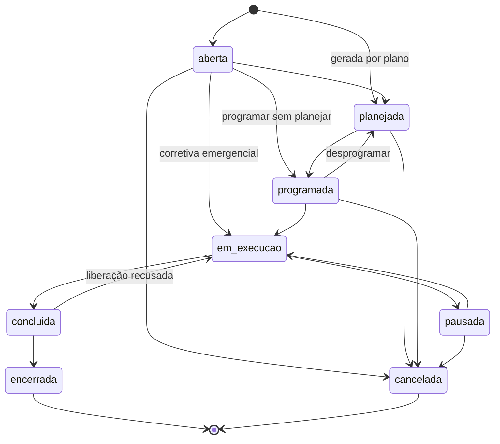

# Sumário Executivo — Tenaz

**Versão:** 0.6 · **Data:** 12/11/2026 · **Status:** Em elaboração
**Produto:** Tenaz · Gestão de Manutenção e Frota

Este documento é a referência comum de toda a documentação. Define o produto, os módulos e seus códigos, os planos, o vocabulário do domínio, os nomes canônicos das entidades e os estados. Os demais documentos usam exatamente esses nomes e códigos. Em caso de conflito, vale este documento.

**Mudanças da versão 0.2:** consolida as inconsistências apontadas na redação dos documentos 1 a 9. Inclui a entidade `pessoa`, os perfis `comprador` e `plh`, os valores de prioridade, o reconhecimento da OS, as transições completas da OS e da solicitação, as regras do status do ativo, a definição de técnico e veículo cobrados, o conteúdo exato de cada plano e a pendência P7 (cópia de recuperação de desastre fora do Brasil).

**Mudanças da versão 0.3:** novos módulos **TER** (terceiros, subcontratadas e assistência técnica, com catálogo de serviços e acesso do prestador) e **LOC** (locação de equipamentos, nos dois sentidos, com controle de locatários). O módulo EST passa a controlar estoque em poder de subcontratadas, remessa e retorno de peças, peças serializadas e reparáveis, e envio de peças com defeito para conserto. A oficina externa sai de FRO e passa a ser um caso de TER.

**Mudanças da versão 0.4:** novo módulo **SRV** (gestão de serviços do prestador), no MVP. A subcontratada tem **conta própria** na Tenaz, cadastra seus técnicos, clientes e equipamentos de clientes, abre e distribui OS, registra serviço, componentes substituídos e horas, e seus técnicos usam o app de campo. Quando o cliente também usa a Tenaz, as duas contas se conectam e a OS trafega entre elas (seção 3.5). Também fecha as divergências de nomes entre os documentos 1 a 9 (seção 3.6) e cria os requisitos de versão visível (RNF-039) e histórico de versões (RNF-040).

**Mudanças da versão 0.5:** a Tenaz passa a ser **configurável por segmento**, sempre dentro de catálogos fechados (seção 3.7). Entram no MVP as **regras configuráveis** de condição e efeito (`regra_automacao`), os **campos extras na OS** (`campo_extra_os`), a **fase de ciclo de vida do ativo** (`fase_ciclo_vida`: `em_implantacao` ou `em_operacao`) e o tipo de OS `implantacao`. Entram na Fase 2 dois módulos novos, **PRJ** (projetos de implantação com etapas) e **CTR** (contratos com clientes, com meta de disponibilidade e medição mensal), e os **pacotes de segmento** (`pacote_segmento`). Origem: análise do caso de um fornecedor de radares de fiscalização eletrônica instalados e mantidos por prestadores em várias cidades ([etapa 012](etapas/012_2026-11-12_configuracao-por-segmento.md)).

**Mudanças da versão 0.6:** nomes canônicos da autenticação e do calendário da unidade, aprovados pelo dono do produto na etapa E01 (seção 3.2): `sessao`, `token_renovacao`, `codigo_autorizacao`, `desafio_mfa` e `token_email` no esquema da plataforma; `turno_unidade` e `feriado_unidade` para o calendário de trabalho da unidade (RF-ADM-002). Nova pendência P11: o login por telefone e código fica adiado até a escolha do provedor de SMS. Na seção 3.6: o catálogo de permissões de RF-ADM-005 passa a ser canônico, com a permissão avulsa em `usuario_permissao`, e `usuario.situacao` fica `convidado`, `ativo`, `inativo`; o responsável nasce `administrador` e `gestor`, os turnos são informados na criação, sem padrão imposto, e entra `empresa.mfa_obrigatorio`; `pessoa.vinculo` ganha `autonomo` e `pessoa.situacao` fica `ativa` ou `inativa`; trilha de auditoria configurável por tela, com tela, módulo, tipos de operação e controle de integridade por hash (`captura_auditoria`, `evento_auditoria.hash`, `selo_auditoria`); nomes da API de E01.

---

## 1. O produto

A Tenaz é um sistema SaaS de gestão de manutenção de equipamentos e frota. Num único sistema, uma empresa controla máquinas, instalações, veículos e implementos: cadastro, planos preventivos, ordens de serviço, peças, custos, documentos com vencimento e indicadores. Técnicos e motoristas usam um aplicativo que funciona sem conexão.

**Slogan:** Cada ativo pronto para operar.

### 1.1 Problema

- Empresas médias que têm máquinas **e** frota usam dois sistemas, ou planilhas, para cuidar dos dois. O custo de manutenção fica espalhado e não há visão única de disponibilidade.
- Os CMMS globais (MaintainX, Limble, UpKeep, Fiix) cobram em dólar e reservam para os planos caros o que uma empresa média usa todo dia: modo offline, preventiva por km e horas, API, SSO, multi-unidade, códigos de falha e trilha de auditoria.
- Os sistemas nacionais tradicionais exigem treinamento formal e têm app móvel com sincronização frágil.
- Nenhum fornecedor pesquisado modela de forma nativa as obrigações brasileiras: NR-12, NR-13, cronotacógrafo, CIV/CIPP, RNTRC, indicação de condutor de multa.

Fonte: [estudo de mercado](pesquisa/reports/Benchmarking%20manuten%C3%A7%C3%A3o%20e%20frota%20Brasil.md).

### 1.2 Proposta de valor

1. **Equipamento e veículo na mesma base**, com medidores múltiplos (km, horas, ciclos) e pneus controlados um a um.
2. **Sem recurso essencial escondido em plano caro.** Offline, preventiva por medidor, códigos de falha, assinatura eletrônica, NR-12 e agenda de documentos já no plano de entrada.
3. **Preço público em reais, com opção mensal** e mínimo baixo.
4. **Conformidade brasileira nativa:** campos obrigatórios da NR-12, prazos da NR-13, documentos de frota com alertas.
5. **Confiabilidade publicada:** dados primários hospedados no Brasil, RPO e RTO divulgados, página de status com histórico.
6. **Uso sem treinamento formal:** primeiros passos guiados e app de campo simples.
7. **Terceiros e locação no mesmo sistema:** subcontratadas e assistências técnicas executam OS e controlam o estoque que mantêm da empresa; peças com defeito são enviadas para conserto e voltam rastreadas; ativos locados (cedidos ou tomados) têm contrato, vistoria e responsabilidade de custo da manutenção.
8. **Configurável por segmento, sem virar outro sistema:** campos extras, regras de condição e efeito, modelos de projeto de implantação e pacotes prontos por segmento, sempre de catálogos fechados que preservam os indicadores, o app offline e o isolamento (seção 3.7).

### 1.3 Público

| Segmento | Ativos típicos | Dor principal |
|---|---|---|
| Transportadoras e operadores logísticos | Cavalos, carretas, empilhadeiras, câmaras frias | Disponibilidade da frota, custo por km, pneus, documentos |
| Indústria | Máquinas, utilidades, caldeiras, compressores | Preventiva, NR-12, NR-13, MTBF/MTTR |
| Comércio e varejo | Lojas, refrigeração, geradores, frota de entrega | Muitas unidades, chamados de manutenção predial |
| Serviços, construção, agro, saúde, locadoras | Equipamentos móveis, máquinas pesadas, veículos, equipamentos médicos | Horímetro, oficina externa, campo sem sinal |
| Fornecedores de equipamentos instalados em clientes (fiscalização eletrônica, telecomunicações, energia, saneamento, elevadores) | Equipamentos próprios em pontos espalhados por cidades ou clientes, com prestador por região | Implantação em campo (obra, energia, aferição), disponibilidade exigida em contrato com desconto, prestadores diferentes por região |
| Subcontratadas e assistências técnicas (Tenaz Serviços) | Equipamentos dos clientes atendidos | Distribuir OS aos técnicos, registrar serviço, peças e horas no campo, prestar contas ao cliente |

Porte-alvo da primeira fase: **50 a 2.000 ativos**, equipe própria de manutenção ou oficina, de 2 a 50 técnicos.

### 1.4 Premissas

| Tema | Decisão |
|---|---|
| Entrega | SaaS multiempresa (vários clientes no mesmo sistema, dados isolados) |
| Hospedagem | Dados primários no Brasil (região São Paulo). Local da cópia de recuperação de desastre: pendência P7 |
| Backend | Go, monólito modular |
| Web | React + TypeScript |
| App de campo | React Native (Expo) + TypeScript, offline-first com SQLite |
| Banco de dados | PostgreSQL, com isolamento por empresa via Row-Level Security |
| Idioma | Português do Brasil (interface preparada para outros idiomas) |

As decisões técnicas e as alternativas descartadas estão em [5_ARQUITETURA_SOFTWARE.md](5_ARQUITETURA_SOFTWARE.md).

---

## 2. Módulos

Cada módulo tem um código. Requisitos, regras e APIs usam esses códigos.

| Código | Módulo | Escopo |
|---|---|---|
| **ADM** | Administração | Empresa cliente, unidades, pessoas, usuários, perfis e permissões, plano contratado, parâmetros, regras configuráveis (condição e efeito), pacotes de segmento, trilha de auditoria |
| **ATV** | Ativos | Cadastro hierárquico de localizações e ativos (equipamento, veículo, implemento, componente), classes, criticidade, fase de ciclo de vida (em implantação ou em operação), QR code, documentos técnicos |
| **MED** | Medidores | Medidores por ativo (km, horas, ciclos, outros), leituras com origem e validação |
| **SOL** | Solicitações | Pedido de manutenção feito por qualquer pessoa, triagem e conversão em OS |
| **OS** | Ordens de serviço | Execução da manutenção e da implantação: tarefas, campos extras, apontamento de horas, peças, falha, custo, assinatura, encerramento |
| **PRE** | Planos de manutenção | Preventiva e inspeção por tempo, medidor ou o que vencer primeiro; geração automática de OS |
| **CHK** | Checklists | Modelos de checklist, execução no app, item reprovado gera solicitação |
| **EST** | Estoque e compras | Itens, almoxarifados próprios e em poder de terceiros, saldo geral e por almoxarifado, reservas, transferência, remessa e retorno de peças a subcontratadas, peças serializadas, reparáveis e envio para conserto, requisição, pedido de compra, entrada por NF-e |
| **TER** | Terceiros | Cadastro de prestadores (subcontratadas, assistências técnicas, oficinas) com catálogo de serviços, contratos de prestação com SLA, OS executada por terceiro, acesso restrito do prestador, avaliação de desempenho |
| **SRV** | Gestão de serviços do prestador | Conta própria da subcontratada: técnicos, clientes atendidos, equipamentos de clientes, OS de serviço com técnico, serviço a realizar, componentes substituídos e horas, app de campo do técnico, conexão com contas de clientes que usam a Tenaz, relatório de serviços por cliente |
| **PRJ** | Projetos e implantação | Modelos de projeto com etapas, dependências e exigências; projeto de implantação de ativos com cronograma, avanço, orçamento e custo; OS de implantação por etapa; medição de etapas para pagamento do prestador; entrada em operação |
| **CTR** | Contratos com clientes | Contrato de serviço com um cliente atendido: ativos cobertos, meta de disponibilidade, prazos de atendimento, faixas de desconto, paradas por causa externa, medição mensal com memória de cálculo |
| **LOC** | Locação | Contratos de locação de ativos (cedidos a locatários ou tomados de locadores), cadastro de locatários, vistoria de entrega e devolução, responsabilidade de custo da manutenção, portal do locatário |
| **FRO** | Frota | Dados específicos de veículo, pneus, combustível, multas, sinistros |
| **CON** | Conformidade | NR-12, NR-13, LOTO, documentos com vencimento, capacitações de pessoas, bloqueios |
| **IND** | Indicadores e relatórios | Painéis, KPIs, relatórios, exportações |
| **INT** | Integrações | API pública, webhooks, telemática, cartão combustível, ERP, importação de planilhas |
| **IA** | Assistente | Busca em manuais e histórico, rascunho de OS por voz ou foto, geração de checklist |
| **MOB** | App de campo | Aplicativo do técnico e do motorista, offline |

**Nomes comerciais:** *Tenaz Planta* é a gestão de equipamentos e instalações (ATV, MED, SOL, OS, PRE, CHK, EST, TER, CON). *Tenaz Frota* acrescenta o módulo FRO aos veículos. *Tenaz Locação* é o módulo LOC. *Tenaz Projetos* reúne PRJ e CTR. *Tenaz Serviços* é o módulo SRV, vendido a subcontratadas e assistências técnicas. *Tenaz Mobile* é o app (MOB), o mesmo para técnicos da empresa e técnicos de subcontratadas. No código e na documentação técnica usam-se sempre os códigos.

### 2.1 Planos comerciais

**Base de cobrança:**

- **Técnico cobrado:** usuário ativo com o perfil `tecnico`. Gestor ou planejador que também executa OS recebe o perfil `tecnico` e passa a contar.
- **Veículo cobrado:** ativo do tipo `veiculo` com status diferente de `inativo`.
- No ciclo de cobrança vale o **maior número diário** de técnicos e de veículos.
- **Usuário de prestador** (perfil `prestador`) que executa OS conta como técnico. Prestador ocasional pode registrar a execução por link seguro de uso único, sem login, sem cobrança.
- Solicitantes, motoristas, visualizadores, compradores, locatários (perfil `locatario`) e ativos de equipamento são gratuitos e ilimitados.

| Plano | Técnico/mês (anual · mensal) | Veículo/mês (anual · mensal) | Mínimo |
|---|---|---|---|
| Essencial | R$ 89 · R$ 109 | R$ 15 · R$ 19 | 2 técnicos |
| Profissional | R$ 149 · R$ 179 | R$ 25 · R$ 29 | 3 técnicos |
| Enterprise | a partir de R$ 249 | a partir de R$ 35 | 10 técnicos ou 200 veículos |

**O que cada plano inclui** (cada plano inclui tudo do anterior):

| Recurso | Essencial | Profissional | Enterprise |
|---|:-:|:-:|:-:|
| Unidades | 1 | Ilimitadas | Ilimitadas |
| Ativos, localizações, classes, QR code (ATV) | ● | ● | ● |
| Medidores e leituras (MED) | ● | ● | ● |
| Solicitações com solicitante gratuito (SOL) | ● | ● | ● |
| OS completa com apontamento, peças, custo (OS) | ● | ● | ● |
| Códigos de falha: catálogo padrão (modo, causa, atividade) | ● | ● | ● |
| Códigos de falha: catálogo personalizável | | ● | ● |
| Assinatura eletrônica avançada em OS e checklist | ● | ● | ● |
| Planos preventivos por tempo, medidor ou o que vencer primeiro (PRE) | ● | ● | ● |
| Checklists (CHK) | ● | ● | ● |
| **Estoque básico:** itens, um almoxarifado por unidade, saldo, reserva e baixa em OS, estoque mínimo, ajuste com motivo | ● | ● | ● |
| **Estoque e compras completos:** vários almoxarifados, transferência, inventário, requisição, pedido de compra, entrada por NF-e | | ● | ● |
| **Estoque em terceiros:** almoxarifado em poder de subcontratada, saldo geral e por subcontratada, remessa e retorno de peças | | ● | ● |
| **Peças serializadas e reparáveis:** número de série, instalação em ativo, peça com defeito, envio para conserto e retorno | | ● | ● |
| Prestadores (TER): cadastro com catálogo de serviços, OS atribuída a prestador, acesso do prestador, link de uso único | ● | ● | ● |
| Contratos de prestação com SLA e avaliação de desempenho do prestador | | ● | ● |
| Locação (LOC): contratos, locatários, vistorias de entrega e devolução, responsabilidade de custo, portal do locatário | | ● | ● |
| Campos extras na OS e regras configuráveis de condição e efeito | ● | ● | ● |
| Fase de ciclo de vida do ativo e OS de implantação | ● | ● | ● |
| Pacotes de segmento aplicados na criação da conta ou depois | ● | ● | ● |
| Projetos de implantação com etapas, cronograma, avanço e medição de etapas (PRJ) | | ● | ● |
| Contratos com clientes com meta de disponibilidade, desconto e medição mensal (CTR) | | ● | ● |
| NR-12: registro do item 12.11.2, inventário, registro de bloqueio e etiquetagem (12.11.3) | ● | ● | ● |
| Documentos com vencimento e alertas | ● | ● | ● |
| NR-13 com motor de prazos | | ● | ● |
| LOTO com pontos de bloqueio e procedimento | | ● | ● |
| Capacitações que bloqueiam atribuição de OS | | ● | ● |
| Frota: pneus, combustível e cartão, multas, sinistros (FRO) | | ● | ● |
| Telemática (conectores) | | ● | ● |
| Indicadores essenciais (IND) | ● | ● | ● |
| Indicadores avançados e relatórios agendados | | ● | ● |
| App offline (MOB) | ● | ● | ● |
| Importação por CSV e exportação completa dos dados | ● | ● | ● |
| API v1 e webhooks | | ● | ● |
| SSO OIDC (Google, Microsoft) | | ● | ● |
| Assistente de IA nível 1 (créditos incluídos) | | ● | ● |
| SAML e SCIM | | | ● |
| Conectores de ERP | | | ● |
| Manutenção baseada em condição e IoT | | | ● |
| Agentes de IA com aprovação, servidor MCP | | | ● |
| RCM/FMEA, TCO e renovação, ISO 55001 | | | ● |
| SLA de 99,95% e banco dedicado opcional | | | ● |

### 2.2 Plano Tenaz Serviços (contas de subcontratadas)

A conta de uma subcontratada ou assistência técnica é uma `empresa` com o módulo SRV habilitado. Ela pode contratar também os planos acima, se tiver frota ou equipamentos próprios.

| Plano | Técnico/mês (anual · mensal) | Inclui |
|---|---|---|
| Serviços | R$ 59 · R$ 69 (proposta) | SRV completo: técnicos, clientes, equipamentos de clientes, OS de serviço, catálogo de serviços, componentes, app offline, assinatura do cliente na OS, relatório de serviços por cliente, conexão com clientes Tenaz, estoque básico, indicadores essenciais |

- Técnico cobrado: usuário ativo com perfil `tecnico` na conta da subcontratada. Usuários de escritório (`gestor`, `planejador`) não pagam.
- **Proposta de canal:** a subcontratada conectada a pelo menos um cliente Tenaz pagante ganha desconto (ex.: 30%) enquanto a conexão estiver ativa. A decisão depende de P4.
- No cliente contratante, o técnico da subcontratada com conta própria **não** conta como técnico cobrado. O perfil `prestador` dentro da conta do cliente (seção 2.1) continua existindo para subcontratadas sem conta própria.

Os preços são uma hipótese a validar com entrevistas e cotações (P4). Recursos que chegam nas fases 2 e 3 só são vendidos quando estiverem prontos (ver risco R3).

---

## 3. Vocabulário do domínio

Termos usados na interface e na documentação. A coluna "Entidade" é o nome canônico no banco de dados e na API.

### 3.1 Entidades principais

| Termo | Entidade | Definição |
|---|---|---|
| Empresa | `empresa` | Cliente da Tenaz. Unidade de isolamento dos dados (tenant). Tudo pertence a uma empresa. |
| Unidade | `unidade` | Planta, filial, base ou loja da empresa. |
| Localização | `localizacao` | Lugar físico dentro da unidade (prédio, linha, setor, doca). Forma uma árvore com até 6 níveis. |
| Ativo | `ativo` | Qualquer bem que recebe manutenção. Tem um **tipo**: `equipamento`, `veiculo`, `implemento` ou `componente`. Forma uma árvore (ativo pai e filhos) com até 6 níveis. Tem criticidade, **valor de reposição (RAV)** e **regime de operação** (horas por dia e dias por semana), usados nos KPIs. Tem **propriedade**: `proprio`, `de_terceiro` (tomado em locação ou em comodato) ou `de_cliente` (equipamento de um cliente atendido, na conta de uma subcontratada, ligado a `cliente_servico`). Tem **fase de ciclo de vida** (`fase_ciclo_vida`): `em_implantacao` (sendo instalado, ainda sem operar) ou `em_operacao`; a passagem é única, pela ação `colocar_em_operacao`. |
| Cliente atendido | `cliente_servico` | A empresa, órgão público ou pessoa para quem a conta presta serviço, com CNPJ ou CPF, contatos, endereços de atendimento e, se usar a Tenaz, a conexão com a conta dele. Existe nas contas com SRV (subcontratada) e nas contas com CTR (contrato com cliente). |
| Classe de ativo | `classe_ativo` | Família com características comuns (ex.: "Empilhadeira elétrica", "Cavalo mecânico 6x2"). Define campos extras, planos padrão e códigos de falha aplicáveis. |
| Criticidade | campo de `ativo` | A, B ou C. Define a prioridade padrão de OS (A → `alta`, B → `media`, C → `baixa`) e a meta de disponibilidade. |
| Medidor | `medidor` | Contador de uso de um ativo: `km`, `horas`, `ciclos` ou `outro`. Um ativo pode ter vários. |
| Leitura | `leitura_medidor` | Valor de um medidor num instante, com **origem**: `manual` (inclui checklist e abastecimento digitado), `telematica`, `cartao_combustivel`, `os`, `importacao` (inclui CSV e API de integrador), `iot` (fase 3). |
| Solicitação | `solicitacao` | Pedido de manutenção aberto por qualquer usuário, inclusive solicitante gratuito. Vira OS após triagem. |
| Ordem de serviço (OS) | `ordem_servico` | Registro de um trabalho de manutenção, do planejamento ao encerramento. Pode ser de um ativo ou só de uma localização (manutenção predial); a OS só de localização não entra nos KPIs por ativo. |
| Tipo de OS | campo de `ordem_servico` | `preventiva`, `preditiva`, `corretiva_planejada`, `corretiva_emergencial`, `inspecao_legal`, `melhoria`, `implantacao`. A OS `implantacao` instala um ativo ou executa uma etapa de projeto; fica fora dos KPIs de manutenção e seu custo é de implantação, não de manutenção. |
| Prioridade | campo de `solicitacao` e `ordem_servico` | `baixa`, `media`, `alta`, `urgente`. `corretiva_emergencial` nasce `urgente`. |
| Tarefa | `tarefa_os` | Passo de uma OS (pode vir de um procedimento padrão). |
| Apontamento | `apontamento` | Registro de horas trabalhadas por um técnico numa OS. |
| Plano de manutenção | `plano_manutencao` | Regra que gera OS periodicamente para um ativo ou uma classe. |
| Gatilho | `gatilho_plano` | Condição que vence o plano: intervalo de tempo, intervalo de medidor ou combinação ("o que vencer primeiro"). |
| Procedimento | `procedimento` | Lista padrão de tarefas, peças e ferramentas reutilizável em planos e OS. |
| Modelo de checklist | `checklist_modelo` | Lista de itens de verificação (sim/não, número, foto, texto). |
| Execução de checklist | `checklist_execucao` | Checklist preenchido por alguém num ativo, numa data. |
| Código de falha | `codigo_falha` | Catálogo de **modo**, **causa** e **atividade** inspirado na ISO 14224. |
| Item de estoque | `item_estoque` | Peça, material ou insumo controlado. Pode **controlar número de série** e ser **reparável** (volta ao estoque depois de consertado). |
| Peça serializada | `peca_serializada` | Unidade física de um item com número de série. Está num almoxarifado, instalada num ativo, em conserto ou baixada. Guarda histórico de instalações e reparos. |
| Almoxarifado | `almoxarifado` | Local de armazenagem de itens, ligado a uma unidade. **Tipo**: `proprio`, `em_terceiro` (estoque em poder de uma subcontratada, ligado ao fornecedor) ou `quarentena` (peças com defeito aguardando decisão). O **estoque geral** é a soma de todos os almoxarifados. |
| Movimentação | `movimentacao_estoque` | Mudança de saldo. **Tipo**: `entrada`, `saida_os`, `devolucao_os`, `transferencia`, `remessa_terceiro`, `retorno_terceiro`, `envio_conserto`, `retorno_conserto`, `ajuste`, `baixa_sucata`. Remessas e retornos guardam o número e a chave da NF-e emitida pelo ERP. |
| Ordem de reparo | `ordem_reparo` | Envio de uma ou mais peças com defeito a um fornecedor para conserto, com orçamento, prazo, custo, NF-e de remessa e de retorno e garantia do reparo. |
| Fornecedor | `fornecedor` | Cadastro único de empresas externas. Uma mesma empresa pode ter vários **papéis**: `fornecedor_pecas`, `subcontratada` (executa manutenção com equipe própria, pode manter estoque da empresa), `assistencia_tecnica` (autorizada ou especializada por marca), `oficina`, `locador`. |
| Serviço do fornecedor | `servico_fornecedor` | Catálogo do que o fornecedor faz: descrição, classes de ativo e marcas atendidas, área de atendimento, prazo de atendimento (SLA), preço de referência e unidade (hora, visita, serviço). |
| Projeto | `projeto` | Implantação de um ou mais ativos, criada a partir de um `modelo_projeto`, com etapas (`etapa_projeto`), dependências entre etapas, documentos e campos exigidos por etapa, cronograma, orçamento e custo realizado. Número `PJ-<AAAA>-<NNNNNN>`. Ao ser concluído, coloca os ativos em operação. |
| Contrato com cliente | `contrato_cliente` | Contrato de serviço da conta com um `cliente_servico` (ex.: prefeitura): ativos cobertos (`item_contrato_cliente`), meta de disponibilidade, prazos de atendimento e de solução, faixas de desconto e causas externas aceitas. Base da medição mensal (`medicao_contrato`). Número `CT-<AAAA>-<NNNNNN>`. |
| Regra configurável | `regra_automacao` | Regra da empresa no formato **condição → efeito**, escolhidos de catálogos fechados (seção 3.7), com filtro por classe de ativo, tipo de documento, unidade ou criticidade. Cada disparo fica registrado em `disparo_regra`. |
| Contrato de prestação | `contrato_prestacao` | Contrato com subcontratada ou assistência técnica: vigência, escopo, ativos ou classes cobertos, SLA de atendimento e de solução, preços. Base da avaliação de desempenho. |
| Locatário | `locatario` | Cliente que recebe ativos em locação (empresa ou pessoa, com CNPJ ou CPF, contatos e locais de uso). |
| Contrato de locação | `contrato_locacao` | Contrato de locação de um ou mais ativos. **Sentido**: `cedido` (ativo próprio locado a um `locatario`) ou `tomado` (ativo de um `fornecedor` com papel `locador` usado pela empresa). Define vigência, local de uso, franquia de horas ou km e a **matriz de responsabilidade** da manutenção (quem paga preventiva, corretiva por desgaste, avaria por mau uso, pneus). |
| Vistoria de locação | `vistoria_locacao` | Checklist de entrega ou devolução de um ativo locado, com leituras de medidor, fotos, avarias encontradas e assinatura das duas partes. |
| Pneu | `pneu` | Pneu controlado individualmente pelo número de fogo, com vida, sulco e posição. |
| Abastecimento | `abastecimento` | Registro de combustível ou Arla, manual ou importado de cartão. |
| Multa | `multa` | Infração de trânsito com prazo de indicação do condutor. |
| Sinistro | `sinistro` | Acidente, avaria ou roubo envolvendo um ativo. |
| Pessoa | `pessoa` | Colaborador ou terceiro que executa, conduz ou responde por algo: técnico, motorista, condutor eventual, técnico de fornecedor, PLH. Pode ou não ter `usuario`. Documentos pessoais, capacitações, CNH e dados de saúde ficam ligados à pessoa. |
| Documento com vencimento | `documento_vencimento` | Documento com validade ligado a ativo, pessoa ou empresa: CRLV-e, cronotacógrafo, CIV, CIPP, laudo NR-13, verificação metrológica, seguro, CNH, ASO. O tipo vem de `tipo_documento`. |
| Capacitação | `capacitacao` | Treinamento ou habilitação de uma pessoa com validade: NR-10, NR-11, NR-12, NR-35, **MOPP**. MOPP é sempre capacitação, nunca documento. |
| Usuário | `usuario` | Login de acesso. Pode estar ligado a uma `pessoa`. Tem um ou mais perfis. Usuário de prestador fica ligado ao `fornecedor`; usuário de locatário fica ligado ao `locatario`. |
| Perfil | `perfil` | Conjunto de permissões. Perfis padrão: `administrador`, `gestor`, `planejador`, `tecnico`, `almoxarife`, `comprador`, `plh`, `motorista`, `solicitante`, `visualizador`, `prestador` (vê e executa só as OS atribuídas ao seu fornecedor e movimenta só o almoxarifado em poder dele), `locatario` (abre solicitações e acompanha OS só dos ativos locados a ele). A liberação (encerramento) de OS é uma permissão, padrão em `gestor` e `planejador`. Dados de saúde (ASO, exame toxicológico) exigem a permissão `pessoa.saude.ler`, que não está em nenhum perfil padrão. |
| Evento de auditoria | `evento_auditoria` | Registro imutável de quem fez o quê, quando, com valores antes e depois. |

### 3.2 Entidades auxiliares

Nomes canônicos de entidades usadas por fluxos, banco e API. O detalhe está em [2_ARQUITETURA_BANCO_DADOS.md](2_ARQUITETURA_BANCO_DADOS.md).

| Área | Entidades |
|---|---|
| Administração | `captura_auditoria` (tipo de captura ligado ou desligado por tela: visualização, impressão, extração), `selo_auditoria` (selo encadeado de integridade da trilha, por empresa e período), `token_api`, `assinatura_webhook`, `entrega_webhook`, `parametro_empresa`, `anexo`, `usuario_permissao` (permissão avulsa concedida a um usuário, como `pessoa.saude.ler`), `turno_unidade` (turno de trabalho da unidade, por dia da semana), `feriado_unidade` (feriado da unidade, com data) |
| Autenticação (esquema da plataforma, fora do RLS por empresa, consultadas antes de a empresa ser conhecida) | `identidade` (login global; campos `falhas_login`, `bloqueada_ate`, `mfa_ativado_em`), `acesso_empresa`, `sessao` (sessão web ou do app, campo `canal`: `web` ou `app`), `token_renovacao` (refresh token rotativo do app, com família para detectar reuso), `codigo_autorizacao` (código OAuth com PKCE do app, uso único), `desafio_mfa` (passo entre a senha e o segundo fator), `token_email` (link enviado por e-mail, campo `finalidade`: `convite`, `redefinicao_senha` ou `verificacao_email`) |
| Medidores | `segmento_medidor` (troca de hodômetro ou horímetro, com deslocamento) |
| Conformidade | `tipo_documento`, `exigencia_capacitacao`, `bloqueio_ativo`, `equipamento_nr13`, `registro_nr12`, `ponto_bloqueio` (LOTO) |
| Estoque e compras | `reserva_estoque`, `requisicao_compra`, `pedido_compra`, `nota_fiscal_entrada` |
| Terceiros | `orcamento_fornecedor` (orçamento de oficina, assistência ou conserto), `avaliacao_fornecedor`, `link_execucao` (acesso de uso único do prestador ocasional) |
| Locação | `item_contrato_locacao`, `responsabilidade_locacao` (linhas da matriz de responsabilidade) |
| Integrações | `evento_telematica`, `regra_telematica` |
| Conexão entre contas (SRV) | `conexao_empresa` (fica no esquema da plataforma, fora do RLS por empresa), `vinculo_os` (liga a OS do cliente à OS da subcontratada), `especialidade_tecnico` |
| Conformidade e LOTO | `bloqueio_energia` (registro de bloqueio e etiquetagem de uma intervenção) |
| App e IA | `comando_sync`, `rascunho_ia` |
| Configuração | `campo_extra_os` (definição de campo extra da OS, por tipo de OS e classe de ativo; valores em `ordem_servico.campos_extras`), `disparo_regra`, `pacote_segmento` (catálogo global mantido pela Tenaz, fora do RLS por empresa, só leitura para as contas), `aplicacao_pacote` |
| Projetos (PRJ) | `modelo_projeto`, `modelo_etapa_projeto`, `etapa_projeto` |
| Contratos com clientes (CTR) | `item_contrato_cliente`, `faixa_desconto_contrato`, `medicao_contrato` |

`checklist_modelo` e `checklist_execucao` mantêm essa ordem de palavras por serem os termos usados no dia a dia; é uma exceção aceita.

### 3.3 Estados canônicos

**Solicitação:** `nova` → `em_triagem` → `aprovada` (gera OS) ou `recusada`. Pode ir para `duplicada` a partir de `nova` ou `em_triagem`, vinculada a outra solicitação ou OS. Desistência do solicitante é `recusada` com motivo `desistencia`. Abrir a triagem grava o instante de reconhecimento da solicitação.

**Ordem de serviço:**

| Estado | Significado |
|---|---|
| `aberta` | Criada, ainda sem planejamento |
| `planejada` | Tarefas, peças e tempo estimados definidos. OS gerada por plano nasce aqui |
| `programada` | Tem data e responsável |
| `em_execucao` | Técnico iniciou o trabalho. Não pode ser cancelada direto: pausar antes |
| `pausada` | Interrompida, com motivo obrigatório (`aguardando_peca`, `aguardando_aprovacao`, `aguardando_terceiro`, `fim_turno`, `outro`) |
| `concluida` | Trabalho técnico terminado, aguardando liberação. Se a liberação for recusada, volta a `em_execucao` com motivo |
| `encerrada` | Liberada por quem tem a permissão de liberação; custos consolidados; não pode mais ser editada |
| `cancelada` | Não será executada, com motivo obrigatório |

**Executor e responsável pelo custo da OS:** toda OS tem **executor** (`interno` ou `fornecedor`, com o fornecedor indicado) e **responsável pelo custo** (`empresa`, `locatario`, `locador`, `garantia` ou `fornecedor`). Em ativo locado, o responsável padrão vem da matriz do contrato de locação e pode ser alterado com justificativa. OS de avaria por mau uso com custo do locatário alimenta o relatório de cobrança; a fatura é emitida pelo ERP.

**Ordem de reparo:** `aberta` → `enviada` → `em_orcamento` → `aprovada` → `retornada`. Saídas alternativas: `irreparavel` (peça vai para sucata ou é devolvida sem reparo) e `cancelada`. Orçamento recusado leva a `irreparavel` ou a nova ordem com outro fornecedor. Ao retornar, a peça entra no almoxarifado como recondicionada, com custo do reparo e garantia.

**Projeto:** `rascunho` → `em_andamento` → `concluido`. `em_andamento` ↔ `suspenso`, com motivo. `cancelado` a partir de `rascunho`, `em_andamento` ou `suspenso`, com motivo. Projeto `concluido` ou `cancelado` não é editado.

**Etapa de projeto:** `pendente` → `disponivel` (todas as predecessoras `concluida` ou `dispensada`) → `em_andamento` → `concluida`. `dispensada` a partir de `pendente` ou `disponivel`, com motivo e a permissão `prj.dispensar_etapa`. A etapa só fica `concluida` quando suas OS estão `encerrada` ou `cancelada` e os documentos e campos exigidos estão registrados.

**Contrato com cliente:** `rascunho` → `vigente` → `encerrado`, ou `cancelado` (só a partir de `rascunho`), como o contrato de locação. **Medição do contrato:** `em_apuracao` → `fechada`; reabrir uma medição `fechada` exige motivo e a permissão `ctr.reabrir_medicao`.

**Contrato de locação:** `rascunho` → `vigente` → `encerrado`, ou `cancelado`. Cada ativo do contrato tem vistoria de entrega (início da locação) e de devolução (fim). Ativo cedido e em locação continua `operando`, mas sua localização passa a ser o local de uso do locatário.

**Reconhecimento da OS:** não é estado. É o campo `data_reconhecimento`, gravado uma única vez quando um técnico ou planejador assume a OS (ação `reconhecer`, ou implicitamente ao programar, iniciar ou assumir). É a base do MTTA. Todos os marcos de tempo da OS usam o prefixo `data_`: `data_abertura`, `data_reconhecimento`, `data_inicio`, `data_conclusao`, `data_encerramento`, `data_cancelamento`.

**Status operacional do ativo:** `operando`, `em_manutencao`, `parado`, `inativo`.

| Status | Quando |
|---|---|
| `operando` | Nenhuma causa abaixo |
| `em_manutencao` | Há OS em `em_execucao` ou `pausada` e o ativo foi retirado de operação de forma programada (preventiva, preditiva, inspeção, corretiva planejada, melhoria, implantação em ativo já em operação) |
| `parado` | Falha que parou o ativo ("o ativo parou?" = sim), corretiva emergencial em curso, parecer NR-12 `inapto` ou bloqueio de conformidade (`bloqueio_ativo`) |
| `inativo` | Baixado, vendido, em reserva ou em implantação (`fase_ciclo_vida = em_implantacao`) |

- `parado` prevalece sobre `em_manutencao`.
- O status volta a `operando` no **encerramento** da OS, se não restar outra causa.
- Os KPIs de tempo (MTTR, disponibilidade) usam `data_inicio` e `data_conclusao` e os registros de parada, não o encerramento administrativo. Por isso uma liberação tardia não infla o MTTR.
- **Atenção** não é status gravado. É uma condição calculada sobre `operando` (plano vencendo, documento vencendo, leitura fora da faixa) e aparece com a cor de Atenção da marca. "Em manutenção" usa a cor de Preventiva.
- **Apto para despacho** (veículo) é uma verificação separada do status: um veículo `operando` pode estar impedido de despacho por documento crítico vencido.
- **Em implantação:** o ativo `em_implantacao` fica com status `inativo` (fora dos KPIs e da cobrança de veículo, planos suspensos) e a interface mostra "Em implantação". A ação `colocar_em_operacao` muda a fase para `em_operacao`, o status para `operando`, grava `data_entrada_operacao` e ativa os planos. A fase não volta para `em_implantacao`.

### 3.4 Convenções de identificação

| Item | Formato | Exemplo |
|---|---|---|
| Requisito funcional | `RF-<MÓDULO>-<NNN>` | RF-OS-012 |
| Requisito não funcional | `RNF-<NNN>` | RNF-004 |
| Regra de negócio | `RN-<MÓDULO>-<NNN>` (definidas só em [4_FLUXOS_PROCESSO.md](4_FLUXOS_PROCESSO.md)) | RN-CON-003 |
| Número de OS | `OS-<AAAA>-<NNNNNN>`, sequencial por empresa, reinicia a cada ano | OS-2026-004812 |
| Número de solicitação | `SS-<AAAA>-<NNNNNN>`, mesma regra | SS-2026-000731 |
| Número de ordem de reparo | `OR-<AAAA>-<NNNNNN>`, mesma regra | OR-2026-000045 |
| Número de contrato de locação | `CL-<AAAA>-<NNNNNN>`, mesma regra | CL-2026-000012 |
| Número de projeto | `PJ-<AAAA>-<NNNNNN>`, mesma regra | PJ-2026-000031 |
| Número de contrato com cliente | `CT-<AAAA>-<NNNNNN>`, mesma regra | CT-2026-000004 |
| TAG de ativo | Livre, única por empresa; sugestão `<SIGLA>-<NNNN>` | CMP-0347, FRT-0112 |
| Tabelas e campos | `snake_case`, português, sem acento | `ordem_servico.data_abertura` |
| Rotas da API | `/v1/<recurso>`, kebab-case, primeira palavra no plural | `/v1/ordens-servico`, `/v1/leituras-medidor` |
| Eventos de webhook | `<entidade>.<fato_no_particípio>`, com o nome completo da entidade | `ordem_servico.encerrada`, `documento_vencimento.vencendo`, `leitura_medidor.registrada` |
| Versão do sistema | SemVer 2.0.0: `MAJOR.MINOR.PATCH`, vinda da tag git `vX.Y.Z` do release, nunca digitada à mão. Exibida sempre no **canto inferior direito** da tela principal e da tela de login, no web e no app. Fora da produção, acompanha o ambiente. Todo release tem tag (RNF-039) | v1.4.2 · v1.5.0-rc.1 · Homologação |
| Histórico de versões | `CHANGELOG.md` na raiz do repositório, formato Keep a Changelog, com **todas** as implementações e correções de cada versão. Atualizado no mesmo pull request de cada mudança; o CI rejeita mudança sem registro. Notas visíveis em "Novidades desta versão" (RNF-040) | `## [1.4.2] - 2026-11-12` |
| Pacotes Go | Nome do módulo em minúsculas; `os`, `int` e `sync` colidem com a linguagem e viram `ordemservico`, `integracoes` e `mob`; TER, LOC, SRV, PRJ e CTR são `terceiros`, `locacao`, `servicos`, `projetos` e `contratos`; regras configuráveis e pacotes de segmento ficam em `configuracao` | `internal/ordemservico` |

### 3.5 Gestão de serviços do prestador (SRV) e conexão entre contas

**Conta da subcontratada.** É uma `empresa` com o módulo SRV. Usa as mesmas entidades do restante da Tenaz, com o significado do lado de quem presta o serviço:

| Necessidade | Como é atendida |
|---|---|
| Cadastro de técnicos | `pessoa` + `usuario` com perfil `tecnico`, especialidades (`especialidade_tecnico`), capacitações e documentos |
| Clientes atendidos | `cliente_servico` |
| Equipamentos dos clientes | `ativo` com `propriedade = de_cliente` e `cliente_servico_id`; hierarquia, QR code e medidores como qualquer ativo |
| Abertura de OS vinculada a equipamento e técnico | `ordem_servico` da conta da subcontratada, com ativo, técnico responsável, prioridade e **serviço a realizar** (descrição livre e itens do catálogo `servico_fornecedor` da própria subcontratada) |
| Componentes substituídos | Itens de material da OS com **tipo** `substituido` (peça retirada e peça instalada, com número de série quando houver), `consumido` ou `fornecido_pelo_cliente` |
| Hora de início e de fim | `data_inicio` e `data_conclusao` da OS e os `apontamento` de cada técnico (início, fim, pausas) |
| Tarefas no celular ou tablet | App Tenaz Mobile (MOB) com perfil `tecnico` na conta da subcontratada: recebe as OS atribuídas, funciona offline, registra andamento, fotos, componentes, checklist e assinatura do cliente |

**Conexão com um cliente que usa a Tenaz.**

1. O cliente cadastra a subcontratada como `fornecedor` e envia um convite. A subcontratada aceita na conta dela. Nasce uma `conexao_empresa` com estados `convidada` → `ativa` → `suspensa` ou `encerrada`.
2. A conexão define o que é compartilhado: os ativos do cliente cobertos pelo contrato de prestação aparecem na conta da subcontratada como ativos `de_cliente` (cópia sincronizada, só os campos necessários).
3. Quando o cliente atribui uma OS ao fornecedor conectado, a Tenaz cria a OS correspondente na conta da subcontratada e liga as duas por `vinculo_os`. A subcontratada distribui ao técnico.
4. A subcontratada também pode **abrir** OS num ativo do cliente conectado (ex.: falha encontrada na visita). A OS nasce no cliente como `aberta`, com origem `prestador`, e segue a triagem do cliente.
5. Andamento, apontamentos, componentes substituídos, fotos e conclusão voltam para a OS do cliente. A **liberação** (encerramento) continua sendo do cliente.
6. Cada conta guarda a sua cópia. Nenhuma consulta lê dados de duas empresas: um processo de sincronização com papel próprio no banco grava em cada conta numa transação separada, só com os campos permitidos pela conexão, com trilha de auditoria nos dois lados.
7. Encerrar a conexão interrompe a sincronização; cada conta mantém o histórico do que já recebeu.

**Sem cliente na Tenaz.** A subcontratada usa o SRV sozinha: cadastra o cliente e os equipamentos, executa as OS e envia ao cliente o relatório da OS em PDF, com assinatura.

### 3.6 Decisões de nomes e regras que fecham divergências entre os documentos

| Tema | Decisão |
|---|---|
| Permissão de liberação de OS | `os.encerrar` (padrão em `gestor` e `planejador`; nunca em `prestador` nem `locatario`). Permissões seguem `<módulo>.<ação>` |
| Catálogo de permissões | Canônico é o catálogo de RF-ADM-005, em [1_ESPECIFICACAO_REQUISITOS.md](1_ESPECIFICACAO_REQUISITOS.md), com a matriz dos 12 perfis padrão. Permissão nova entra nele por decisão do dono do produto. O `administrador` tem todas, menos `pessoa.saude.ler`, `os.encerrar`, `est.decidir_destino` e `ter.manter_catalogo_proprio`; quem administra e libera OS recebe também `gestor` ou `planejador`. Permissão concedida a um único usuário fica em `usuario_permissao` |
| Situação do usuário | `usuario.situacao`: `convidado`, `ativo`, `inativo`. O bloqueio temporário por falhas de login é da identidade (`identidade.bloqueada_ate`), não um estado do usuário |
| Criação da conta | O responsável nasce com os perfis `administrador` e `gestor`, para que uma empresa com uma só pessoa já libere OS. Os turnos da unidade inicial são informados pelo responsável na criação, sem calendário padrão imposto pelo sistema; modelos prontos (por exemplo comercial ou 24 horas por 7 dias) só preenchem o formulário |
| MFA da empresa | `empresa.mfa_obrigatorio`: quando ligado pelo `administrador`, o usuário sem MFA só entra depois de ativá-lo (RF-ADM-006). É um único interruptor por empresa, sem exigência por perfil nem por usuário |
| Vínculo e situação da pessoa | `pessoa.vinculo`: `empregado`, `terceiro` ou `autonomo` (profissional sem empregador nem fornecedor, como o condutor eventual contratado por serviço). `pessoa.situacao`: `ativa` ou `inativa`; não há `desligada`. Pessoa inativa nunca é excluída: continua no banco, ligada ao histórico dos serviços de que participou (por exemplo, o motorista temporário de um transporte de equipamento) |
| Trilha de auditoria configurável (RF-ADM-011, ampliado na etapa E01) | Todo evento grava data e hora, usuário (nome e id), IP, tipo de operação e a tela ou o módulo de origem (`evento_auditoria.tela`, `evento_auditoria.modulo`). Tipos de operação: `login`, `logout`, `inclusao` (cadastro), `alteracao`, `exclusao` (exclusão lógica ou inativação), `delecao` (remoção física), `visualizacao`, `impressao`, `extracao`. São **sempre gravados**, sem opção de desligar: login, logout, inclusão, alteração, exclusão, deleção e a visualização de dado sensível. O `administrador` liga ou desliga, por tela, a captura de visualização, impressão e extração (`captura_auditoria`). Integridade: cada evento guarda o hash do próprio conteúdo (`evento_auditoria.hash`); um job encadeia por empresa os hashes de cada período em `selo_auditoria` e guarda o selo fora do banco, em armazenamento imutável. Alterar ou apagar um evento quebra a cadeia, e a tela de auditoria mostra o período como íntegro ou violado |
| Nomes da API de E01 | `empresa_escolhida_id` (empresa pedida no login, nunca `empresa_id` no corpo), `desafio_id` e `desafio_expira_em` (segundo fator), extensões do contrato `x-escopos-acesso` e `x-permissoes`, rotas `/v1/empresas` (cadastro pelo site), `/v1/auth/convites/*`, `/v1/auth/mfa/*` e `/v1/auth/trocar-senha` ([3_ESPECIFICACAO_APIS.md](3_ESPECIFICACAO_APIS.md), versão 0.5) |
| CNPJ da empresa | O `administrador` altera o CNPJ, com registro na trilha. A conexão entre contas (SRV) não pode confiar num CNPJ conferido uma única vez: a troca de CNPJ de uma conta com conexões é tratada na etapa da conexão |
| Escopo de acesso externo | Valores `interno`, `prestador`, `locatario`, `link` |
| Ação "assumir" | O técnico se atribui uma OS `aberta` ou `planejada` da sua equipe; grava `data_reconhecimento` |
| Link de uso único | O token vai no fragmento da URL (`/l/#<token>`), nunca no caminho nem na query. A página envia o token no corpo de `POST /v1/publico/links-execucao/ativar`, que devolve uma sessão curta; as demais chamadas usam `/v1/publico/links-execucao/atual/...` |
| Endpoint de versão | `GET /v1/versao` é exceção aceita à regra de rota no plural |
| Solicitação | Desistência pode ir de `nova` direto para `recusada` (motivo `desistencia`). `duplicada` é final; marcação errada se corrige com "reabrir como nova". Origem `portal_locatario` para solicitação do locatário |
| Contrato de locação | Só `rascunho` vai para `cancelado`. Contrato `vigente` termina por `encerrar`, com motivo quando antecipado. Sublocação não é permitida. Ativo `de_terceiro` devolvido ao locador passa a `inativo` |
| Matriz de responsabilidade | Categorias `preventiva`, `corretiva_desgaste`, `avaria_mau_uso`, `pneus`, `deslocamento` |
| Campos da OS | `justificativa_responsavel_custo`, `motivo_recusa_liberacao`, `origem` (`manual`, `solicitacao`, `plano`, `checklist`, `telematica`, `rascunho_ia`, `vistoria_locacao`, `prestador` — OS aberta pela subcontratada na conta do cliente —, `cliente_conectado` — OS criada na conta da subcontratada a partir de uma OS do cliente —, `projeto` — OS gerada por uma etapa de projeto). Nenhum efeito de regra abre OS: a regra abre solicitação (origem `regra` da solicitação) |
| SRV no MVP | Os ativos compartilhados na conexão são uma lista escolhida pelo cliente; o vínculo com o contrato de prestação vem na Fase 2. Equipamento de cliente guarda `tag_cliente` além da TAG da conta. Veículo `de_cliente` não é veículo cobrado. Só o cliente convida; permissão `srv.gerenciar_conexao`. Nenhum id de outra conta é exposto: o vínculo mostra `numero_os_remota` |
| Estoque em trânsito | Itens não serializados em remessa não confirmada ficam em `quantidade_em_transito` |
| Grupos compartilhados na conexão | O cliente escolhe os grupos no convite; a subcontratada vê a lista antes de aceitar e pode recusar. O grupo `valores` (preços da subcontratada) só trafega se a subcontratada também o ligar |
| Mensagens entre contas | Idempotência por `mensagem_id` e ordem por `sequencia` por vínculo e sentido. A aplicação lê `plataforma.conexao_empresa` só por funções seguras |
| Devolução de OS pela subcontratada | Ação `devolver`: a subcontratada conectada devolve, com motivo, uma OS recebida que ainda não foi iniciada. No cliente, a OS volta para `aberta`, sem executor, e o planejador é avisado. OS já iniciada não é devolvida: é concluída ou pausada |
| Equipe para "assumir" | O técnico assume OS da mesma unidade dos seus perfis |
| Campos da locação | `local_uso`, `franquia_horas`, `franquia_km` |
| Papéis de fornecedor | Acrescentados `posto_combustivel` e `seguradora` |
| Peça em trânsito | Não pode ser consumida até a confirmação de recebimento pela subcontratada |
| Destino de peça com defeito | Decidido por quem tem a permissão `est.decidir_destino` (padrão `gestor`, `planejador`, `almoxarife`) |
| Bloqueios | `bloqueio_ativo` é a entidade que deixa o ativo `parado`. "Apto para despacho" é verificação calculada, não entidade. `bloqueio_energia` é o registro LOTO de uma intervenção |
| Locatário | Usa só o portal web no lançamento do LOC |
| Origem do bloqueio de ativo | `bloqueio_ativo.origem`: `manual`, `conformidade`, `regra`. O bloqueio de origem `regra` com efeito `bloquear_ativo_ate_documento` é levantado sozinho quando um documento do tipo exigido é registrado com emissão posterior ao fato que disparou a regra |
| Causa externa da parada | `ordem_servico.causa_externa` (opcional): `vandalismo`, `acidente_terceiro`, `falta_energia`, `obra_terceiro`, `solicitacao_cliente`, `caso_fortuito`. Não muda MTTR nem a disponibilidade técnica; só a medição do contrato com cliente desconta a parada, se a causa for aceita no contrato e a exclusão for aprovada. A decisão fica em `decisao_exclusao`: `pendente`, `aprovada`, `recusada` |
| Campos novos e conexão entre contas | Os campos extras da OS (`ordem_servico.campos_extras`), a causa externa da parada (`ordem_servico.causa_externa`), a etapa de projeto da OS e a fase de ciclo de vida do ativo são **nunca compartilhados** na conexão entre contas no lançamento; só entram na lista fechada por um grupo novo, decidido no sumário |
| Solicitação aberta por regra | Origem de solicitação `regra`, ao lado das já existentes |
| Permissões da configuração, de PRJ e de CTR | `adm.gerenciar_regras` (regras), `adm.gerenciar_configuracao` (campos extras da OS e aplicação de pacotes), `atv.colocar_em_operacao`, `prj.gerenciar` (modelos e projetos: criar, iniciar, suspender, retomar, concluir, cancelar), `prj.dispensar_etapa`, `prj.ajustar_medicao`, `ctr.gerenciar` (contratos e itens), `ctr.fechar_medicao` (fechar e decidir exclusões), `ctr.reabrir_medicao`. Padrão: `administrador` e `gestor`; `planejador` recebe `atv.colocar_em_operacao` e `prj.gerenciar` |
| Estado da etapa de projeto | `disponivel`, e não "liberada", para não confundir com a liberação da OS |

### 3.7 Configuração por segmento

A Tenaz atende segmentos diferentes **configurando blocos que o sistema já conhece**, não criando estados, telas ou fluxos livres. Os estados canônicos, as fórmulas dos indicadores, as regras do app offline, o isolamento e a lista de campos da conexão entre contas **não são configuráveis**: são eles que fazem os indicadores serem comparáveis e os testes cobrirem tudo.

| Bloco | O que a empresa configura | Fase |
|---|---|---|
| Classes de ativo | Campos extras do ativo, medidores, planos, checklists e códigos de falha padrão | MVP (já existia) |
| Campos extras da OS | `campo_extra_os` por tipo de OS e classe de ativo: texto, número, data, lista, sim/não; obrigatório na abertura ou na conclusão | MVP |
| Tipos de documento | Tipos criados pela empresa, crítico ou não, com antecedência dos alertas | MVP (já existia) |
| Regras de condição e efeito | `regra_automacao` com uma condição e um efeito dos catálogos abaixo | MVP |
| Fase de ciclo de vida | Ativo criado `em_implantacao` e posto em operação por ação | MVP |
| Modelos de projeto | Etapas, dependências, documentos e campos exigidos, OS gerada por etapa, valor de referência da etapa | Fase 2 (PRJ) |
| Contratos com clientes | Meta de disponibilidade, calendário de apuração, prazos por prioridade, faixas de desconto, causas externas aceitas | Fase 2 (CTR) |
| Pacotes de segmento | Conjunto pronto de tudo acima, aplicado à conta | Fase 2 |

**Catálogo de condições** (lista fechada): `documento_vencido`, `documento_a_vencer`, `os_concluida_com_campo` (campo extra sim/não da OS marcado), `item_checklist_reprovado`, `leitura_fora_faixa`; na Fase 2, `capacitacao_vencida` e `etapa_projeto_atrasada`.

**Catálogo de efeitos** (lista fechada): `notificar`, `abrir_solicitacao`, `bloquear_ativo`, `bloquear_ativo_ate_documento`; na Fase 2, `impedir_atribuicao`.

- Uma regra nunca muda o estado de uma OS, nunca altera fórmula de indicador e nunca grava dado em outra conta.
- Condição ou efeito novo entra por requisito em [1_ESPECIFICACAO_REQUISITOS.md](1_ESPECIFICACAO_REQUISITOS.md), com teste, e não por configuração.
- **Pacotes iniciais (proposta):** `fiscalizacao_eletronica`, `transportadora`, `industria`, `comercio`, `locadora`, `prestador_servicos`. Aplicar um pacote só cria o que falta na conta; nunca sobrescreve o que a empresa já editou.

**Exemplo, fiscalização eletrônica (radares):** cidade é unidade; ponto de fiscalização é localização com coordenadas; radar é ativo `equipamento` com componentes (câmera, gabinete, nobreak, poste, laços); o prestador de cada cidade é `fornecedor` com papel `subcontratada`; a instalação é um projeto com as etapas autorização, energia, fundação e poste, laços, montagem, aferição e entrega; a verificação metrológica é tipo de documento crítico; as regras "verificação vencida → `bloquear_ativo_ate_documento`" e "OS concluída com o campo 'rompeu lacre' → `bloquear_ativo_ate_documento`" impedem o radar de voltar a operar sem nova verificação; o contrato com a prefeitura é `contrato_cliente` com meta de disponibilidade e medição mensal. As regras metrológicas do pacote dependem de **P9**.

---

## 4. Escopo por fase

| Fase | Período | Entrega |
|---|---|---|
| **MVP** | meses 0 a 6 | ADM, ATV, MED, SOL, OS (com catálogo padrão de falhas e assinatura eletrônica avançada), PRE, CHK, estoque básico, TER básico (fornecedores com papéis e catálogo de serviços, OS executada por prestador, perfil `prestador`, link de uso único), **SRV completo** (conta da subcontratada, técnicos, clientes, equipamentos de clientes, OS de serviço, componentes substituídos, app do técnico, relatório em PDF, conexão com clientes Tenaz), NR-12 com registro de bloqueio, agenda de documentos, IND essencial, MOB offline, API v1 e webhooks, SSO OIDC, auditoria, importação por CSV, exportação completa, **configuração por segmento** (campos extras na OS, regras configuráveis de condição e efeito, fase de ciclo de vida do ativo e OS de implantação) |
| **Fase 2** | meses 6 a 12 | Estoque em terceiros com remessa e retorno, peças serializadas e reparáveis com ordem de reparo, contratos de prestação com SLA e avaliação, locação (LOC) completa com portal do locatário, pneus, combustível, multas, sinistros, oficina externa, estoque e compras completos com NF-e, catálogo de falhas personalizável, NR-13, LOTO com pontos de bloqueio, capacitações que bloqueiam atribuição, multi-unidade, conectores de telemática e de ERP, SAML e SCIM, IA nível 1, **projetos de implantação (PRJ)**, **contratos com clientes (CTR)** e **pacotes de segmento**. Início dos controles e da janela de observação do SOC 2 |
| **Fase 3** | meses 12 a 24 | Manutenção baseada em condição e IoT, agentes de IA com aprovação, RCM/FMEA, TCO e renovação de frota, ISO 55001, programação por capacidade, servidor MCP, banco dedicado opcional, relatório SOC 2 Type II |

Detalhes em [6_ROADMAP.md](6_ROADMAP.md).

---

## 5. Metas de qualidade

| Dimensão | Meta |
|---|---|
| Disponibilidade | SLA de 99,9% ao mês (Essencial e Profissional) com SLO interno de 99,95%; SLA de 99,95% no Enterprise com SLO interno de 99,97% |
| Perda máxima de dados (RPO) | 5 minutos (falha de zona); falha de região a medir no primeiro ensaio |
| Tempo de recuperação (RTO) | 1 hora (falha de zona), 4 horas (falha de região, depende de P7) |
| Offline do app | 7 dias de operação sem conexão, sem perda de registro |
| Isolamento entre empresas | Zero vazamento em testes automatizados a cada build |
| Tempo de resposta da API | p95 abaixo de 300 ms em leitura e 500 ms em escrita |
| Acessibilidade | WCAG 2.1 AA |

Detalhes em [1_ESPECIFICACAO_REQUISITOS.md](1_ESPECIFICACAO_REQUISITOS.md) e [9_SEGURANCA_CONFIABILIDADE.md](9_SEGURANCA_CONFIABILIDADE.md).

---

## 6. Riscos e pendências

| # | Pendência | Impacto | Ação |
|---|---|---|---|
| P1 | Saber se o item 1.6 da NR-1 exige assinatura ICP-Brasil em documentos de SST | Define como assinar OS de NR-12 e relatórios de NR-13 | Parecer jurídico antes de fechar o módulo CON |
| P2 | Tabela oficial de validade de CIV e CIPP (anexos das Portarias Inmetro 127 e 128/2022) | Hoje a validade é digitada a partir do certificado | Ler os anexos; se confirmada, oferecer cálculo sugerido |
| P3 | Existência de API Senatran ou Serpro (e-Frotas) acessível a terceiros | Importação automática de multas | Consultar Serpro |
| P4 | Validação de preço e de prioridades | Planos e roadmap | 10 a 15 entrevistas com gestores de manutenção e frota |
| P5 | Disponibilidade do nome Tenaz | Marca | Busca no INPI (classes 9 e 42) e registro de domínio |
| P6 | Divergência nos prazos da NR-13 com SPIE (categorias III a V) | Motor de prazos NR-13 | Conferir no texto do DOU |
| P7 | Onde fica a cópia de recuperação de desastre. A AWS tem só uma região no Brasil; recuperar de falha de região exige cópia fora do país (declarada no contrato de tratamento de dados) ou um segundo provedor no Brasil | Promessa "dados no Brasil", RTO de região, custo | Decisão do dono do produto, com apoio jurídico |
| R1 | "Price match" da Tractian anula vantagem só de preço | Comercial | Diferenciar por frota unificada, offline e conformidade |
| R2 | Vazamento de dados entre empresas | Crítico | RLS forçado, filtro no repositório, teste automatizado em todo build |
| P8 | CFOPs e tratamento fiscal de remessa e retorno a subcontratada, envio para conserto e locação (a Tenaz registra a NF-e emitida pelo ERP, não a emite) | Campos e validações de EST e LOC | Validar com contador; referência inicial: 5.915/5.916 para conserto |
| R4 | Prestador com acesso ao sistema vê dados de outra empresa contratante ou de outro prestador | Crítico | Perfil `prestador` filtrado por fornecedor além do RLS por empresa; teste automatizado |
| R5 | A sincronização entre contas conectadas (SRV) copia dado além do permitido ou para a conta errada | Crítico | Lista fechada de campos por conexão, gravação em transações separadas por conta, papel de banco próprio, auditoria nos dois lados, teste automatizado com três contas |
| R6 | SRV no MVP aumenta o escopo do lançamento | Prazo | Reaproveitar OS, apontamento, ativos e app; ver impacto em [6_ROADMAP.md](6_ROADMAP.md) |
| P9 | Regras metrológicas de medidores de velocidade: periodicidade da verificação do Inmetro, que tipo de reparo exige nova verificação e controle de lacres | Conteúdo do pacote `fiscalizacao_eletronica` (tipo de documento, validade sugerida e regras) | Ler a portaria do Inmetro e a resolução do Contran vigentes; até lá, validade digitada e regras desligadas no pacote |
| P10 | Se o cliente final de um contrato (ex.: prefeitura) terá acesso próprio para abrir chamados e ver a medição | Escopo de acesso novo, isolamento e preço | Decisão do dono do produto; até lá, a medição sai em PDF e XLSX |
| P11 | Provedor de SMS para o login por telefone e código (RF-ADM-006, RF-MOB-001), usado por técnicos e motoristas sem e-mail corporativo | Login sem e-mail; custo por mensagem | Decisão do dono do produto (conta e custo). Até lá, login só por e-mail e senha, com MFA por TOTP |
| R7 | A configuração crescer até virar um sistema "faça você mesmo", com estados e fluxos livres | Indicadores não comparáveis, testes impossíveis, implantação cara | Catálogos fechados de condição e efeito; estados e fórmulas fixos; condição ou efeito novo só por requisito com teste (seção 3.7) |
| R3 | No lançamento, o Profissional difere do Essencial só por API, webhooks e SSO; pneus, NR-13 e multi-unidade chegam na Fase 2 | Upsell fraco nos primeiros meses | Proposta: preço de lançamento do Profissional com desconto até a Fase 2, ou lançar comercialmente com o Profissional só na Fase 2 |

---

## 7. Mapa da documentação

| # | Documento | Público principal |
|---|---|---|
| 0 | Sumário executivo (este documento) | Todos |
| 1 | [Especificação de requisitos](1_ESPECIFICACAO_REQUISITOS.md) | Produto, desenvolvimento, QA |
| 2 | [Arquitetura de banco de dados](2_ARQUITETURA_BANCO_DADOS.md) | Desenvolvimento |
| 3 | [Especificação de APIs](3_ESPECIFICACAO_APIS.md) | Desenvolvimento, integradores |
| 4 | [Fluxos de processo e regras de negócio](4_FLUXOS_PROCESSO.md) | Produto, desenvolvimento, QA |
| 5 | [Arquitetura de software](5_ARQUITETURA_SOFTWARE.md) | Desenvolvimento |
| 6 | [Roadmap](6_ROADMAP.md) | Gestão, produto |
| 7 | [Padrões de design](7_PADROES_DESIGN.md) | Design, frontend |
| 8 | Manual de operação (reservado; escrito quando houver telas) | Usuários |
| 9 | [Segurança e confiabilidade](9_SEGURANCA_CONFIABILIDADE.md) | Desenvolvimento, operação, comercial |
| — | [Estudo de mercado](pesquisa/reports/Benchmarking%20manuten%C3%A7%C3%A3o%20e%20frota%20Brasil.md) | Todos |
| — | [Marca](../marca/README.md) | Todos |
| — | [Histórico de versões](../CHANGELOG.md) | Todos |
