# Arquitetura de Banco de Dados — Tenaz

**Versão:** 0.6 · **Data:** 13/11/2026 · **Status:** Em elaboração
**Alinhado ao sumário executivo 0.7**
**Produto:** Tenaz · Gestão de Manutenção e Frota
**SGBD:** PostgreSQL 16 ou superior (recomendado 18) · **Acesso:** Go com pgx v5 e sqlc (SQL explícito, sem ORM)

Este documento define o modelo de dados da Tenaz: isolamento entre empresas, tabelas, chaves, índices e os mecanismos de banco que sustentam auditoria, numeração, medidores, sincronização offline e indicadores. Os nomes de tabelas, estados e códigos de módulo seguem o [sumário executivo](0_SUMARIO_EXECUTIVO.md), seção 3. Tabelas auxiliares que não constam do sumário estão identificadas como tal.

A versão 0.2 inclui a entidade `pessoa`, os perfis `comprador`, `plh`, `prestador` e `locatario`, os marcos `data_*` da OS, as transições da OS e da solicitação do sumário 0.3, os módulos **TER** (terceiros) e **LOC** (locação), o estoque em poder de terceiros, as peças serializadas e reparáveis com ordem de reparo, e o isolamento adicional do prestador e do locatário (risco R4, seção 2.9).

A versão 0.3 inclui o módulo **SRV** (gestão de serviços do prestador, MVP): conta própria da subcontratada com clientes atendidos, equipamentos de clientes, especialidades de técnicos, serviço a realizar e componentes na OS; a conexão entre contas em `plataforma.conexao_empresa`, o vínculo de OS e o processo de sincronização entre contas com papel de banco próprio (risco R5, seção 2.10). Aplica também as decisões da seção 3.6 do sumário 0.4: permissão `os.encerrar`, ação `assumir`, origens da OS e da solicitação, franquias da locação, papéis `posto_combustivel` e `seguradora`, permissão `est.decidir_destino`, peça em trânsito não consumível e o link de uso único com token no fragmento.

**Mudanças da versão 0.4:** configuração por segmento (sumário 0.5, seções 3.6 e 3.7). No MVP: `ativo.fase_ciclo_vida` (`em_implantacao`, `em_operacao`) e `ativo.data_entrada_operacao`, com `em_implantacao` implicando status `inativo` (RF-ATV-013); `bloqueio_ativo.origem` (`manual`, `conformidade`, `regra`) e a liberação automática pelo tipo de documento exigido; na OS, o tipo `implantacao`, a origem `projeto`, `campos_extras` e `causa_externa` (a OS não tem origem `regra`: nenhum efeito de regra abre OS); a origem `regra` na solicitação; as permissões da configuração, de PRJ e de CTR (sumário 3.6); as tabelas `campo_extra_os`, `regra_automacao` e `disparo_regra` (seção 5.13). Na Fase 2: o catálogo global `plataforma.pacote_segmento` e `aplicacao_pacote` (13.11), o módulo **PRJ** com `modelo_projeto`, `modelo_etapa_projeto`, `projeto` e `etapa_projeto` (estados `pendente`, `disponivel`, `em_andamento`, `concluida`, `dispensada`) (13.12), o módulo **CTR** com `contrato_cliente`, `item_contrato_cliente`, `faixa_desconto_contrato`, `medicao_contrato` e a `decisao_exclusao` da parada por causa externa (`pendente`, `aprovada`, `recusada`) (13.13), e a numeração `PJ` e `CT`. `cliente_servico` passa a existir também nas contas com CTR. A lista explícita de tabelas globais ganha seção própria (2.11), e a lista fechada da conexão entre contas registra que campos extras, causa externa, etapa de projeto da OS, fase de ciclo de vida, projeto e contrato nunca atravessam (2.10.5). Nomes sem correspondência no sumário estão marcados como proposta e listados na seção 17.1.

**Mudanças da versão 0.5** (etapa E01, sumário 0.6, migrações `00003` a `00005`): tabelas de autenticação no esquema `plataforma` — `sessao` (campo `canal`), `token_renovacao` (família = sessão do app), `codigo_autorizacao` (PKCE S256), `desafio_mfa` e `token_email` (campo `finalidade`) —, com privilégio por coluna e FK composta para `app.usuario`, e os campos `identidade.falhas_login`, `bloqueada_ate` e `mfa_ativado_em` (5.1); calendário da unidade em `turno_unidade` e `feriado_unidade` (5.1); `acesso_empresa` mantida só por trigger `SECURITY DEFINER`, sem escrita da aplicação; `app.tg_padrao_empresa()` para as colunas padrão da empresa; `escopo_externo` da empresa, da unidade, da pessoa e do usuário, com a policy `escopo_externo_exclusao` que impede escopo de leitura de apagar (2.9.4); `evento_auditoria` particionada por função própria, `plataforma.criar_particoes_mensais()`, sem `pg_partman`, com partição padrão e partições sem privilégio e com RLS forçado (9.5); coluna `ocorrido_no_dispositivo_em` e contexto opcional de token, aparelho e navegador na auditoria (9.2, 9.3); `usuario_permissao` (permissão avulsa), `perfil.perfil_origem` e a lista `app.permissoes_vedadas_externo()`, com os CHECKs e triggers que impedem permissão vedada a usuário externo, também por perfil personalizado derivado (5.1); `usuario.situacao` com `convidado`, `ativo`, `inativo` (sumário 3.6); correções da revisão de isolamento ISO-E01-01 a 06 (17.3), com o papel `tenaz_autenticacao` do [ADR-011 do documento 5](5_ARQUITETURA_SOFTWARE.md#adr-011--papel-de-banco-próprio-para-as-credenciais-de-autenticação) como único a alcançar as tabelas de credencial, auditoria de login contida pela policy `autenticacao_identidade`, revogação das sessões no trigger de `acesso_empresa` e purga por `plataforma.purgar_credenciais_vencidas()`; pendências do backend: `evento_auditoria.escopo` (RF-ADM-011), `identidade.mfa_ultimo_passo` contra reuso de TOTP, `uq_usuario_perfil` parcial e formato de permissão com dígito; evento de autenticação vedado a `tenaz_app`, `tenaz_job` e `tenaz_sinc` (ISO-E01-07); `preparar_tabela` recusa tabela que não seja de `tenaz_dono` (4.5); `USAGE` no esquema `public` devolvido aos papéis do sistema (2.2); `CASE` entre parênteses em `app.conferir_escopo()` (2.9.3). Pendências da etapa na seção 17.3.

**Mudanças da versão 0.6** (sumário 0.7, seção 3.6, linha "Dados de saúde"; migração `00006_remove_saude`): **a Tenaz não guarda dado de saúde**. Saem a função `app.pode_ler_saude()`, a variável `app.saude` do `NaEmpresa`, o CHECK `ck_perfil_saude`, a permissão `pessoa.saude.ler` (da lista de vedadas a externo e da exceção ao formato de permissão, que deixa de existir), o campo `dado_sensivel` de `tipo_documento` e `documento_vencimento`, a policy restritiva de saúde e a regra de alertas com `app.saude` (5.10); D13 fica sem objeto. A seção 2.8 acompanha a suíte de vazamento (consultas 6, 6-b e 8-b, regra das consultas sqlc, prova da chamada de `app.conferir_escopo()`).

Os itens marcados **Proposta** são decisões de projeto ainda não validadas em implementação e podem mudar até a versão 1.0. Segurança, backup e recuperação de desastre aparecem aqui em alto nível; o detalhe fica em [9_SEGURANCA_CONFIABILIDADE.md](9_SEGURANCA_CONFIABILIDADE.md).

---

## Índice

1. [Princípios e convenções](#1-princípios-e-convenções)
2. [Multiempresa e isolamento](#2-multiempresa-e-isolamento)
3. [Diagramas entidade-relacionamento](#3-diagramas-entidade-relacionamento)
4. [Base comum do esquema](#4-base-comum-do-esquema)
5. [DDL do MVP](#5-ddl-do-mvp)
6. [Hierarquia de ativos e localizações](#6-hierarquia-de-ativos-e-localizações)
7. [Medidores e leituras](#7-medidores-e-leituras)
8. [Numeração de documentos](#8-numeração-de-documentos)
9. [Trilha de auditoria](#9-trilha-de-auditoria)
10. [Anexos em object storage](#10-anexos-em-object-storage)
11. [Sincronização do app offline](#11-sincronização-do-app-offline)
12. [Indicadores e relatórios](#12-indicadores-e-relatórios)
13. [Tabelas das fases 2 e 3](#13-tabelas-das-fases-2-e-3)
14. [Migrações](#14-migrações)
15. [Volume estimado e plano de crescimento](#15-volume-estimado-e-plano-de-crescimento)
16. [Backup e recuperação](#16-backup-e-recuperação)
17. [Pontos em aberto](#17-pontos-em-aberto)

---

## 1. Princípios e convenções

### 1.1 Mapa de tabelas por módulo

Nomes em negrito são entidades canônicas do sumário executivo. Os demais são tabelas auxiliares.

| Módulo | Fase | Tabelas |
|---|---|---|
| ADM | MVP | **`empresa`**, **`unidade`**, **`pessoa`**, **`usuario`**, **`perfil`**, `usuario_perfil`, `usuario_permissao`, `turno_unidade`, `feriado_unidade`, `parametro_empresa`, `token_api`, `contador_documento`, `plataforma.identidade`, `plataforma.acesso_empresa` |
| ADM (autenticação) | MVP | `plataforma.sessao`, `plataforma.token_renovacao`, `plataforma.codigo_autorizacao`, `plataforma.desafio_mfa`, `plataforma.token_email` |
| ATV | MVP | **`localizacao`**, **`classe_ativo`**, **`ativo`**, `ativo_veiculo`, `composicao_veicular` |
| MED | MVP | **`medidor`**, **`leitura_medidor`**, `segmento_medidor` |
| SOL | MVP | **`solicitacao`** |
| OS | MVP | **`ordem_servico`**, **`tarefa_os`**, **`apontamento`**, **`codigo_falha`**, `classe_ativo_codigo_falha`, `material_os`, `transicao_status_os`, `assinatura_eletronica` |
| PRE | MVP | **`plano_manutencao`**, **`gatilho_plano`**, **`procedimento`**, `procedimento_tarefa`, `procedimento_material`, `programacao_plano` |
| CHK | MVP | **`checklist_modelo`**, **`checklist_execucao`**, `checklist_item_modelo`, `checklist_resposta` |
| TER (básico) | MVP | **`fornecedor`**, **`servico_fornecedor`**, `link_execucao` |
| SRV | MVP | **`cliente_servico`**, **`especialidade_tecnico`**, `pessoa_especialidade`, `servico_os`, **`vinculo_os`**, **`plataforma.conexao_empresa`**, `plataforma.grupo_campo_conexao`, `plataforma.catalogo_campo_conexao`, `ativo_compartilhado`, `envio_conexao`, `recebimento_conexao`, `espelho_conexao`, `comentario` (usa `ativo.propriedade = 'de_cliente'`, `ativo.tag_cliente`, `ordem_servico.descricao_servico` e `material_os.tipo_material`) |
| EST (básico) | MVP | **`item_estoque`**, **`almoxarifado`**, **`movimentacao_estoque`**, `saldo_estoque`, visão `vw_estoque_geral` |
| CON | MVP | **`documento_vencimento`**, `tipo_documento`, `registro_nr12`, `bloqueio_ativo`, visão `vw_inventario_nr12` |
| Configuração (ADM, OS) | MVP | **`regra_automacao`**, `disparo_regra`, `campo_extra_os` (valores em `ordem_servico.campos_extras`; usa também `ativo.fase_ciclo_vida`, `ativo.data_entrada_operacao` e `bloqueio_ativo.origem`) |
| Transversal | MVP | **`evento_auditoria`**, `selo_auditoria`, `arquivo_auditoria`, `anexo`, `dispositivo`, `comando_sync`, `exclusao_sync`, `evento_saida`, `notificacao` |
| IND | MVP | `kpi_ativo_dia`, `kpi_preventiva_mes`, `kpi_backlog_semana`, `kpi_pendente` |
| FRO | Fase 2 | **`pneu`**, **`abastecimento`**, **`multa`**, **`sinistro`**, `movimentacao_pneu`, `afericao_pneu` |
| EST (completo) | Fase 2 | `reserva_estoque`, `requisicao_compra`, `pedido_compra`, `pedido_compra_item`, `nota_fiscal_entrada`, `nota_fiscal_item`, `rateio_nota_fiscal` |
| EST (terceiros e reparáveis) | Fase 2 | **`peca_serializada`**, **`ordem_reparo`**, `historico_peca_serializada`, `item_ordem_reparo`, `recebimento_remessa` (usa `almoxarifado.tipo`, `item_estoque.controla_serie` e `item_estoque.reparavel`, criados no MVP) |
| TER (completo) | Fase 2 | **`contrato_prestacao`**, `avaliacao_fornecedor`, `orcamento_fornecedor` |
| LOC | Fase 2 | **`locatario`**, **`contrato_locacao`**, **`vistoria_locacao`**, `item_contrato_locacao`, `responsabilidade_locacao`, visão `vw_ativo_local_efetivo` |
| CON | Fase 2 | **`capacitacao`**, `tipo_capacitacao`, `exigencia_capacitacao`, `equipamento_nr13`, `inspecao_nr13`, `regra_prazo_nr13`, `ponto_bloqueio`, `bloqueio_energia`, `bloqueio_ponto` |
| INT | Fase 2 | `conector_integracao`, `vinculo_telematica`, `evento_telematica`, `regra_telematica`, `assinatura_webhook`, `entrega_webhook` |
| IA | Fase 2 | `documento_ia`, `trecho_ia`, `interacao_ia`, `rascunho_ia` |
| Configuração (pacotes) | Fase 2 | `plataforma.pacote_segmento` (catálogo global, seção 2.11), `aplicacao_pacote` |
| PRJ | Fase 2 | **`projeto`**, `modelo_projeto`, `modelo_etapa_projeto`, `etapa_projeto`, `dependencia_etapa_modelo`, `ativo_projeto`, `lancamento_custo_projeto`, `medicao_etapa_projeto` (usa `ordem_servico.etapa_projeto_id`) |
| CTR | Fase 2 | **`contrato_cliente`**, `item_contrato_cliente`, `faixa_desconto_contrato`, `medicao_contrato`, `item_medicao_contrato`, `exclusao_parada_contrato` (usa `cliente_servico`, seção 5.12, e `ordem_servico.causa_externa`) |
| Fase 3 | Fase 3 | `serie_sensor` (TimescaleDB), `analise_rcm`, `modo_falha_fmea`, `custo_ciclo_vida` |

Os nomes das entidades auxiliares seguem a seção 3.2 do sumário: `segmento_medidor`, `registro_nr12`, `bloqueio_ativo`, `exigencia_capacitacao`, `requisicao_compra`, `regra_telematica`, `assinatura_webhook`, `entrega_webhook`, `comando_sync` e `rascunho_ia` substituem os nomes provisórios da versão 0.1. A oficina externa deixa de ser uma tabela de FRO e passa a ser uma OS executada por fornecedor, com `orcamento_fornecedor` (TER).

No SRV, `cliente_servico`, `especialidade_tecnico`, `vinculo_os` e `conexao_empresa` são entidades do sumário (3.1 e 3.2); `pessoa_especialidade` e `servico_os` são nomes fixados na ficha de alinhamento da versão 0.4. Os 15 nomes de grupo de `campos_compartilhados`, `numero_os_remota` e `ativos_compartilhados` são os do documento 3 (seção 22.5); `envio_conexao`, `recebimento_conexao`, o papel `tenaz_sinc` e a policy `conexao_sinc` são os do documento 5 (seção 6.8); `tag_cliente` e a origem `cliente_conectado` são os do documento 4. São auxiliares deste documento, sem nome no sumário: `grupo_campo_conexao` e `catalogo_campo_conexao` (lista fechada de grupos e campos), `ativo_compartilhado` (seleção de ativos do cliente), `espelho_conexao` (correspondência de ids e sequência das cópias), `comentario` (comentários de solicitação e OS, das rotas `/comentarios` do documento 3) e `recebimento_remessa` (confirmação de recebimento de peça em trânsito).

Na configuração por segmento, `regra_automacao`, `projeto` e `contrato_cliente` são entidades principais do sumário (3.1); `campo_extra_os`, `disparo_regra`, `pacote_segmento`, `aplicacao_pacote`, `modelo_projeto`, `modelo_etapa_projeto`, `etapa_projeto`, `item_contrato_cliente`, `faixa_desconto_contrato` e `medicao_contrato` são auxiliares do sumário (3.2). São **propostas** deste documento, sem nome no sumário: `dependencia_etapa_modelo` (predecessoras de cada etapa do modelo), `ativo_projeto` (ativos implantados por um projeto), `lancamento_custo_projeto` (lançamentos avulsos de custo do projeto, RF-PRJ-005), `medicao_etapa_projeto` (medição de etapas para pagamento do prestador, RF-PRJ-006), `item_medicao_contrato` (linha da medição por item coberto, RF-CTR-004) e `exclusao_parada_contrato` (guarda a `decisao_exclusao` do sumário 3.6, `pendente`, `aprovada` ou `recusada`, de uma parada por causa externa, RF-CTR-003).

### 1.2 Princípios

1. **Isolamento em quatro camadas.** RLS forçado no banco, filtro explícito por `empresa_id` em toda consulta do repositório, chaves estrangeiras compostas com `empresa_id` e teste automatizado de vazamento em todo build. Uma camada falhar não basta para vazar dados. Usuários externos (perfis `prestador` e `locatario`, e o link de uso único) recebem, dentro da empresa, um **escopo** adicional também aplicado por RLS, com o mesmo padrão de camadas (seção 2.9). A troca de dados entre contas conectadas (SRV) nunca lê duas empresas na mesma transação: um papel de banco próprio grava em cada conta numa transação separada, só com os campos permitidos pela conexão (seção 2.10).
2. **SQL explícito.** O sqlc gera o código Go a partir das migrações e das consultas `.sql`. Não há ORM. Toda consulta cita `empresa_id` no `WHERE`, mesmo com RLS ligado.
3. **Integridade no banco.** O que cabe numa constraint fica numa constraint (`CHECK`, FK, `UNIQUE`, `EXCLUDE`). Regras de fluxo vivem no Go; triggers cobrem só as regras críticas, como última barreira: transição de estado da OS, da solicitação, da ordem de reparo, do contrato de locação, do projeto, da etapa de projeto, do contrato com cliente e da medição do contrato, fase de ciclo de vida do ativo, campos da NR-12, imutabilidade de auditoria e de OS encerrada, coerência entre saldo e peças serializadas.
4. **Fatos não se apagam.** Cadastros usam exclusão lógica (`excluido_em`). Registros de fato (apontamento, leitura, movimentação de estoque, transição de status, auditoria) não são apagados: são estornados, rejeitados ou substituídos por um novo registro.
5. **Identificador gerado no cliente.** Toda chave primária é UUID v7, gerada pelo backend ou pelo app, inclusive offline. Isso dispensa mapeamento de IDs temporários na sincronização.
6. **Tempo em UTC, dia no fuso do cliente.** Todo instante é `timestamptz`. O "dia" de um indicador ou de um vencimento é calculado no fuso da unidade (ou da empresa).
7. **Proposta: enumerações como `text` com `CHECK`.** Tipos `ENUM` do PostgreSQL não permitem remover valores e complicam migração sem downtime. Um `CHECK` nomeado se troca numa migração com `NOT VALID` e `VALIDATE`.

### 1.3 Convenções de nomes

| Item | Convenção | Exemplo |
|---|---|---|
| Tabela | `snake_case`, português, sem acento, singular | `ordem_servico`, `leitura_medidor` |
| Coluna | idem; FK termina em `_id` com o nome da tabela | `ativo_id`, `plano_manutencao_id` |
| Instante | sufixo `_em`; exceção: os marcos da OS usam o prefixo `data_` definido no sumário (3.3) e são `timestamptz` | `lido_em`, `enviada_em`; `ordem_servico.data_abertura`, `data_reconhecimento`, `data_inicio`, `data_conclusao`, `data_encerramento`, `data_cancelamento` |
| Data sem hora | prefixo `data_` ou sufixo `_ate` | `data_intervencao`, `data_entrega`, `valido_ate` |
| Booleano | afirmação | `ativo_parado`, `sujeito_nr12` |
| Situação de cadastro | coluna `situacao` (nunca uma coluna booleana chamada `ativo`, para não confundir com a entidade) | `situacao = 'suspenso'` |
| Estado de fluxo | coluna `status`, com os valores canônicos do sumário | `status = 'em_execucao'` |
| Chave primária | `pk_<tabela>` | `pk_ordem_servico` |
| Chave estrangeira | `fk_<tabela>_<referência>` | `fk_ordem_servico_ativo` |
| Unicidade | `uq_<tabela>_<colunas>` | `uq_ativo_tag` |
| Check | `ck_<tabela>_<regra>` | `ck_ordem_servico_status` |
| Índice | `ix_<tabela>_<colunas>` | `ix_ordem_servico_status` |
| Trigger | `trg_<finalidade>` | `trg_padrao`, `trg_auditoria` |
| Esquema | `app` para dados de empresa; `plataforma` para dados globais da Tenaz | `app.ativo`, `plataforma.identidade` |

### 1.4 Tipos de dados

| Uso | Tipo | Observação |
|---|---|---|
| Chave primária | `uuid` (v7) | Ordenável no tempo, boa localidade no índice B-tree |
| Instante | `timestamptz` | Sempre UTC no banco |
| Data de validade, data de intervenção | `date` | Interpretada no fuso da unidade |
| Valor em dinheiro (total) | `numeric(14,2)` | Até R$ 999 bilhões |
| Custo unitário, custo médio | `numeric(18,6)` | Evita erro de arredondamento no custo médio |
| Quantidade de estoque | `numeric(14,4)` | Aceita litro, metro, quilo |
| Valor de medidor (km, horas, ciclos) | `numeric(14,2)` | Nunca `float` |
| Litros de combustível | `numeric(12,3)` | |
| Percentual | `numeric(5,2)` | 0,00 a 100,00 |
| Texto | `text` | Limites de tamanho por `CHECK` quando a regra existir |
| E-mail | `citext` | Comparação sem diferença de maiúsculas |
| CNPJ, CPF, chave de NF-e | `char(14)`, `char(11)`, `char(44)` | Só dígitos |
| Atributos variáveis por classe | `jsonb` | Validado no Go contra a definição da classe |
| Versão de transação para sincronização | `xid8` | Ver seção 11 |

### 1.5 Colunas padrão

Toda tabela de negócio do esquema `app` tem estas colunas, mantidas pelo trigger `trg_padrao` (seção 4.4):

```sql
  versao         bigint      NOT NULL DEFAULT 1,           -- incrementada a cada UPDATE (controle otimista e sync)
  alterado_xid   xid8        NOT NULL DEFAULT pg_current_xact_id(), -- transação da última escrita (cursor de sync)
  criado_em      timestamptz NOT NULL DEFAULT now(),
  criado_por     uuid,                                     -- usuario.id; nulo quando gravado por job
  atualizado_em  timestamptz NOT NULL DEFAULT now(),
  atualizado_por uuid,
  excluido_em    timestamptz                               -- exclusão lógica
```

`criado_em` é o horário do servidor. Quando o instante do fato importa e pode ter ocorrido offline, a tabela tem uma coluna de domínio própria, preenchida com o horário do dispositivo (`ordem_servico.data_abertura`, `solicitacao.aberta_em`, `lido_em`, `iniciado_em`).

### 1.6 UUID v7

**Proposta:** o backend gera UUID v7 com `github.com/google/uuid` (`uuid.NewV7()`), e o app gera no dispositivo. O banco tem um valor padrão como rede de segurança: no PostgreSQL 18, a função nativa `uuidv7()`; no 16 e no 17, a função `app.uuid_v7()` da seção 4.3. O UUID v7 começa pelo instante em milissegundos, então inserções caem no fim do índice e a fragmentação fica parecida com a de um `bigserial`.

---

## 2. Multiempresa e isolamento

### 2.1 Modelo escolhido

**Proposta: pool com RLS forçado.** Todas as empresas compartilham as mesmas tabelas, e cada linha de negócio tem `empresa_id`. É o modelo "pool" da AWS, o mesmo que sustentou Fleetio e MaintainX como monólitos.

| Modelo | Como funciona | Por que não agora |
|---|---|---|
| **Pool + RLS** (escolhido) | Tabelas compartilhadas, coluna `empresa_id`, policies de RLS | — |
| Bridge (schema por empresa) | Um schema por empresa, mesmas tabelas | Multiplica o custo de cada migração pelo número de empresas e não isola CPU, memória nem I/O |
| Silo (banco por empresa) | Instância própria | Custo fixo alto por cliente; fica reservado ao Enterprise (seção 15) |

O mesmo esquema e as mesmas migrações rodam no pool e num eventual banco dedicado. O RLS continua ligado no banco dedicado, como defesa em profundidade.

### 2.2 Papéis do banco

| Papel | Login | Atributos | Uso |
|---|---|---|---|
| `tenaz_dono` | Não | Dono de todos os objetos de `app` e `plataforma` | Ninguém se conecta com ele |
| `tenaz_migrador` | Sim | Homologação e produção: membro de `tenaz_dono` e, pela migração `00004`, de `tenaz_credencial`, com `BYPASSRLS`, sem ser superusuário. Desenvolvimento, CI e testes: **superusuário** (é o `POSTGRES_USER` do compose e do testcontainers) | Só o pipeline de deploy, para migrações e backfills. Credencial no cofre de segredos, nunca no runtime da aplicação. Ver a nota abaixo da tabela |
| `tenaz_app` | Sim | `NOBYPASSRLS`, sem `CREATEROLE`, não é dono nem membro do dono | API e workers que atendem requisições |
| `tenaz_job` | Sim | `NOBYPASSRLS` | Jobs agendados (geração de preventivas, alertas de vencimento, KPIs, arquivamento). Percorre as empresas uma a uma (seção 2.7) |
| `tenaz_leitura` | Sim | `NOBYPASSRLS`, só `SELECT` | Réplica de leitura: painéis, relatórios, exportações |
| `tenaz_manutencao` | Sim | Membro de `tenaz_dono`, `NOBYPASSRLS` | Criação de partições (`plataforma.criar_particoes_mensais()`, seção 9.5) e remoção de partição arquivada, `VACUUM` e `ANALYZE` manuais. Não lê dado de empresa: as policies não o incluem. Não lê credencial: as tabelas de autenticação, sem RLS, pertencem a `tenaz_credencial`, de quem ele não é membro (ISO-E01-08). **Mas, como membro do dono dos esquemas, altera estrutura**: pode apagar e recriar tabelas de credencial, desligar triggers e tirar o RLS forçado das tabelas de `app`; risco aberto ISO-E01-09 (seção 17.3) |
| `tenaz_credencial` | Não | `NOBYPASSRLS`, sem membros além de quem aplica migração; nem `tenaz_dono` nem `tenaz_manutencao` são membros dele | Dono das sete tabelas de credencial de `plataforma` e das funções `SECURITY DEFINER` que as tocam (`tg_acesso_empresa`, `purgar_credenciais_vencidas`). Existe porque essas tabelas não têm RLS: com dono `tenaz_dono`, o `tenaz_manutencao`, que herda do dono, leria todas as credenciais (ISO-E01-08). Nasce na migração `00004` |
| `tenaz_autenticacao` | Não (o usuário de conexão `tenaz_autenticacao_conexao` herda o papel) | `NOBYPASSRLS`, sem objetos, sem privilégio padrão em `app`, sem relação de membro com `tenaz_dono`, `tenaz_app` ou `tenaz_job`; só os privilégios da seção 5.1 | Pacote de autenticação, num pool próprio ([ADR-011 do documento 5](5_ARQUITETURA_SOFTWARE.md#adr-011--papel-de-banco-próprio-para-as-credenciais-de-autenticação)): o único papel que alcança `identidade`, `acesso_empresa`, `sessao`, `token_renovacao`, `codigo_autorizacao`, `desafio_mfa` e `token_email`, e que grava os eventos de login na trilha. Nasce na migração `00005` |
| `tenaz_sinc` | Não (o usuário de conexão `tenaz_sinc_conexao` herda o papel) | `NOBYPASSRLS`, sem privilégio padrão em `app`; só os privilégios de tabela e de coluna listados na seção 2.10.4 | Processo de sincronização entre contas conectadas (SRV). Entra em uma empresa por transação, pelo `NaEmpresa`. Único papel que lê `plataforma.conexao_empresa` diretamente |

```sql
CREATE ROLE tenaz_dono          NOLOGIN;
CREATE ROLE tenaz_migrador      LOGIN BYPASSRLS IN ROLE tenaz_dono;
CREATE ROLE tenaz_app           LOGIN NOBYPASSRLS NOINHERIT;
CREATE ROLE tenaz_job           LOGIN NOBYPASSRLS NOINHERIT;
CREATE ROLE tenaz_leitura       LOGIN NOBYPASSRLS NOINHERIT;
CREATE ROLE tenaz_manutencao    LOGIN NOBYPASSRLS IN ROLE tenaz_dono;
CREATE ROLE tenaz_sinc          NOLOGIN NOBYPASSRLS;      -- privilégios explícitos na seção 2.10.4
CREATE ROLE tenaz_sinc_conexao  LOGIN NOBYPASSRLS IN ROLE tenaz_sinc;   -- usuário de conexão do sincronizador
-- ADR-011, migração 00005 (a 00001 já estava em main): papel das credenciais e seu usuário de conexão
CREATE ROLE tenaz_credencial            NOLOGIN NOBYPASSRLS;   -- 00004: dono das credenciais (ISO-E01-08)
CREATE ROLE tenaz_autenticacao          NOLOGIN NOBYPASSRLS;
CREATE ROLE tenaz_autenticacao_conexao  LOGIN NOBYPASSRLS IN ROLE tenaz_autenticacao;

REVOKE ALL ON SCHEMA public FROM PUBLIC;
-- As extensões (citext, pg_trgm, btree_gin, btree_gist) moram em public. O REVOKE acima tira também
-- o USAGE; sem ele, tenaz_dono não acha o tipo citext e tenaz_app resolveria citext = citext como
-- text = text, pelo cast implícito, diferenciando maiúsculas em silêncio. Volta só o USAGE, só para
-- os papéis do sistema (migração 00004); o CREATE continua fora de PUBLIC (CVE-2018-1058).
GRANT USAGE ON SCHEMA public TO tenaz_dono, tenaz_app, tenaz_job, tenaz_leitura, tenaz_sinc;
GRANT USAGE ON SCHEMA public TO tenaz_autenticacao;          -- 00005: citext de identidade.email
GRANT USAGE ON SCHEMA app TO tenaz_app, tenaz_job, tenaz_leitura;
GRANT USAGE ON SCHEMA plataforma TO tenaz_app, tenaz_job;   -- funções seguras da conexão, catálogos e a função de purga;
                                                            -- nenhum privilégio nas tabelas de credencial (seção 5.1)

ALTER DEFAULT PRIVILEGES FOR ROLE tenaz_dono IN SCHEMA app
  GRANT SELECT, INSERT, UPDATE, DELETE ON TABLES TO tenaz_app, tenaz_job;
ALTER DEFAULT PRIVILEGES FOR ROLE tenaz_dono IN SCHEMA app
  GRANT SELECT ON TABLES TO tenaz_leitura;
ALTER DEFAULT PRIVILEGES FOR ROLE tenaz_dono IN SCHEMA app
  GRANT EXECUTE ON FUNCTIONS TO tenaz_app, tenaz_job, tenaz_leitura;
-- TRUNCATE nunca é concedido: TRUNCATE ignora RLS.
-- tenaz_sinc fica fora dos privilégios padrão: cada tabela que ele toca recebe
-- GRANT explícito na migração que a cria, conferido pelo teste de catálogo (seção 2.10.9).
```

**O migrador em cada ambiente.** Em homologação e produção, o `tenaz_migrador` não é superusuário: é membro de `tenaz_dono` (00001) e de `tenaz_credencial` (00004, que concede o papel a quem aplica a migração quando ele ainda não é membro) e tem `BYPASSRLS`. Em desenvolvimento, no CI e nos testes, ele é o usuário criado pela imagem do PostgreSQL (`POSTGRES_USER` do compose de `infra/docker/` e do testcontainers) e, portanto, **superusuário**: as guardas `pg_has_role(...)` das migrações já dão verdadeiro, e nenhuma concessão de papel é feita (por isso `tenaz_credencial` aparece sem membros no banco local). Consequências: (1) os papéis e privilégios que as migrações criam valem igual nos dois casos, porque toda migração age por `SET ROLE` e os testes de isolamento rodam com `SET LOCAL ROLE` para os papéis de runtime, nunca como migrador; (2) um ensaio feito numa sessão do migrador local aceita `SET ROLE` para qualquer papel, inclusive para os de que um papel de runtime não é membro: a prova de que um papel não assume outro precisa de login real com o papel, não de `SET ROLE` a partir do superusuário; (3) erro de privilégio que só apareceria com o migrador não superusuário (por exemplo, conceder papel ou alterar dono sem ser membro) não é pego localmente, e fica coberto pela primeira aplicação em homologação (seção 14.4).

Em provedor gerenciado que não permita conceder `BYPASSRLS`, o migrador recebe uma policy explícita `TO tenaz_migrador USING (true) WITH CHECK (true)` em cada tabela, criada pelo mesmo procedimento da seção 4.5. O efeito é o mesmo e fica visível no catálogo.

### 2.3 Contexto da transação e policies

A empresa da requisição chega ao banco por uma variável de configuração local à transação, `app.empresa_id`. A função `app.empresa_atual()` lê essa variável:

```sql
CREATE FUNCTION app.empresa_atual() RETURNS uuid
  LANGUAGE sql STABLE PARALLEL SAFE
AS $$ SELECT nullif(current_setting('app.empresa_id', true), '')::uuid $$;
```

Três detalhes importam:

- `current_setting(..., true)` devolve `NULL` em vez de erro quando a variável não existe. Depois de um `COMMIT`, uma variável definida com `is_local = true` volta a ser string vazia; o `nullif` converte isso em `NULL`. Sem contexto, `empresa_id = NULL` é falso: **a policy falha fechada**, com zero linhas e `INSERT` rejeitado.
- A função é `STABLE` e escrita em SQL puro, então o planejador a expande dentro da consulta. A comparação `empresa_id = <expressão estável>` usa o índice que começa por `empresa_id`.
- A função não recebe coluna da linha como argumento. Por isso não precisa ser `LEAKPROOF` (marcar uma função como `LEAKPROOF` exige superusuário e é um risco por si só).

Policy padrão, aplicada a toda tabela de `app` com `empresa_id`:

```sql
ALTER TABLE app.ordem_servico ENABLE ROW LEVEL SECURITY;
ALTER TABLE app.ordem_servico FORCE  ROW LEVEL SECURITY;

CREATE POLICY isolamento_empresa ON app.ordem_servico
  AS PERMISSIVE
  FOR ALL
  TO tenaz_app, tenaz_job, tenaz_leitura
  USING      (empresa_id = app.empresa_atual())
  WITH CHECK (empresa_id = app.empresa_atual());
```

- `FORCE ROW LEVEL SECURITY` faz o dono da tabela também obedecer às policies. Sem ele, qualquer conexão como dono veria tudo.
- `USING` filtra `SELECT`, `UPDATE` e `DELETE`. `WITH CHECK` impede gravar ou mover uma linha para outra empresa.
- A policy só vale para os papéis listados. Qualquer outro papel sem `BYPASSRLS` (inclusive `tenaz_dono` e `tenaz_manutencao`) não tem policy permissiva e, portanto, não vê nenhuma linha.

A tabela `empresa` não tem `empresa_id`, e sim `id`. Ela tem policies próprias:

```sql
ALTER TABLE app.empresa ENABLE ROW LEVEL SECURITY;
ALTER TABLE app.empresa FORCE  ROW LEVEL SECURITY;

CREATE POLICY empresa_propria ON app.empresa
  FOR ALL TO tenaz_app, tenaz_leitura
  USING (id = app.empresa_atual()) WITH CHECK (id = app.empresa_atual());

-- jobs listam as empresas para percorrê-las uma a uma, FORA da transação de uma empresa; dentro dela,
-- veem só a da transação (ISO-E01-04: USING (true) deixava o job, no contexto de A, ler B)
CREATE POLICY empresa_listagem_job ON app.empresa
  FOR SELECT TO tenaz_job USING (app.empresa_atual() IS NULL OR id = app.empresa_atual());
CREATE POLICY empresa_propria_job ON app.empresa
  FOR UPDATE TO tenaz_job
  USING (id = app.empresa_atual()) WITH CHECK (id = app.empresa_atual());

-- Escopo externo: prestador, locatário e link leem a empresa contratante, não a alteram nem apagam.
-- Sem ela, empresa_propria (FOR ALL) deixaria um prestador editar a razão social. tenaz_job fica fora:
-- ele lista as empresas antes de abrir a transação de cada uma, portanto sem escopo.
CREATE POLICY escopo_externo ON app.empresa AS RESTRICTIVE
  FOR ALL TO tenaz_app, tenaz_leitura
  USING (app.escopo_atual() IN ('interno', 'prestador', 'locatario', 'link'))
  WITH CHECK (app.escopo_interno());
CREATE POLICY escopo_externo_exclusao ON app.empresa AS RESTRICTIVE
  FOR DELETE TO tenaz_app, tenaz_leitura USING (app.escopo_interno());
REVOKE INSERT, DELETE ON app.empresa FROM tenaz_job;   -- o job não cria nem apaga empresa
```

A criação da conta (RF-ADM-001) abre a transação com o id da empresa nova, gerado no Go, em `app.empresa_id`, com escopo `interno` e sem usuário; é assim que o `INSERT` passa no `WITH CHECK` de `empresa_propria`, e a unidade inicial, os perfis padrão, a pessoa e o usuário do responsável nascem na mesma transação.

A tabela `evento_auditoria` tem só policies de `SELECT` e `INSERT` (seção 9).

### 2.4 Como o Go define a empresa por transação

Toda consulta de aplicação roda dentro de uma transação aberta pelo helper `NaEmpresa`. Ele é a única forma de obter um `*sqlc.Queries` fora do pacote de banco; o pool não é exportado.

```go
package banco

type Contexto struct {
	EmpresaID    uuid.UUID
	UsuarioID    uuid.UUID // uuid.Nil em jobs e no link de uso único
	AtorTipo     string    // usuario, sistema, integracao, suporte_tenaz, link_execucao, sincronizacao_conexao
	Origem       string    // web, app, api, job, importacao
	ConexaoID    uuid.UUID // só no pool do sincronizador (seção 2.10); uuid.Nil nos demais
	IP           string
	RequestID    string
	UserAgent    string
	TokenAPIID   uuid.UUID // requisição por token de API; uuid.Nil nas demais
	DispositivoID uuid.UUID // comando do app
	OcorridoNoDispositivoEm *time.Time // instante do aparelho, na ação offline (RF-ADM-011)
	// Escopo dentro da empresa (seção 2.9). Vem da sessão autenticada,
	// nunca de parâmetro da requisição.
	Escopo       string    // interno, prestador, locatario, link
	FornecedorID uuid.UUID // escopo prestador
	LocatarioID  uuid.UUID // escopo locatario
	LinkHash     []byte    // escopo link: sha256 do segredo apresentado
}

// NaEmpresa abre uma transação, fixa o contexto com set_config(..., true)
// e executa fn. O contexto some no COMMIT ou ROLLBACK, então a conexão
// devolvida ao pool não carrega a empresa para a próxima requisição.
func (b *Banco) NaEmpresa(ctx context.Context, c Contexto, opts pgx.TxOptions,
	fn func(ctx context.Context, q *sqlc.Queries) error) error {
	if c.EmpresaID == uuid.Nil {
		return ErrSemEmpresa
	}
	if !escopoValido(c) { // interno sem ids externos; prestador com FornecedorID; etc.
		return ErrEscopoInvalido
	}
	// Uma transação por vez: NaEmpresa dentro de NaEmpresa é recusado. É o que garante
	// que o sincronizador nunca tenha duas empresas abertas ao mesmo tempo (seção 2.10).
	if emTransacao(ctx) {
		return ErrTransacaoAninhada
	}
	// Só o pool do sincronizador aceita ConexaoID, e ele exige ConexaoID.
	if (b.papel == papelSincronizador) != (c.ConexaoID != uuid.Nil) {
		return ErrConexaoInvalida
	}
	return pgx.BeginTxFunc(ctx, b.pool, opts, func(tx pgx.Tx) error {
		// pgx.Batch: os comandos vão numa única ida ao banco. As 14 variáveis abaixo são
		// as de backend/internal/plataforma/db/db.go; app.saude não existe mais (00006).
		lote := &pgx.Batch{}
		lote.Queue(`
			SELECT set_config('app.empresa_id',                 $1,  true),
			       set_config('app.escopo',                     $2,  true),
			       set_config('app.usuario_id',                 $3,  true),
			       set_config('app.fornecedor_id',              $4,  true),
			       set_config('app.locatario_id',               $5,  true),
			       set_config('app.link_hash',                  $6,  true),
			       set_config('app.ator_tipo',                  $7,  true),
			       set_config('app.origem',                     $8,  true),
			       set_config('app.ip',                         $9,  true),
			       set_config('app.request_id',                 $10, true),
			       set_config('app.user_agent',                 $11, true),
			       set_config('app.token_api_id',               $12, true),
			       set_config('app.dispositivo_id',             $13, true),
			       set_config('app.ocorrido_no_dispositivo_em', $14, true)`,
			c.EmpresaID.String(), c.Escopo, textoOuVazio(c.UsuarioID),
			textoOuVazio(c.FornecedorID), textoOuVazio(c.LocatarioID), hexOuVazio(c.LinkHash),
			c.AtorTipo, c.Origem, c.IP, c.RequestID, c.UserAgent,
			textoOuVazio(c.TokenAPIID), textoOuVazio(c.DispositivoID), instanteOuVazio(c.OcorridoNoDispositivoEm))
		// Só o pool do sincronizador (E04, ainda não implementado) define a 15ª variável,
		// app.conexao_empresa_id, no mesmo lote (seção 2.10).
		// confere o escopo contra o cadastro do usuário (seção 2.9.3)
		lote.Queue(`SELECT app.conferir_escopo()`)
		// no sincronizador, confere que a empresa é parte da conexão (seção 2.10.3)
		if c.ConexaoID != uuid.Nil {
			lote.Queue(`SELECT plataforma.conferir_conexao()`)
		}
		if err := tx.SendBatch(ctx, lote).Close(); err != nil {
			return err
		}
		// fn recebe um ctx marcado; um NaEmpresa chamado com ele cai em ErrTransacaoAninhada.
		// Um analisador do go vet proíbe usar, dentro de fn, o ctx de fora.
		return fn(marcarTransacao(ctx), sqlc.New(tx))
	})
}
```

Regras:

- **Nunca `SET` nem `set_config(..., false)`.** Uma variável de sessão sobrevive à devolução da conexão ao pool e vaza a empresa para a requisição seguinte. `SET LOCAL app.empresa_id = '...'` é equivalente a `set_config(..., true)`, mas não aceita parâmetro; por isso o helper usa `set_config`.
- O helper funciona igual com pgxpool direto e com PgBouncer em modo transação, porque o contexto vive dentro da transação.
- A réplica de leitura usa um segundo pool (`poolLeitura`) com o mesmo helper e `AccessMode: pgx.ReadOnly`.
- As credenciais de login usam outro pool, `poolAutenticacao`, conectado como `tenaz_autenticacao_conexao` (papel `tenaz_autenticacao`), só no modo `tenaz api` e só pelo pacote de autenticação ([ADR-011 do documento 5](5_ARQUITETURA_SOFTWARE.md#adr-011--papel-de-banco-próprio-para-as-credenciais-de-autenticação); documento 5, seção 6.9). Ele **não** usa o `NaEmpresa` nem chama `app.conferir_escopo()`: abre transação sem empresa, para achar a credencial por hash, e-mail ou id, ou na trilha de uma empresa, definindo só `app.empresa_id`, `app.origem`, `app.ip`, `app.user_agent` e `app.request_id`, para gravar o evento de login junto da mudança de credencial (seção 9.1). Recusa ser chamado dentro de uma transação do `NaEmpresa`, e nunca há empresa de negócio e credencial na mesma transação.
- O sincronizador entre contas usa um terceiro pool (`poolSincronizacao`), conectado como `tenaz_sinc_conexao` (papel `tenaz_sinc`), com o mesmo helper. Ele é o único que define `app.conexao_empresa_id` (seção 2.10).
- O `NaEmpresa` fixa 14 variáveis, todas com `is_local = true`, no mesmo lote: `app.empresa_id`, `app.escopo`, `app.usuario_id`, `app.fornecedor_id`, `app.locatario_id`, `app.link_hash`, `app.ator_tipo`, `app.origem`, `app.ip`, `app.request_id` e as de contexto da auditoria, lidas por `app.tg_auditar()` (seção 9.3) e gravadas como nulo quando vazias: `app.user_agent`, `app.token_api_id` (requisição por token de API), `app.dispositivo_id` e `app.ocorrido_no_dispositivo_em` (comando do app, com o instante do aparelho, RF-ADM-011). `app.saude` deixou de existir (sumário 0.7, 3.6; migração `00006`). `app.conexao_empresa_id` é só do pool do sincronizador, em E04.
- As consultas sqlc repetem o filtro, por defesa em profundidade e para o planejador:

```sql
-- name: BuscarOrdemServico :one
SELECT id, numero, status, ativo_id, tipo, prioridade, data_abertura, versao
FROM app.ordem_servico
WHERE empresa_id = sqlc.arg(empresa_id) AND id = sqlc.arg(id);
```

### 2.5 Chaves estrangeiras compostas

**Proposta:** a chave primária de toda tabela de negócio é `(empresa_id, id)`, e toda FK entre tabelas de negócio é composta: `(empresa_id, ativo_id) REFERENCES app.ativo (empresa_id, id)`.

O motivo: a verificação de integridade referencial do PostgreSQL **ignora o RLS**. Com uma FK simples (`ativo_id REFERENCES ativo(id)`), um bug que receba um `ativo_id` de outra empresa gravaria uma OS apontando para o ativo alheio, e a FK aceitaria. Com a FK composta, a linha referenciada precisa ter o mesmo `empresa_id`, e o `WITH CHECK` da policy garante que esse `empresa_id` é o da transação.

Efeitos colaterais desejados:

- O índice da chave primária já começa por `empresa_id`, então toda busca por id usa o índice junto com a policy.
- FKs compostas permitem amarrar mais de uma coluna. Exemplo: `(empresa_id, unidade_id, pai_id)` garante que o filho está na mesma unidade do pai (seção 6).
- Colunas de FK opcionais funcionam com `MATCH SIMPLE` (padrão): se `ativo_id` for nulo, a FK não é verificada.

### 2.6 Armadilhas conhecidas e mitigação

| Armadilha | Efeito | Mitigação |
|---|---|---|
| Dono da tabela ignora policies | Vazamento total se a aplicação conectar como dono | `FORCE ROW LEVEL SECURITY`; dono `NOLOGIN`; `tenaz_app` não é dono nem membro do dono |
| Papel com `BYPASSRLS` ou superusuário | Ignora todas as policies | Só o migrador tem o atributo e só o pipeline o usa; teste de catálogo (seção 2.8) |
| `SET` de sessão com pool de conexões | Empresa da requisição anterior vaza | `set_config(..., true)` dentro de transação; teste que reutiliza a conexão |
| Contexto ausente | — | Policy falha fechada (`NULL` não casa com nada) |
| Falta de índice em `empresa_id` | Varredura completa filtrada pela policy | Chave primária `(empresa_id, id)` e todo índice começando por `empresa_id`; revisão de `EXPLAIN` das consultas críticas no CI |
| Funções não `LEAKPROOF` em predicados | O planejador avalia o predicado do usuário depois da policy e pode perder o índice da busca | Índices compostos `(empresa_id, ...)` para que a policy já restrinja; não marcamos funções próprias como `LEAKPROOF` |
| Policy com subconsulta ou junção | Custo por linha | A policy só compara uma coluna com o contexto |
| FK simples entre tabelas de empresa | Referência a linha de outra empresa (FK ignora RLS) | FK composta com `empresa_id` (seção 2.5) |
| FK ignora também o escopo externo | Prestador grava baixa de estoque apontando para OS de outro fornecedor da mesma empresa | `WITH CHECK` das policies de escopo exige que a linha referenciada seja visível (seção 2.9.4) |
| Escopo externo esquecido | Prestador ou locatário veria tudo da empresa | Escopo ausente falha fechado para todos; `app.conferir_escopo()` compara o escopo com o cadastro do usuário (seção 2.9) |
| Sincronização entre contas lendo duas empresas ou gravando na conta errada (R5) | Dado de uma empresa aparece em outra | Papel `tenaz_sinc` sem `BYPASSRLS`; uma empresa por transação (`NaEmpresa` recusa aninhamento); `plataforma.conferir_conexao()` exige que a empresa da transação seja parte da conexão; o destino vem da conexão, nunca da mensagem (seção 2.10) |
| Campo copiado além do permitido (R5) | Custo, dado pessoal ou nota interna vai para a outra conta | Lista fechada em três camadas: os 15 grupos de `plataforma.grupo_campo_conexao` e seus campos, os grupos ligados na conexão (`campos_compartilhados`) e os privilégios de coluna do `tenaz_sinc`; carga com campo fora da lista é rejeitada inteira (seção 2.10.5) |
| Unicidade global | Erro de duplicidade revela dado de outra empresa | Toda unicidade de negócio é composta com `empresa_id` (TAG, placa, número de OS) |
| View comum | Roda com os papéis do dono da view; com nossas policies, devolve zero linhas ou, se o dono tiver `BYPASSRLS`, tudo | Toda view em `app` é criada `WITH (security_invoker = true)` |
| View materializada | Não aceita RLS | Proibida em `app` para dados de empresa; agregados ficam em tabelas com RLS (seção 12) |
| Função `SECURITY DEFINER` | Roda com os papéis do dono | Proibida em `app`, salvo lista aprovada no teste de catálogo. Em `plataforma`, só as funções da conexão entre contas (seção 2.10.3), com filtro por `app.empresa_atual()`, o trigger `plataforma.tg_acesso_empresa()` (5.1), `plataforma.purgar_credenciais_vencidas()` (5.1, executada só pelo `tenaz_job`) e `plataforma.criar_particoes_mensais()` (9.5); todas com `search_path` fixo, `EXECUTE` revogado de `PUBLIC` e nomes qualificados |
| Tabela sem RLS lida pelo dono ou por quem herda dele (ISO-E01-08) | O dono não passa por RLS, e numa tabela sem RLS o privilégio do dono é tudo: o `tenaz_manutencao`, membro de `tenaz_dono` com herança, lia as sete tabelas de credencial, com `senha_hash` | Credenciais com dono próprio, `tenaz_credencial`, sem membros de runtime; `tenaz_dono` recebe só `REFERENCES (id)` em `identidade`, para a FK de `app.usuario`. Toda tabela futura de `plataforma` com dado sensível e sem RLS segue a mesma regra (seção 17.3, E01-14) |
| Credencial global lida ou forjada por qualquer módulo (ISO-E01-02) | Sem RLS nas tabelas de autenticação, um papel de negócio com privilégio nelas lê `senha_hash` e segredo de MFA de todas as identidades e cria sessão válida para usuário de outra empresa | Só o papel `tenaz_autenticacao`, num pool exclusivo do pacote de autenticação, alcança as sete tabelas; `tenaz_app`, `tenaz_job`, `tenaz_leitura` e `tenaz_sinc` recebem "permissão negada" ([ADR-011 do documento 5](5_ARQUITETURA_SOFTWARE.md#adr-011--papel-de-banco-próprio-para-as-credenciais-de-autenticação); seção 5.1) |
| Escopo que só lê apaga a linha | O `WITH CHECK` não alcança o `DELETE`: uma policy restritiva `FOR ALL` que libera leitura a um escopo externo libera também a exclusão | Policy restritiva `escopo_externo_exclusao` `FOR DELETE USING (app.escopo_interno())` em toda tabela com leitura externa (seção 2.9.4) |
| `TRUNCATE` | Ignora RLS | Nunca concedido |
| Partição acessada diretamente | Policies do pai não valem na partição | Partição criada por `plataforma.criar_particoes_mensais()` com `REVOKE ALL` dos papéis da aplicação e RLS habilitado e forçado, sem policy: o acesso direto devolve "permissão negada" e, se alguém conceder privilégio por engano, zero linhas (seção 9.5); teste de catálogo |
| `COPY tabela TO` | Não é permitido com RLS | Exportação usa `COPY (SELECT ...) TO` |
| Mensagem de erro do PostgreSQL | O `DETAIL` de violação mostra valores | A API nunca repassa `DETAIL`; erros viram códigos de domínio |
| Réplica de leitura | — | Réplica física herda as mesmas policies; mesmo helper |

### 2.7 Jobs e acesso da equipe Tenaz

- **Jobs por empresa.** O `tenaz_job` lista as empresas ativas (`SELECT id FROM app.empresa WHERE situacao IN ('teste','ativa')`) e, para cada uma, abre uma transação com `NaEmpresa`. Geração de preventivas, alertas de vencimento, recálculo de KPIs, contagem para cobrança e exportação para arquivo seguem esse padrão. Nenhum job roda com `BYPASSRLS`.
- **Manutenção física.** Criar e remover partições é DDL e roda como `tenaz_manutencao`, que é membro do dono mas não lê nenhuma linha: as tabelas de `app` têm RLS forçado sem policy para ele, e as de credencial, sem RLS, pertencem a `tenaz_credencial`, de quem ele não é membro (ISO-E01-08). Não ler não é o mesmo que não alterar: como membro de `tenaz_dono`, dono dos esquemas `app` e `plataforma`, ele pode mudar a estrutura (risco ISO-E01-09, seção 17.3). A remoção de partição de auditoria só acontece depois que o job de arquivamento (como `tenaz_job`, por empresa) confirmou o arquivo (seção 9.5).
- **Suporte.** A equipe Tenaz não acessa dados de cliente direto no banco. O suporte usa a própria aplicação, com autorização do administrador da empresa, por tempo limitado, e cada ação fica na auditoria com `ator_tipo = 'suporte_tenaz'`. O acesso de emergência com a credencial do migrador é procedimento do documento 9.

### 2.8 Teste automatizado de vazamento entre empresas

O sumário fixa a meta "zero vazamento em testes automatizados a cada build" (risco R2). O teste roda no CI contra um PostgreSQL real (testcontainers), depois de aplicar todas as migrações do zero. Esta seção descreve o que a suíte de `backend/testes/vazamento/` verifica hoje; ela e este texto mudam juntos. Dono da suíte: `tenaz-isolamento`.

**Parte 1: catálogo.** Consultas que precisam devolver zero linhas, cada uma conferindo o catálogo do banco migrado:

| # | Verificação |
|---|---|
| 1 | Toda tabela com `empresa_id` (o pai, nas particionadas) tem RLS habilitado e forçado, a policy permissiva `isolamento_empresa` `FOR ALL`, aplicável ao `tenaz_app`, com o texto exato `(empresa_id = app.empresa_atual())` em `USING` e em `WITH CHECK`, e a restritiva `escopo_externo`. Tabela com exceção versionada em `excecoes_cobertura.txt` troca essa regra por uma forma mais estrita, que é conferida: hoje só a forma `somente_insercao` (`evento_auditoria`: permissivas só de `SELECT` e `INSERT` com o predicado exato da empresa, nenhuma de `UPDATE` nem `DELETE`, leitura só interna, nenhum papel da aplicação com `UPDATE`, `DELETE` ou `TRUNCATE`, trigger `app.tg_somente_insercao` em `UPDATE` e `DELETE`) |
| 1-b | Toda policy permissiva de tabela com `empresa_id` usa exatamente o predicado da empresa. Permissivas se somam com `OR`: uma segunda, mais larga, abriria a tabela mesmo com `isolamento_empresa` intacta |
| 2 e 8 | Toda tabela fora do RLS por empresa, em qualquer esquema que não seja de sistema, está em `tabelas_globais.txt` com uma classe: `tenant` (`app.empresa`), `credencial` (as sete tabelas de autenticação), `catalogo` ou `controle` (`plataforma.migracao`). Linha da lista sem tabela no banco também é erro |
| 3 | Nenhum papel de execução, `tenaz_manutencao` incluído, tem `BYPASSRLS` nem é superusuário |
| 3-b | As relações de membro de e para os papéis de execução são exatamente as de `relacoes_de_membro.txt`, com as opções `INHERIT` e `SET`; fica de fora só a concessão pura de `ADMIN`, que o PostgreSQL 16+ dá a quem cria o papel sem ser superusuário e que não transfere privilégio |
| 4 | Toda partição tem RLS habilitado e forçado, nenhuma policy permissiva, nenhum privilégio de papel da aplicação (`SELECT`, `INSERT`, `UPDATE`, `DELETE`, `TRUNCATE`, `REFERENCES`, `TRIGGER`) e todos os triggers do pai |
| 5 | Em todo esquema que não seja de sistema: nenhuma view sem `security_invoker` e nenhuma view materializada |
| 6 | Nenhuma função `SECURITY DEFINER`, em esquema nenhum que não seja do sistema — sem exceção para membros de extensão —, fora da lista aprovada `funcoes_security_definer.txt`; toda função da lista com `search_path` exatamente `pg_catalog, pg_temp`, sem `EXECUTE` para `PUBLIC` e com os executores da lista. Nomes sempre qualificados pelo esquema, inclusive `public` |
| 6-b | Nenhuma função fora de `app` e `plataforma`, exceto as que pertencem a uma extensão de `extensoes.txt` |
| 6-c | Extensões: só as de `extensoes.txt`, cada uma com versão, número de funções e md5 de assinatura, `SECURITY DEFINER`, linguagem e corpo de cada função. Uma função anexada a uma extensão (`ALTER EXTENSION ... ADD FUNCTION`) muda a impressão e quebra o build |
| 7 | Nenhuma unicidade em `app` sem `empresa_id` como primeira coluna (salvo `app.empresa`) |
| 8-b | `privilegios.txt` descreve, nos dois sentidos, todo privilégio em objeto fora de `app` concedido a papel `tenaz_*` ou a `PUBLIC`, todo privilégio do sincronizador, da autenticação e de `tenaz_credencial` em qualquer objeto, os privilégios de esquema e os privilégios padrão (`pg_default_acl`), como `padrao:<dono>:<esquema>:<tabelas|funcoes|sequencias|tipos|esquemas>`. Privilégio a mais alarga a superfície; a menos, a lista deixou de descrever o banco |
| 9 | Dono `tenaz_dono` em todo objeto de `app` e `plataforma`, exceto as sete tabelas de credencial (com os índices e os tipos de linha delas) e as funções `plataforma.tg_acesso_empresa()` e `plataforma.purgar_credenciais_vencidas()`, de dono `tenaz_credencial` (ISO-E01-08). Tabela de `plataforma` sem RLS e de dono `tenaz_dono` só pode ser da classe `catalogo` ou `controle` |
| 10 | Nenhum papel da aplicação tem `TRUNCATE`, `TRIGGER`, `REFERENCES` nem `CREATE` em esquema nenhum |
| 11 | O acesso de escopo externo, por comando, é exatamente o de `tabelas_acesso_externo.txt`: a suíte calcula das policies quais comandos de cada tabela não estão travados por uma restritiva `app.escopo_interno()` para o `tenaz_app` |

Toda consulta tem prova de detector numa transação desfeita: a suíte cria de propósito o defeito que a consulta procura e exige que ela o acuse. Achado demonstrado e devolvido ao dono da migração fica em `achadosAbertos`: falha no CI e mantém o portão de isolamento vermelho; quando o defeito some, o teste pede a retirada do item.

As sete listas versionadas, com revisão de código obrigatória pelo `tenaz-isolamento`: `tabelas_globais.txt` (com classe), `excecoes_cobertura.txt`, `tabelas_acesso_externo.txt`, `funcoes_security_definer.txt`, `privilegios.txt`, `relacoes_de_membro.txt` e `extensoes.txt`.

**Parte 2: dados.** Um gerador de fixtures cria as empresas A e B com pelo menos uma linha em **cada** tabela de `app` (o teste falha se alguma tabela ficar vazia, o que obriga a manter o gerador junto com as migrações); as credenciais são gravadas pelo `tenaz_autenticacao`, como no serviço. A tabela de verificações abaixo é gerada do catálogo, tabela a tabela, para `tenaz_app`, `tenaz_job` e `tenaz_leitura`:

| Verificação | Esperado |
|---|---|
| Sem contexto: `SELECT count(*)` | 0 |
| Contexto A: `SELECT count(*) WHERE empresa_id = B`, e busca pelo id de uma linha de B | 0 |
| Contexto A: `SELECT count(*)` | Igual ao total de linhas de A |
| Contexto A: `UPDATE ... WHERE empresa_id = B` | 0 linhas afetadas |
| Contexto A: `DELETE ... WHERE empresa_id = B` (em transação desfeita) | 0 linhas afetadas |
| Contexto A: `INSERT` de cópia de uma linha de B | Recusa de policy (row-level security, `42501`) para quem tem `INSERT`; falta de privilégio (`42501`) para quem não tem |
| Contexto A: `INSERT` com `empresa_id = A` e FK apontando para linha de B | Erro `23503` (FK composta) |
| Contexto que não vaza no pool | Provado com o `db.NaEmpresa` real e um pool de uma conexão: depois do `COMMIT`, e também depois de transação abortada, a mesma conexão física sem novo contexto vê 0 linhas |
| Escopo desmentido pelo cadastro | `db.NaEmpresa` com escopo que `Escopo.Valido()` aceita e o cadastro desmente (usuário de F1 com o fornecedor F2) é recusado antes do caso de uso: prova de que `app.conferir_escopo()` é chamada |

`app.conferir_escopo()` é testada como `tenaz_app` e `tenaz_job`, nunca como superusuário. Toda prova de detector e todo objeto de teste vivem numa transação desfeita. A prova roda numa transação desfeita e prefere objetos próprios da transação. Quando precisa alterar objeto real (policy, dono, trigger, privilégio), pega a trava com `lock_timeout` de 1 s e repete em `55P03` ou `40P01` (até 8 tentativas, cada uma num savepoint desfeito; helper `estragar` de `cobertura_test.go`), para não travar nem ser derrubada por outro pacote quando todos usam o mesmo banco (`tarefas.sh testar-rapido`).

**Consultas sqlc.** Toda consulta sqlc de `backend/internal`, lida sem comentários nem literais de texto, que cite tabela de cliente: sem nome entre aspas e sem tabela de cliente sem esquema; em `SELECT`, `UPDATE` e `DELETE`, todo `WHERE` do nível de cima (subconsulta não conta) tem `empresa_id = sqlc.arg(empresa_id)` (com ou sem alias) como conjunção `AND` e nenhum `OR` no nível de cima; no `INSERT`, `empresa_id` na lista de colunas e o parâmetro `sqlc.arg(empresa_id)`; para `app.empresa`, `id = sqlc.arg(id)`. A verificação é por consulta, não por tabela da junção (limite registrado, até E02; seção 17.3, E01-17).

**Sem dado de saúde.** Nenhuma tabela, coluna, função, constraint nem policy com `saude` no nome ou na definição, em `app` e `plataforma`; nenhuma função lê `app.saude`; `pessoa.saude.ler` é recusada pelo `ck_usuario_permissao_formato` (sumário 0.7, 3.6; migração `00006`).

**Parte 3: API.** Para cada rota da API v1, o teste chama a rota com o token de A usando IDs de B. O esperado é `404`, nunca `403`, para não confirmar que o ID existe. **Pendente**: dono `tenaz-isolamento`, antes do aceite de E01.

**Parte 4: escopo externo.** Teste do prestador, do locatário e do link de uso único dentro da mesma empresa (risco R4), descrito na seção 2.9.5.

**Parte 5: conexão entre contas.** Teste com três contas (cliente, subcontratada conectada e subcontratada não conectada) para o risco R5, descrito na seção 2.10.9.

O build falha em qualquer violação.

### 2.9 Isolamento do prestador e do locatário (risco R4)

#### 2.9.1 Problema e decisão

O RLS da seção 2.3 separa empresas. Dentro de uma empresa, três tipos de acesso externo precisam de um corte adicional:

| Acesso | Quem | O que pode ver e fazer |
|---|---|---|
| Perfil `prestador` | Usuário com `usuario.fornecedor_id` | Só as OS atribuídas ao seu fornecedor (e o que pertence a elas); só o almoxarifado `em_terceiro` do seu fornecedor |
| Perfil `locatario` | Usuário com `usuario.locatario_id` | Abrir solicitações e acompanhar OS só dos ativos locados ao seu locatário |
| Link de uso único | Quem tem o segredo de um `link_execucao` | Só a OS do link, até registrar a execução |

O risco R4 do sumário é crítico: um prestador que veja OS de outro prestador, ou um locatário que veja ativos de outro cliente da locadora, é vazamento entre clientes da nossa cliente. Uma mesma subcontratada que atende duas empresas da Tenaz tem um `fornecedor` e um `usuario` em cada empresa; a separação entre elas já é a do RLS por empresa.

| Alternativa | Vantagem | Desvantagem |
|---|---|---|
| **Policies adicionais de RLS com escopo por transação** (escolhida) | Vale para toda consulta, inclusive as esquecidas, os deltas de sincronização, as exportações e os relatórios; falha fechado; testável no catálogo | Policies com subconsulta em algumas tabelas; mais um conjunto de variáveis de contexto |
| Filtro obrigatório no repositório | Consultas simples e explícitas | Depende de cada consulta lembrar o filtro; uma consulta nova sem filtro vaza. É exatamente a falha que o RLS por empresa existe para conter |

**Proposta: policies `RESTRICTIVE` de escopo, mais o filtro no repositório como segunda camada.** É o mesmo raciocínio do isolamento por empresa (princípio 1): uma camada falhar não basta para vazar. Policies restritivas se combinam com `AND` às permissivas, então o escopo nunca amplia o que o `isolamento_empresa` permite. As consultas sqlc das telas externas repetem o filtro (`fornecedor_id = sqlc.arg(fornecedor_id)`), o que também ajuda o planejador.

#### 2.9.2 Contexto e funções

```sql
-- 'interno', 'prestador', 'locatario' ou 'link'. Sem valor: NULL, e toda policy de escopo falha fechada,
-- inclusive para usuários internos. O helper NaEmpresa sempre define o escopo.
CREATE FUNCTION app.escopo_atual() RETURNS text
  LANGUAGE sql STABLE PARALLEL SAFE
AS $$ SELECT nullif(current_setting('app.escopo', true), '') $$;

CREATE FUNCTION app.fornecedor_atual() RETURNS uuid
  LANGUAGE sql STABLE PARALLEL SAFE
AS $$ SELECT nullif(current_setting('app.fornecedor_id', true), '')::uuid $$;

CREATE FUNCTION app.locatario_atual() RETURNS uuid
  LANGUAGE sql STABLE PARALLEL SAFE
AS $$ SELECT nullif(current_setting('app.locatario_id', true), '')::uuid $$;

-- sha256 do segredo do link, em hexadecimal
CREATE FUNCTION app.link_hash_atual() RETURNS bytea
  LANGUAGE sql STABLE PARALLEL SAFE
AS $$ SELECT decode(nullif(current_setting('app.link_hash', true), ''), 'hex') $$;

CREATE FUNCTION app.escopo_interno() RETURNS boolean
  LANGUAGE sql STABLE PARALLEL SAFE
AS $$ SELECT app.escopo_atual() = 'interno' $$;
```

Regras do contexto:

- O escopo vem da credencial autenticada, resolvido no servidor **a cada requisição**: o middleware acha a sessão (`plataforma.sessao`) ou o token da API, e lê `usuario.fornecedor_id` e `usuario.locatario_id` na mesma leitura que carrega os perfis e as permissões. A sessão não guarda o escopo nem os ids externos: uma mudança no cadastro vale na requisição seguinte, e `app.conferir_escopo()` confere de novo dentro da transação. Nenhum cabeçalho, parâmetro ou corpo da requisição define escopo.
- Jobs, integrações por token da API e o suporte rodam com escopo `interno`. Token da API ligado a usuário prestador ou locatário não é permitido (o serviço de tokens recusa).
- O serviço de autenticação lê o usuário e os perfis antes de existir sessão, com ator `sistema`, sem `usuario_id` e escopo `interno`; é o único ponto em que dados de um usuário externo são lidos com escopo interno, e o módulo não expõe consultas a outras tabelas.
- O link de uso único não tem usuário: o segredo apresentado é transformado em sha256 e vira o contexto `app.link_hash`; a OS visível é a do link que tem esse hash (seção 5.8).

#### 2.9.3 Conferência do escopo contra o cadastro

O helper `NaEmpresa` executa `app.conferir_escopo()` logo depois de fixar o contexto. A função lê a linha do usuário (já sob as policies) e recusa a transação se o escopo da sessão não bater com o cadastro: um prestador marcado por engano como `interno`, ou um usuário que perdeu o vínculo com o fornecedor durante a sessão.

```sql
CREATE FUNCTION app.conferir_escopo() RETURNS void
  LANGUAGE plpgsql STABLE
AS $$
DECLARE
  v_fornecedor uuid;
  v_locatario  uuid;
  v_situacao   text;
BEGIN
  IF app.escopo_atual() IS NULL OR app.escopo_atual() NOT IN ('interno', 'prestador', 'locatario', 'link') THEN
    RAISE EXCEPTION 'escopo ausente ou inválido' USING ERRCODE = '42501';
  END IF;
  IF app.empresa_atual() IS NULL THEN
    RAISE EXCEPTION 'empresa ausente no contexto' USING ERRCODE = '42501';
  END IF;
  IF app.usuario_atual() IS NULL THEN
    -- jobs e serviço de autenticação (interno) e link de uso único (link); o link exige o hash
    IF app.escopo_atual() = 'link' AND app.link_hash_atual() IS NULL THEN
      RAISE EXCEPTION 'link sem segredo' USING ERRCODE = '42501';
    END IF;
    IF app.escopo_atual() IN ('prestador', 'locatario') THEN
      RAISE EXCEPTION 'escopo externo sem usuário' USING ERRCODE = '42501';
    END IF;
    RETURN;
  END IF;
  SELECT u.fornecedor_id, u.locatario_id, u.situacao INTO v_fornecedor, v_locatario, v_situacao
  FROM app.usuario u
  WHERE u.empresa_id = app.empresa_atual() AND u.id = app.usuario_atual() AND u.excluido_em IS NULL;
  IF NOT FOUND OR v_situacao <> 'ativo'
     OR v_fornecedor IS DISTINCT FROM app.fornecedor_atual()
     OR v_locatario  IS DISTINCT FROM app.locatario_atual()
     -- o CASE vai entre parênteses: dentro de um IF do PL/pgSQL, o primeiro THEN sem parêntese
     -- encerra a condição e a função não compila
     OR app.escopo_atual() <> (CASE WHEN v_fornecedor IS NOT NULL THEN 'prestador'
                                    WHEN v_locatario  IS NOT NULL THEN 'locatario'
                                    ELSE 'interno' END) THEN
    RAISE EXCEPTION 'escopo da sessão diverge do cadastro do usuário' USING ERRCODE = '42501';
  END IF;
END
$$;
```

O custo é uma busca pela chave primária por transação, enviada no mesmo lote do `set_config`. A função entrou em duas etapas: a migração `00002` cria a parte que não depende de cadastro, e a `00004` a substitui por esta, com `CREATE OR REPLACE`, quando `app.usuario` passa a existir. Usuário inexistente, excluído, `convidado` ou `inativo` recusa a transação, inclusive no escopo `interno`. O bloqueio temporário por falhas de login não é situação do usuário: é `identidade.bloqueada_ate`, conferido no login (sumário 3.6).

#### 2.9.4 Policies de escopo

Toda tabela de `app` com `empresa_id` recebe uma policy restritiva chamada `escopo_externo`. O procedimento `app.preparar_tabela` (seção 4.5) cria, por padrão, a versão "só interno"; as tabelas que o acesso externo usa recebem uma versão própria na migração que as cria.

```sql
-- Padrão: tabela invisível e imutável para prestador, locatário e link
CREATE POLICY escopo_externo ON app.contrato_prestacao AS RESTRICTIVE
  FOR ALL TO tenaz_app, tenaz_job, tenaz_leitura
  USING (app.escopo_interno()) WITH CHECK (app.escopo_interno());
```

Tabelas com acesso externo, regra por escopo (interno sempre vê tudo da empresa):

| Tabela | Prestador | Locatário | Link |
|---|---|---|---|
| `ordem_servico` | `fornecedor_id = app.fornecedor_atual()` | `contrato_locacao_id` de contrato do seu locatário | OS do link |
| `tarefa_os`, `apontamento`, `material_os`, `transicao_status_os`, `registro_nr12` | OS visível | Leitura, OS visível | OS visível |
| `assinatura_eletronica`, `anexo`, `comentario` (polimórficas) | Entidade visível (OS, tarefa, solicitação, vistoria, orçamento) | Entidade visível | Entidade visível |
| `ativo`, `medidor`, `leitura_medidor` | Leitura; ativos das OS visíveis (leitura de medidor: inserção permitida) | Leitura; ativos em contrato vigente do seu locatário | Ativo da OS do link |
| `solicitacao` | Nenhum acesso | Ativo em contrato vigente do seu locatário; inserção só nesses ativos e com `origem = 'portal_locatario'` | Nenhum |
| `servico_os` | OS visível | Leitura, OS visível | OS visível (leitura) |
| `almoxarifado`, `saldo_estoque` | Almoxarifado `em_terceiro` do seu fornecedor | Nenhum | Nenhum |
| `movimentacao_estoque` | Origem ou destino no seu almoxarifado; inserção só de `saida_os` e `devolucao_os`, com OS visível | Nenhum | Nenhum |
| `peca_serializada`, `historico_peca_serializada` | No seu almoxarifado ou instalada em ativo de OS visível | Nenhum | Nenhum |
| `recebimento_remessa` | Remessas para o seu almoxarifado; inserção da confirmação de recebimento | Nenhum | Nenhum |
| `fornecedor`, `servico_fornecedor`, `orcamento_fornecedor`, `avaliacao_fornecedor`, `link_execucao` | Só do seu fornecedor (avaliação: leitura) | Nenhum | `link_execucao` do hash |
| `locatario`, `contrato_locacao`, `item_contrato_locacao`, `vistoria_locacao`, `responsabilidade_locacao` | Nenhum | Só do seu locatário (leitura; vistoria: assinatura) | Nenhum |
| `usuario`, `pessoa` | Ele mesmo e pessoas do seu fornecedor | Ele mesmo e usuários do seu locatário | Nenhum |
| `unidade`, `localizacao`, `classe_ativo`, `codigo_falha`, `procedimento`, `procedimento_tarefa`, `procedimento_material`, `checklist_modelo`, `checklist_item_modelo`, `item_estoque` | Leitura | Leitura de `unidade`, `localizacao` e `classe_ativo` | Leitura |
| `campo_extra_os` | Leitura das definições com `preenchido_pelo_prestador` (proposta), para preencher a OS atribuída | Nenhum | Leitura das definições com `preenchido_pelo_prestador` |
| `checklist_execucao`, `checklist_resposta` | Ativo de OS visível | Leitura, ativo visível | Ativo da OS do link |
| `dispositivo`, `notificacao`, `comando_sync` | Só os do próprio usuário | Só os do próprio usuário | `comando_sync` sem usuário |
| `evento_auditoria`, `evento_saida`, `kpi_pendente`, `exclusao_sync`, `contador_documento` | Só inserção (gravadas por trigger ou pelo serviço na mesma transação) | Só inserção | Só inserção |
| Demais tabelas (custos agregados, KPIs, planos, contratos de prestação, documentos, capacitações, NR-13, compras, frota, integrações, IA, e as do SRV: `cliente_servico`, `especialidade_tecnico`, `pessoa_especialidade`, `ativo_compartilhado`, `vinculo_os`, `envio_conexao`, `recebimento_conexao`, `espelho_conexao`; as da configuração por segmento: `bloqueio_ativo`, `regra_automacao`, `disparo_regra`, `aplicacao_pacote`; as do PRJ: `modelo_projeto`, `modelo_etapa_projeto`, `dependencia_etapa_modelo`, `projeto`, `ativo_projeto`, `etapa_projeto`, `lancamento_custo_projeto`, `medicao_etapa_projeto`; e as do CTR: `contrato_cliente`, `item_contrato_cliente`, `faixa_desconto_contrato`, `medicao_contrato`, `item_medicao_contrato`, `exclusao_parada_contrato`) | Nenhum | Nenhum | Nenhum |

**Configuração por segmento e escopo externo.** O padrão das tabelas novas é "só interno". A única exceção é o necessário à OS atribuída:

- Os **valores** dos campos extras ficam na própria linha da OS (`ordem_servico.campos_extras`), que já é visível ao prestador e ao link pela policy da OS. Como o RLS corta linhas e não colunas, a projeção sqlc de cada escopo externo devolve só as chaves cujas definições têm `preenchido_pelo_prestador = true` (proposta), e o serviço aceita do prestador e do link a gravação só dessas chaves (RF-OS-021). A projeção do locatário não leva campos extras.
- As **definições** (`campo_extra_os`) são lidas pelo prestador e pelo link só quando `preenchido_pelo_prestador`; nunca são gravadas por eles. O locatário não as lê.
- A **causa externa** da parada (`ordem_servico.causa_externa`) pode ser marcada pelo prestador na OS atribuída (RF-CTR-003); a decisão sobre a exclusão na medição (`decisao_exclusao`, em `exclusao_parada_contrato`) é só interna.
- O prestador que executa a OS de uma etapa de projeto vê a OS, nunca o projeto, a etapa, o contrato com cliente nem a medição; `etapa_projeto_id` fica fora das projeções externas.
- `fase_ciclo_vida` e `data_entrada_operacao` são colunas da linha do ativo e seguem a regra do ativo; a ação `colocar_em_operacao` é só interna (`WITH CHECK (app.escopo_interno())` da policy do ativo).

Na conta da subcontratada (SRV), os técnicos são usuários internos com perfil `tecnico`: o escopo `prestador` continua sendo só o do usuário de prestador dentro da conta do cliente, para subcontratadas sem conta própria. Uma OS do cliente ligada a uma conexão (`vinculo_os`) não aceita execução por usuário prestador nem por link de uso único: a execução chega pela sincronização (seção 2.10). O serviço recusa gerar link para OS vinculada e atribuir a ela um usuário prestador.

O papel `tenaz_sinc` não aparece nesta tabela: as policies de escopo valem para `tenaz_app`, `tenaz_job` e `tenaz_leitura`, e o sincronizador tem policies próprias, mais restritas (seção 2.10.4).

Uma policy de escopo que cita tabela criada depois (a de `ativo` cita `ordem_servico` e as de locação) é criada na migração da última tabela citada e recriada quando uma fase acrescenta um escopo: a cláusula do locatário entra com LOC, na fase 2. Até lá, a tabela fica com a policy padrão "só interno", que é mais restritiva.

O RLS corta linhas, não colunas. Campos internos de uma linha visível (custo da OS, custo médio do item, custo-hora) são omitidos pela API nas visões externas, com projeções sqlc próprias para cada escopo.

Policies representativas:

```sql
-- OS: a única policy de escopo que olha colunas da própria linha para os três escopos
CREATE POLICY escopo_externo ON app.ordem_servico AS RESTRICTIVE
  FOR ALL TO tenaz_app, tenaz_job, tenaz_leitura
  USING (
       app.escopo_interno()
    OR (app.escopo_atual() = 'prestador' AND fornecedor_id = app.fornecedor_atual())
    OR (app.escopo_atual() = 'locatario' AND contrato_locacao_id IN (
          SELECT c.id FROM app.contrato_locacao c WHERE c.locatario_id = app.locatario_atual()))
    OR (app.escopo_atual() = 'link' AND id IN (
          SELECT l.ordem_servico_id FROM app.link_execucao l WHERE l.token_hash = app.link_hash_atual())))
  WITH CHECK (
       app.escopo_interno()
    OR (app.escopo_atual() = 'prestador' AND fornecedor_id = app.fornecedor_atual())
    OR (app.escopo_atual() = 'link' AND id IN (
          SELECT l.ordem_servico_id FROM app.link_execucao l WHERE l.token_hash = app.link_hash_atual())));
    -- locatário não altera OS: acompanha

-- Filhos da OS: "a OS mãe é visível para mim". A subconsulta passa pelas policies de ordem_servico.
CREATE POLICY escopo_externo ON app.apontamento AS RESTRICTIVE
  FOR ALL TO tenaz_app, tenaz_job, tenaz_leitura
  USING (app.escopo_interno() OR ordem_servico_id IN (SELECT o.id FROM app.ordem_servico o))
  WITH CHECK (app.escopo_interno()
    OR (app.escopo_atual() IN ('prestador', 'link')
        AND ordem_servico_id IN (SELECT o.id FROM app.ordem_servico o)));

-- Almoxarifado em poder da subcontratada
CREATE POLICY escopo_externo ON app.almoxarifado AS RESTRICTIVE
  FOR ALL TO tenaz_app, tenaz_job, tenaz_leitura
  USING (app.escopo_interno()
    OR (app.escopo_atual() = 'prestador' AND tipo = 'em_terceiro' AND fornecedor_id = app.fornecedor_atual()))
  WITH CHECK (app.escopo_interno());          -- o prestador não cria nem altera almoxarifado

-- Movimentação: leitura do que entra ou sai do seu almoxarifado; gravação só de baixa e devolução de OS visível.
-- A FK composta não basta: ela ignora o RLS e aceitaria uma OS de outro fornecedor da mesma empresa.
CREATE POLICY escopo_externo ON app.movimentacao_estoque AS RESTRICTIVE
  FOR ALL TO tenaz_app, tenaz_job, tenaz_leitura
  USING (app.escopo_interno()
    OR (app.escopo_atual() = 'prestador' AND (
          almoxarifado_id IN (SELECT a.id FROM app.almoxarifado a)
       OR almoxarifado_destino_id IN (SELECT a.id FROM app.almoxarifado a))))
  WITH CHECK (app.escopo_interno()
    OR (app.escopo_atual() = 'prestador'
        AND tipo IN ('saida_os', 'devolucao_os')
        AND almoxarifado_id IN (SELECT a.id FROM app.almoxarifado a)
        AND ordem_servico_id IN (SELECT o.id FROM app.ordem_servico o)));

-- Ativo: prestador vê os ativos das suas OS; locatário, os ativos entregues e não devolvidos ao seu locatário
CREATE POLICY escopo_externo ON app.ativo AS RESTRICTIVE
  FOR ALL TO tenaz_app, tenaz_job, tenaz_leitura
  USING (app.escopo_interno()
    OR (app.escopo_atual() IN ('prestador', 'link') AND id IN (SELECT o.ativo_id FROM app.ordem_servico o))
    OR (app.escopo_atual() = 'locatario' AND id IN (
          SELECT i.ativo_id FROM app.item_contrato_locacao i
          JOIN app.contrato_locacao c ON c.empresa_id = i.empresa_id AND c.id = i.contrato_locacao_id
          WHERE c.locatario_id = app.locatario_atual() AND c.status = 'vigente' AND i.situacao = 'entregue')))
  WITH CHECK (app.escopo_interno());          -- cadastro de ativo é interno

-- Definições de campo extra: prestador e link leem só as que preenchem; ninguém externo grava
CREATE POLICY escopo_externo ON app.campo_extra_os AS RESTRICTIVE
  FOR ALL TO tenaz_app, tenaz_job, tenaz_leitura
  USING (app.escopo_interno() OR (app.escopo_atual() IN ('prestador', 'link') AND preenchido_pelo_prestador))
  WITH CHECK (app.escopo_interno());

-- Infraestrutura gravada por trigger na transação do usuário externo: só inserção
CREATE POLICY escopo_externo_leitura ON app.evento_auditoria AS RESTRICTIVE
  FOR SELECT TO tenaz_app, tenaz_job, tenaz_leitura
  USING (app.escopo_interno());

-- Leitura para os quatro escopos, gravação só interna (unidade; a empresa segue o mesmo molde, seção 2.3)
CREATE POLICY escopo_externo ON app.unidade AS RESTRICTIVE
  FOR ALL TO tenaz_app, tenaz_job, tenaz_leitura
  USING (app.escopo_atual() IN ('interno', 'prestador', 'locatario', 'link'))
  WITH CHECK (app.escopo_interno());

-- Usuário: o externo vê a si mesmo e os colegas do mesmo fornecedor ou locatário, e só altera a
-- própria linha sem trocar o vínculo (senão um prestador apagaria o próprio fornecedor_id e viraria interno)
CREATE POLICY escopo_externo ON app.usuario AS RESTRICTIVE
  FOR ALL TO tenaz_app, tenaz_job, tenaz_leitura
  USING (app.escopo_interno()
    OR (app.escopo_atual() = 'prestador' AND (id = app.usuario_atual() OR fornecedor_id = app.fornecedor_atual()))
    OR (app.escopo_atual() = 'locatario' AND (id = app.usuario_atual() OR locatario_id = app.locatario_atual())))
  WITH CHECK (app.escopo_interno()
    OR (app.escopo_atual() = 'prestador' AND id = app.usuario_atual() AND fornecedor_id = app.fornecedor_atual())
    OR (app.escopo_atual() = 'locatario' AND id = app.usuario_atual() AND locatario_id = app.locatario_atual()));

-- Pessoa: as do fornecedor (inclusive técnicos sem login) e as ligadas aos usuários visíveis.
-- A subconsulta passa pela policy de usuario, que não consulta pessoa: sem ciclo.
CREATE POLICY escopo_externo ON app.pessoa AS RESTRICTIVE
  FOR ALL TO tenaz_app, tenaz_job, tenaz_leitura
  USING (app.escopo_interno()
    OR (app.escopo_atual() = 'prestador' AND fornecedor_id = app.fornecedor_atual())
    OR (app.escopo_atual() IN ('prestador', 'locatario')
        AND id IN (SELECT u.pessoa_id FROM app.usuario u WHERE u.pessoa_id IS NOT NULL)))
  WITH CHECK (app.escopo_interno());

-- Escopo que só lê não apaga: o WITH CHECK não alcança o DELETE (empresa, unidade, usuario, pessoa)
CREATE POLICY escopo_externo_exclusao ON app.usuario AS RESTRICTIVE
  FOR DELETE TO tenaz_app, tenaz_job, tenaz_leitura
  USING (app.escopo_interno());
-- Cadastro de usuário é só interno: o INSERT fica fechado por desenho, não por acaso de chave
CREATE POLICY escopo_externo_insercao ON app.usuario AS RESTRICTIVE
  FOR INSERT TO tenaz_app, tenaz_job, tenaz_leitura
  WITH CHECK (app.escopo_interno());
```

**Colunas que o usuário externo altera (ISO-E01-01).** O RLS corta linhas, não colunas: com a policy acima, o prestador ou o locatário alteraria na própria linha `pessoa_id` (e passaria a ler, pela policy de `pessoa`, o CPF da pessoa interna que ligou a si), `custo_hora`, `unidade_padrao_id`, `email` ou `situacao`. O trigger `trg_usuario_colunas_externo` (seção 5.1) recusa com `42501` qualquer mudança, fora do escopo interno, que não seja de `nome` ou `telefone`. A lista é de permitidas: coluna nova nasce proibida para externo. Foi escolhido em vez de "`UPDATE` só para interno" porque o `PATCH /v1/usuarios/eu` do prestador e do locatário precisa alterar nome e telefone.

**Exclusão por escopo externo.** Uma policy restritiva `FOR ALL` cujo `USING` libera um escopo externo libera também o `DELETE`, porque o `WITH CHECK` só vale para a linha nova de `INSERT` e `UPDATE`. Toda tabela em que um escopo externo só lê, ou só altera a própria linha, recebe também a restritiva `escopo_externo_exclusao` `FOR DELETE USING (app.escopo_interno())`. Em E01: `empresa`, `unidade`, `usuario` e `pessoa`. As policies desta seção para tabelas de etapas futuras (`almoxarifado`, `ativo`, `campo_extra_os` e as demais com leitura externa) seguem a mesma regra na migração que as criar; ponto registrado na seção 17.3 para revisão de isolamento.

Desempenho:

- As subconsultas são **não correlacionadas** (`coluna IN (SELECT ...)` sem referência à linha externa). O PostgreSQL as executa uma vez por comando, como subplano com hash, e não por linha. Isso respeita a regra da seção 2.6 de não ter custo por linha nas policies.
- Para usuários internos, `app.escopo_interno()` é avaliado primeiro e o `OR` encerra a avaliação; os subplanos nem chegam a ser montados.
- Índices que sustentam os escopos: `ix_os_fornecedor (empresa_id, fornecedor_id, status)`, `ix_os_contrato_locacao`, `ix_almoxarifado_fornecedor`, `ix_item_contrato_locacao_ativo` e `uq_link_execucao_token`.
- As policies não formam ciclo: `ordem_servico` consulta `contrato_locacao` e `link_execucao`, cujas policies só olham colunas próprias; filhos consultam a OS; `ativo` consulta OS e contratos. O teste de catálogo roda uma consulta em cada tabela com cada escopo e falharia com "infinite recursion detected in policy".

Consistência com o cadastro:

- `usuario.fornecedor_id` e `usuario.locatario_id` são mutuamente exclusivos (`ck_usuario_externo`), e o trigger `trg_usuario_perfil_externo` só aceita o perfil `prestador` em usuário com fornecedor e o perfil `locatario` em usuário com locatário; nenhum usuário externo recebe outro perfil (seção 5.1).
- O usuário prestador só pode ser `responsavel_id` de OS do seu fornecedor (regra no Go; a policy da OS já impede que ele veja ou altere outra).

#### 2.9.5 Teste automatizado do escopo (R4)

Roda junto com o teste da seção 2.8, a cada build. O gerador de fixtures cria, dentro da empresa A, os fornecedores F1 e F2 (cada um com usuário prestador, OS, almoxarifado `em_terceiro`, movimentações, peças serializadas, orçamentos e link de uso único) e os locatários L1 e L2 (cada um com usuário, contrato vigente, ativos entregues, solicitações e OS).

**Catálogo** (devem devolver zero linhas):

```sql
-- Toda tabela de app com empresa_id tem a policy restritiva escopo_externo
SELECT c.oid::regclass FROM pg_class c JOIN pg_namespace n ON n.oid = c.relnamespace
JOIN pg_attribute a ON a.attrelid = c.oid AND a.attname = 'empresa_id' AND NOT a.attisdropped
WHERE n.nspname = 'app' AND c.relkind IN ('r', 'p') AND NOT c.relispartition
  AND NOT EXISTS (SELECT 1 FROM pg_policy p
                  WHERE p.polrelid = c.oid AND p.polname LIKE 'escopo_externo%' AND NOT p.polpermissive);

-- Toda tabela cuja policy de escopo não é a padrão está na lista aprovada de acesso externo
-- (comparação com o arquivo versionado; a lista é a tabela da seção 2.9.4)
```

**Dados**, conectado como `tenaz_app`, para cada tabela:

| Verificação | Esperado |
|---|---|
| Escopo ausente (só `app.empresa_id` definido): `SELECT count(*)` | 0 em todas as tabelas, inclusive para dados internos |
| Prestador F1: linhas ligadas a F2 (OS, almoxarifado, movimentação, peça, orçamento, link, usuário, pessoa) | 0 |
| Prestador F1: tabelas da lista "nenhum acesso" | 0 linhas |
| Prestador F1: `INSERT` de `saida_os` no almoxarifado de F2, ou no seu almoxarifado apontando para OS de F2 | Erro `42501` |
| Prestador F1: `INSERT` de `remessa_terceiro`, `ajuste` ou `entrada` | Erro `42501` |
| Prestador F1: `UPDATE` de OS de F1 para `fornecedor_id = F2` | Erro `42501` |
| Prestador F1 e link de F1: `campo_extra_os` sem `preenchido_pelo_prestador`; `INSERT` ou `UPDATE` em `campo_extra_os`; OS de etapa de projeto de F1: linhas de `projeto`, `etapa_projeto`, `contrato_cliente`, `medicao_contrato` | 0 linhas; erro `42501` na gravação |
| API do prestador F1 e do link: OS com campos extras sem `preenchido_pelo_prestador` (valores sentinela) | Chaves ausentes da resposta; gravação dessas chaves recusada |
| Locatário L1: OS, solicitações, ativos, contratos e vistorias de L2 | 0 |
| Locatário L1: `campo_extra_os`, `regra_automacao`, `disparo_regra`, `bloqueio_ativo` | 0 linhas |
| Locatário L1: `INSERT` de solicitação em ativo de L2 ou em ativo não locado | Erro `42501` |
| Locatário L1: ativo devolvido (contrato encerrado) | Não aparece em `ativo`; as OS antigas do contrato continuam visíveis |
| Link de F1: qualquer OS que não seja a do link | 0 |
| Link com hash inexistente | 0 linhas em todas as tabelas |
| Sessão com `app.escopo = 'interno'` e usuário prestador | `app.conferir_escopo()` falha com `42501` |
| Sessão prestador com `app.fornecedor_id` de F2 e usuário de F1 | `app.conferir_escopo()` falha com `42501` |
| Contexto prestador, `COMMIT`, mesma conexão física, novo contexto interno de outro usuário | O escopo anterior não vaza |

**API.** Para cada rota acessível aos perfis `prestador` e `locatario` e ao link, o teste chama a rota com a credencial de F1 (ou L1, ou o link de F1) usando IDs de F2 (ou L2). O esperado é `404`. Rotas fora do escopo do perfil respondem `403` sem consultar o banco.

### 2.10 Conexão entre contas e sincronização (risco R5)

#### 2.10.1 Problema e decisão

A subcontratada com conta própria (módulo SRV, sumário 3.5) é uma `empresa` como outra qualquer. Quando o cliente dela também usa a Tenaz, as duas contas se conectam: a OS atribuída pelo cliente aparece na conta da subcontratada, e a execução volta para a conta do cliente. O risco R5 do sumário é crítico: copiar dado além do permitido (custo, valor do ativo, dado pessoal, nota interna) ou gravar na conta errada é vazamento entre empresas, o mesmo tipo de falha que o RLS da seção 2.3 existe para impedir.

| Alternativa | Vantagem | Desvantagem |
|---|---|---|
| **Cópia por conta, com processo de sincronização** (escolhida, ADR-009 do documento 5) | Cada conta continua isolada por RLS, sem exceção; a outra parte só recebe o que a conexão permite; encerrar a conexão não apaga nada de ninguém; backup, exportação, restauração por empresa e mudança de célula (seção 15.5) continuam valendo por empresa | Dois registros da mesma OS que precisam convergir; caixas de saída e de entrada, idempotência e tratamento de conflito |
| Leitura cruzada (a subcontratada lê a OS do cliente por view ou função) | Uma fonte só, sem cópia | Exige `SECURITY DEFINER` ou `BYPASSRLS` em consulta de tela; uma consulta errada expõe a conta do cliente; o app offline da subcontratada passaria a sincronizar dado de outra empresa |
| Tabelas compartilhadas fora do RLS | Simples de consultar | Abre mão do isolamento que sustenta R2 |

**Invariante de fluxo de informação.** O único caminho de dado de uma conta para outra é: fato gravado na conta de origem → registro na caixa de saída (`envio_conexao`) da origem → o sincronizador, numa transação **só na origem**, lê a caixa de saída e projeta, das tabelas da lista, só as **colunas concedidas** ao papel `tenaz_sinc` e só as **linhas ligadas à conexão** → o sincronizador grava na conta de destino, numa **outra transação**, depois de conferir a carga de novo contra os grupos da conexão. Nenhuma transação tem duas empresas; nenhuma consulta junta linhas de duas empresas.

Regras do sumário que o modelo garante:

- A liberação (encerramento) da OS é do cliente; a subcontratada é dona da execução; o cadastro do ativo é do cliente.
- OS aberta pela subcontratada num ativo do cliente nasce `aberta` no cliente, com `origem = 'prestador'`, e segue a triagem do cliente.
- Encerrar a conexão para a sincronização sem apagar histórico: cada conta mantém o que já recebeu.
- O técnico da subcontratada com conta própria não é usuário do cliente e, portanto, não conta como técnico cobrado no cliente.

#### 2.10.2 Onde fica cada dado

| Dado | Onde | RLS |
|---|---|---|
| A conexão: as duas empresas, o fornecedor no cliente, o cliente atendido na subcontratada, o estado, os grupos compartilhados | `plataforma.conexao_empresa` (seção 5.12) | Fora do RLS por empresa. Leitura direta só pelo `tenaz_sinc`; cada conta lê as suas por função segura (seção 2.10.3) |
| Os 15 grupos de campos e os campos de cada grupo (lista fechada) | `plataforma.grupo_campo_conexao` e `plataforma.catalogo_campo_conexao`, gerados por migração a partir de `campos_conexao.yaml` (documento 5) | Sem dado de empresa |
| Ativos compartilhados escolhidos pelo cliente | `app.ativo_compartilhado`, na conta do cliente (o filtro do cliente não sai para a subcontratada) | Por empresa |
| Vínculo entre a OS do cliente e a OS da subcontratada | `app.vinculo_os`, **uma linha em cada conta** | Por empresa |
| Caixa de saída, caixa de entrada, correspondência de ids | `app.envio_conexao`, `app.recebimento_conexao`, `app.espelho_conexao`, em cada conta | Por empresa |
| Cópia do ativo do cliente | `app.ativo` da subcontratada, com `propriedade = 'de_cliente'`, `cliente_servico_id`, `conexao_empresa_id`, `ativo_remoto_id` e `tag_cliente` | Por empresa |

**Escolha do `vinculo_os`: uma linha em cada conta.** Cada conta guarda a sua linha, com `conexao_empresa_id`, `os_cliente_id`, `os_prestador_id`, `lado_origem`, `estado_sincronizacao`, `lado_local` (que lado desta conta é) e `numero_os_remota` (o número da OS na outra conta, o único dado da outra OS que a API mostra). A OS local tem FK composta; o id da OS remota é guardado só para uso interno do sincronizador e nunca sai na API.

| Critério | Uma linha em cada conta (escolhida) | Registro na plataforma |
|---|---|---|
| Tela da OS ("vinculada à OS-2026-000123 do cliente", estado da sincronização) | Consulta comum, sob RLS, com o mesmo helper | Exige função `SECURITY DEFINER` em toda leitura da OS |
| Integridade com a OS | FK composta `(empresa_id, ordem_servico_id)` para a OS local | Sem FK que amarre a OS à empresa certa nos dois lados |
| Policy `conexao_sinc` | O vínculo é uma tabela comum da conta, consultável pela própria policy | A policy precisaria consultar a plataforma em cada linha |
| Volume | Cresce com as OS, dentro de cada conta, como o resto do dado de negócio | Tabela de negócio de alto volume fora do RLS |
| Restauração de uma empresa, mudança de célula, exportação completa (seções 15.5 e 16) | O vínculo vai junto com a OS | O registro fica órfão ou aponta para um estado que a empresa restaurada não tem |
| Depois do encerramento da conexão | Cada conta mantém o histórico do vínculo | O histórico depende de uma tabela que nenhuma das duas controla |
| Divergência entre as duas linhas | Possível; detectada pela sequência, pela conciliação diária de hash e corrigida por ressincronização | Não existe |

A plataforma guarda só o que é da relação entre as duas empresas e precisa existir antes de qualquer OS (a conexão e a lista de grupos); tudo que é por OS ou por ativo fica nas contas. É a mesma proposta do documento 5 (seção 6.8), aqui confirmada.

#### 2.10.3 Quem lê a conexão: papel próprio e funções seguras

`plataforma.conexao_empresa` não tem `GRANT` para `tenaz_app`, `tenaz_job` nem `tenaz_leitura`. Só o `tenaz_sinc` tem `SELECT`. Cada conta lê e altera as **suas** conexões por funções `SECURITY DEFINER` do esquema `plataforma`, com `search_path` fixo, que filtram por `app.empresa_atual()` e exigem escopo `interno`. Com o trigger `plataforma.tg_acesso_empresa()` e a função de purga `plataforma.purgar_credenciais_vencidas()` (seção 5.1, [ADR-011 do documento 5](5_ARQUITETURA_SOFTWARE.md#adr-011--papel-de-banco-próprio-para-as-credenciais-de-autenticação)) e a função de partições `plataforma.criar_particoes_mensais()` (seção 9.5), formam a lista aprovada de funções `SECURITY DEFINER` do teste de catálogo (seção 2.8). As ações de API exigem, além disso, a permissão `srv.gerenciar_conexao` (padrão `administrador` e `gestor`), conferida no Go antes da chamada.

```sql
-- Contexto do sincronizador: conexão em processamento
CREATE FUNCTION app.conexao_atual() RETURNS uuid
  LANGUAGE sql STABLE PARALLEL SAFE
AS $$ SELECT nullif(current_setting('app.conexao_empresa_id', true), '')::uuid $$;

-- Chamada pelo NaEmpresa do sincronizador logo depois do set_config (seção 2.4).
-- A empresa da transação precisa ser uma das duas partes da conexão.
CREATE FUNCTION plataforma.conferir_conexao() RETURNS void
  LANGUAGE plpgsql STABLE SECURITY DEFINER
  SET search_path = pg_catalog, plataforma
AS $$
BEGIN
  IF app.empresa_atual() IS NULL OR app.conexao_atual() IS NULL OR NOT EXISTS (
       SELECT 1 FROM plataforma.conexao_empresa c
       WHERE c.id = app.conexao_atual()
         AND c.estado <> 'convidada'
         AND app.empresa_atual() IN (c.empresa_cliente_id, c.empresa_prestadora_id)) THEN
    RAISE EXCEPTION 'empresa da transação não é parte da conexão' USING ERRCODE = '42501';
  END IF;
END
$$;

-- As conexões da própria conta, sem os ids locais da outra parte
CREATE FUNCTION plataforma.conexoes_da_empresa()
  RETURNS TABLE (id uuid, lado text, estado text, referencia_local_id uuid, versao bigint,
                 campos_compartilhados text[], campos_pendentes text[], data_convite timestamptz,
                 convite_expira_em timestamptz, data_aceite timestamptz, data_suspensao timestamptz,
                 suspensa_por_lado text, data_encerramento timestamptz, motivo_encerramento text)
  LANGUAGE sql STABLE SECURITY DEFINER
  SET search_path = pg_catalog, plataforma
AS $$
  SELECT c.id,
         CASE WHEN c.empresa_cliente_id = app.empresa_atual() THEN 'cliente' ELSE 'prestador' END,
         c.estado,
         -- no cliente, o fornecedor; na subcontratada, o cliente atendido. Nunca o id da outra conta.
         CASE WHEN c.empresa_cliente_id = app.empresa_atual() THEN c.fornecedor_id ELSE c.cliente_servico_id END,
         c.versao, c.campos_compartilhados, c.campos_pendentes, c.data_convite, c.convite_expira_em,
         c.data_aceite, c.data_suspensao, c.suspensa_por_lado, c.data_encerramento, c.motivo_encerramento
  FROM plataforma.conexao_empresa c
  WHERE app.escopo_interno()
    AND app.empresa_atual() IN (c.empresa_cliente_id, c.empresa_prestadora_id)
$$;

-- Aceite do convite, na conta da subcontratada. O código do convite é a credencial; a raiz do
-- CNPJ (8 primeiros dígitos) da conta que aceita precisa ser a do fornecedor convidado.
CREATE FUNCTION plataforma.aceitar_conexao(p_id uuid, p_convite_hash bytea, p_cnpj_empresa char(14),
                                           p_cliente_servico_id uuid) RETURNS uuid
  LANGUAGE plpgsql VOLATILE SECURITY DEFINER
  SET search_path = pg_catalog, plataforma
AS $$
DECLARE
  v_id uuid;
BEGIN
  IF app.empresa_atual() IS NULL OR NOT app.escopo_interno() THEN
    RAISE EXCEPTION 'contexto inválido' USING ERRCODE = '42501';
  END IF;
  UPDATE plataforma.conexao_empresa c
  SET estado = 'ativa', empresa_prestadora_id = app.empresa_atual(),
      cliente_servico_id = p_cliente_servico_id,   -- fk composta: precisa ser da empresa que aceita
      data_aceite = now(), convite_hash = NULL, versao = c.versao + 1, atualizado_em = now()
  WHERE c.id = p_id
    AND c.convite_hash = p_convite_hash             -- o serviço compara em tempo constante antes
    AND c.estado = 'convidada' AND c.convite_expira_em > now() AND c.convite_tentativas < 5
    AND left(c.documento_convidado, 8) = left(p_cnpj_empresa, 8)
    AND c.empresa_cliente_id <> app.empresa_atual()
  RETURNING c.id INTO v_id;
  IF v_id IS NULL THEN
    -- tentativa errada conta para o bloqueio do convite (5 códigos errados)
    UPDATE plataforma.conexao_empresa SET convite_tentativas = convite_tentativas + 1
    WHERE id = p_id AND estado = 'convidada';
    RAISE EXCEPTION 'convite inválido, expirado, bloqueado ou de outra raiz de CNPJ' USING ERRCODE = '42501';
  END IF;
  RETURN v_id;
END
$$;
```

O `RAISE` desfaz também o incremento de tentativas; por isso o serviço chama `plataforma.registrar_tentativa_convite(p_id)` numa transação própria quando o aceite falha. O CNPJ passado é o da própria empresa, lido pelo serviço em `app.empresa` na mesma transação.

Funções do mesmo molde, com a mesma verificação de lado, de estado e de escopo:

| Função | Quem chama | Efeito |
|---|---|---|
| `plataforma.convidar_conexao(p_fornecedor_id, p_cnpj, p_campos, p_convite_hash, p_expira_em)` | Só o cliente (convidar = criar a conexão) | Cria a conexão `convidada`. A FK composta `(empresa_cliente_id, fornecedor_id)` garante que o fornecedor é da empresa que convida; `p_campos` precisa conter os grupos obrigatórios e estar contido nos 15 grupos |
| `plataforma.aceitar_conexao(...)` | Subcontratada | `convidada` → `ativa` (acima); com a conexão já `ativa` e `campos_pendentes`, confirma a ampliação dos grupos |
| `plataforma.recusar_conexao(p_id, p_convite_hash, p_motivo)` | Subcontratada | `convidada` → `encerrada`, com motivo |
| `plataforma.alterar_conexao(p_id, p_versao, p_acao, p_motivo)` | Qualquer lado | `suspender` (`ativa` → `suspensa`), `reativar` (`suspensa` → `ativa`, só pelo lado que suspendeu), `encerrar` (`convidada`, `ativa` ou `suspensa` → `encerrada`); `p_versao` é o `If-Match` da API |
| `plataforma.alterar_campos_conexao(p_id, p_versao, p_campos)` | Cliente | Reduzir vale na hora; ampliar grava `campos_pendentes` até novo aceite da subcontratada |
| `plataforma.empresa_participa(p_conexao_id, p_lado)` | Triggers de `cliente_servico`, `ativo`, `ativo_compartilhado` e `vinculo_os` | Verdadeiro se a empresa da transação é parte da conexão (no lado pedido, quando informado) |
| `plataforma.registrar_tentativa_convite(p_id)` | Serviço de aceite | Conta código errado; na quinta, bloqueia o convite |

Convite não aceito vence em 14 dias (proposta) e um job o passa a `encerrada` com motivo `convite_expirado`. O código (256 bits, prefixo `cvx_`) viaja só no e-mail, com o código no fragmento do link; só o sha256 fica no banco. As funções não gravam auditoria (rodam como o dono, que não tem policy em `app.evento_auditoria`): o serviço grava o evento na mesma transação, e o sincronizador grava o evento correspondente na outra conta (seção 2.10.8). Os eventos `conexao_empresa.ativada` e `conexao_empresa.encerrada` são gravados no `evento_saida` de cada conta.

A aplicação lê a conexão só pelas funções acima, para que `tenaz_app` não tenha privilégio nenhum na tabela e não veja colunas da outra parte. O documento 5 (seção 6.8) segue o mesmo desenho.

#### 2.10.4 Papel `tenaz_sinc`: privilégios e policies

O papel não tem `BYPASSRLS`, não é dono de tabela, não é superusuário e não recebe os privilégios padrão do esquema `app`. A credencial é um usuário de conexão próprio, lido só pela tarefa do sincronizador (documento 5). Cada privilégio, de tabela e de **coluna**, é gerado a partir de `campos_conexao.yaml` e concedido na migração; tabela fora da lista responde "permissão negada", não zero linhas.

```sql
-- tenaz_sinc e o usuário de conexão tenaz_sinc_conexao são criados na seção 2.2
GRANT USAGE ON SCHEMA app, plataforma TO tenaz_sinc;
GRANT SELECT ON plataforma.conexao_empresa, plataforma.grupo_campo_conexao,
                plataforma.catalogo_campo_conexao TO tenaz_sinc;
GRANT EXECUTE ON FUNCTION plataforma.conferir_conexao() TO tenaz_sinc;

-- Ativo: o cliente lê o cadastro (origem); a subcontratada grava a cópia (destino). Trecho.
GRANT SELECT (empresa_id, id, tipo, tag, nome, descricao, fabricante, modelo, numero_serie, ano_fabricacao,
              criticidade, classe_ativo_id, unidade_id, localizacao_id, pai_id, versao, excluido_em,
              propriedade, cliente_servico_id, conexao_empresa_id, ativo_remoto_id, tag_cliente)
  ON app.ativo TO tenaz_sinc;
GRANT INSERT (empresa_id, id, unidade_id, tipo, tag, tag_cliente, nome, descricao, fabricante, modelo,
              numero_serie, ano_fabricacao, criticidade, local_atendimento, propriedade,
              cliente_servico_id, conexao_empresa_id, ativo_remoto_id, codigo_qr)
  ON app.ativo TO tenaz_sinc;
GRANT UPDATE (tag_cliente, nome, descricao, fabricante, modelo, numero_serie, ano_fabricacao,
              criticidade, local_atendimento, excluido_em)
  ON app.ativo TO tenaz_sinc;

-- OS: os campos de cada grupo, nas duas pontas. Custos, responsável pelo custo, contrato de locação,
-- plano e responsável interno ficam fora. Trecho.
GRANT SELECT (empresa_id, id, numero, tipo, prioridade, titulo, descricao, prazo_em, status, status_alterado_em,
              programada_inicio, data_reconhecimento, data_inicio, data_conclusao, data_encerramento,
              data_cancelamento, motivo_cancelamento, motivo_pausa, motivo_pausa_detalhe,
              motivo_recusa_liberacao, descricao_servico, solucao, ativo_id, ativo_parado, exige_nr12, versao)
  ON app.ordem_servico TO tenaz_sinc;
GRANT INSERT (empresa_id, id, ano, sequencial, unidade_id, ativo_id, tipo, prioridade, origem, titulo,
              descricao, executor_tipo, fornecedor_id, data_abertura, prazo_em, ativo_parado,
              parada_inicio, exige_nr12)
  ON app.ordem_servico TO tenaz_sinc;
GRANT UPDATE (status, status_alterado_em, data_reconhecimento, programada_inicio, data_inicio,
              data_conclusao, data_encerramento, data_cancelamento, motivo_cancelamento, motivo_pausa,
              motivo_pausa_detalhe, motivo_recusa_liberacao, titulo, descricao, prioridade, prazo_em,
              descricao_servico, solucao, modo_falha_id, causa_falha_id, atividade_id,
              medidor_id, leitura_valor, ativo_parado, parada_inicio, parada_fim)
  ON app.ordem_servico TO tenaz_sinc;
```

| Tabela | Privilégio do `tenaz_sinc` (por coluna onde houver dado de negócio) | Linhas permitidas pela `conexao_sinc` |
|---|---|---|
| `ativo` | `SELECT`, `INSERT`, `UPDATE` por coluna (acima) | Ativo compartilhado na conexão (cliente: `ativo_compartilhado` resolvido ou ativo de OS vinculada; subcontratada: `conexao_empresa_id = app.conexao_atual()`) |
| `medidor`, `leitura_medidor` | `SELECT`, `INSERT` por coluna (grupo `ativo_medidores`) | Medidor de ativo compartilhado; leitura de OS vinculada |
| `ordem_servico` | `SELECT`, `INSERT`, `UPDATE` por coluna | `id` em `vinculo_os` da conexão |
| `tarefa_os`, `servico_os`, `material_os`, `apontamento`, `registro_nr12`, `comentario`, `assinatura_eletronica` | `SELECT`, `INSERT`, `UPDATE` por coluna (só colunas dos grupos e de controle) | OS vinculada; `comentario` e `anexo` só com `compartilhar = true` |
| `anexo` | `SELECT`, `INSERT`, `UPDATE (status, excluido_em)` | Entidade OS vinculada ou ativo compartilhado, `compartilhar = true` |
| `vinculo_os`, `espelho_conexao`, `envio_conexao`, `recebimento_conexao` | `SELECT`, `INSERT`, `UPDATE` | `conexao_empresa_id = app.conexao_atual()` |
| `transicao_status_os` | `INSERT` (pelo trigger da OS) | OS vinculada |
| `contador_documento` | `SELECT`, `INSERT`, `UPDATE` (numeração da OS criada pela sincronização) | Tipo `OS` |
| `unidade`, `parametro_empresa`, `fornecedor`, `cliente_servico`, `codigo_falha` | `SELECT` por coluna | Unidade padrão da conexão; parâmetro `conexao_unidade_padrao`; fornecedor e cliente atendido da conexão; códigos ativos |
| `evento_auditoria`, `evento_saida`, `notificacao`, `kpi_pendente` | `INSERT` | Empresa da transação; auditoria só com `conexao_empresa_id = app.conexao_atual()` |

Policies, no molde de todas as tabelas acima:

```sql
-- Isolamento por empresa também para o sincronizador (permissiva)
CREATE POLICY sincronizacao ON app.ordem_servico
  FOR ALL TO tenaz_sinc
  USING      (empresa_id = app.empresa_atual() AND app.conexao_atual() IS NOT NULL)
  WITH CHECK (empresa_id = app.empresa_atual() AND app.conexao_atual() IS NOT NULL);

-- Só linhas ligadas à conexão em processamento (restritiva; leitura e escrita).
-- A subconsulta passa pela conexao_sinc de vinculo_os, que já filtra pela conexão.
CREATE POLICY conexao_sinc ON app.ordem_servico AS RESTRICTIVE
  FOR ALL TO tenaz_sinc
  USING      (id IN (SELECT v.ordem_servico_id FROM app.vinculo_os v))
  WITH CHECK (id IN (SELECT v.ordem_servico_id FROM app.vinculo_os v));

CREATE POLICY conexao_sinc ON app.vinculo_os AS RESTRICTIVE
  FOR ALL TO tenaz_sinc
  USING (conexao_empresa_id = app.conexao_atual()) WITH CHECK (conexao_empresa_id = app.conexao_atual());
```

- O vínculo é gravado antes da OS que ele cria (a FK de `vinculo_os` para a OS é `DEFERRABLE INITIALLY DEFERRED`), por isso a `conexao_sinc` da OS aceita o `INSERT`.
- As policies de escopo externo (seção 2.9.4) são `TO tenaz_app, tenaz_job, tenaz_leitura` e não se aplicam ao sincronizador. O sincronizador não é um escopo: roda com `app.escopo = 'interno'` e é contido pelo papel, pelos privilégios de coluna e pela `conexao_sinc`.
- O sincronizador não recalcula o status do ativo do cliente (precisaria ler todas as OS do ativo). Ele grava o evento `ativo.status_recalcular` no `evento_saida`, e o worker da aplicação recalcula na conta do cliente.
- Os triggers rodam com o papel de quem escreve. `trg_auditoria`, `trg_os_transicao`, `trg_os_registrar_transicao`, `trg_os_exige_nr12` e `trg_os_papel_fornecedor` funcionam com os privilégios da tabela acima.

#### 2.10.5 Lista fechada de campos

`campos_compartilhados` é uma **lista de grupos com nome fixo**, os mesmos 15 do documento 3 (seção 22.5). Um campo só atravessa se estiver nas três camadas:

1. **Catálogo** (`plataforma.grupo_campo_conexao` e `plataforma.catalogo_campo_conexao`, gerados de `campos_conexao.yaml`): cada grupo, o sentido, se é obrigatório, se vem ligado por padrão, e os campos (entidade e coluna) que o compõem. Campo fora do catálogo nunca atravessa.
2. **Grupos da conexão** (`conexao_empresa.campos_compartilhados`, `text[]`): o `CHECK` aceita só os 15 nomes e exige os obrigatórios. Cada lado controla os grupos opcionais dos dados que envia (documento 5); o grupo `valores` só é ligado pela subcontratada.
3. **Privilégios de coluna** do `tenaz_sinc` (seção 2.10.4): o banco recusa ler na origem ou gravar no destino coluna que não esteja concedida, mesmo com erro no código Go.

A carga é montada na origem só com os campos dos grupos ligados e conferida de novo no destino contra os grupos **atuais** da conexão. Carga com campo fora da lista, ou com campo de que a origem não é dona, é **recusada inteira** (não é aparada em silêncio), vira `erro` no vínculo e gera alerta de segurança. Dado marcado para ir à outra conta cujo grupo não está ligado é recusado já na API (`422 campo_nao_compartilhado`, documento 3).

| Grupo | Sentido | Campos no banco | Obrigatório | Padrão |
|---|---|---|:-:|:-:|
| `ativo_identificacao` | cliente → subcontratada | `ativo`: `tag` (vira `tag_cliente` na cópia), `nome`, `tipo`, nome da classe, `fabricante`, `modelo`, `numero_serie`, `criticidade`, localização em texto (vira `local_atendimento`) | Sim | Sim |
| `ativo_medidores` | dois sentidos | `medidor` (tipo, unidade, `valor_atual`, `lido_em_atual`) do cliente para a cópia; `leitura_medidor` da OS, da subcontratada para o cliente, com origem `os` e as regras da seção 7.2 | Não | Sim |
| `ativo_documentos_tecnicos` | cliente → subcontratada | `anexo` do ativo com `compartilhar = true` | Não | Não |
| `os_dados_basicos` | cliente → subcontratada | `ordem_servico`: `numero` (vira `numero_os_remota`), `tipo`, `prioridade`, `titulo`, `descricao`, `prazo_em`; `tarefa_os` | Sim | Sim |
| `os_execucao` | subcontratada → cliente | `ordem_servico`: `status` de execução e `status_alterado_em`, `programada_inicio`, `data_inicio`, `data_conclusao`, `motivo_pausa`, `solucao`, `descricao_servico`; `servico_os` (descrição e quantidade); `tarefa_os` concluídas | Sim | Sim |
| `liberacao` | cliente → subcontratada | Encerramento (`data_encerramento`), recusa com `motivo_recusa_liberacao`, cancelamento com `motivo_cancelamento`, retirada do fornecedor | Sim | Sim |
| `apontamentos_horas` | subcontratada → cliente | `apontamento`: `inicio`, `fim`, `tipo_hora` | Não | Sim |
| `nomes_tecnicos` | subcontratada → cliente | Nome do responsável e dos técnicos dos apontamentos (`apontamento.tecnico_externo_nome` na cópia); sem e-mail, telefone ou CPF | Não | Sim |
| `componentes` | subcontratada → cliente | `material_os`: `tipo_material`, `descricao`, `quantidade_utilizada`, `unidade_medida`, `numero_serie_retirado`, `numero_serie_instalado` | Não | Sim |
| `fotos_anexos` | dois sentidos | `anexo` da OS com `compartilhar = true` | Não | Sim |
| `comentarios` | dois sentidos | `comentario` da OS com `compartilhar = true` | Não | Sim |
| `codigos_falha` | subcontratada → cliente | Modo, causa e atividade, pelo código do catálogo padrão (o destino resolve para o seu `codigo_falha`) | Não | Não |
| `assinatura_cliente` | subcontratada → cliente | Assinatura com papel `cliente`: nome, função, imagem, `documento_hash`, `assinado_em` | Não | Sim |
| `registro_nr12` | subcontratada → cliente | Campos do item 12.11.2, como rascunho do `registro_nr12` do cliente | Não | Sim |
| `valores` | subcontratada → cliente | `servico_os.preco_referencia` e `material_os.custo_unitario`; no cliente, viram custo de terceiros previsto | Não | Não |

Nunca atravessam, qualquer que seja a configuração: custos internos, `valor_aquisicao`, `valor_reposicao`, `centro_custo`, `responsavel_custo`, `custo_hora`, usuários, perfis e permissões, CPF, contatos pessoais, documentos e capacitações de técnicos, OS do ativo não vinculadas, dados de outros clientes da subcontratada e o filtro de ativos compartilhados do cliente.

**Configuração por segmento: fora da lista no lançamento** (sumário 3.6 e 3.7). Nenhum dos 15 grupos contém, e o `tenaz_sinc` não recebe privilégio de tabela nem de coluna em:

| Dado | Onde | Por que não atravessa |
|---|---|---|
| Campos extras da OS | `ordem_servico.campos_extras` (valores) e `campo_extra_os` (definições) | Decisão do sumário 3.6: nunca compartilhados no lançamento; só entram por um grupo novo, decidido no sumário; as definições são da conta e as chaves não coincidem entre contas |
| Fase de ciclo de vida | `ativo.fase_ciclo_vida`, `ativo.data_entrada_operacao` | Sumário 3.6 e RF-ATV-013: nunca compartilhada no lançamento; a cópia na subcontratada nasce `em_operacao` (padrão) e a fase da cópia é dado local da subcontratada, como unidade e localização |
| Projeto e etapas | `projeto`, `etapa_projeto`, `modelo_projeto`, `modelo_etapa_projeto`, `dependencia_etapa_modelo`, `ativo_projeto`, `lancamento_custo_projeto`, `medicao_etapa_projeto`, `ordem_servico.etapa_projeto_id` | Sumário 3.6 (etapa de projeto da OS nunca compartilhada) e RF-PRJ-004: na conta conectada a OS chega como qualquer OS do cliente (tipo `implantacao`, grupo `os_dados_basicos`); projeto e etapas não são compartilhados |
| Contrato com cliente e medição | `contrato_cliente`, `item_contrato_cliente`, `faixa_desconto_contrato`, `medicao_contrato`, `item_medicao_contrato`, `exclusao_parada_contrato` | Dado comercial da conta com o seu cliente final |
| Causa externa da parada | `ordem_servico.causa_externa`, `causa_externa_marcada_por`, `causa_externa_marcada_em` | Decisão do sumário 3.6: nunca compartilhada no lançamento; a marcação feita pela subcontratada conectada fica na conta dela (seção 17.1, S30) |
| Regras e disparos | `regra_automacao`, `disparo_regra`, `bloqueio_ativo` | Uma regra nunca grava dado em outra conta (sumário 3.7) |
| Pacotes | `aplicacao_pacote` | Configuração da conta |

O teste da seção 2.10.9 recebe valores sentinela nessas colunas e tabelas, nas três contas. Incluir um desses dados na conexão exige grupo novo no sumário, no documento 3 e em `campos_conexao.yaml`, com revisão de segurança.

A assinatura do grupo `assinatura_cliente` chega ao cliente como linha de `assinatura_eletronica` com `papel = 'cliente'`, `pessoa_id` nulo e `conexao_empresa_id` preenchido (assinante externo identificado por nome e função); o `documento_hash` é o do registro assinado na conta da subcontratada, e o relatório em PDF (`GET /v1/ordens-servico/{id}/relatorio-pdf`) vai junto como anexo.

#### 2.10.6 Ciclo de uma mensagem

| Passo | Transação | Papel | O que acontece |
|---|---|---|---|
| T1 | Origem | `tenaz_app` | O caso de uso grava o fato (OS, apontamento, ativo) e o `evento_saida`, como qualquer fato |
| T2 | Origem | `tenaz_app` (worker, assinante SRV) | Se a entidade pertence a um vínculo vivo ou a um ativo compartilhado, grava `envio_conexao` com `mensagem_id`, `sequencia` do fluxo e os grupos envolvidos, e enfileira o job na fila `conexao`. Mudança aplicada pelo próprio sincronizador (`ator_tipo = 'sincronizacao_conexao'`) não gera mensagem de volta para a mesma conexão (sem eco) |
| T3 | Origem | `tenaz_sinc` | Lê `envio_conexao` pendente e projeta das tabelas da lista só as colunas concedidas, só das linhas ligadas à conexão; calcula `hash_conteudo` |
| — | — | — | O destino é a outra ponta da conexão em `plataforma.conexao_empresa`, nunca um valor do job ou da mensagem |
| T4 | Destino | `tenaz_sinc` | `conferir_conexao()`; conexão `ativa`; `mensagem_id` ainda não recebido; `sequencia` = última aplicada + 1; aplica pelos casos de uso remotos; grava `recebimento_conexao`, a auditoria e o `vinculo_os` |
| T5 | Origem | `tenaz_sinc` | Marca `envio_conexao` como `entregue`, `vinculo_os.estado_sincronizacao = 'sincronizado'`, grava os ids gerados no destino em `espelho_conexao` e `numero_os_remota`; audita |

```go
package conexao // internal/servicos/conexao

// Entregar leva as mensagens pendentes de uma conexão num sentido (origem -> destino).
func (s *Sincronizador) Entregar(ctx context.Context, cx Conexao, origem, destino uuid.UUID) error {
	if cx.Estado != "ativa" {
		return nil // suspensa: as mensagens esperam; encerrada: ver seção 2.10.8
	}
	// T3 (origem): caixa de saída e projeção das colunas concedidas, numa transação só leitura.
	var lote []Mensagem
	err := s.banco.NaEmpresa(ctx, s.ctxConexao(origem, cx.ID), pgx.TxOptions{AccessMode: pgx.ReadOnly},
		func(ctx context.Context, q *sqlc.Queries) error {
			var err error
			lote, err = s.projetar(ctx, q, cx) // filtra pelos grupos da conexão e calcula hash_conteudo
			return err
		})
	if err != nil || len(lote) == 0 {
		return err
	}
	// T4 (destino): outra transação, outra empresa. conferir_conexao() recusa se o destino não for parte.
	var res []Resultado
	err = s.banco.NaEmpresa(ctx, s.ctxConexao(destino, cx.ID), pgx.TxOptions{},
		func(ctx context.Context, q *sqlc.Queries) error {
			var err error
			res, err = s.aplicar(ctx, q, cx, agruparPorTransacao(lote))
			return err
		})
	if err != nil {
		return err // nada foi aplicado; nova tentativa com espera crescente
	}
	// T5 (origem): confirmação.
	return s.banco.NaEmpresa(ctx, s.ctxConexao(origem, cx.ID), pgx.TxOptions{},
		func(ctx context.Context, q *sqlc.Queries) error { return s.confirmar(ctx, q, cx, res) })
}

func (s *Sincronizador) ctxConexao(empresa, conexao uuid.UUID) banco.Contexto {
	return banco.Contexto{EmpresaID: empresa, ConexaoID: conexao, AtorTipo: "sincronizacao_conexao",
		Origem: "job", Escopo: "interno", RequestID: novoRequestID()}
}
```

```sql
-- name: LerEnvioPendente :many
-- T3, origem: a caixa de saída da conexão, em ordem de fluxo e sequência.
SELECT mensagem_id, vinculo_os_id, ativo_id, sequencia, tipo, entidade, entidade_id, grupos, criado_xid
FROM app.envio_conexao
WHERE empresa_id = sqlc.arg(empresa_id) AND conexao_empresa_id = app.conexao_atual()
  AND estado = 'pendente' AND (proxima_tentativa_em IS NULL OR proxima_tentativa_em <= now())
ORDER BY criado_xid, sequencia
LIMIT 500;

-- name: RegistrarRecebimento :one
-- T4, destino: reserva o mensagem_id. A chave única é (empresa_id, conexao_empresa_id, mensagem_id).
INSERT INTO app.recebimento_conexao (empresa_id, conexao_empresa_id, mensagem_id, vinculo_os_id, ativo_id,
                                     sequencia, tipo, hash_conteudo, resultado)
VALUES (sqlc.arg(empresa_id), app.conexao_atual(), sqlc.arg(mensagem_id), sqlc.narg(vinculo_os_id),
        sqlc.narg(ativo_id), sqlc.arg(sequencia), sqlc.arg(tipo), sqlc.arg(hash_conteudo), 'aplicada')
ON CONFLICT (empresa_id, conexao_empresa_id, mensagem_id) DO NOTHING
RETURNING mensagem_id;
-- Nenhuma linha: repetição. Mesmo hash: responde "já aplicada". Hash diferente: incidente
-- (o mesmo mensagem_id com outro conteúdo), vínculo em erro e alerta de segurança.
```

**Idempotência.** `mensagem_id` é um UUID v7 gerado na origem (o `id` do `evento_saida` que originou a mensagem). Se o processo cair entre T4 e T5, a repetição chega a T4, encontra o `mensagem_id` em `recebimento_conexao` e responde "já aplicada" sem reaplicar. O efeito é "exatamente uma vez".

**Ids no destino.** O destino gera os ids das suas linhas (UUID v7) e grava a correspondência em `espelho_conexao`. Uma conta nunca escolhe a chave primária de uma linha da outra, e o sincronizador nunca faz `INSERT ... ON CONFLICT (empresa_id, id) DO UPDATE` em tabela de negócio: atualização é sempre da linha encontrada pelo espelho, que a `conexao_sinc` confere. Nenhum desses ids sai na API: o vínculo mostra só `numero_os_remota`, e `ativo_remoto_id` não aparece para ninguém (documento 3, seção 22.1).

**Anexos.** O sincronizador copia o objeto no armazenamento de `empresas/<origem>/...` para `empresas/<destino>/...` (cópia no servidor), com novo `id` e nova `chave_objeto`, e confere o `sha256` antes de gravar o anexo `disponivel` no destino. A credencial de armazenamento do sincronizador só lê os objetos citados na mensagem e só grava no prefixo da empresa de destino da transação.

#### 2.10.7 Ordem de aplicação e conflitos

**Ordem.** Cada fluxo tem sua sequência, atribuída na origem: um fluxo por vínculo e por sentido (a OS e seus filhos) e um fluxo por ativo compartilhado (o cadastro). O destino só aplica `sequencia = última aplicada + 1` (guardada em `vinculo_os.ultima_sequencia_aplicada` e `espelho_conexao.ultima_sequencia`); menor ou igual é repetição; maior fica aguardando, com nova tentativa; lacuna por mais de 15 minutos vira `erro` e pede reenvio à origem (proposta, documento 5). As mensagens de uma mesma transação de origem são aplicadas juntas, num savepoint, na ordem: ativo → OS → `tarefa_os`, `servico_os`, `material_os`, `apontamento`, `registro_nr12`, `comentario` → `anexo`, `assinatura_eletronica`. Assim a OS concluída e o registro NR-12 chegam na mesma transação, e o trigger adiado `trg_os_exige_nr12` os vê juntos.

**Dono de cada campo.** Não há campo com dois donos, então não há conflito de escrita no mesmo campo. O campo do outro lado é somente leitura para os usuários desta conta: o trigger `trg_vinculo_dono` (seção 5.12) recusa a alteração quando a OS ou o ativo pertence a uma conexão `ativa` ou `suspensa` e o ator não é `sincronizacao_conexao`.

| Dado | Dono | Na outra conta |
|---|---|---|
| Cadastro do ativo (grupo `ativo_identificacao`) | Cliente | Somente leitura na cópia; unidade, localização, QR code e anotações locais da cópia são da subcontratada e não voltam |
| Abertura, descrição, prioridade, prazo e tarefas da OS atribuída (`os_dados_basicos`) | Cliente | Somente leitura na subcontratada; mudança no cliente sobrescreve |
| OS aberta pela subcontratada | Subcontratada até a triagem do cliente; depois, cliente | Nasce `aberta` no cliente com `origem = 'prestador'` |
| Distribuição ao técnico, especialidade, equipe | Subcontratada | Ao cliente vai só o nome do técnico (grupo `nomes_tecnicos`) |
| Execução (`os_execucao` e grupos de execução) | Subcontratada | Somente leitura no cliente |
| Liberação (`os.encerrar`), recusa e cancelamento (`liberacao`) | Cliente | Na cópia, a OS encerra, volta a `em_execucao` com o motivo ou é cancelada |
| Leitura de medidor da execução | Subcontratada registra; cliente valida | Entra no cliente com origem `os` e passa pela validação da seção 7.2 |

**Mapeamento de estados.**

| Fato na origem | Efeito no destino |
|---|---|
| Cliente atribui ao fornecedor conectado a OS de um ativo compartilhado | Cria a OS na subcontratada em `aberta`, com `origem = 'cliente_conectado'` e `lado_origem = 'cliente'`, no ativo cópia (o ativo é compartilhado junto, se ainda não era) e na unidade padrão da conexão |
| Subcontratada programa, inicia, pausa, retoma ou conclui | A OS do cliente percorre as transições necessárias da matriz da seção 5.5, cada uma em `transicao_status_os`. Se estiver `aberta` ou `planejada`, passa antes por `programada` (sem `responsavel_id`, permitido para executor fornecedor) |
| Cliente recusa a liberação (`concluida` → `em_execucao`) | A cópia faz a mesma transição, com `motivo_recusa_liberacao` |
| Cliente encerra (libera) | A cópia vai para `encerrada`; não existe mensagem de encerramento no sentido subcontratada → cliente, e a cópia não pode ser encerrada localmente enquanto a conexão estiver `ativa` |
| Cliente cancela ou retira o fornecedor | Validado contra o estado da cópia no momento da entrega: se ainda não começou, a cópia é cancelada; se já está em `em_execucao` ou `concluida`, a entrega falha com `transicao_invalida`, a OS do cliente volta ao estado sincronizado e o gestor do cliente é notificado |
| Subcontratada abre OS num ativo do cliente | Cria no cliente uma OS `aberta`, `origem = 'prestador'`. A cópia fica com `vinculo_os.execucao_autorizada = false` e não vai para `em_execucao` até o cliente atribuir a OS ao fornecedor conectado; se o cliente cancelar ou escolher outro executor, a cópia é cancelada |

**Transição impossível no destino.** Uma mensagem que exige transição inválida (conclusão chegando a OS já cancelada no cliente) não é descartada: apontamentos, fotos e componentes são preservados e ligados à OS, o vínculo vai para `erro` nas duas contas e o gestor da conta de destino recebe uma pendência. Para reduzir o caso de item atrasado depois da liberação, o cliente só libera OS vinculada com `estado_sincronizacao = 'sincronizado'`.

#### 2.10.8 Reprocessamento, suspensão, encerramento e auditoria

**Reprocessamento.**

| Situação | Ação |
|---|---|
| Falha temporária (destino indisponível, mensagem aguardando a anterior) | Nova tentativa automática com espera exponencial, até 24 horas. Esgotadas, `envio_conexao` e `vinculo_os` ficam em `erro` e `vinculo_os.erro` é publicado nas duas contas |
| Vínculo em erro, causa corrigida | `POST /v1/vinculos-os/{id}/reprocessar`: reenfileira a partir da última sequência aplicada; o destino aceita de novo um `mensagem_id` só se o `recebimento_conexao` dele estiver em `erro` |
| Lacuna, suspensão longa ou divergência | Ressincronizar o vínculo: a origem envia uma mensagem `estado_completo` com o valor atual de todos os campos que ela possui; o destino sobrescreve só esses campos e reinicia a sequência do fluxo |
| Conciliação diária | O sincronizador calcula, em cada conta e em transações separadas, o hash dos campos compartilhados de cada vínculo vivo; divergência dispara a ressincronização |

**Suspensão.** O sincronizador não entrega; a caixa de saída acumula (retida por até 30 dias, proposta) e é entregue em ordem na reativação; depois de 30 dias, o vínculo é ressincronizado por estado completo. **Encerramento.** Mensagens geradas antes de `data_encerramento` ainda são entregues por até 24 horas (proposta); depois, viram `descartada` e nada mais trafega. Os vínculos recebem `encerrado_em`; cada conta mantém as suas OS e cópias, que deixam de ser somente leitura (a cópia do ativo continua com `conexao_empresa_id` e `ativo_remoto_id`, como histórico). No cliente, OS vinculadas em aberto voltam ao fluxo comum de TER (perfil `prestador` ou link); na subcontratada, terminam localmente com o relatório em PDF. Uma nova conexão entre as mesmas empresas cria novas cópias: a correspondência é por conexão.

**Auditoria nos dois lados.**

- Na origem, o fato é auditado pelo `trg_auditoria` como sempre. A T5 grava um evento `acao = 'sincronizacao'`, entidade `envio_conexao`: "enviado à conexão X", com os grupos, os nomes dos campos e o `hash_conteudo`.
- No destino, cada linha aplicada gera evento do `trg_auditoria` com `ator_tipo = 'sincronizacao_conexao'`, `conexao_empresa_id` e `request_id` igual ao `mensagem_id`; a T4 grava ainda "recebido da conexão X", entidade `recebimento_conexao`, com o mesmo hash.
- O mesmo `mensagem_id` e o mesmo hash aparecem na trilha das duas contas, o que permite conferir o que saiu e o que entrou sem consulta cruzada. Os valores não vão para log, só para a auditoria de cada conta.
- Mudança de estado da conexão: a conta que agiu grava o evento na transação da ação; o sincronizador grava o evento correspondente na outra conta na próxima rodada.
- Eventos `vinculo_os.sincronizado` e `vinculo_os.erro` no `evento_saida` de cada conta.

#### 2.10.9 Teste automatizado com três contas (R5)

Roda a cada build, junto com as seções 2.8 e 2.9.5, contra PostgreSQL real e o sincronizador real (armazenamento de objetos simulado). Complementa o teste da seção 9.3 do documento 5, com o mesmo bloqueio de build. Fixtures:

- **C** (cliente): fornecedores F1 (CNPJ de P1, conectado) e F2 (CNPJ de P2, sem conexão, com usuário prestador e link de uso único); ativos compartilhados e não compartilhados; OS para F1 e para F2.
- **P1** (subcontratada conectada a C): cliente atendido C (conectado) e cliente X sem conta; técnicos com especialidades; catálogo de serviços próprio; um equipamento de X com a mesma TAG de um ativo de C (prova `tag_cliente`).
- **P2** (subcontratada não conectada): cliente atendido com o mesmo CNPJ de C, sem conexão; equipamentos `de_cliente` próprios; em mãos, o código do convite emitido por C para F1.
- **Valores sentinela:** cada coluna fora dos grupos ligados, nas três contas, recebe um valor único e reconhecível (ex.: `valor_reposicao = 987654.32`, `centro_custo = 'SENTINELA-C-0042'`, `custo_hora` dos técnicos de P1, preços com o grupo `valores` desligado, comentários e anexos com `compartilhar = false`, `campos_extras` da OS vinculada, `causa_externa`, ativo compartilhado `em_implantacao` com `data_entrada_operacao`, OS vinculada de etapa de projeto e ativo coberto por contrato com cliente).

Cenário: C convida F1 e P1 aceita; C atribui OS a F1; P1 distribui, executa (apontamentos, componentes substituídos com número de série, serviços, fotos, assinatura do cliente, NR-12), conclui; C recusa a liberação uma vez e depois libera; P1 abre uma OS num ativo de C, que C aprova, e outra que C cancela; C cancela uma terceira OS que P1, offline, já iniciou; C retira um grupo opcional; a conexão é suspensa, reativada e encerrada.

**Catálogo** (devem devolver zero linhas):

| Verificação |
|---|
| `tenaz_sinc` e seu usuário de conexão sem `BYPASSRLS`, sem superusuário, sem posse de tabela |
| Privilégios de tabela e de coluna do `tenaz_sinc` iguais aos gerados de `campos_conexao.yaml` (`information_schema.role_table_grants` e `column_privileges`) |
| Toda tabela com `GRANT` para `tenaz_sinc` tem a permissiva `sincronizacao` e a restritiva `conexao_sinc` |
| `tenaz_app`, `tenaz_job` e `tenaz_leitura` sem privilégio em `plataforma.conexao_empresa` |
| `ck_conexao_campos` aceita só os 15 grupos e exige os obrigatórios |

**Dados:**

| Verificação | Esperado |
|---|---|
| Varredura de todas as tabelas de P1 e P2 (`to_jsonb` de cada linha) pelos sentinelas de C | Nenhum encontrado |
| Varredura de C pelos sentinelas de P1 e P2 | Nenhum encontrado |
| P2: linhas ligadas a C ou a P1 em qualquer tabela; `conexoes_da_empresa()`; `espelho_conexao`, `vinculo_os`, `envio_conexao`, `recebimento_conexao` | 0 |
| P2: aceitar o convite emitido para F1 | Erro (raiz de CNPJ diferente); a quinta tentativa bloqueia o convite |
| Sincronizador com contexto de P2 e a conexão de C com P1 | `conferir_conexao()` falha com `42501` |
| `tenaz_sinc` com contexto de C: leitura de OS sem vínculo ou de ativo não compartilhado; coluna fora da lista; tabela fora da lista | 0 linhas; "permissão negada" na coluna e na tabela |
| `tenaz_sinc` com contexto de C: `INSERT` com `empresa_id` de P1 | Erro `42501` |
| Sincronizador: `NaEmpresa` dentro de `NaEmpresa` | `ErrTransacaoAninhada` |
| Cópias em P1: cada coluna das linhas recebidas | Valor da origem se o campo está num grupo ligado; padrão ou nulo se não está |
| Mensagem forjada com campo fora dos grupos ou de outro dono | Recusada inteira; vínculo em `erro` nas duas contas; alerta |
| Grupo retirado por C | Nenhuma mensagem nova leva campos dele |
| Cada mensagem entregue duas vezes, fora de ordem, e queda entre T3 e T4 e entre T4 e T5 | Estado final igual ao da entrega única, sem linha duplicada |
| Usuário de C altera campo de execução da OS vinculada; usuário de P1 altera a cópia do ativo ou encerra a cópia | Erro (trigger `trg_vinculo_dono`) |
| Cancelamento em C com P1 já em execução | Entrega falha com `transicao_invalida`, OS de C volta ao estado sincronizado, gestor notificado, execução preservada em P1 |
| API de C e de P1 (todas as rotas e eventos de webhook do SRV) | Nenhum id da outra conta; o vínculo mostra só `numero_os_remota` |
| Trilha de auditoria | Cada `mensagem_id` aplicado aparece em C e em P1, com o mesmo hash e `ator_tipo = 'sincronizacao_conexao'` no destino |
| Conexão suspensa | Caixa de saída acumula, nada é aplicado; na reativação, tudo é aplicado em ordem |
| Conexão encerrada | Depois do prazo, pendentes `descartada`; nenhuma mensagem nova; cópias e OS antigas continuam nas duas contas; cópias deixam de ser somente leitura |
| Contagem de cobrança de C | Técnicos de P1 não contam |

Um teste de propriedades complementa o cenário fixo: sequências aleatórias de operações nos dois lados, com entrega duplicada, atrasada e fora de ordem, conferindo no fim de cada sequência a convergência dos campos de cada dono e que nenhum sentinela saiu da conta de origem.

### 2.11 Tabelas globais (fora do RLS por empresa)

Tabela fora do RLS por empresa só existe se estiver nesta lista, que é a mesma do arquivo versionado `tabelas_globais.txt`, lido pelas consultas 2 e 8 do teste de catálogo (seção 2.8). Cada linha do arquivo tem uma classe: `tenant` (`empresa`), `credencial` (as sete tabelas de autenticação, de dono `tenaz_credencial`), `catalogo` ou `controle` (`migracao`); tabela de `plataforma` sem RLS de dono `tenaz_dono` só pode ser `catalogo` ou `controle` (consulta 9). Entrar na lista exige revisão de código e a aprovação de isolamento. Nenhuma delas guarda dado de negócio de uma empresa.

| Tabela | Esquema | Conteúdo | Quem lê | Quem grava |
|---|---|---|---|---|
| `empresa` | `app` | O próprio tenant | Policies próprias por `id` (seção 2.3) | Serviço de contas |
| `identidade` | `plataforma` | Login global: e-mail, hash da senha, segundo fator, falhas e bloqueio | Só o pacote de autenticação, pelo papel `tenaz_autenticacao` | `tenaz_autenticacao`: `INSERT` e `UPDATE` por coluna, sem `id` nem `criado_em` |
| `acesso_empresa` | `plataforma` | Em quais empresas a identidade entra, e com qual usuário | `tenaz_autenticacao` (só `SELECT`) | Só o trigger `plataforma.tg_acesso_empresa()`, a partir de `app.usuario` |
| `sessao`, `token_renovacao`, `codigo_autorizacao`, `desafio_mfa`, `token_email` | `plataforma` | Credenciais de sessão e de uso único, só como hash (seção 5.1). `desafio_mfa` e `token_renovacao` não têm `empresa_id`; as demais têm, fixado na criação | `tenaz_autenticacao` | `tenaz_autenticacao`: `INSERT` e `UPDATE` só nas colunas de ciclo de vida, nenhum `DELETE`; revogação pelo trigger de `acesso_empresa`; purga só por `plataforma.purgar_credenciais_vencidas()`, executada pelo `tenaz_job` |
| `grupo_campo_conexao`, `catalogo_campo_conexao` | `plataforma` | Lista fechada da conexão entre contas (seção 2.10.5) | `tenaz_app`, `tenaz_sinc` (só leitura) | Migração, gerada de `campos_conexao.yaml` |
| `conexao_empresa` | `plataforma` | Relação entre duas empresas (seção 2.10) | Só `tenaz_sinc` e as funções seguras | Funções seguras |
| `pacote_segmento` | `plataforma` | Catálogo de pacotes de segmento mantido pela Tenaz (seção 13.11, Fase 2) | `tenaz_app`, `tenaz_job` (só leitura, só pacotes publicados) | Migração, gerada dos arquivos versionados dos pacotes |

As tabelas de autenticação estão fora do RLS porque são lidas antes de a empresa ser conhecida: o cookie, o refresh token, o código OAuth e o link do e-mail chegam sem empresa. Sem RLS, o privilégio é a defesa ([ADR-011 do documento 5](5_ARQUITETURA_SOFTWARE.md#adr-011--papel-de-banco-próprio-para-as-credenciais-de-autenticação)): só o `tenaz_autenticacao` as alcança, e os papéis de negócio recebem "permissão negada", não zero linhas. Somam-se as três regras de desenho (seção 5.1): nenhum segredo guardado, só o sha256; empresa fixada na criação, sem `UPDATE` nessas colunas; FK composta para `app.usuario (empresa_id, id, identidade_id)`.

Catálogos que a empresa edita (códigos de falha, tipos de documento, perfis, classes) não são globais: são copiados para a empresa com `empresa_id` (seção 14.2). O mesmo vale para tudo o que um pacote de segmento cria: ao ser aplicado, o pacote vira configuração comum da empresa, com `empresa_id` e RLS, e o catálogo global continua só leitura.

---

## 3. Diagramas entidade-relacionamento

Os diagramas mostram só as colunas de chave e as que explicam o relacionamento. Todas as tabelas, exceto `empresa`, têm `empresa_id` e chave primária `(empresa_id, id)`; para não poluir, `empresa_id` aparece só no diagrama de administração. O DDL completo está na seção 5.

### 3.1 Administração (ADM)

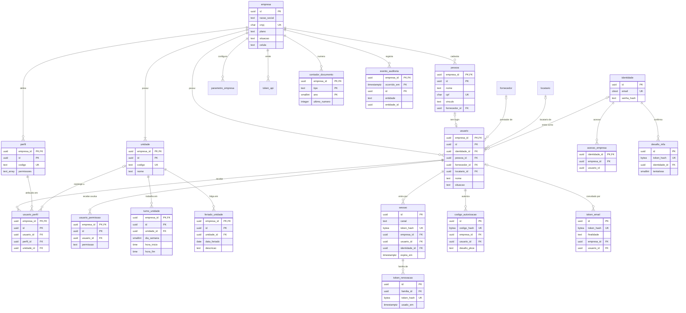

`sessao`, `token_renovacao`, `codigo_autorizacao`, `desafio_mfa` e `token_email`, como `identidade` e `acesso_empresa`, ficam no esquema `plataforma`, fora do RLS por empresa (seção 2.11). As FKs de `sessao`, `codigo_autorizacao` e `acesso_empresa` para `usuario` são compostas por `(empresa_id, usuario_id, identidade_id)`.

### 3.2 Ativos e medidores (ATV, MED)

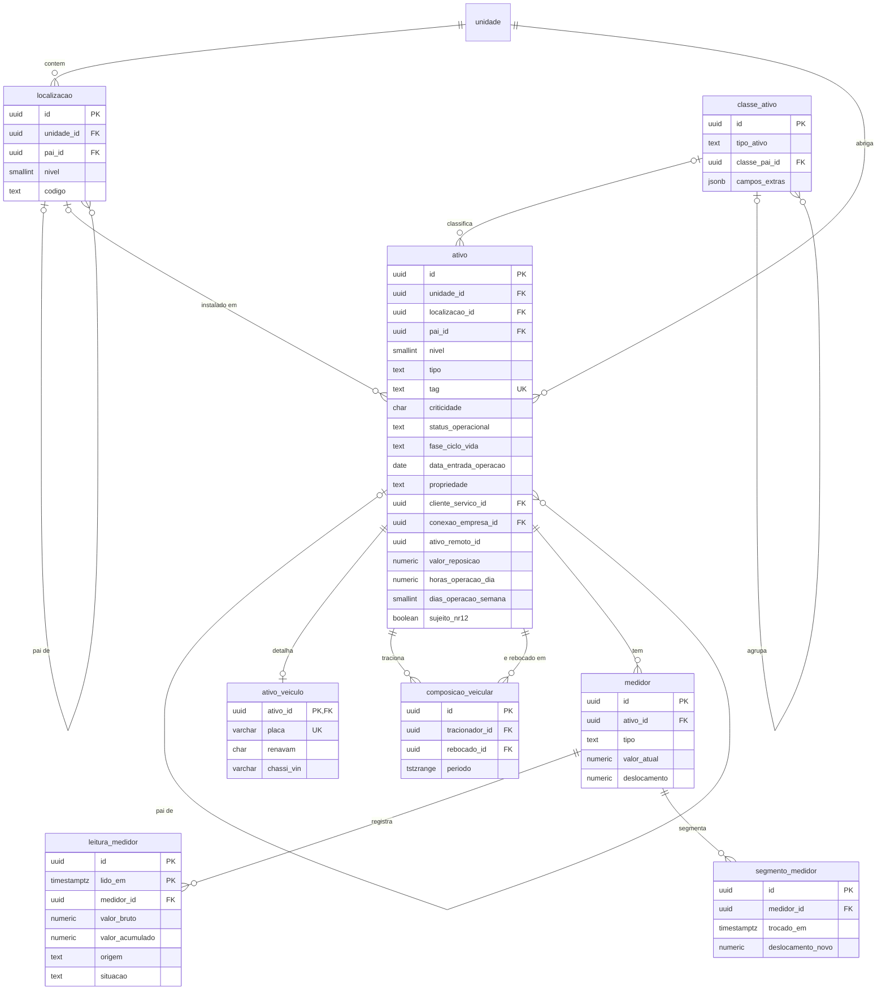

### 3.3 Solicitações, ordens de serviço e planos (SOL, OS, PRE)

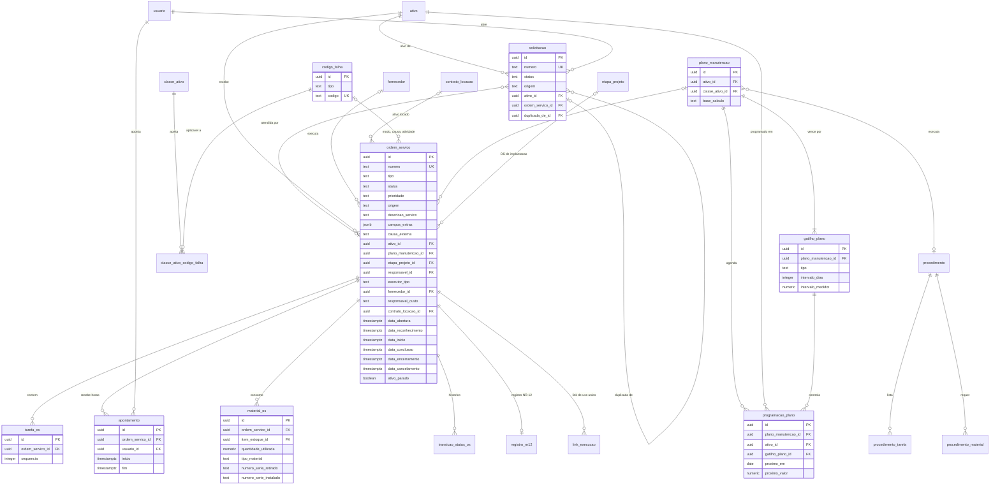

### 3.4 Checklists, estoque e conformidade (CHK, EST, CON)

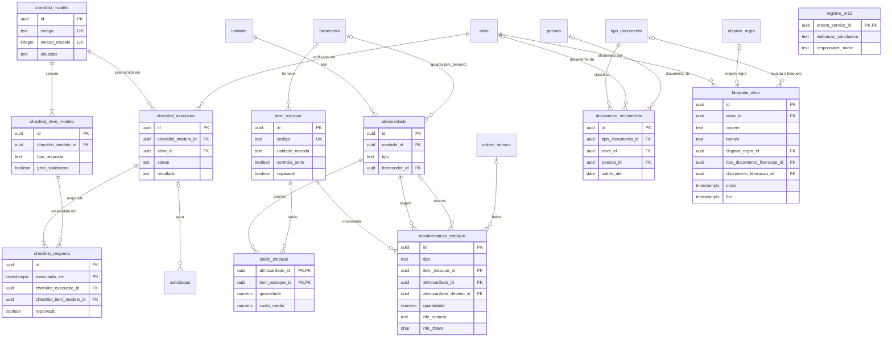

### 3.5 Terceiros (TER)

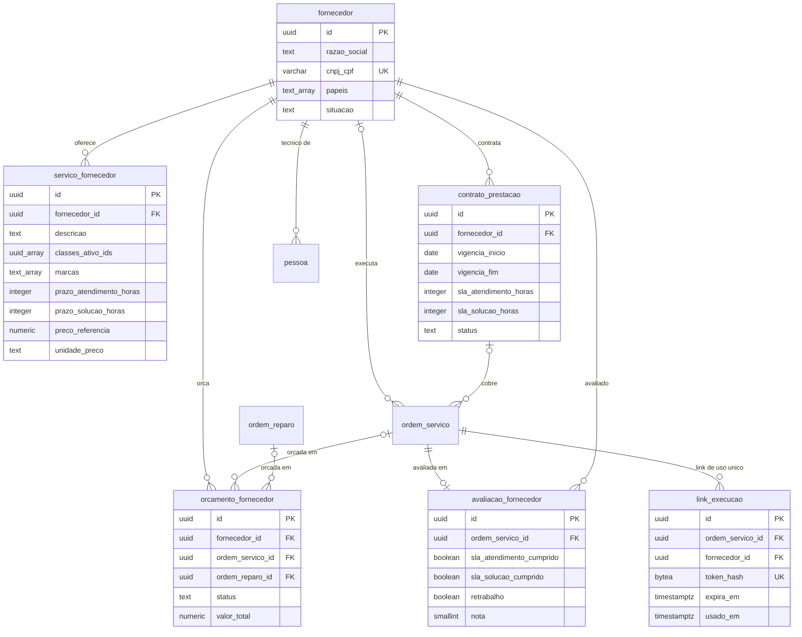

### 3.6 Estoque em terceiros, peças serializadas e reparo (EST)

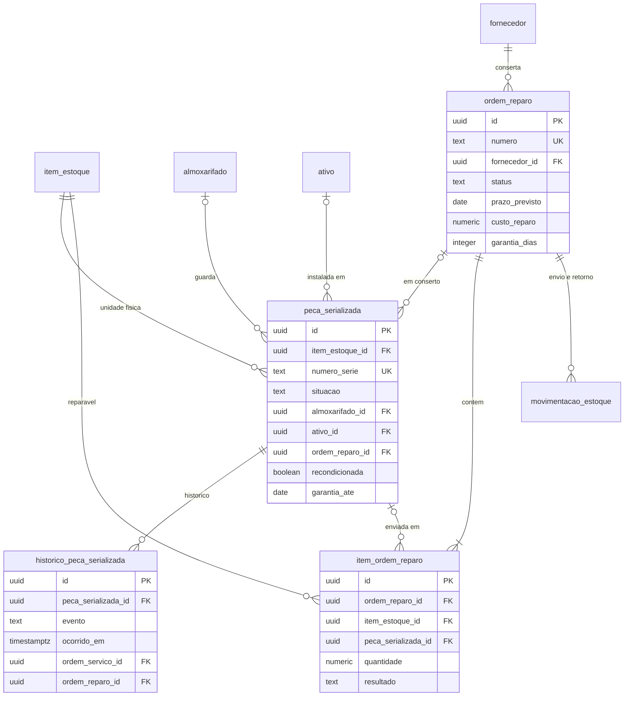

### 3.7 Locação (LOC)

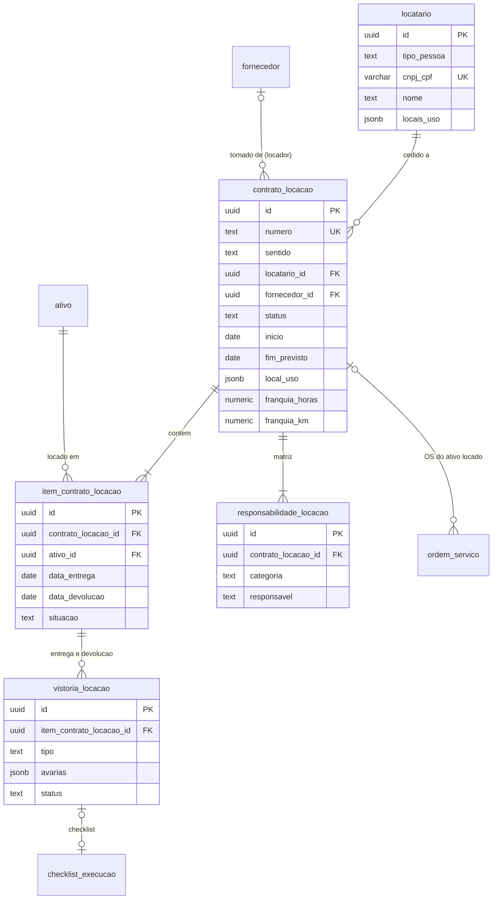

### 3.8 Gestão de serviços do prestador e conexão entre contas (SRV)

Cada conta tem as suas tabelas `app.*`; só `conexao_empresa` e o catálogo ficam em `plataforma`. As setas entre as duas contas passam pela conexão e pelo processo de sincronização (seção 2.10), nunca por FK de uma conta para outra.

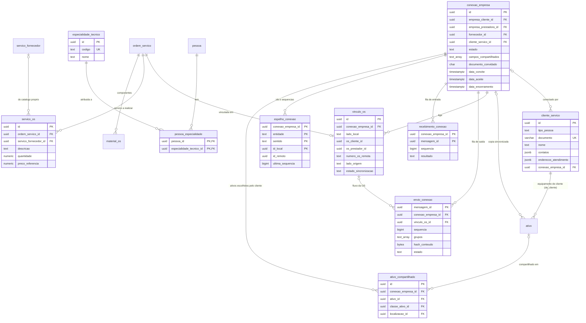

### 3.9 Configuração por segmento (ADM, OS)

`pacote_segmento` fica em `plataforma` (catálogo global, seção 2.11); as demais ficam em `app`, por empresa. O pacote não tem FK para o que cria: a aplicação registra os itens criados em `aplicacao_pacote`.

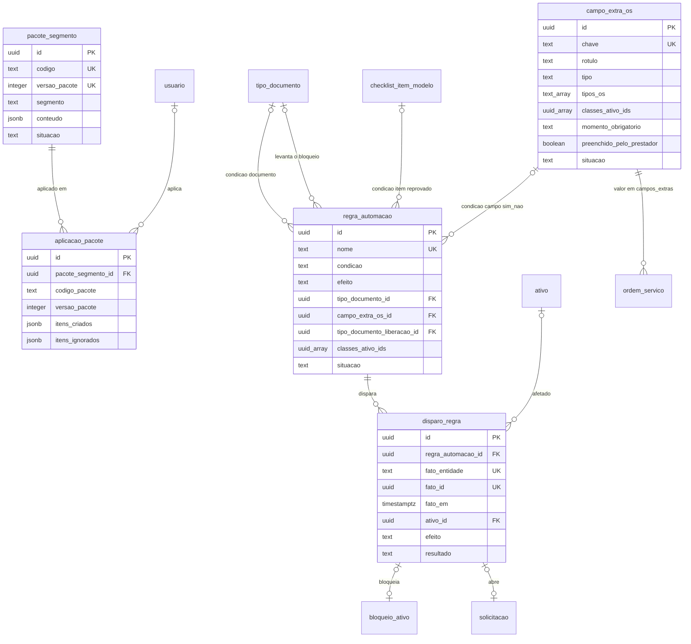

### 3.10 Projetos e implantação (PRJ, Fase 2)

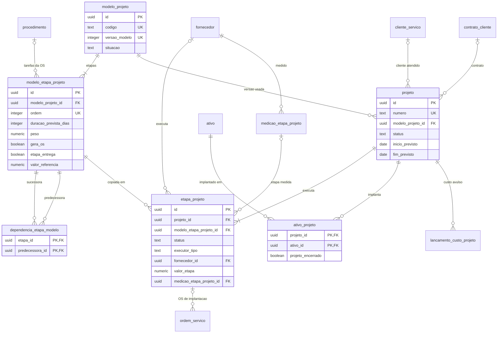

### 3.11 Contratos com clientes (CTR, Fase 2)

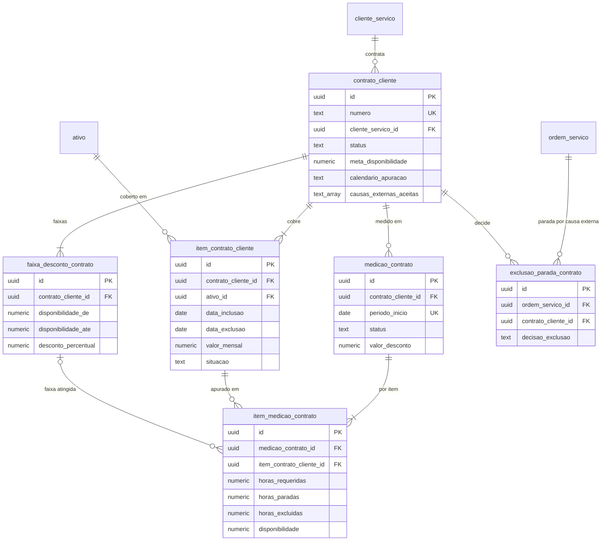

As tabelas transversais (`anexo`, `evento_auditoria`, `comando_sync`, `exclusao_sync`, `evento_saida`) se ligam a qualquer entidade por `entidade` + `entidade_id`, sem FK, e estão descritas nas seções 9 a 11.

---

## 4. Base comum do esquema

### 4.1 Extensões e esquemas

```sql
CREATE EXTENSION IF NOT EXISTS citext;      -- e-mail sem diferença de maiúsculas
CREATE EXTENSION IF NOT EXISTS btree_gist;  -- EXCLUDE com uuid + intervalo (composicao_veicular)
CREATE EXTENSION IF NOT EXISTS btree_gin;   -- GIN composto (empresa_id, texto)
CREATE EXTENSION IF NOT EXISTS pg_trgm;     -- busca por trecho em TAG, nome e descrição
-- Sem pg_partman: não acompanha a imagem oficial do PostgreSQL. Partições mensais por
-- plataforma.criar_particoes_mensais() (seção 9.5).
-- Fase 2: CREATE EXTENSION vector;          -- pgvector (IA)
-- Fase 3: CREATE EXTENSION timescaledb;     -- só se o provedor oferecer (seção 13.6)

CREATE SCHEMA app        AUTHORIZATION tenaz_dono;  -- dados de empresa, sempre com RLS
CREATE SCHEMA plataforma AUTHORIZATION tenaz_dono;  -- dados globais da Tenaz, sem dado de negócio
```

Os exemplos de DDL a seguir usam o prefixo `app.` explicitamente. As migrações rodam com `SET ROLE tenaz_dono` para que todos os objetos tenham o mesmo dono.

### 4.2 Funções de contexto

```sql
CREATE FUNCTION app.empresa_atual() RETURNS uuid
  LANGUAGE sql STABLE PARALLEL SAFE
AS $$ SELECT nullif(current_setting('app.empresa_id', true), '')::uuid $$;

CREATE FUNCTION app.usuario_atual() RETURNS uuid
  LANGUAGE sql STABLE PARALLEL SAFE
AS $$ SELECT nullif(current_setting('app.usuario_id', true), '')::uuid $$;

-- Funções de escopo externo: app.escopo_atual(), app.escopo_interno(),
-- app.fornecedor_atual(), app.locatario_atual(), app.link_hash_atual()
-- e app.conferir_escopo(), na mesma migração (definições na seção 2.9).
-- Conexão entre contas: app.conexao_atual() e as funções seguras de plataforma (seção 2.10.3).
```

### 4.3 UUID v7 no banco

```sql
-- Valor padrão de segurança no PostgreSQL 16 e 17. No 18, usar uuidv7() nativo.
-- Troca os 48 bits iniciais de um UUID v4 pelo instante em milissegundos
-- e ajusta os bits de versão de 0100 para 0111.
CREATE FUNCTION app.uuid_v7() RETURNS uuid
  LANGUAGE sql VOLATILE PARALLEL SAFE
AS $$
  SELECT encode(
           set_bit(set_bit(
             overlay(uuid_send(gen_random_uuid())
                     PLACING substring(int8send((extract(epoch FROM clock_timestamp()) * 1000)::bigint) FROM 3)
                     FROM 1 FOR 6),
           52, 1), 53, 1),
         'hex')::uuid
$$;
```

### 4.4 Trigger das colunas padrão

```sql
CREATE FUNCTION app.tg_padrao() RETURNS trigger
  LANGUAGE plpgsql
AS $$
BEGIN
  IF TG_OP = 'INSERT' THEN
    NEW.versao         := 1;
    NEW.criado_em      := now();
    NEW.criado_por     := coalesce(NEW.criado_por, app.usuario_atual());
    NEW.atualizado_em  := NEW.criado_em;
    NEW.atualizado_por := NEW.criado_por;
  ELSE
    IF NEW.empresa_id IS DISTINCT FROM OLD.empresa_id THEN
      RAISE EXCEPTION 'empresa_id é imutável' USING ERRCODE = '42501';
    END IF;
    NEW.versao         := OLD.versao + 1;
    NEW.criado_em      := OLD.criado_em;
    NEW.criado_por     := OLD.criado_por;
    NEW.atualizado_em  := now();
    NEW.atualizado_por := app.usuario_atual();
  END IF;
  NEW.alterado_xid := pg_current_xact_id();
  RETURN NEW;
END
$$;
```

### 4.5 Procedimento de preparação de tabela

Toda migração que cria uma tabela de negócio termina chamando este procedimento. Ele liga o RLS, cria a policy padrão, o trigger das colunas padrão e, se pedido, o trigger de auditoria (seção 9.3). Antes de tudo, recusa tabela cujo dono não seja `tenaz_dono`: o `FORCE ROW LEVEL SECURITY` não vale para o dono, e uma tabela criada sem o `SET ROLE` da migração contornaria o RLS. A suíte de vazamento cobra a mesma regra no CI; o procedimento a cobra no instante do erro.

```sql
CREATE PROCEDURE app.preparar_tabela(
  p_tabela  regclass,
  p_auditar boolean DEFAULT true,
  p_chave   text    DEFAULT 'id',  -- coluna que identifica a entidade na auditoria
  p_escopo  text    DEFAULT 'interno'  -- 'interno': só usuários internos; 'proprio': a migração cria a policy (seção 2.9.4)
)
LANGUAGE plpgsql
AS $$
BEGIN
  IF p_escopo NOT IN ('interno', 'proprio') THEN
    RAISE EXCEPTION 'p_escopo inválido: %', p_escopo USING ERRCODE = '22023';
  END IF;
  IF (SELECT c.relowner FROM pg_catalog.pg_class c WHERE c.oid = p_tabela) <> 'tenaz_dono'::regrole THEN
    RAISE EXCEPTION 'a tabela % não pertence a tenaz_dono; a migração esqueceu o SET ROLE tenaz_dono', p_tabela
      USING ERRCODE = '42501';
  END IF;
  EXECUTE format('ALTER TABLE %s ENABLE ROW LEVEL SECURITY', p_tabela);
  EXECUTE format('ALTER TABLE %s FORCE ROW LEVEL SECURITY', p_tabela);
  EXECUTE format('DROP POLICY IF EXISTS isolamento_empresa ON %s', p_tabela);
  EXECUTE format(
    'CREATE POLICY isolamento_empresa ON %s FOR ALL TO tenaz_app, tenaz_job, tenaz_leitura '
    'USING (empresa_id = app.empresa_atual()) WITH CHECK (empresa_id = app.empresa_atual())',
    p_tabela);
  IF p_escopo = 'interno' THEN
    EXECUTE format('DROP POLICY IF EXISTS escopo_externo ON %s', p_tabela);
    EXECUTE format(
      'CREATE POLICY escopo_externo ON %s AS RESTRICTIVE FOR ALL TO tenaz_app, tenaz_job, tenaz_leitura '
      'USING (app.escopo_interno()) WITH CHECK (app.escopo_interno())', p_tabela);
  END IF;
  EXECUTE format(
    'CREATE TRIGGER trg_padrao BEFORE INSERT OR UPDATE ON %s '
    'FOR EACH ROW EXECUTE FUNCTION app.tg_padrao()', p_tabela);
  IF p_auditar THEN
    EXECUTE format(
      'CREATE TRIGGER trg_auditoria AFTER INSERT OR UPDATE OR DELETE ON %s '
      'FOR EACH ROW EXECUTE FUNCTION app.tg_auditar(%L)', p_tabela, p_chave);
  END IF;
END
$$;
-- DDL de migração: nenhum papel da aplicação executa (os privilégios padrão dariam EXECUTE)
REVOKE ALL ON PROCEDURE app.preparar_tabela(regclass, boolean, text, text)
  FROM PUBLIC, tenaz_app, tenaz_job, tenaz_leitura;
```

Tabelas de alto volume (`leitura_medidor`, `checklist_resposta`, `evento_telematica`) chamam o procedimento com `p_auditar => false`. A auditoria delas é feita no nível do fato agregado (a execução do checklist, a revisão de uma leitura).

Tabelas acessadas por prestador, locatário ou link (lista da seção 2.9.4) chamam o procedimento com `p_escopo => 'proprio'` e criam em seguida a policy `escopo_externo` específica. Nos blocos de DDL deste documento, essas chamadas aparecem com `p_escopo => 'proprio'` e a policy é a da seção 2.9.4. As tabelas sem colunas padrão (`contador_documento`, `evento_saida`, `kpi_*`, `exclusao_sync`, `comando_sync`, `envio_conexao`, `recebimento_conexao`) também recebem a policy restritiva, criada à mão como a policy de empresa.

O procedimento não concede nada ao `tenaz_sinc` nem cria as policies dele. As tabelas que a sincronização entre contas toca recebem, na própria migração, os `GRANT` por coluna e as policies `sincronizacao` (permissiva) e `conexao_sinc` (restritiva) da seção 2.10.4.

---

## 5. DDL do MVP

Convenções desta seção:

- Toda tabela termina com `CALL app.preparar_tabela(...)` (seção 4.5).
- As colunas padrão (seção 1.5) aparecem em três linhas compactas no fim de cada tabela.
- Índices sempre começam por `empresa_id`. A coluna `alterado_xid` tem índice nas tabelas que o app sincroniza (seção 11).

### 5.1 ADM — Administração

```sql
-- Empresa cliente: unidade de isolamento (tenant)
CREATE TABLE app.empresa (
  id                       uuid        NOT NULL DEFAULT app.uuid_v7(),
  razao_social             text        NOT NULL,
  nome_fantasia            text,
  cnpj                     char(14),
  plano                    text        DEFAULT 'essencial',   -- nulo: conta só do plano Serviços
  srv_habilitado           boolean     NOT NULL DEFAULT false, -- módulo SRV, plano Serviços (sumário 2.2)
  mfa_obrigatorio          boolean     NOT NULL DEFAULT false, -- MFA exigido de todos os usuários, ligado pelo administrador (RF-ADM-006; sumário 3.6)
  situacao                 text        NOT NULL DEFAULT 'teste',
  fuso_horario             text        NOT NULL DEFAULT 'America/Sao_Paulo',
  retencao_auditoria_anos  smallint    NOT NULL DEFAULT 5,
  celula                   text        NOT NULL DEFAULT 'pool-01', -- cluster onde os dados residem (seção 15)
  teste_ate                date,
  versao bigint NOT NULL DEFAULT 1, alterado_xid xid8 NOT NULL DEFAULT pg_current_xact_id(),
  criado_em timestamptz NOT NULL DEFAULT now(), criado_por uuid,
  atualizado_em timestamptz NOT NULL DEFAULT now(), atualizado_por uuid, excluido_em timestamptz,
  CONSTRAINT pk_empresa PRIMARY KEY (id),
  CONSTRAINT uq_empresa_cnpj UNIQUE (cnpj),
  CONSTRAINT ck_empresa_plano CHECK (plano IN ('essencial', 'profissional', 'enterprise')),
  -- a subcontratada pode ter só o plano Serviços ou somá-lo a um dos planos acima
  CONSTRAINT ck_empresa_contratacao CHECK (plano IS NOT NULL OR srv_habilitado),
  CONSTRAINT ck_empresa_situacao CHECK (situacao IN ('teste', 'ativa', 'suspensa', 'cancelada')),
  CONSTRAINT ck_empresa_retencao CHECK (retencao_auditoria_anos BETWEEN 5 AND 30),
  CONSTRAINT ck_empresa_cnpj CHECK (cnpj ~ '^[0-9]{14}$')
);
-- RLS e policies próprias: seção 2.3. Não usa preparar_tabela (não tem empresa_id) nem app.tg_padrao(),
-- que compara NEW.empresa_id e falharia na execução. As colunas padrão ficam com uma versão própria,
-- que torna o id imutável, pelo mesmo motivo que tg_padrao torna empresa_id imutável.
CREATE FUNCTION app.tg_padrao_empresa() RETURNS trigger
  LANGUAGE plpgsql
AS $$
BEGIN
  IF TG_OP = 'INSERT' THEN
    NEW.versao := 1; NEW.criado_em := now();
    NEW.criado_por := coalesce(NEW.criado_por, app.usuario_atual());
    NEW.atualizado_em := NEW.criado_em; NEW.atualizado_por := NEW.criado_por;
  ELSE
    IF NEW.id IS DISTINCT FROM OLD.id THEN
      RAISE EXCEPTION 'o id da empresa é imutável' USING ERRCODE = '42501';
    END IF;
    NEW.versao := OLD.versao + 1; NEW.criado_em := OLD.criado_em; NEW.criado_por := OLD.criado_por;
    NEW.atualizado_em := now(); NEW.atualizado_por := app.usuario_atual();
  END IF;
  NEW.alterado_xid := pg_current_xact_id();
  RETURN NEW;
END
$$;
CREATE TRIGGER trg_padrao BEFORE INSERT OR UPDATE ON app.empresa
  FOR EACH ROW EXECUTE FUNCTION app.tg_padrao_empresa();
CREATE TRIGGER trg_auditoria AFTER INSERT OR UPDATE OR DELETE ON app.empresa
  FOR EACH ROW EXECUTE FUNCTION app.tg_auditar('id');
-- mfa_obrigatorio: o tenaz_autenticacao não lê app.empresa (ADR-011). O login lê a empresa no passo 2 do
-- documento 5 (seção 6.9), pelo pool da aplicação, em NaEmpresa(empresa escolhida, interno, sem usuário),
-- sob empresa_propria; o serviço exige o desafio de MFA antes do passo 3. Nenhum privilégio novo no banco.
-- O CNPJ é alterado pelo administrador (sumário 3.6); a troca com conexão entre contas: seção 17.3, E01-13.
-- Na criação da conta, o responsável recebe os perfis administrador e gestor, e os turnos da unidade
-- inicial são informados pelo próprio cliente, sem turno padrão (sumário 3.6; ver "pelo menos um turno").

-- Unidade: planta, filial, base ou loja
CREATE TABLE app.unidade (
  empresa_id     uuid    NOT NULL,
  id             uuid    NOT NULL DEFAULT app.uuid_v7(),
  codigo         text    NOT NULL,
  nome           text    NOT NULL,
  cnpj           char(14),
  endereco       jsonb,
  fuso_horario   text,                       -- nulo herda o da empresa
  latitude       numeric(9,6),
  longitude      numeric(9,6),
  situacao       text    NOT NULL DEFAULT 'ativa',
  versao bigint NOT NULL DEFAULT 1, alterado_xid xid8 NOT NULL DEFAULT pg_current_xact_id(),
  criado_em timestamptz NOT NULL DEFAULT now(), criado_por uuid,
  atualizado_em timestamptz NOT NULL DEFAULT now(), atualizado_por uuid, excluido_em timestamptz,
  CONSTRAINT pk_unidade PRIMARY KEY (empresa_id, id),
  CONSTRAINT fk_unidade_empresa FOREIGN KEY (empresa_id) REFERENCES app.empresa (id),
  CONSTRAINT ck_unidade_situacao CHECK (situacao IN ('ativa', 'inativa')),
  CONSTRAINT ck_unidade_cnpj CHECK (cnpj ~ '^[0-9]{14}$')
);
CREATE UNIQUE INDEX uq_unidade_codigo ON app.unidade (empresa_id, codigo) WHERE excluido_em IS NULL;
CREATE INDEX ix_unidade_sync ON app.unidade (empresa_id, alterado_xid);
CALL app.preparar_tabela('app.unidade', p_escopo => 'proprio');
-- escopo_externo (leitura para os quatro escopos) e escopo_externo_exclusao: seção 2.9.4

-- Calendário de trabalho da unidade (RF-ADM-002): turnos por dia da semana
CREATE TABLE app.turno_unidade (
  empresa_id   uuid     NOT NULL,
  id           uuid     NOT NULL DEFAULT app.uuid_v7(),
  unidade_id   uuid     NOT NULL,
  dia_semana   smallint NOT NULL,          -- ISO 8601, como extract(isodow): 1 = segunda ... 7 = domingo
  hora_inicio  time     NOT NULL,
  hora_fim     time     NOT NULL,          -- menor que o início: termina no dia seguinte; 24:00 = meia-noite
  nome         text,                       -- ex.: "1º turno"
  versao bigint NOT NULL DEFAULT 1, alterado_xid xid8 NOT NULL DEFAULT pg_current_xact_id(),
  criado_em timestamptz NOT NULL DEFAULT now(), criado_por uuid,
  atualizado_em timestamptz NOT NULL DEFAULT now(), atualizado_por uuid, excluido_em timestamptz,
  CONSTRAINT pk_turno_unidade PRIMARY KEY (empresa_id, id),
  CONSTRAINT fk_turno_unidade_unidade FOREIGN KEY (empresa_id, unidade_id) REFERENCES app.unidade (empresa_id, id),
  CONSTRAINT ck_turno_unidade_dia CHECK (dia_semana BETWEEN 1 AND 7),
  CONSTRAINT ck_turno_unidade_horario CHECK (hora_inicio < time '24:00' AND hora_fim <> hora_inicio)
);
-- calendário por unidade (tela e tempo requerido dos KPIs) e trava contra turno repetido
CREATE UNIQUE INDEX uq_turno_unidade_inicio ON app.turno_unidade (empresa_id, unidade_id, dia_semana, hora_inicio)
  WHERE excluido_em IS NULL;
CALL app.preparar_tabela('app.turno_unidade');

-- Feriados da unidade (RF-ADM-002); o nacional é gravado em cada unidade pelo serviço
CREATE TABLE app.feriado_unidade (
  empresa_id    uuid  NOT NULL,
  id            uuid  NOT NULL DEFAULT app.uuid_v7(),
  unidade_id    uuid  NOT NULL,
  data_feriado  date  NOT NULL,
  descricao     text  NOT NULL,
  versao bigint NOT NULL DEFAULT 1, alterado_xid xid8 NOT NULL DEFAULT pg_current_xact_id(),
  criado_em timestamptz NOT NULL DEFAULT now(), criado_por uuid,
  atualizado_em timestamptz NOT NULL DEFAULT now(), atualizado_por uuid, excluido_em timestamptz,
  CONSTRAINT pk_feriado_unidade PRIMARY KEY (empresa_id, id),
  CONSTRAINT fk_feriado_unidade_unidade FOREIGN KEY (empresa_id, unidade_id) REFERENCES app.unidade (empresa_id, id),
  CONSTRAINT ck_feriado_unidade_descricao CHECK (btrim(descricao) <> '')
);
CREATE UNIQUE INDEX uq_feriado_unidade_data ON app.feriado_unidade (empresa_id, unidade_id, data_feriado)
  WHERE excluido_em IS NULL;
CALL app.preparar_tabela('app.feriado_unidade');

-- Identidade de login, global. Uma pessoa com o mesmo e-mail em duas empresas
-- tem uma identidade e dois usuários. Sem dado de negócio, sem RLS.
-- Acesso restrito ao módulo de autenticação.
CREATE TABLE plataforma.identidade (
  id                    uuid        NOT NULL DEFAULT app.uuid_v7(),
  email                 citext      NOT NULL,
  senha_hash            text,                 -- argon2id; nulo quando só usa SSO
  mfa_segredo_cifrado   bytea,                -- cifrado com chave do KMS
  mfa_ativado_em        timestamptz,          -- TOTP confirmado; nulo: sem segundo fator
  mfa_ultimo_passo      bigint,               -- último passo TOTP aceito (RFC 6238, 5.2): o mesmo código não
                                              -- vale duas vezes dentro da janela
  email_verificado_em   timestamptz,
  falhas_login          smallint    NOT NULL DEFAULT 0,  -- falhas seguidas; zera no login certo
  bloqueada_ate         timestamptz,          -- bloqueio temporário após 5 falhas (RF-ADM-006)
  bloqueada_em          timestamptz,          -- bloqueio administrativo, até desbloqueio explícito
  ultimo_login_em       timestamptz,
  criado_em             timestamptz NOT NULL DEFAULT now(),
  atualizado_em         timestamptz NOT NULL DEFAULT now(),
  CONSTRAINT pk_identidade PRIMARY KEY (id),
  CONSTRAINT uq_identidade_email UNIQUE (email),
  CONSTRAINT ck_identidade_falhas CHECK (falhas_login >= 0),
  CONSTRAINT ck_identidade_mfa CHECK (mfa_ativado_em IS NULL OR mfa_segredo_cifrado IS NOT NULL),
  CONSTRAINT ck_identidade_mfa_passo CHECK (mfa_ultimo_passo >= 0)
);
-- Falha de senha ou de TOTP, num único UPDATE, para duas tentativas simultâneas não se perderem:
--   UPDATE plataforma.identidade SET falhas_login = falhas_login + 1,
--     bloqueada_ate = CASE WHEN falhas_login + 1 >= 5 THEN now() + <duração> END, atualizado_em = now()
--   WHERE id = $1;
-- A duração, progressiva, é do serviço (documento 9, seção 5.3). Login certo zera falhas_login.
-- Código TOTP certo só vale se o passo for maior que o último aceito, no mesmo UPDATE, para que o mesmo
-- código (ou um anterior) não sirva duas vezes dentro da janela de tolerância:
--   UPDATE plataforma.identidade SET mfa_ultimo_passo = $2
--   WHERE id = $1 AND (mfa_ultimo_passo IS NULL OR mfa_ultimo_passo < $2) RETURNING id;
-- Zero linhas: código já usado. Reativar o MFA (segredo novo) volta mfa_ultimo_passo a nulo.

-- Em quais empresas a identidade entra. Mantida SÓ pelo trigger em app.usuario: a aplicação lê,
-- nunca grava. Expõe só o vínculo, nunca dado de negócio. A FK composta garante que o acesso aponta
-- para um usuário daquela empresa cuja identidade é a mesma.
CREATE TABLE plataforma.acesso_empresa (
  identidade_id uuid        NOT NULL,
  empresa_id    uuid        NOT NULL,
  usuario_id    uuid        NOT NULL,
  habilitado    boolean     NOT NULL DEFAULT true,   -- usuario ativo e não excluído
  atualizado_em timestamptz NOT NULL DEFAULT now(),
  CONSTRAINT pk_acesso_empresa PRIMARY KEY (identidade_id, empresa_id),
  CONSTRAINT fk_acesso_empresa_identidade FOREIGN KEY (identidade_id)
    REFERENCES plataforma.identidade (id) ON DELETE CASCADE,
  CONSTRAINT fk_acesso_empresa_usuario FOREIGN KEY (empresa_id, usuario_id, identidade_id)
    REFERENCES app.usuario (empresa_id, id, identidade_id) ON DELETE CASCADE
);

-- SECURITY DEFINER para que tenaz_app não tenha escrita na tabela: se tivesse, um defeito de código
-- poderia gravar acesso a qualquer empresa. Com o trigger, o acesso só nasce de uma linha real de
-- app.usuario, que já passou pelo WITH CHECK da policy da empresa da transação. search_path fixo,
-- pg_temp por último, nomes qualificados; lista aprovada da seção 2.8, consulta 6.
CREATE FUNCTION plataforma.tg_acesso_empresa() RETURNS trigger
  LANGUAGE plpgsql SECURITY DEFINER
  SET search_path = pg_catalog, pg_temp
AS $$
BEGIN
  INSERT INTO plataforma.acesso_empresa (identidade_id, empresa_id, usuario_id, habilitado, atualizado_em)
  VALUES (NEW.identidade_id, NEW.empresa_id, NEW.id,
          NEW.situacao = 'ativo' AND NEW.excluido_em IS NULL, pg_catalog.now())
  ON CONFLICT (identidade_id, empresa_id) DO UPDATE
    SET usuario_id = EXCLUDED.usuario_id, habilitado = EXCLUDED.habilitado, atualizado_em = EXCLUDED.atualizado_em;
  RETURN NULL;
END
$$;
REVOKE ALL ON FUNCTION plataforma.tg_acesso_empresa() FROM PUBLIC;
-- trigger criado depois de app.usuario:
-- CREATE TRIGGER trg_acesso_empresa AFTER INSERT OR UPDATE OF identidade_id, situacao, excluido_em
--   ON app.usuario FOR EACH ROW WHEN (NEW.identidade_id IS NOT NULL)
--   EXECUTE FUNCTION plataforma.tg_acesso_empresa();

-- Nenhum privilégio do tenaz_app nem do tenaz_job em identidade e acesso_empresa: só o tenaz_autenticacao
-- as alcança (ADR-011); os GRANT estão no bloco de autenticação, no fim desta seção.
GRANT USAGE ON SCHEMA plataforma TO tenaz_app, tenaz_job;

-- Pessoa: colaborador ou terceiro que executa, conduz ou responde por algo
-- (técnico, motorista, condutor eventual, técnico de fornecedor, PLH). Pode ou não ter usuário.
-- Documentos pessoais (CNH e outros) e capacitações ligam-se à pessoa, nunca ao usuário.
-- A Tenaz não guarda dado de saúde da pessoa (sumário 0.7, 3.6).
CREATE TABLE app.pessoa (
  empresa_id          uuid    NOT NULL,
  id                  uuid    NOT NULL DEFAULT app.uuid_v7(),
  nome                text    NOT NULL,
  cpf                 char(11),               -- dado pessoal (LGPD); visível só a perfis autorizados
  data_nascimento     date,                   -- dado pessoal; usado na CNH
  matricula           text,
  cargo               text,
  telefone            text,
  email               citext,
  vinculo             text    NOT NULL DEFAULT 'empregado',
  fornecedor_id       uuid,                   -- técnico de fornecedor (vinculo = 'terceiro')
  unidade_id          uuid,
  registro_profissional text,                 -- CREA, CFT etc. (PLH, responsável NR-12)
  situacao            text    NOT NULL DEFAULT 'ativa',
  versao bigint NOT NULL DEFAULT 1, alterado_xid xid8 NOT NULL DEFAULT pg_current_xact_id(),
  criado_em timestamptz NOT NULL DEFAULT now(), criado_por uuid,
  atualizado_em timestamptz NOT NULL DEFAULT now(), atualizado_por uuid, excluido_em timestamptz,
  CONSTRAINT pk_pessoa PRIMARY KEY (empresa_id, id),
  CONSTRAINT fk_pessoa_empresa FOREIGN KEY (empresa_id) REFERENCES app.empresa (id),
  CONSTRAINT fk_pessoa_unidade FOREIGN KEY (empresa_id, unidade_id) REFERENCES app.unidade (empresa_id, id),
  CONSTRAINT ck_pessoa_cpf CHECK (cpf ~ '^[0-9]{11}$'),
  CONSTRAINT ck_pessoa_vinculo CHECK (vinculo IN ('empregado', 'terceiro', 'autonomo')),
  CONSTRAINT ck_pessoa_fornecedor CHECK (fornecedor_id IS NULL OR vinculo = 'terceiro'),
  -- sumário 3.6: só ativa ou inativa; pessoa inativa nunca é excluída e
  -- continua ligada ao histórico dos serviços
  CONSTRAINT ck_pessoa_situacao CHECK (situacao IN ('ativa', 'inativa'))
);
CREATE UNIQUE INDEX uq_pessoa_cpf ON app.pessoa (empresa_id, cpf) WHERE cpf IS NOT NULL AND excluido_em IS NULL;
CREATE INDEX ix_pessoa_nome ON app.pessoa USING gin (empresa_id, nome gin_trgm_ops);
CREATE INDEX ix_pessoa_fornecedor ON app.pessoa (empresa_id, fornecedor_id) WHERE fornecedor_id IS NOT NULL;
CREATE INDEX ix_pessoa_sync ON app.pessoa (empresa_id, alterado_xid);
CALL app.preparar_tabela('app.pessoa', p_escopo => 'proprio');   -- prestador vê as pessoas do seu fornecedor
-- escopo_externo e escopo_externo_exclusao: seção 2.9.4
-- fk para fornecedor: seção 5.8, na migração de fornecedor (E06), com NOT VALID + VALIDATE (seção 17.3)

-- Usuário: login de acesso. Pode estar ligado a uma pessoa (técnico, motorista, PLH);
-- usuário de prestador fica ligado ao fornecedor e usuário de locatário, ao locatário.
CREATE TABLE app.usuario (
  empresa_id         uuid    NOT NULL,
  id                 uuid    NOT NULL DEFAULT app.uuid_v7(),
  identidade_id      uuid,                   -- nulo até o convite ser aceito; depois, imutável
  pessoa_id          uuid,                   -- opcional
  fornecedor_id      uuid,                   -- perfil prestador
  locatario_id       uuid,                   -- perfil locatario (fase 2)
  nome               text    NOT NULL,
  email              citext,
  telefone           text,
  custo_hora         numeric(12,2),          -- custo de mão de obra apontada
  unidade_padrao_id  uuid,
  situacao           text    NOT NULL DEFAULT 'ativo',
  versao bigint NOT NULL DEFAULT 1, alterado_xid xid8 NOT NULL DEFAULT pg_current_xact_id(),
  criado_em timestamptz NOT NULL DEFAULT now(), criado_por uuid,
  atualizado_em timestamptz NOT NULL DEFAULT now(), atualizado_por uuid, excluido_em timestamptz,
  CONSTRAINT pk_usuario PRIMARY KEY (empresa_id, id),
  -- alvo das FKs compostas de sessao, codigo_autorizacao e acesso_empresa
  CONSTRAINT uq_usuario_id_identidade UNIQUE (empresa_id, id, identidade_id),
  CONSTRAINT fk_usuario_empresa FOREIGN KEY (empresa_id) REFERENCES app.empresa (id),
  CONSTRAINT fk_usuario_identidade FOREIGN KEY (identidade_id) REFERENCES plataforma.identidade (id),
  CONSTRAINT fk_usuario_pessoa FOREIGN KEY (empresa_id, pessoa_id) REFERENCES app.pessoa (empresa_id, id),
  CONSTRAINT fk_usuario_unidade FOREIGN KEY (empresa_id, unidade_padrao_id) REFERENCES app.unidade (empresa_id, id),
  -- sumário 3.6; o bloqueio temporário por falhas é da identidade (identidade.bloqueada_ate)
  CONSTRAINT ck_usuario_situacao CHECK (situacao IN ('convidado', 'ativo', 'inativo')),
  CONSTRAINT ck_usuario_externo CHECK (num_nonnulls(fornecedor_id, locatario_id) <= 1)
);
CREATE UNIQUE INDEX uq_usuario_identidade ON app.usuario (empresa_id, identidade_id) WHERE identidade_id IS NOT NULL;
CREATE UNIQUE INDEX uq_usuario_email ON app.usuario (empresa_id, email) WHERE email IS NOT NULL AND excluido_em IS NULL;
CREATE UNIQUE INDEX uq_usuario_pessoa ON app.usuario (empresa_id, pessoa_id) WHERE pessoa_id IS NOT NULL AND excluido_em IS NULL;
CREATE INDEX ix_usuario_nome ON app.usuario USING gin (empresa_id, nome gin_trgm_ops);
CREATE INDEX ix_usuario_fornecedor ON app.usuario (empresa_id, fornecedor_id) WHERE fornecedor_id IS NOT NULL;
CREATE INDEX ix_usuario_locatario ON app.usuario (empresa_id, locatario_id) WHERE locatario_id IS NOT NULL;
CREATE INDEX ix_usuario_sync ON app.usuario (empresa_id, alterado_xid);
CALL app.preparar_tabela('app.usuario', p_escopo => 'proprio');  -- externo vê a si mesmo e os colegas do mesmo fornecedor ou locatário
-- escopo_externo e escopo_externo_exclusao: seção 2.9.4; trg_acesso_empresa: acima
-- fks para fornecedor (seção 5.8, E06) e locatario (seção 13.10, fase 2), com NOT VALID + VALIDATE (seção 17.3)

-- Perfil: conjunto de permissões. Os 12 perfis padrão são criados com a empresa, pelo serviço,
-- a partir do catálogo de permissões versionado no código (documento 1), e não por migração (seção 14.2).
CREATE TABLE app.perfil (
  empresa_id   uuid    NOT NULL,
  id           uuid    NOT NULL DEFAULT app.uuid_v7(),
  codigo       text    NOT NULL,
  nome         text    NOT NULL,
  padrao       boolean NOT NULL DEFAULT false,
  perfil_origem text,                         -- perfil padrão de que deriva (no padrão, o próprio código);
                                              -- nulo: personalizado sem origem, sempre interno
  permissoes   text[]  NOT NULL DEFAULT '{}',   -- <módulo>.<ação>, ex.: {'os.executar','os.encerrar','est.decidir_destino'}
  versao bigint NOT NULL DEFAULT 1, alterado_xid xid8 NOT NULL DEFAULT pg_current_xact_id(),
  criado_em timestamptz NOT NULL DEFAULT now(), criado_por uuid,
  atualizado_em timestamptz NOT NULL DEFAULT now(), atualizado_por uuid, excluido_em timestamptz,
  CONSTRAINT pk_perfil PRIMARY KEY (empresa_id, id),
  CONSTRAINT uq_perfil_codigo UNIQUE (empresa_id, codigo),
  CONSTRAINT fk_perfil_empresa FOREIGN KEY (empresa_id) REFERENCES app.empresa (id),
  CONSTRAINT ck_perfil_padrao CHECK (NOT padrao OR codigo IN
    ('administrador', 'gestor', 'planejador', 'tecnico', 'almoxarife', 'comprador', 'plh', 'motorista',
     'solicitante', 'visualizador', 'prestador', 'locatario')),
  -- ck_perfil_saude existiu na 00004 e saiu na 00006: a Tenaz não guarda dado de saúde (sumário 0.7, 3.6)
  -- a liberação de OS nunca é dada a usuário externo (sumário 3.6)
  CONSTRAINT ck_perfil_origem CHECK (perfil_origem IN
    ('administrador', 'gestor', 'planejador', 'tecnico', 'almoxarife', 'comprador', 'plh', 'motorista',
     'solicitante', 'visualizador', 'prestador', 'locatario')),
  CONSTRAINT ck_perfil_padrao_origem CHECK (NOT padrao OR perfil_origem = codigo),
  -- a liberação de OS nunca é dada a usuário externo (sumário 3.6), nem por perfil derivado de externo
  CONSTRAINT ck_perfil_externo_encerrar CHECK (coalesce(perfil_origem, codigo) NOT IN ('prestador', 'locatario')
                                               OR NOT ('os.encerrar' = ANY (permissoes))),
  -- nem nenhuma das demais vedadas a externo (lista abaixo)
  CONSTRAINT ck_perfil_externo_vedadas CHECK (coalesce(perfil_origem, codigo) NOT IN ('prestador', 'locatario')
                                              OR NOT (permissoes && app.permissoes_vedadas_externo()))
);
CALL app.preparar_tabela('app.perfil');

-- O tipo do perfil, coalesce(perfil_origem, codigo), não muda depois de criado (ISO-E01-03): senão um
-- perfil já atribuído a prestador viraria interno e receberia os.encerrar, e os CHECKs e o trigger de
-- atribuição, que olham o tipo no momento da gravação, não veriam a atribuição antiga. perfil_origem e
-- padrao também ficam imutáveis. Mudar de tipo é criar outro perfil.
CREATE FUNCTION app.tg_perfil_tipo() RETURNS trigger
  LANGUAGE plpgsql
AS $$
BEGIN
  IF NEW.perfil_origem IS DISTINCT FROM OLD.perfil_origem
     OR NEW.padrao IS DISTINCT FROM OLD.padrao
     OR coalesce(NEW.perfil_origem, NEW.codigo) IS DISTINCT FROM coalesce(OLD.perfil_origem, OLD.codigo) THEN
    RAISE EXCEPTION 'o tipo do perfil (origem, padrão) é imutável depois de criado' USING ERRCODE = '42501';
  END IF;
  RETURN NEW;
END
$$;
CREATE TRIGGER trg_perfil_tipo BEFORE UPDATE OF codigo, perfil_origem, padrao ON app.perfil
  FOR EACH ROW EXECUTE FUNCTION app.tg_perfil_tipo();
-- criada antes da tabela, na migração: os CHECKs acima a usam
-- CREATE FUNCTION app.permissoes_vedadas_externo() RETURNS text[] LANGUAGE sql IMMUTABLE PARALLEL SAFE
-- AS $$ SELECT ARRAY['os.encerrar',
--   'adm.gerenciar_regras', 'adm.gerenciar_configuracao', 'atv.colocar_em_operacao',
--   'prj.gerenciar', 'prj.dispensar_etapa', 'prj.ajustar_medicao', 'ctr.gerenciar', 'ctr.fechar_medicao',
--   'ctr.reabrir_medicao', 'srv.gerenciar_conexao',     -- 'pessoa.saude.ler' saiu na 00006
--   -- grupo Admin do catálogo de RF-ADM-005
--   'adm.gerenciar_empresa', 'adm.gerenciar_plano', 'adm.gerenciar_usuarios', 'adm.gerenciar_perfis',
--   'adm.gerenciar_parametros', 'adm.ler_auditoria', 'adm.gerenciar_sso', 'adm.exportar',
--   'con.gerenciar_tipos_documento', 'int.gerenciar_tokens', 'int.gerenciar_webhooks',
--   'int.gerenciar_conexoes_telematica', 'int.gerenciar_erp', 'ia.gerenciar']::text[] $$;

-- Usuário pode ter vários perfis; unidade_id nulo = todas as unidades
CREATE TABLE app.usuario_perfil (
  empresa_id  uuid NOT NULL,
  id          uuid NOT NULL DEFAULT app.uuid_v7(),
  usuario_id  uuid NOT NULL,
  perfil_id   uuid NOT NULL,
  unidade_id  uuid,
  versao bigint NOT NULL DEFAULT 1, alterado_xid xid8 NOT NULL DEFAULT pg_current_xact_id(),
  criado_em timestamptz NOT NULL DEFAULT now(), criado_por uuid,
  atualizado_em timestamptz NOT NULL DEFAULT now(), atualizado_por uuid, excluido_em timestamptz,
  CONSTRAINT pk_usuario_perfil PRIMARY KEY (empresa_id, id),
  CONSTRAINT fk_usuario_perfil_usuario FOREIGN KEY (empresa_id, usuario_id) REFERENCES app.usuario (empresa_id, id),
  CONSTRAINT fk_usuario_perfil_perfil FOREIGN KEY (empresa_id, perfil_id) REFERENCES app.perfil (empresa_id, id),
  CONSTRAINT fk_usuario_perfil_unidade FOREIGN KEY (empresa_id, unidade_id) REFERENCES app.unidade (empresa_id, id)
);
-- quem tem um perfil: contagem de técnicos cobrados, último administrador (RF-ADM-004)
-- uma atribuição ativa por usuário, perfil e unidade (nula = todas); parcial, como as demais unicidades:
-- retirar o perfil (excluido_em) e atribuí-lo de novo não colide; é também o índice dos perfis do usuário
CREATE UNIQUE INDEX uq_usuario_perfil ON app.usuario_perfil (empresa_id, usuario_id, perfil_id, unidade_id)
  NULLS NOT DISTINCT WHERE excluido_em IS NULL;
CREATE INDEX ix_usuario_perfil_perfil ON app.usuario_perfil (empresa_id, perfil_id) WHERE excluido_em IS NULL;
CALL app.preparar_tabela('app.usuario_perfil');

-- Usuário externo só tem o perfil do seu tipo; usuário interno nunca recebe perfil externo.
-- Perfil ou usuário não encontrado (inclusive id de outra empresa, invisível pelo RLS): deixa passar,
-- e a FK composta recusa com 23503, que é o erro que a suíte de vazamento espera (seção 2.8).
CREATE FUNCTION app.tg_usuario_perfil_externo() RETURNS trigger
  LANGUAGE plpgsql
AS $$
DECLARE
  v_codigo     text;
  v_fornecedor uuid;
  v_locatario  uuid;
BEGIN
  IF NEW.excluido_em IS NOT NULL THEN
    RETURN NEW;                       -- retirar um perfil nunca cria incompatibilidade
  END IF;
  -- o tipo do perfil é o da origem: personalizado derivado de prestador é de prestador
  SELECT coalesce(p.perfil_origem, p.codigo) INTO v_codigo FROM app.perfil p
  WHERE p.empresa_id = NEW.empresa_id AND p.id = NEW.perfil_id;
  IF NOT FOUND THEN RETURN NEW; END IF;
  -- FOR SHARE: trava a linha do usuário até o fim da transação; sem ela, em READ COMMITTED, esta
  -- atribuição e uma troca de vínculo simultânea (tg_usuario_vinculo) passariam as duas (ISO-E01-06)
  SELECT u.fornecedor_id, u.locatario_id INTO v_fornecedor, v_locatario FROM app.usuario u
  WHERE u.empresa_id = NEW.empresa_id AND u.id = NEW.usuario_id
  FOR SHARE;
  IF NOT FOUND THEN RETURN NEW; END IF;
  IF (v_codigo = 'prestador') IS DISTINCT FROM (v_fornecedor IS NOT NULL)
     OR (v_codigo = 'locatario') IS DISTINCT FROM (v_locatario IS NOT NULL) THEN
    RAISE EXCEPTION 'perfil % incompatível com o vínculo externo do usuário', v_codigo USING ERRCODE = '23514';
  END IF;
  RETURN NEW;
END
$$;
CREATE TRIGGER trg_usuario_perfil_externo BEFORE INSERT OR UPDATE ON app.usuario_perfil
  FOR EACH ROW EXECUTE FUNCTION app.tg_usuario_perfil_externo();

-- Trigger simétrico em app.usuario: quem já tem perfil não troca de vínculo externo, e a identidade,
-- uma vez definida, não muda (trocar identidade_id seria entregar a conta a outro login; para trocar,
-- desliga-se o usuário e cria-se outro). A consulta a usuario_perfil roda sob o RLS de quem grava: um
-- usuário externo não a enxerga, mas também não chega aqui com vínculo trocado, porque o WITH CHECK
-- de escopo_externo em usuario o recusa antes (seção 2.9.4).
CREATE FUNCTION app.tg_usuario_vinculo() RETURNS trigger
  LANGUAGE plpgsql
AS $$
BEGIN
  IF OLD.identidade_id IS NOT NULL AND NEW.identidade_id IS DISTINCT FROM OLD.identidade_id THEN
    RAISE EXCEPTION 'a identidade do usuário é imutável depois de definida' USING ERRCODE = '42501';
  END IF;
  IF (NEW.fornecedor_id IS DISTINCT FROM OLD.fornecedor_id OR NEW.locatario_id IS DISTINCT FROM OLD.locatario_id)
     AND EXISTS (SELECT 1 FROM app.usuario_perfil up
                 WHERE up.empresa_id = NEW.empresa_id AND up.usuario_id = NEW.id AND up.excluido_em IS NULL) THEN
    RAISE EXCEPTION 'o usuário tem perfis; o vínculo externo não pode mudar' USING ERRCODE = '23514';
  END IF;
  -- interno com permissão avulsa vedada (ex.: os.encerrar) não vira externo
  IF (NEW.fornecedor_id IS NOT NULL OR NEW.locatario_id IS NOT NULL)
     AND (NEW.fornecedor_id IS DISTINCT FROM OLD.fornecedor_id OR NEW.locatario_id IS DISTINCT FROM OLD.locatario_id)
     AND EXISTS (SELECT 1 FROM app.usuario_permissao pu
                 WHERE pu.empresa_id = NEW.empresa_id AND pu.usuario_id = NEW.id AND pu.excluido_em IS NULL
                   AND pu.permissao = ANY (app.permissoes_vedadas_externo())) THEN
    RAISE EXCEPTION 'o usuário tem permissão avulsa vedada a usuário externo' USING ERRCODE = '23514';
  END IF;
  RETURN NEW;
END
$$;
CREATE TRIGGER trg_usuario_vinculo BEFORE UPDATE OF identidade_id, fornecedor_id, locatario_id ON app.usuario
  FOR EACH ROW EXECUTE FUNCTION app.tg_usuario_vinculo();

-- Fora do escopo interno, só nome e telefone mudam (ISO-E01-01, seção 2.9.4). As colunas padrão,
-- mantidas por trg_padrao (que roda antes, pela ordem alfabética), ficam fora da comparação.
CREATE FUNCTION app.tg_usuario_colunas_externo() RETURNS trigger
  LANGUAGE plpgsql
AS $$
DECLARE
  v_livres text[] := ARRAY['nome', 'telefone', 'versao', 'alterado_xid', 'atualizado_em', 'atualizado_por'];
BEGIN
  IF app.escopo_atual() IN ('prestador', 'locatario', 'link')
     AND (to_jsonb(NEW) - v_livres) IS DISTINCT FROM (to_jsonb(OLD) - v_livres) THEN
    RAISE EXCEPTION 'fora do escopo interno, o usuário só altera nome e telefone' USING ERRCODE = '42501';
  END IF;
  RETURN NEW;
END
$$;
CREATE TRIGGER trg_usuario_colunas_externo BEFORE UPDATE ON app.usuario
  FOR EACH ROW EXECUTE FUNCTION app.tg_usuario_colunas_externo();

-- Permissão avulsa concedida a um usuário (RF-ADM-005; sumário 3.2 e 3.6), como os.encerrar para quem não é gestor.
-- Auditada: cada concessão e retirada é evento (RF-ADM-011). Retirar é exclusão lógica.
-- O formato é conferido aqui; a existência do código no catálogo de RF-ADM-005, no Go.
CREATE TABLE app.usuario_permissao (
  empresa_id  uuid NOT NULL,
  id          uuid NOT NULL DEFAULT app.uuid_v7(),
  usuario_id  uuid NOT NULL,
  permissao   text NOT NULL,                -- <módulo>.<ação>, sem exceção (00006)
  versao bigint NOT NULL DEFAULT 1, alterado_xid xid8 NOT NULL DEFAULT pg_current_xact_id(),
  criado_em timestamptz NOT NULL DEFAULT now(), criado_por uuid,
  atualizado_em timestamptz NOT NULL DEFAULT now(), atualizado_por uuid, excluido_em timestamptz,
  CONSTRAINT pk_usuario_permissao PRIMARY KEY (empresa_id, id),
  CONSTRAINT fk_usuario_permissao_usuario FOREIGN KEY (empresa_id, usuario_id) REFERENCES app.usuario (empresa_id, id),
  -- a ação começa por letra e aceita dígito depois dela (con.gerenciar_nr13); os 116 códigos do
  -- catálogo de RF-ADM-005 passam neste padrão; a exceção pessoa.saude.ler saiu na 00006
  CONSTRAINT ck_usuario_permissao_formato CHECK (permissao ~ '^[a-z]{2,3}\.[a-z][a-z0-9_]*[a-z0-9]$')
);
-- uma concessão ativa por usuário e permissão; também o índice da leitura a cada requisição
CREATE UNIQUE INDEX uq_usuario_permissao ON app.usuario_permissao (empresa_id, usuario_id, permissao)
  WHERE excluido_em IS NULL;
CALL app.preparar_tabela('app.usuario_permissao');

-- Usuário externo nunca recebe permissão vedada, nem avulsa. Usuário não encontrado: a FK recusa (23503).
CREATE FUNCTION app.tg_usuario_permissao_externo() RETURNS trigger
  LANGUAGE plpgsql
AS $$
DECLARE
  v_fornecedor uuid;
  v_locatario  uuid;
BEGIN
  IF NEW.excluido_em IS NOT NULL OR NOT (NEW.permissao = ANY (app.permissoes_vedadas_externo())) THEN
    RETURN NEW;
  END IF;
  -- FOR SHARE: trava a linha do usuário até o fim da transação; sem ela, em READ COMMITTED, esta
  -- atribuição e uma troca de vínculo simultânea (tg_usuario_vinculo) passariam as duas (ISO-E01-06)
  SELECT u.fornecedor_id, u.locatario_id INTO v_fornecedor, v_locatario FROM app.usuario u
  WHERE u.empresa_id = NEW.empresa_id AND u.id = NEW.usuario_id
  FOR SHARE;
  IF NOT FOUND THEN RETURN NEW; END IF;
  IF v_fornecedor IS NOT NULL OR v_locatario IS NOT NULL THEN
    RAISE EXCEPTION 'permissão % é vedada a usuário externo', NEW.permissao USING ERRCODE = '23514';
  END IF;
  RETURN NEW;
END
$$;
CREATE TRIGGER trg_usuario_permissao_externo BEFORE INSERT OR UPDATE ON app.usuario_permissao
  FOR EACH ROW EXECUTE FUNCTION app.tg_usuario_permissao_externo();
```

**Permissões vedadas a usuário externo, no banco.** O catálogo de RF-ADM-005 (documento 1) é a lista completa e vive no Go; o banco guarda só o invariante barato: o usuário `prestador` ou `locatario` nunca recebe `os.encerrar`, as nove permissões da configuração, de PRJ e de CTR, `srv.gerenciar_conexao` nem permissão do grupo Admin. São três barreiras, sobre a mesma lista `app.permissoes_vedadas_externo()`: `ck_perfil_externo_vedadas` (e `ck_perfil_externo_encerrar`, a do sumário) no perfil cuja origem é externa; `trg_usuario_permissao_externo` na permissão avulsa; e `trg_usuario_vinculo`, que impede um interno com permissão avulsa vedada de virar externo. A lista é `IMMUTABLE` para caber em `CHECK`; mudá-la é `CREATE OR REPLACE` mais a recriação dos dois CHECKs com `NOT VALID` e `VALIDATE`, porque um `CHECK` não reconfere sozinho as linhas antigas.

**Perfil derivado de externo.** `perfil.perfil_origem` diz de que perfil padrão um perfil deriva (no padrão, o próprio código, `ck_perfil_padrao_origem`). Externo é o perfil com `coalesce(perfil_origem, codigo)` em `prestador` ou `locatario`: assim `ck_perfil_externo_encerrar`, `ck_perfil_externo_vedadas` e `trg_usuario_perfil_externo` pegam também o perfil personalizado derivado de `prestador` ou `locatario` (Fase 2), que o código sozinho não revela. A regra "derivado só contém permissões do conjunto padrão da origem" (RF-ADM-005, proposta) fica no Go, porque depende do catálogo inteiro.

**Calendário da unidade: "pelo menos um turno" fica no serviço, não no banco** (RF-ADM-002). Três motivos. Não é invariante de integridade: unidade sem turno tem comportamento definido, porque o tempo requerido dos KPIs cai no regime 24×7 quando não há calendário (D9). A regra cruza duas tabelas e exigiria um trigger de restrição adiado em `unidade` e em `turno_unidade` (inclusive na exclusão lógica do último turno), rodando sob o RLS de quem grava. E a criação da conta já cria a unidade inicial; com a regra no banco, seria preciso um turno padrão, e o dono do produto decidiu que não há padrão: os turnos da unidade inicial são informados pelo cliente na criação (sumário 3.6). O serviço recusa salvar a unidade ativa sem turno (`422 validacao_falhou`) e a criação da conta pede o calendário no mesmo passo. Turnos sobrepostos no mesmo dia também são validação do serviço: o banco só impede dois turnos com o mesmo início (`uq_turno_unidade_inicio`), porque o turno que atravessa a meia-noite não cabe num `EXCLUDE` simples de intervalo.

Base de cobrança (sumário 2.1), contada pelo job de cobrança, empresa por empresa, com o maior número diário do ciclo:

- **Técnico cobrado:** usuário em situação `ativo` com o perfil `tecnico`, mais o usuário ativo com o perfil `prestador` (que executa OS). O link de uso único não tem usuário e não conta. O técnico de uma subcontratada com conta própria não é usuário do cliente e não conta no cliente; conta na conta da subcontratada (plano Serviços, sumário 2.2), onde `gestor` e `planejador` sem perfil `tecnico` não pagam.
- **Veículo cobrado:** ativo do tipo `veiculo` com `propriedade <> 'de_cliente'`, `status_operacional <> 'inativo'` e `excluido_em IS NULL`. Equipamento ou veículo de cliente atendido, na conta da subcontratada, não é cobrado. Veículo `em_implantacao` tem status `inativo` (`ck_ativo_fase_status`, seção 5.2) e, portanto, também não é cobrado até a entrada em operação.

A liberação (encerramento) de OS é a permissão `os.encerrar`, presente por padrão nos perfis `gestor` e `planejador` e nunca em `prestador` nem `locatario`. As permissões seguem o formato `<módulo>.<ação>`, sem exceção. O destino de peça com defeito (conserto, sucata ou devolução) exige `est.decidir_destino`, padrão em `gestor`, `planejador` e `almoxarife` (seção 13.9). A Tenaz não guarda dado de saúde (sumário 0.7, seção 3.6): a permissão `pessoa.saude.ler`, o CHECK `ck_perfil_saude`, a função `app.pode_ler_saude()` e a variável `app.saude` existiram até a migração `00005` e saíram na `00006_remove_saude`, que também apaga concessões e retira a permissão de perfis, se houver. O banco não tem dado de saúde.

Permissões da configuração por segmento, de PRJ e de CTR (sumário 3.6), conferidas no Go como `os.encerrar`: `adm.gerenciar_regras` (criar, alterar e ativar `regra_automacao`), `adm.gerenciar_configuracao` (definições de `campo_extra_os` e aplicação de pacotes de segmento), `atv.colocar_em_operacao` e, na Fase 2, `prj.gerenciar` (modelos e projetos: criar, iniciar, suspender, retomar, concluir, cancelar), `prj.dispensar_etapa`, `prj.ajustar_medicao`, `ctr.gerenciar` (contratos e itens), `ctr.fechar_medicao` (fechar a medição e decidir as exclusões, `decisao_exclusao`) e `ctr.reabrir_medicao`. Padrão: `administrador` e `gestor`; `planejador` recebe também `atv.colocar_em_operacao` e `prj.gerenciar`. Nenhuma delas entra nos perfis `prestador` e `locatario`.

Proposta: ao receber os perfis `tecnico`, `motorista`, `plh` ou `prestador`, o usuário é ligado a uma pessoa (o serviço cria a pessoa se ela não existir), para que CNH, outros documentos pessoais e capacitações tenham onde ficar. `usuario.pessoa_id` continua opcional no esquema.

```sql
-- Parâmetros da empresa (chave-valor tipado no Go)
CREATE TABLE app.parametro_empresa (
  empresa_id  uuid  NOT NULL,
  chave       text  NOT NULL,
  valor       jsonb NOT NULL,
  versao bigint NOT NULL DEFAULT 1, alterado_xid xid8 NOT NULL DEFAULT pg_current_xact_id(),
  criado_em timestamptz NOT NULL DEFAULT now(), criado_por uuid,
  atualizado_em timestamptz NOT NULL DEFAULT now(), atualizado_por uuid, excluido_em timestamptz,
  CONSTRAINT pk_parametro_empresa PRIMARY KEY (empresa_id, chave),
  CONSTRAINT fk_parametro_empresa_empresa FOREIGN KEY (empresa_id) REFERENCES app.empresa (id)
);
CALL app.preparar_tabela('app.parametro_empresa', true, 'chave');
-- A auditoria grava a chave em evento_auditoria.entidade_chave (texto) quando não for uuid.
```

Exemplos de chaves: `mttr_inclui_espera_peca` (booleano), `janela_pm_compliance_dias` (número), `antecedencias_alerta_padrao` (`[60, 30, 7]`), `os_exige_assinatura` (booleano), `leitura_tolerancia_futuro_min` (número), `conexao_unidade_padrao` (uuid da unidade que recebe as cópias de ativo e as OS vindas de clientes conectados, na conta da subcontratada).

```sql
-- Token da API pública (o segredo nunca é gravado, só o hash)
CREATE TABLE app.token_api (
  empresa_id      uuid        NOT NULL,
  id              uuid        NOT NULL DEFAULT app.uuid_v7(),
  nome            text        NOT NULL,
  prefixo         text        NOT NULL,          -- primeiros caracteres, para identificação na tela
  segredo_hash    bytea       NOT NULL,          -- sha256 do segredo
  escopos         text[]      NOT NULL,
  usuario_id      uuid,                           -- conta técnica ou dono do token
  expira_em       timestamptz,
  ultimo_uso_em   timestamptz,
  revogado_em     timestamptz,
  versao bigint NOT NULL DEFAULT 1, alterado_xid xid8 NOT NULL DEFAULT pg_current_xact_id(),
  criado_em timestamptz NOT NULL DEFAULT now(), criado_por uuid,
  atualizado_em timestamptz NOT NULL DEFAULT now(), atualizado_por uuid, excluido_em timestamptz,
  CONSTRAINT pk_token_api PRIMARY KEY (empresa_id, id),
  CONSTRAINT fk_token_api_usuario FOREIGN KEY (empresa_id, usuario_id) REFERENCES app.usuario (empresa_id, id)
);
CALL app.preparar_tabela('app.token_api');
-- A busca do token na autenticação acontece antes de a empresa ser conhecida.
-- O token tem o formato tnz_<empresa_id>_<segredo>: o Go extrai a empresa,
-- abre a transação com ela e só então compara o hash.

-- Contador de numeração por empresa, tipo e ano (seção 8)
CREATE TABLE app.contador_documento (
  empresa_id     uuid     NOT NULL,
  tipo           text     NOT NULL,
  ano            smallint NOT NULL,
  ultimo_numero  integer  NOT NULL,
  CONSTRAINT pk_contador_documento PRIMARY KEY (empresa_id, tipo, ano),
  CONSTRAINT fk_contador_documento_empresa FOREIGN KEY (empresa_id) REFERENCES app.empresa (id),
  -- OS: ordem de serviço; SS: solicitação; OR: ordem de reparo; CL: contrato de locação;
  -- PC e RM (pedido de compra, requisição de compra), PJ (projeto) e CT (contrato com cliente)
  -- entram nas migrações da fase 2, que recriam este CHECK (seção 8.4)
  CONSTRAINT ck_contador_documento_tipo CHECK (tipo IN ('OS', 'SS', 'OR', 'CL')),
  CONSTRAINT ck_contador_documento_numero CHECK (ultimo_numero BETWEEN 1 AND 999999)
);
-- Sem colunas padrão nem auditoria: o número fica registrado no próprio documento.
ALTER TABLE app.contador_documento ENABLE ROW LEVEL SECURITY;
ALTER TABLE app.contador_documento FORCE ROW LEVEL SECURITY;
CREATE POLICY isolamento_empresa ON app.contador_documento FOR ALL TO tenaz_app, tenaz_job
  USING (empresa_id = app.empresa_atual()) WITH CHECK (empresa_id = app.empresa_atual());
-- escopo: o locatário numera as solicitações que abre; demais escopos externos não numeram
CREATE POLICY escopo_externo ON app.contador_documento AS RESTRICTIVE FOR ALL TO tenaz_app, tenaz_job
  USING (app.escopo_interno() OR (app.escopo_atual() = 'locatario' AND tipo = 'SS'))
  WITH CHECK (app.escopo_interno() OR (app.escopo_atual() = 'locatario' AND tipo = 'SS'));
```

#### Autenticação (esquema `plataforma`)

Nomes aprovados pelo dono do produto na etapa E01 (sumário 0.6, seção 3.2). As tabelas ficam fora do RLS por empresa porque são consultadas antes de a empresa ser conhecida (seção 2.11). Sem RLS, o privilégio é a defesa, e o isolamento vem de quatro regras, válidas para todas:

0. **Dono próprio** (ISO-E01-08). As sete tabelas e as funções `tg_acesso_empresa` e `purgar_credenciais_vencidas` pertencem a `tenaz_credencial`, `NOLOGIN`, sem membros de runtime. Sem RLS, o dono lê tudo; com dono `tenaz_dono`, o `tenaz_manutencao`, que herda do dono, leria as credenciais. A migração faz `SET ROLE tenaz_credencial` para criá-las e volta a `SET ROLE tenaz_dono` antes de terminar, porque o goose grava a versão com o papel corrente. O `tenaz_dono` recebe `REFERENCES (id)` em `identidade` (FK de `app.usuario.identidade_id`) e `EXECUTE` em `tg_acesso_empresa` (para criar o trigger em `app.usuario`); `tenaz_credencial` recebe `REFERENCES (empresa_id, id, identidade_id)` em `app.usuario` (FKs compostas). Caminhos descartados: RLS forçado com policy só para `tenaz_autenticacao` barraria as duas funções `SECURITY DEFINER`, e dar policy ao dono reabriria o acesso ao `tenaz_manutencao`; tirar a herança do `tenaz_manutencao` deixaria o dono e quem pode assumi-lo lendo.
0. **Papel próprio** ([ADR-011 do documento 5](5_ARQUITETURA_SOFTWARE.md#adr-011--papel-de-banco-próprio-para-as-credenciais-de-autenticação); documento 5, seção 6.9). Só o `tenaz_autenticacao`, num pool exclusivo do pacote de autenticação, alcança as sete tabelas (`identidade` e `acesso_empresa`, da migração `00004`, e as cinco abaixo, da `00005`). `tenaz_app`, `tenaz_job`, `tenaz_leitura` e `tenaz_sinc` não têm privilégio nenhum nelas e recebem "permissão negada". Achado ISO-E01-02 da revisão de isolamento: com o privilégio no `tenaz_app`, qualquer módulo de negócio lia `senha_hash` e segredo de MFA de todas as identidades e criava sessão válida para usuário de outra empresa; as três regras seguintes impediam mover uma credencial de empresa, não lê-la nem forjá-la.
1. **Nenhum segredo guardado.** Cookie, CSRF, refresh token, código OAuth, desafio de MFA e link de e-mail são valores aleatórios de 256 bits; o banco guarda só o sha256 (`ck_*_hash` confere os 32 bytes), e o serviço compara em tempo constante. Quem lê a tabela não se passa por ninguém.
2. **Empresa fixada na criação.** O `tenaz_autenticacao` não tem `UPDATE` em `empresa_id`, `usuario_id`, `identidade_id`, `canal` nem nos hashes; só nas colunas de ciclo de vida (uso, consumo, revogação). Trocar de empresa (`POST /v1/auth/trocar-empresa`, documento 3, seção 4.7) é criar outra sessão e revogar a anterior. É assim que uma sessão nunca serve a duas empresas.
3. **FK composta para o usuário.** `(empresa_id, usuario_id, identidade_id) REFERENCES app.usuario (empresa_id, id, identidade_id)`: a sessão e o código só existem para a identidade que é de fato a do usuário naquela empresa. A verificação de FK ignora o RLS, o que aqui é desejado: confere o cadastro, não o contexto.

A cada transação, `app.conferir_escopo()` ainda confere que o usuário da sessão existe, está `ativo` e tem o vínculo externo do escopo (seção 2.9.3): usuário inativado perde o acesso na requisição seguinte, mesmo com sessão viva.

```sql
-- Sessão web ou do app (documento 3, seções 4.2 e 4.3).
-- Web: cookie __Host-tenaz_sessao com identificador de 256 bits (aqui, o sha256); CSRF também como hash.
--   Inatividade de 12 h (ou menos, por parâmetro da empresa), conferida pelo serviço contra ultimo_uso_em;
--   máximo de 7 dias, com teto no CHECK.
-- App: sessão do aparelho. O id é o claim sid do access token e a família dos refresh tokens. Sem cookie
--   nem CSRF. expira_em acompanha o refresh token vigente: 30 dias de inatividade, empurrado a cada
--   renovação (RNF-017).
CREATE TABLE plataforma.sessao (
  id              uuid        NOT NULL DEFAULT app.uuid_v7(),
  canal           text        NOT NULL,
  token_hash      bytea,                    -- web: sha256 do identificador do cookie
  csrf_hash       bytea,                    -- web: sha256 do token CSRF
  identidade_id   uuid        NOT NULL,
  empresa_id      uuid        NOT NULL,
  usuario_id      uuid        NOT NULL,
  dispositivo_id  uuid,                     -- app: aparelho; FK quando app.dispositivo existir
  ip              inet,
  user_agent      text,
  criado_em       timestamptz NOT NULL DEFAULT now(),
  ultimo_uso_em   timestamptz NOT NULL DEFAULT now(),
  expira_em       timestamptz NOT NULL,
  revogada_em     timestamptz,
  CONSTRAINT pk_sessao PRIMARY KEY (id),
  CONSTRAINT fk_sessao_identidade FOREIGN KEY (identidade_id) REFERENCES plataforma.identidade (id) ON DELETE CASCADE,
  CONSTRAINT fk_sessao_usuario FOREIGN KEY (empresa_id, usuario_id, identidade_id)
    REFERENCES app.usuario (empresa_id, id, identidade_id) ON DELETE CASCADE,
  CONSTRAINT ck_sessao_canal CHECK (canal IN ('web', 'app')),
  CONSTRAINT ck_sessao_web CHECK ((canal = 'web') = (token_hash IS NOT NULL AND csrf_hash IS NOT NULL)),
  CONSTRAINT ck_sessao_hash CHECK (octet_length(token_hash) = 32 AND octet_length(csrf_hash) = 32),
  CONSTRAINT ck_sessao_validade CHECK (expira_em > criado_em
                                       AND (canal <> 'web' OR expira_em <= criado_em + interval '7 days'))
);
CREATE UNIQUE INDEX uq_sessao_token ON plataforma.sessao (token_hash) WHERE token_hash IS NOT NULL;  -- cada requisição web
CREATE INDEX ix_sessao_usuario ON plataforma.sessao (empresa_id, usuario_id) WHERE revogada_em IS NULL; -- encerrar sessões do usuário
CREATE INDEX ix_sessao_identidade ON plataforma.sessao (identidade_id) WHERE revogada_em IS NULL;       -- troca de senha: todas as empresas
CREATE INDEX ix_sessao_expira ON plataforma.sessao (expira_em);                                          -- purga

-- Refresh token rotativo do app. Cada renovação marca usado_em e cria o sucessor, com o mesmo familia_id.
-- Reapresentar token já usado revoga a família: todos os tokens do familia_id e a sessão de id familia_id.
CREATE TABLE plataforma.token_renovacao (
  id           uuid        NOT NULL DEFAULT app.uuid_v7(),
  familia_id   uuid        NOT NULL,       -- a sessão do app
  anterior_id  uuid,                       -- o token que este substituiu
  token_hash   bytea       NOT NULL,       -- sha256 do refresh token (tnz_rt_...)
  criado_em    timestamptz NOT NULL DEFAULT now(),
  expira_em    timestamptz NOT NULL,       -- criado_em + 30 dias de inatividade
  usado_em     timestamptz,
  revogado_em  timestamptz,
  CONSTRAINT pk_token_renovacao PRIMARY KEY (id),
  CONSTRAINT uq_token_renovacao_hash UNIQUE (token_hash),
  CONSTRAINT fk_token_renovacao_familia FOREIGN KEY (familia_id) REFERENCES plataforma.sessao (id) ON DELETE CASCADE,
  -- SET NULL: apagar um token antigo nunca leva o sucessor vivo; a purga é pela sessão
  CONSTRAINT fk_token_renovacao_anterior FOREIGN KEY (anterior_id) REFERENCES plataforma.token_renovacao (id) ON DELETE SET NULL,
  CONSTRAINT ck_token_renovacao_hash CHECK (octet_length(token_hash) = 32),
  CONSTRAINT ck_token_renovacao_validade CHECK (expira_em > criado_em AND expira_em <= criado_em + interval '30 days')
);
CREATE INDEX ix_token_renovacao_familia ON plataforma.token_renovacao (familia_id);   -- revogação da família
CREATE INDEX ix_token_renovacao_anterior ON plataforma.token_renovacao (anterior_id) WHERE anterior_id IS NOT NULL;

-- Código de autorização OAuth 2.1 com PKCE S256: uso único, vida curta. A empresa é escolhida na tela
-- de autorização e fica fixa no código. Código reapresentado depois de usado revoga a sessão que gerou.
CREATE TABLE plataforma.codigo_autorizacao (
  id             uuid        NOT NULL DEFAULT app.uuid_v7(),
  codigo_hash    bytea       NOT NULL,
  identidade_id  uuid        NOT NULL,
  empresa_id     uuid        NOT NULL,
  usuario_id     uuid        NOT NULL,
  cliente_oauth  text        NOT NULL,     -- client_id
  uri_retorno    text        NOT NULL,     -- redirect_uri, conferida byte a byte na troca
  desafio_pkce   text        NOT NULL,     -- code_challenge: base64url de sha256, 43 caracteres; só S256
  criado_em      timestamptz NOT NULL DEFAULT now(),
  expira_em      timestamptz NOT NULL,
  usado_em       timestamptz,
  sessao_id      uuid,                     -- sessão criada na troca
  CONSTRAINT pk_codigo_autorizacao PRIMARY KEY (id),
  CONSTRAINT uq_codigo_autorizacao_hash UNIQUE (codigo_hash),
  CONSTRAINT fk_codigo_autorizacao_identidade FOREIGN KEY (identidade_id) REFERENCES plataforma.identidade (id) ON DELETE CASCADE,
  CONSTRAINT fk_codigo_autorizacao_usuario FOREIGN KEY (empresa_id, usuario_id, identidade_id)
    REFERENCES app.usuario (empresa_id, id, identidade_id) ON DELETE CASCADE,
  CONSTRAINT fk_codigo_autorizacao_sessao FOREIGN KEY (sessao_id) REFERENCES plataforma.sessao (id) ON DELETE SET NULL,
  CONSTRAINT ck_codigo_autorizacao_hash CHECK (octet_length(codigo_hash) = 32),
  CONSTRAINT ck_codigo_autorizacao_cliente CHECK (cliente_oauth IN ('tenaz-app')),
  CONSTRAINT ck_codigo_autorizacao_pkce CHECK (desafio_pkce ~ '^[A-Za-z0-9_-]{43}$'),
  CONSTRAINT ck_codigo_autorizacao_validade CHECK (expira_em > criado_em AND expira_em <= criado_em + interval '10 minutes'),
  CONSTRAINT ck_codigo_autorizacao_uso CHECK (sessao_id IS NULL OR usado_em IS NOT NULL)
);
CREATE INDEX ix_codigo_autorizacao_sessao ON plataforma.codigo_autorizacao (sessao_id) WHERE sessao_id IS NOT NULL;
CREATE INDEX ix_codigo_autorizacao_expira ON plataforma.codigo_autorizacao (expira_em);

-- Desafio de MFA: entre a senha certa e o TOTP. Ainda sem empresa (a escolha vem depois do segundo fator).
-- O desafio_id da API é um segredo de 256 bits; aqui, o sha256. O CHECK é o teto de tentativas.
CREATE TABLE plataforma.desafio_mfa (
  id             uuid        NOT NULL DEFAULT app.uuid_v7(),
  token_hash     bytea       NOT NULL,
  identidade_id  uuid        NOT NULL,
  canal          text        NOT NULL,
  tentativas     smallint    NOT NULL DEFAULT 0,
  ip             inet,
  criado_em      timestamptz NOT NULL DEFAULT now(),
  expira_em      timestamptz NOT NULL,
  concluido_em   timestamptz,
  CONSTRAINT pk_desafio_mfa PRIMARY KEY (id),
  CONSTRAINT uq_desafio_mfa_hash UNIQUE (token_hash),
  CONSTRAINT fk_desafio_mfa_identidade FOREIGN KEY (identidade_id) REFERENCES plataforma.identidade (id) ON DELETE CASCADE,
  CONSTRAINT ck_desafio_mfa_hash CHECK (octet_length(token_hash) = 32),
  CONSTRAINT ck_desafio_mfa_canal CHECK (canal IN ('web', 'app')),
  CONSTRAINT ck_desafio_mfa_tentativas CHECK (tentativas BETWEEN 0 AND 5),
  CONSTRAINT ck_desafio_mfa_validade CHECK (expira_em > criado_em AND expira_em <= criado_em + interval '10 minutes')
);
CREATE INDEX ix_desafio_mfa_identidade ON plataforma.desafio_mfa (identidade_id);
CREATE INDEX ix_desafio_mfa_expira ON plataforma.desafio_mfa (expira_em);

-- Link enviado por e-mail. Convite: de uma empresa e de um usuário (que nasce convidado, sem identidade).
-- Redefinição de senha e verificação de e-mail: da identidade, sem empresa.
CREATE TABLE plataforma.token_email (
  id             uuid        NOT NULL DEFAULT app.uuid_v7(),
  token_hash     bytea       NOT NULL,
  finalidade     text        NOT NULL,
  email          citext      NOT NULL,     -- destino no momento do envio
  identidade_id  uuid,
  empresa_id     uuid,
  usuario_id     uuid,
  criado_em      timestamptz NOT NULL DEFAULT now(),
  expira_em      timestamptz NOT NULL,
  usado_em       timestamptz,
  revogado_em    timestamptz,              -- novo envio revoga o anterior
  CONSTRAINT pk_token_email PRIMARY KEY (id),
  CONSTRAINT uq_token_email_hash UNIQUE (token_hash),
  CONSTRAINT fk_token_email_identidade FOREIGN KEY (identidade_id) REFERENCES plataforma.identidade (id) ON DELETE CASCADE,
  CONSTRAINT fk_token_email_usuario FOREIGN KEY (empresa_id, usuario_id) REFERENCES app.usuario (empresa_id, id) ON DELETE CASCADE,
  CONSTRAINT ck_token_email_hash CHECK (octet_length(token_hash) = 32),
  CONSTRAINT ck_token_email_finalidade CHECK (finalidade IN ('convite', 'redefinicao_senha', 'verificacao_email')),
  CONSTRAINT ck_token_email_alvo CHECK (CASE finalidade
      WHEN 'convite' THEN empresa_id IS NOT NULL AND usuario_id IS NOT NULL
      ELSE identidade_id IS NOT NULL AND empresa_id IS NULL AND usuario_id IS NULL END),
  -- tetos (proposta): convite 7 dias, verificação 24 horas, redefinição 1 hora
  CONSTRAINT ck_token_email_validade CHECK (expira_em > criado_em AND expira_em <= criado_em + CASE finalidade
      WHEN 'convite' THEN interval '7 days' WHEN 'verificacao_email' THEN interval '24 hours' ELSE interval '1 hour' END)
);
CREATE INDEX ix_token_email_usuario ON plataforma.token_email (empresa_id, usuario_id) WHERE usuario_id IS NOT NULL;
CREATE INDEX ix_token_email_identidade ON plataforma.token_email (identidade_id) WHERE identidade_id IS NOT NULL;
CREATE INDEX ix_token_email_expira ON plataforma.token_email (expira_em);

-- Privilégios (ADR-011): tudo tirado de todos, e ao tenaz_autenticacao só o necessário. SELECT e INSERT,
-- UPDATE só no ciclo de vida, nenhum DELETE nem TRUNCATE.
GRANT USAGE ON SCHEMA app, plataforma TO tenaz_autenticacao;
GRANT EXECUTE ON FUNCTION app.uuid_v7(), app.empresa_atual() TO tenaz_autenticacao;
REVOKE ALL ON plataforma.identidade, plataforma.acesso_empresa, plataforma.sessao, plataforma.token_renovacao,
              plataforma.codigo_autorizacao, plataforma.desafio_mfa, plataforma.token_email
  FROM PUBLIC, tenaz_app, tenaz_job, tenaz_leitura, tenaz_sinc;
GRANT SELECT, INSERT ON plataforma.identidade TO tenaz_autenticacao;
GRANT UPDATE (email, senha_hash, mfa_segredo_cifrado, mfa_ativado_em, mfa_ultimo_passo, email_verificado_em, falhas_login,
              bloqueada_ate, bloqueada_em, ultimo_login_em, atualizado_em)
  ON plataforma.identidade TO tenaz_autenticacao;               -- id e criado_em nunca mudam
GRANT SELECT ON plataforma.acesso_empresa TO tenaz_autenticacao; -- a escrita é só do trigger
GRANT SELECT, INSERT ON plataforma.sessao, plataforma.token_renovacao, plataforma.codigo_autorizacao,
                        plataforma.desafio_mfa, plataforma.token_email TO tenaz_autenticacao;
GRANT UPDATE (ultimo_uso_em, expira_em, revogada_em) ON plataforma.sessao TO tenaz_autenticacao;
GRANT UPDATE (usado_em, revogado_em) ON plataforma.token_renovacao TO tenaz_autenticacao;
GRANT UPDATE (usado_em, sessao_id) ON plataforma.codigo_autorizacao TO tenaz_autenticacao;
GRANT UPDATE (tentativas, concluido_em) ON plataforma.desafio_mfa TO tenaz_autenticacao;
GRANT UPDATE (usado_em, revogado_em) ON plataforma.token_email TO tenaz_autenticacao;

-- Revogação na inativação (ADR-011, decisão 6). CREATE OR REPLACE da função da seção 5.1 (acesso_empresa),
-- mesmo search_path e mesmo upsert: quando o acesso fica desabilitado (usuário que deixa de estar ativo, ou
-- excluído), revoga na mesma transação as sessões abertas dele naquela empresa e os refresh tokens das
-- famílias revogadas. O ADM não toca tabela de credencial; app.conferir_escopo() é a segunda barreira.
CREATE OR REPLACE FUNCTION plataforma.tg_acesso_empresa() RETURNS trigger
  LANGUAGE plpgsql SECURITY DEFINER
  SET search_path = pg_catalog, pg_temp
AS $$
DECLARE
  v_habilitado boolean := NEW.situacao = 'ativo' AND NEW.excluido_em IS NULL;
BEGIN
  INSERT INTO plataforma.acesso_empresa (identidade_id, empresa_id, usuario_id, habilitado, atualizado_em)
  VALUES (NEW.identidade_id, NEW.empresa_id, NEW.id, v_habilitado, pg_catalog.now())
  ON CONFLICT (identidade_id, empresa_id) DO UPDATE
    SET usuario_id = EXCLUDED.usuario_id, habilitado = EXCLUDED.habilitado, atualizado_em = EXCLUDED.atualizado_em;
  IF NOT v_habilitado THEN
    WITH revogadas AS (
      UPDATE plataforma.sessao s SET revogada_em = pg_catalog.now()
      WHERE s.empresa_id = NEW.empresa_id AND s.usuario_id = NEW.id AND s.revogada_em IS NULL
      RETURNING s.id)
    UPDATE plataforma.token_renovacao t SET revogado_em = pg_catalog.now()
    WHERE t.familia_id IN (SELECT r.id FROM revogadas r) AND t.revogado_em IS NULL;
  END IF;
  RETURN NULL;
END
$$;

-- Purga das credenciais vencidas há mais de 30 dias (proposta: o prazo da investigação de incidente).
-- SECURITY DEFINER e sem parâmetro: não recebe dado da requisição. Só o tenaz_job executa, num job diário;
-- ele não tem privilégio nas tabelas. A ordem respeita as FKs; a sessão leva por cascata o resto da família.
CREATE FUNCTION plataforma.purgar_credenciais_vencidas() RETURNS bigint
  LANGUAGE plpgsql VOLATILE SECURITY DEFINER
  SET search_path = pg_catalog, pg_temp
AS $$
DECLARE
  v_limite timestamptz := pg_catalog.now() - interval '30 days';
  v_n bigint; v_total bigint := 0;
BEGIN
  DELETE FROM plataforma.codigo_autorizacao WHERE expira_em < v_limite; GET DIAGNOSTICS v_n = ROW_COUNT; v_total := v_total + v_n;
  DELETE FROM plataforma.desafio_mfa        WHERE expira_em < v_limite; GET DIAGNOSTICS v_n = ROW_COUNT; v_total := v_total + v_n;
  DELETE FROM plataforma.token_email        WHERE expira_em < v_limite; GET DIAGNOSTICS v_n = ROW_COUNT; v_total := v_total + v_n;
  DELETE FROM plataforma.token_renovacao    WHERE expira_em < v_limite; GET DIAGNOSTICS v_n = ROW_COUNT; v_total := v_total + v_n;
  DELETE FROM plataforma.sessao             WHERE expira_em < v_limite; GET DIAGNOSTICS v_n = ROW_COUNT; v_total := v_total + v_n;
  RETURN v_total;
END
$$;
REVOKE ALL ON FUNCTION plataforma.purgar_credenciais_vencidas() FROM PUBLIC;
GRANT EXECUTE ON FUNCTION plataforma.purgar_credenciais_vencidas() TO tenaz_job;
```

Consumo atômico, no mesmo molde do link de uso único (D16): `UPDATE ... SET usado_em = now() WHERE <hash> = $1 AND usado_em IS NULL AND revogado_em IS NULL AND expira_em > now() RETURNING ...`. Zero linhas com o hash existente é reuso, expiração ou revogação; no refresh token, reuso revoga a família. O desafio de MFA conta a tentativa no mesmo `UPDATE` que confere `tentativas < 5`, e cada código errado conta também em `identidade.falhas_login`. Duas renovações simultâneas do mesmo refresh token (nova tentativa do app depois de queda de rede) contam como reuso e derrubam a sessão; por isso o app precisa serializar a renovação (ponto da seção 17.3 para o app offline).

| Objeto | `tenaz_autenticacao` | `tenaz_app`, `tenaz_job`, `tenaz_leitura`, `tenaz_sinc` |
|---|---|---|
| `identidade` | `SELECT`, `INSERT`, `UPDATE` por coluna (sem `id`, `criado_em`; com `mfa_ultimo_passo`) | — |
| `acesso_empresa` | `SELECT` | — (escrita só pelo trigger) |
| `sessao` | `SELECT`, `INSERT`, `UPDATE (ultimo_uso_em, expira_em, revogada_em)` | — |
| `token_renovacao` | `SELECT`, `INSERT`, `UPDATE (usado_em, revogado_em)` | — |
| `codigo_autorizacao` | `SELECT`, `INSERT`, `UPDATE (usado_em, sessao_id)` | — |
| `desafio_mfa` | `SELECT`, `INSERT`, `UPDATE (tentativas, concluido_em)` | — |
| `token_email` | `SELECT`, `INSERT`, `UPDATE (usado_em, revogado_em)` | — |
| `app.evento_auditoria` | `INSERT` por coluna, sem `SELECT` (seção 9.2) | inalterado |
| `plataforma.purgar_credenciais_vencidas()` | — | `EXECUTE` só para `tenaz_job` |

Os nomes de coluna dos `UPDATE` do documento 5 (seção 6.9) conferem com o DDL acima, sem divergência.

**Operações que atravessam os dois pools** (convite, aceite do convite, troca de empresa, login com evento nas demais empresas) são sequências de transações, na ordem do documento 5, seção 6.9: a credencial de uso único é consumida por último, e cada passo é idempotente. Inativar usuário é só da aplicação: a revogação vem do trigger.

A revogação por "versão de sessão no token" do documento 9 (seção 5.3) é atendida pela própria linha: o access token do app leva `sid`, e a sessão é lida a cada requisição, junto com os perfis; `revogada_em` preenchida vale na hora. Troca de senha, bloqueio e inativação revogam por `ix_sessao_identidade` ou `ix_sessao_usuario`.

O login por telefone e código (RF-ADM-006) fica fora até a escolha do provedor de SMS (pendência P11 do sumário); quando entrar, cabe uma finalidade nova num token próprio, sem mudar estas tabelas.

### 5.2 ATV — Ativos

```sql
-- Localização: árvore de lugares dentro da unidade, até 6 níveis (seção 6)
CREATE TABLE app.localizacao (
  empresa_id   uuid     NOT NULL,
  id           uuid     NOT NULL DEFAULT app.uuid_v7(),
  unidade_id   uuid     NOT NULL,
  pai_id       uuid,
  nivel        smallint NOT NULL DEFAULT 1,     -- mantido pelo trigger da seção 6
  codigo       text     NOT NULL,
  nome         text     NOT NULL,
  tipo         text     NOT NULL DEFAULT 'setor',
  situacao     text     NOT NULL DEFAULT 'ativa',
  versao bigint NOT NULL DEFAULT 1, alterado_xid xid8 NOT NULL DEFAULT pg_current_xact_id(),
  criado_em timestamptz NOT NULL DEFAULT now(), criado_por uuid,
  atualizado_em timestamptz NOT NULL DEFAULT now(), atualizado_por uuid, excluido_em timestamptz,
  CONSTRAINT pk_localizacao PRIMARY KEY (empresa_id, id),
  CONSTRAINT uq_localizacao_unidade_id UNIQUE (empresa_id, unidade_id, id),
  CONSTRAINT fk_localizacao_unidade FOREIGN KEY (empresa_id, unidade_id) REFERENCES app.unidade (empresa_id, id),
  -- o pai está na mesma unidade; se a unidade do pai mudar, a subárvore acompanha
  CONSTRAINT fk_localizacao_pai FOREIGN KEY (empresa_id, unidade_id, pai_id)
    REFERENCES app.localizacao (empresa_id, unidade_id, id) ON UPDATE CASCADE,
  CONSTRAINT ck_localizacao_nivel CHECK (nivel BETWEEN 1 AND 6),
  CONSTRAINT ck_localizacao_pai CHECK (pai_id <> id),
  CONSTRAINT ck_localizacao_tipo CHECK (tipo IN ('predio', 'area', 'linha', 'setor', 'sala', 'doca', 'patio', 'outro')),
  CONSTRAINT ck_localizacao_situacao CHECK (situacao IN ('ativa', 'inativa'))
);
CREATE UNIQUE INDEX uq_localizacao_codigo ON app.localizacao (empresa_id, unidade_id, codigo) WHERE excluido_em IS NULL;
CREATE INDEX ix_localizacao_pai ON app.localizacao (empresa_id, pai_id);
CREATE INDEX ix_localizacao_sync ON app.localizacao (empresa_id, alterado_xid);
CALL app.preparar_tabela('app.localizacao', p_escopo => 'proprio');

-- Classe de ativo: família com características comuns (taxonomia inspirada na ISO 14224)
CREATE TABLE app.classe_ativo (
  empresa_id            uuid    NOT NULL,
  id                    uuid    NOT NULL DEFAULT app.uuid_v7(),
  classe_pai_id         uuid,                       -- agrupamento: categoria > classe
  codigo                text    NOT NULL,
  nome                  text    NOT NULL,           -- ex.: 'Empilhadeira elétrica', 'Cavalo mecânico 6x2'
  tipo_ativo            text    NOT NULL,
  categoria_iso14224    text,                       -- ex.: 'rotativo', 'mecanico', 'eletrico', 'veicular'
  campos_extras         jsonb   NOT NULL DEFAULT '[]', -- [{chave, rotulo, tipo, obrigatorio, unidade}]
  criticidade_padrao    char(1),
  sujeito_nr12_padrao   boolean NOT NULL DEFAULT false,
  layout_eixos          jsonb,                      -- fase 2 (pneus): eixos e posições
  situacao              text    NOT NULL DEFAULT 'ativa',
  versao bigint NOT NULL DEFAULT 1, alterado_xid xid8 NOT NULL DEFAULT pg_current_xact_id(),
  criado_em timestamptz NOT NULL DEFAULT now(), criado_por uuid,
  atualizado_em timestamptz NOT NULL DEFAULT now(), atualizado_por uuid, excluido_em timestamptz,
  CONSTRAINT pk_classe_ativo PRIMARY KEY (empresa_id, id),
  CONSTRAINT fk_classe_ativo_pai FOREIGN KEY (empresa_id, classe_pai_id) REFERENCES app.classe_ativo (empresa_id, id),
  CONSTRAINT ck_classe_ativo_tipo CHECK (tipo_ativo IN ('equipamento', 'veiculo', 'implemento', 'componente')),
  CONSTRAINT ck_classe_ativo_criticidade CHECK (criticidade_padrao IN ('A', 'B', 'C')),
  CONSTRAINT ck_classe_ativo_situacao CHECK (situacao IN ('ativa', 'inativa'))
);
CREATE UNIQUE INDEX uq_classe_ativo_codigo ON app.classe_ativo (empresa_id, codigo) WHERE excluido_em IS NULL;
CREATE INDEX ix_classe_ativo_sync ON app.classe_ativo (empresa_id, alterado_xid);
CALL app.preparar_tabela('app.classe_ativo', p_escopo => 'proprio');

-- Ativo: qualquer bem que recebe manutenção. Árvore de até 6 níveis (seção 6).
CREATE TABLE app.ativo (
  empresa_id              uuid     NOT NULL,
  id                      uuid     NOT NULL DEFAULT app.uuid_v7(),
  unidade_id              uuid     NOT NULL,
  localizacao_id          uuid,                     -- só no ativo raiz; filhos herdam
  pai_id                  uuid,
  nivel                   smallint NOT NULL DEFAULT 1,
  tipo                    text     NOT NULL,
  classe_ativo_id         uuid,
  tag                     text     NOT NULL,        -- livre, única por empresa (ex.: CMP-0347)
  nome                    text     NOT NULL,
  descricao               text,
  fabricante              text,
  modelo                  text,
  numero_serie            text,
  ano_fabricacao          smallint,
  criticidade             char(1)  NOT NULL DEFAULT 'C',
  status_operacional      text     NOT NULL DEFAULT 'operando',
  status_alterado_em      timestamptz,
  propriedade             text     NOT NULL DEFAULT 'proprio',  -- de_terceiro: tomado em locação ou comodato;
                                                                -- de_cliente: equipamento de cliente atendido (SRV)
  cliente_servico_id      uuid,                     -- de_cliente: o cliente atendido (fk na seção 5.12)
  conexao_empresa_id      uuid,                     -- cópia sincronizada: a conexão de origem (seção 2.10)
  ativo_remoto_id         uuid,                     -- cópia sincronizada: id do ativo na conta do cliente (nunca sai na API)
  tag_cliente             text,                     -- de_cliente: TAG do equipamento no cliente, única por cliente atendido
  local_atendimento       jsonb,                    -- de_cliente: um dos enderecos_atendimento do cliente, copiado
  -- fase de ciclo de vida (sumário 3.1 e 3.3, RF-ATV-013): em_implantacao deixa o ativo inativo
  fase_ciclo_vida         text     NOT NULL DEFAULT 'em_operacao',
  data_entrada_operacao   date,                     -- gravada por colocar_em_operacao, no fuso da unidade;
                                                    -- nula no ativo já cadastrado em operação
  sujeito_nr12            boolean  NOT NULL DEFAULT false,
  codigo_qr               text     NOT NULL,        -- token aleatório impresso na etiqueta
  data_aquisicao          date,
  valor_aquisicao         numeric(14,2),
  valor_reposicao         numeric(14,2),            -- RAV, para custo/RAV
  horas_operacao_dia      numeric(4,2),             -- regime de operação, base do tempo requerido nos KPIs
  dias_operacao_semana    smallint,
  centro_custo            text,
  meta_disponibilidade    numeric(5,2),
  garantia_ate            date,
  atributos               jsonb    NOT NULL DEFAULT '{}', -- valores dos campos extras da classe
  versao bigint NOT NULL DEFAULT 1, alterado_xid xid8 NOT NULL DEFAULT pg_current_xact_id(),
  criado_em timestamptz NOT NULL DEFAULT now(), criado_por uuid,
  atualizado_em timestamptz NOT NULL DEFAULT now(), atualizado_por uuid, excluido_em timestamptz,
  CONSTRAINT pk_ativo PRIMARY KEY (empresa_id, id),
  CONSTRAINT uq_ativo_unidade_id UNIQUE (empresa_id, unidade_id, id),
  CONSTRAINT uq_ativo_id_tipo UNIQUE (empresa_id, id, tipo),
  CONSTRAINT fk_ativo_unidade FOREIGN KEY (empresa_id, unidade_id) REFERENCES app.unidade (empresa_id, id),
  CONSTRAINT fk_ativo_localizacao FOREIGN KEY (empresa_id, unidade_id, localizacao_id)
    REFERENCES app.localizacao (empresa_id, unidade_id, id),
  CONSTRAINT fk_ativo_pai FOREIGN KEY (empresa_id, unidade_id, pai_id)
    REFERENCES app.ativo (empresa_id, unidade_id, id) ON UPDATE CASCADE,
  CONSTRAINT fk_ativo_classe FOREIGN KEY (empresa_id, classe_ativo_id) REFERENCES app.classe_ativo (empresa_id, id),
  CONSTRAINT ck_ativo_tipo CHECK (tipo IN ('equipamento', 'veiculo', 'implemento', 'componente')),
  CONSTRAINT ck_ativo_nivel CHECK (nivel BETWEEN 1 AND 6),
  CONSTRAINT ck_ativo_pai CHECK (pai_id <> id),
  CONSTRAINT ck_ativo_localizacao_raiz CHECK (pai_id IS NULL OR localizacao_id IS NULL),
  CONSTRAINT ck_ativo_criticidade CHECK (criticidade IN ('A', 'B', 'C')),
  CONSTRAINT ck_ativo_status CHECK (status_operacional IN ('operando', 'em_manutencao', 'parado', 'inativo')),
  CONSTRAINT ck_ativo_meta CHECK (meta_disponibilidade BETWEEN 0 AND 100),
  CONSTRAINT ck_ativo_valores CHECK (coalesce(valor_aquisicao, 0) >= 0 AND coalesce(valor_reposicao, 0) >= 0),
  CONSTRAINT ck_ativo_propriedade CHECK (propriedade IN ('proprio', 'de_terceiro', 'de_cliente')),
  CONSTRAINT ck_ativo_de_cliente CHECK ((propriedade = 'de_cliente') = (cliente_servico_id IS NOT NULL)
                                       AND (tag_cliente IS NULL OR propriedade = 'de_cliente')),
  -- cópia sincronizada é sempre de cliente e tem as duas referências
  CONSTRAINT ck_ativo_copia CHECK ((conexao_empresa_id IS NULL) = (ativo_remoto_id IS NULL)
                                   AND (conexao_empresa_id IS NULL OR propriedade = 'de_cliente')),
  CONSTRAINT ck_ativo_regime CHECK (horas_operacao_dia > 0 AND horas_operacao_dia <= 24
                                    AND dias_operacao_semana BETWEEN 1 AND 7),
  CONSTRAINT ck_ativo_fase CHECK (fase_ciclo_vida IN ('em_implantacao', 'em_operacao')),
  -- em implantação, o ativo é inativo e ainda não tem data de entrada em operação (sumário 3.3)
  CONSTRAINT ck_ativo_fase_status CHECK (fase_ciclo_vida <> 'em_implantacao'
                                         OR (status_operacional = 'inativo' AND data_entrada_operacao IS NULL))
);
CREATE UNIQUE INDEX uq_ativo_tag ON app.ativo (empresa_id, lower(tag)) WHERE excluido_em IS NULL;
CREATE UNIQUE INDEX uq_ativo_codigo_qr ON app.ativo (empresa_id, codigo_qr);
CREATE INDEX ix_ativo_pai ON app.ativo (empresa_id, pai_id);
CREATE INDEX ix_ativo_localizacao ON app.ativo (empresa_id, localizacao_id);
CREATE INDEX ix_ativo_classe ON app.ativo (empresa_id, classe_ativo_id);
CREATE INDEX ix_ativo_status ON app.ativo (empresa_id, status_operacional) WHERE excluido_em IS NULL;
CREATE INDEX ix_ativo_nr12 ON app.ativo (empresa_id) WHERE sujeito_nr12 AND excluido_em IS NULL;
CREATE INDEX ix_ativo_busca ON app.ativo USING gin (empresa_id, (tag || ' ' || nome) gin_trgm_ops);
CREATE INDEX ix_ativo_sync ON app.ativo (empresa_id, alterado_xid);
CREATE INDEX ix_ativo_cliente_servico ON app.ativo (empresa_id, cliente_servico_id) WHERE cliente_servico_id IS NOT NULL;
-- a TAG da conta é única por empresa; a TAG do cliente, por cliente atendido (duas empresas clientes podem usar CMP-0001)
CREATE UNIQUE INDEX uq_ativo_tag_cliente ON app.ativo (empresa_id, cliente_servico_id, lower(tag_cliente))
  WHERE tag_cliente IS NOT NULL AND excluido_em IS NULL;
-- uma cópia por ativo do cliente e conexão
CREATE UNIQUE INDEX uq_ativo_copia ON app.ativo (empresa_id, conexao_empresa_id, ativo_remoto_id)
  WHERE conexao_empresa_id IS NOT NULL;
-- tela "Em implantação" e filtro por fase (RF-ATV-013): poucos ativos por empresa, índice parcial pequeno
CREATE INDEX ix_ativo_em_implantacao ON app.ativo (empresa_id, unidade_id)
  WHERE fase_ciclo_vida = 'em_implantacao' AND excluido_em IS NULL;
CALL app.preparar_tabela('app.ativo', p_escopo => 'proprio');   -- policy na seção 2.9.4
-- fks para cliente_servico e conexao_empresa, trigger de dono e policies do sincronizador: seção 5.12

-- A fase de ciclo de vida não volta (sumário 3.3): em_operacao -> em_implantacao é recusado.
-- A passagem em_implantacao -> em_operacao exige data_entrada_operacao. Proposta.
CREATE FUNCTION app.tg_ativo_fase() RETURNS trigger
  LANGUAGE plpgsql
AS $$
BEGIN
  IF OLD.fase_ciclo_vida = 'em_operacao' AND NEW.fase_ciclo_vida = 'em_implantacao' THEN
    RAISE EXCEPTION 'a fase do ativo % não volta para em_implantacao', OLD.tag USING ERRCODE = '23514';
  END IF;
  IF OLD.fase_ciclo_vida = 'em_implantacao' AND NEW.fase_ciclo_vida = 'em_operacao'
     AND NEW.data_entrada_operacao IS NULL THEN
    RAISE EXCEPTION 'colocar em operação exige data_entrada_operacao' USING ERRCODE = '23514';
  END IF;
  IF OLD.data_entrada_operacao IS NOT NULL AND NEW.data_entrada_operacao IS DISTINCT FROM OLD.data_entrada_operacao THEN
    RAISE EXCEPTION 'data_entrada_operacao é gravada uma única vez' USING ERRCODE = '23514';
  END IF;
  RETURN NEW;
END
$$;
CREATE TRIGGER trg_ativo_fase BEFORE UPDATE OF fase_ciclo_vida, data_entrada_operacao ON app.ativo
  FOR EACH ROW EXECUTE FUNCTION app.tg_ativo_fase();
```

**Fase de ciclo de vida** (sumário 3.1 e 3.3, RF-ATV-013). O ativo pode nascer `em_implantacao` (cadastro manual, importação ou projeto, Fase 2); nesse caso nasce com `status_operacional = 'inativo'`, sai dos KPIs e da base de veículos cobrados, e o gerador de preventivas ignora seus planos. A interface mostra "Em implantação" a partir da fase, não do status. A ação `colocar_em_operacao` é um único `UPDATE`, atômico, que só vale para ativo ainda em implantação e sem OS `implantacao` em aberto (proposta do RF-ATV-013); em seguida, na mesma transação, o serviço ativa os planos a partir de `data_entrada_operacao`, recalcula o status (um `bloqueio_ativo` vigente o deixa `parado`, que prevalece) e grava o evento `ativo.colocado_em_operacao`. Quem colocou em operação fica na auditoria do `UPDATE`. Ativo `de_cliente` e `de_terceiro` também podem estar `em_implantacao`.

```sql
-- name: ColocarEmOperacao :one
UPDATE app.ativo a
SET fase_ciclo_vida = 'em_operacao', status_operacional = 'operando',
    status_alterado_em = sqlc.arg(instante), data_entrada_operacao = sqlc.arg(data_entrada_operacao)
WHERE a.empresa_id = sqlc.arg(empresa_id) AND a.id = sqlc.arg(id) AND a.versao = sqlc.arg(versao)
  AND a.fase_ciclo_vida = 'em_implantacao'
  AND NOT EXISTS (SELECT 1 FROM app.ordem_servico o
                  WHERE o.empresa_id = a.empresa_id AND o.ativo_id = a.id
                    AND o.tipo = 'implantacao' AND o.status NOT IN ('encerrada', 'cancelada'))
RETURNING a.id, a.versao, a.data_entrada_operacao;
-- Nenhuma linha: versão divergente, ativo já em operação ou OS de implantação em aberto (a API responde 409).
-- A subconsulta usa ix_os_ativo (empresa_id, ativo_id, ...).
```

```sql

-- Dados específicos de veículo e implemento (1:1 com ativo)
CREATE TABLE app.ativo_veiculo (
  empresa_id                   uuid     NOT NULL,
  ativo_id                     uuid     NOT NULL,
  tipo_ativo                   text     NOT NULL DEFAULT 'veiculo',
  placa                        varchar(7),            -- sem hífen; padrão Mercosul ou antigo
  renavam                      char(11),
  chassi_vin                   varchar(17),
  ano_modelo                   smallint,
  cor                          text,
  categoria                    text     NOT NULL,
  configuracao_eixos           text,                  -- ex.: '6x2', '4x2'
  combustivel_principal        text,
  capacidade_tanque_litros     numeric(8,1),
  usa_arla                     boolean  NOT NULL DEFAULT false,
  pbt_kg                       integer,
  cmt_kg                       integer,
  rntrc                        text,
  possui_tacografo             boolean  NOT NULL DEFAULT false,
  transporta_produto_perigoso  boolean  NOT NULL DEFAULT false,
  vinculo                      text     NOT NULL DEFAULT 'proprio',
  versao bigint NOT NULL DEFAULT 1, alterado_xid xid8 NOT NULL DEFAULT pg_current_xact_id(),
  criado_em timestamptz NOT NULL DEFAULT now(), criado_por uuid,
  atualizado_em timestamptz NOT NULL DEFAULT now(), atualizado_por uuid, excluido_em timestamptz,
  CONSTRAINT pk_ativo_veiculo PRIMARY KEY (empresa_id, ativo_id),
  -- a FK inclui o tipo: só ativo do tipo veiculo ou implemento pode ter esta linha
  CONSTRAINT fk_ativo_veiculo_ativo FOREIGN KEY (empresa_id, ativo_id, tipo_ativo)
    REFERENCES app.ativo (empresa_id, id, tipo) ON UPDATE CASCADE ON DELETE CASCADE,
  CONSTRAINT ck_ativo_veiculo_tipo CHECK (tipo_ativo IN ('veiculo', 'implemento')),
  CONSTRAINT ck_ativo_veiculo_placa CHECK (placa ~ '^[A-Z]{3}[0-9][A-Z0-9][0-9]{2}$'),
  CONSTRAINT ck_ativo_veiculo_renavam CHECK (renavam ~ '^[0-9]{11}$'),
  CONSTRAINT ck_ativo_veiculo_vin CHECK (chassi_vin ~ '^[A-HJ-NPR-Z0-9]{17}$'),
  CONSTRAINT ck_ativo_veiculo_categoria CHECK (categoria IN ('leve', 'utilitario', 'caminhao', 'cavalo_mecanico',
    'semirreboque', 'reboque', 'onibus', 'empilhadeira', 'maquina_movel', 'outro')),
  CONSTRAINT ck_ativo_veiculo_combustivel CHECK (combustivel_principal IN ('diesel_s10', 'diesel_s500', 'gasolina',
    'etanol', 'flex', 'gnv', 'eletrico', 'hibrido', 'glp')),
  -- vinculo detalha a propriedade do veículo: 'proprio' exige ativo.propriedade = 'proprio';
  -- 'locado', 'agregado' e 'terceiro' exigem 'de_terceiro' ou 'de_cliente' (conferido pelo serviço de ativos)
  CONSTRAINT ck_ativo_veiculo_vinculo CHECK (vinculo IN ('proprio', 'locado', 'agregado', 'terceiro'))
);
CREATE UNIQUE INDEX uq_ativo_veiculo_placa ON app.ativo_veiculo (empresa_id, placa) WHERE placa IS NOT NULL AND excluido_em IS NULL;
CREATE INDEX ix_ativo_veiculo_vin ON app.ativo_veiculo (empresa_id, chassi_vin);
CREATE INDEX ix_ativo_veiculo_sync ON app.ativo_veiculo (empresa_id, alterado_xid);
CALL app.preparar_tabela('app.ativo_veiculo', true, 'ativo_id');

-- Composição cavalo + carreta(s) ao longo do tempo. Não usa a árvore de ativos
-- porque o acoplamento muda com frequência e precisa de histórico.
CREATE TABLE app.composicao_veicular (
  empresa_id      uuid      NOT NULL,
  id              uuid      NOT NULL DEFAULT app.uuid_v7(),
  tracionador_id  uuid      NOT NULL,
  rebocado_id     uuid      NOT NULL,
  posicao         smallint  NOT NULL DEFAULT 1,     -- 1ª, 2ª ou 3ª unidade rebocada (bitrem, rodotrem)
  periodo         tstzrange NOT NULL,               -- [acoplado_em, desacoplado_em)
  versao bigint NOT NULL DEFAULT 1, alterado_xid xid8 NOT NULL DEFAULT pg_current_xact_id(),
  criado_em timestamptz NOT NULL DEFAULT now(), criado_por uuid,
  atualizado_em timestamptz NOT NULL DEFAULT now(), atualizado_por uuid, excluido_em timestamptz,
  CONSTRAINT pk_composicao_veicular PRIMARY KEY (empresa_id, id),
  CONSTRAINT fk_composicao_tracionador FOREIGN KEY (empresa_id, tracionador_id) REFERENCES app.ativo (empresa_id, id),
  CONSTRAINT fk_composicao_rebocado FOREIGN KEY (empresa_id, rebocado_id) REFERENCES app.ativo (empresa_id, id),
  CONSTRAINT ck_composicao_distintos CHECK (tracionador_id <> rebocado_id),
  CONSTRAINT ck_composicao_posicao CHECK (posicao BETWEEN 1 AND 3),
  CONSTRAINT ck_composicao_periodo CHECK (NOT isempty(periodo) AND lower(periodo) IS NOT NULL),
  -- um implemento não está acoplado a dois veículos ao mesmo tempo
  CONSTRAINT ex_composicao_rebocado EXCLUDE USING gist
    (empresa_id WITH =, rebocado_id WITH =, periodo WITH &&) WHERE (excluido_em IS NULL),
  -- uma posição do veículo não tem dois implementos ao mesmo tempo
  CONSTRAINT ex_composicao_posicao EXCLUDE USING gist
    (empresa_id WITH =, tracionador_id WITH =, posicao WITH =, periodo WITH &&) WHERE (excluido_em IS NULL)
);
CREATE INDEX ix_composicao_sync ON app.composicao_veicular (empresa_id, alterado_xid);
CALL app.preparar_tabela('app.composicao_veicular');
```

### 5.3 MED — Medidores

```sql
-- Medidor: contador de uso de um ativo. Um ativo pode ter vários
-- (hodômetro, horímetro do motor, horímetro da PTO, horímetro do frio).
CREATE TABLE app.medidor (
  empresa_id              uuid     NOT NULL,
  id                      uuid     NOT NULL DEFAULT app.uuid_v7(),
  ativo_id                uuid     NOT NULL,
  tipo                    text     NOT NULL,
  nome                    text     NOT NULL,
  unidade_medida          text     NOT NULL,          -- 'km', 'h', 'ciclos', 'm3' ...
  principal               boolean  NOT NULL DEFAULT false,
  casas_decimais          smallint NOT NULL DEFAULT 1,
  deslocamento            numeric(14,2) NOT NULL DEFAULT 0, -- offset vigente (seção 7.3)
  valor_atual             numeric(14,2),              -- último valor acumulado válido (denormalizado)
  lido_em_atual           timestamptz,
  limite_salto_diario     numeric(14,2),              -- ex.: 1500 km/dia; 24 h/dia
  valor_maximo_mostrador  numeric(14,2),              -- para detectar volta do mostrador
  media_diaria            numeric(14,2),              -- uso médio, para prever vencimento
  situacao                text     NOT NULL DEFAULT 'ativo',
  versao bigint NOT NULL DEFAULT 1, alterado_xid xid8 NOT NULL DEFAULT pg_current_xact_id(),
  criado_em timestamptz NOT NULL DEFAULT now(), criado_por uuid,
  atualizado_em timestamptz NOT NULL DEFAULT now(), atualizado_por uuid, excluido_em timestamptz,
  CONSTRAINT pk_medidor PRIMARY KEY (empresa_id, id),
  CONSTRAINT fk_medidor_ativo FOREIGN KEY (empresa_id, ativo_id) REFERENCES app.ativo (empresa_id, id),
  CONSTRAINT ck_medidor_tipo CHECK (tipo IN ('km', 'horas', 'ciclos', 'outro')),
  CONSTRAINT ck_medidor_casas CHECK (casas_decimais BETWEEN 0 AND 2),
  CONSTRAINT ck_medidor_salto CHECK (limite_salto_diario > 0 AND (tipo <> 'horas' OR limite_salto_diario <= 24)),
  CONSTRAINT ck_medidor_situacao CHECK (situacao IN ('ativo', 'inativo'))
);
CREATE UNIQUE INDEX uq_medidor_principal ON app.medidor (empresa_id, ativo_id, tipo)
  WHERE principal AND excluido_em IS NULL;
CREATE INDEX ix_medidor_ativo ON app.medidor (empresa_id, ativo_id);
CREATE INDEX ix_medidor_sync ON app.medidor (empresa_id, alterado_xid);
CALL app.preparar_tabela('app.medidor', p_escopo => 'proprio');

-- Leitura: valor de um medidor num instante, com origem. Particionada por mês (seção 7.5).
CREATE TABLE app.leitura_medidor (
  empresa_id         uuid          NOT NULL,
  id                 uuid          NOT NULL DEFAULT app.uuid_v7(),
  medidor_id         uuid          NOT NULL,
  ativo_id           uuid          NOT NULL,        -- denormalizado para consultas por ativo
  lido_em            timestamptz   NOT NULL,        -- instante da leitura (dispositivo ou telemática)
  valor_bruto        numeric(14,2) NOT NULL,        -- o que o mostrador indica
  deslocamento       numeric(14,2) NOT NULL DEFAULT 0, -- offset vigente em lido_em
  valor_acumulado    numeric(14,2) GENERATED ALWAYS AS (valor_bruto + deslocamento) STORED,
  origem             text          NOT NULL,
  situacao           text          NOT NULL DEFAULT 'valida',
  motivo_validacao   text,
  referencia_tipo    text,                          -- 'ordem_servico', 'abastecimento', 'checklist_execucao', 'vistoria_locacao', 'importacao', 'evento_telematica'
  referencia_id      uuid,
  usuario_id         uuid,
  dispositivo_id     uuid,
  revisado_por       uuid,
  revisado_em        timestamptz,
  versao bigint NOT NULL DEFAULT 1, alterado_xid xid8 NOT NULL DEFAULT pg_current_xact_id(),
  criado_em timestamptz NOT NULL DEFAULT now(), criado_por uuid,
  atualizado_em timestamptz NOT NULL DEFAULT now(), atualizado_por uuid, excluido_em timestamptz,
  CONSTRAINT pk_leitura_medidor PRIMARY KEY (empresa_id, id, lido_em),
  CONSTRAINT uq_leitura_medidor_instante UNIQUE (empresa_id, medidor_id, lido_em, origem),
  CONSTRAINT fk_leitura_medidor_medidor FOREIGN KEY (empresa_id, medidor_id) REFERENCES app.medidor (empresa_id, id),
  CONSTRAINT ck_leitura_valor CHECK (valor_bruto >= 0),
  -- manual inclui checklist, abastecimento digitado e vistoria de locação; importacao inclui CSV e API de integrador;
  -- iot entra na fase 3
  CONSTRAINT ck_leitura_origem CHECK (origem IN ('manual', 'telematica', 'cartao_combustivel', 'os', 'importacao', 'iot')),
  CONSTRAINT ck_leitura_situacao CHECK (situacao IN ('valida', 'pendente_revisao', 'rejeitada')),
  CONSTRAINT ck_leitura_motivo CHECK (motivo_validacao IN ('regressao', 'salto_excessivo', 'data_futura',
    'fora_de_ordem', 'volta_mostrador', 'revisao_manual'))
) PARTITION BY RANGE (lido_em);
CREATE INDEX ix_leitura_medidor_serie ON app.leitura_medidor (empresa_id, medidor_id, lido_em DESC)
  INCLUDE (valor_acumulado, situacao);
CREATE INDEX ix_leitura_medidor_revisao ON app.leitura_medidor (empresa_id, lido_em)
  WHERE situacao = 'pendente_revisao';
CREATE INDEX ix_leitura_medidor_sync ON app.leitura_medidor (empresa_id, alterado_xid);
CALL app.preparar_tabela('app.leitura_medidor', p_auditar => false, p_escopo => 'proprio');
-- partições mensais criadas por plataforma.criar_particoes_mensais() (seções 7.5 e 9.5)

-- Troca de medidor, volta do mostrador ou ajuste: define o novo offset
CREATE TABLE app.segmento_medidor (
  empresa_id              uuid          NOT NULL,
  id                      uuid          NOT NULL DEFAULT app.uuid_v7(),
  medidor_id              uuid          NOT NULL,
  trocado_em              timestamptz   NOT NULL,
  tipo                    text          NOT NULL,
  valor_final_antigo      numeric(14,2) NOT NULL,   -- último valor bruto do mostrador antigo
  valor_inicial_novo      numeric(14,2) NOT NULL,   -- valor bruto do mostrador novo
  deslocamento_anterior   numeric(14,2) NOT NULL,
  deslocamento_novo       numeric(14,2) NOT NULL,
  motivo                  text          NOT NULL,
  ordem_servico_id        uuid,
  versao bigint NOT NULL DEFAULT 1, alterado_xid xid8 NOT NULL DEFAULT pg_current_xact_id(),
  criado_em timestamptz NOT NULL DEFAULT now(), criado_por uuid,
  atualizado_em timestamptz NOT NULL DEFAULT now(), atualizado_por uuid, excluido_em timestamptz,
  CONSTRAINT pk_segmento_medidor PRIMARY KEY (empresa_id, id),
  CONSTRAINT uq_segmento_medidor_instante UNIQUE (empresa_id, medidor_id, trocado_em),
  CONSTRAINT fk_segmento_medidor_medidor FOREIGN KEY (empresa_id, medidor_id) REFERENCES app.medidor (empresa_id, id),
  CONSTRAINT ck_segmento_medidor_tipo CHECK (tipo IN ('substituicao', 'volta_mostrador', 'ajuste')),
  CONSTRAINT ck_segmento_medidor_conta CHECK
    (deslocamento_novo = deslocamento_anterior + valor_final_antigo - valor_inicial_novo)
);
CALL app.preparar_tabela('app.segmento_medidor');
-- fk para ordem_servico adicionada depois que a tabela existe (seção 5.5)
```

### 5.4 SOL — Solicitações

```sql
CREATE TABLE app.solicitacao (
  empresa_id               uuid     NOT NULL,
  id                       uuid     NOT NULL DEFAULT app.uuid_v7(),
  ano                      smallint NOT NULL,
  sequencial               integer  NOT NULL,
  numero                   text     GENERATED ALWAYS AS
                             ('SS-' || ano::text || '-' || lpad(sequencial::text, 6, '0')) STORED,
  unidade_id               uuid     NOT NULL,
  ativo_id                 uuid,
  localizacao_id           uuid,
  titulo                   text     NOT NULL,
  descricao                text,
  prioridade_sugerida      text     NOT NULL DEFAULT 'media',
  ativo_parado             boolean  NOT NULL DEFAULT false,
  status                   text     NOT NULL DEFAULT 'nova',
  origem                   text     NOT NULL DEFAULT 'web',
  solicitante_id           uuid,                     -- nulo só na solicitação aberta por regra (origem regra)
  aberta_em                timestamptz NOT NULL,     -- instante no dispositivo
  data_reconhecimento      timestamptz,              -- gravado uma vez, ao abrir a triagem (status em_triagem)
  triada_por               uuid,
  triada_em                timestamptz,              -- decisão da triagem (aprovada, recusada, duplicada)
  motivo_recusa            text,                     -- 'desistencia' quando o solicitante desiste (sumário 3.3)
  duplicada_de_id          uuid,
  reaberta_de_id           uuid,                     -- "reabrir como nova": a solicitação duplicada de origem
  ordem_servico_id         uuid,                     -- OS gerada ou vinculada na aprovação
  checklist_execucao_id    uuid,                     -- quando nasce de item reprovado
  checklist_item_modelo_id uuid,
  versao bigint NOT NULL DEFAULT 1, alterado_xid xid8 NOT NULL DEFAULT pg_current_xact_id(),
  criado_em timestamptz NOT NULL DEFAULT now(), criado_por uuid,
  atualizado_em timestamptz NOT NULL DEFAULT now(), atualizado_por uuid, excluido_em timestamptz,
  CONSTRAINT pk_solicitacao PRIMARY KEY (empresa_id, id),
  CONSTRAINT uq_solicitacao_numero UNIQUE (empresa_id, ano, sequencial),
  CONSTRAINT fk_solicitacao_unidade FOREIGN KEY (empresa_id, unidade_id) REFERENCES app.unidade (empresa_id, id),
  CONSTRAINT fk_solicitacao_ativo FOREIGN KEY (empresa_id, ativo_id) REFERENCES app.ativo (empresa_id, id),
  CONSTRAINT fk_solicitacao_localizacao FOREIGN KEY (empresa_id, localizacao_id) REFERENCES app.localizacao (empresa_id, id),
  CONSTRAINT fk_solicitacao_solicitante FOREIGN KEY (empresa_id, solicitante_id) REFERENCES app.usuario (empresa_id, id),
  CONSTRAINT fk_solicitacao_duplicada FOREIGN KEY (empresa_id, duplicada_de_id) REFERENCES app.solicitacao (empresa_id, id),
  CONSTRAINT fk_solicitacao_reaberta FOREIGN KEY (empresa_id, reaberta_de_id) REFERENCES app.solicitacao (empresa_id, id),
  CONSTRAINT ck_solicitacao_status CHECK (status IN ('nova', 'em_triagem', 'aprovada', 'recusada', 'duplicada')),
  CONSTRAINT ck_solicitacao_prioridade CHECK (prioridade_sugerida IN ('baixa', 'media', 'alta', 'urgente')),
  -- portal_locatario: aberta pelo usuário locatário no portal web; regra: aberta pelo efeito
  -- abrir_solicitacao de uma regra configurável (sumário 3.6, RF-ADM-016)
  CONSTRAINT ck_solicitacao_origem CHECK (origem IN ('web', 'app', 'qr_code', 'checklist', 'telematica', 'api',
    'importacao', 'portal_locatario', 'regra')),
  -- só a regra abre solicitação sem usuário solicitante; o disparo fica em disparo_regra.solicitacao_id (proposta)
  CONSTRAINT ck_solicitacao_solicitante CHECK (solicitante_id IS NOT NULL OR origem = 'regra'),
  CONSTRAINT ck_solicitacao_alvo CHECK (ativo_id IS NOT NULL OR localizacao_id IS NOT NULL),
  CONSTRAINT ck_solicitacao_sequencial CHECK (sequencial BETWEEN 1 AND 999999),
  CONSTRAINT ck_solicitacao_aprovada CHECK (status <> 'aprovada' OR ordem_servico_id IS NOT NULL),
  CONSTRAINT ck_solicitacao_recusada CHECK (status <> 'recusada' OR motivo_recusa IS NOT NULL),
  -- duplicada fica vinculada a outra solicitação ou a uma OS
  CONSTRAINT ck_solicitacao_duplicada CHECK (status <> 'duplicada' OR duplicada_de_id IS NOT NULL OR ordem_servico_id IS NOT NULL),
  CONSTRAINT ck_solicitacao_duplicada_si CHECK (duplicada_de_id <> id),
  CONSTRAINT ck_solicitacao_reconhecida CHECK (status NOT IN ('em_triagem', 'aprovada') OR data_reconhecimento IS NOT NULL)
);
CREATE INDEX ix_solicitacao_status ON app.solicitacao (empresa_id, status, aberta_em DESC);
CREATE INDEX ix_solicitacao_ativo ON app.solicitacao (empresa_id, ativo_id, aberta_em DESC);
CREATE INDEX ix_solicitacao_solicitante ON app.solicitacao (empresa_id, solicitante_id, aberta_em DESC);
CREATE INDEX ix_solicitacao_os ON app.solicitacao (empresa_id, ordem_servico_id);
CREATE INDEX ix_solicitacao_sync ON app.solicitacao (empresa_id, alterado_xid);
CALL app.preparar_tabela('app.solicitacao', p_escopo => 'proprio');   -- locatário: seção 2.9.4
-- fks para ordem_servico e checklist: adicionadas nas seções 5.5 e 5.7

-- Transições da solicitação (sumário 3.3). A regra fica no Go; o trigger é a última barreira.
CREATE FUNCTION app.tg_solicitacao_transicao() RETURNS trigger
  LANGUAGE plpgsql
AS $$
BEGIN
  IF TG_OP = 'INSERT' THEN
    IF NEW.status <> 'nova' AND current_setting('app.origem', true) IS DISTINCT FROM 'importacao' THEN
      RAISE EXCEPTION 'solicitação nasce nova' USING ERRCODE = '23514';
    END IF;
    RETURN NEW;
  END IF;
  IF NEW.status IS DISTINCT FROM OLD.status AND NOT (
       (OLD.status = 'nova'       AND NEW.status IN ('em_triagem', 'recusada', 'duplicada'))
    OR (OLD.status = 'em_triagem' AND NEW.status IN ('aprovada', 'recusada', 'duplicada'))
  ) THEN
    RAISE EXCEPTION 'transição de % para % não permitida', OLD.status, NEW.status USING ERRCODE = '23514';
  END IF;
  -- abrir a triagem grava o reconhecimento, uma única vez
  IF NEW.status = 'em_triagem' AND OLD.data_reconhecimento IS NULL THEN
    NEW.data_reconhecimento := coalesce(NEW.data_reconhecimento, now());
  ELSIF OLD.data_reconhecimento IS NOT NULL AND NEW.data_reconhecimento IS DISTINCT FROM OLD.data_reconhecimento THEN
    RAISE EXCEPTION 'data_reconhecimento é gravada uma única vez' USING ERRCODE = '23514';
  END IF;
  RETURN NEW;
END
$$;
CREATE TRIGGER trg_solicitacao_transicao BEFORE INSERT OR UPDATE ON app.solicitacao
  FOR EACH ROW EXECUTE FUNCTION app.tg_solicitacao_transicao();
```

| De | Para |
|---|---|
| `nova` | `em_triagem`, `recusada` (desistência do solicitante, motivo `desistencia`), `duplicada` |
| `em_triagem` | `aprovada` (gera ou vincula OS), `recusada`, `duplicada` |
| `aprovada`, `recusada`, `duplicada` | nenhuma |

Conforme o sumário 3.6, `nova` → `recusada` é o caminho da desistência (motivo `desistencia`); a recusa pela triagem passa por `em_triagem`. O Go aplica essa distinção; o trigger aceita as duas. `duplicada` é final: uma marcação errada se corrige com "reabrir como nova", que cria outra solicitação `nova` com os dados da duplicada e `reaberta_de_id` apontando para ela. A solicitação aberta pelo locatário no portal web tem `origem = 'portal_locatario'`, e a policy de escopo exige essa origem na inserção do locatário (seção 2.9.4). A solicitação aberta por uma regra configurável tem `origem = 'regra'`, nasce `nova`, segue a triagem normal e não tem usuário solicitante: a tela mostra a regra, lida de `disparo_regra` (seção 5.13).

Uma solicitação aprovada aponta para a OS que a atende. Várias solicitações (a original e as duplicadas aprovadas) podem apontar para a mesma OS. A OS não guarda `solicitacao_id`, para evitar referência circular.

### 5.5 OS — Ordens de serviço

```sql
-- Catálogo de códigos de falha (modo, causa, atividade), inspirado na ISO 14224.
-- Copiado para cada empresa na criação e editável por ela.
CREATE TABLE app.codigo_falha (
  empresa_id            uuid NOT NULL,
  id                    uuid NOT NULL DEFAULT app.uuid_v7(),
  tipo                  text NOT NULL,
  codigo                text NOT NULL,          -- ex.: 'VIB', 'ELP', 'OHE'
  descricao             text NOT NULL,
  referencia_iso14224   text,                   -- tabela/código de origem, quando houver
  situacao              text NOT NULL DEFAULT 'ativo',
  versao bigint NOT NULL DEFAULT 1, alterado_xid xid8 NOT NULL DEFAULT pg_current_xact_id(),
  criado_em timestamptz NOT NULL DEFAULT now(), criado_por uuid,
  atualizado_em timestamptz NOT NULL DEFAULT now(), atualizado_por uuid, excluido_em timestamptz,
  CONSTRAINT pk_codigo_falha PRIMARY KEY (empresa_id, id),
  CONSTRAINT uq_codigo_falha_id_tipo UNIQUE (empresa_id, id, tipo),
  CONSTRAINT ck_codigo_falha_tipo CHECK (tipo IN ('modo', 'causa', 'atividade')),
  CONSTRAINT ck_codigo_falha_situacao CHECK (situacao IN ('ativo', 'inativo'))
);
CREATE UNIQUE INDEX uq_codigo_falha_codigo ON app.codigo_falha (empresa_id, tipo, codigo) WHERE excluido_em IS NULL;
CREATE INDEX ix_codigo_falha_sync ON app.codigo_falha (empresa_id, alterado_xid);
CALL app.preparar_tabela('app.codigo_falha', p_escopo => 'proprio');

-- Códigos aplicáveis a cada classe (vazio = todos)
CREATE TABLE app.classe_ativo_codigo_falha (
  empresa_id       uuid NOT NULL,
  classe_ativo_id  uuid NOT NULL,
  codigo_falha_id  uuid NOT NULL,
  versao bigint NOT NULL DEFAULT 1, alterado_xid xid8 NOT NULL DEFAULT pg_current_xact_id(),
  criado_em timestamptz NOT NULL DEFAULT now(), criado_por uuid,
  atualizado_em timestamptz NOT NULL DEFAULT now(), atualizado_por uuid, excluido_em timestamptz,
  CONSTRAINT pk_classe_ativo_codigo_falha PRIMARY KEY (empresa_id, classe_ativo_id, codigo_falha_id),
  CONSTRAINT fk_cacf_classe FOREIGN KEY (empresa_id, classe_ativo_id) REFERENCES app.classe_ativo (empresa_id, id) ON DELETE CASCADE,
  CONSTRAINT fk_cacf_codigo FOREIGN KEY (empresa_id, codigo_falha_id) REFERENCES app.codigo_falha (empresa_id, id) ON DELETE CASCADE
);
CALL app.preparar_tabela('app.classe_ativo_codigo_falha', true, 'codigo_falha_id');

-- Ordem de serviço
CREATE TABLE app.ordem_servico (
  empresa_id            uuid     NOT NULL,
  id                    uuid     NOT NULL DEFAULT app.uuid_v7(),
  ano                   smallint NOT NULL,
  sequencial            integer  NOT NULL,
  numero                text     GENERATED ALWAYS AS
                          ('OS-' || ano::text || '-' || lpad(sequencial::text, 6, '0')) STORED,
  numero_legado         text,                       -- número no sistema anterior (importação)
  unidade_id            uuid     NOT NULL,
  ativo_id              uuid,
  localizacao_id        uuid,                       -- OS predial sem ativo cadastrado
  tipo                  text     NOT NULL,
  status                text     NOT NULL DEFAULT 'aberta',
  status_alterado_em    timestamptz,                -- instante da última transição no dispositivo
  prioridade            text     NOT NULL DEFAULT 'media',
  origem                text     NOT NULL DEFAULT 'manual',  -- de onde a OS nasceu (sumário 3.6); o canal fica na auditoria
  titulo                text     NOT NULL,
  descricao             text,
  descricao_servico     text,                       -- serviço a realizar, em texto livre (SRV); itens em servico_os
  plano_manutencao_id   uuid,
  procedimento_id       uuid,
  responsavel_id        uuid,                       -- técnico responsável (interno ou usuário prestador)
  os_origem_id          uuid,                       -- OS anterior quando é retrabalho (first-time fix)
  -- executor e responsável pelo custo (sumário 3.3)
  executor_tipo         text     NOT NULL DEFAULT 'interno',
  fornecedor_id         uuid,                       -- obrigatório quando executor_tipo = 'fornecedor'
  responsavel_custo     text     NOT NULL DEFAULT 'empresa',
  justificativa_responsavel_custo text,             -- quando difere do padrão da matriz de locação
  contrato_locacao_id   uuid,                       -- OS de ativo locado (fase 2); fk na seção 13.10
  -- marcos de tempo (sumário 3.3): todos com prefixo data_
  data_abertura         timestamptz NOT NULL,       -- instante no dispositivo
  data_reconhecimento   timestamptz,                -- gravado uma única vez; base do MTTA
  prazo_em              timestamptz,                -- vencimento do plano ou SLA de atendimento
  programada_inicio     timestamptz,
  programada_fim        timestamptz,
  data_inicio           timestamptz,                -- primeira entrada em em_execucao
  data_conclusao        timestamptz,                -- trabalho técnico terminado (MTTR usa inicio e conclusao)
  data_encerramento     timestamptz,                -- liberação
  encerrada_por         uuid,                       -- usuário com a permissão os.encerrar; nulo só na cópia
                                                    -- encerrada pela sincronização (liberação feita pelo cliente)
  data_cancelamento     timestamptz,
  motivo_cancelamento   text,
  motivo_pausa          text,
  motivo_pausa_detalhe  text,
  motivo_recusa_liberacao text,                     -- concluida -> em_execucao
  -- parada do ativo
  ativo_parado          boolean  NOT NULL DEFAULT false,
  parada_inicio         timestamptz,
  parada_fim            timestamptz,
  -- causa externa da parada (sumário 3.6, RF-OS-001, RF-CTR-003): não muda MTTR nem disponibilidade técnica
  causa_externa         text,
  causa_externa_marcada_por uuid,                   -- proposta: quem marcou (usuário interno ou prestador)
  causa_externa_marcada_em  timestamptz,            -- proposta
  -- campos extras definidos pela empresa (campo_extra_os, seção 5.13); validados no Go contra as definições
  campos_extras         jsonb    NOT NULL DEFAULT '{}',
  -- medidor no momento da OS
  medidor_id            uuid,
  leitura_valor         numeric(14,2),
  -- falha (codificação simplificada ISO 14224)
  modo_falha_id         uuid,
  modo_falha_tipo       text     NOT NULL DEFAULT 'modo'      CHECK (modo_falha_tipo = 'modo'),
  causa_falha_id        uuid,
  causa_falha_tipo      text     NOT NULL DEFAULT 'causa'     CHECK (causa_falha_tipo = 'causa'),
  atividade_id          uuid,
  atividade_tipo        text     NOT NULL DEFAULT 'atividade' CHECK (atividade_tipo = 'atividade'),
  descricao_falha       text,
  solucao               text,
  -- planejamento e custo (consolidado no encerramento)
  horas_estimadas       numeric(8,2),
  custo_mao_obra        numeric(14,2) NOT NULL DEFAULT 0,
  custo_material        numeric(14,2) NOT NULL DEFAULT 0,
  custo_terceiros       numeric(14,2) NOT NULL DEFAULT 0,
  custo_total           numeric(14,2) GENERATED ALWAYS AS (custo_mao_obra + custo_material + custo_terceiros) STORED,
  exige_nr12            boolean  NOT NULL DEFAULT false, -- copiado de ativo.sujeito_nr12 na abertura
  versao bigint NOT NULL DEFAULT 1, alterado_xid xid8 NOT NULL DEFAULT pg_current_xact_id(),
  criado_em timestamptz NOT NULL DEFAULT now(), criado_por uuid,
  atualizado_em timestamptz NOT NULL DEFAULT now(), atualizado_por uuid, excluido_em timestamptz,
  CONSTRAINT pk_ordem_servico PRIMARY KEY (empresa_id, id),
  CONSTRAINT uq_ordem_servico_numero UNIQUE (empresa_id, ano, sequencial),
  CONSTRAINT uq_os_id_fornecedor UNIQUE (empresa_id, id, fornecedor_id),   -- alvo de fk de link_execucao
  CONSTRAINT fk_os_unidade FOREIGN KEY (empresa_id, unidade_id) REFERENCES app.unidade (empresa_id, id),
  CONSTRAINT fk_os_ativo FOREIGN KEY (empresa_id, ativo_id) REFERENCES app.ativo (empresa_id, id),
  CONSTRAINT fk_os_localizacao FOREIGN KEY (empresa_id, localizacao_id) REFERENCES app.localizacao (empresa_id, id),
  CONSTRAINT fk_os_responsavel FOREIGN KEY (empresa_id, responsavel_id) REFERENCES app.usuario (empresa_id, id),
  CONSTRAINT fk_os_origem FOREIGN KEY (empresa_id, os_origem_id) REFERENCES app.ordem_servico (empresa_id, id),
  CONSTRAINT fk_os_medidor FOREIGN KEY (empresa_id, medidor_id) REFERENCES app.medidor (empresa_id, id),
  -- as FKs incluem o tipo: um código de causa não entra no campo de modo
  CONSTRAINT fk_os_modo FOREIGN KEY (empresa_id, modo_falha_id, modo_falha_tipo)
    REFERENCES app.codigo_falha (empresa_id, id, tipo),
  CONSTRAINT fk_os_causa FOREIGN KEY (empresa_id, causa_falha_id, causa_falha_tipo)
    REFERENCES app.codigo_falha (empresa_id, id, tipo),
  CONSTRAINT fk_os_atividade FOREIGN KEY (empresa_id, atividade_id, atividade_tipo)
    REFERENCES app.codigo_falha (empresa_id, id, tipo),
  CONSTRAINT fk_os_causa_marcada_por FOREIGN KEY (empresa_id, causa_externa_marcada_por) REFERENCES app.usuario (empresa_id, id),
  -- implantacao: instala um ativo ou executa uma etapa de projeto; fora dos KPIs de manutenção (sumário 3.1)
  CONSTRAINT ck_os_tipo CHECK (tipo IN ('preventiva', 'preditiva', 'corretiva_planejada',
    'corretiva_emergencial', 'inspecao_legal', 'melhoria', 'implantacao')),
  -- OS de implantação nunca é gerada por plano (RF-OS-002)
  CONSTRAINT ck_os_implantacao_plano CHECK (tipo <> 'implantacao' OR plano_manutencao_id IS NULL),
  CONSTRAINT ck_os_causa_externa CHECK (causa_externa IN ('vandalismo', 'acidente_terceiro', 'falta_energia',
    'obra_terceiro', 'solicitacao_cliente', 'caso_fortuito')),
  CONSTRAINT ck_os_causa_marcada CHECK (causa_externa IS NULL OR causa_externa_marcada_em IS NOT NULL),
  CONSTRAINT ck_os_campos_extras CHECK (jsonb_typeof(campos_extras) = 'object'),
  CONSTRAINT ck_os_status CHECK (status IN ('aberta', 'planejada', 'programada', 'em_execucao',
    'pausada', 'concluida', 'encerrada', 'cancelada')),
  CONSTRAINT ck_os_prioridade CHECK (prioridade IN ('baixa', 'media', 'alta', 'urgente')),
  -- prestador: no cliente, aberta pela subcontratada conectada; cliente_conectado: na subcontratada, criada
  -- a partir da OS do cliente conectado (seção 2.10); vistoria_locacao: avaria da vistoria (seção 13.10);
  -- projeto: gerada por uma etapa de projeto (seção 13.12). Nenhum efeito de regra abre OS (sumário 3.6)
  CONSTRAINT ck_os_origem CHECK (origem IN ('manual', 'solicitacao', 'plano', 'checklist', 'telematica',
    'rascunho_ia', 'vistoria_locacao', 'prestador', 'cliente_conectado', 'projeto')),
  CONSTRAINT ck_os_motivo_pausa CHECK (motivo_pausa IN ('aguardando_peca', 'aguardando_aprovacao',
    'aguardando_terceiro', 'fim_turno', 'outro')),
  CONSTRAINT ck_os_alvo CHECK (ativo_id IS NOT NULL OR localizacao_id IS NOT NULL),
  CONSTRAINT ck_os_sequencial CHECK (sequencial BETWEEN 1 AND 999999),
  CONSTRAINT ck_os_pausada CHECK (status <> 'pausada' OR motivo_pausa IS NOT NULL),
  CONSTRAINT ck_os_pausa_outro CHECK (motivo_pausa IS DISTINCT FROM 'outro' OR motivo_pausa_detalhe IS NOT NULL),
  CONSTRAINT ck_os_cancelada CHECK (status <> 'cancelada' OR (data_cancelamento IS NOT NULL AND motivo_cancelamento IS NOT NULL)),
  CONSTRAINT ck_os_iniciada CHECK (status NOT IN ('em_execucao', 'pausada', 'concluida', 'encerrada') OR data_inicio IS NOT NULL),
  CONSTRAINT ck_os_concluida CHECK (status NOT IN ('concluida', 'encerrada') OR data_conclusao IS NOT NULL),
  -- encerrada_por é exigido pelo trigger de transição, exceto na cópia encerrada pela sincronização
  CONSTRAINT ck_os_encerrada CHECK (status <> 'encerrada' OR data_encerramento IS NOT NULL),
  CONSTRAINT ck_os_reconhecida CHECK (status NOT IN ('programada', 'em_execucao', 'pausada', 'concluida', 'encerrada')
                                      OR data_reconhecimento IS NOT NULL),
  -- OS de fornecedor pode estar programada sem responsável interno (fornecedor conectado, seção 2.10.7)
  CONSTRAINT ck_os_programada CHECK (status <> 'programada' OR (programada_inicio IS NOT NULL
                                     AND (responsavel_id IS NOT NULL OR executor_tipo = 'fornecedor'))),
  CONSTRAINT ck_os_parada CHECK (NOT ativo_parado OR parada_inicio IS NOT NULL),
  CONSTRAINT ck_os_parada_fim CHECK (parada_fim IS NULL OR parada_fim >= parada_inicio),
  CONSTRAINT ck_os_datas CHECK (data_conclusao IS NULL OR data_inicio IS NULL OR data_conclusao >= data_inicio),
  CONSTRAINT ck_os_custos CHECK (custo_mao_obra >= 0 AND custo_material >= 0 AND custo_terceiros >= 0),
  CONSTRAINT ck_os_executor CHECK (executor_tipo IN ('interno', 'fornecedor')),
  CONSTRAINT ck_os_executor_fornecedor CHECK ((executor_tipo = 'fornecedor') = (fornecedor_id IS NOT NULL)),
  CONSTRAINT ck_os_responsavel_custo CHECK (responsavel_custo IN ('empresa', 'locatario', 'locador', 'garantia', 'fornecedor')),
  -- custo do locatário ou do locador só existe em OS de ativo locado
  CONSTRAINT ck_os_custo_locacao CHECK (responsavel_custo NOT IN ('locatario', 'locador') OR contrato_locacao_id IS NOT NULL)
);
CREATE INDEX ix_os_status ON app.ordem_servico (empresa_id, status, prazo_em);
CREATE INDEX ix_os_ativo ON app.ordem_servico (empresa_id, ativo_id, data_abertura DESC);
CREATE INDEX ix_os_fornecedor ON app.ordem_servico (empresa_id, fornecedor_id, status) WHERE fornecedor_id IS NOT NULL;
CREATE INDEX ix_os_contrato_locacao ON app.ordem_servico (empresa_id, contrato_locacao_id) WHERE contrato_locacao_id IS NOT NULL;
CREATE INDEX ix_os_custo_locatario ON app.ordem_servico (empresa_id, contrato_locacao_id, data_encerramento)
  WHERE responsavel_custo = 'locatario';   -- relatório de cobrança de avarias
CREATE INDEX ix_os_responsavel_aberta ON app.ordem_servico (empresa_id, responsavel_id, status)
  WHERE status NOT IN ('encerrada', 'cancelada');
CREATE INDEX ix_os_programacao ON app.ordem_servico (empresa_id, unidade_id, programada_inicio)
  WHERE status IN ('programada', 'em_execucao', 'pausada');
CREATE INDEX ix_os_encerrada ON app.ordem_servico (empresa_id, data_encerramento) WHERE status = 'encerrada';
-- impede que o gerador de preventivas crie duas OS abertas para o mesmo plano e ativo
CREATE UNIQUE INDEX uq_os_plano_aberta ON app.ordem_servico (empresa_id, plano_manutencao_id, ativo_id)
  WHERE plano_manutencao_id IS NOT NULL AND status NOT IN ('concluida', 'encerrada', 'cancelada');
CREATE INDEX ix_os_busca ON app.ordem_servico USING gin (empresa_id, titulo gin_trgm_ops);
-- filtro e exportação de OS por campo extra (RF-OS-021): WHERE empresa_id = $1 AND campos_extras @> '{"rompeu_lacre": true}';
-- jsonb_ops (e não jsonb_path_ops) porque o trigger de campo_extra_os também pergunta "a chave existe?" (operador ?)
CREATE INDEX ix_os_campos_extras ON app.ordem_servico USING gin (empresa_id, campos_extras);
CREATE INDEX ix_os_sync ON app.ordem_servico (empresa_id, alterado_xid);
CALL app.preparar_tabela('app.ordem_servico', p_escopo => 'proprio');   -- policy na seção 2.9.4
-- fk para fornecedor: seção 5.8; para contrato_locacao: seção 13.10

ALTER TABLE app.solicitacao ADD CONSTRAINT fk_solicitacao_os
  FOREIGN KEY (empresa_id, ordem_servico_id) REFERENCES app.ordem_servico (empresa_id, id);
ALTER TABLE app.segmento_medidor ADD CONSTRAINT fk_segmento_medidor_os
  FOREIGN KEY (empresa_id, ordem_servico_id) REFERENCES app.ordem_servico (empresa_id, id);
```

Transições da OS, conforme o diagrama do sumário (3.3). A regra fica no Go; o trigger é a última barreira e grava o histórico.

| De | Para | Condição |
|---|---|---|
| (criação) | `aberta` | Padrão |
| (criação) | `planejada` | Só OS gerada por plano (`plano_manutencao_id` preenchido), que sempre nasce assim |
| `aberta` | `planejada`, `programada`, `cancelada` | `programada`: programar sem planejar |
| `aberta` | `em_execucao` | Só `corretiva_emergencial` |
| `planejada` | `programada`, `cancelada` | |
| `programada` | `planejada` (desprogramar), `em_execucao`, `cancelada` | |
| `em_execucao` | `pausada`, `concluida` | Não cancela direto: pausar antes |
| `pausada` | `em_execucao`, `cancelada` | Pausa com motivo obrigatório |
| `concluida` | `encerrada` | Liberação por quem tem a permissão `os.encerrar`; na cópia de OS vinculada, só pela sincronização (seção 2.10.7) |
| `concluida` | `em_execucao` | Liberação recusada, com `motivo_recusa_liberacao` |
| `encerrada`, `cancelada` | nenhuma | Registro imutável |

Regras de dados aplicadas pelo mesmo trigger:

- `data_reconhecimento` é gravada uma única vez: pela ação `reconhecer` (o Go preenche o campo sem mudar o estado), pela ação `assumir` (abaixo) ou, se ainda vazia, implicitamente ao ir para `programada` ou `em_execucao`. Depois de gravada, não muda.
- **Assumir** (sumário 3.6): o técnico se atribui uma OS `aberta` ou `planejada` da sua equipe. A ação grava `responsavel_id` e, se vazia, `data_reconhecimento`; o estado não muda. Como não existe entidade de equipe, a equipe do técnico é, por proposta, o conjunto das unidades dos seus perfis (`usuario_perfil.unidade_id`; nulo = todas) (seção 17.1). A consulta abaixo é atômica: dois técnicos que assumem a mesma OS ao mesmo tempo não a dividem; o segundo recebe zero linhas e a API responde `409`. Uma OS vinculada a uma conexão não pode ser assumida por técnico do cliente.
- `encerrada_por` é obrigatório na ida para `encerrada`, exceto quando o ator é `sincronizacao_conexao` (cópia da OS na subcontratada, liberada pelo cliente).
- `data_inicio` é gravada na primeira entrada em `em_execucao` e não muda nas retomadas.
- `concluida` → `em_execucao` (liberação recusada) limpa `data_conclusao`, que será gravada de novo na próxima conclusão. MTTR e disponibilidade usam `data_inicio`, `data_conclusao` e os registros de parada, nunca `data_encerramento` (sumário 3.3), então uma liberação tardia não infla o MTTR.
- `corretiva_emergencial` nasce com prioridade `urgente`. A prioridade padrão das demais vem da criticidade do ativo (A → `alta`, B → `media`, C → `baixa`), aplicada pelo Go.
- `origem` registra de onde a OS nasceu (`manual`, `solicitacao`, `plano`, `checklist`, `telematica`, `rascunho_ia`, `vistoria_locacao`, `prestador`, `cliente_conectado` na OS que a subcontratada recebe do cliente conectado e `projeto` na OS gerada por uma etapa de projeto). Não há origem `regra` na OS: nenhum efeito de regra abre OS, a regra abre solicitação (sumário 3.6). O canal (web, app, API, importação) não é origem: fica em `evento_auditoria.origem`. OS importada de outro sistema tem `origem = 'manual'` e `numero_legado`.
- **OS de implantação** (sumário 3.1, RF-OS-002): `tipo = 'implantacao'` segue o mesmo ciclo de vida, nunca é gerada por plano (`ck_os_implantacao_plano`) e só é aberta em ativo `em_implantacao` ou ligada a uma etapa de projeto (`etapa_projeto_id`, Fase 2, seção 13.12), regra conferida no Go porque depende de outra tabela. Exceção (proposta): na conta da subcontratada, a OS com `origem = 'cliente_conectado'` aceita o tipo vindo do cliente em qualquer fase da cópia do ativo, porque a fase não atravessa a conexão (seção 2.10.5). Fica fora dos KPIs de manutenção e seu custo é custo de implantação (seção 12.4).
- **Campos extras** (RF-OS-021): `campos_extras` é um objeto `{chave: valor}` com as chaves de `campo_extra_os`. O Go confere o tipo de cada valor e a obrigatoriedade na abertura e na conclusão, inclusive nos comandos do app offline (seção 11.4); o banco garante só que é um objeto. Inativar uma definição não apaga valores. Os campos extras não entram em fórmula de indicador e não atravessam a conexão entre contas.
- **Causa externa** (sumário 3.6): opcional, da lista canônica (`ck_os_causa_externa`), marcada na abertura ou na execução, inclusive pelo prestador da OS. Não muda MTTR, MTBF nem disponibilidade técnica: só a medição do contrato com cliente desconta a parada, se a causa for aceita no contrato e a exclusão for aprovada (`decisao_exclusao` em `exclusao_parada_contrato`, seção 13.13). A decisão fica fora da OS porque costuma acontecer no fechamento do mês, quando a OS já está `encerrada` e imutável.

```sql
-- name: AssumirOrdemServico :one
UPDATE app.ordem_servico o
SET responsavel_id = sqlc.arg(usuario_id),
    data_reconhecimento = coalesce(o.data_reconhecimento, sqlc.arg(instante)::timestamptz)
WHERE o.empresa_id = sqlc.arg(empresa_id) AND o.id = sqlc.arg(id)
  AND o.status IN ('aberta', 'planejada')
  AND (o.responsavel_id IS NULL OR o.responsavel_id = sqlc.arg(usuario_id))
  AND (sqlc.narg(unidades_equipe)::uuid[] IS NULL OR o.unidade_id = ANY (sqlc.narg(unidades_equipe)::uuid[]))
  AND NOT EXISTS (SELECT 1 FROM app.vinculo_os v WHERE v.empresa_id = o.empresa_id AND v.ordem_servico_id = o.id)
RETURNING o.id, o.versao, o.data_reconhecimento;
```

```sql
CREATE FUNCTION app.tg_os_transicao() RETURNS trigger
  LANGUAGE plpgsql
AS $$
DECLARE
  v_instante timestamptz := coalesce(NEW.status_alterado_em, now());
BEGIN
  IF TG_OP = 'INSERT' THEN
    IF NEW.tipo = 'corretiva_emergencial' AND NEW.prioridade <> 'urgente' THEN
      RAISE EXCEPTION 'corretiva emergencial nasce urgente' USING ERRCODE = '23514';
    END IF;
    -- importação de histórico pode trazer OS em qualquer estado
    IF current_setting('app.origem', true) IS DISTINCT FROM 'importacao' AND NOT (
         (NEW.status = 'aberta'    AND NEW.plano_manutencao_id IS NULL)
      OR (NEW.status = 'planejada' AND NEW.plano_manutencao_id IS NOT NULL)) THEN
      RAISE EXCEPTION 'OS nasce aberta, ou planejada quando gerada por plano' USING ERRCODE = '23514';
    END IF;
    IF NEW.status IN ('programada', 'em_execucao', 'pausada', 'concluida', 'encerrada')
       AND NEW.data_reconhecimento IS NULL THEN
      NEW.data_reconhecimento := coalesce(NEW.data_inicio, NEW.data_abertura);   -- só na importação
    END IF;
    RETURN NEW;
  END IF;

  IF OLD.status IN ('encerrada', 'cancelada') THEN
    RAISE EXCEPTION 'OS % está % e não pode ser alterada', OLD.numero, OLD.status USING ERRCODE = '55000';
  END IF;

  IF OLD.data_reconhecimento IS NOT NULL
     AND NEW.data_reconhecimento IS DISTINCT FROM OLD.data_reconhecimento THEN
    RAISE EXCEPTION 'data_reconhecimento é gravada uma única vez' USING ERRCODE = '23514';
  END IF;

  IF NEW.status IS DISTINCT FROM OLD.status THEN
    IF NOT (
         (OLD.status = 'aberta'      AND NEW.status IN ('planejada', 'programada', 'cancelada'))
      OR (OLD.status = 'aberta'      AND NEW.status = 'em_execucao' AND NEW.tipo = 'corretiva_emergencial')
      OR (OLD.status = 'planejada'   AND NEW.status IN ('programada', 'cancelada'))
      OR (OLD.status = 'programada'  AND NEW.status IN ('planejada', 'em_execucao', 'cancelada'))
      OR (OLD.status = 'em_execucao' AND NEW.status IN ('pausada', 'concluida'))
      OR (OLD.status = 'pausada'     AND NEW.status IN ('em_execucao', 'cancelada'))
      OR (OLD.status = 'concluida'   AND NEW.status IN ('encerrada', 'em_execucao'))
    ) THEN
      RAISE EXCEPTION 'transição de % para % não permitida', OLD.status, NEW.status USING ERRCODE = '23514';
    END IF;

    -- reconhecimento implícito ao programar ou iniciar
    IF NEW.status IN ('programada', 'em_execucao') AND NEW.data_reconhecimento IS NULL THEN
      NEW.data_reconhecimento := v_instante;
    END IF;
    IF NEW.status = 'em_execucao' AND NEW.data_inicio IS NULL THEN
      NEW.data_inicio := v_instante;
    END IF;
    IF OLD.status = 'concluida' AND NEW.status = 'em_execucao' THEN
      IF NEW.motivo_recusa_liberacao IS NULL THEN
        RAISE EXCEPTION 'liberação recusada exige motivo' USING ERRCODE = '23514';
      END IF;
      NEW.data_conclusao := NULL;
    END IF;
    IF NEW.status = 'concluida' AND NEW.data_conclusao IS NULL THEN
      NEW.data_conclusao := v_instante;
    END IF;
    IF NEW.status = 'encerrada' AND NEW.data_encerramento IS NULL THEN
      NEW.data_encerramento := now();       -- liberação é ato administrativo, no horário do servidor
    END IF;
    IF NEW.status = 'encerrada' AND NEW.encerrada_por IS NULL
       AND current_setting('app.ator_tipo', true) IS DISTINCT FROM 'sincronizacao_conexao' THEN
      RAISE EXCEPTION 'liberação exige o usuário que liberou' USING ERRCODE = '23514';
    END IF;
    IF NEW.status = 'cancelada' AND NEW.data_cancelamento IS NULL THEN
      NEW.data_cancelamento := v_instante;
    END IF;
  END IF;

  IF NEW.status <> 'pausada' THEN
    NEW.motivo_pausa := NULL;
    NEW.motivo_pausa_detalhe := NULL;
  END IF;
  RETURN NEW;
END
$$;

CREATE TRIGGER trg_os_transicao BEFORE INSERT OR UPDATE ON app.ordem_servico
  FOR EACH ROW EXECUTE FUNCTION app.tg_os_transicao();

-- Histórico de transições: base de MTTR, tempo em espera de peça e PM compliance
CREATE TABLE app.transicao_status_os (
  empresa_id         uuid        NOT NULL,
  id                 uuid        NOT NULL DEFAULT app.uuid_v7(),
  ordem_servico_id   uuid        NOT NULL,
  de_status          text,
  para_status        text        NOT NULL,
  motivo             text,
  ocorrido_em        timestamptz NOT NULL,   -- instante no dispositivo
  usuario_id         uuid,                   -- nulo em job e no link de uso único
  versao bigint NOT NULL DEFAULT 1, alterado_xid xid8 NOT NULL DEFAULT pg_current_xact_id(),
  criado_em timestamptz NOT NULL DEFAULT now(), criado_por uuid,
  atualizado_em timestamptz NOT NULL DEFAULT now(), atualizado_por uuid, excluido_em timestamptz,
  CONSTRAINT pk_transicao_status_os PRIMARY KEY (empresa_id, id),
  CONSTRAINT fk_transicao_os FOREIGN KEY (empresa_id, ordem_servico_id) REFERENCES app.ordem_servico (empresa_id, id),
  CONSTRAINT ck_transicao_para CHECK (para_status IN ('aberta', 'planejada', 'programada', 'em_execucao',
    'pausada', 'concluida', 'encerrada', 'cancelada')),
  -- mesmos pares do trigger de transição; de_status nulo = criação (inclusive importação)
  CONSTRAINT ck_transicao_par CHECK (de_status IS NULL OR (de_status, para_status) IN (
    ('aberta', 'planejada'), ('aberta', 'programada'), ('aberta', 'em_execucao'), ('aberta', 'cancelada'),
    ('planejada', 'programada'), ('planejada', 'cancelada'),
    ('programada', 'planejada'), ('programada', 'em_execucao'), ('programada', 'cancelada'),
    ('em_execucao', 'pausada'), ('em_execucao', 'concluida'),
    ('pausada', 'em_execucao'), ('pausada', 'cancelada'),
    ('concluida', 'encerrada'), ('concluida', 'em_execucao'))),
  -- pausa, cancelamento e liberação recusada exigem motivo
  CONSTRAINT ck_transicao_motivo CHECK (
    (para_status NOT IN ('pausada', 'cancelada') AND NOT (de_status = 'concluida' AND para_status = 'em_execucao'))
    OR motivo IS NOT NULL)
);
CREATE INDEX ix_transicao_os ON app.transicao_status_os (empresa_id, ordem_servico_id, ocorrido_em);
CREATE INDEX ix_transicao_sync ON app.transicao_status_os (empresa_id, alterado_xid);
CALL app.preparar_tabela('app.transicao_status_os', p_auditar => false, p_escopo => 'proprio');

-- Tabelas somente inserção (usada também por evento_auditoria e assinatura_eletronica)
CREATE FUNCTION app.tg_somente_insercao() RETURNS trigger
  LANGUAGE plpgsql
AS $$
BEGIN
  RAISE EXCEPTION 'a tabela % é somente inserção', TG_TABLE_NAME USING ERRCODE = '42501';
END
$$;
CREATE TRIGGER trg_somente_insercao BEFORE UPDATE OR DELETE ON app.transicao_status_os
  FOR EACH ROW EXECUTE FUNCTION app.tg_somente_insercao();

CREATE FUNCTION app.tg_os_registrar_transicao() RETURNS trigger
  LANGUAGE plpgsql
AS $$
DECLARE
  v_de text;
BEGIN
  IF TG_OP = 'UPDATE' THEN
    IF NEW.status = OLD.status THEN
      RETURN NULL;
    END IF;
    v_de := OLD.status;
  END IF;
  INSERT INTO app.transicao_status_os
    (empresa_id, ordem_servico_id, de_status, para_status, motivo, ocorrido_em, usuario_id)
  VALUES
    (NEW.empresa_id, NEW.id, v_de, NEW.status,
     CASE WHEN NEW.status = 'pausada' THEN NEW.motivo_pausa
          WHEN NEW.status = 'cancelada' THEN NEW.motivo_cancelamento
          WHEN v_de = 'concluida' AND NEW.status = 'em_execucao' THEN NEW.motivo_recusa_liberacao END,
     coalesce(NEW.status_alterado_em, now()), app.usuario_atual());
  RETURN NULL;
END
$$;

CREATE TRIGGER trg_os_registrar_transicao AFTER INSERT OR UPDATE OF status ON app.ordem_servico
  FOR EACH ROW EXECUTE FUNCTION app.tg_os_registrar_transicao();

-- Filhos de OS encerrada ou cancelada não mudam
CREATE FUNCTION app.tg_os_filho_bloqueado() RETURNS trigger
  LANGUAGE plpgsql
AS $$
DECLARE
  v_empresa uuid;
  v_os      uuid;
  v_status  text;
BEGIN
  IF TG_OP = 'DELETE' THEN
    v_empresa := OLD.empresa_id; v_os := OLD.ordem_servico_id;
  ELSE
    v_empresa := NEW.empresa_id; v_os := NEW.ordem_servico_id;
  END IF;
  SELECT status INTO v_status FROM app.ordem_servico WHERE empresa_id = v_empresa AND id = v_os;
  IF v_status IN ('encerrada', 'cancelada') THEN
    RAISE EXCEPTION 'OS % não aceita alterações', v_status USING ERRCODE = '55000';
  END IF;
  IF TG_OP = 'DELETE' THEN
    RETURN OLD;
  END IF;
  RETURN NEW;
END
$$;

-- Tarefa: passo da OS (pode vir de um procedimento)
CREATE TABLE app.tarefa_os (
  empresa_id               uuid    NOT NULL,
  id                       uuid    NOT NULL DEFAULT app.uuid_v7(),
  ordem_servico_id         uuid    NOT NULL,
  procedimento_tarefa_id   uuid,
  sequencia                integer NOT NULL,
  descricao                text    NOT NULL,
  tipo_resposta            text    NOT NULL DEFAULT 'confirmacao',
  obrigatoria              boolean NOT NULL DEFAULT true,
  relacionada_seguranca    boolean NOT NULL DEFAULT false,   -- NR-12 12.11.2.2
  tempo_estimado_min       integer,
  concluida                boolean NOT NULL DEFAULT false,
  concluida_em             timestamptz,
  concluida_por            uuid,
  valor_numerico           numeric(14,4),
  valor_texto              text,
  observacao               text,
  versao bigint NOT NULL DEFAULT 1, alterado_xid xid8 NOT NULL DEFAULT pg_current_xact_id(),
  criado_em timestamptz NOT NULL DEFAULT now(), criado_por uuid,
  atualizado_em timestamptz NOT NULL DEFAULT now(), atualizado_por uuid, excluido_em timestamptz,
  CONSTRAINT pk_tarefa_os PRIMARY KEY (empresa_id, id),
  CONSTRAINT fk_tarefa_os_os FOREIGN KEY (empresa_id, ordem_servico_id) REFERENCES app.ordem_servico (empresa_id, id),
  CONSTRAINT fk_tarefa_os_concluida_por FOREIGN KEY (empresa_id, concluida_por) REFERENCES app.usuario (empresa_id, id),
  CONSTRAINT ck_tarefa_os_tipo CHECK (tipo_resposta IN ('confirmacao', 'numero', 'texto', 'foto')),
  CONSTRAINT ck_tarefa_os_concluida CHECK (NOT concluida OR concluida_em IS NOT NULL)
);
CREATE INDEX ix_tarefa_os_os ON app.tarefa_os (empresa_id, ordem_servico_id, sequencia);
CREATE INDEX ix_tarefa_os_sync ON app.tarefa_os (empresa_id, alterado_xid);
CALL app.preparar_tabela('app.tarefa_os', p_escopo => 'proprio');
CREATE TRIGGER trg_os_filho_bloqueado BEFORE INSERT OR UPDATE OR DELETE ON app.tarefa_os
  FOR EACH ROW EXECUTE FUNCTION app.tg_os_filho_bloqueado();

-- Apontamento: horas trabalhadas por um técnico numa OS
CREATE TABLE app.apontamento (
  empresa_id         uuid        NOT NULL,
  id                 uuid        NOT NULL DEFAULT app.uuid_v7(),
  ordem_servico_id   uuid        NOT NULL,
  usuario_id         uuid,                              -- técnico da conta; nulo só em cópia recebida da conexão
  tecnico_externo_nome text,                            -- cópia recebida: nome do técnico da subcontratada (seção 2.10.5)
  inicio             timestamptz NOT NULL,
  fim                timestamptz,                       -- nulo = cronômetro em andamento
  duracao_min        numeric(10,2) GENERATED ALWAYS AS
                       (round(extract(epoch FROM (fim - inicio)) / 60, 2)) STORED,
  tipo_hora          text        NOT NULL DEFAULT 'normal',
  custo_hora         numeric(12,2),                     -- cópia de usuario.custo_hora no apontamento
  custo              numeric(14,2) GENERATED ALWAYS AS
                       (round(extract(epoch FROM (fim - inicio)) / 3600 * custo_hora, 2)) STORED,
  forma              text        NOT NULL DEFAULT 'cronometro',
  conflito           boolean     NOT NULL DEFAULT false, -- sobreposição detectada na sincronização
  observacao         text,
  versao bigint NOT NULL DEFAULT 1, alterado_xid xid8 NOT NULL DEFAULT pg_current_xact_id(),
  criado_em timestamptz NOT NULL DEFAULT now(), criado_por uuid,
  atualizado_em timestamptz NOT NULL DEFAULT now(), atualizado_por uuid, excluido_em timestamptz,
  CONSTRAINT pk_apontamento PRIMARY KEY (empresa_id, id),
  CONSTRAINT fk_apontamento_os FOREIGN KEY (empresa_id, ordem_servico_id) REFERENCES app.ordem_servico (empresa_id, id),
  CONSTRAINT fk_apontamento_usuario FOREIGN KEY (empresa_id, usuario_id) REFERENCES app.usuario (empresa_id, id),
  CONSTRAINT ck_apontamento_periodo CHECK (fim IS NULL OR fim > inicio),
  CONSTRAINT ck_apontamento_duracao CHECK (fim IS NULL OR fim - inicio <= interval '24 hours'),
  CONSTRAINT ck_apontamento_tipo CHECK (tipo_hora IN ('normal', 'extra', 'sobreaviso')),
  CONSTRAINT ck_apontamento_forma CHECK (forma IN ('cronometro', 'manual')),
  -- ou é técnico da conta, ou é cópia com o nome do técnico externo (sem custo-hora)
  CONSTRAINT ck_apontamento_executor CHECK ((usuario_id IS NOT NULL) <> (tecnico_externo_nome IS NOT NULL)
                                            AND (usuario_id IS NOT NULL OR custo_hora IS NULL))
);
-- um cronômetro aberto por técnico
CREATE UNIQUE INDEX uq_apontamento_aberto ON app.apontamento (empresa_id, usuario_id)
  WHERE fim IS NULL AND excluido_em IS NULL;
CREATE INDEX ix_apontamento_os ON app.apontamento (empresa_id, ordem_servico_id);
CREATE INDEX ix_apontamento_usuario ON app.apontamento (empresa_id, usuario_id, inicio DESC);
CREATE INDEX ix_apontamento_sync ON app.apontamento (empresa_id, alterado_xid);
CALL app.preparar_tabela('app.apontamento', p_escopo => 'proprio');
CREATE TRIGGER trg_os_filho_bloqueado BEFORE INSERT OR UPDATE OR DELETE ON app.apontamento
  FOR EACH ROW EXECUTE FUNCTION app.tg_os_filho_bloqueado();
```

Na conta da subcontratada (SRV), os apontamentos de cada técnico na OS são as horas do serviço; `data_inicio` e `data_conclusao` da OS são o início e o fim do atendimento. Na conta do cliente, a cópia recebida da conexão não tem usuário nem custo-hora: o custo do serviço do fornecedor vem de `servico_os` e do orçamento, como em qualquer OS de terceiro.

**Proposta:** sobreposição de apontamentos do mesmo técnico não é bloqueada por `EXCLUDE`. Dois dispositivos offline podem gerar sobreposição legítima de registro, e rejeitar o comando perderia dado. A sincronização grava o apontamento com `conflito = true` e a tela do gestor pede correção.

```sql
-- Material planejado ou consumido na OS
CREATE TABLE app.material_os (
  empresa_id              uuid          NOT NULL,
  id                      uuid          NOT NULL DEFAULT app.uuid_v7(),
  ordem_servico_id        uuid          NOT NULL,
  item_estoque_id         uuid,                         -- nulo: material avulso, comprado direto
  descricao               text,
  almoxarifado_id         uuid,
  unidade_medida          text          NOT NULL,
  quantidade_planejada    numeric(14,4) NOT NULL DEFAULT 0,
  quantidade_utilizada    numeric(14,4) NOT NULL DEFAULT 0,
  custo_unitario          numeric(18,6),
  custo_total             numeric(14,2) GENERATED ALWAYS AS (round(quantidade_utilizada * coalesce(custo_unitario, 0), 2)) STORED,
  origem                  text          NOT NULL DEFAULT 'estoque',
  -- componente (SRV, sumário 3.5): consumido, substituído (retirado e instalado) ou fornecido pelo cliente
  tipo_material           text          NOT NULL DEFAULT 'consumido',
  numero_serie_retirado   text,                         -- peça retirada do equipamento, quando houver série
  numero_serie_instalado  text,                         -- peça instalada, quando houver série
  movimentacao_estoque_id uuid,                         -- baixa correspondente
  versao bigint NOT NULL DEFAULT 1, alterado_xid xid8 NOT NULL DEFAULT pg_current_xact_id(),
  criado_em timestamptz NOT NULL DEFAULT now(), criado_por uuid,
  atualizado_em timestamptz NOT NULL DEFAULT now(), atualizado_por uuid, excluido_em timestamptz,
  CONSTRAINT pk_material_os PRIMARY KEY (empresa_id, id),
  CONSTRAINT fk_material_os_os FOREIGN KEY (empresa_id, ordem_servico_id) REFERENCES app.ordem_servico (empresa_id, id),
  CONSTRAINT ck_material_os_item CHECK (item_estoque_id IS NOT NULL OR descricao IS NOT NULL),
  CONSTRAINT ck_material_os_quantidade CHECK (quantidade_planejada >= 0 AND quantidade_utilizada >= 0),
  CONSTRAINT ck_material_os_origem CHECK (origem IN ('estoque', 'compra_direta', 'terceiro')),
  CONSTRAINT ck_material_os_tipo CHECK (tipo_material IN ('consumido', 'substituido', 'fornecido_pelo_cliente')),
  -- número de série retirado só existe em substituição
  CONSTRAINT ck_material_os_serie CHECK (numero_serie_retirado IS NULL OR tipo_material = 'substituido'),
  -- peça fornecida pelo cliente não baixa estoque nem tem custo para quem executa
  CONSTRAINT ck_material_os_fornecido CHECK (tipo_material <> 'fornecido_pelo_cliente'
    OR (movimentacao_estoque_id IS NULL AND coalesce(custo_unitario, 0) = 0))
);
CREATE INDEX ix_material_os_os ON app.material_os (empresa_id, ordem_servico_id);
CREATE INDEX ix_material_os_item ON app.material_os (empresa_id, item_estoque_id);
CREATE INDEX ix_material_os_serie ON app.material_os USING gin
  (empresa_id, (coalesce(numero_serie_retirado, '') || ' ' || coalesce(numero_serie_instalado, '')) gin_trgm_ops)
  WHERE numero_serie_retirado IS NOT NULL OR numero_serie_instalado IS NOT NULL;   -- "onde está a peça de série X"
CREATE INDEX ix_material_os_sync ON app.material_os (empresa_id, alterado_xid);
CALL app.preparar_tabela('app.material_os', p_escopo => 'proprio');
CREATE TRIGGER trg_os_filho_bloqueado BEFORE INSERT OR UPDATE OR DELETE ON app.material_os
  FOR EACH ROW EXECUTE FUNCTION app.tg_os_filho_bloqueado();
-- fks para item_estoque e almoxarifado: seção 5.9

-- Assinatura eletrônica avançada (OS, checklist, registro NR-12, vistoria de locação). Somente inserção.
-- MVP, todos os planos. O método 'icp_brasil' depende da pendência P1 do sumário.
CREATE TABLE app.assinatura_eletronica (
  empresa_id       uuid        NOT NULL,
  id               uuid        NOT NULL DEFAULT app.uuid_v7(),
  entidade         text        NOT NULL,
  entidade_id      uuid        NOT NULL,
  papel            text        NOT NULL,
  usuario_id       uuid,
  pessoa_id        uuid,                      -- assinante sem login (prestador por link, representante do locatário)
  link_execucao_id uuid,                      -- assinatura feita pelo link de uso único (fk na seção 5.8)
  nome_assinante   text        NOT NULL,
  documento_assinante text,                   -- CPF informado por quem assina sem login
  documento_hash   bytea       NOT NULL,     -- sha256 da representação canônica do registro assinado
  metodo           text        NOT NULL,
  imagem_anexo_id  uuid,                      -- rubrica desenhada, quando houver
  assinado_em      timestamptz NOT NULL,      -- instante no dispositivo
  ip               inet,
  dispositivo_id   uuid,
  latitude         numeric(9,6),
  longitude        numeric(9,6),
  versao bigint NOT NULL DEFAULT 1, alterado_xid xid8 NOT NULL DEFAULT pg_current_xact_id(),
  criado_em timestamptz NOT NULL DEFAULT now(), criado_por uuid,
  atualizado_em timestamptz NOT NULL DEFAULT now(), atualizado_por uuid, excluido_em timestamptz,
  CONSTRAINT pk_assinatura_eletronica PRIMARY KEY (empresa_id, id),
  CONSTRAINT fk_assinatura_usuario FOREIGN KEY (empresa_id, usuario_id) REFERENCES app.usuario (empresa_id, id),
  CONSTRAINT fk_assinatura_pessoa FOREIGN KEY (empresa_id, pessoa_id) REFERENCES app.pessoa (empresa_id, id),
  -- projeto: termo de entrega do projeto de implantação (RF-PRJ-007, fase 2)
  CONSTRAINT ck_assinatura_entidade CHECK (entidade IN ('ordem_servico', 'checklist_execucao', 'registro_nr12',
    'inspecao_nr13', 'bloqueio_energia', 'vistoria_locacao', 'projeto')),
  CONSTRAINT ck_assinatura_papel CHECK (papel IN ('executante', 'responsavel', 'liberacao', 'cliente', 'plh',
    'prestador', 'locatario', 'locador')),
  CONSTRAINT ck_assinatura_assinante CHECK (num_nonnulls(usuario_id, pessoa_id, link_execucao_id) >= 1),
  CONSTRAINT ck_assinatura_metodo CHECK (metodo IN ('senha', 'biometria_dispositivo', 'desenho', 'icp_brasil')),
  CONSTRAINT ck_assinatura_hash CHECK (octet_length(documento_hash) = 32)
);
CREATE INDEX ix_assinatura_entidade ON app.assinatura_eletronica (empresa_id, entidade, entidade_id);
CALL app.preparar_tabela('app.assinatura_eletronica', p_escopo => 'proprio');
CREATE TRIGGER trg_somente_insercao BEFORE UPDATE OR DELETE ON app.assinatura_eletronica
  FOR EACH ROW EXECUTE FUNCTION app.tg_somente_insercao();
```

**Status operacional do ativo** (sumário 3.3). `ativo.status_operacional` é gravado, e não calculado na leitura, porque é filtro frequente e entra na contagem de cobrança. O serviço o recalcula na mesma transação de cada fato que pode mudá-lo (transição de OS, mudança de `ativo_parado`, parecer NR-12, criação ou liberação de `bloqueio_ativo`), com a função abaixo. "Atenção" e "apto para despacho" não são status gravados: são calculados na consulta (seção 5.10).

```sql
CREATE FUNCTION app.status_ativo_calculado(p_empresa uuid, p_ativo uuid) RETURNS text
  LANGUAGE sql STABLE
AS $$
  SELECT CASE
    WHEN a.fase_ciclo_vida = 'em_implantacao' THEN 'inativo'      -- em implantação (sumário 3.3, RF-ATV-013)
    WHEN a.status_operacional = 'inativo' THEN 'inativo'          -- baixa, venda ou reserva: só por ação explícita
    -- parado prevalece: falha que parou o ativo, emergencial em curso, NR-12 inapto ou bloqueio de conformidade
    WHEN EXISTS (SELECT 1 FROM app.ordem_servico o
                 WHERE o.empresa_id = a.empresa_id AND o.ativo_id = a.id
                   AND o.status NOT IN ('encerrada', 'cancelada')
                   AND (o.ativo_parado OR (o.tipo = 'corretiva_emergencial' AND o.status IN ('em_execucao', 'pausada'))))
      OR EXISTS (SELECT 1 FROM app.bloqueio_ativo b
                 WHERE b.empresa_id = a.empresa_id AND b.ativo_id = a.id AND b.fim IS NULL AND b.excluido_em IS NULL)
      THEN 'parado'
    -- retirado de operação de forma programada; implantacao: reinstalação de ativo já em operação (proposta)
    WHEN EXISTS (SELECT 1 FROM app.ordem_servico o
                 WHERE o.empresa_id = a.empresa_id AND o.ativo_id = a.id
                   AND o.status IN ('em_execucao', 'pausada')
                   AND o.tipo IN ('preventiva', 'preditiva', 'inspecao_legal', 'corretiva_planejada', 'implantacao'))
      THEN 'em_manutencao'
    ELSE 'operando'
  END
  FROM app.ativo a
  WHERE a.empresa_id = p_empresa AND a.id = p_ativo
$$;
```

- A OS só deixa de prender o ativo no **encerramento**: uma OS `concluida` com `ativo_parado` ainda mantém o ativo `parado` até a liberação, como pede o sumário. Os KPIs de tempo não dependem disso: usam `data_inicio`, `data_conclusao` e `parada_inicio`/`parada_fim`.
- O parecer NR-12 `inapto` cria um `bloqueio_ativo` com motivo `nr12_inapto` e origem `conformidade` (seção 5.10), que só é liberado por nova OS com parecer `apto` ou `apto_com_restricao`. Uma regra configurável com efeito `bloquear_ativo` ou `bloquear_ativo_ate_documento` cria um `bloqueio_ativo` com origem `regra` (seção 5.13), que também deixa o ativo `parado`.
- Ativo `em_implantacao` é sempre `inativo`, qualquer que seja a OS (`ck_ativo_fase_status`). A OS `implantacao` num ativo já em operação (reinstalação, RF-ATV-013) o deixa `em_manutencao` durante a execução, ou `parado` com "o ativo parou?" (proposta: o RF-ATV-006 não lista o tipo `implantacao`).
- Ativo cedido em locação continua `operando`; muda só o local efetivo (seção 13.10).

### 5.6 PRE — Planos de manutenção

```sql
-- Procedimento: lista padrão de tarefas, peças e ferramentas
CREATE TABLE app.procedimento (
  empresa_id              uuid    NOT NULL,
  id                      uuid    NOT NULL DEFAULT app.uuid_v7(),
  codigo                  text    NOT NULL,
  nome                    text    NOT NULL,
  descricao               text,
  tempo_estimado_min      integer,
  ferramentas             text[]  NOT NULL DEFAULT '{}',
  epis                    text[]  NOT NULL DEFAULT '{}',
  relacionado_seguranca   boolean NOT NULL DEFAULT false,   -- entra no cronograma NR-12 (12.11.2.2)
  situacao                text    NOT NULL DEFAULT 'ativo',
  versao bigint NOT NULL DEFAULT 1, alterado_xid xid8 NOT NULL DEFAULT pg_current_xact_id(),
  criado_em timestamptz NOT NULL DEFAULT now(), criado_por uuid,
  atualizado_em timestamptz NOT NULL DEFAULT now(), atualizado_por uuid, excluido_em timestamptz,
  CONSTRAINT pk_procedimento PRIMARY KEY (empresa_id, id),
  CONSTRAINT ck_procedimento_situacao CHECK (situacao IN ('ativo', 'inativo'))
);
CREATE UNIQUE INDEX uq_procedimento_codigo ON app.procedimento (empresa_id, codigo) WHERE excluido_em IS NULL;
CREATE INDEX ix_procedimento_sync ON app.procedimento (empresa_id, alterado_xid);
CALL app.preparar_tabela('app.procedimento', p_escopo => 'proprio');

CREATE TABLE app.procedimento_tarefa (
  empresa_id              uuid    NOT NULL,
  id                      uuid    NOT NULL DEFAULT app.uuid_v7(),
  procedimento_id         uuid    NOT NULL,
  sequencia               integer NOT NULL,
  descricao               text    NOT NULL,
  tipo_resposta           text    NOT NULL DEFAULT 'confirmacao',
  obrigatoria             boolean NOT NULL DEFAULT true,
  relacionada_seguranca   boolean NOT NULL DEFAULT false,
  tempo_estimado_min      integer,
  versao bigint NOT NULL DEFAULT 1, alterado_xid xid8 NOT NULL DEFAULT pg_current_xact_id(),
  criado_em timestamptz NOT NULL DEFAULT now(), criado_por uuid,
  atualizado_em timestamptz NOT NULL DEFAULT now(), atualizado_por uuid, excluido_em timestamptz,
  CONSTRAINT pk_procedimento_tarefa PRIMARY KEY (empresa_id, id),
  CONSTRAINT fk_procedimento_tarefa_proc FOREIGN KEY (empresa_id, procedimento_id)
    REFERENCES app.procedimento (empresa_id, id) ON DELETE CASCADE,
  CONSTRAINT ck_procedimento_tarefa_tipo CHECK (tipo_resposta IN ('confirmacao', 'numero', 'texto', 'foto'))
);
CREATE INDEX ix_procedimento_tarefa_proc ON app.procedimento_tarefa (empresa_id, procedimento_id, sequencia);
CALL app.preparar_tabela('app.procedimento_tarefa', p_escopo => 'proprio');

CREATE TABLE app.procedimento_material (
  empresa_id        uuid          NOT NULL,
  id                uuid          NOT NULL DEFAULT app.uuid_v7(),
  procedimento_id   uuid          NOT NULL,
  item_estoque_id   uuid          NOT NULL,
  quantidade        numeric(14,4) NOT NULL,
  versao bigint NOT NULL DEFAULT 1, alterado_xid xid8 NOT NULL DEFAULT pg_current_xact_id(),
  criado_em timestamptz NOT NULL DEFAULT now(), criado_por uuid,
  atualizado_em timestamptz NOT NULL DEFAULT now(), atualizado_por uuid, excluido_em timestamptz,
  CONSTRAINT pk_procedimento_material PRIMARY KEY (empresa_id, id),
  CONSTRAINT fk_procedimento_material_proc FOREIGN KEY (empresa_id, procedimento_id)
    REFERENCES app.procedimento (empresa_id, id) ON DELETE CASCADE,
  CONSTRAINT ck_procedimento_material_qtd CHECK (quantidade > 0)
);
CREATE INDEX ix_procedimento_material_proc ON app.procedimento_material (empresa_id, procedimento_id);
CALL app.preparar_tabela('app.procedimento_material', p_escopo => 'proprio');

-- Plano de manutenção: regra que gera OS para um ativo ou para todos os ativos de uma classe
CREATE TABLE app.plano_manutencao (
  empresa_id              uuid     NOT NULL,
  id                      uuid     NOT NULL DEFAULT app.uuid_v7(),
  codigo                  text     NOT NULL,
  nome                    text     NOT NULL,
  ativo_id                uuid,
  classe_ativo_id         uuid,
  procedimento_id         uuid,
  tipo_os                 text     NOT NULL DEFAULT 'preventiva',
  prioridade              text     NOT NULL DEFAULT 'media',
  base_calculo            text     NOT NULL DEFAULT 'flutuante', -- flutuante: conta da última execução; fixa: do calendário
  antecedencia_dias       integer  NOT NULL DEFAULT 0,          -- gera a OS N dias antes do vencimento
  antecedencia_medidor    numeric(14,2) NOT NULL DEFAULT 0,     -- ou N unidades de medidor antes
  tolerancia_dias         integer  NOT NULL DEFAULT 0,          -- janela de PM compliance
  relacionado_seguranca   boolean  NOT NULL DEFAULT false,      -- cronograma NR-12
  responsavel_padrao_id   uuid,
  inicio_vigencia         date     NOT NULL,
  situacao                text     NOT NULL DEFAULT 'ativo',
  versao bigint NOT NULL DEFAULT 1, alterado_xid xid8 NOT NULL DEFAULT pg_current_xact_id(),
  criado_em timestamptz NOT NULL DEFAULT now(), criado_por uuid,
  atualizado_em timestamptz NOT NULL DEFAULT now(), atualizado_por uuid, excluido_em timestamptz,
  CONSTRAINT pk_plano_manutencao PRIMARY KEY (empresa_id, id),
  CONSTRAINT fk_plano_ativo FOREIGN KEY (empresa_id, ativo_id) REFERENCES app.ativo (empresa_id, id),
  CONSTRAINT fk_plano_classe FOREIGN KEY (empresa_id, classe_ativo_id) REFERENCES app.classe_ativo (empresa_id, id),
  CONSTRAINT fk_plano_procedimento FOREIGN KEY (empresa_id, procedimento_id) REFERENCES app.procedimento (empresa_id, id),
  CONSTRAINT fk_plano_responsavel FOREIGN KEY (empresa_id, responsavel_padrao_id) REFERENCES app.usuario (empresa_id, id),
  CONSTRAINT ck_plano_alvo CHECK (num_nonnulls(ativo_id, classe_ativo_id) = 1),
  CONSTRAINT ck_plano_tipo_os CHECK (tipo_os IN ('preventiva', 'preditiva', 'inspecao_legal')),
  CONSTRAINT ck_plano_prioridade CHECK (prioridade IN ('baixa', 'media', 'alta', 'urgente')),
  CONSTRAINT ck_plano_base CHECK (base_calculo IN ('fixa', 'flutuante')),
  CONSTRAINT ck_plano_antecedencia CHECK (antecedencia_dias >= 0 AND antecedencia_medidor >= 0 AND tolerancia_dias >= 0),
  CONSTRAINT ck_plano_situacao CHECK (situacao IN ('ativo', 'suspenso', 'encerrado'))
);
CREATE UNIQUE INDEX uq_plano_codigo ON app.plano_manutencao (empresa_id, codigo) WHERE excluido_em IS NULL;
CREATE INDEX ix_plano_ativo ON app.plano_manutencao (empresa_id, ativo_id);
CREATE INDEX ix_plano_classe ON app.plano_manutencao (empresa_id, classe_ativo_id);
CREATE INDEX ix_plano_sync ON app.plano_manutencao (empresa_id, alterado_xid);
CALL app.preparar_tabela('app.plano_manutencao');

ALTER TABLE app.ordem_servico ADD CONSTRAINT fk_os_plano
  FOREIGN KEY (empresa_id, plano_manutencao_id) REFERENCES app.plano_manutencao (empresa_id, id);
ALTER TABLE app.ordem_servico ADD CONSTRAINT fk_os_procedimento
  FOREIGN KEY (empresa_id, procedimento_id) REFERENCES app.procedimento (empresa_id, id);
ALTER TABLE app.tarefa_os ADD CONSTRAINT fk_tarefa_os_proc_tarefa
  FOREIGN KEY (empresa_id, procedimento_tarefa_id) REFERENCES app.procedimento_tarefa (empresa_id, id);

-- Gatilho: condição de vencimento. Um plano com vários gatilhos vence pelo que vencer primeiro.
CREATE TABLE app.gatilho_plano (
  empresa_id            uuid          NOT NULL,
  id                    uuid          NOT NULL DEFAULT app.uuid_v7(),
  plano_manutencao_id   uuid          NOT NULL,
  tipo                  text          NOT NULL,
  intervalo_dias        integer,
  tipo_medidor          text,
  intervalo_medidor     numeric(14,2),
  versao bigint NOT NULL DEFAULT 1, alterado_xid xid8 NOT NULL DEFAULT pg_current_xact_id(),
  criado_em timestamptz NOT NULL DEFAULT now(), criado_por uuid,
  atualizado_em timestamptz NOT NULL DEFAULT now(), atualizado_por uuid, excluido_em timestamptz,
  CONSTRAINT pk_gatilho_plano PRIMARY KEY (empresa_id, id),
  CONSTRAINT fk_gatilho_plano FOREIGN KEY (empresa_id, plano_manutencao_id)
    REFERENCES app.plano_manutencao (empresa_id, id) ON DELETE CASCADE,
  CONSTRAINT ck_gatilho_tipo CHECK (tipo IN ('tempo', 'medidor')),
  CONSTRAINT ck_gatilho_tempo CHECK (tipo <> 'tempo' OR (intervalo_dias > 0 AND intervalo_medidor IS NULL AND tipo_medidor IS NULL)),
  CONSTRAINT ck_gatilho_medidor CHECK (tipo <> 'medidor' OR (intervalo_medidor > 0 AND tipo_medidor IS NOT NULL AND intervalo_dias IS NULL)),
  CONSTRAINT ck_gatilho_tipo_medidor CHECK (tipo_medidor IN ('km', 'horas', 'ciclos', 'outro'))
);
CREATE INDEX ix_gatilho_plano ON app.gatilho_plano (empresa_id, plano_manutencao_id);
CALL app.preparar_tabela('app.gatilho_plano');

-- Programação: estado do plano em cada ativo e gatilho (último feito, próximo vencimento)
CREATE TABLE app.programacao_plano (
  empresa_id              uuid          NOT NULL,
  id                      uuid          NOT NULL DEFAULT app.uuid_v7(),
  plano_manutencao_id     uuid          NOT NULL,
  gatilho_plano_id        uuid          NOT NULL,
  ativo_id                uuid          NOT NULL,
  medidor_id              uuid,                       -- gatilho por medidor
  ultima_execucao_em      timestamptz,
  ultima_execucao_valor   numeric(14,2),
  ultima_os_id            uuid,
  proximo_em              date,                       -- vencimento por tempo, ou previsão por medidor
  proximo_valor           numeric(14,2),              -- vencimento por medidor
  situacao                text          NOT NULL DEFAULT 'em_dia',
  calculado_em            timestamptz   NOT NULL DEFAULT now(),
  versao bigint NOT NULL DEFAULT 1, alterado_xid xid8 NOT NULL DEFAULT pg_current_xact_id(),
  criado_em timestamptz NOT NULL DEFAULT now(), criado_por uuid,
  atualizado_em timestamptz NOT NULL DEFAULT now(), atualizado_por uuid, excluido_em timestamptz,
  CONSTRAINT pk_programacao_plano PRIMARY KEY (empresa_id, id),
  CONSTRAINT uq_programacao_plano UNIQUE (empresa_id, plano_manutencao_id, gatilho_plano_id, ativo_id),
  CONSTRAINT fk_programacao_plano FOREIGN KEY (empresa_id, plano_manutencao_id) REFERENCES app.plano_manutencao (empresa_id, id),
  CONSTRAINT fk_programacao_gatilho FOREIGN KEY (empresa_id, gatilho_plano_id) REFERENCES app.gatilho_plano (empresa_id, id) ON DELETE CASCADE,
  CONSTRAINT fk_programacao_ativo FOREIGN KEY (empresa_id, ativo_id) REFERENCES app.ativo (empresa_id, id),
  CONSTRAINT fk_programacao_medidor FOREIGN KEY (empresa_id, medidor_id) REFERENCES app.medidor (empresa_id, id),
  CONSTRAINT fk_programacao_ultima_os FOREIGN KEY (empresa_id, ultima_os_id) REFERENCES app.ordem_servico (empresa_id, id),
  CONSTRAINT ck_programacao_situacao CHECK (situacao IN ('em_dia', 'proximo', 'vencido', 'os_gerada'))
);
CREATE INDEX ix_programacao_proximo ON app.programacao_plano (empresa_id, proximo_em) WHERE excluido_em IS NULL;
CREATE INDEX ix_programacao_ativo ON app.programacao_plano (empresa_id, ativo_id);
CREATE INDEX ix_programacao_medidor ON app.programacao_plano (empresa_id, medidor_id) WHERE medidor_id IS NOT NULL;
CALL app.preparar_tabela('app.programacao_plano', p_auditar => false);
```

O job de preventivas roda por empresa a cada hora e também é disparado por evento de leitura nova (seção 7). Ele seleciona as programações em que `proximo_em - antecedencia_dias <= hoje` ou `medidor.valor_atual >= proximo_valor - antecedencia_medidor`, cria a OS e marca `situacao = 'os_gerada'`. O índice único `uq_os_plano_aberta` torna o gerador idempotente: duas execuções simultâneas não criam duas OS para o mesmo plano e ativo. Ao encerrar a OS, a programação é recalculada a partir da data e da leitura da execução (base flutuante) ou do calendário (base fixa).

### 5.7 CHK — Checklists

```sql
-- Modelo de checklist. Publicado é imutável: editar cria nova versão.
CREATE TABLE app.checklist_modelo (
  empresa_id         uuid    NOT NULL,
  id                 uuid    NOT NULL DEFAULT app.uuid_v7(),
  codigo             text    NOT NULL,
  versao_modelo      integer NOT NULL DEFAULT 1,
  nome               text    NOT NULL,
  descricao          text,
  classe_ativo_id    uuid,                        -- nulo: aplicável a qualquer ativo
  tipo_ativo         text,
  exige_assinatura   boolean NOT NULL DEFAULT false,
  exige_leitura      boolean NOT NULL DEFAULT false,   -- pede o medidor principal
  situacao           text    NOT NULL DEFAULT 'rascunho',
  publicado_em       timestamptz,
  versao bigint NOT NULL DEFAULT 1, alterado_xid xid8 NOT NULL DEFAULT pg_current_xact_id(),
  criado_em timestamptz NOT NULL DEFAULT now(), criado_por uuid,
  atualizado_em timestamptz NOT NULL DEFAULT now(), atualizado_por uuid, excluido_em timestamptz,
  CONSTRAINT pk_checklist_modelo PRIMARY KEY (empresa_id, id),
  CONSTRAINT uq_checklist_modelo_versao UNIQUE (empresa_id, codigo, versao_modelo),
  CONSTRAINT fk_checklist_modelo_classe FOREIGN KEY (empresa_id, classe_ativo_id) REFERENCES app.classe_ativo (empresa_id, id),
  CONSTRAINT ck_checklist_modelo_situacao CHECK (situacao IN ('rascunho', 'publicado', 'arquivado')),
  CONSTRAINT ck_checklist_modelo_tipo CHECK (tipo_ativo IN ('equipamento', 'veiculo', 'implemento', 'componente')),
  CONSTRAINT ck_checklist_modelo_publicado CHECK (situacao = 'rascunho' OR publicado_em IS NOT NULL)
);
CREATE INDEX ix_checklist_modelo_sync ON app.checklist_modelo (empresa_id, alterado_xid);
CALL app.preparar_tabela('app.checklist_modelo', p_escopo => 'proprio');

CREATE TABLE app.checklist_item_modelo (
  empresa_id                uuid          NOT NULL,
  id                        uuid          NOT NULL DEFAULT app.uuid_v7(),
  checklist_modelo_id       uuid          NOT NULL,
  sequencia                 integer       NOT NULL,
  secao                     text,
  pergunta                  text          NOT NULL,
  tipo_resposta             text          NOT NULL,
  obrigatorio               boolean       NOT NULL DEFAULT true,
  opcoes                    jsonb,                      -- tipo 'selecao': [{valor, rotulo, reprova}]
  valor_minimo              numeric(14,4),              -- tipo 'numero': fora da faixa reprova
  valor_maximo              numeric(14,4),
  foto_obrigatoria_reprovado boolean      NOT NULL DEFAULT true,
  gera_solicitacao          boolean       NOT NULL DEFAULT true,
  prioridade_solicitacao    text          NOT NULL DEFAULT 'media',
  impede_operacao           boolean       NOT NULL DEFAULT false, -- item crítico: reprovado marca o ativo como parado
  versao bigint NOT NULL DEFAULT 1, alterado_xid xid8 NOT NULL DEFAULT pg_current_xact_id(),
  criado_em timestamptz NOT NULL DEFAULT now(), criado_por uuid,
  atualizado_em timestamptz NOT NULL DEFAULT now(), atualizado_por uuid, excluido_em timestamptz,
  CONSTRAINT pk_checklist_item_modelo PRIMARY KEY (empresa_id, id),
  CONSTRAINT fk_checklist_item_modelo FOREIGN KEY (empresa_id, checklist_modelo_id)
    REFERENCES app.checklist_modelo (empresa_id, id) ON DELETE CASCADE,
  CONSTRAINT ck_checklist_item_tipo CHECK (tipo_resposta IN ('sim_nao', 'numero', 'foto', 'texto', 'selecao')),
  CONSTRAINT ck_checklist_item_faixa CHECK (valor_minimo IS NULL OR valor_maximo IS NULL OR valor_minimo <= valor_maximo),
  CONSTRAINT ck_checklist_item_prioridade CHECK (prioridade_solicitacao IN ('baixa', 'media', 'alta', 'urgente'))
);
CREATE INDEX ix_checklist_item_modelo ON app.checklist_item_modelo (empresa_id, checklist_modelo_id, sequencia);
CREATE INDEX ix_checklist_item_sync ON app.checklist_item_modelo (empresa_id, alterado_xid);
CALL app.preparar_tabela('app.checklist_item_modelo', p_escopo => 'proprio');

-- Execução: checklist preenchido por alguém num ativo, numa data
CREATE TABLE app.checklist_execucao (
  empresa_id            uuid          NOT NULL,
  id                    uuid          NOT NULL DEFAULT app.uuid_v7(),
  checklist_modelo_id   uuid          NOT NULL,
  ativo_id              uuid          NOT NULL,
  ordem_servico_id      uuid,                         -- quando faz parte de uma OS (inspeção)
  executado_por         uuid          NOT NULL,
  iniciado_em           timestamptz   NOT NULL,       -- instante no dispositivo; chave de partição das respostas
  concluido_em          timestamptz,
  status                text          NOT NULL DEFAULT 'em_andamento',
  resultado             text,
  itens_reprovados      integer       NOT NULL DEFAULT 0,
  leitura_valor         numeric(14,2),
  latitude              numeric(9,6),
  longitude             numeric(9,6),
  observacao            text,
  versao bigint NOT NULL DEFAULT 1, alterado_xid xid8 NOT NULL DEFAULT pg_current_xact_id(),
  criado_em timestamptz NOT NULL DEFAULT now(), criado_por uuid,
  atualizado_em timestamptz NOT NULL DEFAULT now(), atualizado_por uuid, excluido_em timestamptz,
  CONSTRAINT pk_checklist_execucao PRIMARY KEY (empresa_id, id),
  CONSTRAINT fk_checklist_execucao_modelo FOREIGN KEY (empresa_id, checklist_modelo_id) REFERENCES app.checklist_modelo (empresa_id, id),
  CONSTRAINT fk_checklist_execucao_ativo FOREIGN KEY (empresa_id, ativo_id) REFERENCES app.ativo (empresa_id, id),
  CONSTRAINT fk_checklist_execucao_os FOREIGN KEY (empresa_id, ordem_servico_id) REFERENCES app.ordem_servico (empresa_id, id),
  CONSTRAINT fk_checklist_execucao_usuario FOREIGN KEY (empresa_id, executado_por) REFERENCES app.usuario (empresa_id, id),
  CONSTRAINT ck_checklist_execucao_status CHECK (status IN ('em_andamento', 'concluido', 'cancelado')),
  CONSTRAINT ck_checklist_execucao_resultado CHECK (resultado IN ('aprovado', 'aprovado_com_restricao', 'reprovado')),
  CONSTRAINT ck_checklist_execucao_concluido CHECK (status <> 'concluido' OR (concluido_em IS NOT NULL AND resultado IS NOT NULL))
);
CREATE INDEX ix_checklist_execucao_ativo ON app.checklist_execucao (empresa_id, ativo_id, iniciado_em DESC);
CREATE INDEX ix_checklist_execucao_usuario ON app.checklist_execucao (empresa_id, executado_por, iniciado_em DESC);
CREATE INDEX ix_checklist_execucao_sync ON app.checklist_execucao (empresa_id, alterado_xid);
CALL app.preparar_tabela('app.checklist_execucao', p_escopo => 'proprio');

-- Resposta a cada item. Maior volume do MVP: particionada por mês (seção 15).
CREATE TABLE app.checklist_resposta (
  empresa_id                uuid          NOT NULL,
  id                        uuid          NOT NULL DEFAULT app.uuid_v7(),
  checklist_execucao_id     uuid          NOT NULL,
  executado_em              timestamptz   NOT NULL,   -- cópia de checklist_execucao.iniciado_em
  checklist_item_modelo_id  uuid          NOT NULL,
  respondido_em             timestamptz   NOT NULL,
  valor_booleano            boolean,
  valor_numerico            numeric(14,4),
  valor_texto               text,
  valor_opcao               text,
  nao_aplicavel             boolean       NOT NULL DEFAULT false,
  reprovado                 boolean       NOT NULL DEFAULT false,
  observacao                text,
  solicitacao_id            uuid,                     -- solicitação gerada pela reprovação
  versao bigint NOT NULL DEFAULT 1, alterado_xid xid8 NOT NULL DEFAULT pg_current_xact_id(),
  criado_em timestamptz NOT NULL DEFAULT now(), criado_por uuid,
  atualizado_em timestamptz NOT NULL DEFAULT now(), atualizado_por uuid, excluido_em timestamptz,
  CONSTRAINT pk_checklist_resposta PRIMARY KEY (empresa_id, id, executado_em),
  CONSTRAINT uq_checklist_resposta_item UNIQUE (empresa_id, checklist_execucao_id, checklist_item_modelo_id, executado_em),
  CONSTRAINT fk_checklist_resposta_execucao FOREIGN KEY (empresa_id, checklist_execucao_id) REFERENCES app.checklist_execucao (empresa_id, id),
  CONSTRAINT fk_checklist_resposta_item FOREIGN KEY (empresa_id, checklist_item_modelo_id) REFERENCES app.checklist_item_modelo (empresa_id, id),
  CONSTRAINT fk_checklist_resposta_solicitacao FOREIGN KEY (empresa_id, solicitacao_id) REFERENCES app.solicitacao (empresa_id, id),
  CONSTRAINT ck_checklist_resposta_na CHECK (NOT (nao_aplicavel AND reprovado))
) PARTITION BY RANGE (executado_em);
-- itens do tipo 'foto' não têm valor: a foto é um anexo (entidade 'checklist_resposta')
CREATE INDEX ix_checklist_resposta_reprovado ON app.checklist_resposta (empresa_id, checklist_item_modelo_id, executado_em)
  WHERE reprovado;
CREATE INDEX ix_checklist_resposta_sync ON app.checklist_resposta (empresa_id, alterado_xid);
CALL app.preparar_tabela('app.checklist_resposta', p_auditar => false, p_escopo => 'proprio');

ALTER TABLE app.solicitacao ADD CONSTRAINT fk_solicitacao_checklist
  FOREIGN KEY (empresa_id, checklist_execucao_id) REFERENCES app.checklist_execucao (empresa_id, id);
ALTER TABLE app.solicitacao ADD CONSTRAINT fk_solicitacao_checklist_item
  FOREIGN KEY (empresa_id, checklist_item_modelo_id) REFERENCES app.checklist_item_modelo (empresa_id, id);
```

A conclusão da execução, numa única transação: grava `resultado`, cria uma `solicitacao` com `origem = 'checklist'` para cada item reprovado com `gera_solicitacao`, e muda o `status_operacional` do ativo para `parado` se algum item reprovado tiver `impede_operacao`. Pelo item 12.14.2.1 da NR-12, o registro da inspeção do operador no início do turno não é obrigatório; o checklist existe por gestão, não por exigência legal.

### 5.8 TER — Terceiros (básico)

O MVP traz o fornecedor com papéis, o catálogo de serviços, a OS executada por fornecedor, o perfil `prestador` e o link de uso único. Contratos com SLA, avaliação e orçamento ficam na fase 2 (seção 13.8).

```sql
-- Fornecedor: cadastro único de empresas externas. Uma mesma empresa pode ter vários papéis.
CREATE TABLE app.fornecedor (
  empresa_id          uuid    NOT NULL,
  id                  uuid    NOT NULL DEFAULT app.uuid_v7(),
  razao_social        text    NOT NULL,
  nome_fantasia       text,
  cnpj_cpf            varchar(14),
  papeis              text[]  NOT NULL DEFAULT '{}',
  marcas_autorizadas  text[]  NOT NULL DEFAULT '{}',   -- assistência técnica autorizada por marca
  email               citext,
  telefone            text,
  endereco            jsonb,
  contatos            jsonb   NOT NULL DEFAULT '[]',   -- [{nome, funcao, telefone, email}]
  situacao            text    NOT NULL DEFAULT 'ativo',
  versao bigint NOT NULL DEFAULT 1, alterado_xid xid8 NOT NULL DEFAULT pg_current_xact_id(),
  criado_em timestamptz NOT NULL DEFAULT now(), criado_por uuid,
  atualizado_em timestamptz NOT NULL DEFAULT now(), atualizado_por uuid, excluido_em timestamptz,
  CONSTRAINT pk_fornecedor PRIMARY KEY (empresa_id, id),
  CONSTRAINT ck_fornecedor_documento CHECK (cnpj_cpf ~ '^([0-9]{11}|[0-9]{14})$'),
  -- posto_combustivel (abastecimento) e seguradora (sinistro) entram pelo sumário 0.4 (3.6)
  CONSTRAINT ck_fornecedor_papeis CHECK (papeis <@ ARRAY['fornecedor_pecas', 'subcontratada',
    'assistencia_tecnica', 'oficina', 'locador', 'posto_combustivel', 'seguradora']::text[]),
  CONSTRAINT ck_fornecedor_situacao CHECK (situacao IN ('ativo', 'inativo', 'bloqueado'))
);
CREATE UNIQUE INDEX uq_fornecedor_documento ON app.fornecedor (empresa_id, cnpj_cpf) WHERE cnpj_cpf IS NOT NULL AND excluido_em IS NULL;
CREATE INDEX ix_fornecedor_busca ON app.fornecedor USING gin (empresa_id, razao_social gin_trgm_ops);
CREATE INDEX ix_fornecedor_papeis ON app.fornecedor USING gin (empresa_id, papeis);
CREATE INDEX ix_fornecedor_sync ON app.fornecedor (empresa_id, alterado_xid);
CALL app.preparar_tabela('app.fornecedor', p_escopo => 'proprio');   -- prestador vê só o próprio cadastro

-- Exige que o fornecedor referenciado tenha ao menos um dos papéis informados.
-- Uso: EXECUTE FUNCTION app.tg_exige_papel('fornecedor_id', 'subcontratada', 'oficina')
CREATE FUNCTION app.tg_exige_papel() RETURNS trigger
  LANGUAGE plpgsql
AS $$
DECLARE
  v_id     uuid   := (to_jsonb(NEW) ->> TG_ARGV[0])::uuid;
  v_papeis text[] := TG_ARGV[1:];
BEGIN
  IF v_id IS NOT NULL AND NOT EXISTS (
       SELECT 1 FROM app.fornecedor f
       WHERE f.empresa_id = NEW.empresa_id AND f.id = v_id AND f.papeis && v_papeis) THEN
    RAISE EXCEPTION 'fornecedor sem papel exigido (%)', array_to_string(v_papeis, ', ') USING ERRCODE = '23514';
  END IF;
  RETURN NEW;
END
$$;

-- Catálogo de serviços do fornecedor (base da busca "quem atende esta classe, marca e região").
-- Na conta da subcontratada (SRV), fornecedor_id nulo = catálogo de serviços da própria conta.
CREATE TABLE app.servico_fornecedor (
  empresa_id               uuid          NOT NULL,
  id                       uuid          NOT NULL DEFAULT app.uuid_v7(),
  fornecedor_id            uuid,
  descricao                text          NOT NULL,
  classes_ativo_ids        uuid[]        NOT NULL DEFAULT '{}',   -- vazio = qualquer classe
  marcas                   text[]        NOT NULL DEFAULT '{}',   -- vazio = qualquer marca
  area_atendimento         jsonb         NOT NULL DEFAULT '{}',   -- {"ufs": [...], "municipios_ibge": [...], "raio_km": 80}
  prazo_atendimento_horas  integer,                                -- SLA de atendimento declarado
  prazo_solucao_horas      integer,
  preco_referencia         numeric(14,2),
  unidade_preco            text,
  situacao                 text          NOT NULL DEFAULT 'ativo',
  versao bigint NOT NULL DEFAULT 1, alterado_xid xid8 NOT NULL DEFAULT pg_current_xact_id(),
  criado_em timestamptz NOT NULL DEFAULT now(), criado_por uuid,
  atualizado_em timestamptz NOT NULL DEFAULT now(), atualizado_por uuid, excluido_em timestamptz,
  CONSTRAINT pk_servico_fornecedor PRIMARY KEY (empresa_id, id),
  CONSTRAINT fk_servico_fornecedor FOREIGN KEY (empresa_id, fornecedor_id) REFERENCES app.fornecedor (empresa_id, id),
  CONSTRAINT ck_servico_fornecedor_unidade CHECK (unidade_preco IN ('hora', 'visita', 'servico')),
  CONSTRAINT ck_servico_fornecedor_preco CHECK (preco_referencia IS NULL OR (preco_referencia >= 0 AND unidade_preco IS NOT NULL)),
  CONSTRAINT ck_servico_fornecedor_prazos CHECK (prazo_atendimento_horas > 0 AND prazo_solucao_horas > 0
    AND (prazo_solucao_horas IS NULL OR prazo_atendimento_horas IS NULL OR prazo_solucao_horas >= prazo_atendimento_horas)),
  CONSTRAINT ck_servico_fornecedor_situacao CHECK (situacao IN ('ativo', 'inativo'))
);
CREATE INDEX ix_servico_fornecedor ON app.servico_fornecedor (empresa_id, fornecedor_id);
CREATE INDEX ix_servico_proprio ON app.servico_fornecedor (empresa_id) WHERE fornecedor_id IS NULL AND excluido_em IS NULL;
CREATE INDEX ix_servico_fornecedor_classes ON app.servico_fornecedor USING gin (empresa_id, classes_ativo_ids);
CREATE INDEX ix_servico_fornecedor_marcas ON app.servico_fornecedor USING gin (empresa_id, marcas);
CREATE INDEX ix_servico_fornecedor_busca ON app.servico_fornecedor USING gin (empresa_id, descricao gin_trgm_ops);
CALL app.preparar_tabela('app.servico_fornecedor', p_escopo => 'proprio');
```

O catálogo próprio (`fornecedor_id` nulo) é usado pela conta da subcontratada para os itens de `servico_os` (seção 5.12); a policy de escopo do prestador (`fornecedor_id = app.fornecedor_atual()`) não o alcança, porque nulo não casa com nada.

**Proposta:** `classes_ativo_ids` é um array, sem FK. É um filtro de busca do catálogo, não uma relação de integridade: um id de classe excluída só deixa de casar. O Go valida os ids na gravação. A mesma escolha vale para a cobertura do contrato de prestação (seção 13.8).

```sql
-- OS executada por fornecedor
ALTER TABLE app.ordem_servico ADD CONSTRAINT fk_os_fornecedor
  FOREIGN KEY (empresa_id, fornecedor_id) REFERENCES app.fornecedor (empresa_id, id);
CREATE TRIGGER trg_os_papel_fornecedor BEFORE INSERT OR UPDATE OF fornecedor_id ON app.ordem_servico
  FOR EACH ROW EXECUTE FUNCTION app.tg_exige_papel('fornecedor_id', 'subcontratada', 'assistencia_tecnica', 'oficina', 'locador');

-- Usuário prestador e técnico de fornecedor
ALTER TABLE app.usuario ADD CONSTRAINT fk_usuario_fornecedor
  FOREIGN KEY (empresa_id, fornecedor_id) REFERENCES app.fornecedor (empresa_id, id);
ALTER TABLE app.pessoa ADD CONSTRAINT fk_pessoa_fornecedor
  FOREIGN KEY (empresa_id, fornecedor_id) REFERENCES app.fornecedor (empresa_id, id);

-- Link seguro de uso único: prestador ocasional registra a execução sem login
CREATE TABLE app.link_execucao (
  empresa_id             uuid        NOT NULL,
  id                     uuid        NOT NULL DEFAULT app.uuid_v7(),
  ordem_servico_id       uuid        NOT NULL,
  fornecedor_id          uuid        NOT NULL,     -- o mesmo da OS (fk composta)
  token_hash             bytea       NOT NULL,     -- sha256 do segredo; o segredo só existe na URL enviada
  prefixo                text        NOT NULL,     -- primeiros caracteres, para identificação na tela
  destinatario_nome      text        NOT NULL,
  destinatario_contato   text,                     -- telefone ou e-mail para onde o link foi enviado
  canal                  text        NOT NULL,
  expira_em              timestamptz NOT NULL,
  aberto_em              timestamptz,              -- primeira abertura da página
  usado_em               timestamptz,              -- execução registrada: o link deixa de valer
  revogado_em            timestamptz,
  revogado_por           uuid,
  -- o que o executante informou
  executante_nome        text,
  executante_documento   char(11),                 -- CPF (dado pessoal)
  executante_pessoa_id   uuid,                     -- pessoa encontrada ou criada pelo CPF
  execucao_inicio        timestamptz,
  execucao_fim           timestamptz,
  descricao_execucao     text,
  ip_uso                 inet,
  user_agent_uso         text,
  versao bigint NOT NULL DEFAULT 1, alterado_xid xid8 NOT NULL DEFAULT pg_current_xact_id(),
  criado_em timestamptz NOT NULL DEFAULT now(), criado_por uuid,
  atualizado_em timestamptz NOT NULL DEFAULT now(), atualizado_por uuid, excluido_em timestamptz,
  CONSTRAINT pk_link_execucao PRIMARY KEY (empresa_id, id),
  CONSTRAINT uq_link_execucao_token UNIQUE (empresa_id, token_hash),
  -- o link só pode ser de OS executada por esse fornecedor
  CONSTRAINT fk_link_execucao_os FOREIGN KEY (empresa_id, ordem_servico_id, fornecedor_id)
    REFERENCES app.ordem_servico (empresa_id, id, fornecedor_id),
  CONSTRAINT fk_link_execucao_pessoa FOREIGN KEY (empresa_id, executante_pessoa_id) REFERENCES app.pessoa (empresa_id, id),
  CONSTRAINT fk_link_execucao_revogado_por FOREIGN KEY (empresa_id, revogado_por) REFERENCES app.usuario (empresa_id, id),
  CONSTRAINT ck_link_execucao_hash CHECK (octet_length(token_hash) = 32),
  CONSTRAINT ck_link_execucao_canal CHECK (canal IN ('whatsapp', 'email', 'sms', 'copiado')),
  CONSTRAINT ck_link_execucao_validade CHECK (expira_em > criado_em AND expira_em <= criado_em + interval '30 days'),
  CONSTRAINT ck_link_execucao_cpf CHECK (executante_documento ~ '^[0-9]{11}$'),
  CONSTRAINT ck_link_execucao_uso CHECK (usado_em IS NULL OR (executante_nome IS NOT NULL
    AND execucao_inicio IS NOT NULL AND execucao_fim IS NOT NULL AND execucao_fim > execucao_inicio)),
  CONSTRAINT ck_link_execucao_revogado CHECK (NOT (usado_em IS NOT NULL AND revogado_em IS NOT NULL))
);
-- no máximo um link em aberto por OS; gerar um novo revoga o anterior na mesma transação
CREATE UNIQUE INDEX uq_link_execucao_aberto ON app.link_execucao (empresa_id, ordem_servico_id)
  WHERE usado_em IS NULL AND revogado_em IS NULL;
CALL app.preparar_tabela('app.link_execucao', p_escopo => 'proprio');
-- o trigger de auditoria omite token_hash (lista v_omitir da seção 9.3)

ALTER TABLE app.assinatura_eletronica ADD CONSTRAINT fk_assinatura_link
  FOREIGN KEY (empresa_id, link_execucao_id) REFERENCES app.link_execucao (empresa_id, id);
```

Funcionamento do link:

1. O planejador programa a OS para o fornecedor (`executor_tipo = 'fornecedor'`, status `programada`) e gera o link. O servidor cria um segredo de 256 bits, grava só o sha256 e envia a URL `https://<app>/l/#<token>`. O token vai no **fragmento** da URL (sumário 3.6): o navegador não o envia ao servidor, e ele não aparece em log de acesso, cabeçalho `Referer` nem histórico de proxy. Nunca vai no caminho nem na query. Como no token da API, o token carrega a empresa (`<empresa_id>.<segredo>`), e o servidor abre a transação nela antes de procurar o hash.
2. A página lê o fragmento e envia o token no corpo de `POST /v1/publico/links-execucao/ativar`. O servidor calcula o sha256, abre a transação na empresa com escopo `link` (seção 2.9), confere que o link não foi usado, revogado nem expirou, grava `aberto_em` na primeira ativação e devolve uma **sessão curta** (proposta: 30 minutos, renovada pelo uso, nunca além de `expira_em`). A sessão fica no servidor e guarda a empresa e o hash; o banco não guarda a sessão. As chamadas seguintes (`GET /v1/publico/links-execucao/atual`, `POST .../atual/anexos`, `POST .../atual/registrar-execucao`) usam a sessão e montam o mesmo contexto `link`: veem só a OS do link, o ativo, as tarefas e o procedimento.
3. O registro da execução acontece numa única transação, e o link só vale uma vez:

```sql
-- name: ConsumirLinkExecucao :one
-- Duas submissões simultâneas: a segunda espera a trava da linha, reavalia o WHERE e não encontra nada.
UPDATE app.link_execucao
SET usado_em = now(), executante_nome = sqlc.arg(executante_nome),
    executante_documento = sqlc.narg(executante_documento), executante_pessoa_id = sqlc.narg(pessoa_id),
    execucao_inicio = sqlc.arg(execucao_inicio), execucao_fim = sqlc.arg(execucao_fim),
    descricao_execucao = sqlc.arg(descricao), ip_uso = sqlc.arg(ip), user_agent_uso = sqlc.arg(user_agent)
WHERE empresa_id = sqlc.arg(empresa_id) AND token_hash = app.link_hash_atual()
  AND usado_em IS NULL AND revogado_em IS NULL AND expira_em > now()
RETURNING id, ordem_servico_id;
-- nenhuma linha: link usado, revogado ou expirado (a API responde 410). Depois do uso,
-- o servidor encerra a sessão curta; uma nova ativação do mesmo token também recebe 410.
```

Na mesma transação, a OS passa por `em_execucao` e `concluida`, com `status_alterado_em` igual ao início e ao fim informados; as tarefas são marcadas; fotos e assinatura (papel `prestador`, com `link_execucao_id`) são gravadas; e, se a OS exigir NR-12, o registro do item 12.11.2 vem no mesmo envio (o trigger `trg_os_exige_nr12` continua valendo). A liberação segue com o gestor. A auditoria grava esses eventos com `ator_tipo = 'link_execucao'` e sem usuário. O link de uso único não conta como técnico na cobrança.

OS ligada a uma conexão entre contas (`vinculo_os`) não aceita link de uso único: a execução chega pela sincronização (seção 2.10).

**OS executada por prestador com login.** O usuário prestador usa o app de campo como um técnico, dentro do escopo `prestador`: inicia, pausa, aponta horas, consome peças do almoxarifado `em_terceiro` do seu fornecedor (seção 5.9) e conclui. O responsável pelo custo da OS (`responsavel_custo`) é definido pelo planejador: `empresa` por padrão, `garantia` quando o serviço está coberto, `fornecedor` em retrabalho por conta do prestador, `locatario` ou `locador` em ativo locado (seção 13.10).

### 5.9 EST — Estoque básico

```sql
CREATE TABLE app.item_estoque (
  empresa_id             uuid          NOT NULL,
  id                     uuid          NOT NULL DEFAULT app.uuid_v7(),
  codigo                 text          NOT NULL,
  descricao              text          NOT NULL,
  unidade_medida         text          NOT NULL,      -- 'un', 'l', 'kg', 'm', 'jg'
  categoria              text,
  fabricante             text,
  codigo_fabricante      text,
  ncm                    char(8),
  estoque_minimo         numeric(14,4) NOT NULL DEFAULT 0,
  ponto_reposicao        numeric(14,4) NOT NULL DEFAULT 0,
  estoque_maximo         numeric(14,4),
  controla_estoque       boolean       NOT NULL DEFAULT true,  -- false: item de consumo direto
  controla_serie         boolean       NOT NULL DEFAULT false, -- cada unidade é uma peca_serializada (fase 2)
  reparavel              boolean       NOT NULL DEFAULT false, -- volta ao estoque depois de consertado (fase 2)
  critico                boolean       NOT NULL DEFAULT false,
  fornecedor_padrao_id   uuid,
  custo_referencia       numeric(18,6),
  situacao               text          NOT NULL DEFAULT 'ativo',
  versao bigint NOT NULL DEFAULT 1, alterado_xid xid8 NOT NULL DEFAULT pg_current_xact_id(),
  criado_em timestamptz NOT NULL DEFAULT now(), criado_por uuid,
  atualizado_em timestamptz NOT NULL DEFAULT now(), atualizado_por uuid, excluido_em timestamptz,
  CONSTRAINT pk_item_estoque PRIMARY KEY (empresa_id, id),
  -- alvos de fk que amarram o tipo de item (seção 13.9)
  CONSTRAINT uq_item_estoque_serie UNIQUE (empresa_id, id, controla_serie),
  CONSTRAINT uq_item_estoque_reparavel UNIQUE (empresa_id, id, reparavel),
  CONSTRAINT fk_item_estoque_fornecedor FOREIGN KEY (empresa_id, fornecedor_padrao_id) REFERENCES app.fornecedor (empresa_id, id),
  CONSTRAINT ck_item_estoque_niveis CHECK (estoque_minimo >= 0 AND ponto_reposicao >= 0
                                           AND (estoque_maximo IS NULL OR estoque_maximo >= ponto_reposicao)),
  CONSTRAINT ck_item_estoque_ncm CHECK (ncm ~ '^[0-9]{8}$'),
  -- item serializado é contado em unidades inteiras e sempre controla estoque
  CONSTRAINT ck_item_estoque_serie CHECK (NOT controla_serie OR (controla_estoque AND unidade_medida = 'un')),
  CONSTRAINT ck_item_estoque_situacao CHECK (situacao IN ('ativo', 'inativo'))
);
CREATE UNIQUE INDEX uq_item_estoque_codigo ON app.item_estoque (empresa_id, codigo) WHERE excluido_em IS NULL;
CREATE INDEX ix_item_estoque_busca ON app.item_estoque USING gin (empresa_id, descricao gin_trgm_ops);
CREATE INDEX ix_item_estoque_sync ON app.item_estoque (empresa_id, alterado_xid);
CALL app.preparar_tabela('app.item_estoque', p_escopo => 'proprio');   -- leitura para prestador e link

-- Almoxarifado: próprio, em poder de terceiro (subcontratada) ou quarentena (peças com defeito)
CREATE TABLE app.almoxarifado (
  empresa_id     uuid NOT NULL,
  id             uuid NOT NULL DEFAULT app.uuid_v7(),
  unidade_id     uuid NOT NULL,
  codigo         text NOT NULL,
  nome           text NOT NULL,
  tipo           text NOT NULL DEFAULT 'proprio',
  fornecedor_id  uuid,                         -- obrigatório em 'em_terceiro'
  responsavel_id uuid,
  situacao       text NOT NULL DEFAULT 'ativo',
  versao bigint NOT NULL DEFAULT 1, alterado_xid xid8 NOT NULL DEFAULT pg_current_xact_id(),
  criado_em timestamptz NOT NULL DEFAULT now(), criado_por uuid,
  atualizado_em timestamptz NOT NULL DEFAULT now(), atualizado_por uuid, excluido_em timestamptz,
  CONSTRAINT pk_almoxarifado PRIMARY KEY (empresa_id, id),
  CONSTRAINT uq_almoxarifado_id_tipo UNIQUE (empresa_id, id, tipo),
  CONSTRAINT fk_almoxarifado_unidade FOREIGN KEY (empresa_id, unidade_id) REFERENCES app.unidade (empresa_id, id),
  CONSTRAINT fk_almoxarifado_fornecedor FOREIGN KEY (empresa_id, fornecedor_id) REFERENCES app.fornecedor (empresa_id, id),
  CONSTRAINT fk_almoxarifado_responsavel FOREIGN KEY (empresa_id, responsavel_id) REFERENCES app.usuario (empresa_id, id),
  CONSTRAINT ck_almoxarifado_tipo CHECK (tipo IN ('proprio', 'em_terceiro', 'quarentena')),
  CONSTRAINT ck_almoxarifado_terceiro CHECK ((tipo = 'em_terceiro') = (fornecedor_id IS NOT NULL)),
  CONSTRAINT ck_almoxarifado_situacao CHECK (situacao IN ('ativo', 'inativo'))
);
CREATE UNIQUE INDEX uq_almoxarifado_codigo ON app.almoxarifado (empresa_id, codigo) WHERE excluido_em IS NULL;
CREATE INDEX ix_almoxarifado_fornecedor ON app.almoxarifado (empresa_id, fornecedor_id) WHERE fornecedor_id IS NOT NULL;
CALL app.preparar_tabela('app.almoxarifado', p_escopo => 'proprio');   -- policy na seção 2.9.4
CREATE TRIGGER trg_almoxarifado_papel BEFORE INSERT OR UPDATE OF fornecedor_id ON app.almoxarifado
  FOR EACH ROW EXECUTE FUNCTION app.tg_exige_papel('fornecedor_id', 'subcontratada', 'assistencia_tecnica', 'oficina');
```

No plano Essencial (estoque básico) a empresa tem um almoxarifado `proprio` por unidade; os tipos `em_terceiro` e `quarentena` e os demais almoxarifados são do plano Profissional, a partir da fase 2. A restrição por plano fica no Go; o esquema é o mesmo.

```sql
-- Saldo por item e almoxarifado. Atualizado na mesma transação da movimentação.
CREATE TABLE app.saldo_estoque (
  empresa_id          uuid          NOT NULL,
  almoxarifado_id     uuid          NOT NULL,
  item_estoque_id     uuid          NOT NULL,
  quantidade          numeric(14,4) NOT NULL DEFAULT 0,
  custo_medio         numeric(18,6) NOT NULL DEFAULT 0,
  valor_total         numeric(14,2) GENERATED ALWAYS AS (round(quantidade * custo_medio, 2)) STORED,
  endereco_fisico     text,                         -- prateleira, gaveta
  ultima_movimentacao_em timestamptz,
  versao bigint NOT NULL DEFAULT 1, alterado_xid xid8 NOT NULL DEFAULT pg_current_xact_id(),
  criado_em timestamptz NOT NULL DEFAULT now(), criado_por uuid,
  atualizado_em timestamptz NOT NULL DEFAULT now(), atualizado_por uuid, excluido_em timestamptz,
  CONSTRAINT pk_saldo_estoque PRIMARY KEY (empresa_id, almoxarifado_id, item_estoque_id),
  CONSTRAINT fk_saldo_almoxarifado FOREIGN KEY (empresa_id, almoxarifado_id) REFERENCES app.almoxarifado (empresa_id, id),
  CONSTRAINT fk_saldo_item FOREIGN KEY (empresa_id, item_estoque_id) REFERENCES app.item_estoque (empresa_id, id),
  CONSTRAINT ck_saldo_nao_negativo CHECK (quantidade >= 0),
  CONSTRAINT ck_saldo_custo CHECK (custo_medio >= 0)
);
CREATE INDEX ix_saldo_item ON app.saldo_estoque (empresa_id, item_estoque_id);
CREATE INDEX ix_saldo_sync ON app.saldo_estoque (empresa_id, alterado_xid);
CALL app.preparar_tabela('app.saldo_estoque', p_auditar => false, p_escopo => 'proprio');  -- auditado pela movimentação

-- Estoque geral = soma de todos os almoxarifados, com a parte em poder de terceiros e a de quarentena.
-- Não há saldo geral gravado: a soma vem sempre da mesma fonte e não pode divergir.
CREATE VIEW app.vw_estoque_geral WITH (security_invoker = true) AS
SELECT s.empresa_id, s.item_estoque_id,
       sum(s.quantidade)                                          AS quantidade_geral,
       sum(s.quantidade) FILTER (WHERE a.tipo = 'proprio')        AS quantidade_propria,
       sum(s.quantidade) FILTER (WHERE a.tipo = 'em_terceiro')    AS quantidade_em_terceiros,
       sum(s.quantidade) FILTER (WHERE a.tipo = 'quarentena')     AS quantidade_quarentena,
       sum(s.valor_total)                                         AS valor_geral
FROM app.saldo_estoque s
JOIN app.almoxarifado a ON a.empresa_id = s.empresa_id AND a.id = s.almoxarifado_id
WHERE s.excluido_em IS NULL
GROUP BY s.empresa_id, s.item_estoque_id;
-- visão por subcontratada: o mesmo agrupamento por a.fornecedor_id, filtrando a.tipo = 'em_terceiro'

-- Movimentação: somente inserção; correção por estorno.
CREATE TABLE app.movimentacao_estoque (
  empresa_id               uuid          NOT NULL,
  id                       uuid          NOT NULL DEFAULT app.uuid_v7(),
  tipo                     text          NOT NULL,
  motivo                   text,                      -- obrigatório em ajuste e estorno
  item_estoque_id          uuid          NOT NULL,
  almoxarifado_id          uuid          NOT NULL,    -- origem; na entrada, devolução e retorno de conserto, o almoxarifado que recebe
  almoxarifado_destino_id  uuid,                      -- transferência, remessa e retorno de terceiro
  quantidade               numeric(14,4) NOT NULL,    -- positiva entra, negativa sai (no almoxarifado_id)
  custo_unitario           numeric(18,6) NOT NULL,
  valor_total              numeric(14,2) GENERATED ALWAYS AS (round(quantidade * custo_unitario, 2)) STORED,
  ordem_servico_id         uuid,
  material_os_id           uuid,
  ordem_reparo_id          uuid,                      -- envio e retorno de conserto (fase 2)
  fornecedor_id            uuid,
  documento                text,                      -- número da nota de entrada ou da requisição
  nfe_numero               text,                      -- NF-e de remessa ou retorno emitida pelo ERP (a Tenaz não emite)
  nfe_chave                char(44),
  estorno_de_id            uuid,
  movimentado_em           timestamptz   NOT NULL,
  usuario_id               uuid,
  versao bigint NOT NULL DEFAULT 1, alterado_xid xid8 NOT NULL DEFAULT pg_current_xact_id(),
  criado_em timestamptz NOT NULL DEFAULT now(), criado_por uuid,
  atualizado_em timestamptz NOT NULL DEFAULT now(), atualizado_por uuid, excluido_em timestamptz,
  CONSTRAINT pk_movimentacao_estoque PRIMARY KEY (empresa_id, id),
  CONSTRAINT uq_movimentacao_estorno UNIQUE (empresa_id, estorno_de_id),
  CONSTRAINT fk_mov_item FOREIGN KEY (empresa_id, item_estoque_id) REFERENCES app.item_estoque (empresa_id, id),
  CONSTRAINT fk_mov_almoxarifado FOREIGN KEY (empresa_id, almoxarifado_id) REFERENCES app.almoxarifado (empresa_id, id),
  CONSTRAINT fk_mov_destino FOREIGN KEY (empresa_id, almoxarifado_destino_id) REFERENCES app.almoxarifado (empresa_id, id),
  CONSTRAINT fk_mov_os FOREIGN KEY (empresa_id, ordem_servico_id) REFERENCES app.ordem_servico (empresa_id, id),
  CONSTRAINT fk_mov_material FOREIGN KEY (empresa_id, material_os_id) REFERENCES app.material_os (empresa_id, id),
  CONSTRAINT fk_mov_fornecedor FOREIGN KEY (empresa_id, fornecedor_id) REFERENCES app.fornecedor (empresa_id, id),
  CONSTRAINT fk_mov_estorno FOREIGN KEY (empresa_id, estorno_de_id) REFERENCES app.movimentacao_estoque (empresa_id, id),
  CONSTRAINT ck_mov_tipo CHECK (tipo IN ('entrada', 'saida_os', 'devolucao_os', 'transferencia', 'remessa_terceiro',
    'retorno_terceiro', 'envio_conserto', 'retorno_conserto', 'ajuste', 'baixa_sucata')),
  CONSTRAINT ck_mov_motivo CHECK (motivo IN ('compra', 'saldo_inicial', 'inventario', 'perda', 'avaria',
    'consumo', 'validade', 'estorno', 'outro')),
  CONSTRAINT ck_mov_sinal CHECK (
       motivo = 'estorno'                                         -- estorno inverte o sinal do original
    OR (tipo IN ('entrada', 'devolucao_os', 'retorno_conserto') AND quantidade > 0)
    OR (tipo IN ('saida_os', 'envio_conserto', 'baixa_sucata') AND quantidade < 0)
    OR (tipo IN ('transferencia', 'remessa_terceiro', 'retorno_terceiro') AND quantidade < 0)
    OR (tipo = 'ajuste' AND quantidade <> 0)),
  -- movimentos entre dois almoxarifados têm destino; os demais, não
  CONSTRAINT ck_mov_destino CHECK (
    (tipo IN ('transferencia', 'remessa_terceiro', 'retorno_terceiro'))
      = (almoxarifado_destino_id IS NOT NULL AND almoxarifado_destino_id <> almoxarifado_id)),
  CONSTRAINT ck_mov_os CHECK (tipo NOT IN ('saida_os', 'devolucao_os') OR ordem_servico_id IS NOT NULL),
  CONSTRAINT ck_mov_reparo CHECK ((tipo IN ('envio_conserto', 'retorno_conserto')) = (ordem_reparo_id IS NOT NULL)),
  CONSTRAINT ck_mov_ajuste CHECK (tipo <> 'ajuste' OR motivo IS NOT NULL),
  CONSTRAINT ck_mov_estorno CHECK ((motivo = 'estorno') = (estorno_de_id IS NOT NULL)),
  -- NF-e só em remessas e retornos; chave com 44 dígitos
  CONSTRAINT ck_mov_nfe CHECK ((nfe_numero IS NULL AND nfe_chave IS NULL)
    OR tipo IN ('remessa_terceiro', 'retorno_terceiro', 'envio_conserto', 'retorno_conserto')),
  CONSTRAINT ck_mov_nfe_formato CHECK (nfe_chave ~ '^[0-9]{44}$' AND nfe_numero ~ '^[0-9]{1,9}$'),
  CONSTRAINT ck_mov_custo CHECK (custo_unitario >= 0)
);
CREATE INDEX ix_mov_item ON app.movimentacao_estoque (empresa_id, item_estoque_id, movimentado_em DESC);
CREATE INDEX ix_mov_almoxarifado ON app.movimentacao_estoque (empresa_id, almoxarifado_id, movimentado_em DESC);
CREATE INDEX ix_mov_destino ON app.movimentacao_estoque (empresa_id, almoxarifado_destino_id) WHERE almoxarifado_destino_id IS NOT NULL;
CREATE INDEX ix_mov_os ON app.movimentacao_estoque (empresa_id, ordem_servico_id) WHERE ordem_servico_id IS NOT NULL;
CREATE INDEX ix_mov_reparo ON app.movimentacao_estoque (empresa_id, ordem_reparo_id) WHERE ordem_reparo_id IS NOT NULL;
CREATE INDEX ix_mov_nfe ON app.movimentacao_estoque (empresa_id, nfe_chave) WHERE nfe_chave IS NOT NULL;
CREATE INDEX ix_mov_data ON app.movimentacao_estoque (empresa_id, movimentado_em DESC);
CALL app.preparar_tabela('app.movimentacao_estoque', p_escopo => 'proprio');   -- policy na seção 2.9.4
CREATE TRIGGER trg_somente_insercao BEFORE UPDATE OR DELETE ON app.movimentacao_estoque
  FOR EACH ROW EXECUTE FUNCTION app.tg_somente_insercao();
-- fk para ordem_reparo: seção 13.9

ALTER TABLE app.material_os ADD CONSTRAINT fk_material_os_item
  FOREIGN KEY (empresa_id, item_estoque_id) REFERENCES app.item_estoque (empresa_id, id);
ALTER TABLE app.material_os ADD CONSTRAINT fk_material_os_almoxarifado
  FOREIGN KEY (empresa_id, almoxarifado_id) REFERENCES app.almoxarifado (empresa_id, id);
ALTER TABLE app.procedimento_material ADD CONSTRAINT fk_procedimento_material_item
  FOREIGN KEY (empresa_id, item_estoque_id) REFERENCES app.item_estoque (empresa_id, id);
```

Tipos de movimentação e almoxarifados permitidos. As regras que dependem do tipo do almoxarifado ficam no trigger `trg_mov_almoxarifado` (BEFORE INSERT), que lê o `tipo` dos almoxarifados envolvidos; as demais estão nos `CHECK` acima.

| Tipo | Sinal | Origem (`almoxarifado_id`) | Destino | Exige | Fase |
|---|---|---|---|---|---|
| `entrada` | + | `proprio` | — | — | MVP |
| `saida_os` | − | `proprio` ou `em_terceiro` | — | OS | MVP |
| `devolucao_os` | + | `proprio`, `em_terceiro` ou `quarentena` (peça removida com defeito) | — | OS | MVP |
| `ajuste` | ± | qualquer | — | motivo | MVP |
| `transferencia` | − | `proprio` ou `quarentena` | `proprio` ou `quarentena` | — | 2 |
| `remessa_terceiro` | − | `proprio` | `em_terceiro` | NF-e de remessa | 2 |
| `retorno_terceiro` | − | `em_terceiro` | `proprio` ou `quarentena` | NF-e de retorno | 2 |
| `envio_conserto` | − | `quarentena` ou `proprio` | — (peça fica com o fornecedor) | ordem de reparo, NF-e | 2 |
| `retorno_conserto` | + | `proprio` (reparada) ou `quarentena` (devolvida sem reparo) | — | ordem de reparo, NF-e | 2 |
| `baixa_sucata` | − | `quarentena` | — | — | 2 |

```sql
CREATE FUNCTION app.tg_mov_almoxarifado() RETURNS trigger
  LANGUAGE plpgsql
AS $$
DECLARE
  v_origem  text;
  v_destino text;
BEGIN
  IF NEW.motivo = 'estorno' THEN
    RETURN NEW;                               -- o estorno repete os almoxarifados do original
  END IF;
  SELECT tipo INTO v_origem FROM app.almoxarifado
  WHERE empresa_id = NEW.empresa_id AND id = NEW.almoxarifado_id;
  SELECT tipo INTO v_destino FROM app.almoxarifado
  WHERE empresa_id = NEW.empresa_id AND id = NEW.almoxarifado_destino_id;
  IF NOT CASE NEW.tipo
      WHEN 'entrada'          THEN v_origem = 'proprio'
      WHEN 'saida_os'         THEN v_origem IN ('proprio', 'em_terceiro')
      WHEN 'devolucao_os'     THEN v_origem IN ('proprio', 'em_terceiro', 'quarentena')
      WHEN 'ajuste'           THEN true
      WHEN 'transferencia'    THEN v_origem IN ('proprio', 'quarentena') AND v_destino IN ('proprio', 'quarentena')
      WHEN 'remessa_terceiro' THEN v_origem = 'proprio' AND v_destino = 'em_terceiro'
      WHEN 'retorno_terceiro' THEN v_origem = 'em_terceiro' AND v_destino IN ('proprio', 'quarentena')
      WHEN 'envio_conserto'   THEN v_origem IN ('quarentena', 'proprio')
      WHEN 'retorno_conserto' THEN v_origem IN ('proprio', 'quarentena')
      WHEN 'baixa_sucata'     THEN v_origem = 'quarentena'
    END THEN
    RAISE EXCEPTION 'movimentação % não aceita almoxarifado % para %', NEW.tipo, v_origem, coalesce(v_destino, '-')
      USING ERRCODE = '23514';
  END IF;
  RETURN NEW;
END
$$;
CREATE TRIGGER trg_mov_almoxarifado BEFORE INSERT ON app.movimentacao_estoque
  FOR EACH ROW EXECUTE FUNCTION app.tg_mov_almoxarifado();
```

A exigência da NF-e nas remessas e retornos é um parâmetro da empresa (`exige_nfe_remessa`, padrão verdadeiro) verificado no Go, porque a nota pode ser emitida pelo ERP depois do registro físico. Os CFOPs e o tratamento fiscal ficam para a pendência P8 do sumário; o banco guarda só número e chave.

**Consistência de saldo.**

- **Estoque geral = soma dos almoxarifados.** Não existe saldo geral gravado. `vw_estoque_geral` soma `saldo_estoque` de todos os tipos; a parte em poder de terceiros é a soma dos almoxarifados `em_terceiro`. Peças em conserto não estão em nenhum almoxarifado: aparecem na ordem de reparo (seção 13.9) e, na tela, como "em conserto", fora do estoque geral.
- **Uma linha, dois saldos.** Transferência, remessa e retorno são uma única linha de movimentação, com origem e destino. Na mesma transação, o serviço trava os dois saldos em ordem fixa (`almoxarifado_id` crescente, para evitar deadlock), subtrai na origem e soma no destino. Se faltar saldo na origem, o `CHECK (quantidade >= 0)` desfaz tudo.
- **Custo na remessa.** A remessa e o retorno levam o custo médio da origem; o destino recalcula o seu custo médio como numa entrada. O valor total da empresa não muda.
- **Envio e retorno de conserto.** O envio sai da quarentena (ou do próprio) e a peça passa a constar só na ordem de reparo; o retorno entra no almoxarifado com o custo do reparo como custo unitário. As duas operações mudam, na mesma transação, a ordem de reparo e as peças serializadas (seção 13.9).
- **Peça serializada.** Para item com `controla_serie`, o saldo de cada almoxarifado é igual ao número de peças em estoque ou em trânsito nele. Um trigger de restrição adiado confere isso no `COMMIT` de cada transação que movimenta item serializado (seção 13.9).

Concorrência de saldo: a movimentação faz `INSERT ... ON CONFLICT (empresa_id, almoxarifado_id, item_estoque_id) DO UPDATE` no saldo, o que trava a linha até o fim da transação. Duas baixas simultâneas do mesmo item se enfileiram, e o `CHECK (quantidade >= 0)` rejeita a segunda se faltar saldo. O custo médio é recalculado só nas entradas (inclusive no destino de remessa e retorno e no retorno de conserto). `movimentacao_estoque.material_os_id` liga a baixa ao material, e `material_os.movimentacao_estoque_id` guarda a referência inversa sem FK para não criar ciclo.

### 5.10 CON — Conformidade NR-12, bloqueios e documentos

```sql
-- Registro de manutenção NR-12, item 12.11.2 (1:1 com a OS de máquina sujeita à NR-12)
CREATE TABLE app.registro_nr12 (
  empresa_id                          uuid    NOT NULL,
  ordem_servico_id                    uuid    NOT NULL,
  intervencoes_realizadas             text    NOT NULL,   -- 12.11.2 a
  data_intervencao                    date    NOT NULL,   -- 12.11.2 b
  servico_realizado                   text    NOT NULL,   -- 12.11.2 c
  pecas_reparadas_substituidas        text    NOT NULL,   -- 12.11.2 d ('nenhuma' quando for o caso)
  condicoes_seguranca                 text    NOT NULL,   -- 12.11.2 e
  indicacao_conclusiva                text    NOT NULL,   -- 12.11.2 f
  restricoes                          text,
  responsavel_nome                    text    NOT NULL,   -- 12.11.2 g (cópia do nome no momento do registro)
  responsavel_pessoa_id               uuid,               -- pessoa responsável, com ou sem login
  responsavel_registro_profissional   text,               -- CREA, CFT etc.
  -- bloqueio de energia (12.11.3): horário, data, motivo e responsável
  bloqueio_aplicado                   boolean NOT NULL DEFAULT false,
  bloqueio_inicio                     timestamptz,
  bloqueio_fim                        timestamptz,
  bloqueio_motivo                     text,
  bloqueio_responsavel                text,
  assinatura_id                       uuid,
  versao bigint NOT NULL DEFAULT 1, alterado_xid xid8 NOT NULL DEFAULT pg_current_xact_id(),
  criado_em timestamptz NOT NULL DEFAULT now(), criado_por uuid,
  atualizado_em timestamptz NOT NULL DEFAULT now(), atualizado_por uuid, excluido_em timestamptz,
  CONSTRAINT pk_registro_nr12 PRIMARY KEY (empresa_id, ordem_servico_id),
  CONSTRAINT fk_registro_nr12 FOREIGN KEY (empresa_id, ordem_servico_id) REFERENCES app.ordem_servico (empresa_id, id),
  CONSTRAINT fk_registro_nr12_responsavel FOREIGN KEY (empresa_id, responsavel_pessoa_id) REFERENCES app.pessoa (empresa_id, id),
  CONSTRAINT fk_registro_nr12_assinatura FOREIGN KEY (empresa_id, assinatura_id) REFERENCES app.assinatura_eletronica (empresa_id, id),
  CONSTRAINT ck_registro_nr12_indicacao CHECK (indicacao_conclusiva IN ('apto', 'apto_com_restricao', 'inapto')),
  CONSTRAINT ck_registro_nr12_restricao CHECK (indicacao_conclusiva <> 'apto_com_restricao' OR restricoes IS NOT NULL),
  CONSTRAINT ck_registro_nr12_bloqueio CHECK (NOT bloqueio_aplicado OR
    (bloqueio_inicio IS NOT NULL AND bloqueio_motivo IS NOT NULL AND bloqueio_responsavel IS NOT NULL)),
  CONSTRAINT ck_registro_nr12_campos CHECK (
    length(trim(intervencoes_realizadas)) > 0 AND length(trim(servico_realizado)) > 0 AND
    length(trim(pecas_reparadas_substituidas)) > 0 AND length(trim(condicoes_seguranca)) > 0 AND
    length(trim(responsavel_nome)) > 0)
);
CALL app.preparar_tabela('app.registro_nr12', true, 'ordem_servico_id', 'proprio');
CREATE TRIGGER trg_os_filho_bloqueado BEFORE INSERT OR UPDATE OR DELETE ON app.registro_nr12
  FOR EACH ROW EXECUTE FUNCTION app.tg_os_filho_bloqueado();

-- Nenhuma OS de máquina NR-12 fica concluída sem o registro (verificado no COMMIT)
CREATE FUNCTION app.tg_os_exige_nr12() RETURNS trigger
  LANGUAGE plpgsql
AS $$
BEGIN
  IF NEW.exige_nr12 AND NEW.status IN ('concluida', 'encerrada') AND NOT EXISTS (
       SELECT 1 FROM app.registro_nr12 r
       WHERE r.empresa_id = NEW.empresa_id AND r.ordem_servico_id = NEW.id AND r.excluido_em IS NULL) THEN
    RAISE EXCEPTION 'OS % exige o registro NR-12 (item 12.11.2) para ser concluída', NEW.numero
      USING ERRCODE = '23514';
  END IF;
  RETURN NULL;
END
$$;

CREATE CONSTRAINT TRIGGER trg_os_exige_nr12
  AFTER INSERT OR UPDATE OF status ON app.ordem_servico
  DEFERRABLE INITIALLY DEFERRED
  FOR EACH ROW EXECUTE FUNCTION app.tg_os_exige_nr12();

-- Inventário de máquinas NR-12 (item 12.18.1), com o último parecer
CREATE VIEW app.vw_inventario_nr12 WITH (security_invoker = true) AS
SELECT a.empresa_id, a.id AS ativo_id, a.tag, a.nome, a.fabricante, a.modelo, a.numero_serie,
       a.ano_fabricacao, a.unidade_id, a.status_operacional,
       u.indicacao_conclusiva AS ultima_indicacao, u.data_intervencao AS ultima_intervencao,
       u.ordem_servico_id AS ultima_os_id
FROM app.ativo a
LEFT JOIN LATERAL (
  SELECT r.indicacao_conclusiva, r.data_intervencao, r.ordem_servico_id
  FROM app.registro_nr12 r
  JOIN app.ordem_servico o ON o.empresa_id = r.empresa_id AND o.id = r.ordem_servico_id
  WHERE r.empresa_id = a.empresa_id AND o.ativo_id = a.id AND r.excluido_em IS NULL
  ORDER BY r.data_intervencao DESC
  LIMIT 1) u ON true
WHERE a.sujeito_nr12 AND a.excluido_em IS NULL;

-- Bloqueio de conformidade do ativo: a entidade que deixa o ativo 'parado' enquanto estiver aberta
-- (sumário 3.3 e 3.6). Não confundir com bloqueio_energia, que é o registro LOTO de uma intervenção
-- (seção 13.5, fase 2) e não muda o status do ativo. No MVP, o registro de bloqueio e etiquetagem
-- do item 12.11.3 fica em registro_nr12. "Apto para despacho" é verificação calculada, não entidade.
CREATE TABLE app.bloqueio_ativo (
  empresa_id         uuid        NOT NULL,
  id                 uuid        NOT NULL DEFAULT app.uuid_v7(),
  ativo_id           uuid        NOT NULL,
  motivo             text        NOT NULL,
  descricao          text,
  -- origem (sumário 3.6): manual (pessoa com a permissão de bloqueio), conformidade (NR-12, NR-13,
  -- documento vencido) ou regra (efeito de uma regra configurável, seção 5.13)
  origem             text        NOT NULL DEFAULT 'manual',
  entidade           text,                     -- fato de conformidade (registro_nr12, documento_vencimento, inspecao_nr13)
  entidade_id        uuid,
  disparo_regra_id   uuid,                     -- origem regra: o disparo que criou o bloqueio (fk na seção 5.13)
  tipo_documento_liberacao_id uuid,            -- efeito bloquear_ativo_ate_documento: tipo de documento que levanta
  documento_liberacao_id      uuid,            -- documento cujo registro levantou o bloqueio sozinho
  inicio             timestamptz NOT NULL,
  fim                timestamptz,              -- nulo = bloqueio vigente
  aplicado_por       uuid,                     -- nulo quando aplicado por job
  liberado_por       uuid,
  motivo_liberacao   text,
  versao bigint NOT NULL DEFAULT 1, alterado_xid xid8 NOT NULL DEFAULT pg_current_xact_id(),
  criado_em timestamptz NOT NULL DEFAULT now(), criado_por uuid,
  atualizado_em timestamptz NOT NULL DEFAULT now(), atualizado_por uuid, excluido_em timestamptz,
  CONSTRAINT pk_bloqueio_ativo PRIMARY KEY (empresa_id, id),
  CONSTRAINT fk_bloqueio_ativo_ativo FOREIGN KEY (empresa_id, ativo_id) REFERENCES app.ativo (empresa_id, id),
  CONSTRAINT fk_bloqueio_ativo_aplicado FOREIGN KEY (empresa_id, aplicado_por) REFERENCES app.usuario (empresa_id, id),
  CONSTRAINT fk_bloqueio_ativo_liberado FOREIGN KEY (empresa_id, liberado_por) REFERENCES app.usuario (empresa_id, id),
  -- motivo 'regra' (proposta): bloqueio criado por regra configurável; o texto da regra vai em descricao
  CONSTRAINT ck_bloqueio_ativo_motivo CHECK (motivo IN ('nr12_inapto', 'nr13_vencida', 'documento_vencido', 'manual', 'regra')),
  CONSTRAINT ck_bloqueio_ativo_origem CHECK (origem IN ('manual', 'conformidade', 'regra')),
  -- origem e motivo andam juntos; só o bloqueio de regra tem disparo e tipo de documento de liberação
  CONSTRAINT ck_bloqueio_ativo_origem_motivo CHECK (
       (origem = 'manual'       AND motivo = 'manual')
    OR (origem = 'conformidade' AND motivo IN ('nr12_inapto', 'nr13_vencida', 'documento_vencido'))
    OR (origem = 'regra'        AND motivo = 'regra')),
  CONSTRAINT ck_bloqueio_ativo_regra CHECK ((origem = 'regra') = (disparo_regra_id IS NOT NULL)
                                            AND (tipo_documento_liberacao_id IS NULL OR origem = 'regra')),
  CONSTRAINT ck_bloqueio_ativo_documento CHECK (documento_liberacao_id IS NULL
                                                OR (tipo_documento_liberacao_id IS NOT NULL AND fim IS NOT NULL)),
  CONSTRAINT ck_bloqueio_ativo_fim CHECK (fim IS NULL OR (fim >= inicio AND motivo_liberacao IS NOT NULL))
);
-- no máximo um bloqueio vigente por ativo e origem; na origem regra, um por disparo
CREATE UNIQUE INDEX uq_bloqueio_ativo_vigente ON app.bloqueio_ativo
  (empresa_id, ativo_id, motivo, coalesce(entidade_id, disparo_regra_id))
  NULLS NOT DISTINCT WHERE fim IS NULL AND excluido_em IS NULL;
-- LevantarBloqueiosPorDocumento (abaixo): bloqueios vigentes do ativo que esperam um tipo de documento
CREATE INDEX ix_bloqueio_ativo_documento ON app.bloqueio_ativo (empresa_id, ativo_id, tipo_documento_liberacao_id)
  WHERE fim IS NULL AND tipo_documento_liberacao_id IS NOT NULL AND excluido_em IS NULL;
-- "bloqueios ainda abertos desta regra" ao inativá-la (RF-ADM-016) e disparo -> bloqueio
CREATE INDEX ix_bloqueio_ativo_disparo ON app.bloqueio_ativo (empresa_id, disparo_regra_id)
  WHERE disparo_regra_id IS NOT NULL;
CREATE INDEX ix_bloqueio_ativo_sync ON app.bloqueio_ativo (empresa_id, alterado_xid);
CALL app.preparar_tabela('app.bloqueio_ativo');

-- Tipo de documento com vencimento (catálogo semeado por empresa). MOPP é capacitação, nunca documento.

CREATE TABLE app.tipo_documento (
  empresa_id               uuid      NOT NULL,
  id                       uuid      NOT NULL DEFAULT app.uuid_v7(),
  codigo                   text      NOT NULL,     -- 'crlv_e','cronotacografo','civ','cipp','laudo_nr13','seguro','cnh'; sem tipo de saúde (sumário 0.7, 3.6)
  nome                     text      NOT NULL,
  alvo                     text      NOT NULL,
  validade_sugerida_meses  integer,                -- ex.: cronotacógrafo 24; nulo para CIV e CIPP (sempre digitada)
  antecedencias_alerta     integer[] NOT NULL DEFAULT '{60,30,7}',
  impede_despacho          boolean   NOT NULL DEFAULT false, -- vencido bloqueia o veículo (exposto ao TMS)
  situacao                 text      NOT NULL DEFAULT 'ativo',
  versao bigint NOT NULL DEFAULT 1, alterado_xid xid8 NOT NULL DEFAULT pg_current_xact_id(),
  criado_em timestamptz NOT NULL DEFAULT now(), criado_por uuid,
  atualizado_em timestamptz NOT NULL DEFAULT now(), atualizado_por uuid, excluido_em timestamptz,
  CONSTRAINT pk_tipo_documento PRIMARY KEY (empresa_id, id),
  CONSTRAINT uq_tipo_documento_codigo UNIQUE (empresa_id, codigo),
  CONSTRAINT uq_tipo_documento_alvo UNIQUE (empresa_id, id, alvo),   -- alvo de fk de documento_vencimento
  CONSTRAINT ck_tipo_documento_alvo CHECK (alvo IN ('ativo', 'pessoa', 'empresa')),
  CONSTRAINT ck_tipo_documento_mopp CHECK (codigo <> 'mopp'),
  CONSTRAINT ck_tipo_documento_validade CHECK (validade_sugerida_meses > 0),
  CONSTRAINT ck_tipo_documento_civ_cipp CHECK (codigo NOT IN ('civ', 'cipp') OR validade_sugerida_meses IS NULL),
  CONSTRAINT ck_tipo_documento_situacao CHECK (situacao IN ('ativo', 'inativo'))
);
CALL app.preparar_tabela('app.tipo_documento');

-- Documento com vencimento ligado a ativo, pessoa ou à própria empresa
CREATE TABLE app.documento_vencimento (
  empresa_id             uuid      NOT NULL,
  id                     uuid      NOT NULL DEFAULT app.uuid_v7(),
  tipo_documento_id      uuid      NOT NULL,
  alvo                   text      NOT NULL,     -- cópia de tipo_documento.alvo (fk composta)
  ativo_id               uuid,
  pessoa_id              uuid,
  unidade_id             uuid,
  numero                 text,
  orgao_emissor          text,
  emitido_em             date,
  valido_ate             date      NOT NULL,     -- sempre lida do documento (regra para CIV e CIPP)
  antecedencias_alerta   integer[],              -- nulo usa a do tipo
  situacao               text      NOT NULL DEFAULT 'vigente',
  substituido_por_id     uuid,
  observacao             text,
  versao bigint NOT NULL DEFAULT 1, alterado_xid xid8 NOT NULL DEFAULT pg_current_xact_id(),
  criado_em timestamptz NOT NULL DEFAULT now(), criado_por uuid,
  atualizado_em timestamptz NOT NULL DEFAULT now(), atualizado_por uuid, excluido_em timestamptz,
  CONSTRAINT pk_documento_vencimento PRIMARY KEY (empresa_id, id),
  -- a fk leva o alvo do tipo; mudar o tipo propaga para os documentos
  CONSTRAINT fk_documento_tipo FOREIGN KEY (empresa_id, tipo_documento_id, alvo)
    REFERENCES app.tipo_documento (empresa_id, id, alvo) ON UPDATE CASCADE,
  CONSTRAINT fk_documento_ativo FOREIGN KEY (empresa_id, ativo_id) REFERENCES app.ativo (empresa_id, id),
  CONSTRAINT fk_documento_pessoa FOREIGN KEY (empresa_id, pessoa_id) REFERENCES app.pessoa (empresa_id, id),
  CONSTRAINT fk_documento_unidade FOREIGN KEY (empresa_id, unidade_id) REFERENCES app.unidade (empresa_id, id),
  CONSTRAINT fk_documento_substituto FOREIGN KEY (empresa_id, substituido_por_id) REFERENCES app.documento_vencimento (empresa_id, id),
  CONSTRAINT ck_documento_alvo CHECK (
       (alvo = 'ativo'   AND ativo_id IS NOT NULL AND pessoa_id IS NULL)
    OR (alvo = 'pessoa'  AND pessoa_id IS NOT NULL AND ativo_id IS NULL)
    OR (alvo = 'empresa' AND ativo_id IS NULL AND pessoa_id IS NULL)),
  CONSTRAINT ck_documento_datas CHECK (emitido_em IS NULL OR valido_ate >= emitido_em),
  CONSTRAINT ck_documento_situacao CHECK (situacao IN ('vigente', 'substituido', 'cancelado')),
  CONSTRAINT ck_documento_substituido CHECK (situacao <> 'substituido' OR substituido_por_id IS NOT NULL)
);
CREATE INDEX ix_documento_vencimento ON app.documento_vencimento (empresa_id, valido_ate) WHERE situacao = 'vigente' AND excluido_em IS NULL;
CREATE INDEX ix_documento_ativo ON app.documento_vencimento (empresa_id, ativo_id);
CREATE INDEX ix_documento_pessoa ON app.documento_vencimento (empresa_id, pessoa_id);
CREATE INDEX ix_documento_sync ON app.documento_vencimento (empresa_id, alterado_xid);
CALL app.preparar_tabela('app.documento_vencimento');

-- Liberação do bloqueio de regra por documento (as tabelas citadas já existem neste ponto)
ALTER TABLE app.bloqueio_ativo ADD CONSTRAINT fk_bloqueio_ativo_tipo_liberacao
  FOREIGN KEY (empresa_id, tipo_documento_liberacao_id) REFERENCES app.tipo_documento (empresa_id, id);
ALTER TABLE app.bloqueio_ativo ADD CONSTRAINT fk_bloqueio_ativo_documento_liberacao
  FOREIGN KEY (empresa_id, documento_liberacao_id) REFERENCES app.documento_vencimento (empresa_id, id);

-- Sem policy de dado de saúde: a Tenaz não guarda dado de saúde (sumário 0.7, 3.6). Nenhum tipo de documento
-- é de saúde (ASO e exame toxicológico saíram do escopo), e o RLS por empresa e o escopo externo bastam.

-- Situação calculada na leitura, no fuso da empresa
CREATE VIEW app.vw_documento_situacao WITH (security_invoker = true) AS
SELECT d.*,
       d.valido_ate - (now() AT TIME ZONE e.fuso_horario)::date AS dias_para_vencer,
       CASE
         WHEN d.situacao <> 'vigente' THEN d.situacao
         WHEN d.valido_ate < (now() AT TIME ZONE e.fuso_horario)::date THEN 'vencido'
         WHEN d.valido_ate - (now() AT TIME ZONE e.fuso_horario)::date
              <= (SELECT max(x) FROM unnest(coalesce(d.antecedencias_alerta, t.antecedencias_alerta)) x) THEN 'a_vencer'
         ELSE 'em_dia'
       END AS situacao_prazo,
       t.impede_despacho
FROM app.documento_vencimento d
JOIN app.tipo_documento t ON t.empresa_id = d.empresa_id AND t.id = d.tipo_documento_id
JOIN app.empresa e ON e.id = d.empresa_id
WHERE d.excluido_em IS NULL;
```

O job diário de alertas gera uma `notificacao` por documento e antecedência (D-60, D-30, D-7 por padrão), com chave de deduplicação `documento_id + antecedência`, para não repetir o aviso, e publica o evento `documento_vencimento.vencendo`.

Documentos pessoais, CNH e capacitações ligam-se a `pessoa`; dado de saúde (ASO, exame toxicológico) não é guardado (sumário 0.7, 3.6). A CNH do motorista é uma linha de `documento_vencimento` com `alvo = 'pessoa'`; a pessoa pode não ter login (condutor eventual, técnico de fornecedor).

**Apto para despacho e Atenção** (sumário 3.3) não são status gravados. "Apto para despacho" é uma verificação separada: o veículo não pode ter documento vigente vencido de tipo `impede_despacho` nem `bloqueio_ativo` vigente. Um veículo `operando` pode estar impedido de despacho, e a API expõe isso ao TMS. "Atenção" é calculada sobre `operando` na consulta da tela: plano vencendo (`programacao_plano.situacao = 'proximo'` ou `'vencido'`), documento a vencer ou leitura pendente de revisão.

**Origem do bloqueio e liberação por documento** (sumário 3.6, RF-ATV-006, RF-ADM-016). `bloqueio_ativo.origem` diz quem criou o bloqueio: `manual` (pessoa com a permissão de bloqueio), `conformidade` (parecer NR-12 `inapto`, NR-13 vencida, documento vencido) ou `regra` (efeitos `bloquear_ativo` e `bloquear_ativo_ate_documento`, seção 5.13). O bloqueio de origem `regra` aponta para o `disparo_regra` que o criou. Com `bloquear_ativo`, só é levantado por quem tem a permissão de bloqueio, com motivo. Com `bloquear_ativo_ate_documento`, guarda em `tipo_documento_liberacao_id` o tipo de documento exigido e é levantado sozinho, na mesma transação em que um documento desse tipo é registrado no ativo com emissão posterior ao fato que disparou a regra. Como `documento_vencimento.emitido_em` é uma data, "posterior" é comparado por dia, no fuso da unidade: vale o documento emitido no dia do fato ou depois (proposta, seção 17.1, S29). Os tipos de documento (inclusive a verificação metrológica, RF-CON-005) não bloqueiam nada por si: o efeito vem sempre de uma regra.

```sql
-- name: LevantarBloqueiosPorDocumento :many
-- Na transação que registra (ou renova) um documento de ativo. Usa ix_bloqueio_ativo_documento.
UPDATE app.bloqueio_ativo b
SET fim = sqlc.arg(instante), motivo_liberacao = 'documento_registrado',
    documento_liberacao_id = sqlc.arg(documento_id)
FROM app.disparo_regra d
WHERE b.empresa_id = sqlc.arg(empresa_id) AND b.ativo_id = sqlc.arg(ativo_id)
  AND b.tipo_documento_liberacao_id = sqlc.arg(tipo_documento_id)
  AND b.origem = 'regra' AND b.fim IS NULL AND b.excluido_em IS NULL
  AND d.empresa_id = b.empresa_id AND d.id = b.disparo_regra_id
  AND sqlc.arg(emitido_em)::date >= (d.fato_em AT TIME ZONE sqlc.arg(fuso_unidade)::text)::date
RETURNING b.id, b.disparo_regra_id;
-- Em seguida, na mesma transação, o serviço recalcula o status do ativo (app.status_ativo_calculado).
```

### 5.11 Notificações e eventos de saída

```sql
-- Outbox transacional: todo evento de domínio que precisa sair do banco
-- (webhook, recálculo de KPI, preventiva, notificação) é gravado na mesma transação do fato.
CREATE TABLE app.evento_saida (
  empresa_id     uuid        NOT NULL,
  id             uuid        NOT NULL DEFAULT app.uuid_v7(),
  tipo           text        NOT NULL,     -- 'ordem_servico.encerrada', 'leitura_medidor.registrada', 'solicitacao.criada'
  entidade       text        NOT NULL,
  entidade_id    uuid        NOT NULL,
  carga          jsonb       NOT NULL,
  criado_em      timestamptz NOT NULL DEFAULT now(),
  processado_em  timestamptz,
  tentativas     integer     NOT NULL DEFAULT 0,
  erro           text,
  CONSTRAINT pk_evento_saida PRIMARY KEY (empresa_id, id)
);
CREATE INDEX ix_evento_saida_pendente ON app.evento_saida (empresa_id, criado_em) WHERE processado_em IS NULL;
-- RLS padrão (sem colunas padrão; política e grants como em contador_documento).
-- Escopo externo: só inserção (o fato do prestador, locatário ou link publica eventos); leitura só interna.
-- O despachante lê a fila pendente empresa a empresa, com SELECT ... FOR UPDATE SKIP LOCKED.
-- Eventos processados são removidos após 7 dias.

CREATE TABLE app.notificacao (
  empresa_id        uuid        NOT NULL,
  id                uuid        NOT NULL DEFAULT app.uuid_v7(),
  usuario_id        uuid        NOT NULL,
  canal             text        NOT NULL,
  tipo              text        NOT NULL,   -- 'documento_vencimento.vencendo', 'ordem_servico.atribuida', 'solicitacao.recusada'
  titulo            text        NOT NULL,
  corpo             text,
  entidade          text,
  entidade_id       uuid,
  chave_deduplicacao text,
  enviada_em        timestamptz,
  lida_em           timestamptz,
  versao bigint NOT NULL DEFAULT 1, alterado_xid xid8 NOT NULL DEFAULT pg_current_xact_id(),
  criado_em timestamptz NOT NULL DEFAULT now(), criado_por uuid,
  atualizado_em timestamptz NOT NULL DEFAULT now(), atualizado_por uuid, excluido_em timestamptz,
  CONSTRAINT pk_notificacao PRIMARY KEY (empresa_id, id),
  CONSTRAINT fk_notificacao_usuario FOREIGN KEY (empresa_id, usuario_id) REFERENCES app.usuario (empresa_id, id),
  CONSTRAINT ck_notificacao_canal CHECK (canal IN ('app', 'push', 'email', 'whatsapp'))
);
CREATE UNIQUE INDEX uq_notificacao_dedup ON app.notificacao (empresa_id, usuario_id, canal, chave_deduplicacao)
  WHERE chave_deduplicacao IS NOT NULL;
CREATE INDEX ix_notificacao_usuario ON app.notificacao (empresa_id, usuario_id, criado_em DESC);
CALL app.preparar_tabela('app.notificacao', p_auditar => false, p_escopo => 'proprio');
```

As tabelas `evento_auditoria`, `selo_auditoria`, `anexo`, `dispositivo`, `comando_sync`, `exclusao_sync` e as de KPI estão nas seções 9 a 12.

### 5.12 SRV — Gestão de serviços do prestador e conexão entre contas

MVP, plano Serviços (sumário 2.2). A conta da subcontratada é uma `empresa` com `srv_habilitado`. Ela usa as tabelas do restante do esquema (pessoa, usuário com perfil `tecnico`, ativo, OS, apontamento, material, anexo, assinatura, app de campo) e acrescenta as abaixo. A conexão entre contas e a sincronização estão descritas na seção 2.10; aqui fica o DDL.

`cliente_servico` existe nas contas com SRV (a subcontratada e seus clientes atendidos) e, a partir da Fase 2, nas contas com CTR (sumário 3.1): é a parte do `contrato_cliente` (seção 13.13), por exemplo a prefeitura de um contrato de fiscalização eletrônica. A tabela é a mesma nos dois casos e continua só interna (policy padrão `escopo_externo`, nenhum acesso de prestador, locatário ou link). O serviço de cadastro só aceita `cliente_servico` em empresa com `srv_habilitado` ou com plano que inclua o CTR (Profissional ou Enterprise, sumário 2.1); a regra fica no Go, como a habilitação dos demais módulos. Na conta só com CTR, `cliente_servico.conexao_empresa_id` fica nulo: a conexão entre contas continua sendo só a do SRV.

```sql
-- Cliente atendido: empresa, órgão público ou pessoa para quem a conta presta serviço
-- (contas com SRV e, na fase 2, contas com CTR; sumário 3.1)
CREATE TABLE app.cliente_servico (
  empresa_id              uuid        NOT NULL,
  id                      uuid        NOT NULL DEFAULT app.uuid_v7(),
  tipo_pessoa             text        NOT NULL,
  documento               varchar(14) NOT NULL,          -- CNPJ ou CPF, só dígitos (CPF é dado pessoal)
  nome                    text        NOT NULL,          -- razão social ou nome
  nome_fantasia           text,
  contatos                jsonb       NOT NULL DEFAULT '[]',  -- [{nome, funcao, telefone, email}]
  enderecos_atendimento   jsonb       NOT NULL DEFAULT '[]',  -- [{codigo, nome, endereco, latitude, longitude}]
  conexao_empresa_id      uuid,                          -- preenchido no aceite, se o cliente usa a Tenaz
  situacao                text        NOT NULL DEFAULT 'ativo',
  versao bigint NOT NULL DEFAULT 1, alterado_xid xid8 NOT NULL DEFAULT pg_current_xact_id(),
  criado_em timestamptz NOT NULL DEFAULT now(), criado_por uuid,
  atualizado_em timestamptz NOT NULL DEFAULT now(), atualizado_por uuid, excluido_em timestamptz,
  CONSTRAINT pk_cliente_servico PRIMARY KEY (empresa_id, id),
  CONSTRAINT fk_cliente_servico_empresa FOREIGN KEY (empresa_id) REFERENCES app.empresa (id),
  CONSTRAINT ck_cliente_servico_tipo CHECK (tipo_pessoa IN ('juridica', 'fisica')),
  CONSTRAINT ck_cliente_servico_documento CHECK (
       (tipo_pessoa = 'juridica' AND documento ~ '^[0-9]{14}$')
    OR (tipo_pessoa = 'fisica'   AND documento ~ '^[0-9]{11}$')),
  -- só cliente pessoa jurídica pode ter conta Tenaz e, portanto, conexão
  CONSTRAINT ck_cliente_servico_conexao CHECK (conexao_empresa_id IS NULL OR tipo_pessoa = 'juridica'),
  CONSTRAINT ck_cliente_servico_situacao CHECK (situacao IN ('ativo', 'inativo', 'bloqueado'))
);
CREATE UNIQUE INDEX uq_cliente_servico_documento ON app.cliente_servico (empresa_id, documento) WHERE excluido_em IS NULL;
CREATE INDEX ix_cliente_servico_busca ON app.cliente_servico USING gin (empresa_id, nome gin_trgm_ops);
CREATE INDEX ix_cliente_servico_sync ON app.cliente_servico (empresa_id, alterado_xid);
CALL app.preparar_tabela('app.cliente_servico');                -- só interno, também nas contas com CTR
-- conexao_empresa_id: gravado pelo serviço de aceite; trigger trg_cliente_servico_conexao mais abaixo

-- Equipamento de cliente: ativo com propriedade 'de_cliente'
ALTER TABLE app.ativo ADD CONSTRAINT fk_ativo_cliente_servico
  FOREIGN KEY (empresa_id, cliente_servico_id) REFERENCES app.cliente_servico (empresa_id, id);

-- Especialidade de técnico: catálogo por empresa (ex.: refrigeração, hidráulica, elétrica de média tensão)
CREATE TABLE app.especialidade_tecnico (
  empresa_id    uuid    NOT NULL,
  id            uuid    NOT NULL DEFAULT app.uuid_v7(),
  codigo        text    NOT NULL,
  nome          text    NOT NULL,
  descricao     text,
  situacao      text    NOT NULL DEFAULT 'ativa',
  versao bigint NOT NULL DEFAULT 1, alterado_xid xid8 NOT NULL DEFAULT pg_current_xact_id(),
  criado_em timestamptz NOT NULL DEFAULT now(), criado_por uuid,
  atualizado_em timestamptz NOT NULL DEFAULT now(), atualizado_por uuid, excluido_em timestamptz,
  CONSTRAINT pk_especialidade_tecnico PRIMARY KEY (empresa_id, id),
  CONSTRAINT ck_especialidade_tecnico_situacao CHECK (situacao IN ('ativa', 'inativa'))
);
CREATE UNIQUE INDEX uq_especialidade_tecnico_codigo ON app.especialidade_tecnico (empresa_id, codigo) WHERE excluido_em IS NULL;
CREATE INDEX ix_especialidade_tecnico_sync ON app.especialidade_tecnico (empresa_id, alterado_xid);
CALL app.preparar_tabela('app.especialidade_tecnico');

-- Especialidades de cada pessoa (técnico). A especialidade é da pessoa, como a capacitação.
CREATE TABLE app.pessoa_especialidade (
  empresa_id                 uuid NOT NULL,
  pessoa_id                  uuid NOT NULL,
  especialidade_tecnico_id   uuid NOT NULL,
  observacao                 text,
  versao bigint NOT NULL DEFAULT 1, alterado_xid xid8 NOT NULL DEFAULT pg_current_xact_id(),
  criado_em timestamptz NOT NULL DEFAULT now(), criado_por uuid,
  atualizado_em timestamptz NOT NULL DEFAULT now(), atualizado_por uuid, excluido_em timestamptz,
  CONSTRAINT pk_pessoa_especialidade PRIMARY KEY (empresa_id, pessoa_id, especialidade_tecnico_id),
  CONSTRAINT fk_pessoa_especialidade_pessoa FOREIGN KEY (empresa_id, pessoa_id) REFERENCES app.pessoa (empresa_id, id),
  CONSTRAINT fk_pessoa_especialidade_especialidade FOREIGN KEY (empresa_id, especialidade_tecnico_id)
    REFERENCES app.especialidade_tecnico (empresa_id, id)
);
-- "quem tem esta especialidade": distribuição de OS por especialidade
CREATE INDEX ix_pessoa_especialidade_esp ON app.pessoa_especialidade (empresa_id, especialidade_tecnico_id);
CALL app.preparar_tabela('app.pessoa_especialidade', true, 'especialidade_tecnico_id');
CREATE TRIGGER trg_exclusao_sync AFTER DELETE ON app.pessoa_especialidade
  FOR EACH ROW EXECUTE FUNCTION app.tg_registrar_exclusao('especialidade_tecnico_id');

-- Serviço a realizar na OS: itens do catálogo de serviços da própria conta
CREATE TABLE app.servico_os (
  empresa_id               uuid          NOT NULL,
  id                       uuid          NOT NULL DEFAULT app.uuid_v7(),
  ordem_servico_id         uuid          NOT NULL,
  servico_fornecedor_id    uuid,                         -- catálogo da conta; nulo na cópia recebida da conexão
  descricao                text          NOT NULL,       -- cópia da descrição do catálogo no momento
  quantidade               numeric(14,4) NOT NULL DEFAULT 1,
  unidade_preco            text,
  preco_referencia         numeric(14,2),                -- cópia do catálogo; editável na OS
  valor_total              numeric(14,2) GENERATED ALWAYS AS (round(quantidade * coalesce(preco_referencia, 0), 2)) STORED,
  executado                boolean       NOT NULL DEFAULT false,
  observacao               text,
  versao bigint NOT NULL DEFAULT 1, alterado_xid xid8 NOT NULL DEFAULT pg_current_xact_id(),
  criado_em timestamptz NOT NULL DEFAULT now(), criado_por uuid,
  atualizado_em timestamptz NOT NULL DEFAULT now(), atualizado_por uuid, excluido_em timestamptz,
  CONSTRAINT pk_servico_os PRIMARY KEY (empresa_id, id),
  CONSTRAINT fk_servico_os_os FOREIGN KEY (empresa_id, ordem_servico_id) REFERENCES app.ordem_servico (empresa_id, id),
  CONSTRAINT fk_servico_os_catalogo FOREIGN KEY (empresa_id, servico_fornecedor_id)
    REFERENCES app.servico_fornecedor (empresa_id, id),
  CONSTRAINT ck_servico_os_quantidade CHECK (quantidade > 0),
  CONSTRAINT ck_servico_os_unidade CHECK (unidade_preco IN ('hora', 'visita', 'servico')),
  CONSTRAINT ck_servico_os_preco CHECK (preco_referencia IS NULL OR preco_referencia >= 0)
);
CREATE INDEX ix_servico_os_os ON app.servico_os (empresa_id, ordem_servico_id);
CREATE INDEX ix_servico_os_sync ON app.servico_os (empresa_id, alterado_xid);
CALL app.preparar_tabela('app.servico_os', p_escopo => 'proprio');   -- filho da OS (seção 2.9.4)
CREATE TRIGGER trg_os_filho_bloqueado BEFORE INSERT OR UPDATE OR DELETE ON app.servico_os
  FOR EACH ROW EXECUTE FUNCTION app.tg_os_filho_bloqueado();
-- o catálogo usado é o da própria conta (servico_fornecedor.fornecedor_id nulo); conferido no Go
```

`servico_os.valor_total` é o valor do serviço ao cliente, mostrado no relatório da OS; não entra em `ordem_servico.custo_total`, que é o custo de quem executa. Na conta do cliente conectado, a cópia recebida (com `preco_referencia` só se o campo estiver na lista da conexão) alimenta `custo_terceiros` no encerramento, como o orçamento de um fornecedor.

```sql
-- Lista fechada (seção 2.10.5): os 15 grupos de campos com nome fixo (documento 3, seção 22.5) e os
-- campos de cada grupo. Gerada por migração a partir de campos_conexao.yaml (documento 5); mudança
-- exige revisão de segurança e nova versão da API.
CREATE TABLE plataforma.grupo_campo_conexao (
  grupo         text    NOT NULL,
  sentido       text    NOT NULL,      -- cliente_para_prestador, prestador_para_cliente, dois_sentidos
  obrigatorio   boolean NOT NULL,
  padrao        boolean NOT NULL,      -- ligado por padrão no convite
  descricao     text    NOT NULL,
  CONSTRAINT pk_grupo_campo_conexao PRIMARY KEY (grupo),
  CONSTRAINT ck_grupo_campo_conexao_nome CHECK (grupo IN ('ativo_identificacao', 'ativo_medidores',
    'ativo_documentos_tecnicos', 'os_dados_basicos', 'os_execucao', 'liberacao', 'apontamentos_horas',
    'nomes_tecnicos', 'componentes', 'fotos_anexos', 'comentarios', 'codigos_falha', 'assinatura_cliente',
    'registro_nr12', 'valores')),
  CONSTRAINT ck_grupo_campo_conexao_sentido CHECK (sentido IN ('cliente_para_prestador', 'prestador_para_cliente',
    'dois_sentidos'))
);

CREATE TABLE plataforma.catalogo_campo_conexao (
  grupo         text    NOT NULL REFERENCES plataforma.grupo_campo_conexao (grupo),
  entidade      text    NOT NULL,      -- tabela de app
  campo         text    NOT NULL,      -- coluna
  dono          text    NOT NULL,      -- lado que escreve o campo
  CONSTRAINT pk_catalogo_campo_conexao PRIMARY KEY (entidade, campo, dono),
  CONSTRAINT ck_catalogo_campo_dono CHECK (dono IN ('cliente', 'prestador'))
);
GRANT SELECT ON plataforma.grupo_campo_conexao, plataforma.catalogo_campo_conexao TO tenaz_app, tenaz_sinc;

-- Conexão entre a conta do cliente e a conta da subcontratada. Fora do RLS por empresa:
-- leitura direta só pelo tenaz_sinc; cada conta lê as suas por função segura (seção 2.10.3).
CREATE TABLE plataforma.conexao_empresa (
  id                      uuid        NOT NULL DEFAULT app.uuid_v7(),
  empresa_cliente_id      uuid        NOT NULL,
  empresa_prestadora_id   uuid,                          -- nula até o aceite
  fornecedor_id           uuid        NOT NULL,          -- cadastro da subcontratada na conta do cliente
  cliente_servico_id      uuid,                          -- cadastro do cliente na conta da subcontratada (aceite)
  estado                  text        NOT NULL DEFAULT 'convidada',
  campos_compartilhados   text[]      NOT NULL,          -- grupos ligados (nomes fixos)
  campos_pendentes        text[],                        -- ampliação pedida pelo cliente, aguardando novo aceite
  documento_convidado     char(14)    NOT NULL,          -- CNPJ do fornecedor no cadastro do cliente
  convite_hash            bytea,                         -- sha256 do código do convite; apagado no aceite
  convite_expira_em       timestamptz,
  convite_tentativas      smallint    NOT NULL DEFAULT 0,  -- códigos errados; 5 bloqueiam o convite
  data_convite            timestamptz NOT NULL DEFAULT now(),
  data_aceite             timestamptz,
  data_suspensao          timestamptz,
  suspensa_por_lado       text,
  data_encerramento       timestamptz,
  encerrada_por_lado      text,
  motivo_encerramento     text,
  versao                  bigint      NOT NULL DEFAULT 1,  -- If-Match das ações da API
  criado_em               timestamptz NOT NULL DEFAULT now(),
  atualizado_em           timestamptz NOT NULL DEFAULT now(),
  CONSTRAINT pk_conexao_empresa PRIMARY KEY (id),
  CONSTRAINT fk_conexao_cliente FOREIGN KEY (empresa_cliente_id) REFERENCES app.empresa (id),
  CONSTRAINT fk_conexao_prestadora FOREIGN KEY (empresa_prestadora_id) REFERENCES app.empresa (id),
  -- as FKs compostas ignoram o RLS (seção 2.5) e garantem que cada referência local é da empresa certa
  CONSTRAINT fk_conexao_fornecedor FOREIGN KEY (empresa_cliente_id, fornecedor_id)
    REFERENCES app.fornecedor (empresa_id, id),
  CONSTRAINT fk_conexao_cliente_servico FOREIGN KEY (empresa_prestadora_id, cliente_servico_id)
    REFERENCES app.cliente_servico (empresa_id, id),
  CONSTRAINT ck_conexao_estado CHECK (estado IN ('convidada', 'ativa', 'suspensa', 'encerrada')),
  -- só os 15 grupos, e sempre os quatro obrigatórios
  CONSTRAINT ck_conexao_campos CHECK (
        campos_compartilhados <@ ARRAY['ativo_identificacao', 'ativo_medidores', 'ativo_documentos_tecnicos',
          'os_dados_basicos', 'os_execucao', 'liberacao', 'apontamentos_horas', 'nomes_tecnicos', 'componentes',
          'fotos_anexos', 'comentarios', 'codigos_falha', 'assinatura_cliente', 'registro_nr12', 'valores']::text[]
    AND campos_compartilhados @> ARRAY['ativo_identificacao', 'os_dados_basicos', 'os_execucao', 'liberacao']::text[]
    AND (campos_pendentes IS NULL OR campos_pendentes <@ ARRAY['ativo_identificacao', 'ativo_medidores',
          'ativo_documentos_tecnicos', 'os_dados_basicos', 'os_execucao', 'liberacao', 'apontamentos_horas',
          'nomes_tecnicos', 'componentes', 'fotos_anexos', 'comentarios', 'codigos_falha', 'assinatura_cliente',
          'registro_nr12', 'valores']::text[])),
  CONSTRAINT ck_conexao_partes CHECK (empresa_prestadora_id IS DISTINCT FROM empresa_cliente_id),
  CONSTRAINT ck_conexao_aceite CHECK (estado = 'convidada' OR estado = 'encerrada'
    OR (empresa_prestadora_id IS NOT NULL AND cliente_servico_id IS NOT NULL AND data_aceite IS NOT NULL)),
  CONSTRAINT ck_conexao_convite CHECK (estado <> 'convidada' OR (convite_hash IS NOT NULL AND convite_expira_em IS NOT NULL)),
  CONSTRAINT ck_conexao_suspensa CHECK (estado <> 'suspensa' OR (data_suspensao IS NOT NULL AND suspensa_por_lado IS NOT NULL)),
  CONSTRAINT ck_conexao_encerrada CHECK (estado <> 'encerrada' OR (data_encerramento IS NOT NULL
    AND encerrada_por_lado IS NOT NULL AND motivo_encerramento IS NOT NULL)),
  CONSTRAINT ck_conexao_lados CHECK (suspensa_por_lado IN ('cliente', 'prestador') AND encerrada_por_lado IN ('cliente', 'prestador')),
  CONSTRAINT ck_conexao_documento CHECK (documento_convidado ~ '^[0-9]{14}$'),
  CONSTRAINT ck_conexao_hash CHECK (convite_hash IS NULL OR octet_length(convite_hash) = 32)
);
-- uma conexão não encerrada por fornecedor (409 conexao_duplicada), e uma viva por par de empresas
CREATE UNIQUE INDEX uq_conexao_fornecedor ON plataforma.conexao_empresa (empresa_cliente_id, fornecedor_id)
  WHERE estado IN ('convidada', 'ativa', 'suspensa');
CREATE UNIQUE INDEX uq_conexao_empresas ON plataforma.conexao_empresa (empresa_cliente_id, empresa_prestadora_id)
  WHERE estado IN ('ativa', 'suspensa');
CREATE UNIQUE INDEX uq_conexao_convite ON plataforma.conexao_empresa (convite_hash) WHERE convite_hash IS NOT NULL;
CREATE INDEX ix_conexao_prestadora ON plataforma.conexao_empresa (empresa_prestadora_id, estado);
CREATE INDEX ix_conexao_cliente ON plataforma.conexao_empresa (empresa_cliente_id, estado);
-- convites a aparecer na lista de uma conta que já existe com a mesma raiz de CNPJ (documento 3)
CREATE INDEX ix_conexao_raiz_convidada ON plataforma.conexao_empresa (left(documento_convidado, 8))
  WHERE estado = 'convidada';

REVOKE ALL ON plataforma.conexao_empresa FROM PUBLIC;
GRANT SELECT ON plataforma.conexao_empresa TO tenaz_sinc;   -- e nenhum outro papel de execução
-- funções seguras (seção 2.10.3): donas do tenaz_dono, EXECUTE para tenaz_app
GRANT EXECUTE ON FUNCTION plataforma.conexoes_da_empresa(),
  plataforma.convidar_conexao(uuid, char, text[], bytea, timestamptz),
  plataforma.aceitar_conexao(uuid, bytea, char, uuid), plataforma.recusar_conexao(uuid, bytea, text),
  plataforma.alterar_conexao(uuid, bigint, text, text), plataforma.alterar_campos_conexao(uuid, bigint, text[]),
  plataforma.registrar_tentativa_convite(uuid), plataforma.empresa_participa(uuid, text) TO tenaz_app;
-- Sem colunas padrão de app nem trigger de auditoria de app: a auditoria é gravada pelo serviço
-- em cada conta (seção 2.10.8). Estado e transições também são conferidos pelas funções.

-- Referências de app para a conexão
ALTER TABLE app.cliente_servico ADD CONSTRAINT fk_cliente_servico_conexao
  FOREIGN KEY (conexao_empresa_id) REFERENCES plataforma.conexao_empresa (id);
ALTER TABLE app.ativo ADD CONSTRAINT fk_ativo_conexao
  FOREIGN KEY (conexao_empresa_id) REFERENCES plataforma.conexao_empresa (id);

-- Confere, por função segura, que a conexão referenciada é da empresa da transação (e do lado pedido)
CREATE FUNCTION app.tg_exige_conexao() RETURNS trigger
  LANGUAGE plpgsql
AS $$
DECLARE
  v_conexao uuid := (to_jsonb(NEW) ->> TG_ARGV[0])::uuid;
BEGIN
  IF v_conexao IS NOT NULL AND NOT plataforma.empresa_participa(v_conexao, nullif(TG_ARGV[1], '')) THEN
    RAISE EXCEPTION 'conexão não pertence à empresa' USING ERRCODE = '42501';
  END IF;
  RETURN NEW;
END
$$;
CREATE TRIGGER trg_ativo_conexao BEFORE INSERT OR UPDATE OF conexao_empresa_id ON app.ativo
  FOR EACH ROW WHEN (NEW.conexao_empresa_id IS NOT NULL)
  EXECUTE FUNCTION app.tg_exige_conexao('conexao_empresa_id', 'prestador');
-- o cliente atendido só aponta para conexão de que a empresa é a prestadora
CREATE TRIGGER trg_cliente_servico_conexao BEFORE INSERT OR UPDATE OF conexao_empresa_id ON app.cliente_servico
  FOR EACH ROW WHEN (NEW.conexao_empresa_id IS NOT NULL)
  EXECUTE FUNCTION app.tg_exige_conexao('conexao_empresa_id', 'prestador');
```

`plataforma.empresa_participa(p_conexao, p_lado)` recebe o lado exigido (`cliente`, `prestador` ou nulo para qualquer um). É `SECURITY DEFINER`, `STABLE`, com `search_path` fixo, e devolve só um booleano.

```sql
-- Ativos compartilhados na conexão: seleção do cliente, guardada na conta do cliente (documento 3, 22.5).
-- No MVP, ativos, classes ou localizações escolhidos; na fase 2, também o contrato de prestação.
-- O ativo de OS atribuída ao fornecedor conectado é compartilhado junto com a OS, sem linha aqui.
CREATE TABLE app.ativo_compartilhado (
  empresa_id              uuid    NOT NULL,
  id                      uuid    NOT NULL DEFAULT app.uuid_v7(),
  conexao_empresa_id      uuid    NOT NULL,
  ativo_id                uuid,
  classe_ativo_id         uuid,
  localizacao_id          uuid,
  contrato_prestacao_id   uuid,                         -- fase 2; fk na seção 13.8
  versao bigint NOT NULL DEFAULT 1, alterado_xid xid8 NOT NULL DEFAULT pg_current_xact_id(),
  criado_em timestamptz NOT NULL DEFAULT now(), criado_por uuid,
  atualizado_em timestamptz NOT NULL DEFAULT now(), atualizado_por uuid, excluido_em timestamptz,
  CONSTRAINT pk_ativo_compartilhado PRIMARY KEY (empresa_id, id),
  CONSTRAINT fk_ativo_compartilhado_conexao FOREIGN KEY (conexao_empresa_id) REFERENCES plataforma.conexao_empresa (id),
  CONSTRAINT fk_ativo_compartilhado_ativo FOREIGN KEY (empresa_id, ativo_id) REFERENCES app.ativo (empresa_id, id),
  CONSTRAINT fk_ativo_compartilhado_classe FOREIGN KEY (empresa_id, classe_ativo_id) REFERENCES app.classe_ativo (empresa_id, id),
  CONSTRAINT fk_ativo_compartilhado_localizacao FOREIGN KEY (empresa_id, localizacao_id) REFERENCES app.localizacao (empresa_id, id),
  -- cada linha é um critério
  CONSTRAINT ck_ativo_compartilhado_criterio CHECK (num_nonnulls(ativo_id, classe_ativo_id, localizacao_id, contrato_prestacao_id) = 1)
);
CREATE UNIQUE INDEX uq_ativo_compartilhado ON app.ativo_compartilhado
  (empresa_id, conexao_empresa_id, ativo_id, classe_ativo_id, localizacao_id, contrato_prestacao_id)
  NULLS NOT DISTINCT WHERE excluido_em IS NULL;
CALL app.preparar_tabela('app.ativo_compartilhado');           -- só interno
CREATE TRIGGER trg_ativo_compartilhado_conexao BEFORE INSERT OR UPDATE ON app.ativo_compartilhado
  FOR EACH ROW EXECUTE FUNCTION app.tg_exige_conexao('conexao_empresa_id', 'cliente');

-- Conjunto resolvido: ativos (e descendentes, pela árvore da seção 6) que casam com algum critério.
-- Usado pelo assinante SRV ao gravar envio_conexao e pela conexao_sinc do ativo na conta do cliente.
CREATE VIEW app.vw_ativo_compartilhado WITH (security_invoker = true) AS
SELECT DISTINCT c.empresa_id, c.conexao_empresa_id, a.id AS ativo_id
FROM app.ativo_compartilhado c
JOIN app.ativo a ON a.empresa_id = c.empresa_id AND a.excluido_em IS NULL
 AND (a.id = c.ativo_id OR a.classe_ativo_id = c.classe_ativo_id OR a.localizacao_id = c.localizacao_id)
WHERE c.excluido_em IS NULL;
-- a cobertura pelo contrato de prestação (ativos_ids e classes_ativo_ids do contrato) entra na fase 2

-- Vínculo entre a OS do cliente e a OS da subcontratada: uma linha em cada conta (seção 2.10.2)
CREATE TABLE app.vinculo_os (
  empresa_id                 uuid        NOT NULL,
  id                         uuid        NOT NULL DEFAULT app.uuid_v7(),
  conexao_empresa_id         uuid        NOT NULL,
  lado_local                 text        NOT NULL,       -- lado desta conta na conexão
  os_cliente_id              uuid,                       -- OS na conta do cliente
  os_prestador_id            uuid,                       -- OS na conta da subcontratada
  -- a OS desta conta, com FK; a da outra conta é só um identificador interno, que nunca sai na API
  ordem_servico_id           uuid        GENERATED ALWAYS AS
                               (CASE lado_local WHEN 'cliente' THEN os_cliente_id ELSE os_prestador_id END) STORED,
  numero_os_remota           text,                       -- número da OS na outra conta: o que a API mostra
  lado_origem                text        NOT NULL,       -- quem abriu a OS
  execucao_autorizada        boolean     NOT NULL,       -- na subcontratada: o cliente atribuiu a OS ao fornecedor conectado
  estado_sincronizacao       text        NOT NULL DEFAULT 'pendente',
  ultima_sequencia_enviada   bigint      NOT NULL DEFAULT 0,   -- fluxo desta conta para a outra
  ultima_sequencia_aplicada  bigint      NOT NULL DEFAULT 0,   -- fluxo da outra conta para esta
  ultimo_erro                jsonb,                      -- {codigo, mensagem, mensagem_id}
  sincronizado_em            timestamptz,
  encerrado_em               timestamptz,                -- conexão encerrada ou OS cancelada: o vínculo para
  versao bigint NOT NULL DEFAULT 1, alterado_xid xid8 NOT NULL DEFAULT pg_current_xact_id(),
  criado_em timestamptz NOT NULL DEFAULT now(), criado_por uuid,
  atualizado_em timestamptz NOT NULL DEFAULT now(), atualizado_por uuid, excluido_em timestamptz,
  CONSTRAINT pk_vinculo_os PRIMARY KEY (empresa_id, id),
  CONSTRAINT uq_vinculo_os_local UNIQUE (empresa_id, ordem_servico_id),      -- uma OS, no máximo um vínculo
  -- a OS local é gravada depois do vínculo na mesma transação da sincronização (seção 2.10.4)
  CONSTRAINT fk_vinculo_os_os FOREIGN KEY (empresa_id, ordem_servico_id)
    REFERENCES app.ordem_servico (empresa_id, id) DEFERRABLE INITIALLY DEFERRED,
  CONSTRAINT fk_vinculo_os_conexao FOREIGN KEY (conexao_empresa_id) REFERENCES plataforma.conexao_empresa (id),
  CONSTRAINT ck_vinculo_os_lado CHECK (lado_local IN ('cliente', 'prestador') AND lado_origem IN ('cliente', 'prestador')),
  CONSTRAINT ck_vinculo_os_local CHECK (ordem_servico_id IS NOT NULL),
  -- o id remoto só falta enquanto a primeira entrega não foi confirmada
  CONSTRAINT ck_vinculo_os_remota CHECK (num_nonnulls(os_cliente_id, os_prestador_id) = 2 OR estado_sincronizacao <> 'sincronizado'),
  CONSTRAINT ck_vinculo_os_estado CHECK (estado_sincronizacao IN ('pendente', 'sincronizado', 'erro')),
  CONSTRAINT ck_vinculo_os_erro CHECK (estado_sincronizacao <> 'erro' OR ultimo_erro IS NOT NULL),
  -- no cliente a execução nasce autorizada; na subcontratada, também quando a OS veio do cliente
  CONSTRAINT ck_vinculo_os_autorizada CHECK (lado_local = 'prestador' AND lado_origem = 'prestador' OR execucao_autorizada)
);
CREATE UNIQUE INDEX uq_vinculo_os_cliente ON app.vinculo_os (empresa_id, conexao_empresa_id, os_cliente_id)
  WHERE os_cliente_id IS NOT NULL;
CREATE UNIQUE INDEX uq_vinculo_os_prestador ON app.vinculo_os (empresa_id, conexao_empresa_id, os_prestador_id)
  WHERE os_prestador_id IS NOT NULL;
CREATE INDEX ix_vinculo_os_erro ON app.vinculo_os (empresa_id, conexao_empresa_id) WHERE estado_sincronizacao = 'erro';
CREATE INDEX ix_vinculo_os_sync ON app.vinculo_os (empresa_id, alterado_xid);
CALL app.preparar_tabela('app.vinculo_os');                     -- só interno
CREATE TRIGGER trg_vinculo_os_conexao BEFORE INSERT ON app.vinculo_os
  FOR EACH ROW EXECUTE FUNCTION app.tg_exige_conexao('conexao_empresa_id', '');
-- lado_local confere com o lado da empresa na conexão (conferido pelo serviço com conexoes_da_empresa())

-- Caixa de saída da conexão, gravada na conta de origem pelo assinante SRV (seção 2.10.6)
CREATE TABLE app.envio_conexao (
  empresa_id              uuid        NOT NULL,
  mensagem_id             uuid        NOT NULL,      -- UUID v7: id do evento_saida de origem; chave de idempotência
  conexao_empresa_id      uuid        NOT NULL,
  vinculo_os_id           uuid,                      -- fluxo da OS
  ativo_id                uuid,                      -- fluxo do cadastro do ativo compartilhado
  sequencia               bigint      NOT NULL,      -- sequência no fluxo, atribuída na origem
  tipo                    text        NOT NULL,      -- 'alteracao' ou 'estado_completo' (ressincronização)
  entidade                text        NOT NULL,
  entidade_id             uuid        NOT NULL,      -- id local na origem
  grupos                  text[]      NOT NULL,      -- grupos de campos envolvidos
  hash_conteudo           bytea,                     -- sha256 da carga projetada em T3
  estado                  text        NOT NULL DEFAULT 'pendente',
  tentativas              integer     NOT NULL DEFAULT 0,
  proxima_tentativa_em    timestamptz,
  ultimo_erro             jsonb,
  criado_em               timestamptz NOT NULL DEFAULT now(),
  criado_xid              xid8        NOT NULL DEFAULT pg_current_xact_id(),   -- agrupa as mensagens de uma transação
  entregue_em             timestamptz,
  CONSTRAINT pk_envio_conexao PRIMARY KEY (empresa_id, mensagem_id),
  CONSTRAINT fk_envio_conexao_conexao FOREIGN KEY (conexao_empresa_id) REFERENCES plataforma.conexao_empresa (id),
  CONSTRAINT fk_envio_conexao_vinculo FOREIGN KEY (empresa_id, vinculo_os_id) REFERENCES app.vinculo_os (empresa_id, id),
  CONSTRAINT fk_envio_conexao_ativo FOREIGN KEY (empresa_id, ativo_id) REFERENCES app.ativo (empresa_id, id),
  CONSTRAINT uq_envio_conexao_sequencia UNIQUE NULLS NOT DISTINCT (empresa_id, conexao_empresa_id, vinculo_os_id, ativo_id, sequencia),
  CONSTRAINT ck_envio_conexao_fluxo CHECK (num_nonnulls(vinculo_os_id, ativo_id) = 1),
  CONSTRAINT ck_envio_conexao_tipo CHECK (tipo IN ('alteracao', 'estado_completo')),
  CONSTRAINT ck_envio_conexao_entidade CHECK (entidade IN ('conexao_empresa', 'ativo', 'medidor', 'leitura_medidor',
    'ordem_servico', 'tarefa_os', 'servico_os', 'material_os', 'apontamento', 'registro_nr12', 'comentario',
    'anexo', 'assinatura_eletronica')),
  CONSTRAINT ck_envio_conexao_grupos CHECK (cardinality(grupos) >= 1),
  CONSTRAINT ck_envio_conexao_estado CHECK (estado IN ('pendente', 'entregue', 'erro', 'descartada')),
  CONSTRAINT ck_envio_conexao_entregue CHECK (estado <> 'entregue' OR (entregue_em IS NOT NULL AND hash_conteudo IS NOT NULL)),
  CONSTRAINT ck_envio_conexao_hash CHECK (hash_conteudo IS NULL OR octet_length(hash_conteudo) = 32)
);
CREATE INDEX ix_envio_conexao_pendente ON app.envio_conexao (empresa_id, conexao_empresa_id, criado_xid, sequencia)
  WHERE estado = 'pendente';
CREATE INDEX ix_envio_conexao_vinculo ON app.envio_conexao (empresa_id, vinculo_os_id, sequencia);
-- RLS padrão (isolamento por empresa e escopo só interno), sem colunas padrão nem trigger de auditoria:
-- o fato que gerou a mensagem já foi auditado, e a entrega é auditada em T5 (seção 2.10.8).
-- Retenção: entregues e descartadas por 90 dias; em erro até a resolução; pendentes de conexão
-- suspensa por até 30 dias (depois, ressincronização por estado completo).

-- Caixa de entrada: idempotência e ordem no destino
CREATE TABLE app.recebimento_conexao (
  empresa_id              uuid        NOT NULL,
  conexao_empresa_id      uuid        NOT NULL,
  mensagem_id             uuid        NOT NULL,      -- envio_conexao.mensagem_id na origem
  vinculo_os_id           uuid,                      -- vínculo local do fluxo da OS
  ativo_id                uuid,                      -- cópia local do fluxo do ativo
  sequencia               bigint      NOT NULL,
  tipo                    text        NOT NULL,
  hash_conteudo           bytea       NOT NULL,
  resultado               text        NOT NULL,
  ultimo_erro             jsonb,
  carga                   jsonb,                     -- guardada só em erro, para reprocessar
  recebida_em             timestamptz NOT NULL DEFAULT now(),
  reprocessada_em         timestamptz,
  CONSTRAINT pk_recebimento_conexao PRIMARY KEY (empresa_id, conexao_empresa_id, mensagem_id),
  CONSTRAINT fk_recebimento_conexao_conexao FOREIGN KEY (conexao_empresa_id) REFERENCES plataforma.conexao_empresa (id),
  CONSTRAINT fk_recebimento_conexao_vinculo FOREIGN KEY (empresa_id, vinculo_os_id) REFERENCES app.vinculo_os (empresa_id, id)
    DEFERRABLE INITIALLY DEFERRED,
  CONSTRAINT ck_recebimento_conexao_resultado CHECK (resultado IN ('aplicada', 'erro')),
  CONSTRAINT ck_recebimento_conexao_erro CHECK (resultado <> 'erro' OR (ultimo_erro IS NOT NULL AND carga IS NOT NULL))
);
CREATE INDEX ix_recebimento_conexao_erro ON app.recebimento_conexao (empresa_id, conexao_empresa_id, recebida_em)
  WHERE resultado = 'erro';
-- RLS padrão, sem colunas padrão. Retenção: aplicadas por 90 dias (mais que qualquer reenvio possível,
-- que só acontece com mensagem ainda pendente na origem); em erro até a resolução.

-- Correspondência de ids e sequência do fluxo das entidades compartilhadas, nos dois sentidos
CREATE TABLE app.espelho_conexao (
  empresa_id              uuid        NOT NULL,
  conexao_empresa_id      uuid        NOT NULL,
  entidade                text        NOT NULL,
  sentido                 text        NOT NULL,     -- enviado: entidade desta conta compartilhada; recebido: cópia
  id_local                uuid        NOT NULL,
  id_remoto               uuid,                     -- no enviado, preenchido na confirmação da primeira entrega
  ultima_sequencia        bigint      NOT NULL DEFAULT 0,   -- fluxo do ativo: última enviada ou aplicada
  atualizado_em           timestamptz NOT NULL DEFAULT now(),
  CONSTRAINT pk_espelho_conexao PRIMARY KEY (empresa_id, conexao_empresa_id, entidade, sentido, id_local),
  CONSTRAINT fk_espelho_conexao_conexao FOREIGN KEY (conexao_empresa_id) REFERENCES plataforma.conexao_empresa (id),
  CONSTRAINT ck_espelho_conexao_sentido CHECK (sentido IN ('enviado', 'recebido')),
  CONSTRAINT ck_espelho_conexao_recebido CHECK (sentido = 'enviado' OR id_remoto IS NOT NULL)
);
CREATE UNIQUE INDEX uq_espelho_conexao_remoto ON app.espelho_conexao (empresa_id, conexao_empresa_id, entidade, id_remoto)
  WHERE sentido = 'recebido';
CREATE INDEX ix_espelho_conexao_local ON app.espelho_conexao (empresa_id, entidade, id_local);
-- RLS padrão, escopo só interno, sem colunas padrão nem auditoria (é estado técnico da sincronização).
-- Nenhum id remoto desta tabela, de vinculo_os ou de ativo.ativo_remoto_id sai na API.

-- Assinatura do cliente recebida da conexão (grupo assinatura_cliente): assinante externo
ALTER TABLE app.assinatura_eletronica ADD COLUMN conexao_empresa_id uuid
  REFERENCES plataforma.conexao_empresa (id);
ALTER TABLE app.assinatura_eletronica ADD COLUMN funcao_assinante text;
ALTER TABLE app.assinatura_eletronica DROP CONSTRAINT ck_assinatura_assinante;
ALTER TABLE app.assinatura_eletronica ADD CONSTRAINT ck_assinatura_assinante
  CHECK (num_nonnulls(usuario_id, pessoa_id, link_execucao_id, conexao_empresa_id) >= 1);
-- na migração real, o CHECK já nasce assim; o ALTER mostra só a diferença
```

**Somente leitura do que é do outro lado.** O trigger `trg_vinculo_dono` protege, na conta que recebe, os campos cujo dono é a outra conta (seção 2.10.7):

```sql
CREATE FUNCTION app.tg_vinculo_dono() RETURNS trigger
  LANGUAGE plpgsql
AS $$
DECLARE
  v_lado      text;      -- lado desta conta na conexão
  v_conexao   uuid;
  v_campo     text;
BEGIN
  IF current_setting('app.ator_tipo', true) = 'sincronizacao_conexao' THEN
    RETURN NEW;                                   -- o sincronizador grava o que vem do dono
  END IF;
  IF TG_TABLE_NAME = 'ativo' THEN
    v_conexao := NEW.conexao_empresa_id; v_lado := 'prestador';
  ELSE                                            -- ordem_servico
    SELECT v.conexao_empresa_id, v.lado_local INTO v_conexao, v_lado
    FROM app.vinculo_os v
    WHERE v.empresa_id = NEW.empresa_id AND v.ordem_servico_id = NEW.id AND v.encerrado_em IS NULL;
  END IF;
  IF v_conexao IS NULL OR NOT plataforma.empresa_participa(v_conexao, v_lado) THEN
    RETURN NEW;                                   -- sem vínculo vivo: a linha é só desta conta
  END IF;
  -- campos do catálogo cujo dono é só o outro lado (status tem dois donos e regra própria abaixo)
  FOR v_campo IN
    SELECT c.campo FROM plataforma.catalogo_campo_conexao c
    WHERE c.entidade = TG_TABLE_NAME AND c.dono <> v_lado AND c.campo <> 'status'
  LOOP
    IF (to_jsonb(NEW) -> v_campo) IS DISTINCT FROM (to_jsonb(OLD) -> v_campo) THEN
      RAISE EXCEPTION 'campo % é mantido pela outra conta da conexão', v_campo USING ERRCODE = '42501';
    END IF;
  END LOOP;
  -- no cliente, as transições de execução chegam só pela sincronização
  IF TG_TABLE_NAME = 'ordem_servico' AND v_lado = 'cliente' AND NEW.status IS DISTINCT FROM OLD.status
     AND (NEW.status IN ('em_execucao', 'pausada', 'concluida') AND OLD.status <> 'concluida') THEN
    RAISE EXCEPTION 'a execução desta OS é registrada pela subcontratada' USING ERRCODE = '42501';
  END IF;
  -- a liberação da cópia na subcontratada é só do cliente
  IF TG_TABLE_NAME = 'ordem_servico' AND v_lado = 'prestador'
     AND NEW.status IS DISTINCT FROM OLD.status AND NEW.status IN ('encerrada', 'cancelada') THEN
    RAISE EXCEPTION 'a liberação e o cancelamento desta OS são do cliente' USING ERRCODE = '42501';
  END IF;
  -- OS aberta pela subcontratada só executa depois que o cliente a atribui
  IF TG_TABLE_NAME = 'ordem_servico' AND v_lado = 'prestador' AND NEW.status = 'em_execucao'
     AND OLD.status IS DISTINCT FROM 'em_execucao' AND NOT EXISTS (
       SELECT 1 FROM app.vinculo_os v
       WHERE v.empresa_id = NEW.empresa_id AND v.ordem_servico_id = NEW.id AND v.execucao_autorizada) THEN
    RAISE EXCEPTION 'OS aguardando atribuição pelo cliente' USING ERRCODE = '23514';
  END IF;
  RETURN NEW;
END
$$;
CREATE TRIGGER trg_vinculo_dono BEFORE UPDATE ON app.ordem_servico
  FOR EACH ROW EXECUTE FUNCTION app.tg_vinculo_dono();
CREATE TRIGGER trg_vinculo_dono BEFORE UPDATE ON app.ativo
  FOR EACH ROW WHEN (OLD.conexao_empresa_id IS NOT NULL) EXECUTE FUNCTION app.tg_vinculo_dono();
-- os filhos copiados (tarefa_os, apontamento, material_os, servico_os, registro_nr12, comentario,
-- anexo, assinatura_eletronica) usam a variante
-- app.tg_espelho_somente_leitura: UPDATE ou DELETE de linha com espelho_conexao 'recebido' de conexão viva
-- só pelo sincronizador
```

Regras de dados do SRV:

- **Equipamento de cliente.** Ativo com `propriedade = 'de_cliente'` e `cliente_servico_id`; tem hierarquia, QR code, medidores, documentos técnicos e planos como qualquer ativo, fica numa unidade da subcontratada e guarda em `local_atendimento` o endereço de atendimento do cliente. A TAG da conta continua única por empresa (`uq_ativo_tag`); a TAG usada pelo cliente fica em `tag_cliente`, única por cliente atendido (`uq_ativo_tag_cliente`), e o sistema sugere a TAG da conta com o prefixo do cliente (ex.: `ACME-CMP-0001`). A cópia sincronizada tem também `conexao_empresa_id` e `ativo_remoto_id` (este nunca sai na API); a TAG do cliente chega em `tag_cliente`; os campos dos grupos são do cliente, os demais (TAG da conta, unidade, localização, QR, anotações) são da subcontratada. O status operacional da cópia é calculado na conta da subcontratada pelas OS dela.
- **OS de serviço.** É uma `ordem_servico` comum na conta da subcontratada: ativo de cliente, técnico responsável (usuário com perfil `tecnico`), prioridade, `descricao_servico` e itens em `servico_os`. Os técnicos usam o app de campo com perfil `tecnico`, offline, com as mesmas tabelas de sincronização da seção 11.
- **Componentes.** `material_os.tipo_material`: `consumido` (baixa do estoque da subcontratada), `substituido` (peça retirada e peça instalada, com `numero_serie_retirado` e `numero_serie_instalado` quando houver) e `fornecido_pelo_cliente` (sem baixa e sem custo).
- **Técnico e especialidade.** `pessoa` + `usuario` com perfil `tecnico`; especialidades em `pessoa_especialidade`; capacitações e documentos como qualquer pessoa. A distribuição sugere técnicos pela especialidade exigida no serviço (regra no Go).
- **Relatório.** `GET /v1/ordens-servico/{id}/relatorio-pdf` monta o PDF com serviço, componentes, horas, fotos e assinatura do cliente (`assinatura_eletronica` com papel `cliente`). O PDF gerado na conclusão é guardado como `anexo` da OS (categoria `documento`), com `sha256`; com o grupo `fotos_anexos` ligado e `compartilhar = true`, vai também para o cliente conectado.
- **Comentários e anexos compartilháveis.** `comentario` e `anexo` têm a marca `compartilhar` (padrão falso); só os marcados atravessam a conexão, e só com os grupos `comentarios` e `fotos_anexos` (ou `ativo_documentos_tecnicos`) ligados.
- **Ativos compartilhados.** O cliente escolhe na conexão ativos, classes ou localizações (`ativo_compartilhado`); o conjunto resolvido (`vw_ativo_compartilhado`) é copiado no aceite e mantido pela sincronização. Na fase 2, entra também a cobertura do contrato de prestação. O ativo de uma OS atribuída ao fornecedor conectado é compartilhado junto com a OS.
- **Sem cliente na Tenaz.** A subcontratada usa tudo acima sem conexão: `cliente_servico.conexao_empresa_id` nulo, ativos sem `conexao_empresa_id`, nenhuma mensagem em `envio_conexao`.

### 5.13 Configuração por segmento: campos extras da OS e regras configuráveis

MVP, todos os planos (sumário 3.7). A empresa configura blocos que o sistema já conhece, sempre de catálogos fechados: estados, fórmulas de indicador, regras do app offline, isolamento e a lista de campos da conexão **não** são configuráveis. Condição ou efeito novo entra por requisito e por migração (o `CHECK` abaixo), nunca por configuração. Fase de ciclo de vida do ativo e tipo de OS `implantacao` estão nas seções 5.2 e 5.5; pacotes de segmento, na seção 13.11 (Fase 2).

```sql
-- Definição de campo extra da OS (RF-OS-021). Os valores ficam em ordem_servico.campos_extras,
-- gravados com a chave. Aparece por tipo de OS e classe de ativo; vazio = todos.
CREATE TABLE app.campo_extra_os (
  empresa_id           uuid     NOT NULL,
  id                   uuid     NOT NULL DEFAULT app.uuid_v7(),
  chave                text     NOT NULL,      -- minúsculas, sem acento; nunca muda (os valores a usam)
  rotulo               text     NOT NULL,
  tipo                 text     NOT NULL,
  opcoes               text[],                 -- tipo lista
  unidade_medida       text,                   -- tipo numero
  tipos_os             text[]   NOT NULL DEFAULT '{}',
  classes_ativo_ids    uuid[]   NOT NULL DEFAULT '{}',   -- array de ids, sem fk, como em servico_fornecedor (D14)
  momento_obrigatorio  text     NOT NULL DEFAULT 'nenhum',  -- proposta de nome: momento da obrigatoriedade
  preenchido_pelo_prestador boolean NOT NULL DEFAULT false,  -- proposta (sumário 3.6): lido e preenchido por prestador e link
  texto_ajuda          text,
  ordem                integer  NOT NULL DEFAULT 0,
  situacao             text     NOT NULL DEFAULT 'ativo',
  versao bigint NOT NULL DEFAULT 1, alterado_xid xid8 NOT NULL DEFAULT pg_current_xact_id(),
  criado_em timestamptz NOT NULL DEFAULT now(), criado_por uuid,
  atualizado_em timestamptz NOT NULL DEFAULT now(), atualizado_por uuid, excluido_em timestamptz,
  CONSTRAINT pk_campo_extra_os PRIMARY KEY (empresa_id, id),
  -- única na empresa, inclusive entre definições inativas ou excluídas: valores antigos continuam com a chave
  CONSTRAINT uq_campo_extra_os_chave UNIQUE (empresa_id, chave),
  CONSTRAINT uq_campo_extra_os_tipo UNIQUE (empresa_id, id, tipo),   -- alvo de fk de regra_automacao
  CONSTRAINT ck_campo_extra_os_chave CHECK (chave ~ '^[a-z][a-z0-9_]{0,39}$'),
  CONSTRAINT ck_campo_extra_os_tipo CHECK (tipo IN ('texto', 'numero', 'data', 'lista', 'sim_nao')),
  CONSTRAINT ck_campo_extra_os_opcoes CHECK ((tipo = 'lista') = (coalesce(cardinality(opcoes), 0) >= 1)),
  CONSTRAINT ck_campo_extra_os_unidade CHECK (unidade_medida IS NULL OR tipo = 'numero'),
  CONSTRAINT ck_campo_extra_os_tipos_os CHECK (tipos_os <@ ARRAY['preventiva', 'preditiva', 'corretiva_planejada',
    'corretiva_emergencial', 'inspecao_legal', 'melhoria', 'implantacao']),
  CONSTRAINT ck_campo_extra_os_momento CHECK (momento_obrigatorio IN ('nenhum', 'abertura', 'conclusao')),
  CONSTRAINT ck_campo_extra_os_situacao CHECK (situacao IN ('ativo', 'inativo'))
);
CREATE INDEX ix_campo_extra_os_sync ON app.campo_extra_os (empresa_id, alterado_xid);   -- cache de configuração do app
CALL app.preparar_tabela('app.campo_extra_os', p_escopo => 'proprio');   -- policy na seção 2.9.4

-- A chave nunca muda; o tipo só muda enquanto nenhuma OS tiver valor gravado (RF-OS-021). Usa ix_os_campos_extras.
CREATE FUNCTION app.tg_campo_extra_os_imutavel() RETURNS trigger
  LANGUAGE plpgsql
AS $$
BEGIN
  IF NEW.chave IS DISTINCT FROM OLD.chave THEN
    RAISE EXCEPTION 'a chave do campo extra não muda' USING ERRCODE = '23514';
  END IF;
  IF NEW.tipo IS DISTINCT FROM OLD.tipo AND EXISTS (
       SELECT 1 FROM app.ordem_servico o
       WHERE o.empresa_id = OLD.empresa_id AND o.campos_extras ? OLD.chave) THEN
    RAISE EXCEPTION 'o tipo do campo % não muda depois de haver valor gravado', OLD.chave USING ERRCODE = '23514';
  END IF;
  RETURN NEW;
END
$$;
CREATE TRIGGER trg_campo_extra_os_imutavel BEFORE UPDATE OF chave, tipo ON app.campo_extra_os
  FOR EACH ROW EXECUTE FUNCTION app.tg_campo_extra_os_imutavel();

-- Regra configurável: condição -> efeito, de catálogos fechados (sumário 3.7, RF-ADM-016)
CREATE TABLE app.regra_automacao (
  empresa_id                   uuid     NOT NULL,
  id                           uuid     NOT NULL DEFAULT app.uuid_v7(),
  nome                         text     NOT NULL,     -- chave natural usada pelo pacote de segmento (RF-ADM-017)
  descricao                    text,
  condicao                     text     NOT NULL,
  efeito                       text     NOT NULL,
  -- parâmetros da condição: colunas com fk onde há referência; o resto em parametros_condicao
  tipo_documento_id            uuid,                  -- documento_vencido, documento_a_vencer
  dias_antecedencia            integer,               -- documento_a_vencer
  campo_extra_os_id            uuid,                  -- os_concluida_com_campo (campo sim_nao)
  campo_extra_tipo             text     NOT NULL DEFAULT 'sim_nao' CHECK (campo_extra_tipo = 'sim_nao'),
  checklist_item_modelo_id     uuid,                  -- item_checklist_reprovado (nulo = qualquer item reprovado)
  parametros_condicao          jsonb    NOT NULL DEFAULT '{}',  -- leitura_fora_faixa: {tipo_medidor, minimo, maximo}
  -- filtro (vazio = todos)
  classes_ativo_ids            uuid[]   NOT NULL DEFAULT '{}',
  unidades_ids                 uuid[]   NOT NULL DEFAULT '{}',
  criticidades                 text[]   NOT NULL DEFAULT '{}',
  -- parâmetros do efeito
  tipo_documento_liberacao_id  uuid,                  -- bloquear_ativo_ate_documento: tipo que levanta o bloqueio
  motivo_bloqueio              text,                  -- bloquear_ativo e bloquear_ativo_ate_documento
  prioridade_solicitacao       text,                  -- abrir_solicitacao
  destinatarios                jsonb    NOT NULL DEFAULT '[]',  -- notificar: [{perfil | usuario_id, canal}]
  situacao                     text     NOT NULL DEFAULT 'inativa',
  ativada_em                   timestamptz,
  ativada_por                  uuid,
  versao bigint NOT NULL DEFAULT 1, alterado_xid xid8 NOT NULL DEFAULT pg_current_xact_id(),
  criado_em timestamptz NOT NULL DEFAULT now(), criado_por uuid,
  atualizado_em timestamptz NOT NULL DEFAULT now(), atualizado_por uuid, excluido_em timestamptz,
  CONSTRAINT pk_regra_automacao PRIMARY KEY (empresa_id, id),
  CONSTRAINT fk_regra_tipo_documento FOREIGN KEY (empresa_id, tipo_documento_id) REFERENCES app.tipo_documento (empresa_id, id),
  -- a fk inclui o tipo: só campo sim_nao serve de condição
  CONSTRAINT fk_regra_campo_extra FOREIGN KEY (empresa_id, campo_extra_os_id, campo_extra_tipo)
    REFERENCES app.campo_extra_os (empresa_id, id, tipo),
  CONSTRAINT fk_regra_item_checklist FOREIGN KEY (empresa_id, checklist_item_modelo_id)
    REFERENCES app.checklist_item_modelo (empresa_id, id),
  CONSTRAINT fk_regra_tipo_liberacao FOREIGN KEY (empresa_id, tipo_documento_liberacao_id)
    REFERENCES app.tipo_documento (empresa_id, id),
  CONSTRAINT fk_regra_ativada_por FOREIGN KEY (empresa_id, ativada_por) REFERENCES app.usuario (empresa_id, id),
  -- catálogos fechados do MVP; a fase 2 recria os dois CHECK com capacitacao_vencida,
  -- etapa_projeto_atrasada e impedir_atribuicao (padrão "novo valor de estado", seção 14.3)
  CONSTRAINT ck_regra_condicao CHECK (condicao IN ('documento_vencido', 'documento_a_vencer',
    'os_concluida_com_campo', 'item_checklist_reprovado', 'leitura_fora_faixa')),
  CONSTRAINT ck_regra_efeito CHECK (efeito IN ('notificar', 'abrir_solicitacao', 'bloquear_ativo',
    'bloquear_ativo_ate_documento')),
  CONSTRAINT ck_regra_documento CHECK ((condicao IN ('documento_vencido', 'documento_a_vencer')) = (tipo_documento_id IS NOT NULL)),
  CONSTRAINT ck_regra_antecedencia CHECK ((condicao = 'documento_a_vencer') = (dias_antecedencia IS NOT NULL)
                                          AND coalesce(dias_antecedencia, 1) BETWEEN 1 AND 365),
  CONSTRAINT ck_regra_campo CHECK ((condicao = 'os_concluida_com_campo') = (campo_extra_os_id IS NOT NULL)),
  CONSTRAINT ck_regra_item CHECK (checklist_item_modelo_id IS NULL OR condicao = 'item_checklist_reprovado'),
  CONSTRAINT ck_regra_liberacao CHECK ((efeito = 'bloquear_ativo_ate_documento') = (tipo_documento_liberacao_id IS NOT NULL)),
  CONSTRAINT ck_regra_prioridade CHECK ((efeito = 'abrir_solicitacao') = (prioridade_solicitacao IS NOT NULL)
    AND prioridade_solicitacao IN ('baixa', 'media', 'alta', 'urgente')),
  -- proposta do RF-ADM-016: documento a vencer não abre solicitação (seria uma por dia)
  CONSTRAINT ck_regra_combinacao CHECK (NOT (condicao = 'documento_a_vencer' AND efeito = 'abrir_solicitacao')),
  CONSTRAINT ck_regra_criticidades CHECK (criticidades <@ ARRAY['A', 'B', 'C']),
  CONSTRAINT ck_regra_situacao CHECK (situacao IN ('ativa', 'inativa')),
  CONSTRAINT ck_regra_ativa CHECK (situacao <> 'ativa' OR ativada_em IS NOT NULL)
);
CREATE UNIQUE INDEX uq_regra_automacao_nome ON app.regra_automacao (empresa_id, lower(nome)) WHERE excluido_em IS NULL;
-- ListarRegrasAtivas: a cada fato (documento vence, OS conclui, checklist enviado, leitura registrada),
-- o serviço busca as regras ativas daquela condição
CREATE INDEX ix_regra_automacao_condicao ON app.regra_automacao (empresa_id, condicao)
  WHERE situacao = 'ativa' AND excluido_em IS NULL;
CALL app.preparar_tabela('app.regra_automacao');   -- só interno

-- Disparo: cada vez que uma regra aplicou (ou deixou de aplicar) seu efeito a um fato
CREATE TABLE app.disparo_regra (
  empresa_id           uuid        NOT NULL,
  id                   uuid        NOT NULL DEFAULT app.uuid_v7(),
  regra_automacao_id   uuid        NOT NULL,
  condicao             text        NOT NULL,   -- cópia da regra no momento do disparo
  efeito               text        NOT NULL,
  fato_entidade        text        NOT NULL,   -- o fato que disparou (associação polimórfica, como anexo)
  fato_id              uuid        NOT NULL,
  fato_em              timestamptz NOT NULL,   -- instante do fato: vencimento, conclusão, envio, leitura
  ativo_id             uuid,
  resultado            text        NOT NULL,   -- proposta: aplicado; sem_efeito (ativo fora do filtro, já bloqueado)
  solicitacao_id       uuid,                   -- efeito abrir_solicitacao
  disparado_em         timestamptz NOT NULL DEFAULT now(),
  versao bigint NOT NULL DEFAULT 1, alterado_xid xid8 NOT NULL DEFAULT pg_current_xact_id(),
  criado_em timestamptz NOT NULL DEFAULT now(), criado_por uuid,
  atualizado_em timestamptz NOT NULL DEFAULT now(), atualizado_por uuid, excluido_em timestamptz,
  CONSTRAINT pk_disparo_regra PRIMARY KEY (empresa_id, id),
  -- idempotência: a rotina diária e a avaliação no fato nunca repetem o efeito para o mesmo fato
  CONSTRAINT uq_disparo_regra_fato UNIQUE (empresa_id, regra_automacao_id, fato_entidade, fato_id),
  CONSTRAINT fk_disparo_regra_regra FOREIGN KEY (empresa_id, regra_automacao_id) REFERENCES app.regra_automacao (empresa_id, id),
  CONSTRAINT fk_disparo_regra_ativo FOREIGN KEY (empresa_id, ativo_id) REFERENCES app.ativo (empresa_id, id),
  CONSTRAINT fk_disparo_regra_solicitacao FOREIGN KEY (empresa_id, solicitacao_id) REFERENCES app.solicitacao (empresa_id, id),
  -- capacitacao e etapa_projeto entram com as condições da fase 2
  CONSTRAINT ck_disparo_regra_fato CHECK (fato_entidade IN ('documento_vencimento', 'ordem_servico',
    'checklist_execucao', 'leitura_medidor')),
  CONSTRAINT ck_disparo_regra_resultado CHECK (resultado IN ('aplicado', 'sem_efeito')),
  CONSTRAINT ck_disparo_regra_solicitacao CHECK (solicitacao_id IS NULL OR efeito = 'abrir_solicitacao')
);
-- histórico de disparos por regra e por ativo (RF-ADM-016)
CREATE INDEX ix_disparo_regra_regra ON app.disparo_regra (empresa_id, regra_automacao_id, disparado_em DESC);
CREATE INDEX ix_disparo_regra_ativo ON app.disparo_regra (empresa_id, ativo_id, disparado_em DESC) WHERE ativo_id IS NOT NULL;
-- tela da solicitação aberta por regra: "aberta pela regra X"
CREATE INDEX ix_disparo_regra_solicitacao ON app.disparo_regra (empresa_id, solicitacao_id) WHERE solicitacao_id IS NOT NULL;
CALL app.preparar_tabela('app.disparo_regra', p_auditar => false);   -- o disparo já é o registro do fato; só interno

ALTER TABLE app.bloqueio_ativo ADD CONSTRAINT fk_bloqueio_ativo_disparo
  FOREIGN KEY (empresa_id, disparo_regra_id) REFERENCES app.disparo_regra (empresa_id, id);
```

Avaliação de uma regra, numa transação, no fato que a dispara ou na rotina diária (job `tenaz_job`, empresa por empresa):

```sql
-- name: RegistrarDisparoRegra :one
-- Reserva o fato para a regra. Nenhuma linha: o fato já disparou esta regra e o efeito não é repetido.
INSERT INTO app.disparo_regra (empresa_id, id, regra_automacao_id, condicao, efeito, fato_entidade, fato_id,
                               fato_em, ativo_id, resultado)
VALUES (sqlc.arg(empresa_id), sqlc.arg(id), sqlc.arg(regra_automacao_id), sqlc.arg(condicao), sqlc.arg(efeito),
        sqlc.arg(fato_entidade), sqlc.arg(fato_id), sqlc.arg(fato_em), sqlc.narg(ativo_id), sqlc.arg(resultado))
ON CONFLICT (empresa_id, regra_automacao_id, fato_entidade, fato_id) DO NOTHING
RETURNING id;
-- Depois, na mesma transação: cria o bloqueio_ativo (origem 'regra', disparo_regra_id) ou a solicitacao
-- (origem 'regra') e grava solicitacao_id no disparo; notificar usa notificacao com chave de deduplicação
-- 'disparo:' || id. O efeito roda em SAVEPOINT: se falhar, o disparo vira 'sem_efeito' com o motivo no log.
```

Regras de dados:

- **Catálogos fechados.** Condição e efeito são `CHECK` (`ck_regra_condicao`, `ck_regra_efeito`) e as combinações permitidas também (`ck_regra_documento`, `ck_regra_liberacao`, `ck_regra_combinacao`). Acrescentar um valor exige requisito no documento 1 e migração (risco R7).
- **Permissões.** Regras exigem `adm.gerenciar_regras`; definições de campo extra, `adm.gerenciar_configuracao` (seção 5.1).
- **Limites.** No máximo 50 regras `ativa` por empresa e 30 campos extras ativos por combinação de tipo de OS e classe (propostas de RF-ADM-016 e RF-OS-021), conferidos no Go na ativação.
- **O que a regra nunca faz** (sumário 3.7): mudar o estado de uma OS, alterar fórmula de indicador, gravar dado em outra conta. Os efeitos só criam `bloqueio_ativo`, `solicitacao`, `notificacao` e o próprio `disparo_regra`; nenhuma dessas tabelas tem privilégio para o `tenaz_sinc`. Na conexão entre contas, o efeito de um bloqueio não atravessa como dado: a cópia do ativo na subcontratada tem o status calculado pelas OS dela (seção 5.12; divergência com o RF-ADM-016 na seção 17.1, S31).
- **Inativar a regra** não levanta os bloqueios que ela criou; a lista para decisão sai de `bloqueio_ativo` por `disparo_regra_id` (`ix_bloqueio_ativo_disparo`).
- **Padrões continuam.** Alertas de vencimento (seção 5.10) e item reprovado de checklist gerando solicitação (seção 5.7) valem sem regra; a regra acrescenta efeitos.
- **Auditoria.** `regra_automacao` e `campo_extra_os` são auditadas pelo `trg_auditoria`. Os efeitos são auditados como qualquer escrita, com `ator_tipo = 'sistema'` quando gravados pelo job e o id do disparo em `request_id` (proposta), o que liga a trilha ao `disparo_regra`.
- **App offline.** `campo_extra_os` desce no cache de configuração (`ix_campo_extra_os_sync`), e o app valida a obrigatoriedade antes de enfileirar `ordem_servico.concluir` (seção 11.4). As regras não descem ao app: são avaliadas no servidor, quando o comando chega.

---

## 6. Hierarquia de ativos e localizações

### 6.1 Decisão

**Proposta: lista de adjacência (`pai_id`) com CTE recursiva, mais a coluna `nivel` mantida por trigger.** Vale para `ativo` e para `localizacao`, ambas com limite de 6 níveis.

| Critério | Lista de adjacência + CTE | `ltree` | Tabela de fechamento |
|---|---|---|---|
| Mover um ramo | Altera uma linha (e `nivel` dos descendentes) | Reescreve o caminho de toda a subárvore | Apaga e recria as linhas de ancestralidade da subárvore |
| Sincronização offline | Um campo; conflito simples | Caminho derivado; conflito em cascata | Tabela extra para sincronizar |
| Buscar descendentes | CTE recursiva, no máximo 6 iterações | Índice GiST, uma consulta | Uma junção |
| Chave UUID | Natural | Rótulos do `ltree` não aceitam hífen; exige conversão | Natural |
| Integridade | FK composta garante pai existente, na mesma empresa e unidade | Sem FK no caminho | FK, mas a consistência depende de trigger |
| Extensão | Nenhuma | `ltree` | Nenhuma |

Com no máximo 6 níveis e árvores de até alguns milhares de ativos por empresa, a CTE recursiva percorre poucos níveis e usa o índice `(empresa_id, pai_id)`. A vantagem do `ltree` em leitura não compensa o custo de mover ramos, que é comum (um motor trocado entre máquinas, um componente enviado para reparo). Agregações pesadas por subárvore, como custo do ativo com seus filhos, vêm das tabelas de KPI (seção 12), não de CTE em tempo de consulta.

A composição cavalo + carreta não usa a árvore: está em `composicao_veicular`, com histórico e exclusão de sobreposição (seção 5.2).

### 6.2 Regras garantidas no banco

| Regra | Mecanismo |
|---|---|
| Pai existe e é da mesma empresa e unidade | FK composta `(empresa_id, unidade_id, pai_id)` |
| Mudar a unidade de um ativo leva a subárvore junto | `ON UPDATE CASCADE` na mesma FK |
| Só o ativo raiz tem `localizacao_id` | `ck_ativo_localizacao_raiz` |
| No máximo 6 níveis | `CHECK (nivel BETWEEN 1 AND 6)` + trigger que calcula `nivel` e mede a subárvore movida |
| Sem ciclo | Trigger verifica se o novo pai é descendente |
| Movimentos concorrentes não criam ciclo | Trava consultiva por empresa durante mudança estrutural |

### 6.3 Trigger da árvore de ativos

```sql
CREATE FUNCTION app.tg_arvore_ativo() RETURNS trigger
  LANGUAGE plpgsql
AS $$
DECLARE
  v_nivel_pai     smallint;
  v_profundidade  integer;
BEGIN
  IF TG_OP = 'UPDATE' THEN
    IF NEW.pai_id IS NOT DISTINCT FROM OLD.pai_id THEN
      RETURN NEW;                         -- só mudanças de pai passam pela verificação
    END IF;
  END IF;

  -- serializa mudanças estruturais na árvore da empresa
  PERFORM pg_advisory_xact_lock(hashtextextended('arvore_ativo:' || NEW.empresa_id::text, 0));

  IF NEW.pai_id IS NULL THEN
    NEW.nivel := 1;
  ELSE
    SELECT nivel INTO v_nivel_pai
    FROM app.ativo WHERE empresa_id = NEW.empresa_id AND id = NEW.pai_id;
    NEW.nivel := coalesce(v_nivel_pai, 0) + 1;
  END IF;

  IF TG_OP = 'UPDATE' THEN
    -- ciclo: o novo pai não pode estar na subárvore do próprio ativo
    IF NEW.pai_id IS NOT NULL AND EXISTS (
      WITH RECURSIVE sub(id) AS (
        SELECT a.id FROM app.ativo a WHERE a.empresa_id = NEW.empresa_id AND a.pai_id = NEW.id
        UNION ALL
        SELECT a.id FROM app.ativo a JOIN sub s ON a.pai_id = s.id WHERE a.empresa_id = NEW.empresa_id
      )
      SELECT 1 FROM sub WHERE id = NEW.pai_id
    ) THEN
      RAISE EXCEPTION 'ciclo na hierarquia de ativos' USING ERRCODE = '23514';
    END IF;

    -- a subárvore movida precisa caber nos 6 níveis
    WITH RECURSIVE sub(id, prof) AS (
      SELECT a.id, 1 FROM app.ativo a WHERE a.empresa_id = NEW.empresa_id AND a.pai_id = NEW.id
      UNION ALL
      SELECT a.id, s.prof + 1 FROM app.ativo a JOIN sub s ON a.pai_id = s.id
      WHERE a.empresa_id = NEW.empresa_id AND s.prof < 6
    )
    SELECT coalesce(max(prof), 0) INTO v_profundidade FROM sub;

    IF NEW.nivel + v_profundidade > 6 THEN
      RAISE EXCEPTION 'a hierarquia de ativos tem no máximo 6 níveis' USING ERRCODE = '23514';
    END IF;
  END IF;
  RETURN NEW;
END
$$;

CREATE TRIGGER trg_arvore_ativo BEFORE INSERT OR UPDATE OF pai_id ON app.ativo
  FOR EACH ROW EXECUTE FUNCTION app.tg_arvore_ativo();

-- Depois de mover um ramo, recalcula o nível dos descendentes
CREATE FUNCTION app.tg_arvore_ativo_descendentes() RETURNS trigger
  LANGUAGE plpgsql
AS $$
BEGIN
  WITH RECURSIVE sub(id, prof) AS (
    SELECT a.id, 1 FROM app.ativo a WHERE a.empresa_id = NEW.empresa_id AND a.pai_id = NEW.id
    UNION ALL
    SELECT a.id, s.prof + 1 FROM app.ativo a JOIN sub s ON a.pai_id = s.id
    WHERE a.empresa_id = NEW.empresa_id AND s.prof < 6
  )
  UPDATE app.ativo a SET nivel = NEW.nivel + s.prof
  FROM sub s
  WHERE a.empresa_id = NEW.empresa_id AND a.id = s.id AND a.nivel <> NEW.nivel + s.prof;
  RETURN NULL;
END
$$;

CREATE TRIGGER trg_arvore_ativo_descendentes AFTER UPDATE OF pai_id ON app.ativo
  FOR EACH ROW WHEN (OLD.pai_id IS DISTINCT FROM NEW.pai_id)
  EXECUTE FUNCTION app.tg_arvore_ativo_descendentes();
```

A coluna `nivel` é mantida só pelos triggers; as consultas sqlc de escrita não a incluem. A `localizacao` usa as funções `app.tg_arvore_localizacao` e `app.tg_arvore_localizacao_descendentes`, idênticas trocando a tabela e a chave da trava consultiva.

### 6.4 Consultas típicas

```sql
-- name: ListarSubarvoreAtivo :many
-- Ativo e todos os descendentes (OS do ativo e dos componentes, custo agregado)
WITH RECURSIVE sub AS (
  SELECT id, pai_id, tag, nome, nivel, tipo
  FROM app.ativo
  WHERE empresa_id = sqlc.arg(empresa_id) AND id = sqlc.arg(ativo_id)
  UNION ALL
  SELECT a.id, a.pai_id, a.tag, a.nome, a.nivel, a.tipo
  FROM app.ativo a
  JOIN sub s ON a.pai_id = s.id
  WHERE a.empresa_id = sqlc.arg(empresa_id) AND a.excluido_em IS NULL
)
SELECT * FROM sub ORDER BY nivel, tag;

-- name: CaminhoAtivo :many
-- Ancestrais do ativo (trilha "Unidade > Linha 2 > Prensa 04 > Motor principal")
WITH RECURSIVE anc AS (
  SELECT id, pai_id, tag, nome, nivel FROM app.ativo
  WHERE empresa_id = sqlc.arg(empresa_id) AND id = sqlc.arg(ativo_id)
  UNION ALL
  SELECT a.id, a.pai_id, a.tag, a.nome, a.nivel
  FROM app.ativo a JOIN anc ON a.id = anc.pai_id
  WHERE a.empresa_id = sqlc.arg(empresa_id)
)
SELECT * FROM anc ORDER BY nivel;
```

A taxonomia da ISO 14224 tem 9 níveis (da indústria à peça). A Tenaz cobre os níveis de uso (unidade, instalação, sistema, equipamento, subunidade, componente) com `unidade` + `localizacao` + `ativo` de até 6 níveis + `classe_ativo` para a classe de equipamento. Os níveis superiores da norma (indústria, categoria de negócio) não fazem sentido dentro de uma empresa cliente.

---

## 7. Medidores e leituras

### 7.1 Modelo

- Um ativo tem zero ou mais medidores (`km`, `horas`, `ciclos`, `outro`). Um caminhão frigorífico tem hodômetro, horímetro do motor e horímetro do equipamento de frio; uma empilhadeira tem só horímetro.
- No máximo um medidor `principal` por tipo e ativo (`uq_medidor_principal`). É o que aparece na tela e o que o plano usa quando o gatilho só diz "km".
- `medidor.valor_atual` guarda a última leitura válida já com offset. É denormalizado para que a geração de preventivas não precise varrer `leitura_medidor`.
- O gatilho de plano por medidor aponta para o **tipo**; a `programacao_plano` resolve o medidor concreto de cada ativo (`medidor_id`).

### 7.2 Origem e validação

A origem é um dos valores canônicos: `manual`, `telematica`, `cartao_combustivel`, `os`, `importacao`, `iot`. Leituras informadas no checklist, num abastecimento digitado ou numa vistoria de locação entram como `manual`, com `referencia_tipo` e `referencia_id` apontando para o registro de onde vieram. Arquivos CSV e a API de integrador entram como `importacao`. A origem `iot` (sensores, fase 3) segue as mesmas regras de validação da telemática.

| Regra | Condição | Resultado |
|---|---|---|
| Data futura | `lido_em > now() + tolerância` (parâmetro, padrão 5 min) | `rejeitada`, motivo `data_futura` |
| Duplicada | Mesmo medidor, instante e origem (`uq_leitura_medidor_instante`) | Ignorada (idempotência da importação e da telemática) |
| Regressão | Valor acumulado menor que o da leitura válida anterior no tempo | `pendente_revisao`, motivo `regressao` |
| Fora de ordem | Valor maior que o da leitura válida seguinte no tempo (chegou atrasada do app offline) | `pendente_revisao`, motivo `fora_de_ordem` |
| Salto excessivo | `(valor - anterior) / dias decorridos > limite_salto_diario` | `pendente_revisao`, motivo `salto_excessivo` |
| Volta do mostrador | Regressão com valor anterior perto de `valor_maximo_mostrador` | `pendente_revisao`, motivo `volta_mostrador`; a aprovação cria uma `segmento_medidor` do tipo `volta_mostrador` |

**Proposta:** nenhuma leitura é descartada em silêncio. Leituras suspeitas ficam em `pendente_revisao`, não alimentam planos nem KPIs e entram numa fila de revisão para o planejador (`ix_leitura_medidor_revisao`). A revisão marca `valida` ou `rejeitada` e grava `revisado_por` e `revisado_em`; essa ação é auditada pelo serviço, já que a tabela não tem trigger de auditoria.

Fluxo de gravação, numa transação:

```sql
-- 1. Serializa as leituras do medidor (evita duas validações concorrentes contra o mesmo vizinho)
SELECT id, valor_atual, lido_em_atual, deslocamento, limite_salto_diario, valor_maximo_mostrador
FROM app.medidor
WHERE empresa_id = $1 AND id = $2
FOR UPDATE;

-- 2. Offset vigente no instante da leitura (pode ser anterior a uma troca, se a leitura chegou atrasada)
SELECT app.deslocamento_em($1, $2, $3);   -- $3 = lido_em

-- 3. Vizinhas válidas no tempo
SELECT valor_acumulado, lido_em FROM app.leitura_medidor
WHERE empresa_id = $1 AND medidor_id = $2 AND situacao = 'valida' AND lido_em < $3
ORDER BY lido_em DESC LIMIT 1;

SELECT valor_acumulado, lido_em FROM app.leitura_medidor
WHERE empresa_id = $1 AND medidor_id = $2 AND situacao = 'valida' AND lido_em > $3
ORDER BY lido_em ASC LIMIT 1;

-- 4. O Go classifica e grava (ON CONFLICT DO NOTHING trata a duplicada)
INSERT INTO app.leitura_medidor (...) VALUES (...)
ON CONFLICT (empresa_id, medidor_id, lido_em, origem) DO NOTHING;

-- 5. Se válida e mais recente, atualiza o valor corrente e publica o evento
UPDATE app.medidor SET valor_atual = $4, lido_em_atual = $3
WHERE empresa_id = $1 AND id = $2 AND (lido_em_atual IS NULL OR lido_em_atual <= $3);

INSERT INTO app.evento_saida (empresa_id, tipo, entidade, entidade_id, carga)
VALUES ($1, 'leitura_medidor.registrada', 'leitura_medidor', $6, $5);   -- $6 = id da leitura
```

O evento `leitura_medidor.registrada` faz o job de preventivas recalcular a `programacao_plano` do ativo e, se for o caso, gerar a OS. Um job diário recalcula `medidor.media_diaria` (uso médio dos últimos 30 dias), usada para prever a data de vencimento dos gatilhos por medidor.

### 7.3 Troca de medidor e offset

O valor que importa para planos e indicadores é o **acumulado** (`valor_acumulado = valor_bruto + deslocamento`), que nunca volta. O mostrador (`valor_bruto`) pode voltar a zero por troca do painel, volta do contador ou ajuste.

Exemplo: o hodômetro de um cavalo mecânico marca 412.350 km e é substituído; o novo marca 15 km.

| Campo | Valor |
|---|---|
| `valor_final_antigo` | 412.350,0 |
| `valor_inicial_novo` | 15,0 |
| `deslocamento_anterior` | 0 |
| `deslocamento_novo` | 0 + 412.350 − 15 = 412.335,0 |

Uma leitura posterior com mostrador em 1.015 km tem valor acumulado 413.350 km. O `CHECK ck_segmento_medidor_conta` garante a conta. A troca grava também uma leitura com o valor inicial do novo mostrador, para que a série não tenha buraco.

```sql
-- Offset vigente num instante: o da última troca até esse instante
CREATE FUNCTION app.deslocamento_em(p_empresa uuid, p_medidor uuid, p_instante timestamptz)
  RETURNS numeric
  LANGUAGE sql STABLE
AS $$
  SELECT coalesce(
    (SELECT t.deslocamento_novo
     FROM app.segmento_medidor t
     WHERE t.empresa_id = p_empresa AND t.medidor_id = p_medidor
       AND t.trocado_em <= p_instante AND t.excluido_em IS NULL
     ORDER BY t.trocado_em DESC
     LIMIT 1),
    0)
$$;
```

Uma troca registrada depois de leituras posteriores a ela (caso típico de sincronização atrasada) dispara o recálculo do `deslocamento` dessas leituras, numa única transação com o medidor travado.

### 7.4 Volume e consolidação da telemática

A telemática pode enviar odômetro a cada minuto. **Proposta:** o conector grava o dado bruto em `evento_telematica` (retenção curta, seção 13.6) e consolida em `leitura_medidor` no máximo uma leitura por medidor por hora, e só quando o valor mudou. Para manutenção, a resolução horária basta: nenhum plano vence com precisão de minuto.

### 7.5 Particionamento

`leitura_medidor` é particionada por mês em `lido_em` desde a primeira migração, porque converter uma tabela grande em particionada depois exige reescrita. **Proposta (a confirmar em E03 com `tenaz-plataforma-sre`):** as partições são criadas pela mesma função de `evento_auditoria` (seção 9.5), sem `pg_partman`, que não acompanha a imagem oficial do PostgreSQL. A migração de `leitura_medidor` acrescenta a tabela à lista fechada da função, por `CREATE OR REPLACE`, e faz a chamada inicial:

```sql
SELECT plataforma.criar_particoes_mensais('app.leitura_medidor', 3);
-- partição padrão, mês corrente e três à frente; sem privilégio da aplicação e com RLS forçado.
-- Leituras não expiram (seção 15): nenhuma partição de leitura_medidor é removida.
```

- A importação de histórico com datas anteriores à primeira partição cria antes as partições do período, para não encher a partição padrão.
- Consultas por medidor e intervalo de datas fazem poda de partição pelo `lido_em` e usam `ix_leitura_medidor_serie` dentro de cada partição.
- Leituras de telemática com mais de 13 meses podem ser reduzidas a uma por dia por medidor (job mensal), mantendo integralmente as de origem `manual`, `os` e `cartao_combustivel`. Leituras `iot` seguem a mesma redução.

---

## 8. Numeração de documentos

### 8.1 Requisito

`OS-AAAA-NNNNNN` (ordem de serviço), `SS-AAAA-NNNNNN` (solicitação), `OR-AAAA-NNNNNN` (ordem de reparo) e `CL-AAAA-NNNNNN` (contrato de locação), sequenciais **por empresa**, reiniciando a cada ano, sem lacunas indevidas. Na fase 2 entram `PC` (pedido de compra), `RM` (requisição de compra), `PJ-AAAA-NNNNNN` (projeto, sumário 3.4) e `CT-AAAA-NNNNNN` (contrato com cliente, sumário 3.4), com a mesma regra. Uma `SEQUENCE` não serve: é global, não volta em `ROLLBACK` (cria lacuna a cada falha) e uma sequência por empresa e ano exigiria DDL em tempo de execução.

### 8.2 Solução: contador transacional com upsert

**Proposta:** a tabela `contador_documento` (seção 5.1) tem uma linha por empresa, tipo e ano. O próximo número é obtido na mesma transação que grava o documento:

```sql
CREATE FUNCTION app.proximo_numero(p_tipo text, p_ano smallint) RETURNS integer
  LANGUAGE sql VOLATILE
AS $$
  INSERT INTO app.contador_documento AS c (empresa_id, tipo, ano, ultimo_numero)
  VALUES (app.empresa_atual(), p_tipo, p_ano, 1)
  ON CONFLICT (empresa_id, tipo, ano)
  DO UPDATE SET ultimo_numero = c.ultimo_numero + 1
  RETURNING ultimo_numero
$$;
```

```sql
-- name: CriarOrdemServico :one
INSERT INTO app.ordem_servico (empresa_id, id, ano, sequencial, unidade_id, ativo_id, tipo, prioridade,
                               titulo, descricao, data_abertura, origem, exige_nr12)
VALUES (sqlc.arg(empresa_id), sqlc.arg(id), sqlc.arg(ano),
        app.proximo_numero('OS', sqlc.arg(ano)::smallint),
        sqlc.arg(unidade_id), sqlc.arg(ativo_id), sqlc.arg(tipo), sqlc.arg(prioridade),
        sqlc.arg(titulo), sqlc.arg(descricao), sqlc.arg(data_abertura), sqlc.arg(origem), sqlc.arg(exige_nr12))
RETURNING id, numero;
```

### 8.3 Comportamento sob concorrência

| Situação | O que acontece |
|---|---|
| Duas OS da mesma empresa ao mesmo tempo | A segunda transação espera a trava da linha do contador. Quando a primeira confirma, o `ON CONFLICT DO UPDATE` da segunda relê a versão mais nova (em `READ COMMITTED`) e recebe o número seguinte |
| A primeira transação falha | O incremento é desfeito junto. A segunda recebe o número que seria da primeira. **Nenhuma lacuna** |
| Primeira OS do ano | Duas transações tentam o `INSERT`; uma espera no índice único e segue pelo `DO UPDATE` |
| Empresas diferentes | Linhas diferentes; nenhuma espera entre elas |
| OS cancelada | Mantém o número. Cancelamento não é lacuna, é registro |

Regras de uso:

- Transações que numeram rodam em `READ COMMITTED` (padrão do pgx). Em `REPEATABLE READ` a segunda transação receberia erro de serialização.
- A trava dura até o `COMMIT`. A chamada a `proximo_numero` fica no fim da transação, e nada lento (chamada externa, upload) acontece depois dela. Com transações de poucos milissegundos, a vazão por empresa passa de centenas de documentos por segundo, muito acima do necessário.
- O ano é o da abertura do documento no fuso da unidade (`ordem_servico.data_abertura`, `solicitacao.aberta_em`; na ordem de reparo e no contrato de locação, a data de criação). Uma OS aberta offline em 31/12 e sincronizada em 02/01 recebe o próximo número do ano em que foi aberta.

### 8.4 Offline, importação e limite

- **Offline:** o app não numera. A OS ou solicitação criada offline tem só o UUID e aparece como "Nova (aguardando sincronização)". O número é atribuído quando o comando chega ao servidor.
- **Importação:** OS históricas guardam o número do sistema anterior em `numero_legado`. A numeração da Tenaz começa em 1 no ano da implantação.
- **Ordem de reparo e contrato de locação** usam o mesmo `app.proximo_numero`, com os tipos `OR` e `CL`; as colunas `ano`, `sequencial` e `numero` gerado seguem o padrão da OS (seções 13.9 e 13.10). Rascunho de contrato de locação já recebe número: cancelamento não é lacuna.
- **Projeto e contrato com cliente** (fase 2) usam o mesmo mecanismo, com os tipos `PJ` e `CT` e as mesmas colunas (seções 13.12 e 13.13). Rascunho também recebe número, e o ano é o da criação no fuso da unidade. A migração da fase 2 recria o `CHECK` do contador sem travar a tabela (seção 14.3):

```sql
ALTER TABLE app.contador_documento DROP CONSTRAINT ck_contador_documento_tipo,
  ADD CONSTRAINT ck_contador_documento_tipo CHECK (tipo IN ('OS', 'SS', 'OR', 'CL', 'PC', 'RM', 'PJ', 'CT')) NOT VALID;
ALTER TABLE app.contador_documento VALIDATE CONSTRAINT ck_contador_documento_tipo;
```
- **Limite:** 999.999 documentos por tipo, empresa e ano (`ck_contador_documento_numero`). Uma empresa que se aproxime disso exige mudança de formato no sumário executivo.

---

## 9. Trilha de auditoria

### 9.1 O que é registrado

| Evento | Como |
|---|---|
| Inclusão, alteração e exclusão em tabelas de negócio | Trigger genérico `trg_auditoria` (seção 9.3), com só os campos alterados |
| Login, falha de login, logout, MFA | Gravado pelo próprio `tenaz_autenticacao` ([ADR-011 do documento 5](5_ARQUITETURA_SOFTWARE.md#adr-011--papel-de-banco-próprio-para-as-credenciais-de-autenticação)), com `entidade = 'identidade'`, na trilha de **cada empresa** em que a identidade tem acesso habilitado (`acesso_empresa`): o login acontece antes da escolha da empresa, e o administrador de cada uma vê as tentativas contra o seu usuário. Na empresa da sessão, o evento vai na mesma transação que cria a sessão e zera as falhas; nas demais, uma transação por empresa, que não cita as outras. Falha com e-mail inexistente não tem empresa: vai só para o log de segurança (documento 9), nunca para a trilha. O `tenaz_app` não grava evento de autenticação |
| Troca de senha, ativação de MFA | `acao = 'alteracao'`, `entidade = 'identidade'`, `campos_alterados` com o nome do campo e sem `antes` nem `depois`, gravado pelo `tenaz_autenticacao` em cada empresa da identidade (RF-ADM-006) |
| Exportação de dados, relatório com dado pessoal | Gravado pelo serviço |
| Visualização de dado sensível (CPF completo) | `acao = 'visualizacao_sensivel'`, gravado pelo serviço |
| Alteração de perfil ou permissão | Trigger em `usuario_perfil` e `perfil` |
| Acesso da equipe de suporte | `ator_tipo = 'suporte_tenaz'` em todos os eventos da sessão |
| Execução por link de uso único | `ator_tipo = 'link_execucao'`, sem usuário; o id do link vai em `entidade_chave` dos eventos da transação |
| Sincronização entre contas conectadas (SRV) | `ator_tipo = 'sincronizacao_conexao'`, `conexao_empresa_id` e `request_id` igual ao `mensagem_id`, nas duas contas; um evento `acao = 'sincronizacao'` por grupo entregue ou recebido (seção 2.10.8) |
| Revisão de leitura, alteração de alto volume | Gravado pelo serviço, no nível do fato |
| Disparo de regra configurável | O próprio `disparo_regra` (sem `trg_auditoria`); os efeitos (bloqueio, solicitação) pelo `trg_auditoria`, com `ator_tipo = 'sistema'` no job e o id do disparo em `request_id` (seção 5.13) |
| Entrada em operação do ativo | `trg_auditoria` do `UPDATE` de `colocar_em_operacao`: quem, quando, `fase_ciclo_vida` e `data_entrada_operacao` antes e depois |

Cada evento guarda quem, o quê, quando, antes, depois, IP, dispositivo, origem e o identificador da requisição, como pede a meta de auditoria do estudo de mercado.

### 9.2 Tabela

```sql
CREATE TABLE app.evento_auditoria (
  empresa_id        uuid        NOT NULL,
  id                uuid        NOT NULL DEFAULT app.uuid_v7(),
  ocorrido_em       timestamptz NOT NULL DEFAULT now(),
  ator_tipo         text        NOT NULL,
  usuario_id        uuid,
  token_api_id      uuid,
  acao              text        NOT NULL,
  entidade          text        NOT NULL,     -- nome da tabela ou do recurso
  entidade_id       uuid,
  entidade_chave    text,                     -- chave não uuid (ex.: parametro_empresa.chave)
  antes             jsonb,
  depois            jsonb,
  campos_alterados  text[],
  origem            text,
  ip                inet,
  dispositivo_id    uuid,
  user_agent        text,
  request_id        text,                     -- na sincronização entre contas: o mensagem_id (seção 2.10.8)
  conexao_empresa_id uuid,                    -- evento gravado pela sincronização entre contas
  ocorrido_no_dispositivo_em timestamptz,     -- instante do aparelho, na ação feita offline (RF-ADM-011)
  escopo            text,                     -- escopo de acesso da credencial (RF-ADM-011); nulo sem contexto
  transacao         xid8        NOT NULL DEFAULT pg_current_xact_id(),
  CONSTRAINT pk_evento_auditoria PRIMARY KEY (empresa_id, ocorrido_em, id),
  CONSTRAINT ck_evento_auditoria_ator CHECK (ator_tipo IN ('usuario', 'sistema', 'integracao', 'suporte_tenaz',
    'link_execucao', 'sincronizacao_conexao')),
  CONSTRAINT ck_evento_auditoria_acao CHECK (acao IN ('inclusao', 'alteracao', 'exclusao', 'login', 'login_falho',
    'logout', 'exportacao', 'visualizacao_sensivel', 'acesso_suporte', 'revisao', 'sincronizacao')),
  -- evento da sincronização sempre diz de qual conexão veio
  CONSTRAINT ck_evento_auditoria_conexao CHECK (ator_tipo <> 'sincronizacao_conexao' OR conexao_empresa_id IS NOT NULL),
  CONSTRAINT ck_evento_auditoria_origem CHECK (origem IN ('web', 'app', 'api', 'job', 'importacao')),
  CONSTRAINT ck_evento_auditoria_escopo CHECK (escopo IN ('interno', 'prestador', 'locatario', 'link'))
) PARTITION BY RANGE (ocorrido_em);

-- antes e depois são comprimidos com lz4 (parâmetro do servidor default_toast_compression = 'lz4')

-- histórico de um registro na tela do registro; o filtro por período usa a chave primária
CREATE INDEX ix_evento_auditoria_entidade ON app.evento_auditoria (empresa_id, entidade, entidade_id, ocorrido_em DESC);
-- filtro por usuário na tela de auditoria
CREATE INDEX ix_evento_auditoria_usuario  ON app.evento_auditoria (empresa_id, usuario_id, ocorrido_em DESC);

ALTER TABLE app.evento_auditoria ENABLE ROW LEVEL SECURITY;
ALTER TABLE app.evento_auditoria FORCE  ROW LEVEL SECURITY;
CREATE POLICY auditoria_leitura ON app.evento_auditoria
  FOR SELECT TO tenaz_app, tenaz_job, tenaz_leitura
  USING (empresa_id = app.empresa_atual());
CREATE POLICY auditoria_insercao ON app.evento_auditoria
  FOR INSERT TO tenaz_app, tenaz_job, tenaz_sinc, tenaz_autenticacao   -- tenaz_autenticacao: 00005, ADR-011
  WITH CHECK (empresa_id = app.empresa_atual());

-- Evento de autenticação (entidade 'identidade') é só do tenaz_autenticacao: os papéis de negócio e o
-- sincronizador não o gravam nem por INSERT direto (ISO-E01-07). O tg_auditar nunca produz essa entidade.
CREATE POLICY auditoria_sem_autenticacao ON app.evento_auditoria AS RESTRICTIVE
  FOR INSERT TO tenaz_app, tenaz_job, tenaz_sinc
  WITH CHECK (entidade <> 'identidade');

-- Autenticação (ADR-011): só eventos da identidade, só quatro ações, e o usuário do evento é, em acesso_empresa,
-- o daquela identidade naquela empresa. As restritivas escopo_externo_insercao (tenaz_app, tenaz_job) e
-- conexao_sinc (tenaz_sinc) não alcançam o tenaz_autenticacao, que grava sem escopo definido.
CREATE POLICY autenticacao_identidade ON app.evento_auditoria AS RESTRICTIVE
  FOR INSERT TO tenaz_autenticacao
  WITH CHECK (ator_tipo = 'usuario' AND entidade = 'identidade'
              AND acao IN ('login', 'login_falho', 'logout', 'alteracao')
              AND EXISTS (SELECT 1 FROM plataforma.acesso_empresa a
                          WHERE a.identidade_id = evento_auditoria.entidade_id
                            AND a.empresa_id = evento_auditoria.empresa_id
                            AND a.usuario_id = evento_auditoria.usuario_id));
-- o sincronizador grava, mas não lê a trilha
CREATE POLICY conexao_sinc ON app.evento_auditoria AS RESTRICTIVE
  FOR INSERT TO tenaz_sinc
  WITH CHECK (conexao_empresa_id = app.conexao_atual() AND ator_tipo = 'sincronizacao_conexao');

-- escopo externo: grava pelo trigger, nunca lê (seção 2.9.4)
CREATE POLICY escopo_externo_leitura ON app.evento_auditoria AS RESTRICTIVE
  FOR SELECT TO tenaz_app, tenaz_job, tenaz_leitura
  USING (app.escopo_interno());
-- e só grava evento em nome de si mesmo (nulo no link): o INSERT direto não atribui o evento a outra pessoa
CREATE POLICY escopo_externo_insercao ON app.evento_auditoria AS RESTRICTIVE
  FOR INSERT TO tenaz_app, tenaz_job
  WITH CHECK (app.escopo_interno()
              OR (usuario_id IS NOT DISTINCT FROM app.usuario_atual()
                  AND escopo IS NOT DISTINCT FROM app.escopo_atual()));   -- nem se passa por interno

REVOKE ALL ON app.evento_auditoria FROM PUBLIC, tenaz_app, tenaz_job, tenaz_leitura;
GRANT SELECT, INSERT ON app.evento_auditoria TO tenaz_app, tenaz_job;
GRANT SELECT ON app.evento_auditoria TO tenaz_leitura;
-- o sincronizador recebe INSERT por coluna, como em toda tabela que ele toca (seção 2.10.4): exatamente
-- as colunas que tg_auditar lista; faltando uma, toda escrita auditada dele falharia com 42501 (ISO-E01-05)
GRANT INSERT (empresa_id, ator_tipo, usuario_id, token_api_id, acao, entidade, entidade_id, entidade_chave,
              antes, depois, campos_alterados, origem, ip, dispositivo_id, user_agent, request_id,
              conexao_empresa_id, ocorrido_no_dispositivo_em, escopo)
  ON app.evento_auditoria TO tenaz_sinc;
-- o papel das credenciais grava os eventos de login, por coluna e sem leitura da trilha (ADR-011);
-- sem a coluna escopo: o evento é da identidade e acontece antes de o escopo ser resolvido, então fica nulo
GRANT INSERT (empresa_id, ator_tipo, usuario_id, acao, entidade, entidade_id, depois, campos_alterados,
              origem, ip, dispositivo_id, user_agent, request_id)
  ON app.evento_auditoria TO tenaz_autenticacao;

-- trigger de linha de tabela particionada é clonado em cada partição, inclusive nas criadas depois
CREATE TRIGGER trg_somente_insercao BEFORE UPDATE OR DELETE ON app.evento_auditoria
  FOR EACH ROW EXECUTE FUNCTION app.tg_somente_insercao();
-- TRUNCATE ignora RLS e trigger de linha. A trava trg_somente_insercao_truncate (BEFORE TRUNCATE FOR
-- EACH STATEMENT) fica em cada partição, criada por criar_particoes_mensais, e não no pai: trigger de
-- comando não é clonado, e o TRUNCATE do pai recursa nas partições e dispara a trava de cada uma.

-- partição padrão, mês corrente e três à frente (seção 9.5)
SELECT plataforma.criar_particoes_mensais('app.evento_auditoria', 3);
```

`evento_auditoria` não recebe a policy `isolamento_empresa` `FOR ALL` das demais tabelas: tem uma policy por comando e nenhuma de `UPDATE` nem de `DELETE`, que é a primeira camada da imutabilidade (seção 9.4). `app.tg_somente_insercao()` é criada nesta mesma migração (`00003`) e serve também a `transicao_status_os`, `assinatura_eletronica` e às demais tabelas somente inserção.

### 9.3 Trigger genérico

```sql
CREATE FUNCTION app.tg_auditar() RETURNS trigger
  LANGUAGE plpgsql
AS $$
DECLARE
  v_coluna_chave text   := TG_ARGV[0];
  v_ignorar      text[] := ARRAY['versao', 'alterado_xid', 'atualizado_em', 'atualizado_por'];
  v_omitir       text[] := ARRAY['segredo_hash', 'token_hash', 'codigo_hash', 'csrf_hash', 'convite_hash',
                                 'senha_hash', 'mfa_segredo_cifrado'];   -- nunca vão para a trilha
  v_antes        jsonb;
  v_depois       jsonb;
  v_linha        jsonb;
  v_campos       text[];
  v_chave        text;
  v_acao         text;
BEGIN
  IF TG_OP = 'INSERT' THEN
    v_acao := 'inclusao';
    v_depois := to_jsonb(NEW) - v_omitir - v_ignorar;
    v_linha  := to_jsonb(NEW);
  ELSIF TG_OP = 'DELETE' THEN
    v_acao := 'exclusao';
    v_antes := to_jsonb(OLD) - v_omitir - v_ignorar;
    v_linha := to_jsonb(OLD);
  ELSE
    v_acao  := 'alteracao';
    v_antes  := to_jsonb(OLD) - v_omitir;
    v_depois := to_jsonb(NEW) - v_omitir;
    v_linha  := to_jsonb(NEW);
    SELECT array_agg(d.key ORDER BY d.key) INTO v_campos
    FROM jsonb_each(v_depois) d
    WHERE d.value IS DISTINCT FROM v_antes -> d.key
      AND NOT d.key = ANY (v_ignorar);
    IF v_campos IS NULL THEN
      RETURN NULL;                      -- nada relevante mudou
    END IF;
    SELECT jsonb_object_agg(k, v_antes -> k), jsonb_object_agg(k, v_depois -> k)
      INTO v_antes, v_depois
    FROM unnest(v_campos) AS k;
  END IF;

  v_chave := v_linha ->> v_coluna_chave;

  INSERT INTO app.evento_auditoria
    (empresa_id, ator_tipo, usuario_id, token_api_id, acao, entidade, entidade_id, entidade_chave,
     antes, depois, campos_alterados, origem, ip, dispositivo_id, user_agent, request_id,
     conexao_empresa_id, ocorrido_no_dispositivo_em, escopo)
  VALUES
    (coalesce(v_linha ->> 'empresa_id', v_linha ->> 'id')::uuid,   -- a tabela empresa não tem empresa_id
     coalesce(nullif(current_setting('app.ator_tipo', true), ''), 'sistema'),
     app.usuario_atual(),
     nullif(current_setting('app.token_api_id', true), '')::uuid,
     v_acao,
     TG_TABLE_NAME,
     CASE WHEN v_chave ~ '^[0-9a-f]{8}-[0-9a-f]{4}-[0-9a-f]{4}-[0-9a-f]{4}-[0-9a-f]{12}$' THEN v_chave::uuid END,
     CASE WHEN v_chave !~ '^[0-9a-f]{8}-[0-9a-f]{4}-[0-9a-f]{4}-[0-9a-f]{4}-[0-9a-f]{12}$' THEN v_chave END,
     v_antes, v_depois, v_campos,
     nullif(current_setting('app.origem', true), ''),
     nullif(current_setting('app.ip', true), '')::inet,
     nullif(current_setting('app.dispositivo_id', true), '')::uuid,
     nullif(current_setting('app.user_agent', true), ''),
     nullif(current_setting('app.request_id', true), ''),
     app.conexao_atual(),                     -- nulo fora do sincronizador
     nullif(current_setting('app.ocorrido_no_dispositivo_em', true), '')::timestamptz,
     app.escopo_atual());                     -- RF-ADM-011; nulo sem contexto
  RETURN NULL;
END
$$;
```

O contexto opcional (`app.token_api_id`, `app.dispositivo_id`, `app.user_agent`, `app.ocorrido_no_dispositivo_em`) é o da seção 2.4; ausente, vira nulo. O escopo de acesso (`interno`, `prestador`, `locatario`, `link`), que o RF-ADM-011 exige no evento, vem de `app.escopo_atual()`; é nulo só sem contexto (migração, manutenção) e nos eventos de login do `tenaz_autenticacao`, que são da identidade e precedem a resolução do escopo. O `tenaz_sinc` recebe `INSERT` também nessa coluna, porque o trigger sempre a lista. Com ele, o evento gerado pelo trigger leva o token de API, o aparelho e o instante do aparelho que o RF-ADM-011 pede, e não só o evento gravado pelo serviço.

O trigger roda com o papel de quem escreveu (`tenaz_app` ou `tenaz_job`), então a policy de `INSERT` confere que o evento é da empresa da transação. O evento grava na mesma transação do fato: se o fato for desfeito, o evento também é. Exclusões lógicas aparecem como `alteracao` do campo `excluido_em`.

### 9.4 Imutabilidade

**Proposta: quatro camadas, nenhuma suficiente sozinha.**

1. **Permissão.** `tenaz_app` e `tenaz_job` têm só `SELECT` e `INSERT`. Não há policy de `UPDATE` nem de `DELETE`: mesmo com permissão concedida por engano, o RLS bloquearia.
2. **Trigger.** `trg_somente_insercao` rejeita `UPDATE` e `DELETE` até para o dono e para o migrador. Desligar o trigger é DDL, que só o pipeline executa e que fica registrado no histórico de migrações e no log do banco.
3. **Remoção só por partição inteira.** Linhas nunca são apagadas uma a uma. Uma partição mensal só é removida pelo `tenaz_manutencao` depois do arquivamento confirmado (seção 9.5).
4. **Selo diário.** Um job calcula, por empresa e dia, um hash encadeado dos eventos e grava em `selo_auditoria` e no armazenamento imutável. Alterar um evento antigo, mesmo com acesso de superusuário, quebra a cadeia.

Verificado pela suíte de vazamento (seção 2.8): os moldes das restritivas de inserção em `evento_auditoria` — `auditoria_sem_autenticacao` (nenhum evento de identidade pelos papéis de negócio e pelo sincronizador), `escopo_externo_insercao` (o externo só grava em nome próprio e com o próprio escopo) e `conexao_sinc` (o sincronizador só grava evento da conexão em processamento) — e a corrida de atribuição de perfil contra a troca de vínculo (ISO-E01-06), provada com `55P03` (espera de trava): a atribuição segura a linha do usuário com `FOR SHARE`, e a troca de vínculo concorrente não passa por ela.

```sql
CREATE TABLE app.selo_auditoria (
  empresa_id      uuid        NOT NULL,
  dia             date        NOT NULL,      -- dia UTC
  quantidade      bigint      NOT NULL,
  hash_dia        bytea       NOT NULL,      -- sha256 dos hashes das linhas, em ordem (ocorrido_em, id)
  hash_anterior   bytea,                     -- hash_encadeado do dia anterior
  hash_encadeado  bytea       NOT NULL,      -- sha256(hash_anterior || hash_dia)
  calculado_em    timestamptz NOT NULL DEFAULT now(),
  chave_objeto    text,                      -- cópia no bucket com bloqueio de objeto
  CONSTRAINT pk_selo_auditoria PRIMARY KEY (empresa_id, dia)
);
-- RLS padrão; somente inserção (mesmo trigger de evento_auditoria).
```

No desenvolvimento, a cópia vai para o bucket `tenaz-auditoria` do SeaweedFS do compose, com bloqueio de objeto COMPLIANCE e retenção padrão de 1 dia; em produção, para o S3 com Object Lock em modo de conformidade e a retenção da trilha (seção 9.5). O formato da chave do objeto (`selo_auditoria.chave_objeto`; proposta do `tenaz-plataforma-sre`: `selos/empresas/<empresa_id>/<AAAA-MM-DD>.selo`) é decidido no desenho da auditoria configurável (seção 17.3, E01-19).

**`selo_auditoria` entra em E01** (decisão do dono do produto: sumário 0.7, seção 3.6, "Trilha de auditoria configurável"; RF-ADM-011 no documento 1). A auditoria configurável, com o controle de integridade por hash e selo encadeado, faz parte da etapa; a tabela entra na migração dessa entrega, junto com o job do selo. Substitui a proposta anterior desta seção (selo em E11). O primeiro cálculo percorre os dias desde a primeira partição e monta a cadeia inteira, então os eventos gravados antes do job também ficam selados.

O selo de um dia é calculado com uma hora de folga após a meia-noite UTC, para incluir transações que começaram antes da virada (`ocorrido_em` é o início da transação).

### 9.5 Partições, retenção e arquivamento

- **Partições sem `pg_partman`.** A extensão não acompanha a imagem oficial do PostgreSQL (pendência da etapa 011). As partições mensais, em UTC, são criadas por `plataforma.criar_particoes_mensais(p_tabela, p_meses_a_frente, p_desde)`, migração `00003`:
  - `SECURITY DEFINER` de dono `tenaz_dono`, para que toda partição tenha o mesmo dono do pai (partição de outro dono escaparia do RLS forçado e da suíte de propriedade), com `search_path = pg_catalog, pg_temp`, nomes qualificados, `lock_timeout` de 3 s e `TimeZone = 'UTC'` (os limites das partições são escritos como texto e não podem depender do fuso de quem chama);
  - `p_desde` limitado a 120 meses antes do mês corrente, para uma chamada não criar centenas de tabelas por engano;
  - nas tabelas somente inserção, cada partição recebe a trava de TRUNCATE `trg_somente_insercao_truncate`, que barra também o TRUNCATE do pai, inclusive pelo dono;
  - lista fechada de tabelas (hoje só `app.evento_auditoria`): não aceita tabela arbitrária, para não virar "crie qualquer coisa como dono" para quem tem `EXECUTE`;
  - `EXECUTE` revogado de `PUBLIC` e concedido só a `tenaz_manutencao`, que roda o job mensal; a migração chama como dono;
  - `CREATE TABLE ... (LIKE pai)` seguido de `ATTACH PARTITION`, que trava o pai em `SHARE UPDATE EXCLUSIVE`, e não `CREATE TABLE ... PARTITION OF`, que exige `ACCESS EXCLUSIVE` e pararia a gravação de auditoria;
  - toda partição nasce com `REVOKE ALL` dos papéis da aplicação (os privilégios padrão do esquema a teriam liberado) e com RLS habilitado e forçado, sem policy: acesso direto devolve "permissão negada" e, com privilégio dado por engano, zero linhas. Pelo pai, valem as policies do pai;
  - idempotente: devolve quantas partições criou e pula as que existem.
- **Partição padrão** (`evento_auditoria_padrao`), rede de segurança: recebe o que cair fora das mensais (job que não rodou, relógio adiantado), em vez de a gravação falhar e levar junto a transação do fato. Deve ficar vazia; o monitoramento olha `pg_stat_user_tables.n_live_tup` dela, sem ler dado. Se tiver linhas do mês que a função for criar, o `ATTACH` falha com `23514` e nada se perde; o procedimento manual, como `tenaz_migrador`, é: desanexar a partição padrão, criar e anexar a mensal, copiar para ela as linhas do mês, recriar a padrão vazia e descartar a antiga (o `trg_somente_insercao` impede apagar linha a linha, por desenho).
- O job mensal (`tenaz_manutencao`) mantém sempre três meses à frente; a migração já cria o mês corrente e os três seguintes.
- **Proposta:** as partições dos últimos 24 meses ficam no banco, para consulta imediata na tela de auditoria.
- Todo mês, o job de arquivamento (como `tenaz_job`, empresa por empresa) exporta a partição que completou 24 meses: `COPY (SELECT ... WHERE empresa_id = $1 AND ocorrido_em >= $2 AND ocorrido_em < $3) TO STDOUT`, em JSON Lines compactado, com manifesto (quantidade de linhas, sha256, selos do período). O arquivo vai para `auditoria/empresas/<empresa_id>/<AAAA-MM>.jsonl.gz` num bucket com bloqueio de objeto em modo de conformidade, retido até `mês do evento + empresa.retencao_auditoria_anos`.
- O job registra cada arquivo em `app.arquivo_auditoria` (empresa, mês, chave, linhas, sha256, `retido_ate`). Só depois que todas as empresas com eventos no mês estão arquivadas e conferidas (contagem do arquivo igual à da partição), o `tenaz_manutencao` faz `DETACH PARTITION ... CONCURRENTLY` e `DROP TABLE`.
- **Efeito de não usar `pg_partman` no arquivamento:** não há retenção automática, e isso é desejado — nenhuma partição de auditoria cai por configuração, só depois do arquivo conferido. A remoção não cabe na função de criação: `DETACH ... CONCURRENTLY` não roda dentro de função nem de transação. É um passo próprio do job de arquivamento, como `tenaz_manutencao`, que pode remover a partição por ser membro do dono.
- **`arquivo_auditoria` não entra em E01.** A primeira partição só completa 24 meses em novembro de 2028; a tabela entra com o job de arquivamento, antes disso.
- A retenção é de **5 anos no mínimo** (`ck_empresa_retencao`), configurável para mais por empresa. O bucket apaga o arquivo depois do prazo pelo ciclo de vida.
- Consulta a período arquivado: a tela oferece "solicitar auditoria de período antigo"; um job restaura o arquivo numa tabela temporária da sessão ou entrega o arquivo ao cliente.

```sql
CREATE TABLE app.arquivo_auditoria (
  empresa_id     uuid        NOT NULL,
  mes            date        NOT NULL,     -- primeiro dia do mês arquivado
  chave_objeto   text        NOT NULL,
  linhas         bigint      NOT NULL,
  sha256         bytea       NOT NULL,
  retido_ate     date        NOT NULL,     -- mês + retencao_auditoria_anos
  conferido_em   timestamptz,              -- contagem do arquivo = contagem da partição
  criado_em      timestamptz NOT NULL DEFAULT now(),
  CONSTRAINT pk_arquivo_auditoria PRIMARY KEY (empresa_id, mes),
  CONSTRAINT ck_arquivo_auditoria_retencao CHECK (retido_ate >= mes + interval '5 years')
);
-- RLS padrão; somente inserção, exceto o preenchimento de conferido_em pelo job.
```

---

## 10. Anexos em object storage

### 10.1 Princípio

Fotos, PDFs, manuais, XML de nota e rubricas ficam em object storage (S3 ou equivalente, na região São Paulo). O banco guarda só os metadados. Nenhum binário entra no PostgreSQL.

```sql
CREATE TABLE app.anexo (
  empresa_id      uuid        NOT NULL,
  id              uuid        NOT NULL DEFAULT app.uuid_v7(),   -- gerado no app quando a foto é tirada offline
  entidade        text        NOT NULL,
  entidade_id     uuid        NOT NULL,
  categoria       text        NOT NULL DEFAULT 'foto',
  chave_objeto    text        NOT NULL,      -- empresas/<empresa_id>/<AAAA>/<MM>/<id>
  nome_original   text        NOT NULL,
  tipo_mime       text        NOT NULL,
  tamanho_bytes   bigint,
  sha256          bytea,
  status          text        NOT NULL DEFAULT 'pendente_upload',
  capturado_em    timestamptz,               -- instante da captura no dispositivo
  latitude        numeric(9,6),
  longitude       numeric(9,6),
  dispositivo_id  uuid,
  largura_px      integer,
  altura_px       integer,
  chave_miniatura text,
  compartilhar    boolean     NOT NULL DEFAULT false,  -- vai para a conta conectada (grupos fotos_anexos e ativo_documentos_tecnicos)
  versao bigint NOT NULL DEFAULT 1, alterado_xid xid8 NOT NULL DEFAULT pg_current_xact_id(),
  criado_em timestamptz NOT NULL DEFAULT now(), criado_por uuid,
  atualizado_em timestamptz NOT NULL DEFAULT now(), atualizado_por uuid, excluido_em timestamptz,
  CONSTRAINT pk_anexo PRIMARY KEY (empresa_id, id),
  CONSTRAINT uq_anexo_chave UNIQUE (empresa_id, chave_objeto),
  CONSTRAINT ck_anexo_chave_empresa CHECK (chave_objeto LIKE 'empresas/' || empresa_id::text || '/%'),
  CONSTRAINT ck_anexo_entidade CHECK (entidade IN ('ativo', 'classe_ativo', 'ordem_servico', 'tarefa_os', 'solicitacao',
    'checklist_execucao', 'checklist_resposta', 'documento_vencimento', 'procedimento', 'item_estoque',
    'registro_nr12', 'assinatura_eletronica', 'fornecedor', 'pneu', 'abastecimento', 'multa', 'sinistro',
    'nota_fiscal_entrada', 'inspecao_nr13', 'capacitacao', 'ponto_bloqueio', 'documento_ia', 'pessoa',
    'orcamento_fornecedor', 'contrato_prestacao', 'ordem_reparo', 'peca_serializada', 'movimentacao_estoque',
    'locatario', 'contrato_locacao', 'vistoria_locacao', 'cliente_servico', 'comentario',
    -- fase 2: termo de entrega e documentos do projeto, contrato com cliente e memória da medição
    'projeto', 'etapa_projeto', 'contrato_cliente', 'medicao_contrato')),
  CONSTRAINT ck_anexo_categoria CHECK (categoria IN ('foto', 'documento', 'manual', 'laudo', 'certificado',
    'nota_fiscal', 'rubrica', 'outro')),
  CONSTRAINT ck_anexo_status CHECK (status IN ('pendente_upload', 'em_verificacao', 'disponivel', 'rejeitado', 'removido')),
  CONSTRAINT ck_anexo_tamanho CHECK (tamanho_bytes BETWEEN 1 AND 104857600),   -- até 100 MB
  CONSTRAINT ck_anexo_sha256 CHECK (sha256 IS NULL OR octet_length(sha256) = 32)
);
CREATE INDEX ix_anexo_entidade ON app.anexo (empresa_id, entidade, entidade_id);
CREATE INDEX ix_anexo_pendente ON app.anexo (empresa_id, criado_em) WHERE status IN ('pendente_upload', 'em_verificacao');
CREATE INDEX ix_anexo_sync ON app.anexo (empresa_id, alterado_xid);
CALL app.preparar_tabela('app.anexo', p_escopo => 'proprio');
```

```sql
-- Comentário em solicitação ou OS (rotas /comentarios do documento 3), com anexos pela tabela anexo
CREATE TABLE app.comentario (
  empresa_id      uuid        NOT NULL,
  id              uuid        NOT NULL DEFAULT app.uuid_v7(),
  entidade        text        NOT NULL,
  entidade_id     uuid        NOT NULL,
  texto           text        NOT NULL,
  usuario_id      uuid,                      -- nulo na cópia recebida da conexão
  autor_externo_nome text,                   -- cópia recebida: nome de quem comentou na outra conta
  compartilhar    boolean     NOT NULL DEFAULT false,  -- vai para a conta conectada (grupo comentarios)
  comentado_em    timestamptz NOT NULL,      -- instante no dispositivo
  versao bigint NOT NULL DEFAULT 1, alterado_xid xid8 NOT NULL DEFAULT pg_current_xact_id(),
  criado_em timestamptz NOT NULL DEFAULT now(), criado_por uuid,
  atualizado_em timestamptz NOT NULL DEFAULT now(), atualizado_por uuid, excluido_em timestamptz,
  CONSTRAINT pk_comentario PRIMARY KEY (empresa_id, id),
  CONSTRAINT fk_comentario_usuario FOREIGN KEY (empresa_id, usuario_id) REFERENCES app.usuario (empresa_id, id),
  CONSTRAINT ck_comentario_entidade CHECK (entidade IN ('solicitacao', 'ordem_servico')),
  CONSTRAINT ck_comentario_autor CHECK ((usuario_id IS NOT NULL) <> (autor_externo_nome IS NOT NULL)),
  CONSTRAINT ck_comentario_texto CHECK (length(trim(texto)) > 0)
);
CREATE INDEX ix_comentario_entidade ON app.comentario (empresa_id, entidade, entidade_id, comentado_em);
CREATE INDEX ix_comentario_sync ON app.comentario (empresa_id, alterado_xid);
CALL app.preparar_tabela('app.comentario', p_escopo => 'proprio');   -- entidade visível (seção 2.9.4)
```

**Proposta: associação polimórfica** (`entidade` + `entidade_id`, sem FK). Anexos se ligam a mais de vinte tabelas; uma coluna de FK por tabela, ou uma tabela de ligação por entidade, multiplicaria o esquema sem ganho real. A integridade é garantida pelo serviço (o anexo só é criado depois de ler a entidade com RLS) e por um job semanal que aponta anexos órfãos.

### 10.2 Fluxo de envio

1. O app (ou a web) gera o `id` do anexo, grava o arquivo localmente e envia o comando `anexo.registrar` com os metadados. O servidor cria a linha em `pendente_upload` e devolve uma URL pré-assinada de `PUT` com validade de 15 minutos, restrita à `chave_objeto`, ao tipo e ao tamanho declarados.
2. O cliente envia o arquivo direto ao bucket. Offline, o envio fica na fila e é refeito; a URL é pedida de novo se expirar.
3. O cliente envia `anexo.confirmar`. O servidor confere existência, tamanho e sha256 do objeto e muda para `em_verificacao`.
4. Um worker faz antivírus e gera miniatura (fotos). Resultado: `disponivel` ou `rejeitado`.
5. Download: a API checa a permissão lendo a linha com RLS e devolve uma URL pré-assinada de `GET` com validade de 5 minutos. O bucket não tem nenhum acesso público.

### 10.3 Armazenamento

- Prefixo por empresa (`empresas/<empresa_id>/...`) facilita a exportação completa do cliente e a remoção ao fim do contrato.
- Criptografia no servidor com chave do KMS; versionamento ligado; replicação conforme o documento 9.
- Excluir um anexo é lógico (`status = 'removido'`, `excluido_em`). O objeto é apagado após 30 dias, exceto anexos ligados a registro NR-12, NR-13, assinatura ou OS encerrada, que seguem a retenção da auditoria.
- Objetos sem linha correspondente (upload abandonado) são apagados por regra de ciclo de vida de 7 dias no prefixo de entrada.

---

## 11. Sincronização do app offline

### 11.1 Visão geral

O app de campo funciona até 7 dias sem conexão. **Proposta:** a sincronização tem dois sentidos com mecanismos diferentes:

- **Subida (app → servidor):** comandos idempotentes numa fila local (outbox). Cada comando tem uma chave de idempotência e é processado uma única vez, por mais vezes que seja enviado.
- **Descida (servidor → app):** deltas por tabela a partir de um cursor, mais tombstones para exclusões físicas.

O servidor é sempre a autoridade. O SQLite do app é um cache com escrita otimista.

### 11.2 Colunas de versão

| Coluna | Uso |
|---|---|
| `id` (UUID v7) | Gerado no dispositivo; o registro criado offline já tem a chave definitiva |
| `versao` | Incrementada a cada `UPDATE` pelo `trg_padrao`. O comando de edição envia a `versao_base`; o servidor detecta edição concorrente |
| `alterado_xid` | Transação da última escrita. É o cursor da descida |
| `excluido_em` | Exclusão lógica; viaja como uma alteração comum |

### 11.3 Descida com cursor de transação

Usar `atualizado_em` como cursor perde alterações: uma transação que começou antes e confirmou depois da leitura tem horário menor que o cursor. **Proposta:** o cursor é um `xid8` e a consulta usa o *xmin* do snapshot.

```sql
-- name: CursorSync :one
-- Lido no início da transação de leitura (REPEATABLE READ), antes das consultas de delta.
SELECT pg_snapshot_xmin(pg_current_snapshot())::text AS novo_cursor;

-- name: DeltaOrdemServico :many
SELECT id, numero, status, ativo_id, responsavel_id, titulo, descricao, prioridade,
       programada_inicio, campos_extras, causa_externa, versao, alterado_xid, excluido_em
FROM app.ordem_servico
WHERE empresa_id = sqlc.arg(empresa_id)
  AND alterado_xid >= sqlc.arg(cursor)::xid8
ORDER BY alterado_xid, id
LIMIT 500;
```

- Toda transação com `xid` menor que o *xmin* do snapshot já terminou; o que ela gravou está visível agora e não muda mais.
- Transações em andamento na hora da leitura têm `xid` maior ou igual ao *xmin*; o que gravarem aparece na próxima descida, porque o novo cursor é esse *xmin*.
- Linhas podem vir repetidas entre duas descidas. O app aplica por `id` e `versao`, então repetição não tem efeito.
- A paginação usa `(alterado_xid, id)` dentro do mesmo snapshot; o cursor só avança para `novo_cursor` depois da última página.
- `xid8` não sofre *wraparound*. A descida roda no primário. Um cursor de outro cluster (empresa movida, seção 15.5) não vale: o servidor detecta pela `empresa.celula` e manda ressincronizar do zero.

**Escopo do dispositivo.** O app do prestador roda com o escopo `prestador` (seção 2.9): os deltas já chegam cortados pelo RLS, e o recorte abaixo se aplica dentro desse escopo. O técnico recebe só o necessário: OS atribuídas a ele ou à sua equipe, os ativos dessas OS e da sua unidade, checklists publicados, itens de estoque do almoxarifado da unidade, procedimentos e anexos marcados para offline. Nas tabelas com escopo, a consulta de delta lê as linhas alteradas **sem** o filtro de escopo e o servidor classifica cada uma: dentro do escopo, envia a linha; fora, envia "remover localmente" (OS reatribuída a outro técnico, por exemplo).

Na conta da subcontratada (SRV), o técnico usa o mesmo app com perfil `tecnico`: recebe as OS atribuídas a ele, os ativos `de_cliente` dessas OS, o catálogo de serviços próprio, e envia apontamentos, componentes, fotos, checklist e a assinatura do cliente pelos mesmos comandos. Essa sincronização do app é interna à conta; a ida para a conta do cliente conectado acontece depois, no servidor, pela sincronização entre contas (seção 2.10). Quando o comando altera uma OS vinculada, o evento gravado na mesma transação leva o assinante SRV a registrar a mensagem em `envio_conexao` (seção 2.10.6).

```sql
-- Dispositivo registrado
CREATE TABLE app.dispositivo (
  empresa_id        uuid        NOT NULL,
  id                uuid        NOT NULL DEFAULT app.uuid_v7(),
  usuario_id        uuid        NOT NULL,
  plataforma        text        NOT NULL,
  modelo            text,
  versao_app        text        NOT NULL,
  cursor_sync       xid8,
  ultimo_sync_em    timestamptz,
  desvio_relogio_ms integer,                  -- medido no handshake; corrige instantes do dispositivo
  revogado_em       timestamptz,
  versao bigint NOT NULL DEFAULT 1, alterado_xid xid8 NOT NULL DEFAULT pg_current_xact_id(),
  criado_em timestamptz NOT NULL DEFAULT now(), criado_por uuid,
  atualizado_em timestamptz NOT NULL DEFAULT now(), atualizado_por uuid, excluido_em timestamptz,
  CONSTRAINT pk_dispositivo PRIMARY KEY (empresa_id, id),
  CONSTRAINT fk_dispositivo_usuario FOREIGN KEY (empresa_id, usuario_id) REFERENCES app.usuario (empresa_id, id),
  CONSTRAINT ck_dispositivo_plataforma CHECK (plataforma IN ('android', 'ios', 'web'))
);
CREATE INDEX ix_dispositivo_usuario ON app.dispositivo (empresa_id, usuario_id);
CALL app.preparar_tabela('app.dispositivo', p_escopo => 'proprio');
```

### 11.4 Subida com comandos idempotentes

O app não envia "a linha nova da OS"; envia intenções: `ordem_servico.reconhecer`, `ordem_servico.assumir`, `ordem_servico.iniciar`, `ordem_servico.pausar`, `ordem_servico.concluir`, `apontamento.registrar`, `leitura_medidor.registrar`, `checklist.concluir`, `solicitacao.criar`, `movimentacao_estoque.registrar`, `vistoria_locacao.registrar`, `anexo.registrar`. A mesma tabela atende o cabeçalho `Idempotency-Key` da API pública. Os valores de campos extras e a causa externa viajam na carga dos comandos da OS (abertura, edição e `ordem_servico.concluir`); o app confere a obrigatoriedade pelas definições de `campo_extra_os` antes de enfileirar, e o servidor confere de novo. No escopo `prestador`, a descida de `ordem_servico` passa pela mesma projeção da API: só as chaves de campos com `preenchido_pelo_prestador` (seção 2.9.4).

```sql
CREATE TABLE app.comando_sync (
  empresa_id            uuid        NOT NULL,
  chave_idempotencia    text        NOT NULL,   -- UUID v7 do app ou Idempotency-Key do integrador
  tipo_comando          text        NOT NULL,   -- 'ordem_servico.iniciar' ou 'POST /v1/ordens-servico'
  usuario_id            uuid,
  token_api_id          uuid,
  dispositivo_id        uuid,
  sequencia_dispositivo bigint,                 -- ordem do comando na fila do aparelho
  hash_carga            bytea       NOT NULL,   -- sha256 do corpo
  situacao              text        NOT NULL,
  codigo_resposta       integer     NOT NULL,
  resposta              jsonb,
  carga                 jsonb,                  -- guardada só quando rejeitado, para resolução manual
  criado_no_cliente_em  timestamptz,
  recebido_em           timestamptz NOT NULL DEFAULT now(),
  expira_em             timestamptz NOT NULL DEFAULT now() + interval '30 days',
  CONSTRAINT pk_comando_sync PRIMARY KEY (empresa_id, chave_idempotencia),
  CONSTRAINT ck_comando_chave CHECK (length(chave_idempotencia) BETWEEN 8 AND 255),
  CONSTRAINT ck_comando_situacao CHECK (situacao IN ('concluido', 'rejeitado'))
);
CREATE INDEX ix_comando_expira ON app.comando_sync (empresa_id, expira_em);
CREATE INDEX ix_comando_rejeitado ON app.comando_sync (empresa_id, usuario_id, recebido_em)
  WHERE situacao = 'rejeitado';
-- RLS padrão, sem trigger de colunas padrão. Escopo externo: só as linhas do próprio usuário
-- (no link, as linhas sem usuário da transação do link).
```

Processamento de um comando, numa transação:

```sql
-- 1. Tenta reservar a chave. Se outra transação estiver processando a mesma chave,
--    este INSERT espera por ela e, depois do COMMIT dela, cai no DO NOTHING.
INSERT INTO app.comando_sync
  (empresa_id, chave_idempotencia, tipo_comando, usuario_id, dispositivo_id, sequencia_dispositivo,
   hash_carga, situacao, codigo_resposta, criado_no_cliente_em)
VALUES ($1, $2, $3, $4, $5, $6, $7, 'concluido', 0, $8)
ON CONFLICT (empresa_id, chave_idempotencia) DO NOTHING
RETURNING chave_idempotencia;

-- 2a. Nenhuma linha: comando repetido. Lê o resultado guardado.
SELECT hash_carga, situacao, codigo_resposta, resposta
FROM app.comando_sync WHERE empresa_id = $1 AND chave_idempotencia = $2;
--     hash diferente  -> 422 (mesma chave com outro conteúdo)
--     senão           -> devolve a resposta original, sem reexecutar

-- 2b. Uma linha: executa o comando em SAVEPOINT, na mesma transação.
--     Sucesso: UPDATE ... SET codigo_resposta = 200, resposta = ...
--     Regra de negócio violada: ROLLBACK TO SAVEPOINT;
--       UPDATE ... SET situacao = 'rejeitado', codigo_resposta = 409, resposta = <motivo>, carga = <corpo>
COMMIT;
```

Como a reserva da chave e o efeito estão na mesma transação, uma queda no meio desfaz os dois e o reenvio processa do zero. Comandos rejeitados ficam guardados com a carga e aparecem para o usuário como "pendência de sincronização", com o motivo, para que nenhum registro feito em campo se perca. O app envia os comandos de um aparelho em ordem de `sequencia_dispositivo`, e o servidor os processa em sequência. Chaves expiradas são removidas depois de 30 dias, o que limita a janela em que um reenvio é reconhecido (maior que os 7 dias de autonomia offline).

### 11.5 Tombstones

A maior parte das exclusões é lógica e viaja como alteração. Exclusões físicas (vínculos como `usuario_perfil` e `classe_ativo_codigo_falha`, limpeza de rascunhos) geram um tombstone:

```sql
CREATE TABLE app.exclusao_sync (
  empresa_id    uuid        NOT NULL,
  tabela        text        NOT NULL,
  registro_id   text        NOT NULL,      -- id, ou chave composta serializada
  excluido_em   timestamptz NOT NULL DEFAULT now(),
  alterado_xid  xid8        NOT NULL DEFAULT pg_current_xact_id(),
  CONSTRAINT pk_exclusao_sync PRIMARY KEY (empresa_id, tabela, registro_id)
);
CREATE INDEX ix_exclusao_sync_cursor ON app.exclusao_sync (empresa_id, alterado_xid);
-- RLS padrão. Escopo externo: inserção (pelo trigger) e leitura, filtrada pelo servidor na descida.

CREATE FUNCTION app.tg_registrar_exclusao() RETURNS trigger
  LANGUAGE plpgsql
AS $$
BEGIN
  INSERT INTO app.exclusao_sync (empresa_id, tabela, registro_id)
  VALUES (OLD.empresa_id, TG_TABLE_NAME, to_jsonb(OLD) ->> TG_ARGV[0])
  ON CONFLICT (empresa_id, tabela, registro_id)
  DO UPDATE SET excluido_em = now(), alterado_xid = pg_current_xact_id();
  RETURN NULL;
END
$$;
-- CREATE TRIGGER trg_exclusao_sync AFTER DELETE ON app.<tabela>
--   FOR EACH ROW EXECUTE FUNCTION app.tg_registrar_exclusao('id');
```

Tombstones com mais de 30 dias são apagados por job diário. Um dispositivo cujo `ultimo_sync_em` é anterior ao tombstone mais antigo retido recebe `410` e ressincroniza do zero.

### 11.6 Conflitos

| Tipo de dado | Regra |
|---|---|
| Fatos de inserção (apontamento, leitura, foto, resposta de checklist, assinatura, transição) | Não conflitam: o `id` vem do dispositivo e a inserção é idempotente |
| Transição de estado da OS | Validada no servidor pela matriz da seção 5.5. Transição impossível (concluir OS cancelada no escritório) vira comando rejeitado, com motivo |
| Campos descritivos da OS e da solicitação (descrição, solução, observação) | **Proposta:** último a escrever vence, campo a campo, pelo instante do dispositivo corrigido pelo desvio de relógio. O servidor guarda o instante de cada campo em `carimbo_campos` |
| Campos extras da OS (`campos_extras`) | **Proposta:** como os campos descritivos, chave a chave: cada chave tem o seu instante em `carimbo_campos` (`"campos_extras.<chave>"`), e o último a escrever vence |
| Cadastros (ativo, plano, modelo de checklist, item, definições de campo extra, regras) | No MVP, o app só lê. Edição exige conexão |

```sql
ALTER TABLE app.ordem_servico ADD COLUMN carimbo_campos jsonb NOT NULL DEFAULT '{}';
ALTER TABLE app.solicitacao   ADD COLUMN carimbo_campos jsonb NOT NULL DEFAULT '{}';
-- {"descricao": "2026-11-12T14:03:11.204Z", "solucao": "..."}
```

---

## 12. Indicadores e relatórios

### 12.1 Princípio

As tabelas transacionais guardam fatos com tempo (transições de status, apontamentos, leituras, movimentações). Os KPIs saem de **tabelas de agregação** atualizadas de forma incremental. Cada KPI na tela tem o "como calculamos", com a fórmula e os parâmetros da empresa (por exemplo, se o MTTR inclui espera de peça).

### 12.2 Por que não views materializadas

**Proposta: tabelas de agregação com RLS, não views materializadas.**

- View materializada não aceita RLS. Exposta à aplicação, mostraria dados de todas as empresas; escondida atrás de função, exigiria `SECURITY DEFINER`, que este projeto proíbe.
- `REFRESH MATERIALIZED VIEW` recalcula tudo, de todas as empresas, a cada atualização. Uma tabela de agregação recalcula só o ativo e o dia que mudaram.

### 12.3 Tabelas

```sql
-- Fatos diários por ativo, só para dias com algum fato (tabela esparsa).
-- Dia sem linha = ativo disponível o dia todo, sem custo.
CREATE TABLE app.kpi_ativo_dia (
  empresa_id               uuid          NOT NULL,
  ativo_id                 uuid          NOT NULL,
  dia                      date          NOT NULL,     -- no fuso da unidade
  unidade_id               uuid          NOT NULL,
  classe_ativo_id          uuid,
  horas_parado             numeric(6,2)  NOT NULL DEFAULT 0,  -- indisponível total (Ao, disponibilidade física)
  horas_reparo             numeric(6,2)  NOT NULL DEFAULT 0,  -- OS em execução com ativo parado (Ai, MTTR)
  horas_espera             numeric(6,2)  NOT NULL DEFAULT 0,  -- OS pausada com ativo parado
  falhas                   integer       NOT NULL DEFAULT 0,  -- corretivas com parada iniciadas no dia
  reparos_concluidos       integer       NOT NULL DEFAULT 0,
  os_concluidas            integer       NOT NULL DEFAULT 0,
  hh_planejadas            numeric(8,2)  NOT NULL DEFAULT 0,  -- preventiva, preditiva, corretiva planejada
  hh_total                 numeric(8,2)  NOT NULL DEFAULT 0,
  custo_mao_obra           numeric(14,2) NOT NULL DEFAULT 0,
  custo_material           numeric(14,2) NOT NULL DEFAULT 0,
  custo_terceiros          numeric(14,2) NOT NULL DEFAULT 0,
  custo_outros_responsaveis numeric(14,2) NOT NULL DEFAULT 0, -- OS com responsavel_custo <> 'empresa' (fora de custo/RAV)
  custo_implantacao        numeric(14,2) NOT NULL DEFAULT 0,  -- proposta: OS tipo implantacao (fora do custo de manutenção)
  uso_km                   numeric(14,2),
  uso_horas                numeric(14,2),
  calculado_em             timestamptz   NOT NULL DEFAULT now(),
  CONSTRAINT pk_kpi_ativo_dia PRIMARY KEY (empresa_id, ativo_id, dia),
  CONSTRAINT ck_kpi_ativo_dia_horas CHECK (horas_parado BETWEEN 0 AND 24 AND horas_reparo + horas_espera <= 24)
) PARTITION BY RANGE (dia);                  -- partições anuais
CREATE INDEX ix_kpi_ativo_dia_unidade ON app.kpi_ativo_dia (empresa_id, unidade_id, dia);
CREATE INDEX ix_kpi_ativo_dia_classe ON app.kpi_ativo_dia (empresa_id, classe_ativo_id, dia);

-- Aderência à preventiva (PM compliance) por unidade e mês
CREATE TABLE app.kpi_preventiva_mes (
  empresa_id            uuid         NOT NULL,
  unidade_id            uuid         NOT NULL,
  mes                   date         NOT NULL,   -- primeiro dia do mês
  programadas           integer      NOT NULL DEFAULT 0,
  concluidas_na_janela  integer      NOT NULL DEFAULT 0,
  concluidas_fora       integer      NOT NULL DEFAULT 0,
  nao_executadas        integer      NOT NULL DEFAULT 0,
  hh_programadas        numeric(10,2) NOT NULL DEFAULT 0,
  hh_executadas         numeric(10,2) NOT NULL DEFAULT 0,
  calculado_em          timestamptz  NOT NULL DEFAULT now(),
  CONSTRAINT pk_kpi_preventiva_mes PRIMARY KEY (empresa_id, unidade_id, mes)
);

-- Fotografia semanal do backlog
CREATE TABLE app.kpi_backlog_semana (
  empresa_id      uuid          NOT NULL,
  unidade_id      uuid          NOT NULL,
  semana          date          NOT NULL,   -- segunda-feira
  os_pendentes    integer       NOT NULL,
  hh_pendentes    numeric(10,2) NOT NULL,
  hh_disponiveis  numeric(10,2) NOT NULL,   -- técnicos ativos × jornada
  calculado_em    timestamptz   NOT NULL DEFAULT now(),
  CONSTRAINT pk_kpi_backlog_semana PRIMARY KEY (empresa_id, unidade_id, semana)
);

-- Fila de recálculo: (ativo, dia) marcados como sujos pelos eventos de OS, apontamento e leitura
CREATE TABLE app.kpi_pendente (
  empresa_id  uuid        NOT NULL,
  ativo_id    uuid        NOT NULL,
  dia         date        NOT NULL,
  marcado_em  timestamptz NOT NULL DEFAULT now(),
  CONSTRAINT pk_kpi_pendente PRIMARY KEY (empresa_id, ativo_id, dia)
);
-- As quatro tabelas: RLS padrão, sem colunas padrão nem auditoria. Escopo externo: nenhum acesso,
-- exceto inserção em kpi_pendente pelo evento gravado na transação do prestador ou do link.
```

### 12.4 Atualização

1. Eventos de domínio (`ordem_servico.status_alterado`, `apontamento.registrado`, `movimentacao_estoque.registrada`, `leitura_medidor.registrada`) marcam `(ativo, dia)` em `kpi_pendente` com `INSERT ... ON CONFLICT DO NOTHING`. Uma OS que atravessa vários dias marca cada dia.
2. Um worker, a cada minuto, percorre as empresas com pendências, recalcula as linhas de `kpi_ativo_dia` a partir de `transicao_status_os`, `apontamento`, `material_os` e `leitura_medidor`, e apaga as pendências processadas, tudo na mesma transação.
3. Um job noturno recalcula os últimos 7 dias de todas as empresas, como correção de eventos perdidos, e calcula `kpi_preventiva_mes` e `kpi_backlog_semana`.

Regras de cálculo ligadas ao sumário 3.3:

- `horas_reparo` e `horas_espera` vêm de `transicao_status_os`, entre a entrada em `em_execucao` e a ida para `concluida`; `horas_parado` vem de `parada_inicio` e `parada_fim`. O encerramento administrativo (`data_encerramento`) não entra, então uma liberação tardia não infla o MTTR nem reduz a disponibilidade.
- Como o regime de operação não diz em que horas do dia o ativo opera, a parada de cada dia é ponderada pela fração operacional (`horas_operacao_dia / 24`) antes de entrar em `horas_parado`.
- `custo_mao_obra`, `custo_material` e `custo_terceiros` somam só as OS com `responsavel_custo = 'empresa'`. As demais (locatário, locador, garantia, fornecedor) vão para `custo_outros_responsaveis`, aparecem separadas na tela e não entram em custo/RAV.
- OS só de localização (sem ativo) não entram nos KPIs por ativo.
- **OS de implantação** (sumário 3.1, RF-OS-002) não entram em `horas_parado`, `horas_reparo`, `horas_espera`, `falhas`, `reparos_concluidos`, `os_concluidas`, `hh_planejadas`, `hh_total` nem nos custos de manutenção: o custo vai para `custo_implantacao`, mostrado à parte e somado ao custo realizado do projeto (Fase 2, seção 13.12). O backlog e o cumprimento de preventiva também as ignoram.
- **Ativo em implantação** fica fora do denominador: o tempo requerido conta só a partir de `data_entrada_operacao` (consulta abaixo), e o ativo `em_implantacao` não entra.
- **Causa externa** (`ordem_servico.causa_externa`) não muda nenhum KPI técnico; só a medição do contrato com cliente desconta a parada (seção 13.13).
- **Campos extras** não entram em fórmula de indicador.

Os indicadores derivam das somas, no momento da consulta:

```sql
-- name: MtbfMttrPorAtivo :many
-- Tempo requerido = dias do período × (dias_operacao_semana / 7) × horas_operacao_dia,
-- o regime de operação do ativo (sumário 3.1). Sem regime cadastrado, vale 24×7.
-- Calendário operacional por ativo e dia fica para a fase 3.
-- O período de cada ativo começa no maior entre o início pedido e a data de entrada em operação (RF-ATV-013).
WITH req AS (
  SELECT a.id AS ativo_id,
         greatest(sqlc.arg(fim)::date - greatest(sqlc.arg(inicio)::date,
                                                 coalesce(a.data_entrada_operacao, sqlc.arg(inicio)::date)) + 1, 0)
           * coalesce(a.dias_operacao_semana, 7) / 7.0
           * coalesce(a.horas_operacao_dia, 24) AS horas_requeridas
  FROM app.ativo a
  WHERE a.empresa_id = sqlc.arg(empresa_id) AND a.excluido_em IS NULL
    AND a.fase_ciclo_vida = 'em_operacao'
)
SELECT k.ativo_id,
       (r.horas_requeridas - sum(k.horas_parado)) / nullif(sum(k.falhas), 0)            AS mtbf_horas,
       CASE WHEN sqlc.arg(mttr_inclui_espera)::boolean
            THEN sum(k.horas_reparo + k.horas_espera)
            ELSE sum(k.horas_reparo) END / nullif(sum(k.reparos_concluidos), 0)          AS mttr_horas,
       100 * (1 - sum(k.horas_parado) / nullif(r.horas_requeridas, 0))                   AS disponibilidade_pct,
       sum(k.custo_mao_obra + k.custo_material + k.custo_terceiros)                      AS custo_total
FROM app.kpi_ativo_dia k
JOIN req r ON r.ativo_id = k.ativo_id
WHERE k.empresa_id = sqlc.arg(empresa_id)
  AND k.dia BETWEEN sqlc.arg(inicio) AND sqlc.arg(fim)
GROUP BY k.ativo_id, r.horas_requeridas;
```

| KPI | Fonte |
|---|---|
| MTBF, MTTR, Ai, Ao, disponibilidade física | `kpi_ativo_dia` |
| MKBF, custo por km | `kpi_ativo_dia.uso_km` + custos (com combustível e pneus na fase 2) |
| MTTA | `ordem_servico.data_reconhecimento - data_abertura`, direto na réplica |
| PM compliance, schedule compliance | `kpi_preventiva_mes` |
| Backlog em semanas | `kpi_backlog_semana` |
| % planejada | `kpi_ativo_dia.hh_planejadas / hh_total` |
| Custo / RAV | Custos anuais + `ativo.valor_reposicao` |
| First-time fix | `ordem_servico.os_origem_id` (retrabalho) |
| Custo de implantação (separado do de manutenção) | `kpi_ativo_dia.custo_implantacao` |

### 12.5 Réplica de leitura

- Painéis, relatórios e exportações leem da réplica com o papel `tenaz_leitura` e o mesmo helper `NaEmpresa`. A réplica física herda as policies; nada muda no isolamento.
- A tela mostra a defasagem quando ela passa de 30 segundos ("dados de até 1 minuto atrás").
- Telas que acabaram de gravar e precisam ler o próprio dado (detalhe da OS após salvar) leem do primário.
- Exportações grandes (exportação completa do cliente, meta de até 24 h) rodam na réplica, empresa por empresa, com `COPY (SELECT ...) TO STDOUT`.
- **Fase 3:** se consultas analíticas pesadas passarem a disputar a réplica, a primeira opção é uma réplica dedicada a BI; CDC para um banco colunar (ClickHouse) só se o volume justificar, como recomenda o estudo de mercado.

---

## 13. Tabelas das fases 2 e 3

Todas seguem as convenções do MVP: `empresa_id` e chave `(empresa_id, id)`, FKs compostas, colunas padrão, `CALL app.preparar_tabela(...)` e índices começando por `empresa_id`. Para encurtar, o DDL desta seção omite as três linhas de colunas padrão, indicadas por `/* colunas padrão */`. O detalhe final é fechado na migração de cada fase.

### 13.1 Frota (FRO)

**Proposta: o pneu é uma tabela própria, não uma linha de `ativo`.** O pneu muda de veículo e de posição com frequência, tem vidas (novo, R1, R2) e é contado aos milhares por cliente; tratá-lo como `componente` na árvore encheria a hierarquia e exigiria mover ramos a cada rodízio. A OS de pneu referencia o veículo e, quando preciso, o pneu.

```sql
CREATE TABLE app.pneu (
  empresa_id         uuid         NOT NULL,
  id                 uuid         NOT NULL DEFAULT app.uuid_v7(),
  numero_fogo        text         NOT NULL,          -- marcação individual, única por empresa
  marca              text         NOT NULL,
  modelo             text,
  medida             text         NOT NULL,          -- ex.: '295/80R22.5'
  dot                char(4),                        -- semana e ano de fabricação (SSAA)
  aplicacao          text,
  vida_atual         smallint     NOT NULL DEFAULT 0,  -- 0 = novo, 1 = R1, 2 = R2 ...
  vidas_maximas      smallint     NOT NULL DEFAULT 3,
  status             text         NOT NULL DEFAULT 'estoque',
  ativo_id           uuid,                           -- veículo onde está montado
  posicao            text,                           -- ex.: '2E-INT' (eixo 2, esquerdo, interno)
  almoxarifado_id    uuid,
  sulco_inicial_mm   numeric(4,1),
  sulco_atual_mm     numeric(4,1),
  km_acumulado       numeric(14,2) NOT NULL DEFAULT 0,
  custo_aquisicao    numeric(14,2),
  valor_residual     numeric(14,2),
  fornecedor_id      uuid,
  data_aquisicao     date,
  /* colunas padrão */
  CONSTRAINT pk_pneu PRIMARY KEY (empresa_id, id),
  CONSTRAINT fk_pneu_ativo FOREIGN KEY (empresa_id, ativo_id) REFERENCES app.ativo (empresa_id, id),
  CONSTRAINT fk_pneu_almoxarifado FOREIGN KEY (empresa_id, almoxarifado_id) REFERENCES app.almoxarifado (empresa_id, id),
  CONSTRAINT fk_pneu_fornecedor FOREIGN KEY (empresa_id, fornecedor_id) REFERENCES app.fornecedor (empresa_id, id),
  CONSTRAINT ck_pneu_status CHECK (status IN ('estoque', 'montado', 'em_recapagem', 'em_conserto', 'sucata')),
  CONSTRAINT ck_pneu_montado CHECK ((status = 'montado') = (ativo_id IS NOT NULL AND posicao IS NOT NULL)),
  CONSTRAINT ck_pneu_vida CHECK (vida_atual BETWEEN 0 AND vidas_maximas),
  CONSTRAINT ck_pneu_aplicacao CHECK (aplicacao IN ('direcional', 'tracao', 'livre', 'misto'))
);
CREATE UNIQUE INDEX uq_pneu_numero_fogo ON app.pneu (empresa_id, numero_fogo) WHERE excluido_em IS NULL;
CREATE UNIQUE INDEX uq_pneu_posicao ON app.pneu (empresa_id, ativo_id, posicao) WHERE status = 'montado';

-- Histórico de montagem, rodízio, recapagem, conserto e sucateamento. Somente inserção.
CREATE TABLE app.movimentacao_pneu (
  empresa_id         uuid          NOT NULL,
  id                 uuid          NOT NULL DEFAULT app.uuid_v7(),
  pneu_id            uuid          NOT NULL,
  tipo               text          NOT NULL,
  ativo_id           uuid,
  posicao_origem     text,
  posicao_destino    text,
  leitura_km         numeric(14,2),           -- hodômetro acumulado do veículo no momento
  sulco_mm           numeric(4,1),
  vida               smallint      NOT NULL,
  custo              numeric(14,2),           -- recapagem ou conserto
  fornecedor_id      uuid,
  ordem_servico_id   uuid,
  motivo             text,
  movimentado_em     timestamptz   NOT NULL,
  /* colunas padrão */
  CONSTRAINT pk_movimentacao_pneu PRIMARY KEY (empresa_id, id),
  CONSTRAINT fk_mov_pneu_pneu FOREIGN KEY (empresa_id, pneu_id) REFERENCES app.pneu (empresa_id, id),
  CONSTRAINT fk_mov_pneu_os FOREIGN KEY (empresa_id, ordem_servico_id) REFERENCES app.ordem_servico (empresa_id, id),
  CONSTRAINT ck_mov_pneu_tipo CHECK (tipo IN ('montagem', 'desmontagem', 'rodizio', 'envio_recapagem',
    'retorno_recapagem', 'envio_conserto', 'retorno_conserto', 'sucateamento'))
);
CREATE INDEX ix_mov_pneu ON app.movimentacao_pneu (empresa_id, pneu_id, movimentado_em);

-- Aferição de sulco e pressão (manual, Bluetooth ou sensor)
CREATE TABLE app.afericao_pneu (
  empresa_id            uuid           NOT NULL,
  id                    uuid           NOT NULL DEFAULT app.uuid_v7(),
  pneu_id               uuid           NOT NULL,
  ativo_id              uuid,
  posicao               text,
  aferido_em            timestamptz    NOT NULL,
  sulcos_mm             numeric(4,1)[] NOT NULL,   -- um valor por ponto medido
  pressao_psi           numeric(5,1),
  leitura_km            numeric(14,2),
  origem                text           NOT NULL DEFAULT 'manual',
  checklist_execucao_id uuid,
  /* colunas padrão */
  CONSTRAINT pk_afericao_pneu PRIMARY KEY (empresa_id, id),
  CONSTRAINT fk_afericao_pneu FOREIGN KEY (empresa_id, pneu_id) REFERENCES app.pneu (empresa_id, id),
  CONSTRAINT ck_afericao_origem CHECK (origem IN ('manual', 'bluetooth', 'sensor'))
);
CREATE INDEX ix_afericao_pneu ON app.afericao_pneu (empresa_id, pneu_id, aferido_em DESC);
```

O km do pneu é acumulado na desmontagem: `leitura_km` da desmontagem menos a da montagem, sempre no valor acumulado do hodômetro (seção 7.3). O CPK é `(custo_aquisicao + Σ custos de recapagem e conserto − valor_residual) / km_acumulado`.

```sql
CREATE TABLE app.abastecimento (
  empresa_id             uuid          NOT NULL,
  id                     uuid          NOT NULL DEFAULT app.uuid_v7(),
  ativo_id               uuid          NOT NULL,
  abastecido_em          timestamptz   NOT NULL,
  produto                text          NOT NULL,
  litros                 numeric(12,3) NOT NULL,
  preco_litro            numeric(12,4) NOT NULL,
  valor_total            numeric(14,2) NOT NULL,
  tanque_cheio           boolean       NOT NULL DEFAULT true,
  medidor_id             uuid,
  leitura_valor          numeric(14,2),            -- também grava uma leitura_medidor
  km_desde_anterior      numeric(14,2),            -- entre tanques cheios
  consumo_km_l           numeric(8,3),
  motorista_id           uuid,                     -- pessoa (com ou sem login)
  fornecedor_id          uuid,                     -- posto (papel posto_combustivel)
  municipio              text,
  uf                     char(2),
  origem                 text          NOT NULL DEFAULT 'manual',
  id_transacao_externa   text,                     -- id no cartão combustível
  anomalias              text[]        NOT NULL DEFAULT '{}',
  /* colunas padrão */
  CONSTRAINT pk_abastecimento PRIMARY KEY (empresa_id, id),
  CONSTRAINT fk_abastecimento_ativo FOREIGN KEY (empresa_id, ativo_id) REFERENCES app.ativo (empresa_id, id),
  CONSTRAINT fk_abastecimento_motorista FOREIGN KEY (empresa_id, motorista_id) REFERENCES app.pessoa (empresa_id, id),
  CONSTRAINT fk_abastecimento_posto FOREIGN KEY (empresa_id, fornecedor_id) REFERENCES app.fornecedor (empresa_id, id),
  CONSTRAINT ck_abastecimento_produto CHECK (produto IN ('diesel_s10', 'diesel_s500', 'gasolina', 'etanol', 'gnv', 'arla32')),
  CONSTRAINT ck_abastecimento_valores CHECK (litros > 0 AND preco_litro >= 0 AND valor_total >= 0),
  CONSTRAINT ck_abastecimento_origem CHECK (origem IN ('manual', 'cartao_combustivel', 'importacao', 'tanque_interno')),
  CONSTRAINT ck_abastecimento_anomalias CHECK (anomalias <@ ARRAY['litros_acima_tanque', 'consumo_fora_faixa',
    'intervalo_curto', 'local_distante', 'produto_incompativel']::text[])
);
CREATE UNIQUE INDEX uq_abastecimento_externo ON app.abastecimento (empresa_id, origem, id_transacao_externa)
  WHERE id_transacao_externa IS NOT NULL;
CREATE INDEX ix_abastecimento_ativo ON app.abastecimento (empresa_id, ativo_id, abastecido_em DESC);
CREATE TRIGGER trg_abastecimento_papel BEFORE INSERT OR UPDATE OF fornecedor_id ON app.abastecimento
  FOR EACH ROW EXECUTE FUNCTION app.tg_exige_papel('fornecedor_id', 'posto_combustivel');

CREATE TABLE app.multa (
  empresa_id           uuid          NOT NULL,
  id                   uuid          NOT NULL DEFAULT app.uuid_v7(),
  auto_infracao        text          NOT NULL,
  orgao_autuador       text          NOT NULL,
  ativo_id             uuid          NOT NULL,
  placa                varchar(7)    NOT NULL,     -- placa na data da infração
  codigo_infracao      text          NOT NULL,
  descricao            text,
  gravidade            text,
  pontos               smallint,
  infracao_em          timestamptz   NOT NULL,
  local_infracao       text,
  valor                numeric(14,2) NOT NULL,
  notificada_em        date          NOT NULL,     -- recebimento da notificação de autuação
  prazo_indicacao      date          GENERATED ALWAYS AS (notificada_em + 30) STORED,
  aderiu_sne           boolean       NOT NULL DEFAULT false,
  condutor_id          uuid,                       -- pessoa; condutor eventual pode não ter login
  indicado_em          date,
  status               text          NOT NULL DEFAULT 'aguardando_indicacao',
  vencimento_pagamento date,
  pago_em              date,
  valor_pago           numeric(14,2),
  multa_origem_id      uuid,                       -- NIC ligada à multa original
  /* colunas padrão */
  CONSTRAINT pk_multa PRIMARY KEY (empresa_id, id),
  CONSTRAINT uq_multa_auto UNIQUE (empresa_id, orgao_autuador, auto_infracao),
  CONSTRAINT fk_multa_ativo FOREIGN KEY (empresa_id, ativo_id) REFERENCES app.ativo (empresa_id, id),
  CONSTRAINT fk_multa_condutor FOREIGN KEY (empresa_id, condutor_id) REFERENCES app.pessoa (empresa_id, id),
  CONSTRAINT fk_multa_origem FOREIGN KEY (empresa_id, multa_origem_id) REFERENCES app.multa (empresa_id, id),
  CONSTRAINT ck_multa_gravidade CHECK (gravidade IN ('leve', 'media', 'grave', 'gravissima')),
  CONSTRAINT ck_multa_status CHECK (status IN ('aguardando_indicacao', 'condutor_indicado', 'em_recurso',
    'aguardando_pagamento', 'paga', 'cancelada', 'nic_gerada')),
  CONSTRAINT ck_multa_indicado CHECK (status <> 'condutor_indicado' OR (condutor_id IS NOT NULL AND indicado_em IS NOT NULL))
);
CREATE INDEX ix_multa_prazo ON app.multa (empresa_id, prazo_indicacao) WHERE status = 'aguardando_indicacao';

CREATE TABLE app.sinistro (
  empresa_id              uuid          NOT NULL,
  id                      uuid          NOT NULL DEFAULT app.uuid_v7(),
  ativo_id                uuid          NOT NULL,
  tipo                    text          NOT NULL,
  ocorrido_em             timestamptz   NOT NULL,
  local_ocorrencia        text,
  descricao               text          NOT NULL,
  motorista_id            uuid,                    -- pessoa
  boletim_ocorrencia      text,
  houve_vitima            boolean       NOT NULL DEFAULT false,
  terceiros_envolvidos    jsonb,
  seguradora_id           uuid,                    -- fornecedor com papel seguradora
  numero_sinistro_seguro  text,
  valor_estimado          numeric(14,2),
  valor_franquia          numeric(14,2),
  valor_indenizado        numeric(14,2),
  ordem_servico_id        uuid,                    -- reparo
  status                  text          NOT NULL DEFAULT 'aberto',
  /* colunas padrão */
  CONSTRAINT pk_sinistro PRIMARY KEY (empresa_id, id),
  CONSTRAINT fk_sinistro_ativo FOREIGN KEY (empresa_id, ativo_id) REFERENCES app.ativo (empresa_id, id),
  CONSTRAINT fk_sinistro_motorista FOREIGN KEY (empresa_id, motorista_id) REFERENCES app.pessoa (empresa_id, id),
  CONSTRAINT fk_sinistro_seguradora FOREIGN KEY (empresa_id, seguradora_id) REFERENCES app.fornecedor (empresa_id, id),
  CONSTRAINT ck_sinistro_tipo CHECK (tipo IN ('colisao', 'avaria', 'roubo', 'furto', 'incendio', 'tombamento', 'outro')),
  CONSTRAINT ck_sinistro_status CHECK (status IN ('aberto', 'em_analise', 'em_reparo', 'indenizado', 'encerrado'))
);
CREATE TRIGGER trg_sinistro_papel BEFORE INSERT OR UPDATE OF seguradora_id ON app.sinistro
  FOR EACH ROW EXECUTE FUNCTION app.tg_exige_papel('seguradora_id', 'seguradora');
```

**Oficina externa.** Não é mais uma tabela de FRO: é uma OS com `executor_tipo = 'fornecedor'` e fornecedor de papel `oficina` ou `assistencia_tecnica`, com o fluxo orçamento → aprovação → execução → nota → garantia de `orcamento_fornecedor` (seção 13.8). O mesmo fluxo atende equipamentos e veículos. A garantia de peças e serviços usa `orcamento_fornecedor.garantia_ate` e `nota_fiscal_item.garantia_ate`.

### 13.2 Estoque completo, compras e NF-e (EST)

```sql
CREATE TABLE app.pedido_compra (
  empresa_id            uuid          NOT NULL,
  id                    uuid          NOT NULL DEFAULT app.uuid_v7(),
  ano                   smallint      NOT NULL,
  sequencial            integer       NOT NULL,      -- contador_documento tipo 'PC'
  numero                text          GENERATED ALWAYS AS
                          ('PC-' || ano::text || '-' || lpad(sequencial::text, 6, '0')) STORED,
  unidade_id            uuid          NOT NULL,
  fornecedor_id         uuid          NOT NULL,
  status                text          NOT NULL DEFAULT 'rascunho',
  emitido_em            timestamptz,
  entrega_prevista_em   date,
  condicao_pagamento    text,
  valor_total           numeric(14,2) NOT NULL DEFAULT 0,
  aprovado_por          uuid,
  aprovado_em           timestamptz,
  /* colunas padrão */
  CONSTRAINT pk_pedido_compra PRIMARY KEY (empresa_id, id),
  CONSTRAINT uq_pedido_compra_numero UNIQUE (empresa_id, ano, sequencial),
  CONSTRAINT fk_pedido_compra_fornecedor FOREIGN KEY (empresa_id, fornecedor_id) REFERENCES app.fornecedor (empresa_id, id),
  CONSTRAINT ck_pedido_compra_status CHECK (status IN ('rascunho', 'aguardando_aprovacao', 'aprovado', 'emitido',
    'recebido_parcial', 'recebido', 'cancelado'))
);

CREATE TABLE app.pedido_compra_item (
  empresa_id            uuid          NOT NULL,
  id                    uuid          NOT NULL DEFAULT app.uuid_v7(),
  pedido_compra_id      uuid          NOT NULL,
  item_estoque_id       uuid,
  descricao             text          NOT NULL,
  quantidade            numeric(14,4) NOT NULL,
  quantidade_recebida   numeric(14,4) NOT NULL DEFAULT 0,
  valor_unitario        numeric(18,6) NOT NULL,
  ordem_servico_id      uuid,                       -- compra direta para uma OS
  requisicao_compra_id uuid,
  /* colunas padrão */
  CONSTRAINT pk_pedido_compra_item PRIMARY KEY (empresa_id, id),
  CONSTRAINT fk_pci_pedido FOREIGN KEY (empresa_id, pedido_compra_id) REFERENCES app.pedido_compra (empresa_id, id),
  CONSTRAINT fk_pci_item FOREIGN KEY (empresa_id, item_estoque_id) REFERENCES app.item_estoque (empresa_id, id),
  CONSTRAINT ck_pci_quantidade CHECK (quantidade > 0 AND quantidade_recebida >= 0)
);

-- NF-e e NFS-e de entrada, importadas do XML (o XML fica como anexo)
CREATE TABLE app.nota_fiscal_entrada (
  empresa_id         uuid          NOT NULL,
  id                 uuid          NOT NULL DEFAULT app.uuid_v7(),
  modelo             text          NOT NULL,          -- '55' (NF-e) ou 'nfse'
  chave_acesso       char(44),                         -- NF-e
  numero             text          NOT NULL,
  serie              text,
  emitente_cnpj      char(14)      NOT NULL,
  fornecedor_id      uuid,
  emitida_em         timestamptz   NOT NULL,
  valor_total        numeric(14,2) NOT NULL,
  pedido_compra_id   uuid,
  status             text          NOT NULL DEFAULT 'importada',
  xml_anexo_id       uuid,
  /* colunas padrão */
  CONSTRAINT pk_nota_fiscal_entrada PRIMARY KEY (empresa_id, id),
  CONSTRAINT uq_nota_fiscal_chave UNIQUE (empresa_id, chave_acesso),
  CONSTRAINT ck_nota_fiscal_modelo CHECK (modelo IN ('55', 'nfse')),
  CONSTRAINT ck_nota_fiscal_chave CHECK (modelo <> '55' OR chave_acesso ~ '^[0-9]{44}$'),
  CONSTRAINT ck_nota_fiscal_status CHECK (status IN ('importada', 'conferida', 'lancada', 'cancelada'))
);

CREATE TABLE app.nota_fiscal_item (
  empresa_id               uuid          NOT NULL,
  id                       uuid          NOT NULL DEFAULT app.uuid_v7(),
  nota_fiscal_entrada_id   uuid          NOT NULL,
  numero_item              smallint      NOT NULL,
  codigo_produto_emitente  text,
  descricao                text          NOT NULL,
  ncm                      char(8),
  cfop                     char(4),
  quantidade               numeric(14,4) NOT NULL,
  unidade_medida           text          NOT NULL,
  valor_unitario           numeric(18,6) NOT NULL,
  valor_total              numeric(14,2) NOT NULL,
  item_estoque_id          uuid,                       -- de-para com o cadastro
  almoxarifado_id          uuid,
  garantia_ate             date,
  /* colunas padrão */
  CONSTRAINT pk_nota_fiscal_item PRIMARY KEY (empresa_id, id),
  CONSTRAINT uq_nota_fiscal_item UNIQUE (empresa_id, nota_fiscal_entrada_id, numero_item),
  CONSTRAINT fk_nfi_nota FOREIGN KEY (empresa_id, nota_fiscal_entrada_id) REFERENCES app.nota_fiscal_entrada (empresa_id, id)
);

-- Rateio de item de nota por OS e ativo (custo de terceiros e peças compradas direto)
CREATE TABLE app.rateio_nota_fiscal (
  empresa_id           uuid          NOT NULL,
  id                   uuid          NOT NULL DEFAULT app.uuid_v7(),
  nota_fiscal_item_id  uuid          NOT NULL,
  ordem_servico_id     uuid,
  ativo_id             uuid,
  valor                numeric(14,2) NOT NULL,
  /* colunas padrão */
  CONSTRAINT pk_rateio_nota_fiscal PRIMARY KEY (empresa_id, id),
  CONSTRAINT fk_rateio_item FOREIGN KEY (empresa_id, nota_fiscal_item_id) REFERENCES app.nota_fiscal_item (empresa_id, id),
  CONSTRAINT ck_rateio_alvo CHECK (num_nonnulls(ordem_servico_id, ativo_id) >= 1),
  CONSTRAINT ck_rateio_valor CHECK (valor > 0)
);
```

**`reserva_estoque`**: quantidade de um item reservada para uma OS programada, por almoxarifado, com `status` (`ativa`, `atendida`, `cancelada`). O saldo disponível passa a ser `saldo_estoque.quantidade − Σ reservas ativas`. **`requisicao_compra`** e seus itens: requisição de material do técnico ou do planejador, ligada à OS, atendida pelo almoxarife com baixa (`movimentacao_estoque`) ou transformada pelo comprador (perfil `comprador`) em pedido de compra. O `ck_contador_documento_tipo` ganha os tipos `PC` e `RM` na migração da fase 2.

### 13.3 NR-13 (CON)

```sql
-- Dados NR-13 do equipamento (1:1 com ativo)
CREATE TABLE app.equipamento_nr13 (
  empresa_id                 uuid          NOT NULL,
  ativo_id                   uuid          NOT NULL,
  tipo                       text          NOT NULL,
  categoria                  text,                      -- 'A', 'B' (caldeira); 'I' a 'V' (vaso)
  condicao_especial          text,                      -- muda o prazo máximo (ver regra_prazo_nr13)
  fluido                     text,
  classe_fluido              text,
  pmta_kpa                   numeric(10,2),
  volume_m3                  numeric(10,3),
  possui_spie                boolean       NOT NULL DEFAULT false,
  numero_registro_seguranca  text,
  plh_pessoa_id              uuid,                      -- PLH responsável (pessoa, com ou sem login)
  plh_nome                   text,
  plh_registro               text,
  /* colunas padrão */
  CONSTRAINT pk_equipamento_nr13 PRIMARY KEY (empresa_id, ativo_id),
  CONSTRAINT fk_equipamento_nr13_plh FOREIGN KEY (empresa_id, plh_pessoa_id) REFERENCES app.pessoa (empresa_id, id),
  CONSTRAINT fk_equipamento_nr13_ativo FOREIGN KEY (empresa_id, ativo_id) REFERENCES app.ativo (empresa_id, id),
  CONSTRAINT ck_nr13_tipo CHECK (tipo IN ('caldeira', 'vaso_pressao', 'tubulacao', 'tanque_metalico')),
  CONSTRAINT ck_nr13_categoria CHECK (
       (tipo = 'caldeira' AND categoria IN ('A', 'B'))
    OR (tipo = 'vaso_pressao' AND categoria IN ('I', 'II', 'III', 'IV', 'V'))
    OR (tipo IN ('tubulacao', 'tanque_metalico') AND categoria IS NULL)),
  CONSTRAINT ck_nr13_condicao CHECK (condicao_especial IN ('recuperacao_alcalis', 'teste_anual_valvulas',
    'gerenciamento_combustao', 'sistema_instrumentado_seguranca'))
);

-- Prazos máximos parametrizáveis. Semeados por empresa a partir da tabela consolidada da NR-13
-- (Portaria MTP 1.846/2022); a empresa pode reduzir, nunca aumentar (validado no Go).
CREATE TABLE app.regra_prazo_nr13 (
  empresa_id          uuid     NOT NULL,
  id                  uuid     NOT NULL DEFAULT app.uuid_v7(),
  tipo_equipamento    text     NOT NULL,
  categoria           text,
  condicao_especial   text,
  com_spie            boolean  NOT NULL,
  tipo_inspecao       text     NOT NULL,
  prazo_meses         integer,                 -- nulo = critério do PLH
  prazo_legal_meses   integer,                 -- valor da norma, para comparação
  fonte               text     NOT NULL,
  /* colunas padrão */
  CONSTRAINT pk_regra_prazo_nr13 PRIMARY KEY (empresa_id, id),
  CONSTRAINT uq_regra_prazo_nr13 UNIQUE NULLS NOT DISTINCT
    (empresa_id, tipo_equipamento, categoria, condicao_especial, com_spie, tipo_inspecao),
  CONSTRAINT ck_regra_nr13_inspecao CHECK (tipo_inspecao IN ('externa', 'interna', 'seguranca_periodica')),
  CONSTRAINT ck_regra_nr13_reducao CHECK (prazo_meses IS NULL OR prazo_legal_meses IS NULL OR prazo_meses <= prazo_legal_meses)
);

CREATE TABLE app.inspecao_nr13 (
  empresa_id              uuid     NOT NULL,
  id                      uuid     NOT NULL DEFAULT app.uuid_v7(),
  ativo_id                uuid     NOT NULL,
  tipo_inspecao           text     NOT NULL,
  realizada_em            date     NOT NULL,
  parada_geral            boolean  NOT NULL DEFAULT false,
  relatorio_prazo_ate     date     GENERATED ALWAYS AS
                            (realizada_em + CASE WHEN parada_geral THEN 90 ELSE 60 END) STORED,
  relatorio_emitido_em    date,
  prazo_aplicado_meses    integer,
  proxima_ate             date,
  resultado               text,
  plh_pessoa_id           uuid,                      -- pessoa; plh_nome e plh_registro guardam a cópia do momento
  plh_nome                text     NOT NULL,
  plh_registro            text,
  ordem_servico_id        uuid,
  relatorio_anexo_id      uuid,
  documento_vencimento_id uuid,              -- vencimento lançado na agenda de documentos
  /* colunas padrão */
  CONSTRAINT pk_inspecao_nr13 PRIMARY KEY (empresa_id, id),
  CONSTRAINT fk_inspecao_nr13_equip FOREIGN KEY (empresa_id, ativo_id) REFERENCES app.equipamento_nr13 (empresa_id, ativo_id),
  CONSTRAINT ck_inspecao_nr13_tipo CHECK (tipo_inspecao IN ('inicial', 'externa', 'interna', 'seguranca_periodica', 'extraordinaria')),
  CONSTRAINT ck_inspecao_nr13_resultado CHECK (resultado IN ('apto', 'apto_com_restricao', 'inapto'))
);
CREATE INDEX ix_inspecao_nr13_proxima ON app.inspecao_nr13 (empresa_id, proxima_ate);
```

A divergência dos prazos de vasos categorias III a V com SPIE (pendência P6 do sumário) afeta só as linhas semeadas em `regra_prazo_nr13`, não o esquema.

### 13.4 Capacitações (CON)

```sql
CREATE TABLE app.tipo_capacitacao (
  empresa_id      uuid    NOT NULL,
  id              uuid    NOT NULL DEFAULT app.uuid_v7(),
  codigo          text    NOT NULL,     -- 'nr10_basico', 'nr10_sep', 'nr11_empilhadeira', 'nr12', 'nr35', 'mopp'
  nome            text    NOT NULL,
  validade_meses  integer,              -- ex.: NR-11 operador de empilhadeira 12; NR-10 reciclagem 24
  /* colunas padrão */
  CONSTRAINT pk_tipo_capacitacao PRIMARY KEY (empresa_id, id),
  CONSTRAINT uq_tipo_capacitacao UNIQUE (empresa_id, codigo)
);

CREATE TABLE app.capacitacao (
  empresa_id             uuid         NOT NULL,
  id                     uuid         NOT NULL DEFAULT app.uuid_v7(),
  pessoa_id              uuid         NOT NULL,
  tipo_capacitacao_id    uuid         NOT NULL,
  realizada_em           date         NOT NULL,
  valido_ate             date,
  carga_horaria          numeric(6,1),
  instituicao            text,
  instrutor              text,
  certificado_anexo_id   uuid,
  situacao               text         NOT NULL DEFAULT 'vigente',
  /* colunas padrão */
  CONSTRAINT pk_capacitacao PRIMARY KEY (empresa_id, id),
  CONSTRAINT fk_capacitacao_pessoa FOREIGN KEY (empresa_id, pessoa_id) REFERENCES app.pessoa (empresa_id, id),
  CONSTRAINT fk_capacitacao_tipo FOREIGN KEY (empresa_id, tipo_capacitacao_id) REFERENCES app.tipo_capacitacao (empresa_id, id),
  CONSTRAINT ck_capacitacao_datas CHECK (valido_ate IS NULL OR valido_ate >= realizada_em),
  CONSTRAINT ck_capacitacao_situacao CHECK (situacao IN ('vigente', 'substituida', 'cancelada'))
);
CREATE INDEX ix_capacitacao_pessoa ON app.capacitacao (empresa_id, pessoa_id, tipo_capacitacao_id);
CREATE INDEX ix_capacitacao_validade ON app.capacitacao (empresa_id, valido_ate) WHERE situacao = 'vigente';

-- Capacitação exigida para executar OS numa classe de ativo ou num tipo de OS
CREATE TABLE app.exigencia_capacitacao (
  empresa_id           uuid NOT NULL,
  id                   uuid NOT NULL DEFAULT app.uuid_v7(),
  tipo_capacitacao_id  uuid NOT NULL,
  classe_ativo_id      uuid,
  ativo_id             uuid,
  tipo_os              text,
  /* colunas padrão */
  CONSTRAINT pk_exigencia_capacitacao PRIMARY KEY (empresa_id, id),
  CONSTRAINT ck_exigencia_capacitacao_alvo CHECK (num_nonnulls(classe_ativo_id, ativo_id, tipo_os) >= 1)
);
```

Regra da fase 2 (plano Profissional): nenhuma OS regulada é atribuída a técnico com capacitação exigida vencida. A capacitação é da pessoa; o técnico atribuído é um usuário, e a verificação segue `usuario.pessoa_id`. Usuário sem pessoa não passa na verificação de OS com exigência. A verificação fica no Go, na atribuição e na mudança para `programada` e `em_execucao`, com a função `app.capacitacoes_pendentes(pessoa_id, ordem_servico_id)` que devolve os códigos faltantes. Vale também para o técnico de fornecedor (pessoa com `fornecedor_id`). MOPP é sempre capacitação (`tipo_capacitacao.codigo = 'mopp'`), nunca documento. Uma capacitação também gera vencimento na agenda (via `documento_vencimento` com alvo pessoa ou, preferencialmente, consulta direta em `ix_capacitacao_validade`).

### 13.5 LOTO — bloqueio de energias (CON)

```sql
-- Pontos de bloqueio cadastrados por ativo
CREATE TABLE app.ponto_bloqueio (
  empresa_id                uuid NOT NULL,
  id                        uuid NOT NULL DEFAULT app.uuid_v7(),
  ativo_id                  uuid NOT NULL,
  codigo                    text NOT NULL,
  tipo_energia              text NOT NULL,
  descricao                 text NOT NULL,
  dispositivo               text NOT NULL,
  verificacao_energia_zero  text,               -- como testar a ausência de energia
  foto_anexo_id             uuid,
  /* colunas padrão */
  CONSTRAINT pk_ponto_bloqueio PRIMARY KEY (empresa_id, id),
  CONSTRAINT uq_ponto_bloqueio UNIQUE (empresa_id, ativo_id, codigo),
  CONSTRAINT fk_ponto_bloqueio_ativo FOREIGN KEY (empresa_id, ativo_id) REFERENCES app.ativo (empresa_id, id),
  CONSTRAINT ck_ponto_energia CHECK (tipo_energia IN ('eletrica', 'pneumatica', 'hidraulica', 'mecanica',
    'termica', 'quimica', 'gravitacional')),
  CONSTRAINT ck_ponto_dispositivo CHECK (dispositivo IN ('cadeado', 'etiqueta', 'garra', 'bloqueio_valvula', 'outro'))
);

-- Bloqueio aplicado numa OS (12.11.3: horário, data, motivo e responsável)
CREATE TABLE app.bloqueio_energia (
  empresa_id         uuid        NOT NULL,
  id                 uuid        NOT NULL DEFAULT app.uuid_v7(),
  ordem_servico_id   uuid        NOT NULL,
  status             text        NOT NULL DEFAULT 'planejado',
  motivo             text        NOT NULL,
  responsavel_id     uuid        NOT NULL,
  aplicado_em        timestamptz,
  liberado_em        timestamptz,
  liberado_por       uuid,
  /* colunas padrão */
  CONSTRAINT pk_bloqueio_energia PRIMARY KEY (empresa_id, id),
  CONSTRAINT fk_bloqueio_os FOREIGN KEY (empresa_id, ordem_servico_id) REFERENCES app.ordem_servico (empresa_id, id),
  CONSTRAINT ck_bloqueio_status CHECK (status IN ('planejado', 'aplicado', 'liberado', 'cancelado')),
  CONSTRAINT ck_bloqueio_aplicado CHECK (status NOT IN ('aplicado', 'liberado') OR aplicado_em IS NOT NULL),
  CONSTRAINT ck_bloqueio_liberado CHECK (status <> 'liberado' OR (liberado_em IS NOT NULL AND liberado_por IS NOT NULL))
);

CREATE TABLE app.bloqueio_ponto (
  empresa_id                uuid        NOT NULL,
  id                        uuid        NOT NULL DEFAULT app.uuid_v7(),
  bloqueio_energia_id       uuid        NOT NULL,
  ponto_bloqueio_id         uuid        NOT NULL,
  identificacao_dispositivo text,                  -- número do cadeado ou da etiqueta
  aplicado_por              uuid        NOT NULL,
  aplicado_em               timestamptz NOT NULL,
  energia_zero_verificada_em timestamptz,
  removido_por              uuid,
  removido_em               timestamptz,
  /* colunas padrão */
  CONSTRAINT pk_bloqueio_ponto PRIMARY KEY (empresa_id, id),
  CONSTRAINT uq_bloqueio_ponto UNIQUE (empresa_id, bloqueio_energia_id, ponto_bloqueio_id),
  CONSTRAINT fk_bp_bloqueio FOREIGN KEY (empresa_id, bloqueio_energia_id) REFERENCES app.bloqueio_energia (empresa_id, id),
  CONSTRAINT fk_bp_ponto FOREIGN KEY (empresa_id, ponto_bloqueio_id) REFERENCES app.ponto_bloqueio (empresa_id, id)
);
```

Com LOTO ativo na fase 2, os campos `bloqueio_*` de `registro_nr12` passam a ser preenchidos a partir de `bloqueio_energia`. Uma OS com bloqueio em `aplicado` não pode ir para `concluida` (regra no Go e no trigger de transição).

### 13.6 Telemática, webhooks e IoT (INT)

```sql
-- Conector configurado pela empresa. Credenciais ficam no cofre de segredos, nunca no banco.
CREATE TABLE app.conector_integracao (
  empresa_id           uuid        NOT NULL,
  id                   uuid        NOT NULL DEFAULT app.uuid_v7(),
  provedor             text        NOT NULL,
  nome                 text        NOT NULL,
  referencia_segredo   text        NOT NULL,     -- caminho no cofre (ex.: ARN do Secrets Manager)
  configuracao         jsonb       NOT NULL DEFAULT '{}',
  situacao             text        NOT NULL DEFAULT 'ativo',
  ultimo_sucesso_em    timestamptz,
  ultimo_erro          text,
  /* colunas padrão */
  CONSTRAINT pk_conector_integracao PRIMARY KEY (empresa_id, id),
  CONSTRAINT ck_conector_provedor CHECK (provedor IN ('cobli', 'geotab', 'samsara', 'rfms_volvo', 'rfms_scania',
    'ticket_log', 'sascar', 'omnilink', 'sankhya', 'protheus', 'omie', 'outro')),
  CONSTRAINT ck_conector_situacao CHECK (situacao IN ('ativo', 'pausado', 'erro'))
);

-- Casamento entre o veículo no provedor e o ativo (por id externo, VIN ou placa)
CREATE TABLE app.vinculo_telematica (
  empresa_id     uuid NOT NULL,
  id             uuid NOT NULL DEFAULT app.uuid_v7(),
  conector_id    uuid NOT NULL,
  ativo_id       uuid NOT NULL,
  id_externo     text NOT NULL,
  vin            varchar(17),
  placa          varchar(7),
  casado_por     text NOT NULL,
  /* colunas padrão */
  CONSTRAINT pk_vinculo_telematica PRIMARY KEY (empresa_id, id),
  CONSTRAINT uq_vinculo_externo UNIQUE (empresa_id, conector_id, id_externo),
  CONSTRAINT ck_vinculo_casado CHECK (casado_por IN ('vin', 'placa', 'manual'))
);

-- Evento canônico recebido. Particionado por dia; retenção de 90 dias (proposta).
CREATE TABLE app.evento_telematica (
  empresa_id     uuid        NOT NULL,
  id             uuid        NOT NULL DEFAULT app.uuid_v7(),
  recebido_em    timestamptz NOT NULL DEFAULT now(),
  ocorrido_em    timestamptz NOT NULL,
  conector_id    uuid        NOT NULL,
  ativo_id       uuid,
  tipo           text        NOT NULL,
  dados          jsonb       NOT NULL,
  spn            integer,                -- DTC J1939
  fmi            smallint,
  severidade     text,
  processado_em  timestamptz,
  solicitacao_id uuid,                   -- solicitação ou OS gerada pela regra
  CONSTRAINT pk_evento_telematica PRIMARY KEY (empresa_id, id, recebido_em),
  CONSTRAINT ck_evento_tel_tipo CHECK (tipo IN ('leitura', 'dtc', 'combustivel', 'pneu')),
  CONSTRAINT ck_evento_tel_severidade CHECK (severidade IN ('parar_imediatamente', 'proxima_parada', 'seguro_continuar'))
) PARTITION BY RANGE (recebido_em);
CREATE INDEX ix_evento_tel_pendente ON app.evento_telematica (empresa_id, recebido_em) WHERE processado_em IS NULL;
CREATE INDEX ix_evento_tel_ativo ON app.evento_telematica (empresa_id, ativo_id, ocorrido_em DESC);
```

**Proposta:** posição GPS não é armazenada; continua no provedor de telemática. A Tenaz guarda só o que gera manutenção: leitura de medidor (consolidada em `leitura_medidor`, seção 7.4), DTC, combustível e alerta de pneu.

- **`regra_telematica`**: regra configurável "DTC → solicitação ou OS" por classe de ativo, SPN/FMI ou severidade, com prioridade e deduplicação por janela de tempo.
- **`assinatura_webhook`**: URL, eventos assinados, segredo HMAC-SHA256 (no cofre), situação. **`entrega_webhook`**: cada tentativa, com código de resposta, duração, próxima tentativa (backoff exponencial por 24 h) e estado `pendente`, `entregue` ou `falhou` (fila de mortos). Particionada por mês, retenção de 30 dias. A origem dos eventos é o outbox `evento_saida`.
- **Fase 3, IoT:** séries de sensores (vibração, temperatura) em hypertable TimescaleDB (`serie_sensor`), se o provedor gerenciado oferecer a extensão; caso contrário, tabela particionada por dia com índice BRIN em `ocorrido_em` ou um banco de séries separado. A escolha fica no documento 5. A regra de condição (limiar, tendência) gera `solicitacao` com `origem = 'telematica'`.

### 13.7 IA com pgvector (IA)

```sql
CREATE EXTENSION IF NOT EXISTS vector;

-- Documento indexado: manual, procedimento, histórico de OS
CREATE TABLE app.documento_ia (
  empresa_id        uuid        NOT NULL,
  id                uuid        NOT NULL DEFAULT app.uuid_v7(),
  origem            text        NOT NULL,
  anexo_id          uuid,
  entidade_id       uuid,                       -- OS ou procedimento de origem
  ativo_id          uuid,
  classe_ativo_id   uuid,
  titulo            text        NOT NULL,
  hash_conteudo     bytea       NOT NULL,       -- reindexa só quando muda
  modelo_embedding  text        NOT NULL,       -- ex.: nome e versão do modelo
  situacao          text        NOT NULL DEFAULT 'pendente',
  indexado_em       timestamptz,
  /* colunas padrão */
  CONSTRAINT pk_documento_ia PRIMARY KEY (empresa_id, id),
  CONSTRAINT ck_documento_ia_origem CHECK (origem IN ('anexo', 'ordem_servico', 'procedimento')),
  CONSTRAINT ck_documento_ia_situacao CHECK (situacao IN ('pendente', 'indexado', 'erro'))
);

-- Trechos com embedding. A dimensão depende do modelo escolhido (1024 é hipótese).
CREATE TABLE app.trecho_ia (
  empresa_id        uuid         NOT NULL,
  id                uuid         NOT NULL DEFAULT app.uuid_v7(),
  documento_ia_id   uuid         NOT NULL,
  ordem             integer      NOT NULL,
  pagina            integer,
  conteudo          text         NOT NULL,
  embedding         vector(1024) NOT NULL,
  ativo_id          uuid,                       -- copiado do documento, para filtrar
  classe_ativo_id   uuid,
  /* colunas padrão */
  CONSTRAINT pk_trecho_ia PRIMARY KEY (empresa_id, id),
  CONSTRAINT fk_trecho_documento FOREIGN KEY (empresa_id, documento_ia_id) REFERENCES app.documento_ia (empresa_id, id) ON DELETE CASCADE
);
CREATE INDEX ix_trecho_ia_documento ON app.trecho_ia (empresa_id, documento_ia_id);
CREATE INDEX ix_trecho_ia_ativo ON app.trecho_ia (empresa_id, ativo_id);
```

**Índice vetorial e RLS.** Um índice HNSW não pode começar por `empresa_id`, então é a única exceção à regra dos índices. **Proposta em duas etapas:**

1. **Início:** busca exata, sem índice vetorial. O índice B-tree `(empresa_id, ...)` restringe à empresa (e ao ativo ou classe, quando houver), e a distância é calculada só sobre esses trechos. Com algumas dezenas de milhares de trechos por empresa, a busca exata fica em dezenas de milissegundos e tem recall de 100%.
2. **Quando alguma empresa passar de cerca de 100 mil trechos:** particionar `trecho_ia` por hash de `empresa_id` (16 partições), com um índice HNSW por partição e busca iterativa do pgvector (`hnsw.iterative_scan`), para que o filtro de empresa não derrube o recall. Clientes Enterprise com acervo muito grande vão para banco dedicado.

O RLS vale para `trecho_ia` como para qualquer tabela: a busca vetorial nunca devolve trecho de outra empresa, mesmo que o índice seja compartilhado.

- **`interacao_ia`**: registro de cada uso (usuário, tipo, pergunta, resposta, trechos citados, modelo, tokens, créditos consumidos). Particionada por mês, retenção de 12 meses. Atende à exigência de log de prompts por empresa.
- **`rascunho_ia`**: rascunho gerado pela IA (OS por voz ou foto, checklist a partir de PDF, triagem) com `status` `pendente`, `aceita`, `editada` ou `descartada`. **A IA nunca grava direto em tabela de negócio**; a entidade só nasce quando um usuário aceita a sugestão, e a auditoria registra quem aceitou.
- Governança: o parâmetro `ia_habilitada` da empresa e a permissão `ia.usar` do perfil desligam a IA por empresa e por usuário.

### 13.8 Terceiros: contratos, avaliação e orçamento (TER)

Fase 2, plano Profissional. O básico de TER (fornecedor, catálogo, OS executada por fornecedor, link) está no MVP (seção 5.8).

```sql
-- Contrato de prestação com subcontratada ou assistência técnica: base do SLA e da avaliação
CREATE TABLE app.contrato_prestacao (
  empresa_id              uuid          NOT NULL,
  id                      uuid          NOT NULL DEFAULT app.uuid_v7(),
  codigo                  text          NOT NULL,      -- número do contrato na empresa
  fornecedor_id           uuid          NOT NULL,
  descricao               text          NOT NULL,      -- escopo
  status                  text          NOT NULL DEFAULT 'rascunho',
  vigencia_inicio         date          NOT NULL,
  vigencia_fim            date,
  ativos_ids              uuid[]        NOT NULL DEFAULT '{}',   -- cobertura por ativo
  classes_ativo_ids       uuid[]        NOT NULL DEFAULT '{}',   -- ou por classe
  sla_atendimento_horas   integer       NOT NULL,
  sla_solucao_horas       integer       NOT NULL,
  precos                  jsonb         NOT NULL DEFAULT '[]',   -- [{servico_fornecedor_id, preco, unidade_preco}]
  valor_mensal            numeric(14,2),
  /* colunas padrão */
  CONSTRAINT pk_contrato_prestacao PRIMARY KEY (empresa_id, id),
  CONSTRAINT fk_contrato_prestacao_fornecedor FOREIGN KEY (empresa_id, fornecedor_id) REFERENCES app.fornecedor (empresa_id, id),
  CONSTRAINT ck_contrato_prestacao_status CHECK (status IN ('rascunho', 'vigente', 'encerrado', 'cancelado')),
  CONSTRAINT ck_contrato_prestacao_vigencia CHECK (vigencia_fim IS NULL OR vigencia_fim >= vigencia_inicio),
  CONSTRAINT ck_contrato_prestacao_sla CHECK (sla_atendimento_horas > 0 AND sla_solucao_horas >= sla_atendimento_horas),
  CONSTRAINT ck_contrato_prestacao_cobertura CHECK (cardinality(ativos_ids) + cardinality(classes_ativo_ids) >= 1)
);
CREATE UNIQUE INDEX uq_contrato_prestacao_codigo ON app.contrato_prestacao (empresa_id, codigo) WHERE excluido_em IS NULL;
CREATE INDEX ix_contrato_prestacao_fornecedor ON app.contrato_prestacao (empresa_id, fornecedor_id, status);
CREATE INDEX ix_contrato_prestacao_ativos ON app.contrato_prestacao USING gin (empresa_id, ativos_ids);
CREATE INDEX ix_contrato_prestacao_classes ON app.contrato_prestacao USING gin (empresa_id, classes_ativo_ids);
CALL app.preparar_tabela('app.contrato_prestacao');          -- só interno
CREATE TRIGGER trg_contrato_prestacao_papel BEFORE INSERT OR UPDATE OF fornecedor_id ON app.contrato_prestacao
  FOR EACH ROW EXECUTE FUNCTION app.tg_exige_papel('fornecedor_id', 'subcontratada', 'assistencia_tecnica', 'oficina');

ALTER TABLE app.ordem_servico ADD COLUMN contrato_prestacao_id uuid;
ALTER TABLE app.ordem_servico ADD CONSTRAINT fk_os_contrato_prestacao
  FOREIGN KEY (empresa_id, contrato_prestacao_id) REFERENCES app.contrato_prestacao (empresa_id, id) NOT VALID;
ALTER TABLE app.ordem_servico ADD CONSTRAINT ck_os_contrato_prestacao
  CHECK (contrato_prestacao_id IS NULL OR executor_tipo = 'fornecedor') NOT VALID;
-- ativos cobertos pelo contrato também podem ser compartilhados na conexão entre contas (seção 5.12)
ALTER TABLE app.ativo_compartilhado ADD CONSTRAINT fk_ativo_compartilhado_contrato
  FOREIGN KEY (empresa_id, contrato_prestacao_id) REFERENCES app.contrato_prestacao (empresa_id, id) NOT VALID;

-- Orçamento de oficina, assistência ou conserto. Fluxo: solicitado → recebido → aprovado ou recusado.
CREATE TABLE app.orcamento_fornecedor (
  empresa_id              uuid          NOT NULL,
  id                      uuid          NOT NULL DEFAULT app.uuid_v7(),
  fornecedor_id           uuid          NOT NULL,
  ordem_servico_id        uuid,                         -- oficina externa, assistência
  ordem_reparo_id         uuid,                         -- conserto de peça (seção 13.9)
  numero_fornecedor       text,                         -- número do orçamento no fornecedor
  status                  text          NOT NULL DEFAULT 'solicitado',
  solicitado_em           timestamptz   NOT NULL,
  recebido_em             timestamptz,
  validade_ate            date,
  valor_mao_obra          numeric(14,2),
  valor_pecas             numeric(14,2),
  valor_deslocamento      numeric(14,2),
  valor_total             numeric(14,2) GENERATED ALWAYS AS
                            (coalesce(valor_mao_obra, 0) + coalesce(valor_pecas, 0) + coalesce(valor_deslocamento, 0)) STORED,
  prazo_execucao_dias     integer,
  itens                   jsonb         NOT NULL DEFAULT '[]',   -- [{descricao, quantidade, valor_unitario}]
  aprovado_por            uuid,
  aprovado_em             timestamptz,
  motivo_recusa           text,
  valor_final             numeric(14,2),                -- valor da nota, depois da execução
  nota_fiscal_entrada_id  uuid,
  garantia_ate            date,
  /* colunas padrão */
  CONSTRAINT pk_orcamento_fornecedor PRIMARY KEY (empresa_id, id),
  CONSTRAINT fk_orcamento_fornecedor FOREIGN KEY (empresa_id, fornecedor_id) REFERENCES app.fornecedor (empresa_id, id),
  CONSTRAINT fk_orcamento_os FOREIGN KEY (empresa_id, ordem_servico_id) REFERENCES app.ordem_servico (empresa_id, id),
  CONSTRAINT fk_orcamento_aprovado_por FOREIGN KEY (empresa_id, aprovado_por) REFERENCES app.usuario (empresa_id, id),
  CONSTRAINT fk_orcamento_nota FOREIGN KEY (empresa_id, nota_fiscal_entrada_id) REFERENCES app.nota_fiscal_entrada (empresa_id, id),
  CONSTRAINT ck_orcamento_alvo CHECK (num_nonnulls(ordem_servico_id, ordem_reparo_id) = 1),
  CONSTRAINT ck_orcamento_status CHECK (status IN ('solicitado', 'recebido', 'aprovado', 'recusado', 'cancelado')),
  CONSTRAINT ck_orcamento_recebido CHECK (status NOT IN ('recebido', 'aprovado', 'recusado') OR recebido_em IS NOT NULL),
  CONSTRAINT ck_orcamento_aprovado CHECK (status <> 'aprovado' OR (aprovado_por IS NOT NULL AND aprovado_em IS NOT NULL)),
  CONSTRAINT ck_orcamento_recusado CHECK (status <> 'recusado' OR motivo_recusa IS NOT NULL),
  CONSTRAINT ck_orcamento_valores CHECK (coalesce(valor_mao_obra, 0) >= 0 AND coalesce(valor_pecas, 0) >= 0
    AND coalesce(valor_deslocamento, 0) >= 0 AND coalesce(valor_final, 0) >= 0)
);
-- um orçamento aprovado por OS e por ordem de reparo; os demais da cotação ficam recusados ou cancelados
CREATE UNIQUE INDEX uq_orcamento_aprovado_os ON app.orcamento_fornecedor (empresa_id, ordem_servico_id)
  WHERE status = 'aprovado' AND ordem_servico_id IS NOT NULL;
CREATE UNIQUE INDEX uq_orcamento_aprovado_reparo ON app.orcamento_fornecedor (empresa_id, ordem_reparo_id)
  WHERE status = 'aprovado' AND ordem_reparo_id IS NOT NULL;
CREATE INDEX ix_orcamento_fornecedor ON app.orcamento_fornecedor (empresa_id, fornecedor_id, status);
CALL app.preparar_tabela('app.orcamento_fornecedor', p_escopo => 'proprio');   -- prestador lança o orçamento do seu fornecedor
CREATE TRIGGER trg_orcamento_papel BEFORE INSERT OR UPDATE OF fornecedor_id ON app.orcamento_fornecedor
  FOR EACH ROW EXECUTE FUNCTION app.tg_exige_papel('fornecedor_id', 'oficina', 'assistencia_tecnica', 'subcontratada');
-- fk para ordem_reparo: seção 13.9

-- Avaliação do fornecedor por OS executada: SLA cumprido, retrabalho, nota
CREATE TABLE app.avaliacao_fornecedor (
  empresa_id                uuid        NOT NULL,
  id                        uuid        NOT NULL DEFAULT app.uuid_v7(),
  fornecedor_id             uuid        NOT NULL,
  ordem_servico_id          uuid        NOT NULL,
  contrato_prestacao_id     uuid,
  acionado_em               timestamptz NOT NULL,   -- atribuição da OS ao fornecedor
  atendido_em               timestamptz,            -- data_inicio da OS
  solucionado_em            timestamptz,            -- data_conclusao da OS
  sla_atendimento_horas     integer,                -- cópia do contrato ou do catálogo de serviços
  sla_solucao_horas         integer,
  sla_atendimento_cumprido  boolean,
  sla_solucao_cumprido      boolean,
  retrabalho                boolean     NOT NULL DEFAULT false,   -- outra OS apontou esta em os_origem_id
  nota                      smallint,
  comentario                text,
  avaliado_por              uuid,
  avaliado_em               timestamptz,
  /* colunas padrão */
  CONSTRAINT pk_avaliacao_fornecedor PRIMARY KEY (empresa_id, id),
  CONSTRAINT uq_avaliacao_fornecedor_os UNIQUE (empresa_id, ordem_servico_id),
  -- a avaliação é do fornecedor que executou a OS
  CONSTRAINT fk_avaliacao_os FOREIGN KEY (empresa_id, ordem_servico_id, fornecedor_id)
    REFERENCES app.ordem_servico (empresa_id, id, fornecedor_id),
  CONSTRAINT fk_avaliacao_contrato FOREIGN KEY (empresa_id, contrato_prestacao_id) REFERENCES app.contrato_prestacao (empresa_id, id),
  CONSTRAINT fk_avaliacao_avaliado_por FOREIGN KEY (empresa_id, avaliado_por) REFERENCES app.usuario (empresa_id, id),
  CONSTRAINT ck_avaliacao_nota CHECK (nota BETWEEN 1 AND 5),
  CONSTRAINT ck_avaliacao_avaliada CHECK (nota IS NULL OR (avaliado_por IS NOT NULL AND avaliado_em IS NOT NULL))
);
CREATE INDEX ix_avaliacao_fornecedor ON app.avaliacao_fornecedor (empresa_id, fornecedor_id, acionado_em DESC);
CALL app.preparar_tabela('app.avaliacao_fornecedor', p_escopo => 'proprio');   -- prestador lê as suas
```

- A avaliação é criada pelo serviço no encerramento de toda OS com `executor_tipo = 'fornecedor'`. Os campos de SLA são calculados ali (comparação entre instantes, que não cabe em coluna gerada porque soma de `timestamptz` com intervalo não é imutável). A nota é dada depois, por quem liberou a OS.
- O SLA vem do contrato vigente que cobre o ativo ou a classe; sem contrato, do `servico_fornecedor` usado. O `prazo_em` da OS recebe o prazo de atendimento no acionamento.
- Um job a cada 15 minutos procura OS de fornecedor com o prazo de atendimento ou de solução vencido sem `data_inicio` ou `data_conclusao` e publica `fornecedor.sla_violado` no outbox, uma vez por OS e tipo de prazo.
- O orçamento aprovado com `valor_final` alimenta `ordem_servico.custo_terceiros` no encerramento. A oficina externa (antes em FRO) é este fluxo: OS com executor fornecedor de papel `oficina`, orçamento, aprovação, execução, nota e garantia.

### 13.9 Estoque em terceiros, peças serializadas e reparo (EST)

Fase 2, plano Profissional. Usa os tipos de almoxarifado e de movimentação já criados no MVP (seção 5.9) e acrescenta a unidade física da peça e a ordem de reparo.

```sql
-- Ordem de reparo: envio de peças com defeito a um fornecedor para conserto
CREATE TABLE app.ordem_reparo (
  empresa_id                uuid          NOT NULL,
  id                        uuid          NOT NULL DEFAULT app.uuid_v7(),
  ano                       smallint      NOT NULL,
  sequencial                integer       NOT NULL,      -- contador_documento tipo 'OR'
  numero                    text          GENERATED ALWAYS AS
                              ('OR-' || ano::text || '-' || lpad(sequencial::text, 6, '0')) STORED,
  unidade_id                uuid          NOT NULL,
  fornecedor_id             uuid          NOT NULL,
  status                    text          NOT NULL DEFAULT 'aberta',
  ordem_servico_id          uuid,                        -- OS em que a peça foi removida, quando houver
  almoxarifado_origem_id    uuid          NOT NULL,      -- de onde as peças saem (normalmente quarentena)
  almoxarifado_retorno_id   uuid,                        -- para onde voltam reparadas
  defeito_relatado          text          NOT NULL,
  enviada_em                timestamptz,
  prazo_previsto            date,
  aprovada_em               timestamptz,
  aprovada_por              uuid,
  custo_reparo              numeric(14,2),
  retornada_em              timestamptz,
  garantia_dias             integer,
  garantia_ate              date,                        -- retorno + garantia_dias, gravado no retorno
  motivo_irreparavel        text,
  destino_irreparavel       text,
  motivo_cancelamento       text,
  /* colunas padrão */
  CONSTRAINT pk_ordem_reparo PRIMARY KEY (empresa_id, id),
  CONSTRAINT uq_ordem_reparo_numero UNIQUE (empresa_id, ano, sequencial),
  CONSTRAINT fk_ordem_reparo_unidade FOREIGN KEY (empresa_id, unidade_id) REFERENCES app.unidade (empresa_id, id),
  CONSTRAINT fk_ordem_reparo_fornecedor FOREIGN KEY (empresa_id, fornecedor_id) REFERENCES app.fornecedor (empresa_id, id),
  CONSTRAINT fk_ordem_reparo_os FOREIGN KEY (empresa_id, ordem_servico_id) REFERENCES app.ordem_servico (empresa_id, id),
  CONSTRAINT fk_ordem_reparo_origem FOREIGN KEY (empresa_id, almoxarifado_origem_id) REFERENCES app.almoxarifado (empresa_id, id),
  CONSTRAINT fk_ordem_reparo_retorno FOREIGN KEY (empresa_id, almoxarifado_retorno_id) REFERENCES app.almoxarifado (empresa_id, id),
  CONSTRAINT fk_ordem_reparo_aprovada_por FOREIGN KEY (empresa_id, aprovada_por) REFERENCES app.usuario (empresa_id, id),
  CONSTRAINT ck_ordem_reparo_status CHECK (status IN ('aberta', 'enviada', 'em_orcamento', 'aprovada', 'retornada',
    'irreparavel', 'cancelada')),
  CONSTRAINT ck_ordem_reparo_sequencial CHECK (sequencial BETWEEN 1 AND 999999),
  CONSTRAINT ck_ordem_reparo_enviada CHECK (status IN ('aberta', 'cancelada') OR enviada_em IS NOT NULL),
  CONSTRAINT ck_ordem_reparo_aprovada CHECK (status NOT IN ('aprovada', 'retornada')
    OR (aprovada_em IS NOT NULL AND aprovada_por IS NOT NULL AND custo_reparo IS NOT NULL)),
  CONSTRAINT ck_ordem_reparo_retornada CHECK (status <> 'retornada'
    OR (retornada_em IS NOT NULL AND almoxarifado_retorno_id IS NOT NULL AND garantia_dias IS NOT NULL)),
  CONSTRAINT ck_ordem_reparo_irreparavel CHECK (status <> 'irreparavel'
    OR (motivo_irreparavel IS NOT NULL AND destino_irreparavel IS NOT NULL)),
  CONSTRAINT ck_ordem_reparo_destino CHECK (destino_irreparavel IN ('sucata_no_fornecedor', 'devolvida_sem_reparo')),
  CONSTRAINT ck_ordem_reparo_cancelada CHECK (status <> 'cancelada' OR motivo_cancelamento IS NOT NULL),
  CONSTRAINT ck_ordem_reparo_valores CHECK (coalesce(custo_reparo, 0) >= 0 AND coalesce(garantia_dias, 0) >= 0)
);
CREATE INDEX ix_ordem_reparo_status ON app.ordem_reparo (empresa_id, status, prazo_previsto);
CREATE INDEX ix_ordem_reparo_fornecedor ON app.ordem_reparo (empresa_id, fornecedor_id, status);
CALL app.preparar_tabela('app.ordem_reparo');                -- só interno
CREATE TRIGGER trg_ordem_reparo_papel BEFORE INSERT OR UPDATE OF fornecedor_id ON app.ordem_reparo
  FOR EACH ROW EXECUTE FUNCTION app.tg_exige_papel('fornecedor_id', 'assistencia_tecnica', 'oficina',
                                                   'subcontratada', 'fornecedor_pecas');

ALTER TABLE app.movimentacao_estoque ADD CONSTRAINT fk_mov_ordem_reparo
  FOREIGN KEY (empresa_id, ordem_reparo_id) REFERENCES app.ordem_reparo (empresa_id, id);
ALTER TABLE app.orcamento_fornecedor ADD CONSTRAINT fk_orcamento_ordem_reparo
  FOREIGN KEY (empresa_id, ordem_reparo_id) REFERENCES app.ordem_reparo (empresa_id, id);

-- Unidade física de um item com número de série. Está em um único lugar por vez.
CREATE TABLE app.peca_serializada (
  empresa_id              uuid          NOT NULL,
  id                      uuid          NOT NULL DEFAULT app.uuid_v7(),
  item_estoque_id         uuid          NOT NULL,
  controla_serie          boolean       NOT NULL DEFAULT true,   -- sempre true; amarra a fk ao item serializado
  numero_serie            text          NOT NULL,
  situacao                text          NOT NULL DEFAULT 'em_estoque',
  almoxarifado_id         uuid,                                  -- em_estoque, em_transito (destino)
  ativo_id                uuid,                                  -- instalada
  ordem_reparo_id         uuid,                                  -- em_conserto
  recondicionada          boolean       NOT NULL DEFAULT false,
  reparos                 integer       NOT NULL DEFAULT 0,
  custo_atual             numeric(18,6),                         -- aquisição ou último reparo
  garantia_ate            date,
  garantia_fornecedor_id  uuid,                                  -- quem garante (fabricante ou quem consertou)
  instalada_em            timestamptz,
  instalada_leitura       numeric(14,2),                         -- medidor acumulado do ativo na instalação
  baixada_em              timestamptz,
  motivo_baixa            text,
  /* colunas padrão */
  CONSTRAINT pk_peca_serializada PRIMARY KEY (empresa_id, id),
  CONSTRAINT uq_peca_serializada_serie UNIQUE (empresa_id, item_estoque_id, numero_serie),
  CONSTRAINT fk_peca_item FOREIGN KEY (empresa_id, item_estoque_id, controla_serie)
    REFERENCES app.item_estoque (empresa_id, id, controla_serie),
  CONSTRAINT fk_peca_almoxarifado FOREIGN KEY (empresa_id, almoxarifado_id) REFERENCES app.almoxarifado (empresa_id, id),
  CONSTRAINT fk_peca_ativo FOREIGN KEY (empresa_id, ativo_id) REFERENCES app.ativo (empresa_id, id),
  CONSTRAINT fk_peca_ordem_reparo FOREIGN KEY (empresa_id, ordem_reparo_id) REFERENCES app.ordem_reparo (empresa_id, id),
  CONSTRAINT fk_peca_garantia FOREIGN KEY (empresa_id, garantia_fornecedor_id) REFERENCES app.fornecedor (empresa_id, id),
  CONSTRAINT ck_peca_controla_serie CHECK (controla_serie),
  CONSTRAINT ck_peca_situacao CHECK (situacao IN ('em_estoque', 'instalada', 'em_transito', 'em_conserto', 'baixada')),
  -- um único lugar por vez: exatamente a coluna de lugar da situação está preenchida
  CONSTRAINT ck_peca_lugar CHECK (
       (situacao IN ('em_estoque', 'em_transito')
          AND almoxarifado_id IS NOT NULL AND ativo_id IS NULL AND ordem_reparo_id IS NULL)
    OR (situacao = 'instalada'
          AND ativo_id IS NOT NULL AND almoxarifado_id IS NULL AND ordem_reparo_id IS NULL AND instalada_em IS NOT NULL)
    OR (situacao = 'em_conserto'
          AND ordem_reparo_id IS NOT NULL AND almoxarifado_id IS NULL AND ativo_id IS NULL)
    OR (situacao = 'baixada'
          AND almoxarifado_id IS NULL AND ativo_id IS NULL AND ordem_reparo_id IS NULL AND baixada_em IS NOT NULL)),
  CONSTRAINT ck_peca_recondicionada CHECK (NOT recondicionada OR reparos > 0),
  CONSTRAINT ck_peca_reparos CHECK (reparos >= 0)
);
CREATE INDEX ix_peca_lugar ON app.peca_serializada (empresa_id, almoxarifado_id, item_estoque_id)
  WHERE situacao IN ('em_estoque', 'em_transito');
CREATE INDEX ix_peca_ativo ON app.peca_serializada (empresa_id, ativo_id) WHERE situacao = 'instalada';
CREATE INDEX ix_peca_reparo ON app.peca_serializada (empresa_id, ordem_reparo_id) WHERE situacao = 'em_conserto';
CREATE INDEX ix_peca_serie ON app.peca_serializada USING gin (empresa_id, numero_serie gin_trgm_ops);
CREATE INDEX ix_peca_sync ON app.peca_serializada (empresa_id, alterado_xid);
CALL app.preparar_tabela('app.peca_serializada', p_escopo => 'proprio');   -- seção 2.9.4

-- Histórico de instalações, remoções, remessas e reparos. Somente inserção, gravado pelo serviço
-- na mesma transação da mudança da peça.
CREATE TABLE app.historico_peca_serializada (
  empresa_id               uuid          NOT NULL,
  id                       uuid          NOT NULL DEFAULT app.uuid_v7(),
  peca_serializada_id      uuid          NOT NULL,
  evento                   text          NOT NULL,
  ocorrido_em              timestamptz   NOT NULL,
  situacao_anterior        text,
  situacao_nova            text          NOT NULL,
  almoxarifado_id          uuid,
  ativo_id                 uuid,
  ordem_servico_id         uuid,
  ordem_reparo_id          uuid,
  movimentacao_estoque_id  uuid,
  leitura_medidor          numeric(14,2),           -- horas ou km acumulados do ativo na instalação ou remoção
  custo                    numeric(18,6),           -- custo do reparo no retorno
  observacao               text,
  usuario_id               uuid,
  /* colunas padrão */
  CONSTRAINT pk_historico_peca_serializada PRIMARY KEY (empresa_id, id),
  CONSTRAINT fk_historico_peca FOREIGN KEY (empresa_id, peca_serializada_id) REFERENCES app.peca_serializada (empresa_id, id),
  CONSTRAINT fk_historico_peca_os FOREIGN KEY (empresa_id, ordem_servico_id) REFERENCES app.ordem_servico (empresa_id, id),
  CONSTRAINT fk_historico_peca_reparo FOREIGN KEY (empresa_id, ordem_reparo_id) REFERENCES app.ordem_reparo (empresa_id, id),
  CONSTRAINT fk_historico_peca_mov FOREIGN KEY (empresa_id, movimentacao_estoque_id) REFERENCES app.movimentacao_estoque (empresa_id, id),
  CONSTRAINT ck_historico_peca_evento CHECK (evento IN ('entrada', 'transferencia', 'remessa_terceiro', 'retorno_terceiro',
    'recebimento', 'instalacao', 'remocao', 'envio_conserto', 'retorno_conserto', 'irreparavel', 'baixa')),
  CONSTRAINT ck_historico_peca_situacao CHECK (situacao_nova IN ('em_estoque', 'instalada', 'em_transito', 'em_conserto', 'baixada'))
);
CREATE INDEX ix_historico_peca ON app.historico_peca_serializada (empresa_id, peca_serializada_id, ocorrido_em);
CALL app.preparar_tabela('app.historico_peca_serializada', p_auditar => false, p_escopo => 'proprio');
CREATE TRIGGER trg_somente_insercao BEFORE UPDATE OR DELETE ON app.historico_peca_serializada
  FOR EACH ROW EXECUTE FUNCTION app.tg_somente_insercao();

-- Itens da ordem de reparo: só itens reparáveis
CREATE TABLE app.item_ordem_reparo (
  empresa_id              uuid          NOT NULL,
  id                      uuid          NOT NULL DEFAULT app.uuid_v7(),
  ordem_reparo_id         uuid          NOT NULL,
  item_estoque_id         uuid          NOT NULL,
  reparavel               boolean       NOT NULL DEFAULT true,   -- sempre true; amarra a fk ao item reparável
  peca_serializada_id     uuid,                                  -- obrigatório quando o item controla série
  quantidade              numeric(14,4) NOT NULL DEFAULT 1,
  defeito                 text,
  resultado               text,
  custo_reparo            numeric(14,2),
  garantia_ate            date,
  /* colunas padrão */
  CONSTRAINT pk_item_ordem_reparo PRIMARY KEY (empresa_id, id),
  CONSTRAINT fk_item_reparo_ordem FOREIGN KEY (empresa_id, ordem_reparo_id) REFERENCES app.ordem_reparo (empresa_id, id),
  CONSTRAINT fk_item_reparo_item FOREIGN KEY (empresa_id, item_estoque_id, reparavel)
    REFERENCES app.item_estoque (empresa_id, id, reparavel),
  CONSTRAINT fk_item_reparo_peca FOREIGN KEY (empresa_id, peca_serializada_id) REFERENCES app.peca_serializada (empresa_id, id),
  CONSTRAINT ck_item_reparo_reparavel CHECK (reparavel),
  CONSTRAINT ck_item_reparo_quantidade CHECK (quantidade > 0 AND (peca_serializada_id IS NULL OR quantidade = 1)),
  CONSTRAINT ck_item_reparo_resultado CHECK (resultado IN ('reparado', 'irreparavel'))
);
CREATE UNIQUE INDEX uq_item_reparo_peca ON app.item_ordem_reparo (empresa_id, ordem_reparo_id, peca_serializada_id)
  WHERE peca_serializada_id IS NOT NULL;
CREATE INDEX ix_item_reparo_ordem ON app.item_ordem_reparo (empresa_id, ordem_reparo_id);
CALL app.preparar_tabela('app.item_ordem_reparo');           -- só interno

-- Peça instalada ou removida numa OS
ALTER TABLE app.material_os ADD COLUMN peca_serializada_id uuid;         -- peça instalada
ALTER TABLE app.material_os ADD COLUMN peca_removida_id uuid;            -- peça defeituosa retirada do ativo
ALTER TABLE app.material_os ADD CONSTRAINT fk_material_os_peca
  FOREIGN KEY (empresa_id, peca_serializada_id) REFERENCES app.peca_serializada (empresa_id, id) NOT VALID;
ALTER TABLE app.material_os ADD CONSTRAINT fk_material_os_peca_removida
  FOREIGN KEY (empresa_id, peca_removida_id) REFERENCES app.peca_serializada (empresa_id, id) NOT VALID;
```

Transições da ordem de reparo (sumário 3.3), com trigger `trg_ordem_reparo_transicao` no mesmo molde do da OS:

| De | Para | Efeito na mesma transação |
|---|---|---|
| `aberta` | `enviada` | Movimentação `envio_conserto` (com NF-e de remessa); peças `em_conserto`; evento `ordem_reparo.enviada` |
| `aberta` | `cancelada` | Nenhum (as peças não saíram) |
| `enviada` | `em_orcamento` | Orçamento recebido em `orcamento_fornecedor` |
| `em_orcamento` | `aprovada` | Orçamento `aprovado`; `custo_reparo` e `prazo_previsto` gravados |
| `enviada`, `em_orcamento`, `aprovada` | `irreparavel` | `destino_irreparavel = 'sucata_no_fornecedor'`: peças `baixada`, sem movimentação (já estão fora do estoque). `'devolvida_sem_reparo'`: `retorno_conserto` para a quarentena com custo zero e depois `baixa_sucata` ou nova ordem |
| `enviada`, `em_orcamento` | `cancelada` | Orçamento recusado e nova ordem com outro fornecedor: `retorno_conserto` para a quarentena com custo zero |
| `aprovada` | `retornada` | Movimentação `retorno_conserto` (com NF-e de retorno) no `almoxarifado_retorno_id`, custo unitário = custo do reparo; peças `em_estoque`, `recondicionada = true`, `reparos + 1`, `garantia_ate`; evento `ordem_reparo.retornada` |
| `retornada`, `irreparavel`, `cancelada` | nenhuma | |

As NF-e de remessa e de retorno da ordem ficam nas movimentações `envio_conserto` e `retorno_conserto` ligadas a ela (`movimentacao_estoque.nfe_numero`, `nfe_chave`, índice `ix_mov_reparo`); a ordem não duplica esses campos.

**Peça em um único lugar.** Garantido em três níveis:

1. **Uma linha por peça.** A peça não é uma quantidade espalhada por almoxarifados; é uma linha com `uq_peca_serializada_serie`.
2. **Uma coluna de lugar por situação.** `ck_peca_lugar` exige que exatamente a coluna correspondente à situação esteja preenchida (almoxarifado, ativo ou ordem de reparo) e as outras, vazias. Não há estado em que a peça esteja no estoque e instalada ao mesmo tempo.
3. **Saldo e peças batem.** Para item com `controla_serie`, um trigger de restrição adiado confere, no `COMMIT`, que o saldo de cada almoxarifado movimentado é igual ao número de peças nele:

```sql
CREATE FUNCTION app.tg_conferir_serie() RETURNS trigger
  LANGUAGE plpgsql
AS $$
DECLARE
  v_almoxarifado uuid;
  v_saldo        numeric;
  v_pecas        bigint;
BEGIN
  IF NOT EXISTS (SELECT 1 FROM app.item_estoque i
                 WHERE i.empresa_id = NEW.empresa_id AND i.id = NEW.item_estoque_id AND i.controla_serie) THEN
    RETURN NULL;
  END IF;
  FOREACH v_almoxarifado IN ARRAY array_remove(ARRAY[NEW.almoxarifado_id, NEW.almoxarifado_destino_id], NULL) LOOP
    SELECT coalesce(max(s.quantidade), 0) INTO v_saldo FROM app.saldo_estoque s
    WHERE s.empresa_id = NEW.empresa_id AND s.almoxarifado_id = v_almoxarifado AND s.item_estoque_id = NEW.item_estoque_id;
    SELECT count(*) INTO v_pecas FROM app.peca_serializada p
    WHERE p.empresa_id = NEW.empresa_id AND p.almoxarifado_id = v_almoxarifado
      AND p.item_estoque_id = NEW.item_estoque_id AND p.situacao IN ('em_estoque', 'em_transito')
      AND p.excluido_em IS NULL;
    IF v_saldo <> v_pecas THEN
      RAISE EXCEPTION 'saldo (%) diverge das peças serializadas (%) no almoxarifado', v_saldo, v_pecas
        USING ERRCODE = '23514';
    END IF;
  END LOOP;
  RETURN NULL;
END
$$;

CREATE CONSTRAINT TRIGGER trg_conferir_serie
  AFTER INSERT ON app.movimentacao_estoque
  DEFERRABLE INITIALLY DEFERRED
  FOR EACH ROW EXECUTE FUNCTION app.tg_conferir_serie();
```

**Regras de transação** (cada operação é uma única transação; falhar em qualquer passo desfaz tudo):

| Operação | Passos |
|---|---|
| Remessa a subcontratada | 1. Trava os dois saldos em ordem de `almoxarifado_id`. 2. Grava `movimentacao_estoque` tipo `remessa_terceiro` (origem `proprio`, destino `em_terceiro`, NF-e). 3. Subtrai na origem, soma no destino com o custo médio da origem, e soma a mesma quantidade em `saldo_estoque.quantidade_em_transito` do destino. 4. Peças serializadas: `almoxarifado_id` = destino, `situacao = 'em_transito'`, histórico `remessa_terceiro`. 5. Evento `movimentacao_estoque.registrada`. A confirmação de recebimento pela subcontratada (`recebimento_remessa`) baixa `quantidade_em_transito` e muda as peças para `em_estoque` (histórico `recebimento`) |
| Retorno da subcontratada | Igual, com `retorno_terceiro` (origem `em_terceiro`, destino `proprio` ou `quarentena`). Peça defeituosa volta para a quarentena |
| Baixa em OS pelo prestador | `saida_os` no almoxarifado `em_terceiro` do fornecedor, na OS dele (policy da seção 2.9.4). Peça serializada: `instalada`, `ativo_id`, `instalada_em`, leitura do medidor; histórico `instalacao` |
| Remoção de peça com defeito | `devolucao_os` para a `quarentena`, custo zero; peça `em_estoque` na quarentena; histórico `remocao` com a leitura do medidor (vida útil da peça) |
| Envio para conserto | Ordem `aberta` → `enviada`; `envio_conserto` da quarentena (saldo diminui); peças `em_conserto` com `ordem_reparo_id`; histórico `envio_conserto` |
| Retorno de conserto | Ordem `aprovada` → `retornada`; `retorno_conserto` no almoxarifado de retorno com o custo do reparo; peças `em_estoque`, recondicionadas, com garantia; histórico `retorno_conserto` |

**Peça em trânsito não é consumível** (sumário 3.6). O saldo vai para o destino no registro da remessa (a NF-e é o fato que transfere a posse), mas a parte em trânsito só pode ser usada depois que a subcontratada confirma o recebimento:

```sql
-- Parte do saldo que chegou por remessa e ainda não teve o recebimento confirmado
ALTER TABLE app.saldo_estoque ADD COLUMN quantidade_em_transito numeric(14,4) NOT NULL DEFAULT 0;
-- Uma saída (baixa em OS, retorno, transferência) não pode consumir a parte em trânsito:
-- o saldo nunca fica abaixo do que está em trânsito.
ALTER TABLE app.saldo_estoque ADD CONSTRAINT ck_saldo_transito
  CHECK (quantidade_em_transito >= 0 AND quantidade_em_transito <= quantidade) NOT VALID;

-- Confirmação de recebimento de uma remessa, pela subcontratada (escopo prestador) ou pelo almoxarife
CREATE TABLE app.recebimento_remessa (
  empresa_id                uuid          NOT NULL,
  id                        uuid          NOT NULL DEFAULT app.uuid_v7(),
  movimentacao_estoque_id   uuid          NOT NULL,     -- a remessa_terceiro
  almoxarifado_id           uuid          NOT NULL,     -- o destino da remessa
  item_estoque_id           uuid          NOT NULL,
  quantidade                numeric(14,4) NOT NULL,
  confirmado_em             timestamptz   NOT NULL,     -- instante no dispositivo
  confirmado_por            uuid          NOT NULL,
  divergencia               text,                       -- falta ou avaria encontrada na conferência
  /* colunas padrão */
  CONSTRAINT pk_recebimento_remessa PRIMARY KEY (empresa_id, id),
  CONSTRAINT fk_recebimento_mov FOREIGN KEY (empresa_id, movimentacao_estoque_id) REFERENCES app.movimentacao_estoque (empresa_id, id),
  CONSTRAINT fk_recebimento_almoxarifado FOREIGN KEY (empresa_id, almoxarifado_id) REFERENCES app.almoxarifado (empresa_id, id),
  CONSTRAINT fk_recebimento_item FOREIGN KEY (empresa_id, item_estoque_id) REFERENCES app.item_estoque (empresa_id, id),
  CONSTRAINT fk_recebimento_usuario FOREIGN KEY (empresa_id, confirmado_por) REFERENCES app.usuario (empresa_id, id),
  CONSTRAINT ck_recebimento_quantidade CHECK (quantidade > 0)
);
CREATE INDEX ix_recebimento_mov ON app.recebimento_remessa (empresa_id, movimentacao_estoque_id);
CALL app.preparar_tabela('app.recebimento_remessa', p_escopo => 'proprio');   -- prestador: seu almoxarifado (seção 2.9.4)
CREATE TRIGGER trg_somente_insercao BEFORE UPDATE OR DELETE ON app.recebimento_remessa
  FOR EACH ROW EXECUTE FUNCTION app.tg_somente_insercao();
-- trg_recebimento_remessa (BEFORE INSERT): confere que a movimentação é remessa_terceiro para esse almoxarifado
-- e item, que a soma dos recebimentos não passa da quantidade remetida, e baixa quantidade_em_transito
-- do saldo na mesma transação; para item serializado, exige as peças confirmadas (em_transito -> em_estoque)
```

- Para item serializado, a peça `em_transito` não pode ser instalada: o trigger `trg_peca_transicao` só aceita, a partir de `em_transito`, a ida para `em_estoque` (recebimento) ou a volta pela retorno da remessa; `material_os.peca_serializada_id` exige peça `em_estoque`.
- O retorno de uma remessa ainda não recebida (devolução sem abrir) baixa o trânsito na mesma transação do `retorno_terceiro`.
- A divergência informada no recebimento (quantidade menor) gera notificação ao almoxarife; a diferença continua em trânsito até ser resolvida por ajuste com motivo.

**Destino de peça com defeito.** A peça retirada com defeito entra na quarentena (`devolucao_os`). Decidir o destino (enviar para conserto com `ordem_reparo`, sucatear com `baixa_sucata` ou devolver ao fornecedor em garantia por `retorno_terceiro` ou ordem de reparo) exige a permissão `est.decidir_destino`, padrão em `gestor`, `planejador` e `almoxarife` (sumário 3.6). A verificação é no Go, na criação da ordem de reparo e na movimentação de saída da quarentena; a auditoria registra quem decidiu.

```sql
-- a peça removida numa OS é sempre uma substituição
ALTER TABLE app.material_os ADD CONSTRAINT ck_material_os_peca_removida
  CHECK (peca_removida_id IS NULL OR tipo_material = 'substituido') NOT VALID;
```

### 13.10 Locação (LOC)

Fase 2, plano Profissional. Um contrato tem **sentido** `cedido` (ativo próprio locado a um locatário) ou `tomado` (ativo de um fornecedor de papel `locador` usado pela empresa).

```sql
-- Locatário: cliente que recebe ativos em locação
CREATE TABLE app.locatario (
  empresa_id      uuid        NOT NULL,
  id              uuid        NOT NULL DEFAULT app.uuid_v7(),
  tipo_pessoa     text        NOT NULL,
  cnpj_cpf        varchar(14) NOT NULL,           -- CPF é dado pessoal (LGPD)
  nome            text        NOT NULL,           -- razão social ou nome
  nome_fantasia   text,
  email           citext,
  telefone        text,
  contatos        jsonb       NOT NULL DEFAULT '[]',   -- [{nome, funcao, telefone, email}]
  locais_uso      jsonb       NOT NULL DEFAULT '[]',   -- [{codigo, nome, endereco, latitude, longitude}]
  situacao        text        NOT NULL DEFAULT 'ativo',
  /* colunas padrão */
  CONSTRAINT pk_locatario PRIMARY KEY (empresa_id, id),
  CONSTRAINT ck_locatario_tipo CHECK (tipo_pessoa IN ('juridica', 'fisica')),
  CONSTRAINT ck_locatario_documento CHECK (
       (tipo_pessoa = 'juridica' AND cnpj_cpf ~ '^[0-9]{14}$')
    OR (tipo_pessoa = 'fisica'   AND cnpj_cpf ~ '^[0-9]{11}$')),
  CONSTRAINT ck_locatario_situacao CHECK (situacao IN ('ativo', 'inativo', 'bloqueado'))
);
CREATE UNIQUE INDEX uq_locatario_documento ON app.locatario (empresa_id, cnpj_cpf) WHERE excluido_em IS NULL;
CREATE INDEX ix_locatario_busca ON app.locatario USING gin (empresa_id, nome gin_trgm_ops);
CALL app.preparar_tabela('app.locatario', p_escopo => 'proprio');   -- locatário vê o próprio cadastro

ALTER TABLE app.usuario ADD CONSTRAINT fk_usuario_locatario
  FOREIGN KEY (empresa_id, locatario_id) REFERENCES app.locatario (empresa_id, id);

-- Contrato de locação: CL-AAAA-NNNNNN
CREATE TABLE app.contrato_locacao (
  empresa_id              uuid          NOT NULL,
  id                      uuid          NOT NULL DEFAULT app.uuid_v7(),
  ano                     smallint      NOT NULL,
  sequencial              integer       NOT NULL,      -- contador_documento tipo 'CL'
  numero                  text          GENERATED ALWAYS AS
                            ('CL-' || ano::text || '-' || lpad(sequencial::text, 6, '0')) STORED,
  numero_externo          text,                        -- número do contrato no ERP
  sentido                 text          NOT NULL,
  locatario_id            uuid,                        -- cedido
  fornecedor_id           uuid,                        -- tomado (papel locador)
  unidade_id              uuid          NOT NULL,
  status                  text          NOT NULL DEFAULT 'rascunho',
  inicio                  date          NOT NULL,
  fim_previsto            date,
  local_uso               jsonb,                       -- cedido: um dos locais_uso do locatário, copiado
  franquia_horas          numeric(14,2),               -- horas de uso incluídas no período (sumário 3.6)
  franquia_km             numeric(14,2),               -- km incluídos no período; pode coexistir com horas
  franquia_periodo        text,                        -- 'mes' ou 'contrato'
  valor_excedente_hora    numeric(14,2),               -- por hora além da franquia (relatório de cobrança)
  valor_excedente_km      numeric(14,2),               -- por km além da franquia
  sla_substituicao_horas  integer,                     -- tomado: prazo do locador para substituir ativo parado
  ativado_em              timestamptz,
  encerrado_em            timestamptz,
  motivo_encerramento     text,                        -- obrigatório quando encerrado antes de fim_previsto
  cancelado_em            timestamptz,
  motivo_cancelamento     text,
  /* colunas padrão */
  CONSTRAINT pk_contrato_locacao PRIMARY KEY (empresa_id, id),
  CONSTRAINT uq_contrato_locacao_numero UNIQUE (empresa_id, ano, sequencial),
  CONSTRAINT uq_contrato_locacao_sentido UNIQUE (empresa_id, id, sentido),   -- alvo de fk da matriz
  CONSTRAINT fk_contrato_locacao_locatario FOREIGN KEY (empresa_id, locatario_id) REFERENCES app.locatario (empresa_id, id),
  CONSTRAINT fk_contrato_locacao_fornecedor FOREIGN KEY (empresa_id, fornecedor_id) REFERENCES app.fornecedor (empresa_id, id),
  CONSTRAINT fk_contrato_locacao_unidade FOREIGN KEY (empresa_id, unidade_id) REFERENCES app.unidade (empresa_id, id),
  CONSTRAINT ck_contrato_locacao_sentido CHECK (sentido IN ('cedido', 'tomado')),
  CONSTRAINT ck_contrato_locacao_parte CHECK (
       (sentido = 'cedido' AND locatario_id IS NOT NULL AND fornecedor_id IS NULL)
    OR (sentido = 'tomado' AND fornecedor_id IS NOT NULL AND locatario_id IS NULL)),
  CONSTRAINT ck_contrato_locacao_status CHECK (status IN ('rascunho', 'vigente', 'encerrado', 'cancelado')),
  CONSTRAINT ck_contrato_locacao_sequencial CHECK (sequencial BETWEEN 1 AND 999999),
  CONSTRAINT ck_contrato_locacao_datas CHECK (fim_previsto IS NULL OR fim_previsto >= inicio),
  CONSTRAINT ck_contrato_locacao_franquia CHECK (coalesce(franquia_horas, 1) > 0 AND coalesce(franquia_km, 1) > 0
    AND (num_nonnulls(franquia_horas, franquia_km) = 0) = (franquia_periodo IS NULL)
    AND franquia_periodo IN ('mes', 'contrato')),
  -- valor de excedente só existe para a franquia definida
  CONSTRAINT ck_contrato_locacao_excedente CHECK ((valor_excedente_hora IS NULL OR franquia_horas IS NOT NULL)
    AND (valor_excedente_km IS NULL OR franquia_km IS NOT NULL)
    AND coalesce(valor_excedente_hora, 0) >= 0 AND coalesce(valor_excedente_km, 0) >= 0),
  CONSTRAINT ck_contrato_locacao_substituicao CHECK (sla_substituicao_horas IS NULL OR sentido = 'tomado'),
  CONSTRAINT ck_contrato_locacao_vigente CHECK (status NOT IN ('vigente', 'encerrado') OR ativado_em IS NOT NULL),
  CONSTRAINT ck_contrato_locacao_encerrado CHECK (status <> 'encerrado' OR encerrado_em IS NOT NULL),
  CONSTRAINT ck_contrato_locacao_cancelado CHECK (status <> 'cancelado' OR (cancelado_em IS NOT NULL AND motivo_cancelamento IS NOT NULL))
);
CREATE INDEX ix_contrato_locacao_locatario ON app.contrato_locacao (empresa_id, locatario_id, status) WHERE locatario_id IS NOT NULL;
CREATE INDEX ix_contrato_locacao_fornecedor ON app.contrato_locacao (empresa_id, fornecedor_id, status) WHERE fornecedor_id IS NOT NULL;
CREATE INDEX ix_contrato_locacao_sync ON app.contrato_locacao (empresa_id, alterado_xid);
CALL app.preparar_tabela('app.contrato_locacao', p_escopo => 'proprio');
CREATE TRIGGER trg_contrato_locacao_papel BEFORE INSERT OR UPDATE OF fornecedor_id ON app.contrato_locacao
  FOR EACH ROW EXECUTE FUNCTION app.tg_exige_papel('fornecedor_id', 'locador');

-- Ativos do contrato, com datas de entrega e devolução por item
CREATE TABLE app.item_contrato_locacao (
  empresa_id                uuid          NOT NULL,
  id                        uuid          NOT NULL DEFAULT app.uuid_v7(),
  contrato_locacao_id       uuid          NOT NULL,
  ativo_id                  uuid          NOT NULL,
  situacao                  text          NOT NULL DEFAULT 'previsto',
  data_entrega_prevista     date,
  data_entrega              date,
  data_devolucao_prevista   date,
  data_devolucao            date,
  periodo                   daterange     GENERATED ALWAYS AS (daterange(data_entrega, data_devolucao, '[)')) STORED,
  valor_mensal              numeric(14,2),
  -- franquia: medidor principal de cada tipo e valores acumulados das vistorias de entrega e devolução
  medidor_horas_id          uuid,
  medidor_km_id             uuid,
  leitura_entrega_horas     numeric(14,2),
  leitura_entrega_km        numeric(14,2),
  leitura_devolucao_horas   numeric(14,2),
  leitura_devolucao_km      numeric(14,2),
  /* colunas padrão */
  CONSTRAINT pk_item_contrato_locacao PRIMARY KEY (empresa_id, id),
  CONSTRAINT fk_item_locacao_contrato FOREIGN KEY (empresa_id, contrato_locacao_id) REFERENCES app.contrato_locacao (empresa_id, id),
  CONSTRAINT fk_item_locacao_ativo FOREIGN KEY (empresa_id, ativo_id) REFERENCES app.ativo (empresa_id, id),
  CONSTRAINT fk_item_locacao_medidor_horas FOREIGN KEY (empresa_id, medidor_horas_id) REFERENCES app.medidor (empresa_id, id),
  CONSTRAINT fk_item_locacao_medidor_km FOREIGN KEY (empresa_id, medidor_km_id) REFERENCES app.medidor (empresa_id, id),
  CONSTRAINT ck_item_locacao_situacao CHECK (situacao IN ('previsto', 'entregue', 'devolvido', 'cancelado')),
  CONSTRAINT ck_item_locacao_entregue CHECK (situacao NOT IN ('entregue', 'devolvido') OR data_entrega IS NOT NULL),
  CONSTRAINT ck_item_locacao_devolvido CHECK ((situacao = 'devolvido') = (data_devolucao IS NOT NULL)),
  CONSTRAINT ck_item_locacao_datas CHECK (data_devolucao IS NULL OR data_devolucao >= data_entrega),
  -- um ativo não está locado em dois contratos ao mesmo tempo
  CONSTRAINT ex_item_locacao_periodo EXCLUDE USING gist
    (empresa_id WITH =, ativo_id WITH =, periodo WITH &&)
    WHERE (situacao IN ('entregue', 'devolvido') AND excluido_em IS NULL)
);
CREATE INDEX ix_item_contrato_locacao_ativo ON app.item_contrato_locacao (empresa_id, ativo_id) WHERE situacao = 'entregue';
CREATE INDEX ix_item_contrato_locacao_contrato ON app.item_contrato_locacao (empresa_id, contrato_locacao_id);
CALL app.preparar_tabela('app.item_contrato_locacao', p_escopo => 'proprio');
-- trigger trg_item_locacao_propriedade: no sentido cedido, ativo.propriedade = 'proprio';
-- no sentido tomado, ativo.propriedade = 'de_terceiro' (lê contrato e ativo antes do INSERT).
-- Isso impede a sublocação (sumário 3.6): ativo de_terceiro nunca entra em contrato cedido,
-- e ativo de_cliente (SRV) não entra em contrato de locação.

-- Matriz de responsabilidade: quem paga cada categoria de custo de manutenção
CREATE TABLE app.responsabilidade_locacao (
  empresa_id            uuid NOT NULL,
  id                    uuid NOT NULL DEFAULT app.uuid_v7(),
  contrato_locacao_id   uuid NOT NULL,
  sentido               text NOT NULL,          -- cópia do contrato (fk composta)
  categoria             text NOT NULL,
  responsavel           text NOT NULL,
  observacao            text,
  /* colunas padrão */
  CONSTRAINT pk_responsabilidade_locacao PRIMARY KEY (empresa_id, id),
  CONSTRAINT uq_responsabilidade_locacao UNIQUE (empresa_id, contrato_locacao_id, categoria),
  CONSTRAINT fk_responsabilidade_contrato FOREIGN KEY (empresa_id, contrato_locacao_id, sentido)
    REFERENCES app.contrato_locacao (empresa_id, id, sentido) ON UPDATE CASCADE,
  CONSTRAINT ck_responsabilidade_categoria CHECK (categoria IN ('preventiva', 'corretiva_desgaste', 'avaria_mau_uso',
    'pneus', 'deslocamento')),
  -- no cedido, paga a empresa (locadora) ou o locatário; no tomado, a empresa (locatária) ou o locador
  CONSTRAINT ck_responsabilidade_responsavel CHECK (
       (sentido = 'cedido' AND responsavel IN ('empresa', 'locatario'))
    OR (sentido = 'tomado' AND responsavel IN ('empresa', 'locador')))
);
CALL app.preparar_tabela('app.responsabilidade_locacao', p_escopo => 'proprio');

-- Vistoria de entrega ou devolução, com leituras, fotos, avarias e assinatura das duas partes
CREATE TABLE app.vistoria_locacao (
  empresa_id                  uuid        NOT NULL,
  id                          uuid        NOT NULL DEFAULT app.uuid_v7(),
  contrato_locacao_id         uuid        NOT NULL,
  item_contrato_locacao_id    uuid        NOT NULL,
  ativo_id                    uuid        NOT NULL,
  tipo                        text        NOT NULL,
  status                      text        NOT NULL DEFAULT 'em_andamento',
  realizada_em                timestamptz NOT NULL,     -- instante no dispositivo
  realizada_por               uuid,
  checklist_execucao_id       uuid,
  leituras                    jsonb       NOT NULL DEFAULT '[]',  -- [{medidor_id, valor_bruto, leitura_medidor_id}]
  avarias                     jsonb       NOT NULL DEFAULT '[]',  -- [{descricao, gravidade, anexo_ids, ordem_servico_id}]
  observacao                  text,
  assinatura_empresa_id       uuid,
  assinatura_contraparte_id   uuid,                     -- locatário (cedido) ou locador (tomado)
  concluida_em                timestamptz,
  /* colunas padrão */
  CONSTRAINT pk_vistoria_locacao PRIMARY KEY (empresa_id, id),
  CONSTRAINT fk_vistoria_contrato FOREIGN KEY (empresa_id, contrato_locacao_id) REFERENCES app.contrato_locacao (empresa_id, id),
  CONSTRAINT fk_vistoria_item FOREIGN KEY (empresa_id, item_contrato_locacao_id) REFERENCES app.item_contrato_locacao (empresa_id, id),
  CONSTRAINT fk_vistoria_ativo FOREIGN KEY (empresa_id, ativo_id) REFERENCES app.ativo (empresa_id, id),
  CONSTRAINT fk_vistoria_realizada_por FOREIGN KEY (empresa_id, realizada_por) REFERENCES app.usuario (empresa_id, id),
  CONSTRAINT fk_vistoria_checklist FOREIGN KEY (empresa_id, checklist_execucao_id) REFERENCES app.checklist_execucao (empresa_id, id),
  CONSTRAINT fk_vistoria_assinatura_empresa FOREIGN KEY (empresa_id, assinatura_empresa_id) REFERENCES app.assinatura_eletronica (empresa_id, id),
  CONSTRAINT fk_vistoria_assinatura_contraparte FOREIGN KEY (empresa_id, assinatura_contraparte_id) REFERENCES app.assinatura_eletronica (empresa_id, id),
  CONSTRAINT ck_vistoria_tipo CHECK (tipo IN ('entrega', 'devolucao')),
  CONSTRAINT ck_vistoria_status CHECK (status IN ('em_andamento', 'concluida', 'cancelada')),
  CONSTRAINT ck_vistoria_concluida CHECK (status <> 'concluida'
    OR (concluida_em IS NOT NULL AND assinatura_empresa_id IS NOT NULL AND assinatura_contraparte_id IS NOT NULL))
);
-- uma vistoria válida de cada tipo por item
CREATE UNIQUE INDEX uq_vistoria_item_tipo ON app.vistoria_locacao (empresa_id, item_contrato_locacao_id, tipo)
  WHERE status <> 'cancelada' AND excluido_em IS NULL;
CREATE INDEX ix_vistoria_contrato ON app.vistoria_locacao (empresa_id, contrato_locacao_id);
CREATE INDEX ix_vistoria_sync ON app.vistoria_locacao (empresa_id, alterado_xid);
CALL app.preparar_tabela('app.vistoria_locacao', p_escopo => 'proprio');   -- locatário lê e assina

-- OS de ativo locado
ALTER TABLE app.ordem_servico ADD CONSTRAINT fk_os_contrato_locacao
  FOREIGN KEY (empresa_id, contrato_locacao_id) REFERENCES app.contrato_locacao (empresa_id, id) NOT VALID;

-- Local efetivo do ativo: ativo cedido e entregue fica no local de uso do locatário
CREATE VIEW app.vw_ativo_local_efetivo WITH (security_invoker = true) AS
SELECT a.empresa_id, a.id AS ativo_id, a.unidade_id, a.localizacao_id,
       l.contrato_locacao_id, l.locatario_id, l.local_uso,
       CASE WHEN l.contrato_locacao_id IS NULL THEN 'localizacao' ELSE 'locacao' END AS origem_local
FROM app.ativo a
LEFT JOIN LATERAL (
  SELECT c.id AS contrato_locacao_id, c.locatario_id, c.local_uso
  FROM app.item_contrato_locacao i
  JOIN app.contrato_locacao c ON c.empresa_id = i.empresa_id AND c.id = i.contrato_locacao_id
  WHERE i.empresa_id = a.empresa_id AND i.ativo_id = a.id
    AND i.situacao = 'entregue' AND c.sentido = 'cedido' AND c.status = 'vigente'
    AND i.excluido_em IS NULL
  LIMIT 1) l ON true
WHERE a.excluido_em IS NULL;
```

Transições do contrato (sumário 3.3), com trigger `trg_contrato_locacao_transicao`:

| De | Para | Condição | Evento |
|---|---|---|---|
| `rascunho` | `vigente` (ação `ativar`) | Pelo menos um item e a matriz com as cinco categorias | `contrato_locacao.ativado` |
| `rascunho` | `cancelado` | Motivo. Só o rascunho é cancelado (sumário 3.6) | |
| `vigente` | `encerrado` (ação `encerrar`) | Nenhum item `entregue` (todos devolvidos ou cancelados); `motivo_encerramento` obrigatório quando antes de `fim_previsto` | `contrato_locacao.encerrado` |
| `encerrado`, `cancelado` | nenhuma | | |

`vigente` nunca vai para `cancelado`: um contrato que não chegou a entregar nada termina por `encerrar`, com motivo. O trigger confere a exigência do motivo comparando `encerrado_em` com `fim_previsto` no fuso da unidade.

Regras da locação:

- **Status do ativo.** Ativo `cedido` e entregue continua `operando` (sumário 3.3); só o local efetivo muda (`vw_ativo_local_efetivo`). O ativo raiz carrega a localização; os filhos seguem o pai.
- **Entrega e devolução.** A vistoria de entrega concluída marca o item como `entregue` com `data_entrega` e `leitura_entrega_horas` ou `leitura_entrega_km`; a de devolução, como `devolvido`. As leituras da vistoria entram em `leitura_medidor` com origem `manual` e `referencia_tipo = 'vistoria_locacao'`. Evento `vistoria_locacao.registrada`.
- **OS de ativo locado.** Ao abrir OS de um ativo com item `entregue` em contrato `vigente`, o serviço preenche `contrato_locacao_id` e o `responsavel_custo` padrão pela matriz (tipo da OS → categoria: preventiva e inspeção → `preventiva`; corretiva → `corretiva_desgaste`; OS de avaria da vistoria → `avaria_mau_uso`; OS de pneu → `pneus`). Mudar o responsável exige `justificativa_responsavel_custo`, e a mudança fica na auditoria. A categoria `deslocamento` vale para o custo de deslocamento lançado na OS, não para a OS inteira.
- **Avaria na devolução.** Cada avaria da vistoria de devolução gera uma OS `corretiva_planejada` com `origem = 'vistoria_locacao'` e `responsavel_custo = 'locatario'`; o id da OS volta para o item de `avarias`.
- **Ativo tomado.** Tem `propriedade = 'de_terceiro'` e não pode ser cedido a locatário (sem sublocação). Devolvido ao locador (vistoria de devolução concluída no contrato `tomado`), passa a `status_operacional = 'inativo'` na mesma transação. Manutenção a cargo do locador vira OS com `executor_tipo = 'fornecedor'`, o próprio locador como fornecedor e `responsavel_custo = 'locador'`, conforme a matriz. O prazo `sla_substituicao_horas` é acompanhado pelo mesmo job de SLA de TER e gera `fornecedor.sla_violado`.
- **Portal do locatário.** O usuário com perfil `locatario` usa só o portal web no lançamento (sumário 3.6): abre solicitações (`origem = 'portal_locatario'`) e acompanha OS só dos ativos entregues ao seu locatário (seção 2.9.4). O perfil é gratuito.

Relatório de cobrança (a fatura é emitida pelo ERP):

```sql
-- name: RelatorioCobrancaAvarias :many
SELECT c.numero AS contrato, l.nome AS locatario, o.numero AS os, a.tag, o.data_encerramento,
       o.custo_mao_obra + o.custo_material + o.custo_terceiros AS valor
FROM app.ordem_servico o
JOIN app.contrato_locacao c ON c.empresa_id = o.empresa_id AND c.id = o.contrato_locacao_id
JOIN app.locatario l ON l.empresa_id = c.empresa_id AND l.id = c.locatario_id
JOIN app.ativo a ON a.empresa_id = o.empresa_id AND a.id = o.ativo_id
WHERE o.empresa_id = sqlc.arg(empresa_id)
  AND o.responsavel_custo = 'locatario' AND o.status = 'encerrada'
  AND o.data_encerramento >= sqlc.arg(inicio) AND o.data_encerramento < sqlc.arg(fim)
ORDER BY c.numero, o.data_encerramento;
```

As horas e os km excedentes saem de `leitura_medidor` dos medidores do item (`medidor_horas_id`, `medidor_km_id`): uso no período = valor acumulado no fim − valor acumulado no início (com `leitura_entrega_*` e `leitura_devolucao_*` nas pontas), menos `franquia_horas` ou `franquia_km` do período, vezes `valor_excedente_hora` ou `valor_excedente_km`. As duas franquias podem coexistir no mesmo contrato. Os custos de OS com `responsavel_custo = 'locatario'` saem do custo da empresa nos KPIs (seção 12.4).

### 13.11 Pacotes de segmento (ADM)

Fase 2, plano Essencial (RF-ADM-017). O pacote é um conjunto pronto de configuração mantido pela Tenaz. Aplicá-lo à conta **só cria o que falta**, como configuração comum da empresa (com `empresa_id` e RLS), e nunca altera nem apaga o que a empresa já tem ou editou.

```sql
-- Catálogo global mantido pela Tenaz (sumário 3.2): sem empresa_id, fora do RLS por empresa e na lista
-- explícita de tabelas globais (seção 2.11). Publicado por migração a partir dos arquivos versionados dos
-- pacotes (proposta: pacotes/<codigo>.yaml, como campos_conexao.yaml). Só leitura para as contas.
CREATE TABLE plataforma.pacote_segmento (
  id                uuid        NOT NULL DEFAULT app.uuid_v7(),
  codigo            text        NOT NULL,      -- fiscalizacao_eletronica, transportadora, industria, comercio,
                                               -- locadora, prestador_servicos (pacotes iniciais, proposta do sumário 3.7)
  versao_pacote     integer     NOT NULL,      -- proposta de nome: "versao" é a coluna padrão de controle otimista
  nome              text        NOT NULL,
  segmento          text        NOT NULL,
  descricao         text,
  -- itens por tipo, cada um com a sua chave natural: classes de ativo (com campos extras e medidores), campos
  -- extras da OS, procedimentos, planos padrão, modelos de checklist, tipos de documento, regras, modelos de
  -- projeto, códigos de falha sugeridos e módulos recomendados. Nenhum dado de empresa.
  conteudo          jsonb       NOT NULL,
  modulos_exigidos  text[]      NOT NULL DEFAULT '{}',   -- itens desses módulos são ignorados sem o plano
  situacao          text        NOT NULL DEFAULT 'rascunho',
  publicado_em      timestamptz,
  criado_em         timestamptz NOT NULL DEFAULT now(),
  atualizado_em     timestamptz NOT NULL DEFAULT now(),
  CONSTRAINT pk_pacote_segmento PRIMARY KEY (id),
  CONSTRAINT uq_pacote_segmento_versao UNIQUE (codigo, versao_pacote),
  CONSTRAINT ck_pacote_segmento_codigo CHECK (codigo ~ '^[a-z][a-z0-9_]{2,39}$'),
  CONSTRAINT ck_pacote_segmento_versao CHECK (versao_pacote >= 1),
  CONSTRAINT ck_pacote_segmento_conteudo CHECK (jsonb_typeof(conteudo) = 'object'),
  -- mesmos valores de situação do modelo de checklist (proposta)
  CONSTRAINT ck_pacote_segmento_situacao CHECK (situacao IN ('rascunho', 'publicado', 'arquivado')),
  CONSTRAINT ck_pacote_segmento_publicado CHECK (situacao = 'rascunho' OR publicado_em IS NOT NULL)
);
-- Aqui o RLS não separa empresas (a tabela não tem dado de empresa): esconde o rascunho da Tenaz.
-- A escrita fica fechada pela ausência de privilégio; só o migrador publica.
ALTER TABLE plataforma.pacote_segmento ENABLE ROW LEVEL SECURITY;
ALTER TABLE plataforma.pacote_segmento FORCE ROW LEVEL SECURITY;
CREATE POLICY pacote_publicado ON plataforma.pacote_segmento
  FOR SELECT TO tenaz_app, tenaz_job USING (situacao <> 'rascunho');
REVOKE ALL ON plataforma.pacote_segmento FROM PUBLIC;
GRANT SELECT ON plataforma.pacote_segmento TO tenaz_app, tenaz_job;   -- nenhum INSERT, UPDATE ou DELETE

-- Aplicação de um pacote à conta (RF-ADM-017): o que foi criado e o que foi ignorado
CREATE TABLE app.aplicacao_pacote (
  empresa_id           uuid        NOT NULL,
  id                   uuid        NOT NULL DEFAULT app.uuid_v7(),
  pacote_segmento_id   uuid        NOT NULL,
  codigo_pacote        text        NOT NULL,     -- cópia: o histórico não depende do catálogo
  versao_pacote        integer     NOT NULL,
  aplicado_em          timestamptz NOT NULL DEFAULT now(),
  aplicado_por         uuid,
  momento              text        NOT NULL DEFAULT 'administracao',   -- proposta: primeiros_passos ou administracao
  itens_criados        jsonb       NOT NULL DEFAULT '[]',   -- [{tipo_item, chave_natural, entidade, entidade_id}]
  itens_ignorados      jsonb       NOT NULL DEFAULT '[]',   -- [{tipo_item, chave_natural, motivo}]; motivo:
                                                            -- ja_existe ou modulo_nao_contratado (proposta)
  /* colunas padrão */
  CONSTRAINT pk_aplicacao_pacote PRIMARY KEY (empresa_id, id),
  -- fk simples para o catálogo global: o alvo não tem empresa_id nem dado de empresa (como usuario -> identidade)
  CONSTRAINT fk_aplicacao_pacote_pacote FOREIGN KEY (pacote_segmento_id) REFERENCES plataforma.pacote_segmento (id),
  CONSTRAINT fk_aplicacao_pacote_usuario FOREIGN KEY (empresa_id, aplicado_por) REFERENCES app.usuario (empresa_id, id),
  CONSTRAINT ck_aplicacao_pacote_momento CHECK (momento IN ('primeiros_passos', 'administracao'))
);
-- "versões deste pacote já aplicadas na conta", para mostrar o que a versão nova acrescenta
CREATE INDEX ix_aplicacao_pacote_codigo ON app.aplicacao_pacote (empresa_id, codigo_pacote, aplicado_em DESC);
CALL app.preparar_tabela('app.aplicacao_pacote');   -- só interno
```

Regras da aplicação:

- **Uma transação por pacote**, pela permissão `adm.gerenciar_configuracao`, como `tenaz_app` no contexto da empresa (`NaEmpresa`): lê o pacote publicado, e para cada item procura a chave natural na tabela de destino (`classe_ativo.codigo`, `campo_extra_os.chave`, `tipo_documento.codigo`, `regra_automacao.nome`, `modelo_projeto.codigo`, `procedimento.codigo`, `checklist_modelo.codigo`, `codigo_falha` por tipo e código). Existe: o item vai para `itens_ignorados` com `ja_existe`. Não existe: é criado e vai para `itens_criados`. Os índices únicos de cada tabela são a última barreira contra duplicidade numa aplicação concorrente.
- **Nada é sobrescrito.** Aplicar uma versão nova do mesmo pacote só cria o que falta; o que a empresa editou fica como está.
- **Módulos não contratados:** itens de módulos fora do plano da conta (por exemplo, modelos de projeto sem o PRJ) não são criados e aparecem como `modulo_nao_contratado`.
- **Regras nascem `inativa`** (padrão de `regra_automacao.situacao`, proposta do RF-ADM-017); as do pacote `fiscalizacao_eletronica` dependem de **P9** e só são ativadas pela empresa.
- **Sem vínculo depois de aplicado.** O que o pacote cria não tem FK para o pacote; retirar ou arquivar o pacote não muda a conta.
- **Conteúdo conferido no CI:** o conteúdo de cada arquivo de pacote é carregado numa empresa de teste e precisa passar por todos os `CHECK` das tabelas de destino (proposta).

### 13.12 Projetos e implantação (PRJ)

Fase 2, plano Profissional (RF-PRJ-001 a RF-PRJ-007). O projeto não executa trabalho: organiza OS `implantacao` por etapa, com dependências, exigências, prazo, avanço e custo. Estados do sumário 3.3.

```sql
-- Modelo de projeto: roteiro reutilizável, versionado como o modelo de checklist (RF-PRJ-001)
CREATE TABLE app.modelo_projeto (
  empresa_id          uuid    NOT NULL,
  id                  uuid    NOT NULL DEFAULT app.uuid_v7(),
  codigo              text    NOT NULL,          -- igual em todas as versões; chave natural do pacote de segmento
  versao_modelo       integer NOT NULL DEFAULT 1,
  nome                text    NOT NULL,
  descricao           text,
  classes_ativo_ids   uuid[]  NOT NULL DEFAULT '{}',   -- classes a que se aplica (vazio = todas)
  situacao            text    NOT NULL DEFAULT 'rascunho',
  publicado_em        timestamptz,
  /* colunas padrão */
  CONSTRAINT pk_modelo_projeto PRIMARY KEY (empresa_id, id),
  CONSTRAINT uq_modelo_projeto_versao UNIQUE (empresa_id, codigo, versao_modelo),
  -- mesmos valores do modelo de checklist (proposta): "inativar" é arquivar
  CONSTRAINT ck_modelo_projeto_situacao CHECK (situacao IN ('rascunho', 'publicado', 'arquivado')),
  CONSTRAINT ck_modelo_projeto_publicado CHECK (situacao = 'rascunho' OR publicado_em IS NOT NULL)
);
CALL app.preparar_tabela('app.modelo_projeto');   -- só interno

-- Etapa do modelo e o que ela exige para ser concluída
CREATE TABLE app.modelo_etapa_projeto (
  empresa_id                 uuid          NOT NULL,
  id                         uuid          NOT NULL DEFAULT app.uuid_v7(),
  modelo_projeto_id          uuid          NOT NULL,
  ordem                      integer       NOT NULL,
  nome                       text          NOT NULL,
  descricao                  text,
  duracao_prevista_dias      integer       NOT NULL DEFAULT 1,
  peso                       numeric(7,2)  NOT NULL DEFAULT 1,      -- peso no avanço físico
  executor_padrao            text          NOT NULL DEFAULT 'interno',
  gera_os                    boolean       NOT NULL DEFAULT false,
  procedimento_id            uuid,                                  -- tarefas da OS implantacao
  repete_por_ativo           boolean       NOT NULL DEFAULT false,  -- proposta do RF-PRJ-004: uma OS por ativo
  tipos_documento_exigidos   uuid[]        NOT NULL DEFAULT '{}',   -- tipo_documento.id (alvo ativo)
  campos_exigidos            text[]        NOT NULL DEFAULT '{}',   -- campo_extra_os.chave, preenchidos na OS da etapa
  valor_referencia           numeric(14,2),                         -- pagamento do prestador (RF-PRJ-006)
  etapa_entrega              boolean       NOT NULL DEFAULT false,  -- a última: coloca os ativos em operação (RF-PRJ-007)
  /* colunas padrão */
  CONSTRAINT pk_modelo_etapa_projeto PRIMARY KEY (empresa_id, id),
  CONSTRAINT uq_modelo_etapa_modelo UNIQUE (empresa_id, modelo_projeto_id, id),   -- alvo das fks de dependência
  CONSTRAINT uq_modelo_etapa_ordem UNIQUE (empresa_id, modelo_projeto_id, ordem),
  CONSTRAINT fk_modelo_etapa_modelo FOREIGN KEY (empresa_id, modelo_projeto_id)
    REFERENCES app.modelo_projeto (empresa_id, id) ON DELETE CASCADE,
  CONSTRAINT fk_modelo_etapa_procedimento FOREIGN KEY (empresa_id, procedimento_id) REFERENCES app.procedimento (empresa_id, id),
  CONSTRAINT ck_modelo_etapa_executor CHECK (executor_padrao IN ('interno', 'fornecedor')),
  CONSTRAINT ck_modelo_etapa_duracao CHECK (duracao_prevista_dias >= 0),
  CONSTRAINT ck_modelo_etapa_peso CHECK (peso >= 0),
  CONSTRAINT ck_modelo_etapa_valor CHECK (valor_referencia IS NULL OR valor_referencia >= 0),
  -- procedimento, repetição por ativo e campos exigidos só existem em etapa que gera OS (proposta)
  CONSTRAINT ck_modelo_etapa_os CHECK (gera_os OR (procedimento_id IS NULL AND NOT repete_por_ativo
                                                   AND cardinality(campos_exigidos) = 0))
);
-- no máximo uma etapa de entrega por modelo (RF-PRJ-001)
CREATE UNIQUE INDEX uq_modelo_etapa_entrega ON app.modelo_etapa_projeto (empresa_id, modelo_projeto_id)
  WHERE etapa_entrega AND excluido_em IS NULL;
CALL app.preparar_tabela('app.modelo_etapa_projeto');

-- Predecessoras de cada etapa do modelo (proposta de nome). As duas pontas são do mesmo modelo: as fks levam o modelo.
CREATE TABLE app.dependencia_etapa_modelo (
  empresa_id          uuid NOT NULL,
  modelo_projeto_id   uuid NOT NULL,
  etapa_id            uuid NOT NULL,      -- a sucessora
  predecessora_id     uuid NOT NULL,
  /* colunas padrão */
  CONSTRAINT pk_dependencia_etapa_modelo PRIMARY KEY (empresa_id, etapa_id, predecessora_id),
  CONSTRAINT fk_dependencia_etapa FOREIGN KEY (empresa_id, modelo_projeto_id, etapa_id)
    REFERENCES app.modelo_etapa_projeto (empresa_id, modelo_projeto_id, id) ON DELETE CASCADE,
  CONSTRAINT fk_dependencia_predecessora FOREIGN KEY (empresa_id, modelo_projeto_id, predecessora_id)
    REFERENCES app.modelo_etapa_projeto (empresa_id, modelo_projeto_id, id) ON DELETE CASCADE,
  CONSTRAINT ck_dependencia_si CHECK (etapa_id <> predecessora_id)
);
CALL app.preparar_tabela('app.dependencia_etapa_modelo', true, 'etapa_id');
-- Ciclos: o serviço recusa publicar modelo com ciclo (busca em profundidade, no máximo 40 etapas, RF-PRJ-001).
-- Modelo publicado não é editado: editar cria a versão seguinte, então as dependências de um projeto não mudam.

-- Projeto de implantação: PJ-AAAA-NNNNNN (RF-PRJ-002)
CREATE TABLE app.projeto (
  empresa_id            uuid          NOT NULL,
  id                    uuid          NOT NULL DEFAULT app.uuid_v7(),
  ano                   smallint      NOT NULL,
  sequencial            integer       NOT NULL,      -- contador_documento tipo 'PJ'
  numero                text          GENERATED ALWAYS AS
                          ('PJ-' || ano::text || '-' || lpad(sequencial::text, 6, '0')) STORED,
  modelo_projeto_id     uuid          NOT NULL,      -- a linha da versão usada: mudar o modelo não altera o projeto
  nome                  text          NOT NULL,
  descricao             text,
  unidade_id            uuid          NOT NULL,
  localizacao_id        uuid,
  cliente_servico_id    uuid,                        -- opcional (RF-CTR-001)
  contrato_cliente_id   uuid,                        -- opcional; fk na seção 13.13
  responsavel_id        uuid,
  status                text          NOT NULL DEFAULT 'rascunho',
  inicio_previsto       date,
  fim_previsto          date,
  iniciado_em           timestamptz,
  concluido_em          timestamptz,
  suspenso_em           timestamptz,                 -- última suspensão; o histórico fica na auditoria
  motivo_suspensao      text,
  cancelado_em          timestamptz,
  motivo_cancelamento   text,
  /* colunas padrão */
  CONSTRAINT pk_projeto PRIMARY KEY (empresa_id, id),
  CONSTRAINT uq_projeto_numero UNIQUE (empresa_id, ano, sequencial),
  CONSTRAINT fk_projeto_modelo FOREIGN KEY (empresa_id, modelo_projeto_id) REFERENCES app.modelo_projeto (empresa_id, id),
  CONSTRAINT fk_projeto_unidade FOREIGN KEY (empresa_id, unidade_id) REFERENCES app.unidade (empresa_id, id),
  CONSTRAINT fk_projeto_localizacao FOREIGN KEY (empresa_id, unidade_id, localizacao_id)
    REFERENCES app.localizacao (empresa_id, unidade_id, id),
  CONSTRAINT fk_projeto_cliente FOREIGN KEY (empresa_id, cliente_servico_id) REFERENCES app.cliente_servico (empresa_id, id),
  CONSTRAINT fk_projeto_responsavel FOREIGN KEY (empresa_id, responsavel_id) REFERENCES app.usuario (empresa_id, id),
  CONSTRAINT ck_projeto_status CHECK (status IN ('rascunho', 'em_andamento', 'suspenso', 'concluido', 'cancelado')),
  CONSTRAINT ck_projeto_sequencial CHECK (sequencial BETWEEN 1 AND 999999),
  CONSTRAINT ck_projeto_datas CHECK (fim_previsto IS NULL OR inicio_previsto IS NULL OR fim_previsto >= inicio_previsto),
  CONSTRAINT ck_projeto_iniciado CHECK (status IN ('rascunho', 'cancelado')
                                        OR (iniciado_em IS NOT NULL AND responsavel_id IS NOT NULL)),
  CONSTRAINT ck_projeto_suspenso CHECK (status <> 'suspenso' OR (suspenso_em IS NOT NULL AND motivo_suspensao IS NOT NULL)),
  CONSTRAINT ck_projeto_concluido CHECK (status <> 'concluido' OR concluido_em IS NOT NULL),
  CONSTRAINT ck_projeto_cancelado CHECK (status <> 'cancelado' OR (cancelado_em IS NOT NULL AND motivo_cancelamento IS NOT NULL))
);
-- carteira de projetos por situação e prazo (RF-PRJ-005)
CREATE INDEX ix_projeto_status ON app.projeto (empresa_id, status, fim_previsto);
CREATE INDEX ix_projeto_cliente ON app.projeto (empresa_id, cliente_servico_id) WHERE cliente_servico_id IS NOT NULL;
CALL app.preparar_tabela('app.projeto');   -- só interno
-- trigger trg_projeto_transicao: matriz abaixo; projeto concluido ou cancelado não é editado

-- Ativos implantados pelo projeto (proposta de nome)
CREATE TABLE app.ativo_projeto (
  empresa_id          uuid    NOT NULL,
  projeto_id          uuid    NOT NULL,
  ativo_id            uuid    NOT NULL,
  projeto_encerrado   boolean NOT NULL DEFAULT false,   -- proposta: projeto concluido ou cancelado, gravado na transição
  /* colunas padrão */
  CONSTRAINT pk_ativo_projeto PRIMARY KEY (empresa_id, projeto_id, ativo_id),
  CONSTRAINT fk_ativo_projeto_projeto FOREIGN KEY (empresa_id, projeto_id) REFERENCES app.projeto (empresa_id, id),
  CONSTRAINT fk_ativo_projeto_ativo FOREIGN KEY (empresa_id, ativo_id) REFERENCES app.ativo (empresa_id, id)
);
-- proposta do RF-PRJ-002: um ativo em no máximo um projeto não encerrado
CREATE UNIQUE INDEX uq_ativo_projeto_aberto ON app.ativo_projeto (empresa_id, ativo_id)
  WHERE NOT projeto_encerrado AND excluido_em IS NULL;
-- "projeto de origem" do ativo (RF-ATV-013) e histórico de projetos do ativo
CREATE INDEX ix_ativo_projeto_ativo ON app.ativo_projeto (empresa_id, ativo_id);
CALL app.preparar_tabela('app.ativo_projeto', true, 'ativo_id');

-- Etapa do projeto, copiada da etapa do modelo (RF-PRJ-003)
CREATE TABLE app.etapa_projeto (
  empresa_id                 uuid          NOT NULL,
  id                         uuid          NOT NULL DEFAULT app.uuid_v7(),
  projeto_id                 uuid          NOT NULL,
  modelo_etapa_projeto_id    uuid          NOT NULL,   -- da versão do modelo usada: dá as dependências
  ordem                      integer       NOT NULL,   -- cópia do modelo
  nome                       text          NOT NULL,   -- cópia do modelo
  peso                       numeric(7,2)  NOT NULL,   -- cópia do modelo
  status                     text          NOT NULL DEFAULT 'pendente',
  executor_tipo              text          NOT NULL DEFAULT 'interno',
  fornecedor_id              uuid,
  responsavel_id             uuid,
  inicio_previsto            date,
  fim_previsto               date,
  disponivel_em                timestamptz,
  iniciada_em                timestamptz,
  concluida_em               timestamptz,
  dispensada_em              timestamptz,
  motivo_dispensa            text,
  orcamento_previsto         numeric(14,2),
  valor_etapa                numeric(14,2),            -- do modelo ou do contrato de prestação (RF-PRJ-006)
  medicao_etapa_projeto_id   uuid,                     -- proposta do RF-PRJ-006: uma etapa entra numa única medição
  valor_medido               numeric(14,2),            -- valor da etapa na medição
  motivo_ajuste_medicao      text,                     -- obrigatório quando valor_medido difere de valor_etapa
  /* colunas padrão */
  CONSTRAINT pk_etapa_projeto PRIMARY KEY (empresa_id, id),
  CONSTRAINT uq_etapa_projeto_projeto UNIQUE (empresa_id, projeto_id, id),   -- alvo de fk de lancamento_custo_projeto
  CONSTRAINT uq_etapa_projeto_modelo UNIQUE (empresa_id, projeto_id, modelo_etapa_projeto_id),
  CONSTRAINT fk_etapa_projeto_projeto FOREIGN KEY (empresa_id, projeto_id) REFERENCES app.projeto (empresa_id, id),
  CONSTRAINT fk_etapa_projeto_modelo FOREIGN KEY (empresa_id, modelo_etapa_projeto_id)
    REFERENCES app.modelo_etapa_projeto (empresa_id, id),
  CONSTRAINT fk_etapa_projeto_fornecedor FOREIGN KEY (empresa_id, fornecedor_id) REFERENCES app.fornecedor (empresa_id, id),
  CONSTRAINT fk_etapa_projeto_responsavel FOREIGN KEY (empresa_id, responsavel_id) REFERENCES app.usuario (empresa_id, id),
  CONSTRAINT ck_etapa_projeto_status CHECK (status IN ('pendente', 'disponivel', 'em_andamento', 'concluida', 'dispensada')),
  CONSTRAINT ck_etapa_projeto_executor CHECK (executor_tipo IN ('interno', 'fornecedor')
                                              AND (executor_tipo = 'fornecedor') = (fornecedor_id IS NOT NULL)),
  CONSTRAINT ck_etapa_projeto_disponivel CHECK (status IN ('pendente', 'dispensada') OR disponivel_em IS NOT NULL),
  CONSTRAINT ck_etapa_projeto_concluida CHECK (status <> 'concluida' OR concluida_em IS NOT NULL),
  CONSTRAINT ck_etapa_projeto_dispensada CHECK (status <> 'dispensada' OR (dispensada_em IS NOT NULL AND motivo_dispensa IS NOT NULL)),
  CONSTRAINT ck_etapa_projeto_valores CHECK (coalesce(orcamento_previsto, 0) >= 0 AND coalesce(valor_etapa, 0) >= 0
                                             AND coalesce(valor_medido, 0) >= 0),
  -- só etapa concluída é medida (a dispensada nunca); ajuste de valor exige motivo
  CONSTRAINT ck_etapa_projeto_medicao CHECK (medicao_etapa_projeto_id IS NULL
    OR (status = 'concluida' AND valor_medido IS NOT NULL
        AND (valor_medido = coalesce(valor_etapa, 0) OR motivo_ajuste_medicao IS NOT NULL)))
);
CREATE INDEX ix_etapa_projeto_projeto ON app.etapa_projeto (empresa_id, projeto_id, status);
-- etapas atrasadas (condição calculada, RF-PRJ-003) e condição etapa_projeto_atrasada da rotina diária
CREATE INDEX ix_etapa_projeto_atraso ON app.etapa_projeto (empresa_id, fim_previsto)
  WHERE status IN ('pendente', 'disponivel', 'em_andamento') AND excluido_em IS NULL;
-- medição de etapas: concluídas por fornecedor e período (RF-PRJ-006)
CREATE INDEX ix_etapa_projeto_fornecedor ON app.etapa_projeto (empresa_id, fornecedor_id, concluida_em)
  WHERE status = 'concluida';
CALL app.preparar_tabela('app.etapa_projeto');   -- só interno
CREATE TRIGGER trg_etapa_projeto_papel BEFORE INSERT OR UPDATE OF fornecedor_id ON app.etapa_projeto
  FOR EACH ROW EXECUTE FUNCTION app.tg_exige_papel('fornecedor_id', 'subcontratada', 'assistencia_tecnica', 'oficina');
-- trigger trg_etapa_projeto_transicao: matriz abaixo, com a conferência das predecessoras na ida para disponivel

-- Medição de etapas para pagamento do prestador (proposta de nome; RF-PRJ-006). A Tenaz não paga: o ERP paga.
CREATE TABLE app.medicao_etapa_projeto (
  empresa_id        uuid          NOT NULL,
  id                uuid          NOT NULL DEFAULT app.uuid_v7(),
  fornecedor_id     uuid          NOT NULL,
  periodo_inicio    date          NOT NULL,
  periodo_fim       date          NOT NULL,
  total             numeric(14,2) NOT NULL DEFAULT 0,   -- soma de etapa_projeto.valor_medido, gravada ao gerar
  enviada_em        timestamptz,                         -- marcada como enviada ao ERP (proposta do RF-PRJ-006)
  /* colunas padrão */
  CONSTRAINT pk_medicao_etapa_projeto PRIMARY KEY (empresa_id, id),
  CONSTRAINT uq_medicao_etapa_fornecedor UNIQUE (empresa_id, id, fornecedor_id),   -- etapa medida é do mesmo fornecedor
  CONSTRAINT fk_medicao_etapa_fornecedor FOREIGN KEY (empresa_id, fornecedor_id) REFERENCES app.fornecedor (empresa_id, id),
  CONSTRAINT ck_medicao_etapa_periodo CHECK (periodo_fim >= periodo_inicio),
  CONSTRAINT ck_medicao_etapa_total CHECK (total >= 0)
);
CREATE INDEX ix_medicao_etapa_fornecedor ON app.medicao_etapa_projeto (empresa_id, fornecedor_id, periodo_inicio DESC);
CALL app.preparar_tabela('app.medicao_etapa_projeto');   -- só interno

ALTER TABLE app.etapa_projeto ADD CONSTRAINT fk_etapa_projeto_medicao
  FOREIGN KEY (empresa_id, medicao_etapa_projeto_id, fornecedor_id)
  REFERENCES app.medicao_etapa_projeto (empresa_id, id, fornecedor_id);

-- Lançamento avulso de custo do projeto (proposta de nome; RF-PRJ-005): licença, guindaste, taxa de ligação
CREATE TABLE app.lancamento_custo_projeto (
  empresa_id            uuid          NOT NULL,
  id                    uuid          NOT NULL DEFAULT app.uuid_v7(),
  projeto_id            uuid          NOT NULL,
  etapa_projeto_id      uuid,                          -- nulo: custo do projeto inteiro
  descricao             text          NOT NULL,
  valor                 numeric(14,2) NOT NULL,
  data_lancamento       date          NOT NULL,
  documento_referencia  text,                          -- nota, recibo, pedido no ERP
  /* colunas padrão */
  CONSTRAINT pk_lancamento_custo_projeto PRIMARY KEY (empresa_id, id),
  CONSTRAINT fk_lancamento_projeto FOREIGN KEY (empresa_id, projeto_id) REFERENCES app.projeto (empresa_id, id),
  -- a etapa é do mesmo projeto
  CONSTRAINT fk_lancamento_etapa FOREIGN KEY (empresa_id, projeto_id, etapa_projeto_id)
    REFERENCES app.etapa_projeto (empresa_id, projeto_id, id),
  CONSTRAINT ck_lancamento_valor CHECK (valor >= 0)
);
CREATE INDEX ix_lancamento_projeto ON app.lancamento_custo_projeto (empresa_id, projeto_id, etapa_projeto_id);
CALL app.preparar_tabela('app.lancamento_custo_projeto');   -- só interno

-- OS de implantação da etapa (RF-PRJ-004). Coluna anulável e fk NOT VALID: compatível com o código do MVP.
ALTER TABLE app.ordem_servico ADD COLUMN etapa_projeto_id uuid;
ALTER TABLE app.ordem_servico ADD CONSTRAINT fk_os_etapa_projeto
  FOREIGN KEY (empresa_id, etapa_projeto_id) REFERENCES app.etapa_projeto (empresa_id, id) NOT VALID;
-- origem projeto sempre tem etapa, e a etapa só gera OS de implantação
ALTER TABLE app.ordem_servico ADD CONSTRAINT ck_os_etapa_projeto
  CHECK ((etapa_projeto_id IS NOT NULL) = (origem = 'projeto')
         AND (etapa_projeto_id IS NULL OR tipo = 'implantacao')) NOT VALID;
ALTER TABLE app.ordem_servico VALIDATE CONSTRAINT fk_os_etapa_projeto;
ALTER TABLE app.ordem_servico VALIDATE CONSTRAINT ck_os_etapa_projeto;
-- em arquivo NO TRANSACTION (seção 14.3): OS da etapa, conclusão da etapa e custo realizado
CREATE INDEX CONCURRENTLY ix_os_etapa_projeto ON app.ordem_servico (empresa_id, etapa_projeto_id)
  WHERE etapa_projeto_id IS NOT NULL;

-- Termo de entrega e documentos do projeto: anexo e assinatura_eletronica com entidade 'projeto' (seções 5.5 e 10)
```

Transições do projeto (sumário 3.3), com trigger `trg_projeto_transicao`. Todas as ações exigem `prj.gerenciar`:

| De | Para | Condição | Evento |
|---|---|---|---|
| `rascunho` | `em_andamento` (ação `iniciar`) | Pelo menos um ativo (`ativo_projeto`) ou uma localização; responsável. Torna `disponivel` as etapas sem predecessoras | `projeto.iniciado` |
| `em_andamento` | `suspenso` (ação `suspender`) | Motivo. Pausa os prazos das etapas, não as OS | |
| `suspenso` | `em_andamento` (ação `retomar`) | Os prazos das etapas não concluídas avançam pelos dias de suspensão | |
| `em_andamento` | `concluido` (ação `concluir`) | Todas as etapas `concluida` ou `dispensada` | `projeto.concluido` |
| `rascunho`, `em_andamento`, `suspenso` | `cancelado` (ação `cancelar`) | Motivo; nenhuma OS da etapa em `em_execucao` (pausar antes) | `projeto.cancelado` |
| `concluido`, `cancelado` | nenhuma | Registro imutável | |

Transições da etapa (sumário 3.3), com trigger `trg_etapa_projeto_transicao`:

| De | Para | Condição |
|---|---|---|
| `pendente` | `disponivel` | Projeto `em_andamento` e todas as predecessoras `concluida` ou `dispensada` (conferido no trigger pela consulta abaixo) |
| `pendente`, `disponivel` | `dispensada` | Motivo e a permissão `prj.dispensar_etapa`; a etapa de entrega não é dispensada (proposta do RF-PRJ-007) |
| `disponivel` | `em_andamento` | Primeira OS da etapa vai para `em_execucao`, ou ação manual em etapa sem OS |
| `em_andamento` | `concluida` | OS da etapa `encerrada` ou `cancelada`, ao menos uma `encerrada` quando a etapa gera OS; documentos e campos exigidos registrados (conferidos no Go) |
| `concluida`, `dispensada` | nenhuma | |

```sql
-- name: EtapasDisponibilizaveis :many
-- Depois de concluir ou dispensar uma etapa: as sucessoras pendentes cujas predecessoras terminaram.
-- Usa ix_etapa_projeto_projeto, pk_dependencia_etapa_modelo e uq_etapa_projeto_modelo.
SELECT e.id
FROM app.etapa_projeto e
WHERE e.empresa_id = sqlc.arg(empresa_id) AND e.projeto_id = sqlc.arg(projeto_id) AND e.status = 'pendente'
  AND NOT EXISTS (
    SELECT 1 FROM app.dependencia_etapa_modelo d
    JOIN app.etapa_projeto p ON p.empresa_id = d.empresa_id AND p.projeto_id = e.projeto_id
                            AND p.modelo_etapa_projeto_id = d.predecessora_id
    WHERE d.empresa_id = e.empresa_id AND d.etapa_id = e.modelo_etapa_projeto_id
      AND p.status NOT IN ('concluida', 'dispensada'));

-- name: CustoRealizadoEtapas :many
-- Custo realizado por etapa (RF-PRJ-005): OS de implantação encerradas mais lançamentos avulsos.
SELECT e.id, e.ordem, e.nome, e.orcamento_previsto,
       coalesce((SELECT sum(o.custo_total) FROM app.ordem_servico o
                 WHERE o.empresa_id = e.empresa_id AND o.etapa_projeto_id = e.id AND o.status = 'encerrada'), 0)
     + coalesce((SELECT sum(l.valor) FROM app.lancamento_custo_projeto l
                 WHERE l.empresa_id = e.empresa_id AND l.projeto_id = e.projeto_id
                   AND l.etapa_projeto_id = e.id AND l.excluido_em IS NULL), 0) AS custo_realizado
FROM app.etapa_projeto e
WHERE e.empresa_id = sqlc.arg(empresa_id) AND e.projeto_id = sqlc.arg(projeto_id) AND e.excluido_em IS NULL
ORDER BY e.ordem;
```

Regras do PRJ:

- **Criação.** Criar o projeto copia as etapas da versão do modelo para `etapa_projeto` (nome, ordem, peso, valor) e calcula as datas previstas pela duração e pelas dependências. As dependências não são copiadas: vêm de `dependencia_etapa_modelo` da versão usada, que não muda.
- **OS da etapa.** A etapa que gera OS cria OS com `tipo = 'implantacao'`, `origem = 'projeto'` e `etapa_projeto_id` (`ck_os_etapa_projeto`); com `repete_por_ativo`, uma OS por ativo de `ativo_projeto`. Atribuída a fornecedor conectado, a OS vai à subcontratada como qualquer OS do cliente; o projeto, a etapa e `etapa_projeto_id` não atravessam (seção 2.10.5).
- **Exigências.** Documento exigido vale quando um `documento_vencimento` do tipo está no ativo com `emitido_em` no dia de `iniciada_em` da etapa ou depois (proposta do RF-PRJ-003, com a mesma comparação por dia da seção 5.10). Campo exigido vale quando a chave está preenchida em `campos_extras` de uma OS `encerrada` da etapa.
- **Avanço físico** = soma de `peso` das etapas `concluida` e `dispensada` ÷ soma de `peso`, calculado na consulta. A etapa dispensada conta no avanço e não conta no custo.
- **Entrega.** Concluir o projeto executa `colocar_em_operacao` (seção 5.2) em cada ativo de `ativo_projeto` ainda `em_implantacao`, na mesma transação, ativa os planos, grava `projeto_encerrado = true` nas linhas de `ativo_projeto` e, com contrato com cliente, inclui os ativos como `item_contrato_cliente` a partir de `data_entrada_operacao` (proposta do RF-PRJ-007). Cancelar não apaga ativos: o serviço pede o destino de cada um e registra a decisão na auditoria.
- **Custo.** O custo das OS de implantação é custo de implantação (`kpi_ativo_dia.custo_implantacao`, seção 12.4), nunca de manutenção.

### 13.13 Contratos com clientes (CTR)

Fase 2, plano Profissional (RF-CTR-001 a RF-CTR-005). A parte do contrato é um `cliente_servico` (seção 5.12). A medição usa as OS e os registros de parada (`parada_inicio`, `parada_fim`) sem mudar o cálculo técnico da disponibilidade (seção 12): é uma apuração contratual, gravada à parte. Estados do sumário 3.3.

```sql
-- Contrato com cliente: CT-AAAA-NNNNNN (RF-CTR-001)
CREATE TABLE app.contrato_cliente (
  empresa_id                 uuid          NOT NULL,
  id                         uuid          NOT NULL DEFAULT app.uuid_v7(),
  ano                        smallint      NOT NULL,
  sequencial                 integer       NOT NULL,      -- contador_documento tipo 'CT'
  numero                     text          GENERATED ALWAYS AS
                               ('CT-' || ano::text || '-' || lpad(sequencial::text, 6, '0')) STORED,
  cliente_servico_id         uuid          NOT NULL,
  numero_contrato_cliente    text,                        -- ex.: processo licitatório (proposta do RF-CTR-001)
  descricao                  text,                        -- objeto do contrato
  unidades_ids               uuid[]        NOT NULL DEFAULT '{}',
  status                     text          NOT NULL DEFAULT 'rascunho',
  vigencia_inicio            date          NOT NULL,
  vigencia_fim               date,
  renovacao_automatica       boolean       NOT NULL DEFAULT false,   -- proposta: a "renovação" do RF-CTR-001
  meta_disponibilidade       numeric(5,2),                -- % do contrato; o item pode ter a sua
  calendario_apuracao        text          NOT NULL DEFAULT 'continuo_24x7',
  calendario                 jsonb,                       -- calendario_contrato: {dias: [{dia_semana, inicio, fim}], feriados}
  prazos_prioridade          jsonb         NOT NULL DEFAULT '{}',   -- {"urgente": {"atendimento_horas": 4, "solucao_horas": 24}}
  causas_externas_aceitas    text[]        NOT NULL DEFAULT '{}',   -- subconjunto da lista canônica de causa_externa
  exige_evidencia_causa      boolean       NOT NULL DEFAULT true,   -- proposta do RF-CTR-003
  valor_mensal_referencia    numeric(14,2),
  ativado_em                 timestamptz,
  encerrado_em               timestamptz,
  motivo_encerramento        text,
  cancelado_em               timestamptz,
  motivo_cancelamento        text,
  /* colunas padrão */
  CONSTRAINT pk_contrato_cliente PRIMARY KEY (empresa_id, id),
  CONSTRAINT uq_contrato_cliente_numero UNIQUE (empresa_id, ano, sequencial),
  CONSTRAINT uq_contrato_cliente_cliente UNIQUE (empresa_id, id, cliente_servico_id),   -- alvo de fk de projeto
  CONSTRAINT fk_contrato_cliente_cliente FOREIGN KEY (empresa_id, cliente_servico_id)
    REFERENCES app.cliente_servico (empresa_id, id),
  CONSTRAINT ck_contrato_cliente_status CHECK (status IN ('rascunho', 'vigente', 'encerrado', 'cancelado')),
  CONSTRAINT ck_contrato_cliente_sequencial CHECK (sequencial BETWEEN 1 AND 999999),
  CONSTRAINT ck_contrato_cliente_vigencia CHECK (vigencia_fim IS NULL OR vigencia_fim >= vigencia_inicio),
  CONSTRAINT ck_contrato_cliente_meta CHECK (meta_disponibilidade BETWEEN 0 AND 100),
  -- continuo_24x7 ou o calendário do contrato (proposta de nome do segundo valor)
  CONSTRAINT ck_contrato_cliente_calendario CHECK (calendario_apuracao IN ('continuo_24x7', 'calendario_contrato')
    AND (calendario_apuracao = 'calendario_contrato') = (calendario IS NOT NULL)),
  CONSTRAINT ck_contrato_cliente_causas CHECK (causas_externas_aceitas <@ ARRAY['vandalismo', 'acidente_terceiro',
    'falta_energia', 'obra_terceiro', 'solicitacao_cliente', 'caso_fortuito']),
  CONSTRAINT ck_contrato_cliente_valor CHECK (coalesce(valor_mensal_referencia, 0) >= 0),
  CONSTRAINT ck_contrato_cliente_vigente CHECK (status NOT IN ('vigente', 'encerrado')
                                                OR (ativado_em IS NOT NULL AND meta_disponibilidade IS NOT NULL)),
  CONSTRAINT ck_contrato_cliente_encerrado CHECK (status <> 'encerrado' OR encerrado_em IS NOT NULL),
  CONSTRAINT ck_contrato_cliente_cancelado CHECK (status <> 'cancelado'
                                                  OR (cancelado_em IS NOT NULL AND motivo_cancelamento IS NOT NULL))
);
CREATE INDEX ix_contrato_cliente_cliente ON app.contrato_cliente (empresa_id, cliente_servico_id, status);
-- alertas D-60, D-30 e D-7 antes do fim da vigência (proposta do RF-CTR-001), job diário
CREATE INDEX ix_contrato_cliente_vigencia ON app.contrato_cliente (empresa_id, vigencia_fim) WHERE status = 'vigente';
CALL app.preparar_tabela('app.contrato_cliente');   -- só interno
-- trigger trg_contrato_cliente_transicao: matriz abaixo; contrato encerrado ou cancelado não é editado

-- O contrato do projeto é do mesmo cliente atendido do projeto
ALTER TABLE app.projeto ADD CONSTRAINT fk_projeto_contrato_cliente
  FOREIGN KEY (empresa_id, contrato_cliente_id, cliente_servico_id)
  REFERENCES app.contrato_cliente (empresa_id, id, cliente_servico_id) NOT VALID;
ALTER TABLE app.projeto VALIDATE CONSTRAINT fk_projeto_contrato_cliente;

-- Ativos cobertos (RF-CTR-002)
CREATE TABLE app.item_contrato_cliente (
  empresa_id              uuid          NOT NULL,
  id                      uuid          NOT NULL DEFAULT app.uuid_v7(),
  contrato_cliente_id     uuid          NOT NULL,
  ativo_id                uuid          NOT NULL,
  situacao                text          NOT NULL DEFAULT 'previsto',
  data_inclusao           date          NOT NULL,
  data_exclusao           date,                       -- o item conta até o dia anterior
  periodo                 daterange     GENERATED ALWAYS AS (daterange(data_inclusao, data_exclusao, '[)')) STORED,
  meta_disponibilidade    numeric(5,2),               -- sobrepõe a do contrato
  valor_mensal            numeric(14,2),
  /* colunas padrão */
  CONSTRAINT pk_item_contrato_cliente PRIMARY KEY (empresa_id, id),
  CONSTRAINT uq_item_contrato_cliente_contrato UNIQUE (empresa_id, id, contrato_cliente_id),   -- alvo de item_medicao_contrato
  CONSTRAINT fk_item_contrato_cliente_contrato FOREIGN KEY (empresa_id, contrato_cliente_id)
    REFERENCES app.contrato_cliente (empresa_id, id),
  CONSTRAINT fk_item_contrato_cliente_ativo FOREIGN KEY (empresa_id, ativo_id) REFERENCES app.ativo (empresa_id, id),
  -- previsto: contrato em rascunho; incluido: coberto; excluido: saiu por aditivo ou no encerramento (proposta)
  CONSTRAINT ck_item_contrato_cliente_situacao CHECK (situacao IN ('previsto', 'incluido', 'excluido')),
  CONSTRAINT ck_item_contrato_cliente_excluido CHECK (situacao <> 'excluido' OR data_exclusao IS NOT NULL),
  CONSTRAINT ck_item_contrato_cliente_datas CHECK (data_exclusao IS NULL OR data_exclusao >= data_inclusao),
  CONSTRAINT ck_item_contrato_cliente_meta CHECK (meta_disponibilidade BETWEEN 0 AND 100),
  CONSTRAINT ck_item_contrato_cliente_valor CHECK (coalesce(valor_mensal, 0) >= 0),
  -- um ativo em no máximo um contrato com cliente no mesmo período (RF-CTR-002); o índice gist também
  -- atende "o ativo da OS está coberto?" (prazos de atendimento e painel)
  CONSTRAINT ex_item_contrato_cliente_periodo EXCLUDE USING gist
    (empresa_id WITH =, ativo_id WITH =, periodo WITH &&)
    WHERE (situacao IN ('incluido', 'excluido') AND excluido_em IS NULL)
);
CREATE INDEX ix_item_contrato_cliente_contrato ON app.item_contrato_cliente (empresa_id, contrato_cliente_id, situacao);
CALL app.preparar_tabela('app.item_contrato_cliente');   -- só interno

-- Faixas de desconto por disponibilidade (RF-CTR-001)
CREATE TABLE app.faixa_desconto_contrato (
  empresa_id              uuid          NOT NULL,
  id                      uuid          NOT NULL DEFAULT app.uuid_v7(),
  contrato_cliente_id     uuid          NOT NULL,
  disponibilidade_de      numeric(5,2)  NOT NULL,     -- inclusive (proposta)
  disponibilidade_ate     numeric(5,2)  NOT NULL,     -- exclusive (proposta)
  faixa                   numrange      GENERATED ALWAYS AS
                            (numrange(disponibilidade_de, disponibilidade_ate, '[)')) STORED,
  desconto_percentual     numeric(5,2)  NOT NULL,     -- % do valor do item
  /* colunas padrão */
  CONSTRAINT pk_faixa_desconto_contrato PRIMARY KEY (empresa_id, id),
  CONSTRAINT uq_faixa_desconto_contrato UNIQUE (empresa_id, id, contrato_cliente_id),   -- alvo de item_medicao_contrato
  CONSTRAINT fk_faixa_desconto_contrato FOREIGN KEY (empresa_id, contrato_cliente_id)
    REFERENCES app.contrato_cliente (empresa_id, id),
  CONSTRAINT ck_faixa_desconto_limites CHECK (disponibilidade_de >= 0 AND disponibilidade_ate <= 100
                                              AND disponibilidade_de < disponibilidade_ate),
  CONSTRAINT ck_faixa_desconto_percentual CHECK (desconto_percentual BETWEEN 0 AND 100),
  -- faixas sem sobreposição; a contiguidade, da meta para baixo, é conferida no Go ao ativar
  CONSTRAINT ex_faixa_desconto_sobreposicao EXCLUDE USING gist
    (empresa_id WITH =, contrato_cliente_id WITH =, faixa WITH &&) WHERE (excluido_em IS NULL)
);
CALL app.preparar_tabela('app.faixa_desconto_contrato');   -- só interno

-- Medição mensal (RF-CTR-004): em_apuracao -> fechada; reabrir exige motivo e ctr.reabrir_medicao
CREATE TABLE app.medicao_contrato (
  empresa_id              uuid          NOT NULL,
  id                      uuid          NOT NULL DEFAULT app.uuid_v7(),
  contrato_cliente_id     uuid          NOT NULL,
  periodo_inicio          date          NOT NULL,     -- primeiro dia do período
  periodo_fim             date          NOT NULL,     -- último dia do período
  status                  text          NOT NULL DEFAULT 'em_apuracao',
  horas_requeridas        numeric(12,2) NOT NULL DEFAULT 0,   -- totais do contrato: soma dos itens
  horas_paradas           numeric(12,2) NOT NULL DEFAULT 0,
  horas_excluidas         numeric(12,2) NOT NULL DEFAULT 0,
  disponibilidade         numeric(5,2),
  valor_bruto             numeric(14,2) NOT NULL DEFAULT 0,
  valor_desconto          numeric(14,2) NOT NULL DEFAULT 0,
  valor_liquido           numeric(14,2) GENERATED ALWAYS AS (valor_bruto - valor_desconto) STORED,
  memoria_calculo         jsonb         NOT NULL DEFAULT '{}',   -- parâmetros, calendário e fórmula usados (RF-IND-002)
  fechada_em              timestamptz,
  fechada_por             uuid,
  reaberta_em             timestamptz,                -- última reabertura; o histórico fica na auditoria
  motivo_reabertura       text,
  enviada_em              timestamptz,                -- marcada como enviada ao cliente ou ao ERP (proposta)
  /* colunas padrão */
  CONSTRAINT pk_medicao_contrato PRIMARY KEY (empresa_id, id),
  CONSTRAINT uq_medicao_contrato_periodo UNIQUE (empresa_id, contrato_cliente_id, periodo_inicio),
  CONSTRAINT uq_medicao_contrato_contrato UNIQUE (empresa_id, id, contrato_cliente_id),   -- alvo de item_medicao_contrato
  CONSTRAINT fk_medicao_contrato_contrato FOREIGN KEY (empresa_id, contrato_cliente_id)
    REFERENCES app.contrato_cliente (empresa_id, id),
  CONSTRAINT fk_medicao_contrato_fechada_por FOREIGN KEY (empresa_id, fechada_por) REFERENCES app.usuario (empresa_id, id),
  CONSTRAINT ck_medicao_contrato_status CHECK (status IN ('em_apuracao', 'fechada')),
  CONSTRAINT ck_medicao_contrato_periodo CHECK (periodo_fim >= periodo_inicio),
  CONSTRAINT ck_medicao_contrato_fechada CHECK (status <> 'fechada' OR (fechada_em IS NOT NULL AND fechada_por IS NOT NULL)),
  CONSTRAINT ck_medicao_contrato_reaberta CHECK (reaberta_em IS NULL OR motivo_reabertura IS NOT NULL),
  CONSTRAINT ck_medicao_contrato_horas CHECK (horas_excluidas BETWEEN 0 AND horas_paradas
                                              AND horas_paradas <= horas_requeridas),
  CONSTRAINT ck_medicao_contrato_valores CHECK (valor_bruto >= 0 AND valor_desconto BETWEEN 0 AND valor_bruto)
);
-- medições em apuração: abertura automática no primeiro dia do mês seguinte e painel do contrato
CREATE INDEX ix_medicao_contrato_aberta ON app.medicao_contrato (empresa_id, periodo_inicio) WHERE status = 'em_apuracao';
CALL app.preparar_tabela('app.medicao_contrato');   -- só interno
-- trigger trg_medicao_contrato_transicao: em_apuracao -> fechada; fechada -> em_apuracao só com reaberta_em
-- e motivo_reabertura novos; medição fechada não muda em nenhuma outra coluna

-- Linha da medição por item coberto (proposta de nome; RF-CTR-004)
CREATE TABLE app.item_medicao_contrato (
  empresa_id                   uuid          NOT NULL,
  id                           uuid          NOT NULL DEFAULT app.uuid_v7(),
  medicao_contrato_id          uuid          NOT NULL,
  contrato_cliente_id          uuid          NOT NULL,   -- cópia: as fks compostas amarram item, medição e faixa ao mesmo contrato
  item_contrato_cliente_id     uuid          NOT NULL,
  ativo_id                     uuid          NOT NULL,   -- cópia do item, para consultas por ativo
  horas_requeridas             numeric(10,2) NOT NULL,   -- pelo calendário, da inclusão ou da entrada em operação
  horas_paradas                numeric(10,2) NOT NULL DEFAULT 0,   -- paradas das OS do item dentro do calendário
  horas_excluidas              numeric(10,2) NOT NULL DEFAULT 0,   -- causa externa aceita e exclusão aprovada
  disponibilidade              numeric(5,2),             -- (requeridas - paradas + excluídas) / requeridas
  meta_disponibilidade         numeric(5,2)  NOT NULL,   -- do item ou do contrato, copiada
  faixa_desconto_contrato_id   uuid,                     -- faixa atingida; nula = sem desconto
  desconto_percentual          numeric(5,2)  NOT NULL DEFAULT 0,
  valor_item                   numeric(14,2) NOT NULL DEFAULT 0,   -- valor mensal proporcional ao período coberto
  valor_desconto               numeric(14,2) NOT NULL DEFAULT 0,
  memoria_calculo              jsonb         NOT NULL DEFAULT '{}',   -- OS e paradas consideradas, minuto a minuto
  /* colunas padrão */
  CONSTRAINT pk_item_medicao_contrato PRIMARY KEY (empresa_id, id),
  CONSTRAINT uq_item_medicao_item UNIQUE (empresa_id, medicao_contrato_id, item_contrato_cliente_id),
  CONSTRAINT fk_item_medicao_medicao FOREIGN KEY (empresa_id, medicao_contrato_id, contrato_cliente_id)
    REFERENCES app.medicao_contrato (empresa_id, id, contrato_cliente_id),
  CONSTRAINT fk_item_medicao_item FOREIGN KEY (empresa_id, item_contrato_cliente_id, contrato_cliente_id)
    REFERENCES app.item_contrato_cliente (empresa_id, id, contrato_cliente_id),
  CONSTRAINT fk_item_medicao_faixa FOREIGN KEY (empresa_id, faixa_desconto_contrato_id, contrato_cliente_id)
    REFERENCES app.faixa_desconto_contrato (empresa_id, id, contrato_cliente_id),
  CONSTRAINT fk_item_medicao_ativo FOREIGN KEY (empresa_id, ativo_id) REFERENCES app.ativo (empresa_id, id),
  CONSTRAINT ck_item_medicao_horas CHECK (horas_requeridas >= 0 AND horas_excluidas BETWEEN 0 AND horas_paradas
                                          AND horas_paradas <= horas_requeridas),
  CONSTRAINT ck_item_medicao_percentuais CHECK (disponibilidade BETWEEN 0 AND 100 AND meta_disponibilidade BETWEEN 0 AND 100
                                                AND desconto_percentual BETWEEN 0 AND 100),
  CONSTRAINT ck_item_medicao_valores CHECK (valor_item >= 0 AND valor_desconto BETWEEN 0 AND valor_item)
);
CALL app.preparar_tabela('app.item_medicao_contrato');   -- só interno
-- trigger trg_medicao_fechada (proposta): como tg_os_filho_bloqueado, recusa INSERT, UPDATE e DELETE
-- quando a medição mãe está fechada

-- Decisão sobre excluir da medição a parada de uma OS com causa externa (tabela: proposta de nome;
-- coluna e valores: decisao_exclusao do sumário 3.6; RF-CTR-003). Fica fora da OS porque a decisão vem no
-- fechamento do mês, quando a OS já está encerrada e imutável. A apuração cria a linha 'pendente' para
-- cada parada com causa aceita no contrato; quem tem ctr.fechar_medicao aprova ou recusa.
CREATE TABLE app.exclusao_parada_contrato (
  empresa_id              uuid        NOT NULL,
  id                      uuid        NOT NULL DEFAULT app.uuid_v7(),
  ordem_servico_id        uuid        NOT NULL,
  contrato_cliente_id     uuid        NOT NULL,
  causa_externa           text        NOT NULL,   -- cópia da OS no momento da apuração
  decisao_exclusao        text        NOT NULL DEFAULT 'pendente',
  decidida_por            uuid,
  decidida_em             timestamptz,
  motivo                  text,
  /* colunas padrão */
  CONSTRAINT pk_exclusao_parada_contrato PRIMARY KEY (empresa_id, id),
  -- uma decisão por OS e contrato: vale para todas as medições que a parada atravessa
  CONSTRAINT uq_exclusao_parada_os UNIQUE (empresa_id, contrato_cliente_id, ordem_servico_id),
  CONSTRAINT fk_exclusao_parada_os FOREIGN KEY (empresa_id, ordem_servico_id) REFERENCES app.ordem_servico (empresa_id, id),
  CONSTRAINT fk_exclusao_parada_contrato FOREIGN KEY (empresa_id, contrato_cliente_id)
    REFERENCES app.contrato_cliente (empresa_id, id),
  CONSTRAINT fk_exclusao_parada_usuario FOREIGN KEY (empresa_id, decidida_por) REFERENCES app.usuario (empresa_id, id),
  CONSTRAINT ck_exclusao_parada_causa CHECK (causa_externa IN ('vandalismo', 'acidente_terceiro', 'falta_energia',
    'obra_terceiro', 'solicitacao_cliente', 'caso_fortuito')),
  CONSTRAINT ck_exclusao_parada_decisao CHECK (decisao_exclusao IN ('pendente', 'aprovada', 'recusada')),
  CONSTRAINT ck_exclusao_parada_decidida CHECK (decisao_exclusao = 'pendente'
                                                OR (decidida_por IS NOT NULL AND decidida_em IS NOT NULL)),
  CONSTRAINT ck_exclusao_parada_motivo CHECK (decisao_exclusao <> 'recusada' OR motivo IS NOT NULL)
);
-- painel e fechamento: decisões pendentes do contrato (RF-CTR-004, RF-CTR-005)
CREATE INDEX ix_exclusao_parada_pendente ON app.exclusao_parada_contrato (empresa_id, contrato_cliente_id)
  WHERE decisao_exclusao = 'pendente' AND excluido_em IS NULL;
CALL app.preparar_tabela('app.exclusao_parada_contrato');   -- só interno

-- em arquivo NO TRANSACTION: paradas com causa externa dos ativos cobertos (painel, medição e consulta abaixo)
CREATE INDEX CONCURRENTLY ix_os_causa_externa ON app.ordem_servico (empresa_id, ativo_id, parada_inicio)
  WHERE causa_externa IS NOT NULL;
```

Transições do contrato (sumário 3.3, como o contrato de locação), com trigger `trg_contrato_cliente_transicao`. As ações e a edição de itens e faixas exigem `ctr.gerenciar`:

| De | Para | Condição | Evento |
|---|---|---|---|
| `rascunho` | `vigente` (ação `ativar`) | Pelo menos um item, meta, calendário e faixas sem sobreposição; os itens `previsto` passam a `incluido` | `contrato_cliente.ativado` |
| `rascunho` | `cancelado` (ação `cancelar`) | Motivo. Só o rascunho é cancelado | |
| `vigente` | `encerrado` (ação `encerrar`) | Os itens `incluido` passam a `excluido` com `data_exclusao` | `contrato_cliente.encerrado` |
| `encerrado`, `cancelado` | nenhuma | Registro imutável | |

```sql
-- name: ParadasCausaExternaSemDecisao :many
-- Apuração da medição (RF-CTR-004): paradas com causa externa aceita no contrato, nos ativos cobertos,
-- que cruzam o período e ainda não têm linha em exclusao_parada_contrato. Cada uma recebe a linha
-- 'pendente' na mesma transação. Usa ix_item_contrato_cliente_contrato, ix_os_causa_externa e uq_exclusao_parada_os.
SELECT o.id, o.numero, o.ativo_id, o.causa_externa, o.parada_inicio, o.parada_fim
FROM app.contrato_cliente c
JOIN app.item_contrato_cliente i ON i.empresa_id = c.empresa_id AND i.contrato_cliente_id = c.id
JOIN app.ordem_servico o ON o.empresa_id = i.empresa_id AND o.ativo_id = i.ativo_id
WHERE c.empresa_id = sqlc.arg(empresa_id) AND c.id = sqlc.arg(contrato_cliente_id)
  AND i.situacao IN ('incluido', 'excluido') AND i.excluido_em IS NULL
  AND o.causa_externa IS NOT NULL AND o.causa_externa = ANY (c.causas_externas_aceitas)
  AND o.parada_inicio < sqlc.arg(fim_periodo)::timestamptz
  AND coalesce(o.parada_fim, 'infinity') > sqlc.arg(inicio_periodo)::timestamptz
  AND NOT EXISTS (SELECT 1 FROM app.exclusao_parada_contrato e
                  WHERE e.empresa_id = o.empresa_id AND e.contrato_cliente_id = c.id
                    AND e.ordem_servico_id = o.id AND e.excluido_em IS NULL);
```

Regras do CTR:

- **Período do item.** O item conta na medição entre `data_inclusao` (ou `ativo.data_entrada_operacao`, o que for depois) e `data_exclusao` (RF-CTR-002). Ativo `em_implantacao` pode ser incluído com início na entrada em operação; ativo `inativo` por outro motivo, não.
- **Medição.** Aberta pelo job no primeiro dia do mês seguinte (proposta do RF-CTR-004), uma por contrato e período (`uq_medicao_contrato_periodo`). As horas requeridas vêm do calendário de apuração; as horas paradas, de `parada_inicio` e `parada_fim` das OS do item, cortadas no período e no calendário. Disponibilidade contratual do item = (horas requeridas − horas paradas não excluídas) ÷ horas requeridas; a fórmula completa e as paradas que cruzam o período ficam no documento 4. A faixa atingida e o desconto saem de `faixa_desconto_contrato`.
- **Causa externa.** Só a parada com causa aceita no contrato e `decisao_exclusao = 'aprovada'` em `exclusao_parada_contrato` entra em `horas_excluidas`. Fechar a medição (permissão `ctr.fechar_medicao`) exige que nenhuma decisão do contrato esteja `pendente` (`ix_exclusao_parada_pendente`) depois de rodar a consulta acima; com `exige_evidencia_causa`, aprovar exige ao menos um anexo da OS (proposta do RF-CTR-003). MTTR, MTBF e disponibilidade técnica (`kpi_ativo_dia`) não mudam.
- **Fechamento.** Medição `fechada` não é editada, nem seus itens (`trg_medicao_fechada`). Mudança posterior em OS não altera a medição fechada; na reabertura, o recálculo mostra a divergência (proposta do RF-CTR-004). Fechar gera `medicao_contrato.fechada`. A Tenaz não fatura: o valor com desconto vai para o ERP.
- **Prazos de atendimento e de solução.** `prazos_prioridade` vale para as OS dos ativos cobertos; o job de SLA (o mesmo de TER) compara `data_reconhecimento` e `data_conclusao` com os prazos e publica `contrato_cliente.sla_violado`.
- **Isolamento.** Todas as tabelas do CTR são só internas. O acesso do cliente final ao painel depende de **P10**; até lá, a medição sai em PDF e XLSX. Um acesso do cliente final exigiria um escopo novo, e os escopos (`interno`, `prestador`, `locatario`, `link`) são fechados no sumário 3.6.

### 13.14 Fase 3

| Tabela | Conteúdo |
|---|---|
| `serie_sensor` | Séries de sensores IoT (seção 13.6) |
| `analise_rcm` | Análise RCM por sistema ou ativo, com as sete perguntas da SAE JA1011 |
| `modo_falha_fmea` | Modo de falha, efeito, severidade, ocorrência, detecção e *Action Priority* (H, M, L), ligado a `codigo_falha` e a `plano_manutencao` |
| `custo_ciclo_vida` | TCO por ativo e ano: aquisição, manutenção, combustível, pneus, depreciação, valor residual; base da curva de renovação |
| `calendario_operacional` | Horas requeridas por ativo e dia, substituindo o calendário 24×7 no cálculo de disponibilidade |
| `capacidade_equipe` | Horas disponíveis por técnico e dia, para programação por capacidade |
| `risco_ativo` | Criticidade por risco (ISO 55001), ligada a `ativo.valor_reposicao` |

---

## 14. Migrações

### 14.1 Ferramenta

**Proposta: goose (`github.com/pressly/goose/v3`).**

| Critério | goose | golang-migrate |
|---|---|---|
| Arquivo | Um `.sql` com seções `-- +goose Up` e `-- +goose Down` | Dois arquivos por migração |
| Migração em Go (backfill com lógica) | Sim | Não |
| Comando fora de transação (`CREATE INDEX CONCURRENTLY`) | `-- +goose NO TRANSACTION` por arquivo | Possível, menos explícito |
| Embutir no binário | `embed.FS` | `embed.FS` |
| Leitura pelo sqlc | Suportada (o sqlc entende o formato do goose) | Suportada |

### 14.2 Convenções

- Diretório `backend/db/migracoes/`, arquivos `NNNNN_descricao.sql`, numeração sequencial de cinco dígitos (ex.: `00004_adm.sql`), como as migrações de E00 e E01. Dois ramos com o mesmo número colidem no merge, e o goose recusa migração fora de ordem; a data no nome, prevista na versão 0.4, foi abandonada em E00.
- Uma preocupação por arquivo. Toda tabela nova vem, no mesmo arquivo, com índices, `CALL app.preparar_tabela(...)` e triggers específicos.
- As tabelas de credencial e as funções que as tocam são criadas com `SET ROLE tenaz_credencial` (ISO-E01-08), e a migração volta a `SET ROLE tenaz_dono` antes de terminar, porque o goose grava a versão na tabela de controle com o papel corrente.
- Toda migração, da `00002` em diante, começa com o bloco abaixo. A `00001` é a exceção: cria os próprios papéis. Os limites são `SET LOCAL` porque o goose roda cada arquivo numa transação e o limite não deve sobreviver na conexão. O `SET ROLE` sobrevive, e por isso a migração que precisar agir como o dono do esquema `public` (a `00004`) faz `RESET ROLE` antes.

```sql
-- +goose Up
SET ROLE tenaz_dono;
SET LOCAL lock_timeout = '3s';          -- desiste em vez de enfileirar tráfego atrás de uma trava
SET LOCAL statement_timeout = '60s';
```

- Migração aplicada nunca é editada; correção é uma nova migração.
- Toda migração entra no `CHANGELOG.md` do mesmo pull request (RNF-040), e a versão do esquema aplicada (`goose_db_version`) acompanha a versão do sistema vinda da tag `vX.Y.Z` (RNF-039), exibida na tela e em `GET /v1/versao`.
- Os privilégios por coluna do `tenaz_sinc` e o catálogo `plataforma.catalogo_campo_conexao` são gerados de `campos_conexao.yaml`; o CI falha se a migração e o arquivo divergirem (seção 2.10.9).
- `Down` existe para desenvolvimento local. Em produção, o caminho é sempre para a frente.
- Dados de catálogo por empresa (perfis padrão, códigos de falha, tipos de documento, regras NR-13) não são semeados por migração: são criados pelo serviço de criação de empresa, a partir de modelos versionados no código.
- O catálogo global de pacotes de segmento (`plataforma.pacote_segmento`, seção 13.11) é a exceção: é publicado por migração a partir dos arquivos versionados dos pacotes, como `campos_conexao.yaml`. Aplicar um pacote a uma empresa não é migração: é o serviço, na transação da empresa.
- Backfill de grande volume não roda na migração: roda como job, empresa por empresa, em lotes de 1.000 linhas com pausa.

### 14.3 Migração sem downtime

A versão N da aplicação precisa funcionar com o esquema N e N+1. Toda mudança incompatível vira expandir → migrar → contrair, em releases separados.

| Mudança | Como fazer sem travar |
|---|---|
| Nova coluna | `ADD COLUMN` anulável, ou com `DEFAULT` constante (não reescreve a tabela) |
| Coluna passa a `NOT NULL` | `ADD CONSTRAINT ... CHECK (col IS NOT NULL) NOT VALID`; `VALIDATE CONSTRAINT`; `ALTER COLUMN SET NOT NULL` (usa o check validado e não varre de novo); remove o check |
| Novo índice | `CREATE INDEX CONCURRENTLY` em arquivo `NO TRANSACTION`; em tabela particionada, criar em cada partição e depois anexar ao índice do pai |
| Nova FK | `ADD CONSTRAINT ... NOT VALID`; depois `VALIDATE CONSTRAINT` (trava leve) |
| Novo valor de estado | Recria o `CHECK` com `NOT VALID` e valida; o código que grava o valor novo sobe depois |
| Renomear coluna ou tabela | Nova coluna, gravação dupla, backfill, troca de leitura, remoção da antiga (três releases) |
| Trocar tipo | Igual a renomear |
| Remover coluna | Primeiro o código para de ler e escrever; um release depois, `DROP COLUMN` |

### 14.4 Pipeline

1. **CI:** sobe PostgreSQL limpo, aplica todas as migrações do zero, roda o lint de migrações (squawk, para detectar operação que trava tabela), confere que o código gerado pelo sqlc está atualizado, roda o teste de vazamento da seção 2.8 e os testes de integração.
2. **Deploy:** o pipeline, com o papel `tenaz_migrador` (não superusuário em homologação e produção; superusuário só em desenvolvimento, CI e testes, seção 2.2), roda `goose up` antes de atualizar a aplicação. Com várias células (seção 15), aplica célula por célula, começando por uma célula canário.
3. **Registro:** o goose mantém a tabela de versões (`goose_db_version`) em cada banco.

---

## 15. Volume estimado e plano de crescimento

### 15.1 Premissas

Hipóteses de projeto, a revisar com os primeiros clientes:

- Empresa média: 500 ativos, dos quais 80 veículos; 12 técnicos; 40 usuários; 6 OS por ativo por ano.
- 30% das empresas com telemática integrada (a partir da fase 2).
- Base de clientes: cerca de 100 empresas no fim do ano 1 e 1.000 no ano 3.

### 15.2 Linhas por ano

| Tabela | Por empresa/ano | 1.000 empresas/ano | Tamanho/ano (com índices) |
|---|---|---|---|
| `ordem_servico` | 3.000 | 3 milhões | 6 GB |
| `tarefa_os` | 15.000 | 15 milhões | 6 GB |
| `transicao_status_os` | 15.000 | 15 milhões | 3 GB |
| `apontamento` | 6.000 | 6 milhões | 1,5 GB |
| `solicitacao` | 2.000 | 2 milhões | 2 GB |
| `checklist_execucao` | 25.000 | 25 milhões | 8 GB |
| `checklist_resposta` | 625.000 | 625 milhões | 150 GB |
| `leitura_medidor` | 200.000 (média, com telemática) | 200 milhões | 40 GB |
| `movimentacao_estoque` | 8.000 | 8 milhões | 2 GB |
| `anexo` (metadados) | 20.000 | 20 milhões | 6 GB |
| `evento_auditoria` | 150.000 | 150 milhões | 200 GB (lz4) |
| `kpi_ativo_dia` (esparsa) | 40.000 | 40 milhões | 6 GB |
| `evento_telematica` (fase 2, retenção 90 dias) | 730.000 | 220 milhões (55 milhões em linha) | 15 GB em linha |
| **Total aproximado** | | **≈ 1,3 bilhão** | **≈ 450 GB/ano** |

Anexos em object storage: cerca de 6 GB por empresa por ano (20 mil arquivos de 300 KB), ou 6 TB por ano com 1.000 empresas.

Com 24 meses de auditoria em linha, o banco do ano 3 fica perto de 1 TB. Cabe numa instância única com uma réplica, sem sharding.

### 15.3 Tabelas particionadas

| Tabela | Chave | Intervalo | Retenção em linha |
|---|---|---|---|
| `evento_auditoria` | `ocorrido_em` | Mês | 24 meses, depois arquivo (seção 9.5) |
| `leitura_medidor` | `lido_em` | Mês | Indefinida (telemática reduzida após 13 meses) |
| `checklist_resposta` | `executado_em` | Mês | Indefinida |
| `kpi_ativo_dia` | `dia` | Ano | Indefinida |
| `evento_telematica` | `recebido_em` | Dia | 90 dias |
| `interacao_ia`, `entrega_webhook` | data | Mês | 12 meses / 30 dias |

As demais tabelas não são particionadas: o índice começando por `empresa_id` basta até centenas de milhões de linhas.

### 15.4 Plano de crescimento

| Estágio | Gatilho (proposta) | Arquitetura |
|---|---|---|
| 1. Pool único | Até cerca de 300 empresas ou 500 GB | Um primário com standby síncrono em outra zona, uma réplica de leitura, pool de conexões (pgxpool; PgBouncer ou RDS Proxy quando houver muitos processos) |
| 2. Pool ampliado | CPU p95 acima de 60% ou mais de 1,5 TB | Instância maior, segunda réplica dedicada a exportação e BI, arquivamento mais agressivo da auditoria |
| 3. Células | Mais de cerca de 1.500 empresas, mais de 3 TB, ou vizinho barulhento recorrente | Vários clusters iguais ("células"), cada um com várias empresas. O diretório `empresa → célula` e o esquema `plataforma` vão para um banco de controle pequeno. Empresas novas vão para a célula menos carregada |
| 4. Banco dedicado (Enterprise) | Contrato Enterprise com essa opção (fase 3) | Uma célula com uma empresa. Mesmo esquema, mesmas migrações, RLS ligado |

A coluna `empresa.celula` e as chaves UUID globais existem desde o MVP para que mover uma empresa não exija renumerar nada.

### 15.5 Mover uma empresa entre células

**Proposta:** replicação lógica com filtro de linha (PostgreSQL 15 ou superior).

1. A célula de destino está na mesma versão de migração.
2. Na origem: `CREATE PUBLICATION mover_<empresa> FOR TABLE app.ativo WHERE (empresa_id = '<uuid>'), app.ordem_servico WHERE (empresa_id = '<uuid>'), ... WITH (publish_via_partition_root = true);`. A identidade de réplica é a chave primária, que contém `empresa_id`, condição para filtrar `UPDATE` e `DELETE`.
3. No destino: `CREATE SUBSCRIPTION ... WITH (copy_data = true)`, com dono `tenaz_migrador` (a aplicação da replicação precisa ignorar o RLS).
4. Com a defasagem perto de zero, a empresa entra em modo manutenção (a API responde `503` com `Retry-After` só para ela, por poucos minutos), a defasagem chega a zero, as contagens por tabela são conferidas e o diretório passa a apontar para o destino.
5. Os apps da empresa recebem ordem de ressincronizar do zero (os cursores `xid8` da origem não valem no destino).
6. Os dados na origem são apagados após 30 dias de quarentena, pelo migrador, com registro.

Os anexos não mudam de lugar: o bucket é o mesmo, com o mesmo prefixo por empresa.

---

## 16. Backup e recuperação

Visão em alto nível. Procedimentos, responsáveis e testes estão no documento [9_SEGURANCA_CONFIABILIDADE.md](9_SEGURANCA_CONFIABILIDADE.md).

| Meta (sumário, seção 5) | Mecanismo de banco |
|---|---|
| RPO de 5 minutos | WAL contínuo arquivado (PITR do serviço gerenciado) e standby síncrono em outra zona: perda praticamente zero em falha de zona e até 5 minutos em restauração por PITR |
| RTO de 1 hora (falha de zona) | Failover automático para o standby síncrono, em minutos |
| RTO de 4 horas (falha de região) | Restauração a partir de cópia em outra região (ver ponto em aberto sobre residência de dados) |

- **PITR** de 14 a 35 dias (proposta: 35 em produção).
- **Snapshot diário** copiado para outra conta, com chave própria, contra ransomware e erro de operação.
- **Teste de restauração trimestral** documentado: restaura um snapshot, aplica WAL até um instante escolhido e roda o teste de vazamento e verificações de contagem.
- **Restauração de uma empresa só:** o PITR restaura o cluster inteiro. Para devolver os dados de uma empresa a um instante passado (erro do cliente, por exemplo), o procedimento restaura o cluster numa instância separada e copia as linhas daquela empresa (`WHERE empresa_id = ...`) para o banco de produção, com o migrador e com registro na auditoria.
- **Anexos:** versionamento no bucket e replicação para outro bucket; bloqueio de objeto no bucket de arquivo da auditoria.
- **Exportação lógica por empresa** (JSON/CSV + anexos), agendável, atende à portabilidade e serve de cópia independente do provedor.

---

## 17. Pontos em aberto

### 17.1 Inconsistências e lacunas encontradas no sumário executivo

**Resolvidas pelo sumário 0.3** (pontos da versão 0.1 deste documento, já aplicados):

| # | Ponto (versão 0.1) | Como o sumário 0.3 resolveu | Onde está neste documento |
|---|---|---|---|
| S1 | Limite de 6 níveis só para `ativo` | `localizacao` também tem até 6 níveis (sumário 3.1) | `ck_localizacao_nivel` e trigger da árvore (seções 5.2 e 6) |
| S2 | "Pneus como ativo" na proposta de valor | Pneu é entidade própria, controlado um a um | `pneu` (seção 13.1) |
| S3 | Não havia entidade `pessoa` | Entidade `pessoa`, com ou sem usuário | `pessoa` (seção 5.1) e referências |
| S4 | Diagrama da OS linear | Diagrama completo no sumário 3.3 | Trigger e matriz da seção 5.5; `ck_transicao_par` |
| S5 | Códigos de falha: MVP ou Profissional | Catálogo padrão no MVP; personalizável no Profissional, fase 2 | `codigo_falha` no MVP |
| S6 | Enterprise com recursos de fases futuras | Vendidos só quando prontos (risco R3) | Banco dedicado só na fase 3 (seção 15.4) |
| S8 | Reinício anual da numeração | `OS-`, `SS-`, `OR-` e `CL-` + `AAAA-NNNNNN` | Seção 8 |
| S9 | Origem de leitura de checklist e abastecimento | `manual`, `importacao`, `iot` | `ck_leitura_origem` e seção 7.2 |
| S10 | Nome do identificador de empresa | `empresa_id` em toda a documentação | Todo o esquema |

**Resolvidas pelo sumário 0.4** (seção 3.6) e aplicadas nesta versão:

| # | Ponto (versão 0.2) | Decisão do sumário 0.4 | Onde está neste documento |
|---|---|---|---|
| S11 | Posto de combustível e seguradora sem papel em `fornecedor.papeis` | Papéis `posto_combustivel` e `seguradora` | `ck_fornecedor_papeis` (5.8); FK e trigger de papel em `abastecimento` e `sinistro` (13.1) |
| S14 | Cancelamento de contrato de locação `vigente` | Só `rascunho` é cancelado; `vigente` termina por `encerrar`, com motivo quando antecipado; sem sublocação; `de_terceiro` devolvido vira `inativo` | Transições e regras da seção 13.10; `motivo_encerramento` |
| S15 | Recusa de solicitação direto de `nova` | `nova` → `recusada` para desistência; `duplicada` é final ("reabrir como nova"); origem `portal_locatario` | Seção 5.4; `reaberta_de_id`; `ck_solicitacao_origem`; policy do locatário (2.9.4) |
| S16 | Categorias da matriz de responsabilidade | `preventiva`, `corretiva_desgaste`, `avaria_mau_uso`, `pneus`, `deslocamento` | `ck_responsabilidade_categoria` (13.10) |
| S17 | Peça `em_transito` consumível antes do recebimento | Não é consumível até a confirmação | `saldo_estoque.quantidade_em_transito`, `ck_saldo_transito`, `recebimento_remessa` (13.9) |
| — | Permissão de liberação com nomes diferentes nos documentos | `os.encerrar`; formato `<módulo>.<ação>` | Seções 5.1 (`ck_perfil_externo_encerrar`) e 5.5 |
| — | Valores de escopo externo | `interno`, `prestador`, `locatario`, `link` | Seção 2.9 (já usava esses valores) |
| — | Ação "assumir" | Técnico se atribui OS `aberta` ou `planejada` da sua equipe; grava `data_reconhecimento` | Seção 5.5 (`AssumirOrdemServico`); comando `ordem_servico.assumir` (11.4) |
| — | Origem da OS | `manual`, `solicitacao`, `plano`, `checklist`, `telematica`, `rascunho_ia`, `vistoria_locacao`, `prestador` (mais `cliente_conectado`, do documento 4) | `ck_os_origem` (5.5) |
| — | Campos da locação | `local_uso`, `franquia_horas`, `franquia_km` | `contrato_locacao` e `item_contrato_locacao` (13.10) |
| — | Destino de peça com defeito | Permissão `est.decidir_destino` | Seções 5.1 e 13.9 |
| — | Bloqueios | `bloqueio_ativo` deixa o ativo `parado`; apto para despacho é calculado; `bloqueio_energia` é o registro LOTO | Seções 5.10 e 13.5 |
| — | Link de uso único | Token no fragmento; `ativar` com token no corpo e sessão curta; rotas `atual` | Seção 5.8 |
| — | Conta da subcontratada e conexão entre contas (sumário 2.2 e 3.5, risco R5) | Módulo SRV no MVP | Seções 2.10, 3.8 e 5.12 |

**Resolvidas pelo sumário 0.5** (seções 3.1 a 3.7, configuração por segmento) e aplicadas nesta versão:

| # | Decisão do sumário 0.5 | Onde está neste documento |
|---|---|---|
| — | Fase de ciclo de vida `em_implantacao` e `em_operacao`; `em_implantacao` implica `inativo`; a fase não volta | `ativo.fase_ciclo_vida`, `data_entrada_operacao`, `ck_ativo_fase_status`, `trg_ativo_fase`, `ColocarEmOperacao` (5.2); `app.status_ativo_calculado` (5.5) |
| — | Origem do bloqueio `manual`, `conformidade`, `regra`; liberação automática pelo documento exigido | `bloqueio_ativo.origem`, `disparo_regra_id`, `tipo_documento_liberacao_id`, `LevantarBloqueiosPorDocumento` (5.10) |
| — | Tipo de OS `implantacao`; origens da OS com `projeto` (e `cliente_conectado`); a OS não tem origem `regra` | `ck_os_tipo`, `ck_os_implantacao_plano`, `ck_os_origem` (5.5); `ck_os_etapa_projeto` (13.12) |
| — | Campos extras da OS e causa externa da parada | `ordem_servico.campos_extras`, `causa_externa` (5.5); `campo_extra_os` (5.13) |
| — | Decisão da exclusão da parada em `decisao_exclusao` (`pendente`, `aprovada`, `recusada`) | `exclusao_parada_contrato.decisao_exclusao` (13.13) |
| — | Solicitação com origem `regra` | `ck_solicitacao_origem`, `ck_solicitacao_solicitante` (5.4) |
| — | Estado da etapa `disponivel`, e não "liberada" | `ck_etapa_projeto_status`, `disponivel_em` (13.12) |
| — | Campos extras, causa externa, etapa de projeto da OS e fase de ciclo de vida nunca compartilhados na conexão | Seção 2.10.5 |
| — | Marcação "preenchido pelo prestador" (proposta) define o que `prestador` e `link` veem do campo extra | `campo_extra_os.preenchido_pelo_prestador` e policy `escopo_externo` (2.9.4, 5.13) |
| — | Permissões `adm.gerenciar_regras`, `adm.gerenciar_configuracao`, `atv.colocar_em_operacao`, `prj.gerenciar`, `prj.dispensar_etapa`, `prj.ajustar_medicao`, `ctr.gerenciar`, `ctr.fechar_medicao`, `ctr.reabrir_medicao` | Seção 5.1 |
| — | Numeração `PJ` e `CT`; `pacote_segmento` como catálogo global só leitura; `cliente_servico` também nas contas com CTR | Seções 8, 2.11 e 13.11, 5.12 |

**Ainda em aberto:**

| # | Ponto | Onde no sumário | Tratamento neste documento |
|---|---|---|---|
| S27 | Nomes sem correspondência no sumário: tabelas `dependencia_etapa_modelo`, `ativo_projeto`, `lancamento_custo_projeto`, `medicao_etapa_projeto`, `item_medicao_contrato`, `exclusao_parada_contrato`; colunas `campo_extra_os.preenchido_pelo_prestador`, `campo_extra_os.momento_obrigatorio`, `pacote_segmento.versao_pacote`, `ativo_projeto.projeto_encerrado`, `etapa_projeto.disponivel_em`, `ordem_servico.causa_externa_marcada_por` e `_em`; valores `bloqueio_ativo.motivo = 'regra'`, `disparo_regra.resultado` (`aplicado`, `sem_efeito`), `contrato_cliente.calendario_apuracao = 'calendario_contrato'`, `item_contrato_cliente.situacao` (`previsto`, `incluido`, `excluido`), situação de `pacote_segmento` e `modelo_projeto` (`rascunho`, `publicado`, `arquivado`), `aplicacao_pacote.momento` | 3.2 e 3.3 | **Proposta**, marcada no DDL. Incluir no sumário |
| S28 | OS `implantacao` recebida pela subcontratada conectada (`origem = 'cliente_conectado'`): a cópia do ativo nasce `em_operacao` (a fase não atravessa) e não tem etapa, o que violaria a validação do RF-OS-002 | 3.6 | **Proposta:** a OS de origem `cliente_conectado` aceita o tipo vindo do cliente em qualquer fase (5.5). Confirmar no documento 1 |
| S29 | "Emissão posterior ao fato" na liberação do bloqueio: `documento_vencimento.emitido_em` é data, o fato é instante | 3.6 | **Proposta:** comparação por dia, no fuso da unidade, aceitando o mesmo dia (5.10) |
| S30 | Causa externa marcada pela subcontratada **conectada**: fica na conta dela, porque a causa externa nunca atravessa; o cliente (dono do contrato) não a recebe | 3.6 | O RF-CTR-003 ("pelo prestador") vale hoje só para o usuário `prestador` sem conta própria. Decidir se a causa ganha grupo próprio na conexão |
| S31 | O RF-ADM-016 diz que o efeito de uma regra (ativo `parado`) chega à outra conta "pelo campo de status já compartilhado"; neste documento `status_operacional` não está em nenhum dos 15 grupos e o status da cópia é calculado pelas OS da subcontratada (5.12) | 3.5 e 3.6 | Sem mudança de esquema. Corrigir o RF-ADM-016 ou criar o campo no grupo `ativo_identificacao` |
| S32 | O RF-ATV-006 não lista o tipo `implantacao` entre as OS que deixam o ativo `em_manutencao`, mas o RF-ATV-013 prevê reinstalação com o ativo `em_manutencao` | 3.3 | **Proposta:** `implantacao` em ativo já em operação conta como `em_manutencao` (5.5) |
| S33 | O sumário fixa `decisao_exclusao` e seus valores, mas não a tabela. A decisão não cabe na OS: costuma vir no fechamento do mês, com a OS já `encerrada` e imutável | 3.6 | **Proposta:** tabela `exclusao_parada_contrato`, uma linha por OS e contrato, criada `pendente` pela apuração (13.13) |
| S34 | Solicitação aberta por regra não tem usuário solicitante, e `solicitante_id` era obrigatório | 3.6 | **Proposta:** `solicitante_id` anulável só com `origem = 'regra'` (`ck_solicitacao_solicitante`, 5.4) |
| S35 | Limites das faixas de desconto ("de % até %"): inclusivo ou exclusivo | — (RF-CTR-001) | **Proposta:** `[disponibilidade_de, disponibilidade_ate)` (13.13). Confirmar no documento 4 |
| S7 | Local da cópia de recuperação de desastre (pendência P7) | 1.4, 5 e 6 | Sem mudança de esquema; o RTO de região depende da decisão |
| S12 | CFOPs e tratamento fiscal de remessa, retorno, conserto e locação (pendência P8) | 6 | O banco guarda só `nfe_numero` e `nfe_chave` |
| S13 | "Usuário de prestador que executa OS" conta como técnico: todo usuário ativo com perfil `prestador` ou só o que teve atividade no ciclo | 2.1 | **Proposta:** todo usuário ativo com perfil `prestador`. Confirmar |
| S18 | Valor de `origem` para a OS criada na subcontratada a partir da OS do cliente: a lista do sumário 3.6 não tem | 3.6 | `cliente_conectado`, como no documento 4 (lacuna L-21); incluir no sumário |
| S19 | "Equipe" do técnico na ação `assumir`: não há entidade de equipe | 3.6 | **Proposta:** as unidades dos perfis do técnico (seção 5.5) |
| S20 | Plano da conta da subcontratada: o sumário 2.2 permite somar o plano Serviços a outro plano | 2.2 | **Proposta:** `empresa.plano` anulável e `empresa.srv_habilitado` (seção 5.1) |
| S21 | Leitura de `plataforma.conexao_empresa` pela aplicação | 3.5 | **Resolvido:** funções seguras, nenhum privilégio de `tenaz_app` na tabela (2.10.3); documento 5 alinhado |
| S22 | Chave de idempotência da mensagem entre contas | 3.5 | **Resolvido:** `mensagem_id` com ordem por `sequencia` por vínculo e sentido; documento 3 alinhado |
| S23 | Quem liga os grupos opcionais | 3.5 | **Resolvido (sumário 3.6):** o cliente escolhe os grupos no convite; a subcontratada vê a lista antes de aceitar e pode recusar a conexão; o grupo `valores` só trafega se a subcontratada também o ligar do lado dela |
| S24 | Recusa ou devolução da OS pela subcontratada conectada (não vai atender) | 3.5 | Sem ação definida; hoje o cliente retira o fornecedor. Definir no documento 4 |
| S25 | Assinatura do cliente na conta do cliente | 3.5 | **Proposta:** linha de `assinatura_eletronica` com `conexao_empresa_id` e assinante externo, mais o PDF assinado como anexo (2.10.5). Confirmar com a pendência P1 |
| S26 | Conexão iniciada pela subcontratada | 3.5 | Fora do MVP: só o cliente convida (documento 3) |
| S36 | Nomes da etapa E01 sem correspondência no sumário (o sumário 0.6 fixa as tabelas de autenticação, `turno_unidade`, `feriado_unidade` e três campos de `identidade`): colunas `sessao.token_hash`, `csrf_hash`, `dispositivo_id`, `ultimo_uso_em`, `expira_em`, `revogada_em`; `token_renovacao.familia_id`, `anterior_id`, `usado_em`, `revogado_em`; `codigo_autorizacao.codigo_hash`, `cliente_oauth`, `uri_retorno`, `desafio_pkce`, `sessao_id`; `desafio_mfa.tentativas`, `concluido_em`; `token_email.email`, `usado_em`, `revogado_em`; `turno_unidade.dia_semana`, `hora_inicio`, `hora_fim`, `nome`; `feriado_unidade.data_feriado`, `descricao`; `evento_auditoria.ocorrido_no_dispositivo_em` e `evento_auditoria.escopo`; `identidade.mfa_ultimo_passo`; policies `escopo_externo_exclusao` e `auditoria_sem_autenticacao`; coluna `empresa.mfa_obrigatorio` (já no sumário 0.6, 3.6); papel `tenaz_credencial`; coluna `perfil.perfil_origem`; `usuario_permissao.permissao`; constraints `ck_perfil_origem`, `ck_perfil_padrao_origem`, `ck_perfil_externo_vedadas`, `ck_usuario_permissao_formato`; funções `app.permissoes_vedadas_externo()`, `app.tg_usuario_permissao_externo()`, `app.tg_padrao_empresa()`, `app.tg_usuario_vinculo()`, `plataforma.tg_acesso_empresa()`, `plataforma.criar_particoes_mensais()`; variáveis de contexto `app.token_api_id`, `app.dispositivo_id`, `app.user_agent`, `app.ocorrido_no_dispositivo_em` | 3.2 | **Proposta**, já nas migrações `00003` a `00005`. Incluir no sumário os que forem nome de campo exposto na API |
| S37 | Situação do usuário: o RF-ADM-004 propunha `convidado`, `ativo`, `inativo`; o DDL tinha `convidado`, `ativo`, `bloqueado`, `desligado` | 3.6 | **Resolvido pelo sumário 0.6 (seção 3.6):** `convidado`, `ativo`, `inativo`; o bloqueio temporário é `identidade.bloqueada_ate`. `ck_usuario_situacao` na migração `00004` |
| S39 | Vínculo e situação da `pessoa` sem nome no sumário (documento 4, L-42; documento 1, ponto 47): o DDL tinha `situacao` `ativa`, `inativa`, `desligada` | 3.6 | **Resolvido pelo sumário 0.6 (seção 3.6):** `vinculo` `empregado`, `terceiro`, `autonomo`; `situacao` só `ativa` ou `inativa`, sem `desligada`; pessoa inativa nunca é excluída e continua ligada ao histórico. `ck_pessoa_situacao` na migração `00004` |
| S38 | Origem da auditoria: o documento 9 (seção 5.14) registra eventos do link de uso único com "`origem = link`", e o RF-ADM-011 lista as origens "web, app, API, sistema"; `ck_evento_auditoria_origem` aceita `web`, `app`, `api`, `job`, `importacao`, e o link é identificado por `ator_tipo = 'link_execucao'` (9.1) | 3.1 | Sem mudança de esquema: o link grava `origem = 'web'` e `ator_tipo = 'link_execucao'`; "sistema" é o `ator_tipo` de job. Alinhar o texto dos documentos 1 e 9 |

### 17.2 Decisões de projeto a validar

| # | Decisão | Seção |
|---|---|---|
| D1 | Chave primária `(empresa_id, id)` e FKs compostas em todo o esquema | 2.5 |
| D2 | Enumerações como `text` + `CHECK` | 1.2 |
| D3 | Lista de adjacência + CTE para hierarquias | 6 |
| D4 | Cursor de sincronização por `xid8` | 11.3 |
| D5 | Auditoria em linha por 24 meses e arquivo imutável até a retenção da empresa | 9.5 |
| D6 | Tabelas de agregação em vez de views materializadas | 12.2 |
| D7 | goose como ferramenta de migração | 14.1 |
| D8 | Busca vetorial exata no início, HNSW particionado depois | 13.7 |
| D9 | Tempo requerido pelo regime de operação do ativo (horas por dia e dias por semana), com 24×7 quando não cadastrado | 12.4 |
| D10 | TimescaleDB ou alternativa para séries de IoT, conforme o provedor | 13.6 |
| D11 | Método de assinatura para OS NR-12 e relatórios NR-13 (depende da pendência P1) | 5.5 |
| D12 | Escopo do prestador, do locatário e do link por policies restritivas de RLS, com conferência do escopo contra o cadastro e filtro no repositório como segunda camada | 2.9 |
| D13 | **Sem objeto** (versão 0.6): a Tenaz não guarda dado de saúde (sumário 0.7, 3.6), e a policy e a permissão `pessoa.saude.ler` deixam de existir | 5.10 |
| D14 | Cobertura de catálogo e de contrato de prestação em arrays de ids, sem FK | 5.8, 13.8 |
| D15 | Estoque geral sempre calculado da soma dos almoxarifados, sem saldo geral gravado; peça serializada em uma linha com uma coluna de lugar por situação | 5.9, 13.9 |
| D16 | Link de uso único com segredo em hash, token no fragmento da URL, sessão curta, validade máxima de 30 dias e consumo atômico por `UPDATE ... WHERE usado_em IS NULL` | 5.8 |
| D17 | Conexão entre contas por cópia em cada conta, com o papel `tenaz_sinc` (sem `BYPASSRLS`, privilégios por coluna, policy `conexao_sinc`), uma empresa por transação e caixas de saída e de entrada nas duas contas | 2.10 |
| D18 | `vinculo_os` com uma linha em cada conta, e não registro na plataforma | 2.10.2 |
| D19 | Ids das cópias gerados no destino, com correspondência em `espelho_conexao`; nenhum id da outra conta na API | 2.10.6 |
| D20 | Peça em trânsito controlada por `saldo_estoque.quantidade_em_transito` e `CHECK`, sem saldo separado | 13.9 |
| D21 | Valores de campo extra em `ordem_servico.campos_extras` (`jsonb` com GIN `(empresa_id, campos_extras)`), e não em tabela de valores por linha | 5.5, 5.13 |
| D22 | Idempotência das regras por `uq_disparo_regra_fato` (regra, entidade e id do fato) com `INSERT ... ON CONFLICT DO NOTHING` | 5.13 |
| D23 | `pacote_segmento` em `plataforma`, com conteúdo em `jsonb` e RLS só para esconder o rascunho; aplicação cria configuração comum por empresa, sem vínculo com o pacote | 2.11, 13.11 |
| D24 | Predecessoras só no modelo (`dependencia_etapa_modelo`); o projeto usa as da versão do modelo, que não muda depois de publicada | 13.12 |
| D25 | Decisão da exclusão de parada fora da OS (`exclusao_parada_contrato`), por causa da imutabilidade da OS encerrada | 13.13 |
| D26 | Faixas de desconto e itens cobertos sem sobreposição por `EXCLUDE USING gist` com `numrange` e `daterange` | 13.13 |
| D27 | Tabelas de autenticação em `plataforma`, fora do RLS, com segredo só em hash, empresa sem `UPDATE` pela aplicação e FK composta `(empresa_id, usuario_id, identidade_id)` para `app.usuario`; família do refresh token = sessão do app | 5.1, 2.11 |
| D28 | `acesso_empresa` escrita só pelo trigger `SECURITY DEFINER` `plataforma.tg_acesso_empresa()`; `tenaz_app` só lê | 5.1 |
| D29 | Partições mensais por função própria `SECURITY DEFINER` com lista fechada, `ATTACH PARTITION`, partição padrão e partições sem privilégio e com RLS forçado, no lugar do `pg_partman` | 9.5, 7.5 |
| D30 | "Calendário com pelo menos um turno" (RF-ADM-002) validado no serviço, e não por trigger de restrição | 5.1 |
| D31 | Policy restritiva `escopo_externo_exclusao` em toda tabela com leitura externa | 2.9.4 |
| D32 | `usuario.identidade_id` imutável depois de definida | 5.1 |
| D33 | Escopo resolvido a cada requisição a partir do cadastro, sem cópia na sessão | 2.9.2 |
| D34 | `selo_auditoria` entra em E01, com o job do selo e a auditoria configurável (sumário 0.7, 3.6); `arquivo_auditoria` fica fora de E01 e entra com o job de arquivamento | 9.4, 9.5 |
| D35 | Permissões vedadas a usuário externo garantidas no banco por uma lista curta `IMMUTABLE` (CHECK no perfil, trigger na permissão avulsa e no vínculo); o catálogo completo só no Go, com CHECK de formato | 5.1 |
| D36 | `perfil.perfil_origem` define se o perfil é externo, inclusive o personalizado derivado; o tipo do perfil é imutável depois de criado | 5.1 |
| D37 | Fora do escopo interno, o usuário altera só `nome` e `telefone` da própria linha, por trigger com lista de colunas permitidas, e não por `UPDATE` só interno | 2.9.4, 5.1 |

### 17.3 Pendências da etapa E01

| # | Pendência | Dono | Quando |
|---|---|---|---|
| E01-1 | FKs que esperam tabela de etapa futura: `pessoa.fornecedor_id` e `usuario.fornecedor_id` → `app.fornecedor` (E06, RF-TER-001); `usuario.locatario_id` → `app.locatario` (fase 2, LOC); `sessao.dispositivo_id` → `app.dispositivo`. Entram como `ADD CONSTRAINT ... NOT VALID` seguido de `VALIDATE CONSTRAINT` (seção 14.3), compostas com `empresa_id`. Até lá, a regra do RF-ADM-015 ("pessoa com fornecedor só se liga a usuário `prestador` daquele fornecedor") fica no serviço | `tenaz-banco-dados` | Migração de cada tabela |
| E01-2 | `selo_auditoria` (D34): entra em E01, com o job do selo e a auditoria configurável (sumário 0.7, 3.6). `arquivo_auditoria`: com o job de arquivamento, antes de novembro de 2028 | `tenaz-banco-dados` com `tenaz-plataforma-sre` | E01 (selo); antes de 11/2028 (arquivo) |
| E01-3 | **Resolvido** pelo documento 5, versão 0.6, seção 6.6: `app.escopo_id()` não é criada; as policies usam `app.fornecedor_atual()`, `app.locatario_atual()` e `app.link_hash_atual()` (seção 2.9.2), e a do link confere também que o link não está revogado, expirado nem usado | `tenaz-arquiteto` | — |
| E01-4 | **Resolvido** (confirmado pelo `tenaz-isolamento`). Suíte de vazamento, desalinhada da seção 2.8 e acusando o desenho desta etapa: (a) a consulta de cobertura olha `relkind = 'r'` sem excluir partições e não olha o pai `'p'` — acusa as cinco partições de `evento_auditoria` e deixaria passar uma tabela particionada sem RLS; (b) `evento_auditoria` precisa de exceção versionada, por não ter `isolamento_empresa` nem `escopo_externo` (policies por comando, seção 9.2); (c) `tabelas_globais.txt` precisa de `app.empresa`, `plataforma.identidade`, `plataforma.desafio_mfa` e `plataforma.token_renovacao` (e, pela consulta 8, de toda tabela de `plataforma`); (d) o caso "interno com usuário" de `TestConferirEscopoRecusaContextoInvalido` usa usuário aleatório, que a versão completa de `app.conferir_escopo()` agora recusa, corretamente; precisa de um usuário de fixture; (e) a lista aprovada de funções `SECURITY DEFINER` (consulta 6) ainda não é verificada | `tenaz-isolamento` | Antes do aceite de E01 |
| E01-5 | `escopo_externo_exclusao` (D31) nas tabelas de etapas futuras com leitura externa: `almoxarifado`, `ativo`, `medidor`, `campo_extra_os` e as demais da tabela da seção 2.9.4 | `tenaz-banco-dados` e `tenaz-isolamento` | Migração de cada tabela |
| E01-6 | Variáveis de contexto novas (seção 2.4) no `NaEmpresa`; leitura de escopo e permissões a cada requisição (2.9.2); pool `poolAutenticacao` com `tenaz_autenticacao_conexao` e repositório só no pacote de autenticação (2.4; documento 5, seção 6.9), recusando rodar dentro do `NaEmpresa`; operações entre os dois pools na ordem do documento 5; job diário que chama `plataforma.purgar_credenciais_vencidas()` como `tenaz_job`; eventos de login gravados pelo `tenaz_autenticacao` em cada empresa da identidade (9.1) | `tenaz-backend-go` | E01 |
| E01-7 | O app precisa serializar a renovação do refresh token: duas renovações simultâneas contam como reuso e revogam a família (5.1) | `tenaz-mobile-offline` | E01 |
| E01-8 | Sessão curta do link de uso único (documento 3, seção 4.7, "guarda `link_execucao_id` e `empresa_id`"): não cabe em `plataforma.sessao`, que exige usuário. Desenhar com o link, com nome a aprovar no sumário | `tenaz-banco-dados` com `tenaz-isolamento` | Etapa do link (TER) |
| E01-9 | Partições de `leitura_medidor` pela mesma função (7.5), no lugar do `pg_partman`: confirmar | `tenaz-plataforma-sre` com `tenaz-banco-dados` | E03 |
| ISO-E01-01 | **Corrigido.** Usuário externo alterava colunas da própria linha de `app.usuario` (`pessoa_id`, com leitura do CPF da pessoa interna; `custo_hora`, `unidade_padrao_id`, `email`, `situacao`). `trg_usuario_colunas_externo` (só `nome` e `telefone`) e `escopo_externo_insercao` | `tenaz-banco-dados`; revisão `tenaz-isolamento` | E01 |
| ISO-E01-02 | **Corrigido pelo [ADR-011 do documento 5](5_ARQUITETURA_SOFTWARE.md#adr-011--papel-de-banco-próprio-para-as-credenciais-de-autenticação)** (documento 5, seção 6.9). O `tenaz_app` lia e escrevia credenciais de qualquer empresa nas tabelas de autenticação de `plataforma`. Agora só o papel `tenaz_autenticacao`, com pool próprio do pacote de autenticação, as alcança; `tenaz_app`, `tenaz_job`, `tenaz_leitura` e `tenaz_sinc` recebem "permissão negada"; auditoria de login contida por `autenticacao_identidade`; revogação no trigger de `acesso_empresa`; purga por `plataforma.purgar_credenciais_vencidas()` (seção 5.1) | `tenaz-banco-dados`; revisão `tenaz-isolamento` | E01 |
| ISO-E01-03 | **Corrigido.** `perfil_origem` e `codigo` mudavam depois da atribuição. `trg_perfil_tipo`: o tipo `coalesce(perfil_origem, codigo)`, `perfil_origem` e `padrao` imutáveis | `tenaz-banco-dados` | E01 |
| ISO-E01-04 | **Corrigido.** `empresa_listagem_job USING (true)` deixava o job, no contexto de A, ler B. Agora `USING (app.empresa_atual() IS NULL OR id = app.empresa_atual())` | `tenaz-banco-dados` | E01 |
| ISO-E01-05 | **Corrigido.** `tenaz_sinc` sem `INSERT` em `token_api_id`, `dispositivo_id`, `user_agent` e `ocorrido_no_dispositivo_em`, que `tg_auditar` sempre lista: toda escrita auditada do sincronizador falharia | `tenaz-banco-dados` | E01 |
| ISO-E01-06 | **Corrigido.** Corrida em READ COMMITTED entre os triggers de atribuição (perfil e permissão avulsa) e `tg_usuario_vinculo`: `SELECT ... FOR SHARE` em `app.usuario` nos dois triggers de atribuição | `tenaz-banco-dados` | E01 |
| ISO-E01-07 | **Corrigido.** `tenaz_app` e `tenaz_job` gravavam em `app.evento_auditoria` evento com `entidade = 'identidade'` (ex.: `login`) na própria empresa, embora só o `tenaz_autenticacao` grave evento de autenticação (documento 5, seção 6.9). Restritiva `auditoria_sem_autenticacao` `FOR INSERT TO tenaz_app, tenaz_job, tenaz_sinc WITH CHECK (entidade <> 'identidade')` (seção 9.2); o `tg_auditar` nunca gera essa entidade, porque `identidade` fica em `plataforma`, sem trigger de auditoria. Teste a cargo do `tenaz-isolamento` | `tenaz-banco-dados` | E01 |
| E01-12 | **Resolvido** (confirmado pelo `tenaz-isolamento`; suíte reescrita, seção 2.8). Suíte de vazamento depois do ADR-011: as fixtures passaram a gravar credenciais como `tenaz_autenticacao` e o teste da FK composta das credenciais passou a rodar nesse papel (adaptação mínima feita na etapa, para revisão); o mapa `privilegios.txt` ainda não varre o `INSERT` por coluna do `tenaz_autenticacao` em `app.evento_auditoria` (a linha esperada está comentada no arquivo); faltam os testes do ADR-011, decisão 9 (molde da auditoria, revogação pelo trigger, purga, consultas de credencial só no repositório) | `tenaz-isolamento` | Antes do aceite de E01 |
| E01-13 | Troca de CNPJ de uma conta com conexão entre contas: o administrador altera `empresa.cnpj` (sumário 3.6), mas o aceite da conexão confere a raiz do CNPJ contra `conexao_empresa.documento_convidado` (seção 2.10.3). Definir o efeito da troca numa conta com conexão `convidada`, `ativa` ou `suspensa` (manter, suspender, exigir novo aceite) | `tenaz-conexao-contas` com `tenaz-banco-dados` | E07, antes do convite de conexão |
| ISO-E01-08 | **Corrigido.** O `tenaz_manutencao` (`LOGIN`, membro de `tenaz_dono` com herança) lia as sete tabelas de credencial, sem RLS, porque o dono era `tenaz_dono`. Agora o dono é `tenaz_credencial`, sem membros de runtime (seções 2.2 e 5.1). Pendente no `tenaz-isolamento`: `TestTodoObjetoPertenceAoDono` precisa aceitar `tenaz_credencial` como dono das sete tabelas e das duas funções, e só deles; teste do próprio achado | `tenaz-banco-dados`; revisão `tenaz-isolamento` | E01 |
| ISO-E01-09 | **Aberto (risco residual do ISO-E01-08; só registro, sem mudança de migração agora).** O esquema `plataforma`, como o `app`, continua com dono `tenaz_dono`, e o dono do esquema pode apagar tabelas que não são dele. Quem roubar a credencial do `tenaz_manutencao` (`LOGIN`, membro de `tenaz_dono`) não lê as credenciais, mas pode: apagar e recriar as sete tabelas de credencial como `tenaz_dono` e conceder acesso ao `tenaz_autenticacao`, para capturar o que for gravado depois; desligar o `trg_acesso_empresa`, e a inativação deixa de revogar sessões; e, nas tabelas de `app`, tirar o `FORCE ROW LEVEL SECURITY` ou criar policy para si. Opções em aberto (documento 5, seção 16; ADR-011 emendado): (a) tirar o `tenaz_manutencao` de `tenaz_dono`, com funções estreitas para criar e remover partições e o privilégio `MAINTAIN` do PostgreSQL 17+ para `VACUUM` e `ANALYZE`; (b) deixá-lo só no pipeline, como o `tenaz_migrador`, sem credencial em tarefa de runtime | `tenaz-arquiteto` (decisão), `tenaz-banco-dados` e `tenaz-plataforma-sre` | Antes da primeira implantação em homologação |
| ISO-E01-10 | **Aberto (falha fechada, não vazamento).** O `tenaz_sinc` não tem `USAGE` no esquema `app`: toda escrita do sincronizador falharia por falta de privilégio. O teste de `conexao_sinc` concede o `USAGE` só dentro da transação desfeita. Conceder na migração da conexão entre contas. O `tenaz-isolamento` o registrou como ISO-E01-09, ID que já é o risco residual do `tenaz_manutencao`; IDs não se reaproveitam | `tenaz-banco-dados` | Migração de E04 |
| E01-15 | Sugestão da revisão de isolamento: `ALTER DEFAULT PRIVILEGES FOR ROLE tenaz_dono IN SCHEMA app REVOKE EXECUTE ON FUNCTIONS FROM PUBLIC`. Hoje toda função de `app` tem `EXECUTE` para `PUBLIC`, o padrão do PostgreSQL, e o mapa de privilégios (consulta 8-b) a ignora | `tenaz-banco-dados` com `tenaz-isolamento` | A decidir |
| E01-16 | **Resolvido** (resíduo do item 13 da revisão de isolamento). `TestPredicadoNuloNaoLiberaLinha` e `TestEmpresaIDEImutavel` criavam tabela no banco compartilhado; hoje toda prova de detector e todo objeto de teste vivem numa transação desfeita (seção 2.8) | `tenaz-isolamento` | — |
| E01-17 | A regra das consultas sqlc (seção 2.8) confere `empresa_id` por consulta, e não por tabela da junção: uma junção que filtre só a primeira tabela passaria. Conferir cada tabela citada | `tenaz-isolamento` | Até E02 |
| E01-14 | Toda tabela futura de `plataforma` com dado sensível e sem RLS (a próxima é `conexao_empresa`, E04) não pode ter dono `tenaz_dono`, pelo mesmo motivo do ISO-E01-08: precisa de dono próprio sem membros de runtime ou de RLS forçado | `tenaz-banco-dados` com `tenaz-isolamento` | E04 |
| E01-19 | Desenho da auditoria configurável, em E01: tela, módulo, tipos de operação, hash por evento e selo encadeado (`selo_auditoria`, job do selo e cópia no bucket com bloqueio de objeto, seção 9.4), incluindo o formato da chave do objeto (proposta do `tenaz-plataforma-sre`: `selos/empresas/<empresa_id>/<AAAA-MM-DD>.selo`) e a E01-18 | `tenaz-banco-dados` | E01 |
| E01-18 | **Retirada de perfil e de permissão sem o código retirado na trilha.** Hoje a retirada de perfil (`usuario_perfil`) ou de permissão avulsa (`usuario_permissao`), que é exclusão lógica (`excluido_em` preenchido), entra na trilha como `alteracao` só de `excluido_em`, sem dizer qual perfil ou permissão saiu. O RF-ADM-011 (documento 1, versão 0.6) distingue `exclusao` (exclusão lógica ou inativação) de `delecao` (remoção física). `tg_auditar` passa a tratar `excluido_em` de nulo para preenchido como `exclusao`, com a linha inteira em `antes`, e a remoção física como `delecao`; o `CHECK` de `acao` ganha o valor novo. Parte da implementação da auditoria configurável (tela, módulo, hash, tipos de operação) | `tenaz-banco-dados` | Próxima tarefa, com a auditoria configurável |
| E01-11 | **LGPD na trilha** (revista na versão 0.6). A parte de saúde cai: não há dado de saúde. **Continua valendo** para CPF e data de nascimento: `tg_auditar` grava `cpf` e `data_nascimento` de `pessoa` em `antes` e `depois`, legíveis por quem tem `adm.ler_auditoria`, e o CPF completo segue como dado sensível (sumário 0.7, 3.6). **Decisão proposta:** a trilha registra que o campo mudou (`campos_alterados`) sem o valor, por uma lista de colunas mascaradas por tabela passada ao `preparar_tabela` (ex.: `pessoa`: `cpf`, `data_nascimento`); a consulta do valor atual continua pela tela de pessoa, com a sua própria regra de acesso | `tenaz-banco-dados` com `tenaz-isolamento` e `tenaz-conformidade-br` (LGPD) | Antes do primeiro cliente em produção (E12) |
| E01-10 | `app.permissoes_vedadas_externo()` repete parte do catálogo de RF-ADM-005 (as vedadas a externo, com o grupo Admin). Permissão nova do grupo Admin ou vedada exige migração que atualize a lista e revalide os CHECKs; sugestão: teste no Go que compare a lista do banco com o catálogo | `tenaz-backend-go` e `tenaz-banco-dados` | E01 |

---

## Histórico de revisões

| Versão | Data | Alteração |
|---|---|---|
| 0.1 | 12/11/2026 | Primeira versão: isolamento multiempresa, DDL do MVP, mecanismos de auditoria, numeração, medidores, sincronização, KPIs, fases 2 e 3, migrações, volume e crescimento |
| 0.3 | 12/11/2026 | Alinhamento ao sumário executivo 0.4: módulo SRV (`cliente_servico`, `ativo` `de_cliente` com `tag_cliente`, `especialidade_tecnico`, `pessoa_especialidade`, `descricao_servico`, `servico_os`, `tipo_material` e números de série no material, `comentario`); conexão entre contas (`plataforma.conexao_empresa` com os 15 grupos de `campos_compartilhados`, `ativo_compartilhado`, `vinculo_os` em cada conta, `envio_conexao`, `recebimento_conexao`, `espelho_conexao`, papel `tenaz_sinc`, policy `conexao_sinc`, sincronização e teste com três contas, R5); `os.encerrar`, `est.decidir_destino`, ação `assumir`, origens da OS e da solicitação, `reaberta_de_id`, franquias de horas e km, encerramento e sublocação na locação, papéis `posto_combustivel` e `seguradora`, peça em trânsito não consumível, link de uso único com token no fragmento; seção 17.1 atualizada |
| 0.2 | 12/11/2026 | Alinhamento ao sumário executivo 0.3: entidade `pessoa`; perfis novos; marcos `data_*`, transições e reconhecimento da OS; transições da solicitação; status do ativo e `bloqueio_ativo`; campos de propriedade e regime de operação do ativo; origem `iot`; numeração `OR` e `CL`; nomes das entidades auxiliares da seção 3.2 do sumário; módulo TER (fornecedor com papéis, catálogo, link de uso único, contratos, avaliação, orçamento); estoque em terceiros, peças serializadas e ordem de reparo; módulo LOC; isolamento do prestador e do locatário (R4); dados de saúde; KPIs pelo regime de operação |
| 0.4 | 12/11/2026 | Alinhamento ao sumário executivo 0.5 (configuração por segmento): `ativo.fase_ciclo_vida` e `data_entrada_operacao`, `trg_ativo_fase` e `colocar_em_operacao`; `bloqueio_ativo.origem` com liberação por documento; OS tipo `implantacao`, origem `projeto` (sem origem `regra`), `campos_extras` e `causa_externa`; solicitação com origem `regra`; tabelas `campo_extra_os` (com `preenchido_pelo_prestador`), `regra_automacao` e `disparo_regra` (5.13); Fase 2: `plataforma.pacote_segmento` e `aplicacao_pacote` (13.11), PRJ com etapa `disponivel` (13.12), CTR com `decisao_exclusao` (13.13); numeração `PJ` e `CT`; permissões da configuração, de PRJ e de CTR; `cliente_servico` nas contas com CTR; lista de tabelas globais (2.11); campos que nunca atravessam a conexão (2.10.5); escopo externo das tabelas novas (2.9.4); diagramas 3.9 a 3.11; KPIs sem OS de implantação; seção 17.1 com S27 a S35 e decisões D21 a D26 |
| 0.5 | 12/11/2026 | Etapa E01 (sumário 0.6), migrações `00003_auditoria`, `00004_adm` e `00005_autenticacao`: tabelas de autenticação `sessao`, `token_renovacao`, `codigo_autorizacao`, `desafio_mfa`, `token_email` e campos `identidade.falhas_login`, `bloqueada_ate`, `mfa_ativado_em`, com privilégios por coluna e FK composta para `usuario`; `turno_unidade` e `feriado_unidade`, com "pelo menos um turno" no serviço; `acesso_empresa` mantida por trigger `SECURITY DEFINER`; `tg_padrao_empresa` e `escopo_externo` da empresa; policies de escopo de `unidade`, `usuario` e `pessoa`, com `escopo_externo_exclusao`; `tg_usuario_vinculo` e identidade imutável; `evento_auditoria` particionada por `plataforma.criar_particoes_mensais()`, sem `pg_partman`, com partição padrão, `ocorrido_no_dispositivo_em` e contexto opcional na auditoria; `preparar_tabela` com conferência do dono; `USAGE` em `public` para os papéis do sistema; correção do `CASE` em `conferir_escopo`; `usuario_permissao`, `perfil.perfil_origem` e `app.permissoes_vedadas_externo()`, com `ck_perfil_externo_vedadas` e os triggers de permissão avulsa; `usuario.situacao` `convidado`, `ativo`, `inativo` (S37 resolvido); papel `tenaz_autenticacao` e privilégios das credenciais, `autenticacao_identidade`, revogação em `tg_acesso_empresa`, `purgar_credenciais_vencidas()` (ADR-011, ISO-E01-02); `evento_auditoria.escopo`, `identidade.mfa_ultimo_passo`, `uq_usuario_perfil` parcial e `ck_usuario_permissao_formato` com dígito (pendências do backend); `auditoria_sem_autenticacao` (ISO-E01-07); `empresa.mfa_obrigatorio` (sumário 3.6) e E01-13; dono `tenaz_credencial` das credenciais (ISO-E01-08); `pessoa.situacao` só `ativa` ou `inativa` (S39); risco ISO-E01-09 registrado; `tenaz_migrador` superusuário em desenvolvimento, CI e testes, membro de `tenaz_dono` e `tenaz_credencial` em homologação e produção (2.2); seção 2.8 alinhada à suíte reescrita (consultas 1 a 11, seis listas versionadas, partes 2 e 3); ISO-E01-10, E01-15 e E01-16; revisão de isolamento: `trg_usuario_colunas_externo` e `escopo_externo_insercao` em `usuario` (ISO-E01-01), `trg_perfil_tipo` (03), listagem do job restrita ao contexto (04), `INSERT` do sincronizador em todas as colunas de `tg_auditar` (05), `FOR SHARE` nos triggers de atribuição (06), trava de TRUNCATE nas partições, `TimeZone` e limite de `p_desde` em `criar_particoes_mensais`, `escopo_externo_insercao` em `evento_auditoria`; migrações numeradas `NNNNN_` e `SET LOCAL` nos limites (14.2); S36 a S39, D27 a D37 e pendências da etapa (17.3) |
| 0.6 | 13/11/2026 | Alinhamento ao sumário 0.7 (seção 3.6, "Dados de saúde"): a Tenaz não guarda dado de saúde. Migração `00006_remove_saude` (sem editar 00001 a 00005, já em main): saem `app.pode_ler_saude()`, `ck_perfil_saude`, `pessoa.saude.ler` da lista de vedadas e da exceção de `ck_usuario_permissao_formato` (agora sem exceção), com limpeza de concessões e perfis. No documento: `app.saude` fora do `NaEmpresa` (2.4) e das funções de contexto (2.9.2, 4.2); "dados de saúde" fora do que nunca atravessa a conexão (2.10.5); `dado_sensivel`, a policy de saúde e o alerta com `app.saude` fora de 5.10; 9.1 sem ASO; D13 sem objeto; E01-11 revista (CPF e data de nascimento na trilha continuam pendentes, com decisão proposta). Seção 2.8 alinhada à suíte: consultas 6 e 6-b, privilégios padrão na 8-b, prova da chamada de `app.conferir_escopo()`, regra das consultas sqlc; pendências E01-16 e E01-17 |
| 0.6 | 13/11/2026 | Seção 2.8 alinhada de novo à suíte: consulta 6 sem exceção para membros de extensão; 6-b só com extensões de `extensoes.txt`; nova 6-c (impressão das extensões); regra das consultas sqlc detalhada; verificação "sem dado de saúde"; `app.conferir_escopo()` testada como `tenaz_app` e `tenaz_job`; provas em transação desfeita; sétima lista `extensoes.txt`; E01-16 resolvida |
| 0.6 | 13/11/2026 | Seção 2.4 alinhada a `backend/internal/plataforma/db/db.go`: o `NaEmpresa` fixa 14 variáveis, sem `app.saude`; `app.conexao_empresa_id` só no pool do sincronizador (E04). Pendência E01-18: retirada de perfil e de permissão como `exclusao`, com a linha inteira, e `delecao` para a remoção física (RF-ADM-011), na auditoria configurável |
| 0.6 | 13/11/2026 | Seção 2.8: provas de detector com `lock_timeout` de 1 s e repetição em `55P03` e `40P01` quando alteram objeto real (helper `estragar` da suíte) |
| 0.6 | 13/11/2026 | `selo_auditoria` passa para E01 (D34, 9.4, E01-2), com a auditoria configurável (sumário 0.7, 3.6); cópia do selo no bucket `tenaz-auditoria` do SeaweedFS no desenvolvimento e no S3 com Object Lock em produção; E01-19 (desenho da auditoria configurável e formato da chave) |
