# Fluxos de Processo e Regras de Negócio — Tenaz

**Versão:** 0.5 · **Data:** 12/11/2026 · **Status:** Em elaboração
**Produto:** Tenaz · Gestão de Manutenção e Frota
**Alinhado ao sumário executivo 0.6**

Este documento descreve os fluxos de negócio da Tenaz, as máquinas de estado, as regras de negócio e o cálculo dos indicadores. Ele é o **dono dos identificadores de regra de negócio** (`RN-<MÓDULO>-<NNN>`): requisitos, APIs, testes e telas citam as regras por esses IDs e não as redefinem.

Os códigos de módulo, os nomes de entidade, os estados de solicitação, OS, ordem de reparo, contrato de locação, projeto, etapa de projeto, contrato com cliente, medição do contrato e ativo, os tipos de OS, as prioridades e os motivos de pausa seguem exatamente o [Sumário Executivo](0_SUMARIO_EXECUTIVO.md). As normas e os KPIs vêm do [estudo de mercado](pesquisa/reports/Benchmarking%20manuten%C3%A7%C3%A3o%20e%20frota%20Brasil.md).

**Mudanças da versão 0.5:** etapa E01 (conta e acesso), alinhamento ao sumário 0.6. Quinze IDs novos de administração, RN-ADM-017 a RN-ADM-031, para o comportamento que a etapa implementa e que o catálogo não descrevia: criação da conta (responsável com `administrador` e `gestor`, turnos informados), unidade e calendário (sem calendário padrão imposto, com a sobreposição de turnos), pessoa e a ligação com o usuário, situação do usuário e convite, último administrador, regras anti-escalada na atribuição de perfis e de permissões avulsas, login com bloqueio progressivo (código TOTP errado também soma falha) e MFA obrigatório por empresa (`empresa.mfa_obrigatorio`), escolha e troca de empresa, eventos de autenticação e trilha de auditoria dos cadastros de ADM. RN-ADM-031 (CNPJ só pelo suporte) foi recusada pelo dono do produto na mesma etapa e fica no catálogo como revogada. O que não vem de requisito ou do sumário está marcado "(proposta)". Parâmetros da autenticação e do calendário na seção 34; lacunas L-40 a L-43 na seção 35.3, com L-42 e L-43 resolvidas e L-40 resolvida em parte (fica aberta a base do tempo requerido). Nenhum fluxo novo e nenhuma fórmula alterada. O catálogo tem 376 IDs, 367 em vigor.

**Mudanças da versão 0.4:** alinhamento ao sumário 0.5, **configuração por segmento** (sumário 3.7), a partir do caso de um fornecedor de radares instalados e mantidos por prestadores em várias cidades (etapa 012). Três fluxos novos, e o documento passa a ter 31: Fluxo 29, regras configuráveis de condição e efeito, com o catálogo de condições e efeitos, as combinações permitidas e o bloqueio até documento que se levanta sozinho; Fluxo 30, implantação por projeto, do modelo à entrada em operação (`colocar_em_operacao`), com os estados de projeto e de etapa (`pendente`, `disponivel`, `em_andamento`, `concluida`, `dispensada`); Fluxo 31, medição mensal do contrato com cliente, com os estados do contrato e da medição, a `decisao_exclusao` das paradas por causa externa e o fechamento. Cinquenta e sete regras novas: RN-ADM-009 a RN-ADM-016, RN-ATV-011 a RN-ATV-015, RN-OS-022 a RN-OS-026, RN-CON-040 a RN-CON-044, RN-IND-009 a RN-IND-011, RN-PRJ-001 a RN-PRJ-016 e RN-CTR-001 a RN-CTR-015; RN-ATV-003 é substituída por RN-ATV-012. O ativo `em_implantacao` fica `inativo`, `colocar_em_operacao` o leva a `operando` e a fase não volta (seção 0.6). A OS `implantacao` e o ativo em implantação saem dos indicadores de manutenção e o custo de implantação fica separado (seção 33.8); entra a fórmula da disponibilidade contratual (seção 33.9). Campos extras da OS no Fluxo 02. Parâmetros, lacunas L-31 a L-39 e pendências P9, P10 e R7. As seções de referência foram renumeradas: catálogo de regras (32), indicadores (33), parâmetros (34), lacunas e pendências (35). O catálogo tem 361 IDs, 353 em vigor.

**Mudanças da versão 0.2:** transições da OS e da solicitação conforme o sumário 3.3 (programar sem planejar, desprogramar, liberação recusada, cancelamento só a partir de `aberta`, `planejada`, `programada` e `pausada`); novas regras do status do ativo (`parado` prevalece sobre `em_manutencao`); prioridade `urgente`; campo `data_reconhecimento`; origens de leitura; entidade `pessoa`; perfis `comprador`, `plh`, `prestador` e `locatario`; MOPP como capacitação; registro de bloqueio NR-12 (12.11.3) no MVP; catálogo padrão de códigos de falha no MVP. Fluxos novos de terceiros (TER), estoque estendido (EST) e locação (LOC): Fluxos 18 a 22. A oficina externa (Fluxo 14) passa de FRO para TER. As seções de referência foram renumeradas: catálogo de regras (23), indicadores (24), parâmetros (25), lacunas e pendências (26).

**Mudanças da versão 0.3:** alinhamento ao sumário 0.4. Novo módulo **SRV** (gestão de serviços do prestador) no MVP, com os Fluxos 23 a 28: conta da subcontratada, OS de serviço com execução no app e relatório em PDF, conexão entre contas, OS do cliente executada pela subcontratada conectada, OS aberta pela subcontratada em ativo do cliente e falha de sincronização com reprocessamento. Sessenta regras novas RN-SRV, de RN-SRV-001 a RN-SRV-073, em blocos de dezena por tema; indicadores da subcontratada (seção 30.7) e parâmetros do SRV. As decisões do sumário 3.6 fecham as lacunas L-11 a L-13 e L-15 a L-20: desistência de `nova` para `recusada`, `duplicada` final com "reabrir como nova", contrato de locação cancelável só em `rascunho` e encerramento antecipado com motivo (RN-LOC-008), sublocação proibida, ativo tomado devolvido passa a `inativo`, origem `portal_locatario`, peça em trânsito não consumível antes da confirmação de recebimento (RN-EST-050 substitui RN-EST-024), destino de peça com defeito pela permissão `est.decidir_destino` (RN-EST-060 substitui RN-EST-041), ação `assumir` só em OS `aberta` ou `planejada` da equipe (RN-OS-021), propriedade `de_cliente` do ativo (RN-ATV-010 substitui RN-ATV-009), papéis de fornecedor `posto_combustivel` e `seguradora` (RN-TER-004), token do link de uso único no fragmento da URL (RN-TER-018) e locatário só no portal web (RN-LOC-032). As seções de referência passam a ser: catálogo de regras (29), indicadores (30), parâmetros (31), lacunas e pendências (32).

---

## 0. Convenções

### 0.1 Como ler cada fluxo

Cada fluxo tem: módulos envolvidos, fase de entrega, atores, diagrama Mermaid, passos numerados, exceções e as regras aplicadas. O texto completo de cada regra está no [catálogo](#32-catálogo-de-regras-de-negócio) (seção 32). O fluxo cita a regra pelo ID.

### 0.2 Atores

Os atores são os perfis padrão do sumário (RN-ADM-007): `administrador`, `gestor`, `planejador`, `tecnico`, `almoxarife`, `comprador`, `plh`, `motorista`, `solicitante`, `visualizador`, `prestador` e `locatario`. Além deles:

| Ator | Significado |
|---|---|
| Sistema | Rotina interna da Tenaz (validação, agendador, cálculo) |
| Integração | Sistema externo: telemática, cartão combustível, ERP, TMS |
| Qualquer usuário | Qualquer perfil autenticado, inclusive `solicitante` |
| Liberador | Usuário com a permissão de liberação de OS (`os.encerrar`), padrão nos perfis `gestor` e `planejador`. Não é perfil: é permissão (RN-ADM-007) |
| Prestador ocasional | Pessoa de um fornecedor que registra a execução de uma OS pelo link de uso único, sem login (`link_execucao`, RN-TER-013) |
| Pessoa | Registro de `pessoa` (com ou sem `usuario`): técnico, motorista, condutor eventual, técnico de fornecedor, PLH. CNH, ASO, capacitações e documentos pessoais ficam ligados à pessoa (RN-ADM-006) |
| Subcontratada (conta SRV) | Empresa com o módulo SRV, com conta própria na Tenaz. Dentro da conta dela valem os mesmos perfis (`administrador`, `gestor`, `planejador`, `tecnico`, `almoxarife`); para o cliente conectado, ela é o fornecedor executor (Fluxos 23 a 28, RN-SRV-001) |
| Cliente conectado | Empresa cliente da Tenaz ligada à conta de uma subcontratada por uma `conexao_empresa` ativa (Fluxo 25) |
| Sincronização | Processo da plataforma, com papel próprio no banco, que copia entre contas conectadas só os campos permitidos pela conexão (RN-SRV-047, Fluxo 28) |
| Cliente no local | Pessoa do cliente atendido que assina a OS de serviço no app do técnico, sem login (RN-SRV-034) |

A coluna "quem" das tabelas mostra a permissão **padrão**. As permissões seguem o formato `<módulo>.<ação>` (ex.: `os.encerrar`, `est.decidir_destino`; `pessoa.saude.ler` é a exceção aceita). A empresa pode criar perfis e redistribuir permissões (RN-ADM-005), mas não pode remover as verificações de conformidade (capacitação, NR-12, bloqueios) nem o isolamento dos perfis `prestador` e `locatario` (RN-TER-012, RN-LOC-030). Dados de saúde (ASO, exame toxicológico) exigem a permissão `pessoa.saude.ler`, que não está em nenhum perfil padrão (RN-ADM-008).

O **escopo de acesso** de quem age sobre um registro é `interno` (usuário da própria empresa), `prestador` (usuário de perfil `prestador`, filtrado pelo fornecedor), `locatario` (usuário de perfil `locatario`, filtrado pelo contrato) ou `link` (prestador ocasional pelo link de uso único). A sincronização entre contas conectadas não é um escopo de acesso: ela grava em cada conta como processo próprio, com origem `conexao` na auditoria (RN-SRV-047).

### 0.3 Identificação das regras

- Formato `RN-<MÓDULO>-<NNN>`, com o código de módulo do sumário.
- Dentro de um módulo, as regras são numeradas em blocos de dezena por tema (ex.: FRO 001 a 009 para pneus, 010 a 019 para combustível). Os números vagos ficam reservados para o mesmo tema.
- Uma regra nunca muda de ID. Regra revogada fica no catálogo marcada como revogada. Regra que muda de módulo, ou cujo enunciado muda por decisão do sumário, mantém o ID antigo com a nota "Substituída por" e ganha um ID novo (ex.: RN-FRO-030 → RN-TER-030; RN-EST-041 → RN-EST-060). Quem cita o ID antigo continua encontrando o texto original.
- Blocos de dezena dos módulos da versão 0.2: TER 001 a 009 cadastro e catálogo, 010 a 019 OS executada por prestador, 020 a 029 contratos e SLA, 030 a 039 oficina externa e assistência técnica; EST 020 a 029 almoxarifados e estoque em terceiro, 030 a 039 peças serializadas, 040 a 049 peças reparáveis e ordem de reparo; LOC 001 a 009 contrato, 010 a 019 responsabilidade e cobrança, 020 a 029 vistorias, 030 a 039 portal do locatário, 040 a 049 locação tomada.
- Blocos novos da versão 0.4: CON 040 a 049 bloqueio de ativo por regra configurável (o bloco 030 é de capacitações). ADM, ATV, OS e IND continuam em sequência, sem blocos; PRJ e CTR, módulos novos, começam em 001 e seguem em sequência.
- Blocos novos da versão 0.3: EST 050 a 059 trânsito e recebimento da remessa (continuação do bloco 020, que está cheio), 060 a 069 decisão de destino da peça com defeito (continuação do bloco 040, cheio); SRV 001 a 009 conta, técnicos e especialidades, 010 a 019 clientes atendidos e equipamentos de clientes, 020 a 029 abertura e distribuição da OS de serviço, 030 a 039 execução, componentes, assinatura e relatório, 040 a 049 conexão entre contas, 050 a 059 OS entre contas conectadas, 060 a 069 sincronização, falha e reprocessamento, 070 a 079 indicadores da subcontratada.

### 0.4 Nomes que o sumário ainda não define

O sumário 0.3 tornou canônicos vários nomes que a versão 0.1 propunha (`bloqueio_ativo`, `tipo_documento`, `exigencia_capacitacao`, `reserva_estoque`, `requisicao_compra`, `pedido_compra`, `equipamento_nr13`, `segmento_medidor`, `evento_telematica`, `regra_telematica`, `comando_sync`, `rascunho_ia`, `orcamento_fornecedor`). O sumário 0.4 tornou canônicos as categorias da matriz de responsabilidade (`preventiva`, `corretiva_desgaste`, `avaria_mau_uso`, `pneus`, `deslocamento`), a origem de solicitação `portal_locatario`, os valores de `origem` da OS (`manual`, `solicitacao`, `plano`, `checklist`, `telematica`, `rascunho_ia`, `vistoria_locacao`, `prestador`), os campos `justificativa_responsavel_custo`, `motivo_recusa_liberacao`, `local_uso`, `franquia_horas` e `franquia_km`, a entidade `bloqueio_energia` (registro LOTO de uma intervenção) e os nomes do SRV: `cliente_servico`, propriedade `de_cliente`, `especialidade_tecnico`, `pessoa_especialidade`, `descricao_servico`, `servico_os`, `tipo_material` (`consumido`, `substituido`, `fornecido_pelo_cliente`), `numero_serie_retirado`, `numero_serie_instalado`, `conexao_empresa`, `vinculo_os`, `lado_origem` e `estado_sincronizacao`. O sumário 0.5 tornou canônicos os nomes da configuração por segmento: `regra_automacao`, `disparo_regra`, `campo_extra_os` e `ordem_servico.campos_extras`, `pacote_segmento`, `aplicacao_pacote`, `fase_ciclo_vida` (`em_implantacao`, `em_operacao`), a ação `colocar_em_operacao`, `data_entrada_operacao`, o tipo de OS `implantacao`, as origens de OS `projeto` e `cliente_conectado` (nenhum efeito de regra abre OS), a origem de solicitação `regra`, `bloqueio_ativo.origem` (`manual`, `conformidade`, `regra`), `ordem_servico.causa_externa` e seus valores, `decisao_exclusao` (`pendente`, `aprovada`, `recusada`), `projeto`, `modelo_projeto`, `modelo_etapa_projeto`, `etapa_projeto`, `contrato_cliente`, `item_contrato_cliente`, `faixa_desconto_contrato`, `medicao_contrato`, os estados de projeto, etapa (`disponivel`, não "liberada"), contrato com cliente e medição, e as permissões `adm.gerenciar_regras`, `adm.gerenciar_configuracao`, `atv.colocar_em_operacao`, `prj.gerenciar`, `prj.dispensar_etapa`, `prj.ajustar_medicao`, `ctr.gerenciar`, `ctr.fechar_medicao` e `ctr.reabrir_medicao`. Os conceitos que ainda não têm nome canônico (ex.: estados do pneu, situação da leitura, situação do orçamento de fornecedor, decisão sobre peça com defeito) aparecem marcados como **(proposto)** e estão listados na seção 35.4 para inclusão no sumário e no documento 2. Até lá, nenhum outro documento deve usá-los como definitivos.

### 0.5 Princípios transversais

1. **Servidor autoritativo.** Toda transição de estado é validada no servidor, relendo o estado atual dentro da transação (`SELECT ... FOR UPDATE`). O estado mostrado na tela ou no app nunca é a base da decisão.
2. **Registros de fato são append-only.** `leitura_medidor`, `movimentacao_estoque`, `apontamento`, respostas de `checklist_execucao`, fotos, comentários e `evento_auditoria` nunca são alterados nem apagados. Correção é feita por novo registro que invalida ou estorna o anterior.
3. **Nada de I/O externo dentro da transação.** Notificação, e-mail, webhook e indexação acontecem depois do commit.
4. **Toda transição gera `evento_auditoria`** com usuário, data e hora, origem (web, app, API, integração, IA), valores antes e depois (RN-ADM-002).
5. **Datas em UTC, prazos em dias no fuso da unidade** (RN-ADM-004). "D-30" significa 30 dias de calendário antes da data de vencimento, contados no fuso da unidade dona do registro.
6. **Mensagem de bloqueio diz o motivo e o próximo passo.** Toda recusa informa o que aconteceu, em qual registro e o que fazer.

### 0.6 Status operacional do ativo

O status operacional (`operando`, `em_manutencao`, `parado`, `inativo`) é **derivado** de fatos do sistema e recalculado a cada evento que o afeta (RN-ATV-001), conforme o sumário 3.3. O ativo em implantação (`fase_ciclo_vida = em_implantacao`) é `inativo` (RN-ATV-011). A precedência é `inativo` > `parado` > `em_manutencao` > `operando`: **`parado` prevalece sobre `em_manutencao`**.

```go
func StatusOperacional(a Ativo) Status {
    if a.Inativo || a.Fase == EmImplantacao {        // baixado, vendido, em reserva, devolvido ao locador
                                                     // ou em implantação (a OS implantacao não muda isso)
        return Inativo
    }
    if ExisteFalhaComParada(a) ||                    // solicitação com "ativo parado" = sim em nova/em_triagem,
                                                     // ou OS corretiva com "parou o ativo" = sim não encerrada nem cancelada
        ExisteOS(a, CorretivaEmergencial, []Estado{EmExecucao, Pausada, Concluida}) ||
        ExisteBloqueioVigente(a) ||                  // bloqueio_ativo de origem manual, conformidade ou regra:
                                                     // NR-12 inapto, item crítico de checklist, regra configurável
        ExisteParadaManual(a) {
        return Parado
    }
    if ExisteOS(a, RetiradaProgramada, []Estado{EmExecucao, Pausada, Concluida}) {
        return EmManutencao                          // preventiva, preditiva, inspeção, corretiva planejada, melhoria
                                                     // ou implantacao em reinstalação (ativo em_operacao)
                                                     // com "exige parada" = sim, sem falha que parou o ativo
    }
    return Operando
}
```

- **Falha com parada:** solicitação com "ativo parado" = sim, ou OS `corretiva_planejada` ou `corretiva_emergencial` com "parou o ativo" = sim. O ativo fica `parado` do instante da parada até o **encerramento** (ou cancelamento) do último registro que o mantém parado, mesmo durante a execução. Assim, corretiva planejada aberta por falha que parou o ativo deixa o ativo `parado` até o encerramento; corretiva planejada em ativo que ainda operava, executada com retirada programada, deixa o ativo `em_manutencao` só durante a execução.
- **Retirada programada:** OS de `preventiva`, `preditiva`, `inspecao_legal`, `corretiva_planejada` ou `melhoria` com "exige parada" = sim (vem do plano ou é informado no planejamento). O ativo fica `em_manutencao` de `data_inicio` até o encerramento.
- O status volta a `operando` no **encerramento** da OS, se não restar outra causa (RN-ATV-006). Uma OS em `concluida` aguardando liberação mantém o status que tinha.
- Os KPIs de tempo (MTTR, disponibilidade) usam `data_inicio`, `data_conclusao` e os intervalos de parada, não o encerramento administrativo. Uma liberação tardia não infla o MTTR nem a indisponibilidade (RN-ATV-006, seção 33).
- Cada mudança de status grava um intervalo (início, fim, status, causa). Os intervalos alimentam a disponibilidade (seção 33).
- A parada manual exige motivo e é classificada como **manutenção** ou **operacional** (ex.: falta de operador, sem demanda). Parada operacional não conta como indisponibilidade de manutenção (RN-ATV-002).
- **Atenção** não é status gravado: é uma condição calculada sobre `operando` (plano vencendo, documento vencendo, leitura fora da faixa), exibida com a cor de Atenção da marca (RN-ATV-007).
- **Em implantação:** o ativo `em_implantacao` fica `inativo` (fora dos KPIs e da cobrança de veículo, planos suspensos, sem avaliação de regras) e a interface mostra "Em implantação". Recebe só OS `implantacao`, que não mudam o status (RN-ATV-011, RN-ATV-012). A ação `colocar_em_operacao` muda a fase para `em_operacao`, o status para `operando`, grava `data_entrada_operacao` e ativa os planos (RN-ATV-013, RN-ATV-014). A fase não volta para `em_implantacao`; a reinstalação é transferência com projeto, e a OS `implantacao` com "exige parada" = sim deixa o ativo `em_manutencao` durante a execução (RN-ATV-015).
- **Bloqueio de regra:** o `bloqueio_ativo` de origem `regra` deixa o ativo `parado` desde o instante do fato que o disparou e não sai com o encerramento de OS: só com o documento exigido ou pelo `gestor` (Fluxo 29, RN-CON-040 a RN-CON-043).
- **Apto para despacho** é uma verificação separada do status (RN-ATV-008, Fluxo 08). Bloqueio de despacho (documento crítico vencido) não muda o status para `parado` por si só: o veículo pode estar fisicamente apto. Já o `bloqueio_ativo` por parecer NR-12 `inapto` e por item crítico de checklist muda o status para `parado`.
- Ativo **cedido** em locação vigente continua com o status calculado pelas regras acima (normalmente `operando`); só a localização passa a ser o local de uso do locatário (RN-LOC-005). Ativo **tomado** em locação tem `propriedade = de_terceiro` e segue as mesmas regras de status (RN-LOC-006); devolvido ao locador, passa a `inativo` (sumário 3.6).
- Equipamento de cliente (`propriedade = de_cliente`, na conta de uma subcontratada) tem o status calculado pelas mesmas regras, **só com os fatos da conta da subcontratada** (as OS dela). O status do ativo original, na conta do cliente conectado, é calculado na conta do cliente com os fatos dela, inclusive os que chegaram pela sincronização (RN-SRV-015, RN-SRV-056). Os dois status nunca são copiados um para o outro.

---

## Fluxo 01 — Solicitação, triagem e geração de OS

**Módulos:** SOL, OS, ATV, MOB · **Fase:** MVP

### 1.1 Atores

Qualquer usuário (abre), `locatario` (abre pelo portal, só para ativos locados a ele, Fluxo 21), `planejador` e `gestor` (triagem), Sistema.

### 1.2 Estados

Conforme o sumário 3.3 e as decisões do sumário 3.6: a desistência vai de `nova` (ou `em_triagem`) direto para `recusada` com motivo `desistencia`; `duplicada` é final e a marcação errada se corrige com "reabrir como nova"; a solicitação do locatário tem origem `portal_locatario`.

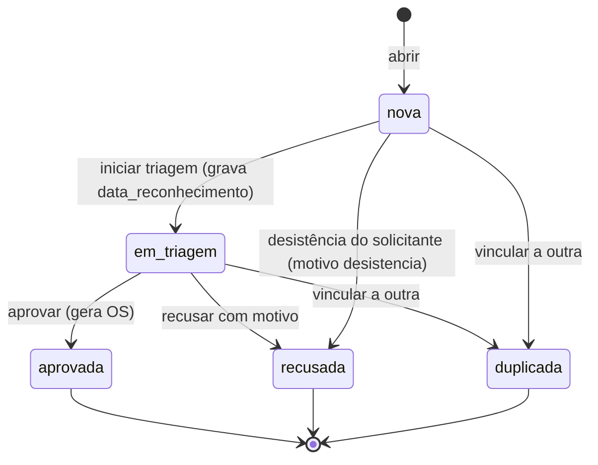

| De | Para | Ação | Quem | Campos obrigatórios | Efeito no ativo |
|---|---|---|---|---|---|
| — | `nova` | abrir | Qualquer usuário, `locatario` (RN-LOC-031), Sistema (checklist, telemática) | Ativo ou localização, descrição, "ativo parado?" | Se parado = sim: `parado` (RN-SOL-005) |
| `nova` | `em_triagem` | iniciar triagem | `planejador`, `gestor` | — (grava `data_reconhecimento`, uma única vez, RN-SOL-009) | Nenhum |
| `em_triagem` | `aprovada` | aprovar | `planejador`, `gestor` | Ativo (ou localização, RN-OS-015), tipo de OS, prioridade (`baixa`, `media`, `alta`, `urgente`; `corretiva_emergencial` é sempre `urgente`, RN-OS-017) | Parada passa a ser mantida pela OS |
| `em_triagem` | `recusada` | recusar | `planejador`, `gestor` | Motivo | Se a solicitação mantinha o ativo parado e não há outra causa: volta a `operando` |
| `nova`, `em_triagem` | `recusada` | desistir | O próprio solicitante; `planejador` ou `gestor` em nome dele | Motivo `desistencia` (fixo) e texto opcional (RN-SOL-008) | Igual a recusar |
| `nova`, `em_triagem` | `duplicada` | vincular | `planejador`, `gestor` | Solicitação ou OS de destino | Parada passa para o registro de destino |

`aprovada`, `recusada` e `duplicada` são finais (RN-SOL-008).

### 1.3 Diagrama do processo

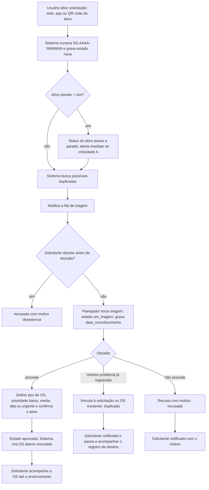

### 1.4 Passos

1. O usuário abre a solicitação pela web, pelo app ou lendo o QR code do ativo. Informa ativo ou localização, descrição, se o ativo está parado e, opcionalmente, foto, áudio e prioridade sugerida (RN-SOL-001).
2. O Sistema numera a solicitação (`SS-<AAAA>-<NNNNNN>`) e grava o estado `nova` com o instante de abertura. Aberta offline, ela recebe um identificador provisório e o número definitivo na sincronização (RN-MOB-007).
3. Se "ativo parado" = sim, o status do ativo passa a `parado` no instante informado de parada (padrão: instante da abertura) (RN-SOL-005). Ativo de criticidade A dispara alerta imediato ao `gestor` e ao `planejador` da unidade.
4. O Sistema mostra ao solicitante, antes de gravar, as solicitações em `nova` ou `em_triagem` e as OS não encerradas do mesmo ativo nos últimos 7 dias. O solicitante pode desistir e seguir uma existente. A marcação de duplicada, porém, é sempre humana (RN-SOL-002).
5. A solicitação entra na fila de triagem da unidade, ordenada por criticidade do ativo e antiguidade. Se ficar em `nova` além do SLA de triagem, o Sistema escala ao `gestor` (RN-SOL-006).
6. O `planejador` abre a solicitação. O estado passa a `em_triagem` e o instante é gravado em `data_reconhecimento` (usado no MTTA) (RN-SOL-009).
7. O `planejador` decide:
   - **Duplicada:** vincula a uma solicitação ou OS do mesmo problema. A causa da parada do ativo passa ao registro de destino. O solicitante é notificado e passa a acompanhar o destino.
   - **Recusada:** informa o motivo (lista configurável mais texto). O solicitante é notificado (RN-SOL-003).
   - **Aprovada:** confirma ou corrige o ativo, define o tipo de OS (`corretiva_planejada`, `corretiva_emergencial`, `melhoria` ou outro tipo aplicável) e a prioridade (`baixa`, `media`, `alta` ou `urgente`). A prioridade padrão vem da criticidade (RN-ATV-004); `corretiva_emergencial` é sempre `urgente` (RN-OS-017).
8. Na aprovação, o Sistema cria **uma** OS em `aberta`, numerada `OS-<AAAA>-<NNNNNN>`, vinculada à solicitação, copiando descrição, anexos e "parou o ativo" (RN-SOL-004). Se o ativo está em contrato de locação vigente, a OS recebe o responsável pelo custo padrão da matriz do contrato (RN-LOC-011). O `planejador` pode, na mesma operação, planejar e programar a OS (ver Fluxo 02).
9. O solicitante recebe notificação a cada mudança de estado da OS vinculada e no encerramento.

### 1.5 Exceções

| Situação | Tratamento |
|---|---|
| Solicitação só com localização | Na triagem, o `planejador` vincula um ativo ou aprova como OS de localização (RN-OS-015) |
| Ativo informado está `inativo` | A solicitação é aceita (pode ser um alerta real), mas a aprovação exige trocar o ativo ou reativá-lo (RN-ATV-003, substituída por RN-ATV-012). Ativo `em_implantacao`: a aprovação gera OS `implantacao` (RN-ATV-012) |
| Solicitação aberta por regra configurável | Origem `regra`, "ativo parado" = não, deduplicada pela regra e pelo ativo; segue esta triagem (Fluxo 29, RN-ADM-014) |
| Solicitante quer desistir | Não existe estado de cancelamento da solicitação. A desistência, a partir de `nova` ou `em_triagem`, é registrada como `recusada` com motivo `desistencia` (RN-SOL-008). A desistência a partir de `nova` não grava `data_reconhecimento` e fica fora do MTTA |
| Triagem informa que o ativo não está parado | O `planejador` corrige o campo; o status do ativo é recalculado e o intervalo de parada é encerrado no instante da correção, com auditoria |
| Duplicada marcada por engano | `duplicada` é final. O `gestor` usa a ação "reabrir como nova", que cria outra solicitação em `nova` com os dados e anexos da original, vinculada a ela, com motivo. A original continua `duplicada` (RN-SOL-008) |
| Solicitação automática (checklist, telemática) repetida | Não cria nova solicitação: incrementa o contador de ocorrências da existente (RN-SOL-007) |
| Regra automática configurada para criar OS direto | A solicitação é dispensada; a OS nasce com a origem registrada (Fluxo 15) |
| Solicitação aberta pelo locatário no portal | Entra na mesma fila de triagem, com origem `portal_locatario` e o contrato de locação vinculado (Fluxo 21, RN-LOC-031) |

### 1.6 Regras aplicadas

RN-SOL-001 a RN-SOL-009, RN-ATV-001, RN-ATV-004, RN-ATV-012, RN-ADM-014, RN-OS-015, RN-OS-017, RN-LOC-011, RN-LOC-031, RN-MOB-007, RN-ADM-002.

---

## Fluxo 02 — Ciclo de vida da OS

**Módulos:** OS, ATV, EST, CON, TER, LOC, MOB · **Fase:** MVP (registro de bloqueio NR-12 12.11.3 no MVP; verificação de capacitação e LOTO com pontos de bloqueio na Fase 2)

### 2.1 Atores

`planejador`, `gestor`, `tecnico`, `prestador` (OS atribuída ao seu fornecedor, Fluxo 18), `almoxarife`, liberador (permissão `os.encerrar`), Sistema.

### 2.2 Máquina de estados

O diagrama é o do sumário 3.3, com o nome das ações.

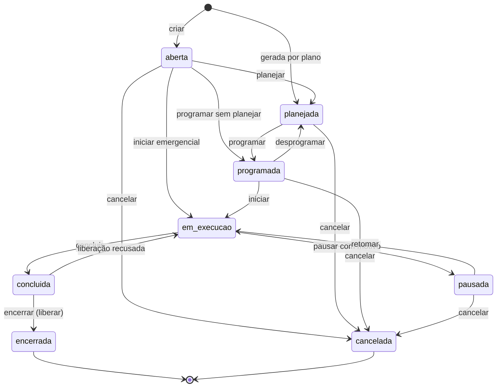

`em_execucao`, `concluida` e `encerrada` nunca vão para `cancelada`. `encerrada` e `cancelada` são finais (RN-OS-008).

### 2.3 Transições permitidas

Qualquer transição fora desta tabela é recusada (RN-OS-001).

| # | De | Para | Ação | Quem (padrão) | Campos obrigatórios e pré-condições | Status do ativo (RN-ATV-001) |
|---|---|---|---|---|---|---|
| T1 | — | `aberta` | criar | `planejador`, `gestor`; `tecnico` só para corretivas; Sistema (solicitação, regra de telemática, vistoria de locação, OS aberta pela subcontratada conectada, RN-SRV-056); IA após confirmação humana | Ativo (ou localização), tipo de OS, descrição, prioridade (`baixa`, `media`, `alta`, `urgente`; `corretiva_emergencial` nasce `urgente`, RN-OS-017), origem (`manual`, `solicitacao`, `plano`, `checklist`, `telematica`, `rascunho_ia`, `vistoria_locacao`, `prestador`, `cliente_conectado`, `projeto`; nenhum efeito de regra abre OS), "parou o ativo", executor (`interno` ou `fornecedor`) e responsável pelo custo (RN-OS-019). Campos extras obrigatórios na abertura, quando a criação é de usuário (RN-OS-024). OS `implantacao` só em ativo `em_implantacao` ou ligada a etapa de projeto (RN-OS-022). Grava `data_abertura` | Falha com parada: `parado` |
| T1a | — | `planejada` | gerar por plano | Sistema | Plano, procedimento, data de vencimento, gatilho (RN-OS-014). Grava `data_abertura` | Sem mudança |
| T2 | `aberta` | `planejada` | planejar | `planejador`, `gestor` | Ao menos uma tarefa (ou procedimento), HH estimadas, peças previstas (pode ser "nenhuma"), "exige parada" | Sem mudança |
| T3 | `aberta` | `programada` | programar sem planejar | `planejador`, `gestor` | Campos de T4. Tarefas, HH e peças ficam opcionais e podem ser completadas depois, sem mudar o estado (RN-OS-020). Grava `data_reconhecimento` se vazia | Sem mudança |
| T4 | `planejada` | `programada` | programar | `planejador`, `gestor` | Data e hora de início previstas, duração prevista, responsável (técnico, equipe ou fornecedor; fornecedor exige papel compatível, RN-TER-002). Capacitação válida dos atribuídos na data programada (RN-CON-030, Fase 2). Dispara reserva das peças previstas (RN-EST-002; no almoxarifado `em_terceiro` do fornecedor quando ele executa com estoque próprio da empresa, RN-EST-023). Grava `data_reconhecimento` se vazia (RN-OS-016) | Sem mudança |
| T5 | `programada` | `planejada` | desprogramar | `planejador`, `gestor`; Sistema quando o fornecedor recusa a OS (RN-TER-011) | Motivo. Reservas mantidas. A OS que veio de T3 sem planejamento volta a `planejada` mesmo sem tarefas; o `planejador` completa o planejamento antes de reprogramar | Sem mudança |
| T6 | `programada` | `em_execucao` | iniciar | `tecnico` atribuído, `prestador` do fornecedor atribuído (RN-TER-014), Sistema em nome da subcontratada conectada (RN-SRV-053), `gestor` | Registro de bloqueio e etiquetagem (`bloqueio_energia`, NR-12, 12.11.3) se o ativo exige (RN-CON-006, MVP); pontos de bloqueio e procedimento LOTO (RN-CON-007, Fase 2). Capacitação válida no instante (RN-CON-031, Fase 2). Nenhum outro apontamento aberto do técnico (RN-OS-011). Grava `data_inicio` (só na primeira vez) e `data_reconhecimento` se vazia | Retirada programada: `em_manutencao`. Falha com parada: continua `parado` |
| T7 | `aberta` | `em_execucao` | iniciar emergencial | `tecnico`, `gestor` | Só para `corretiva_emergencial` (RN-OS-005). Quem inicia vira responsável. Mesmas verificações de T6 | `parado` (corretiva emergencial em curso) |
| T8 | `em_execucao` | `pausada` | pausar | `tecnico`, `prestador` atribuído, `gestor` | Motivo: `aguardando_peca`, `aguardando_aprovacao`, `aguardando_terceiro`, `fim_turno` ou `outro`. `outro` exige texto. `aguardando_peca` exige o item faltante (RN-OS-003). Fecha o apontamento aberto | Sem mudança |
| T9 | `pausada` | `em_execucao` | retomar | `tecnico` atribuído, `prestador` atribuído, `gestor` | Mesmas verificações de T6 (capacitação reavaliada) | Sem mudança |
| T10 | `em_execucao` | `concluida` | concluir | `tecnico` atribuído, `prestador` atribuído (inclusive pelo link de uso único, RN-TER-013), `gestor` | Ver 2.4 (RN-OS-006). Grava `data_conclusao` | Sem mudança até o encerramento |
| T11 | `concluida` | `em_execucao` | recusar liberação | Liberador (`os.encerrar`; padrão `gestor`, `planejador`) | Motivo em `motivo_recusa_liberacao` (RN-OS-009). A `data_conclusao` anterior fica no histórico; a próxima conclusão grava a nova | Sem mudança |
| T12 | `concluida` | `encerrada` | encerrar (liberar) | Liberador (`os.encerrar`; padrão `gestor`, `planejador`); o próprio técnico se a empresa permitir (RN-OS-013). Nunca `prestador` nem `locatario` (RN-TER-015) | Ver 2.5 (RN-OS-007). Grava `data_encerramento` | Recalculado: `operando` se não houver outra causa (RN-ATV-006); `parado` se parecer NR-12 `inapto` |
| T13 | `aberta`, `planejada`, `programada`, `pausada` | `cancelada` | cancelar | `gestor`, `planejador` | Motivo. Peças saídas devolvidas. Se a OS mantinha o ativo parado, informar o status final do ativo (RN-OS-004). Grava `data_cancelamento` | Recalculado com a informação dada |

`em_execucao` não pode ser cancelada diretamente: o técnico pausa primeiro, o que fecha o apontamento. `concluida` também não: o liberador recusa a liberação (T11), o técnico pausa e só então a OS pode ser cancelada. `encerrada` e `cancelada` são finais (RN-OS-008).

**Ações sem mudança de estado:**

| Ação | Estados | Quem | Efeito |
|---|---|---|---|
| reconhecer | `aberta`, `planejada`, `programada` | `tecnico`, `planejador`, `gestor`, `prestador` (aceite, RN-TER-011) | Grava `data_reconhecimento` se vazia (RN-OS-016). Base do MTTA |
| assumir | `aberta`, `planejada` | `tecnico` da equipe da OS | O técnico se atribui como responsável, sem mudar o estado; grava `data_reconhecimento` se vazia (RN-OS-021). OS `programada` já tem responsável: a troca é feita pelo `planejador` |
| aceitar ou recusar (fornecedor) | `programada` | `prestador`, prestador ocasional pelo link ou a subcontratada conectada na conta dela (RN-SRV-052) | Aceite grava `data_reconhecimento`; recusa dispara T5 com motivo (RN-TER-011) |
| alterar responsável pelo custo | Qualquer estado não final | `planejador`, `gestor` | Exige `justificativa_responsavel_custo` quando o valor padrão veio da matriz de locação ou de garantia (RN-LOC-011) |

**Marcos de tempo da OS:** `data_abertura`, `data_reconhecimento`, `data_inicio`, `data_conclusao`, `data_encerramento`, `data_cancelamento`, além dos instantes de planejamento, programação, pausas e retomadas (RN-OS-010).

### 2.4 Campos obrigatórios para concluir (T10)

| Campo | Quando é obrigatório |
|---|---|
| Todas as tarefas obrigatórias marcadas como feitas ou "não aplicável" com justificativa | Sempre |
| Ao menos um apontamento de horas | Sempre, exceto OS de fornecedor cobrada por visita ou por serviço (unidade de preço diferente de `hora`, RN-TER-014) |
| "Parou o ativo" confirmado e, se sim, instante de início da parada | Sempre |
| Descrição do serviço executado | Sempre |
| Código de falha (modo, causa, atividade) | Corretivas (nunca na OS `implantacao`, RN-OS-022), em todos os planos: catálogo padrão no MVP; catálogo personalizável no Profissional, Fase 2 (RN-OS-018) |
| Leitura de cada medidor do ativo exigido pelo plano | Preventiva ou inspeção com gatilho por medidor (RN-PRE-013); opcional nas demais |
| Peças saídas e não usadas devolvidas ou declaradas como consumidas | Sempre que houver saída para a OS (RN-EST-005) |
| Destino de peça reparável retirada com defeito (quarentena) | Quando a OS retirou peça de item reparável (RN-EST-040, Fase 2) |
| Respostas do checklist vinculado | Quando a OS tem checklist obrigatório |
| Campos extras obrigatórios na conclusão (`campo_extra_os`) | Quando a definição do tipo de OS e da classe do ativo exige; validados igual no servidor e no app offline. Conclusão offline feita antes de o aparelho receber a definição nova é aceita sem o campo e sinalizada para revisão (RN-OS-023, RN-OS-024) |

### 2.5 Requisitos para encerrar (T12)

1. Usuário com permissão de liberação (`os.encerrar`). O prestador nunca encerra (RN-TER-015).
2. Se o ativo é máquina NR-12: os sete campos do item 12.11.2 e o parecer conclusivo (Fluxo 06, RN-CON-001 e RN-CON-002).
3. Nenhum apontamento aberto.
4. Reservas não consumidas são liberadas automaticamente (RN-EST-006).
5. O Sistema consolida o custo: mão de obra (horas apontadas × custo-hora do técnico), peças (saídas menos devoluções, a custo médio) e serviços de terceiros (Fluxos 14 e 18). O custo fica atribuído ao responsável pelo custo da OS (RN-OS-019).
6. A OS fica imutável. Correções posteriores são feitas por OS complementar vinculada ou por anotação auditada que não altera campos (RN-OS-008).
7. O Sistema recalcula o status do ativo (RN-ATV-006) e, se a OS veio de plano, reprograma o plano (Fluxo 03).
8. OS de fornecedor encerrada entra na avaliação de SLA do fornecedor (RN-TER-021, RN-TER-023, Fase 2).

### 2.6 OS gerada por plano

A OS de `preventiva`, `preditiva` ou `inspecao_legal` gerada por plano já nasce em `planejada`, com tarefas, HH e peças do procedimento (RN-OS-014). O Sistema grava o instante de criação como `data_abertura` e como planejamento.

### 2.7 Exceções

| Situação | Tratamento |
|---|---|
| Liberação demora dias após a conclusão | O ativo mantém o status até o encerramento. O MTTR e a disponibilidade medem até `data_conclusao`; o tempo em `concluida` aparece à parte como "tempo de liberação". O painel mostra OS em `concluida` há mais de 24 h (parâmetro) |
| Técnico tenta iniciar segunda OS com apontamento aberto | Recusado. O app oferece pausar a OS atual com motivo |
| Ativo com duas OS que param o ativo | O status só volta a `operando` quando a última for encerrada ou cancelada |
| Problema reaparece depois do encerramento | Nova OS corretiva; se for no mesmo ativo e mesmo modo de falha em até 30 dias, é marcada como retrabalho (RN-OS-012). Se a OS anterior foi executada por fornecedor, o responsável pelo custo sugerido é `fornecedor` (RN-TER-024) |
| Ajuste de horário gravado errado (ex.: início esquecido) | Só o `gestor` ajusta timestamps de ciclo, com motivo; valor original fica na auditoria (RN-OS-010) |
| OS de localização sem ativo | Segue o mesmo ciclo, sem efeito em status de ativo nem em KPIs por ativo (RN-OS-015) |
| Precisa cancelar OS em `em_execucao` | Pausar com motivo (T8) e então cancelar (T13) |
| Ativo em contrato de locação vigente | Responsável pelo custo padrão vem da matriz do contrato e só muda com justificativa (RN-LOC-011); OS em ativo tomado a cargo do locador é executada pelo locador (Fluxo 22) |
| OS atribuída a fornecedor com conta própria conectada | A execução acontece na conta da subcontratada e chega a esta OS pela sincronização; cada campo tem um lado dono e a liberação continua da empresa (Fluxo 26, RN-SRV-051, RN-SRV-054) |
| Técnico tenta assumir OS `programada` ou de outra equipe | Recusado. A OS programada já tem responsável; o `planejador` reprograma (RN-OS-021) |
| OS `implantacao` | Mesmo ciclo e mesmas transições; sem código de falha; fora dos KPIs de manutenção e com custo de implantação (RN-OS-022, RN-IND-009, RN-IND-010). No ativo `em_implantacao`, não muda o status, que continua `inativo` |
| OS vinculada a conta conectada com campo extra obrigatório na conclusão do cliente | A conclusão sincronizada é aceita sem o campo, que não trafega; a regra `os_concluida_com_campo` não dispara (RN-OS-024, lacuna L-39) |
| Regra configurável bloqueia o ativo com a OS em execução | A OS segue: regra nunca muda estado de OS (RN-ADM-011). O encerramento não levanta o bloqueio de regra (RN-CON-041) |

### 2.8 Regras aplicadas

RN-OS-001 a RN-OS-026, RN-SRV-051 a RN-SRV-054, RN-ADM-011, RN-CON-041, RN-IND-009, RN-IND-010, RN-SRV-056, RN-ATV-001, RN-ATV-006, RN-CON-001, RN-CON-002, RN-CON-006, RN-CON-007, RN-CON-030, RN-CON-031, RN-EST-002, RN-EST-005, RN-EST-006, RN-EST-023, RN-EST-040, RN-PRE-013, RN-TER-002, RN-TER-011, RN-TER-013, RN-TER-014, RN-TER-015, RN-TER-024, RN-LOC-011.

---

## Fluxo 03 — Manutenção preventiva

**Módulos:** PRE, OS, MED, EST · **Fase:** MVP

### 3.1 Atores

`planejador` (cadastra planos e programa), Sistema (agendador e recálculo), `tecnico` (executa).

### 3.2 Definições

| Termo | Definição |
|---|---|
| Gatilho por tempo | Intervalo de calendário `I_t` (dias, semanas, meses ou anos) |
| Gatilho por medidor | Intervalo `I_m` em unidades de um medidor do ativo (km, horas, ciclos, outro) |
| "O que vencer primeiro" | Plano com dois ou mais gatilhos; vence quando o primeiro deles vence |
| Base | Ponto de partida do próximo vencimento: data `B_t` e leitura `B_m` |
| Vencimento | `V_t = B_t + I_t`; `V_m = B_m + I_m` |
| Antecipação | Quanto antes do vencimento a OS é gerada: `A_t` em dias, `A_m` em unidades do medidor |
| Tolerância | Janela em torno do vencimento em que a execução conta como "no prazo": `[V − T_antes, V + T_depois]` |
| Uso médio | Média diária de uso do medidor nos últimos 30 dias de leituras válidas |
| Base de reprogramação | `execucao` (a partir da data e leitura reais de execução) ou `previsto` (a partir do vencimento previsto) — valores propostos |

Padrões (alteráveis por plano): `A_t` = 7 dias; `A_m` = 10% de `I_m`; `T_antes` = `T_depois` = 10% do intervalo (mínimo 1 dia ou 1 unidade); base de reprogramação `previsto` para gatilho único por tempo ou medidor; `execucao` para planos combinados e para `inspecao_legal`.

### 3.3 Diagrama

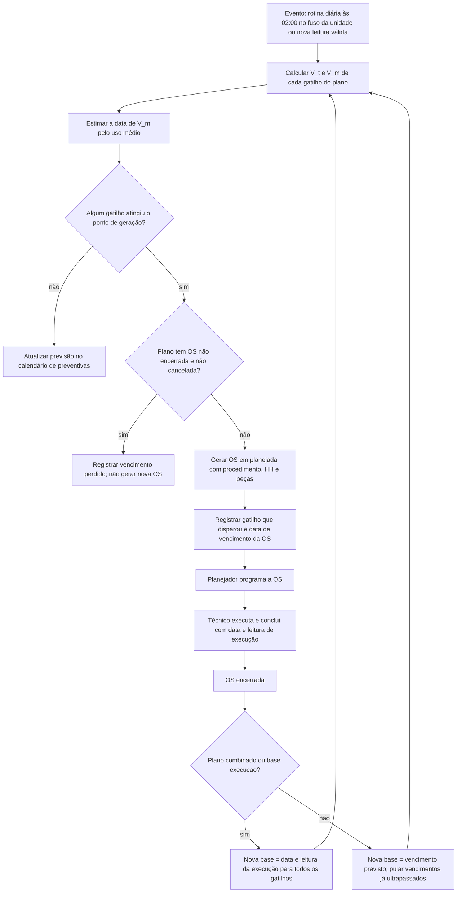

### 3.4 Cálculo do vencimento e da geração

```go
// Ponto de geração de cada gatilho
geraPorTempo   := hoje >= V_t.AddDays(-A_t)
geraPorMedidor := leituraAtual >= V_m - A_m ||
                  (usoMedio > 0 && DataEstimada(V_m) <= hoje.AddDays(A_t))

// Data estimada de um vencimento por medidor
func DataEstimada(V_m float64) Date {
    return hoje.AddDays(ceil((V_m - leituraAtual) / usoMedio))
}

// Plano combinado: vence no primeiro gatilho
if geraPorTempo || geraPorMedidor {
    os.DataVencimento = min(V_t, DataEstimada(V_m))   // gatilhos ausentes são ignorados
    os.GatilhoDisparado = qualDisparou()
}
```

- Intervalo em meses soma meses de calendário. Se o dia não existe no mês de destino, usa o último dia do mês.
- O uso médio exige ao menos duas leituras válidas em 7 dias. Sem isso, usa o uso médio padrão da classe do ativo; sem padrão da classe, a data estimada fica indisponível e só a leitura dispara a OS (RN-PRE-002).
- O vencimento por medidor usa o **valor acumulado** do medidor, que atravessa trocas de hodômetro e viradas de contador (Fluxo 04).

### 3.5 Passos

1. O `planejador` cadastra o plano para um ativo ou para uma classe de ativo: gatilhos, procedimento, tipo de OS (`preventiva`, `preditiva` ou `inspecao_legal`), "exige parada", antecipação, tolerância e base de reprogramação. A primeira base é a data de início do plano e a leitura atual.
2. O Sistema avalia o plano diariamente e a cada leitura válida do medidor ligado (RN-MED-007).
3. Ao atingir o ponto de geração, o Sistema verifica se já existe OS do plano não encerrada e não cancelada. Se existe, registra **vencimento perdido** e não gera outra (RN-PRE-007).
4. Se não existe, gera a OS em `planejada`, com data de vencimento, gatilho que disparou e janela de tolerância gravados na OS (RN-OS-014). Peças previstas podem ser reservadas já na geração, se o plano pedir.
5. O `planejador` programa (Fluxo 02, T4).
6. O `tecnico` executa e conclui, informando a leitura de cada medidor usado pelo plano (RN-PRE-013). A leitura entra como `leitura_medidor` de origem `os`.
7. No encerramento, o Sistema reprograma o plano:
   - **Base `execucao`:** `B_t` = data de conclusão; `B_m` = leitura na conclusão.
   - **Base `previsto` (só gatilho único):** `B` = vencimento previsto da OS. Se a execução ocorreu depois de um ou mais vencimentos seguintes, esses vencimentos são pulados (registrados como perdidos) e a nova base é o último vencimento previsto já ultrapassado. Exemplo: plano de 10.000 km, OS prevista para 10.000 km, executada a 21.000 km; o vencimento de 20.000 km é registrado como perdido e o próximo é 30.000 km.
   - **Plano combinado:** sempre reinicia todos os gatilhos a partir da execução (RN-PRE-003). Ancorar no previsto de um gatilho desalinharia o outro.
8. O calendário de preventivas e o PM compliance são atualizados.

### 3.6 Preventiva não executada

| Situação | Tratamento |
|---|---|
| OS passa de `V + T_depois` sem conclusão | A OS continua aberta e é marcada como **atrasada** (atributo derivado, não estado). Alerta diário ao `planejador`; alerta ao `gestor` após 7 dias. Conta como não cumprida no PM compliance (RN-PRE-008) |
| Chega o vencimento seguinte com a OS ainda aberta | Não gera nova OS. Registra vencimento perdido, que entra no denominador do PM compliance como não cumprido (RN-PRE-007) |
| OS de preventiva cancelada | Motivo obrigatório. O plano é reprogramado como se o vencimento tivesse sido pulado: próximo `V` = `V_cancelado + I`, em qualquer base. Conta como não cumprida, salvo motivos de exclusão: ativo passou a `inativo` antes do vencimento ou plano desativado antes do vencimento (RN-PRE-008) |
| OS de `inspecao_legal` não executada | Nunca é pulada em silêncio. Alerta crítico diário até a execução. Só o `gestor` cancela, e somente se houver outra OS que a substitua ou se o ativo for inativado (RN-PRE-012) |
| Execução antecipada, antes de `V − T_antes` | Conta como cumprida por padrão; a empresa pode configurar como não cumprida (RN-IND-002). A reprogramação segue a base do plano |

### 3.7 Outras exceções

| Situação | Tratamento |
|---|---|
| Medidor sem leitura há mais de 15 dias (parâmetro) | Alerta "medidor desatualizado" ao `planejador`; a data estimada fica marcada como não confiável (RN-PRE-009) |
| Plano de classe alterado | Afeta apenas as OS geradas depois da alteração (RN-PRE-010) |
| Ativo inativado | Planos suspensos, sem gerar OS. Na reativação, a base passa a ser a data da reativação e a leitura atual; vencimentos durante a inatividade não contam (RN-PRE-011) |
| Leitura que gerou a OS é invalidada depois | A OS não é cancelada automaticamente; o `planejador` é alertado para decidir (RN-MED-008) |
| Ativo em implantação | Planos suspensos desde o cadastro. Na entrada em operação, a base é `data_entrada_operacao` e a leitura atual; nada é devido antes (RN-ATV-014) |

### 3.8 Regras aplicadas

RN-PRE-001 a RN-PRE-013, RN-OS-014, RN-MED-007, RN-MED-008, RN-IND-002, RN-ATV-014.

---

## Fluxo 04 — Leitura de medidor

**Módulos:** MED, PRE, FRO, INT, LOC, MOB · **Fase:** MVP (origens `telematica` e `cartao_combustivel` na Fase 2; `iot` na Fase 3)

### 4.1 Atores

`tecnico`, `motorista`, `prestador`, `gestor` (confirma leituras pendentes), Integração (telemática, cartão, integrador via API), Sistema.

### 4.1a Origem da leitura

Toda `leitura_medidor` tem uma origem, conforme o sumário (RN-MED-009):

| Origem | Inclui |
|---|---|
| `manual` | Digitação na web ou no app, leitura informada em checklist (inclusive pré-viagem), abastecimento digitado, vistoria de locação (Fluxo 21) |
| `telematica` | Conectores de rastreador ou montadora (Fase 2) |
| `cartao_combustivel` | Km informado na transação do cartão (Fase 2) |
| `os` | Leitura informada na conclusão de OS, inclusive por prestador (RN-PRE-013) |
| `importacao` | Importação por CSV e envio por API de integrador |
| `iot` | Sensores de manutenção baseada em condição (Fase 3) |

### 4.2 Situação da leitura

Toda `leitura_medidor` tem uma situação **(proposto)**: `valida` (usada nos cálculos), `pendente` (aguarda confirmação do `gestor`, não usada) ou `rejeitada` (guardada só para auditoria). Leitura manual recusada na tela não é gravada: o usuário corrige na hora. Leitura de integração recusada é gravada como `rejeitada`.

### 4.3 Diagrama

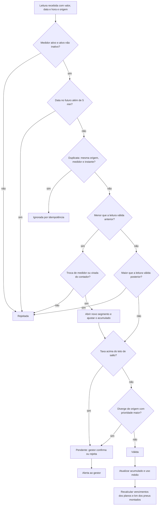

### 4.4 Validações

1. **Medidor ativo.** O medidor existe, está ativo e o ativo não está `inativo` (RN-ATV-003). Importação de histórico é a única exceção, e só para datas anteriores à inativação.
2. **Sem data futura.** Data e hora até 5 minutos à frente do relógio do servidor (RN-MED-005).
3. **Sem regressão.** O valor não pode ser menor que o da última leitura válida com data anterior, nem maior que o da primeira leitura válida com data posterior (leitura retroativa) (RN-MED-001, RN-MED-005).
4. **Teto de salto.** A taxa `(valor − anterior) / horas decorridas` não pode passar da taxa máxima da classe do ativo. Padrões: horímetro 1,05 h por hora decorrida; hodômetro 120 km por hora decorrida e 1.500 km por dia em intervalos acima de 24 h; ciclos e outros sem padrão (o `planejador` define). Acima do teto, a leitura fica `pendente` (RN-MED-002).
5. **Conflito entre origens.** Ver 4.6 (RN-MED-006).

### 4.5 Troca de hodômetro ou horímetro e virada do contador

- **Troca** é uma ação própria ("trocar medidor") com: data e hora, leitura final do medidor antigo, leitura inicial do novo e motivo. Se o medidor antigo quebrou e não tem leitura final, o Sistema sugere uma estimativa pelo uso médio, marcada como estimada (RN-MED-003).
- O Sistema guarda o medidor em **segmentos**. O valor acumulado é `Σ (final − inicial)` dos segmentos encerrados `+ (leitura atual − inicial do segmento atual)`.
- A validação de regressão compara leituras dentro do mesmo segmento. Planos, pneus, MTBF e consumo usam sempre o valor acumulado.
- **Virada do contador** (ex.: hodômetro de 6 dígitos que passa de 999.999 para 0) é detectada quando o medidor tem limite cadastrado, a última leitura está a menos de 1% do limite e a nova é menor que 1% do limite. O acumulado soma `(limite − anterior) + nova` (RN-MED-004).

### 4.6 Leituras conflitantes de origens diferentes

- Cada origem tem prioridade configurável por empresa. Padrão: `telematica` (1), `os` (2), `manual` (3), `importacao` (4), `cartao_combustivel` (5). A origem `iot` (Fase 3) recebe prioridade na ativação do conector; até lá não é usada.
- Ao receber uma leitura, o Sistema estima o valor esperado naquele instante pela origem de maior prioridade disponível: interpolação entre duas leituras dela ou extrapolação pelo uso médio por até 24 h.
- Se a diferença passar da tolerância (padrão: km, o maior entre 2% e 50 km; horas, o maior entre 2% e 5 h), a leitura de **menor** prioridade fica `pendente` com motivo "conflito com <origem>". A de maior prioridade continua válida.
- Três ou mais conflitos entre as mesmas duas origens no mesmo medidor em 30 dias geram alerta de **calibração** ao `gestor` (odômetro do painel diferente do rastreador, por exemplo).
- Nenhuma leitura é apagada. O `gestor` pode confirmar a pendente (vira `valida`) ou rejeitá-la.

### 4.7 Recálculo de vencimentos

Cada leitura `valida`:

1. Atualiza o valor acumulado e o uso médio de 30 dias.
2. Recalcula `V_m`, a data estimada e o ponto de geração de todos os planos ligados ao medidor; gera OS quando o ponto é atingido (Fluxo 03).
3. Atualiza o km dos pneus montados no veículo (Fluxo 11) e o km usado no consumo (Fluxo 12).
4. Leitura confirmada depois de pendente dispara o mesmo recálculo.
5. Leitura invalidada depois de ter gerado OS não cancela a OS; o `planejador` é alertado (RN-MED-008).

### 4.8 Exceções

| Situação | Tratamento |
|---|---|
| Motorista digita km com um dígito a mais | Teto de salto barra; o app pede confirmação com foto do painel; a leitura fica `pendente` |
| Telemática envia leitura a cada minuto | O conector grava no máximo uma leitura por medidor por hora, mais a última do dia (RN-INT-005) |
| Leitura retroativa entre duas existentes | Aceita se estiver entre a anterior e a posterior; recalcula uso médio e vencimentos |
| Correção de leitura válida errada | O `gestor` invalida com motivo e, se quiser, registra a leitura correta; a original continua na trilha (RN-MED-008) |

### 4.9 Regras aplicadas

RN-MED-001 a RN-MED-009, RN-ATV-003, RN-INT-005, RN-PRE-002.

---

## Fluxo 05 — Checklist no app

**Módulos:** CHK, SOL, MED, CON, MOB · **Fase:** MVP

### 5.1 Atores

`tecnico`, `motorista`, operador (qualquer usuário com permissão de executar checklist), `gestor` (libera veículo bloqueado), Sistema.

### 5.2 Diagrama

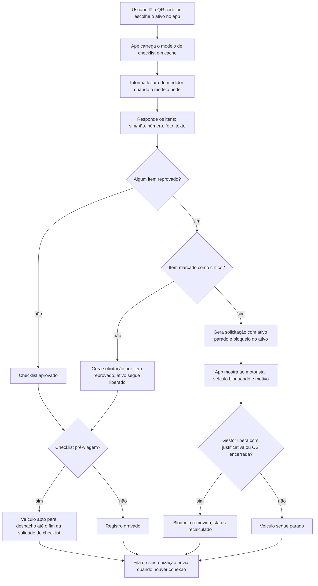

### 5.3 Passos

1. O usuário escolhe o ativo (QR code, lista ou busca). O app usa o modelo de checklist em cache e grava a versão do modelo usada (RN-CHK-003).
2. Se o modelo pede leitura de medidor, o usuário informa. Ela vira `leitura_medidor` com origem `manual` e passa pelas validações do Fluxo 04 no app (com o último dado conhecido) e de novo no servidor (RN-CHK-006).
3. O usuário responde os itens. Item numérico fora da faixa do modelo reprova automaticamente. Item reprovado pode exigir foto e comentário, conforme o modelo (RN-CHK-002).
4. Ao finalizar, a execução recebe data e hora do dispositivo, geolocalização (se permitida) e assinatura do executor.
5. Para cada item reprovado marcado no modelo como "gera solicitação", o Sistema cria uma solicitação com origem "checklist", o ativo, o item e as fotos (RN-CHK-001). Se já existe solicitação aberta do mesmo ativo para o mesmo item, só incrementa o contador de ocorrências (RN-SOL-007).
6. **Item crítico reprovado** (marcado como crítico no modelo) gera a solicitação com "ativo parado" = sim e cria um `bloqueio_ativo`. O status passa a `parado` (RN-CHK-005).
7. **Checklist pré-viagem:** se a classe do veículo exige checklist pré-viagem, o veículo só fica apto para despacho com um checklist pré-viagem aprovado dentro da validade (padrão: 12 horas, ou até o fim da jornada informada) (RN-CHK-004). Item não crítico reprovado não impede o despacho; item crítico impede.
8. O bloqueio é removido quando: a OS gerada a partir da solicitação é encerrada, ou o `gestor` libera com justificativa (liberação registrada na auditoria e na solicitação). A liberação pelo `gestor` não encerra a solicitação.

### 5.4 Execução offline

- O app guarda modelos de checklist, ativos da unidade e o último estado conhecido de bloqueios e documentos (RN-MOB-008).
- A decisão de bloqueio por item crítico é tomada **no app**, na hora, sem esperar o servidor. O motorista vê a mensagem imediatamente.
- A execução, as solicitações geradas e a leitura viram comandos na fila de sincronização (Fluxo 16). O servidor revalida; solicitações recebem número definitivo na sincronização (RN-MOB-007).
- Se dois checklists do mesmo veículo chegam fora de ordem, todos são aceitos (eventos append-only, RN-MOB-004). A aptidão para despacho considera o mais recente pela data de execução.

### 5.5 Exceções

| Situação | Tratamento |
|---|---|
| Modelo mudou enquanto o app estava offline | A execução vale com a versão antiga, registrada na execução |
| Foto obrigatória sem câmera disponível | O item não pode ser finalizado; o app permite salvar rascunho |
| Motorista tenta sair com veículo bloqueado | A Tenaz não controla o veículo; a aptidão negativa é exposta por API ao TMS (Fluxo 08) e o evento é registrado se houver telemática indicando movimento |
| Inspeção rotineira do operador de máquina NR-12 | O registro é opcional (NR-12 item 12.14.2.1); a empresa decide se exige (RN-CHK-007) |
| Item reprovado com regra configurável `item_checklist_reprovado` | O efeito da regra se soma ao padrão de RN-CHK-001 e RN-CHK-005, sem substituí-lo (Fluxo 29, RN-ADM-011) |

### 5.6 Regras aplicadas

RN-CHK-001 a RN-CHK-007, RN-SOL-007, RN-MOB-004, RN-MOB-007, RN-MOB-008, RN-CON-021, RN-ADM-011.

---

## Fluxo 06 — Encerramento de OS em máquina NR-12

**Módulos:** OS, CON, ATV, TER · **Fase:** MVP (assinatura eletrônica avançada no MVP, todos os planos; ICP-Brasil condicionada à pendência P1)

### 6.1 Atores

`tecnico` ou `prestador` (preenche), liberador (permissão `os.encerrar`, padrão `gestor` e `planejador`), Sistema.

### 6.2 Quando se aplica

A todo encerramento de OS de qualquer tipo em ativo marcado como **máquina NR-12** (marcação no ativo ou na classe). A empresa não pode desativar a exigência para esses ativos (RN-CON-001).

### 6.3 Os sete campos do item 12.11.2

| # | Elemento exigido pela NR-12 (12.11.2) | Como a Tenaz preenche | Pode ficar vazio? |
|---|---|---|---|
| 1 | Intervenções realizadas | Lista das tarefas executadas da OS mais descrição livre do executado | Não |
| 2 | Data da realização | Data de conclusão da OS, gravada pelo Sistema | Não |
| 3 | Serviço realizado | Tipo de OS e descrição do serviço | Não |
| 4 | Peças reparadas ou substituídas | Saídas de estoque da OS (substituídas) mais lista de peças reparadas. "Nenhuma" exige marcação explícita | Não (aceita "nenhuma" explícito) |
| 5 | Condições de segurança do equipamento | Checklist de segurança pós-intervenção: proteções reinstaladas, dispositivos de parada de emergência testados, bloqueios do registro 12.11.3 removidos (RN-CON-006), área liberada, mais observação | Não |
| 6 | Indicação conclusiva quanto às condições de segurança da máquina | Parecer: apto, apto com restrição ou inapto, com justificativa | Não |
| 7 | Nome do responsável pela execução das intervenções | Nome completo do usuário que assina; função e registro profissional quando cadastrados | Não |

### 6.4 Diagrama

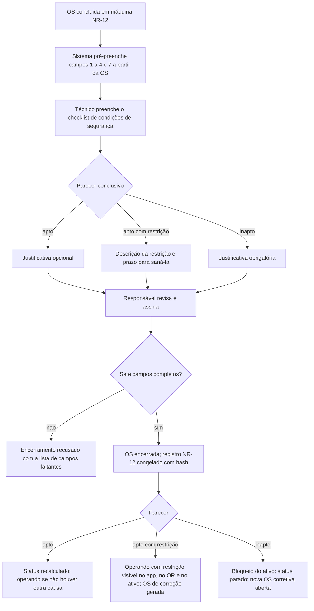

### 6.5 Passos

1. A OS chega a `concluida`. O Sistema pré-preenche os campos 1, 2, 3, 4 e 7 a partir da OS.
2. O técnico preenche o checklist de condições de segurança (campo 5) e o parecer conclusivo (campo 6).
3. O responsável pela liberação revisa e encerra. O Sistema verifica os sete campos e recusa o encerramento listando os que faltam (RN-CON-001).
4. A assinatura eletrônica avançada registra usuário autenticado, data e hora do servidor, geolocalização (se no app) e hash do conteúdo do registro NR-12 (RN-CON-005).
5. Efeito do parecer (RN-CON-002):
   - **Apto:** status recalculado normalmente.
   - **Apto com restrição:** o ativo volta a operar, com a restrição exibida no app, no QR code e na ficha do ativo. O Sistema gera OS `corretiva_planejada` para sanar a restrição, com data limite igual ao prazo informado. Restrição vencida gera alerta ao `gestor`.
   - **Inapto:** o Sistema cria `bloqueio_ativo`; status `parado`. Abre OS `corretiva_planejada` vinculada (ou `corretiva_emergencial`, se o `gestor` escolher). O bloqueio só sai com o encerramento de uma OS posterior com parecer apto ou apto com restrição.
6. O registro NR-12 entra no histórico do ativo e no relatório de inventário de máquinas (12.18.1), disponível a qualquer momento (RN-CON-003).

### 6.6 Assinatura e pendência P1

- **MVP, todos os planos:** assinatura eletrônica avançada própria (login, geolocalização, carimbo de tempo, hash e trilha), apoiada na MP 2.200-2, art. 10, §2º. Vale para OS, checklist, registro NR-12 e vistoria de locação.
- **ICP-Brasil** (A1, A3 ou em nuvem): **condicionada à pendência P1** do sumário, saber se o item 1.6 da NR-1 exige ICP-Brasil em documentos de SST (RN-CON-005). A fase de entrega será definida depois do parecer.

### 6.7 Exceções

| Situação | Tratamento |
|---|---|
| OS de fornecedor externo em máquina NR-12 | O `prestador` (no app ou pelo link de uso único, Fluxo 18) preenche os campos 5 e 6 e assina como executor; sem acesso, o fornecedor informa os campos pelo relatório de serviço e um usuário da empresa transcreve e anexa o relatório. O campo 7 registra a `pessoa` do fornecedor que executou. A liberação é sempre de um usuário da empresa (RN-TER-015) |
| OS cancelada em máquina NR-12 | Não há registro NR-12, pois não houve intervenção. Se houve trabalho parcial, a OS não pode ser cancelada: é concluída com o que foi feito |
| Máquina marcada como NR-12 depois de OS antigas | OS anteriores não são alteradas; o relatório indica a data da marcação |

### 6.8 Regras aplicadas

RN-CON-001 a RN-CON-006, RN-OS-007, RN-ATV-001, RN-TER-015.

---

## Fluxo 07 — NR-13: próxima inspeção e relatório

**Módulos:** CON, PRE, OS, ATV · **Fase:** Fase 2

### 7.1 Atores

`planejador`, profissional legalmente habilitado (perfil `plh`), `gestor`, Sistema. O PLH é uma `pessoa` com usuário de perfil `plh`, interna ou ligada a um fornecedor; quando é de fornecedor, o usuário também fica ligado ao `fornecedor` e só vê os equipamentos das OS atribuídas a ele (RN-TER-012).

### 7.2 Cadastro do equipamento NR-13

| Campo | Valores |
|---|---|
| Tipo NR-13 | Caldeira, vaso de pressão, tubulação, tanque metálico |
| Categoria | Caldeira: A ou B. Vaso: I a V |
| Condição especial | Caldeira de recuperação de álcalis; cat. A com teste anual das válvulas; cat. B com gerenciamento de combustão (Anexo IV); cat. A com sistema instrumentado de segurança |
| SPIE | Sim ou não, com o certificado do SPIE cadastrado como `documento_vencimento` da unidade |
| Prazo definido pelo PLH | Opcional; menor ou igual ao máximo legal |
| Equipamentos interligados | Para tubulações |
| Data da última inspeção | Externa e interna, separadas para vasos |

### 7.3 Prazos máximos

Prazos da NR-13 (Portaria MTP 1.846/2022), conforme o estudo de mercado. A tabela fica parametrizada e versionada no Sistema, nunca escrita no código.

| Equipamento | Sem SPIE | Com SPIE |
|---|---|---|
| Caldeira cat. A ou B | 12 meses | Cat. B: 24 meses; cat. A: 30 meses |
| Caldeira de recuperação de álcalis | 18 meses | 24 meses |
| Caldeira cat. A com teste anual das válvulas | 24 meses | — |
| Caldeira cat. B com gerenciamento de combustão (Anexo IV) | 30 meses | — |
| Caldeira cat. A com sistema instrumentado de segurança | — | 48 meses |
| Vaso cat. I (externo / interno) | 1 / 3 anos | 3 / 6 anos |
| Vaso cat. II | 2 / 4 anos | 4 / 8 anos |
| Vaso cat. III | 3 / 6 anos | 5 / 10 anos **(P6)** |
| Vaso cat. IV | 4 / 8 anos | 6 / 12 anos **(P6)** |
| Vaso cat. V | 5 / 10 anos | 7 anos / critério do PLH **(P6)** |
| Tubulações | Até o maior prazo de inspeção interna do vaso ou caldeira mais crítico interligado; pode ser dobrado com justificativa, até 10 anos | Idem |
| Tanques metálicos | Programa do responsável técnico, sem prazo fixo | Idem |

**P6:** há divergência entre fontes nos prazos com SPIE das categorias III a V. A Tenaz usa os valores acima, exibe o aviso "prazo pendente de confirmação no DOU" nesses casos e exige confirmação do PLH no cadastro do plano (RN-CON-011).

### 7.4 Cálculo

```go
func ProximaInspecao(eq EquipamentoNR13, modalidade Modalidade) Date {
    spie := eq.TemSPIE && CertificadoSPIEValido(eq.Unidade, hoje)   // RN-CON-013
    prazoMax := TabelaNR13(eq.Tipo, eq.Categoria, eq.CondicaoEspecial, spie, modalidade)

    if eq.Tipo == Tubulacao {
        prazoMax = MaiorPrazoInternoDoInterligadoMaisCritico(eq)    // RN-CON-014
        if eq.DobraJustificada { prazoMax = min(2*prazoMax, 10*anos) }
    }
    if eq.Tipo == TanqueMetalico {
        return eq.UltimaInspecao.Add(eq.PrazoDoProgramaRT)           // RN-CON-015, digitado
    }
    if eq.Tipo == Vaso && eq.Categoria == V && spie && modalidade == Interna {
        prazoMax = eq.PrazoPLH                                       // critério do PLH, obrigatório
    }

    prazo := prazoMax
    if eq.PrazoPLH > 0 && eq.PrazoPLH < prazoMax {
        prazo = eq.PrazoPLH                                          // PLH pode reduzir, nunca ampliar
    }
    return eq.UltimaInspecao(modalidade).Add(prazo)
}
```

- A base é sempre a data de execução da última inspeção (RN-PRE-012).
- Vasos têm dois planos: inspeção externa e interna, cada um com seu prazo.

### 7.5 Diagrama

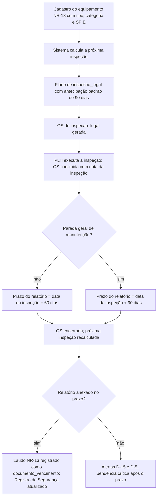

### 7.6 Passos

1. O `planejador` cadastra o equipamento e o Sistema calcula a próxima inspeção.
2. O Sistema cria o plano de `inspecao_legal` (base `execucao`, antecipação padrão de 90 dias).
3. A OS é gerada e programada; o PLH (perfil `plh`) é atribuído.
4. O PLH executa e o técnico conclui a OS informando a data da inspeção e se ela ocorreu em parada geral de manutenção.
5. A OS pode ser encerrada sem o relatório. O ativo volta a operar se não houver impedimento registrado pelo PLH.
6. O Sistema calcula o prazo do relatório: data da inspeção + 60 dias, ou + 90 dias em parada geral (RN-CON-012). Alertas em D-15 e D-5; depois do prazo, pendência crítica no painel de conformidade.
7. O relatório é anexado como `documento_vencimento` do tipo "laudo NR-13". O Registro de Segurança recebe a anotação com nome e assinatura do PLH (RN-CON-016, sujeita à pendência P1).
8. A próxima inspeção é recalculada a partir da data da inspeção, não da data do relatório.

### 7.7 Exceções

| Situação | Tratamento |
|---|---|
| Certificado do SPIE vence | Prazos recalculados pela coluna "sem SPIE". Se a nova data já passou, alerta crítico imediato (RN-CON-013) |
| PLH informa prazo maior que o máximo | Recusado com a indicação do máximo |
| Inspeção vencida | Alerta crítico diário ao `gestor` e ao `planejador`. O Sistema não muda o status do ativo automaticamente: a decisão de parar é humana. A empresa pode configurar o vencimento como bloqueio (RN-PRE-012) |
| Equipamento novo | A inspeção de segurança inicial é registrada como primeira base |

### 7.8 Regras aplicadas

RN-CON-010 a RN-CON-016, RN-PRE-012, RN-CON-005, RN-TER-012.

---

## Fluxo 08 — Documentos com vencimento e bloqueio de despacho

**Módulos:** CON, FRO, ATV, INT · **Fase:** MVP

### 8.1 Atores

`gestor`, `planejador`, `motorista` (consulta), Sistema, Integração (TMS consulta a aptidão).

### 8.2 Tipos de documento

O `tipo_documento` define: alvo (ativo, pessoa ou empresa), se é **crítico para despacho**, prazos de alerta e se a validade é **sugerida** pelo Sistema ou **sempre digitada**.

| Documento | Alvo | Crítico (padrão) | Validade |
|---|---|---|---|
| CRLV-e | Veículo, implemento | Sim | Digitada (licenciamento anual) |
| Verificação do cronotacógrafo | Veículo | Sim | Sugerida: data da verificação + 2 anos (Portaria Inmetro 481/2021) (RN-CON-023) |
| CIV | Veículo de produto perigoso | Sim | **Sempre digitada a partir do certificado** (RN-CON-022, P2) |
| CIPP | Equipamento de produto perigoso | Sim | **Sempre digitada a partir do certificado** (RN-CON-022, P2) |
| Seguros exigidos para o RNTRC | Empresa ou veículo | Sim | Digitada (RN-CON-026) |
| Laudo NR-13 | Equipamento | Não (alerta) | Digitada |
| CNH | `pessoa` (motorista ou condutor eventual) | Sim, para o motorista | Digitada (RN-CON-034) |
| ASO, exame toxicológico | `pessoa` | Não (alerta) | Digitada. Conteúdo visível só com a permissão `pessoa.saude.ler`; os demais veem só a situação (RN-ADM-008) |
| Outros | Qualquer | Configurável | Configurável |

O **MOPP** não é documento: é `capacitacao` da pessoa, com validade e alertas pelo Fluxo 09, e entra na aptidão para despacho (RN-CON-035).

### 8.3 Diagrama

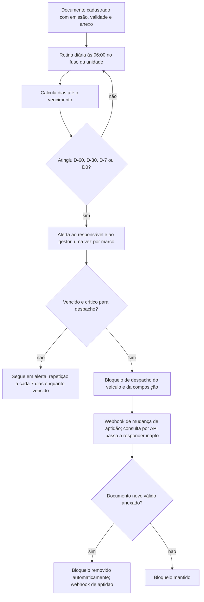

### 8.4 Passos

1. O `gestor` cadastra o documento com tipo, alvo, número, data de emissão, validade e anexo. Para CIV e CIPP, a validade é obrigatória e digitada a partir do certificado; o Sistema não sugere valor (RN-CON-022).
2. Diariamente, às 06:00 no fuso da unidade, o Sistema calcula os dias restantes de cada documento.
3. Nos marcos D-60, D-30, D-7 e D0 (padrão; configuráveis por tipo), envia alerta ao responsável do documento e ao `gestor` da unidade. Cada marco é enviado **uma única vez** por documento (RN-CON-020). Depois de vencido, repete a cada 7 dias.
4. Documento **crítico para despacho** vencido gera bloqueio de despacho do veículo (RN-CON-021). Se o documento é de um implemento acoplado, o bloqueio vale para a composição inteira (RN-CON-024).
5. A aptidão para despacho é exposta por API e por webhook para o TMS e aparece no app do motorista. A resposta traz `apto` (sim ou não) e a lista de motivos. Rota e nome do webhook ficam no documento 3.
6. O bloqueio é removido automaticamente quando um documento novo e válido do mesmo tipo é anexado. O documento anterior fica no histórico (RN-CON-025).

### 8.5 Aptidão para despacho

Um veículo está apto para despacho quando todas as condições abaixo são verdadeiras:

1. Status operacional `operando`.
2. Nenhum documento crítico para despacho vencido no veículo ou em implemento acoplado (RN-CON-021, RN-CON-024).
3. Checklist pré-viagem aprovado dentro da validade, se a classe exige (RN-CHK-004).
4. Nenhum bloqueio vigente por item crítico de checklist ou parecer NR-12 `inapto`.
5. Se o motorista é informado na consulta: CNH válida (documento da `pessoa`) e, para produto perigoso, capacitação MOPP válida (RN-CON-034, RN-CON-035).

### 8.6 Exceções

| Situação | Tratamento |
|---|---|
| Documento em renovação, com protocolo | O protocolo é anexado, mas não remove o bloqueio de documento exigido por lei |
| Documento interno marcado como crítico pela empresa | O `gestor` pode liberar com justificativa por até 72 horas, uma vez por vencimento (RN-CON-025) |
| Documento com validade digitada errada | Correção pelo `gestor`, com auditoria; a correção recalcula alertas e bloqueios |
| Validade de CIV/CIPP calculada pela tabela oficial | Fora do escopo enquanto a pendência P2 não for resolvida (RN-CON-022) |
| Regra configurável `documento_vencido` com bloqueio | Além do bloqueio de despacho, o ativo fica `parado` desde 00:00 do dia seguinte à validade, até o registro de documento do tipo com emissão posterior à do vencido e validade vigente (Fluxo 29, RN-CON-042). Os dois bloqueios são independentes (RN-CON-044) |

### 8.7 Regras aplicadas

RN-CON-020 a RN-CON-026, RN-CON-034, RN-CON-035, RN-CON-042, RN-CON-044, RN-CHK-004, RN-ATV-008, RN-ADM-004, RN-ADM-008.

---

## Fluxo 09 — Capacitações e bloqueio de atribuição

**Módulos:** CON, OS, TER, MOB · **Fase:** MVP (cadastro de capacitações por pessoa, inclusive MOPP, e alertas de vencimento); Fase 2, plano Profissional (bloqueio de atribuição e de início)

### 9.1 Atores

`gestor` (cadastra capacitações e exigências), `planejador` (atribui), `tecnico`, `prestador`, Sistema.

A capacitação pertence à `pessoa`, não ao usuário (RN-ADM-006). Técnico de fornecedor, condutor eventual e PLH externo são pessoas, com ou sem usuário. NR-10, NR-11, NR-12, NR-35 e **MOPP** são capacitações; MOPP nunca é documento (RN-CON-035).

### 9.2 OS regulada

Uma OS é **regulada** quando exige ao menos uma capacitação. A exigência (`exigencia_capacitacao`) vem de:

- a classe do ativo ou o ativo (ex.: instalação elétrica exige NR-10);
- o procedimento ou a tarefa (ex.: trabalho em altura exige NR-35);
- o tipo de OS combinado com a classe (ex.: inspeção de máquina NR-12 exige capacitação NR-12).

### 9.3 Diagrama

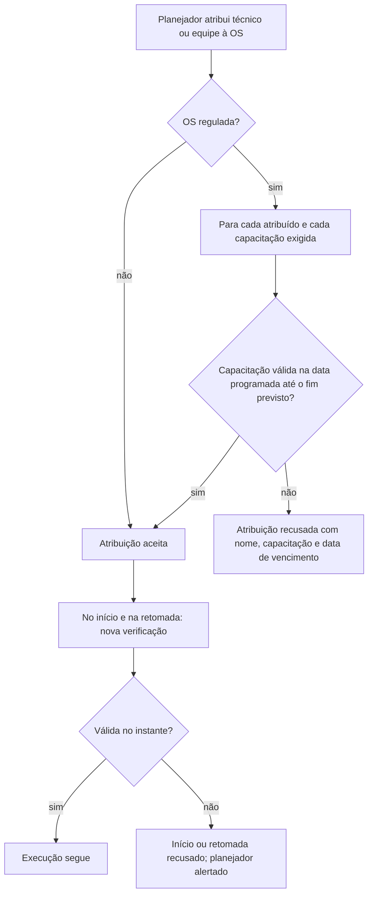

### 9.4 Passos

1. O `gestor` cadastra a `capacitacao` de cada `pessoa` com tipo, data de realização, validade e certificado (MVP).
2. Alertas em D-60, D-30 e D-7 à pessoa (se tiver usuário) e ao `gestor` (RN-CON-033, MVP). Os passos 3 a 7 valem a partir da Fase 2, no plano Profissional.
3. Na atribuição (programar, T4), o Sistema verifica cada atribuído contra cada capacitação exigida, considerando a data programada e o fim previsto. Se alguma estiver vencida ou vencer antes do fim previsto, a atribuição é recusada (RN-CON-030).
4. Em equipe, todos os membros são verificados; a mensagem lista quem e qual capacitação.
5. No início e em cada retomada, nova verificação no instante (RN-CON-031).
6. Se a capacitação vence durante uma execução em curso, o trabalho iniciado continua até a próxima pausa. A retomada é recusada.
7. Não existe liberação manual: o único caminho é registrar a capacitação renovada (RN-CON-032).

### 9.5 Exceções

| Situação | Tratamento |
|---|---|
| Técnico inicia OS offline com capacitação vencida no servidor | O app usa o último estado conhecido. Se o servidor constatar o vencimento na sincronização, a execução é aceita como fato e marcada como **não conformidade** para o `gestor` tratar (RN-MOB-006) |
| OS executada por fornecedor | A verificação vale para as pessoas do fornecedor atribuídas à OS (RN-TER-014). Execução pelo link de uso único sem pessoa cadastrada exige anexo do certificado na conclusão |
| Capacitação renovada antes da OS | A atribuição passa na nova validação; nenhuma ação manual |

### 9.6 Regras aplicadas

RN-CON-030 a RN-CON-033, RN-CON-035, RN-ADM-006, RN-MOB-006, RN-OS-002, RN-TER-014.

---

## Fluxo 10 — Estoque: reserva, saída, devolução, entrada e reposição

**Módulos:** EST, OS, MOB · **Fase:** MVP, estoque básico (itens, um almoxarifado `proprio` por unidade, saldo, reserva e baixa em OS, estoque mínimo, ajuste com motivo); Fase 2, estoque e compras completos no plano Profissional (vários almoxarifados, transferência, inventário, requisição, pedido de compra, entrada por NF-e). Estoque em terceiros, peças serializadas e reparáveis estão nos Fluxos 19 e 20.

### 10.1 Atores

`planejador`, `tecnico`, `almoxarife`, `comprador` (requisição e pedido de compra), `gestor` (aprova compras por alçada), Sistema.

### 10.1a Almoxarifados

| Tipo (`almoxarifado.tipo`) | Uso | Disponível para reserva e saída em OS |
|---|---|---|
| `proprio` | Estoque da empresa na unidade | Sim |
| `em_terceiro` | Estoque da empresa em poder de uma subcontratada; exige `fornecedor_id` de papel `subcontratada` (RN-EST-021) | Só para OS executadas por esse fornecedor (RN-EST-023) |
| `quarentena` | Peças com defeito aguardando decisão (RN-EST-022) | Não |

O **estoque geral** de um item é a soma do saldo físico em todos os almoxarifados, de todos os tipos; há visões por almoxarifado e por subcontratada (RN-EST-020). O saldo nunca fica negativo em nenhum almoxarifado (RN-EST-004).

### 10.2 Saldos

| Saldo | Definição |
|---|---|
| Físico | Soma das `movimentacao_estoque` do item no almoxarifado. Tipos: `entrada`, `saida_os`, `devolucao_os`, `transferencia`, `remessa_terceiro`, `retorno_terceiro`, `envio_conserto`, `retorno_conserto`, `ajuste`, `baixa_sucata` |
| Reservado | Soma das `reserva_estoque` ativas do item no almoxarifado |
| Disponível | Físico − reservado (RN-EST-001) |
| Em trânsito | Quantidade remetida a um `em_terceiro` ainda sem confirmação de recebimento **(proposto: `quantidade_em_transito`)**. Entra no estoque geral, mas não no físico nem no disponível do destino; não é reservável nem consumível (RN-EST-050, Fase 2) |
| Em pedido | Quantidade em pedidos de compra aprovados e não recebidos (Fase 2) |

### 10.3 Diagrama

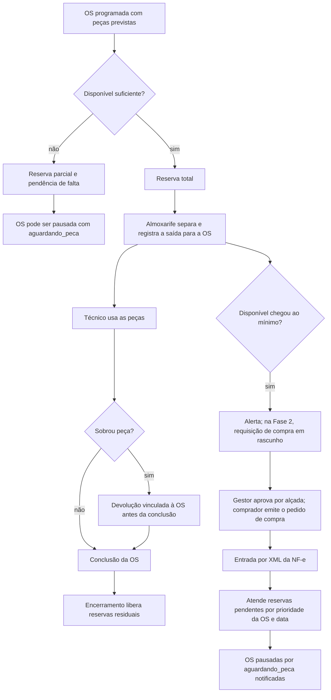

### 10.4 Passos

1. **Reserva.** Na programação da OS (T4), o Sistema reserva as peças previstas no almoxarifado `proprio` da unidade (RN-EST-002), ou no almoxarifado `em_terceiro` do fornecedor executor (RN-EST-023, Fase 2). O `planejador` também pode reservar manualmente em `planejada`. Disponível insuficiente gera reserva parcial e pendência de falta.
2. **Saída.** O `almoxarife` (ou o técnico com permissão) registra a saída para a OS. Só é aceita com a OS em `programada`, `em_execucao` ou `pausada` (RN-EST-003). A saída consome a reserva e baixa o físico a custo médio. Saldo físico nunca fica negativo, em nenhum almoxarifado (RN-EST-004).
3. **Saída sem reserva.** Permitida se houver disponível; caso contrário, recusada, a menos que outra reserva de prioridade menor seja realocada pelo `almoxarife`.
4. **Devolução.** Peça que sai e não é usada volta ao estoque com movimento de devolução vinculado à mesma OS, até o limite do que saiu para ela (RN-EST-005). A devolução precisa acontecer antes da conclusão; na conclusão, o técnico declara o destino de cada saída.
5. **Encerramento.** Reservas não consumidas são liberadas (RN-EST-006). Depois do encerramento, sobra física de peça é tratada por ajuste de estoque com referência à OS, sem alterar o custo da OS encerrada.
6. **Saldo mínimo.** Quando o disponível fica menor ou igual ao mínimo, o Sistema alerta o `almoxarife` (MVP). Na Fase 2, cria uma `requisicao_compra` em rascunho com quantidade `máximo − (disponível + em pedido)`. Só existe uma requisição aberta por item e almoxarifado (RN-EST-007).
7. **Compra (Fase 2).** O `gestor` aprova a requisição conforme alçada; o `comprador` emite o `pedido_compra` ao `fornecedor` com papel `fornecedor_pecas`.
8. **Entrada por NF-e (Fase 2).** O `almoxarife` importa o XML. O Sistema valida chave de acesso única, destinatário (CNPJ da empresa ou unidade), emitente igual ao fornecedor do pedido e itens pelo de-para do fornecedor. Após a conferência física, a entrada é efetivada e o custo médio ponderado é atualizado (RN-EST-008).
9. **Atendimento de faltas.** A entrada atende primeiro as reservas pendentes, por prioridade da OS e depois pela data da reserva. As OS em `pausada` com motivo `aguardando_peca` recebem notificação (RN-EST-009).

### 10.5 Exceções

| Situação | Tratamento |
|---|---|
| Técnico registra consumo offline | Vira "consumo declarado". O servidor efetiva a saída se houver saldo; senão abre pendência para o `almoxarife`, sem saldo negativo (RN-EST-011) |
| NF de serviço ou peça aplicada direto na OS (oficina externa, assistência técnica) | O custo vai para a OS sem passar pelo estoque (Fluxo 14, RN-TER-035) |
| Peça reparável retirada com defeito | Volta pela OS como `devolucao_os` para o almoxarifado `quarentena`, sem crédito na OS (Fluxo 20, RN-EST-040) |
| Entrada sem NF-e no estoque básico (MVP) | Movimento `entrada` manual com documento de referência e custo unitário; o custo médio é atualizado |
| XML já importado | Recusado, com link para a entrada original |
| Correção de movimento | Movimento inverso com motivo; o original não é alterado (RN-EST-010) |
| OS cancelada com peças saídas | O cancelamento exige devolver as peças antes (RN-OS-004) |

### 10.6 Regras aplicadas

RN-EST-001 a RN-EST-011, RN-EST-020 a RN-EST-023, RN-EST-040, RN-OS-004, RN-TER-035.

---

## Fluxo 11 — Pneus

**Módulos:** FRO, MED, EST · **Fase:** Fase 2

### 11.1 Atores

`tecnico` (borracheiro), `almoxarife`, `gestor`, Sistema.

### 11.2 Estados do pneu (proposto)

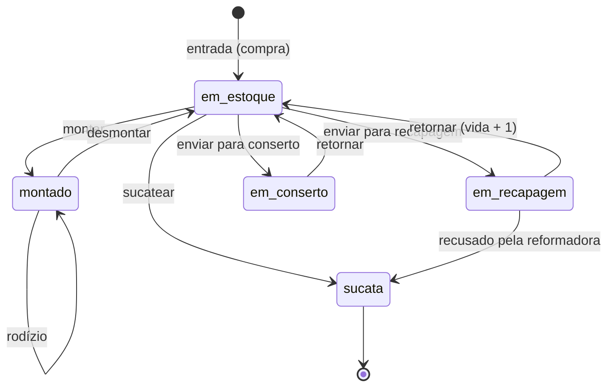

O sumário define a entidade `pneu`, mas não seus estados. Os nomes acima estão listados na seção 35.4.

### 11.3 Passos

1. **Entrada.** O pneu é cadastrado com número de fogo (único na empresa), marca, modelo, medida, DOT, custo de compra, vida 0 (novo) e sulco inicial (RN-FRO-001).
2. **Montagem.** O técnico escolhe veículo e posição (mapa por eixo). O Sistema exige a leitura de km do veículo no momento e o sulco. Uma posição comporta um pneu; um pneu ocupa uma posição (RN-FRO-001, RN-FRO-002).
3. **Rodízio.** Troca de posição no mesmo veículo ou entre veículos. É registrado como desmontagem e montagem no mesmo instante, com km e sulco.
4. **Desmontagem.** Registra km do veículo, sulco, motivo (rodízio, desgaste, avaria, recapagem) e destino.
5. **Recapagem.** O pneu é enviado à reformadora (`fornecedor`). No retorno, a vida passa de N para N+1 (R1, R2...), com custo e novo sulco. O limite de recapagens é configurável (padrão 2). Pneu no limite não pode ser enviado (RN-FRO-004).
6. **Conserto.** Envio e retorno com custo; a vida não muda.
7. **Sucata.** Estado final, com motivo obrigatório e valor residual (venda de carcaça) (RN-FRO-005).
8. **Sulco mínimo.** Sulco medido abaixo do mínimo de retirada (parâmetro por classe, padrão 3 mm) gera alerta de retirada. O mínimo legal de 1,6 mm é bloqueante para nova montagem (RN-FRO-007).

### 11.4 Cálculo de km e de CPK

```
km do pneu (por montagem) = km do veículo na desmontagem − km do veículo na montagem
km da vida N              = Σ km das montagens durante a vida N
km total                  = Σ km de todas as vidas

CPK total  = (custo de compra + Σ custos de recapagem + Σ custos de conserto − valor residual) / km total
CPK vida 0 = custo de compra / km da vida 0
CPK vida N = (custo da recapagem N + Σ consertos da vida N) / km da vida N
```

- O km do veículo usa o valor acumulado do hodômetro (Fluxo 04), não o painel (RN-FRO-003).
- Pneu montado: o km é atualizado a cada leitura válida do veículo.
- CPK com menos de 1.000 km rodados aparece como "insuficiente" (RN-FRO-006).
- Valor residual só entra no CPK total depois da sucata.

### 11.5 Exceções

| Situação | Tratamento |
|---|---|
| Montagem sem leitura de km disponível | Recusada; a leitura é obrigatória |
| Número de fogo repetido | Recusado |
| Veículo com hodômetro trocado entre montagem e desmontagem | Sem efeito: o cálculo usa o acumulado |
| Pneu com sensor (TPMS) via telemática | Pressão e temperatura são registradas como eventos; não mudam o estado do pneu |
| Veículo em contrato de locação vigente | O custo de pneu segue a linha "pneus" da matriz de responsabilidade do contrato; a OS de troca recebe o responsável pelo custo padrão da matriz (RN-LOC-011) |

### 11.6 Regras aplicadas

RN-FRO-001 a RN-FRO-007, RN-MED-003, RN-LOC-011.

---

## Fluxo 12 — Combustível

**Módulos:** FRO, INT, MED · **Fase:** Fase 2

### 12.1 Atores

Integração (cartão combustível), `gestor`, `motorista` (lançamento manual), Sistema.

### 12.2 Diagrama

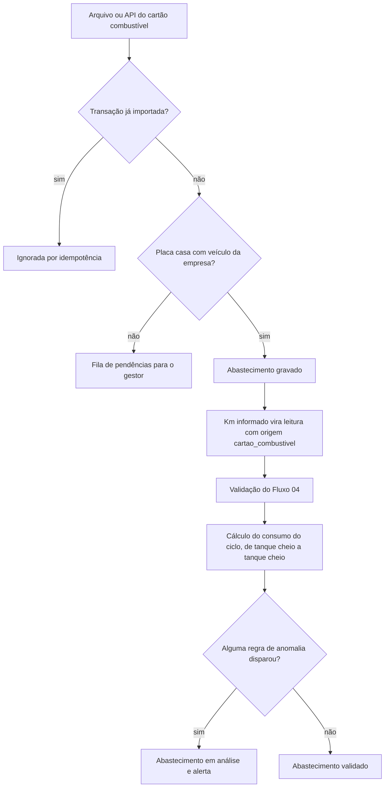

### 12.3 Passos

1. O conector importa as transações do cartão (arquivo ou API). A chave de idempotência é o par fornecedor do cartão e identificador da transação (RN-FRO-010).
2. A transação é casada com o veículo pela placa (e pelo número do cartão, se cadastrado). Sem casamento, vai para a fila de pendências; o Sistema nunca cria veículo automaticamente.
3. O `abastecimento` é gravado com data e hora, posto, produto (diesel, gasolina, etanol, Arla), litros, preço e km informado.
4. O km informado vira `leitura_medidor` com origem `cartao_combustivel`, a de menor prioridade padrão (RN-FRO-011). Leitura recusada ou pendente não impede o abastecimento, mas marca o km como não confiável.
5. O Sistema calcula o consumo (12.4) e aplica as regras de anomalia (12.5).
6. Abastecimento com anomalia fica **em análise**; o `gestor` valida ou registra a ocorrência. A anomalia não bloqueia o lançamento (RN-FRO-013).
7. Abastecimento lançado manualmente (`motorista` ou `gestor`) segue os passos 3 a 6; o km digitado vira leitura com origem `manual` (RN-MED-009).

### 12.4 Consumo

```
Para cada abastecimento cheio C_k do veículo, ordenado por data:
  km do ciclo     = km(C_k) − km(C_{k−1})            // C_{k−1} = abastecimento cheio anterior
  litros do ciclo = Σ litros dos abastecimentos depois de C_{k−1} até C_k, inclusive
  consumo (km/l)  = km do ciclo / litros do ciclo

Consumo do período = Σ km dos ciclos encerrados no período / Σ litros desses ciclos
```

- `km(C)` é o valor acumulado do hodômetro no instante do abastecimento, pela origem de maior prioridade disponível (interpolação da telemática, se houver). O km digitado no posto só é usado sem alternativa (RN-FRO-012).
- Abastecimento importado é considerado "tanque cheio", a não ser que seja marcado como parcial.
- Equipamento com horímetro usa litros por hora com a mesma lógica.
- Arla é registrado à parte e não entra no km/l.

### 12.5 Regras de anomalia

| Anomalia | Condição | Padrão |
|---|---|---|
| Volume acima do tanque | Litros > capacidade do tanque × (1 + tolerância) | Tolerância de 5% |
| Consumo fora da faixa | km/l do ciclo fora de ±X% da média móvel de 90 dias do veículo (ou da classe, com menos de 5 ciclos) | X = 20% |
| Abastecimentos próximos | Intervalo menor que 2 h ou menos de 50 km desde o anterior | 2 h e 50 km |
| Produto incompatível | Produto diferente do combustível cadastrado no veículo | Ativa |
| Km incoerente | Leitura de km `rejeitada` ou `pendente` | Ativa |
| Local divergente | Posição da telemática a mais de 5 km do posto no horário da transação | 5 km (só com telemática) |
| Preço acima | Preço por litro acima da média da empresa na UF no mês + 10% | 10% |

### 12.6 Regras aplicadas

RN-FRO-010 a RN-FRO-013, RN-MED-006, RN-MED-009, RN-INT-001.

---

## Fluxo 13 — Multas

**Módulos:** FRO, CON · **Fase:** Fase 2

### 13.1 Atores

`gestor` (frota), `motorista`, Sistema.

### 13.2 Situação da indicação (proposto)

`pendente_indicacao` → `indicada` ou `nao_indicada`. Multas de responsabilidade do proprietário (ex.: licenciamento) não exigem indicação e nascem como `indicada` com observação "responsabilidade do proprietário". O pagamento é controlado à parte (pago ou não, com data).

### 13.3 Diagrama

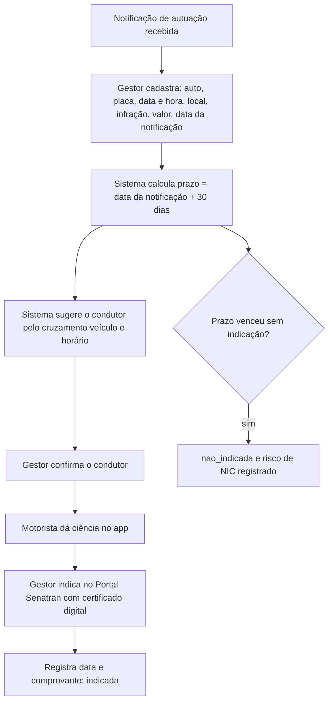

### 13.4 Passos

1. O `gestor` cadastra a multa a partir da notificação de autuação: número do auto, placa, data, hora e local da infração, código da infração, órgão autuador, valor e **data da notificação**. Importação automática pela Senatran ou Serpro depende da pendência P3 (RN-FRO-023).
2. O Sistema calcula o prazo de indicação: **data da notificação + 30 dias corridos** (RN-FRO-020).
3. O Sistema sugere o condutor cruzando veículo, data e hora da infração com: checklist pré-viagem, identificação de motorista da telemática e escala ou despacho importado do TMS. A sugestão mostra a fonte; a confirmação é humana (RN-FRO-021).
4. O motorista recebe a multa no app e dá ciência.
5. O `gestor` faz a indicação no Portal Senatran com certificado digital, fora da Tenaz, e registra a data e o comprovante.
6. Alertas ao `gestor` em D-10, D-5 e D-2 do prazo (RN-FRO-022).
7. Se o prazo vence sem indicação, a situação passa a `nao_indicada` e o Sistema registra o **risco de NIC** (multa por não identificação do condutor). Quando a NIC chega, é cadastrada como nova multa vinculada à original.
8. Se a empresa aderiu ao SNE, o Sistema mostra o valor com 40% de desconto e o prazo para pagamento com desconto (RN-FRO-024).

### 13.5 Exceções

| Situação | Tratamento |
|---|---|
| Placa de veículo vendido | A multa é cadastrada no histórico do veículo `inativo`; a indicação segue normalmente |
| Data da notificação desconhecida | O campo é obrigatório. Sem ele, o Sistema usa a data de cadastro e marca o prazo como estimado |
| Condutor não é usuário da Tenaz | O condutor é uma `pessoa` sem usuário (condutor eventual), cadastrada com nome e CNH; a ciência é registrada pelo `gestor` com anexo (RN-ADM-006) |

### 13.6 Regras aplicadas

RN-FRO-020 a RN-FRO-024, RN-ADM-006.

---

## Fluxo 14 — Oficina externa e assistência técnica: orçamento, aprovação, execução, nota e garantia

**Módulos:** TER, OS, EST, FRO · **Fase:** Fase 2, plano Profissional

A oficina externa saiu do módulo FRO e passou a ser um caso de TER (sumário 0.3). Vale para veículos e equipamentos, enviados ao fornecedor ou atendidos no local por assistência técnica. As regras RN-FRO-030 a RN-FRO-033 foram substituídas por RN-TER-030 a RN-TER-033. A OS executada por prestador sem orçamento prévio (preço de catálogo ou de contrato) segue o Fluxo 18; este fluxo acrescenta o orçamento, a alçada, a nota e a garantia.

### 14.1 Atores

`planejador`, `gestor` (aprova por alçada), fornecedor com papel `oficina` ou `assistencia_tecnica` (pelo perfil `prestador`, pelo link de uso único ou sem acesso, com registro feito pela empresa), `comprador` ou `almoxarife` (registra a nota), liberador, Sistema.

### 14.2 Situação do orçamento (proposto)

O orçamento é um `orcamento_fornecedor` ligado à OS (ou à ordem de reparo, Fluxo 20). Situação **(proposto)**: `pendente` → `aprovado` ou `recusado`. Uma OS pode ter vários orçamentos; só um fica `aprovado` (RN-TER-034).

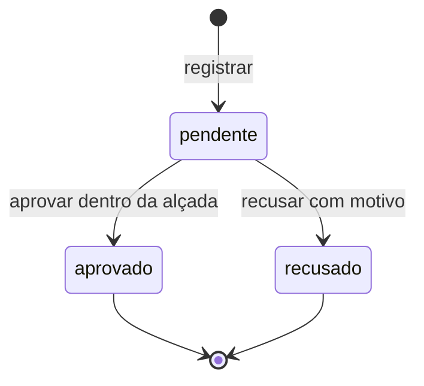

### 14.3 Diagrama

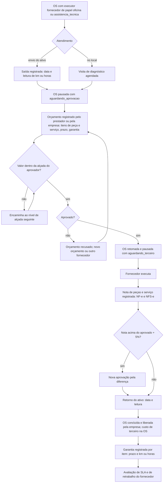

### 14.4 Passos

1. O `planejador` programa a OS com executor `fornecedor` e escolhe um fornecedor de papel `oficina` ou `assistencia_tecnica` (RN-TER-002). O Sistema sugere fornecedores pelo catálogo de serviços (classe, marca, área de atendimento) e pelo contrato de prestação vigente (RN-TER-003, RN-TER-020).
2. Se o ativo é enviado, registra data e leitura de saída (km ou horas). O status do ativo segue a regra geral: `parado` se a OS é de falha com parada; `em_manutencao` se é retirada programada (RN-TER-033, RN-ATV-001).
3. A OS é pausada com `aguardando_aprovacao` até haver orçamento aprovado. Nenhuma execução externa sem orçamento aprovado (RN-TER-030). Se o contrato de prestação tem preço fixo para o serviço, o orçamento é dispensado até o limite do contrato.
4. O orçamento (`orcamento_fornecedor`) é registrado com itens de peça e serviço, prazo, garantia oferecida e anexo. O `prestador` registra pelo app ou pelo link; sem acesso, um usuário da empresa registra. A aprovação segue as alçadas por valor da empresa.
5. Aprovado, a OS é retomada e pausada com `aguardando_terceiro` durante a execução externa. Esses intervalos entram ou não no MTTR conforme o parâmetro (RN-IND-001). Quando o prestador executa pelo app, a OS fica `em_execucao` com os apontamentos dele (Fluxo 18).
6. A nota fiscal (NF-e de peças e NFS-e de serviço) é registrada pelo `comprador` ou `almoxarife`. O custo vai direto para a OS, sem passar pelo estoque (RN-TER-035). Nota acima do valor aprovado mais a tolerância (padrão 5%) exige nova aprovação da diferença (RN-TER-031).
7. No retorno, registra data e leitura. Km rodado entre saída e retorno acima do trajeto informado mais 20% gera alerta (RN-TER-033).
8. A OS é concluída (o apontamento interno é dispensado se o serviço é cobrado por serviço ou visita, RN-TER-014) e liberada por um usuário da empresa (RN-TER-015).
9. A garantia é registrada por item de peça e serviço, com prazo em dias e, se houver, em km ou horas (RN-TER-032).
10. Nova OS corretiva no mesmo ativo dentro da garantia gera aviso "possível garantia" com o fornecedor e a OS de origem; se confirmada, a nova OS recebe `responsavel_custo = garantia` e o mesmo fornecedor como executor (RN-TER-032).
11. A OS encerrada entra na avaliação do fornecedor: SLA de atendimento e de solução, retrabalho e nota (RN-TER-021, RN-TER-023).

### 14.5 Exceções

| Situação | Tratamento |
|---|---|
| Orçamento recusado | Situação `recusado` com motivo; a OS continua `pausada` com `aguardando_aprovacao`. O `planejador` pede novo orçamento ou troca o fornecedor (nova atribuição) |
| Fornecedor executou antes da aprovação | A execução é registrada como fato, a OS recebe marca de não conformidade e o custo só entra após aprovação a posteriori do `gestor` (RN-TER-030) |
| Ativo em locação tomada com manutenção a cargo do locador | Segue o Fluxo 22: executor é o locador e o custo é `locador`; não há orçamento a aprovar pela empresa, salvo se a matriz indicar custo da empresa |
| Peça avulsa com defeito para conserto (sem o ativo) | Não é este fluxo: segue a ordem de reparo do Fluxo 20 |
| Máquina NR-12 | O registro dos sete campos é exigido no encerramento (Fluxo 06); o executor do campo 7 é a pessoa do fornecedor |
| Nota sem chave de acesso válida | Recusada; a nota de serviço municipal (NFS-e) é registrada por número e município |

### 14.6 Regras aplicadas

RN-TER-002, RN-TER-003, RN-TER-014, RN-TER-015, RN-TER-020, RN-TER-021, RN-TER-023, RN-TER-030 a RN-TER-035, RN-OS-003, RN-OS-019, RN-ATV-001, RN-IND-001.

---

## Fluxo 15 — Telemática

**Módulos:** INT, MED, SOL, OS · **Fase:** Fase 2

### 15.1 Atores

Integração (rastreador ou montadora: Cobli, Geotab, rFMS Volvo e Scania, outros), `gestor` (configura regras), Sistema.

### 15.2 Modelo canônico de eventos

O conector converte o formato de cada provedor em eventos canônicos: leitura (odômetro, horímetro), DTC (código, SPN/FMI quando J1939, severidade, ativo ou inativo), combustível, pneu e posição.

### 15.3 Diagrama

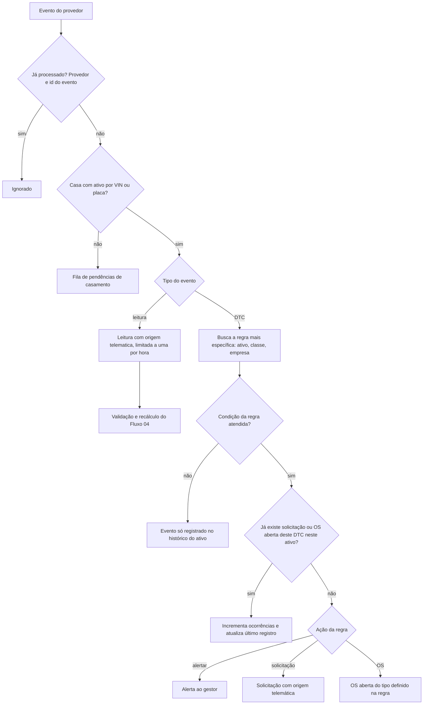

### 15.4 Passos

1. **Idempotência:** o par provedor e identificador do evento é a chave; eventos repetidos são ignorados (RN-INT-006).
2. **Casamento:** pelo VIN, depois pela placa. Sem casamento, o evento vai para a fila de pendências. O Sistema nunca cria ativo a partir de telemática (RN-INT-001).
3. **Leitura automática de odômetro e horímetro:** grava no máximo uma leitura por medidor por hora, mais a última do dia, com origem `telematica` (RN-INT-005). Passa pelo Fluxo 04 e recalcula vencimentos.
4. **DTC:** o Sistema busca a regra configurável mais específica (ativo, depois classe, depois padrão da empresa). A regra tem (RN-INT-002):
   - condição: código ou SPN/FMI, severidade mínima, recorrência (N ocorrências em T horas);
   - ação: registrar, alertar, criar solicitação ou criar OS;
   - para OS: tipo (`corretiva_planejada` ou `corretiva_emergencial`), prioridade e procedimento.
5. **Deduplicação:** se já existe solicitação ou OS não encerrada para o mesmo ativo e o mesmo DTC, o Sistema só incrementa o contador (RN-INT-003).
6. **Severidade "parar imediatamente":** cria a solicitação ou OS com prioridade `urgente` e alerta imediato ao `gestor`. O status do ativo não muda automaticamente: a decisão de parar o veículo é humana (RN-INT-004).
7. DTC que passa a inativo é registrado, mas não encerra nem cancela OS.

### 15.5 Regras aplicadas

RN-INT-001 a RN-INT-006, RN-SOL-007, RN-MED-001 a RN-MED-008.

---

## Fluxo 16 — Sincronização offline do app

**Módulos:** MOB, todos os módulos com escrita no app · **Fase:** MVP

### 16.1 Atores

`tecnico`, `motorista`, Sistema (servidor de sincronização).

### 16.2 Pacote offline

O app guarda: OS atribuídas ao usuário ou à sua equipe, ativos da unidade (para o perfil `prestador`, só as OS atribuídas ao seu fornecedor, os ativos dessas OS e o almoxarifado `em_terceiro` desse fornecedor, RN-MOB-011), modelos de checklist, procedimentos, itens de estoque do almoxarifado da unidade, documentos técnicos marcados para offline e o último estado de bloqueios, documentos e capacitações. Cadastros mestres (ativo, plano, modelo de checklist) são somente leitura offline (RN-MOB-008). A meta é operar 7 dias sem conexão; o app avisa após 72 horas sem sincronizar (RN-MOB-009).

### 16.3 Comando

Toda escrita no app vira um comando (`comando_sync`) numa fila local (outbox) em SQLite, com:

| Campo | Conteúdo |
|---|---|
| Identificador | UUID gerado no dispositivo; é a chave de idempotência |
| Tipo | Ex.: iniciar OS, pausar, concluir, apontar horas, registrar leitura, responder checklist, anexar foto |
| Agregado | Entidade e identificador (provisório, se criado offline) |
| Versão base | Versão do registro que o app conhecia |
| Carga | Dados do comando |
| Relógio | Data e hora do dispositivo e relógio lógico híbrido (HLC) |

### 16.4 Diagrama

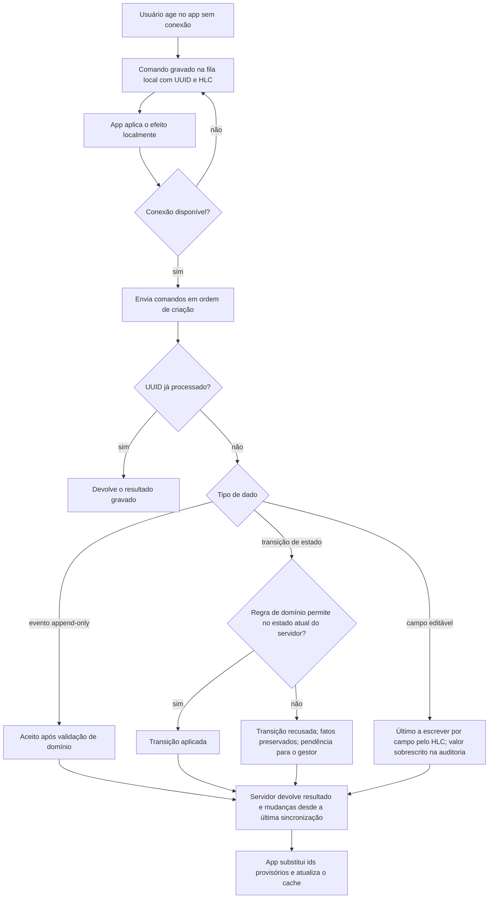

### 16.5 Passos

1. O usuário age; o app grava o comando e aplica o efeito localmente (a tela reflete a ação na hora).
2. Com conexão, o app envia os comandos na ordem de criação. Comandos de um mesmo dispositivo são processados nessa ordem (RN-MOB-002).
3. O servidor verifica o UUID. Comando já processado devolve o mesmo resultado, sem reaplicar (RN-MOB-001). Os UUIDs ficam guardados por 30 dias, acima da janela de 7 dias offline.
4. O servidor resolve cada comando por um de três mecanismos:
   - **Regras de domínio**, para transições de estado (RN-MOB-003). O servidor aplica a máquina de estados do Fluxo 02 sobre o estado atual, não sobre o que o app viu.
   - **Eventos append-only**, para apontamentos, fotos, leituras, respostas de checklist e comentários (RN-MOB-004). Não há conflito: todos são aceitos, sujeitos à validação de domínio (ex.: leitura passa pelo Fluxo 04).
   - **Último a escrever por campo**, para campos editáveis simples (descrição, observação, prioridade sugerida) (RN-MOB-005). A ordem é dada pelo HLC. O valor sobrescrito fica na auditoria.
5. Registros criados offline (solicitação, OS corretiva) recebem o número definitivo do servidor. O app troca o identificador provisório (RN-MOB-007).
6. O servidor devolve o resultado de cada comando e as mudanças ocorridas no servidor desde a última sincronização.
7. Comando recusado nunca é descartado em silêncio: aparece numa lista de "pendências de sincronização" no app, com o motivo, e no painel do `gestor` (RN-MOB-010).

### 16.6 Conflitos típicos

| Situação | Mecanismo | Resultado |
|---|---|---|
| Técnico conclui offline uma OS que foi cancelada no servidor | Regra de domínio | "Concluir" recusado. Apontamentos, fotos e leituras são preservados e ligados à OS cancelada como registros posteriores ao cancelamento. Pendência ao `gestor`, que pode abrir OS de regularização com esses registros (RN-MOB-006) |
| Dois técnicos concluem a mesma OS offline | Regra de domínio | O primeiro comando a chegar conclui. O segundo recebe "transição inválida"; seus apontamentos e respostas são aceitos |
| Planejador muda a data programada; técnico edita a descrição | Último a escrever por campo | Campos diferentes: os dois valores são aplicados |
| Planejador e técnico editam a descrição | Último a escrever por campo | Vence o HLC maior; o outro valor fica na auditoria e no histórico da OS |
| Técnico inicia OS que foi reatribuída a outro | Regra de domínio | Se a OS ainda está em `programada`, o início é aceito, o técnico é incluído como responsável e o `planejador` é notificado |
| Técnico inicia OS com capacitação vencida no servidor | Regra de domínio | A execução é aceita como fato e marcada como não conformidade (RN-MOB-006, RN-CON-031) |
| Leitura offline menor que leitura de telemática recebida depois | Evento append-only + Fluxo 04 | Leitura gravada como `pendente` por conflito de origem |
| Consumo de peça offline sem saldo no servidor | Evento + regra de estoque | Consumo declarado vira pendência do `almoxarife` (RN-EST-011) |
| Comando reenviado após perda de resposta | Idempotência | Mesmo resultado, sem duplicar |
| Prestador executa offline uma OS que foi reatribuída a outro fornecedor | Regra de domínio + isolamento | Transição recusada; apontamentos e fotos preservados e ligados à OS como registros do fornecedor anterior; pendência ao `planejador` (RN-MOB-006, RN-TER-012) |

### 16.7 Relógio

O servidor grava a data e hora do dispositivo e a de recebimento. Se o desvio do relógio do dispositivo, medido em cada sincronização, passar de 5 minutos, os horários de execução usados em KPIs são corrigidos pelo desvio medido, e o valor original fica guardado.

### 16.8 Regras aplicadas

RN-MOB-001 a RN-MOB-011, RN-EST-011, RN-CON-031, RN-TER-012.

---

## Fluxo 17 — Assistente de IA: rascunho de OS por voz ou foto

**Módulos:** IA, SOL, OS, MOB · **Fase:** Fase 2

### 17.1 Atores

Qualquer usuário com IA habilitada, Sistema (serviço de IA).

### 17.2 Diagrama

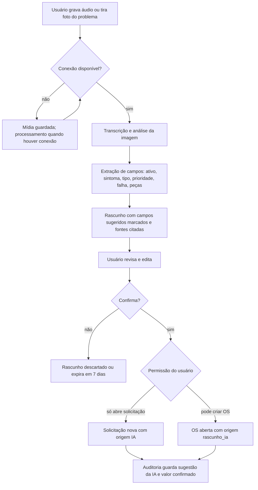

### 17.3 Passos

1. O usuário grava um áudio ou tira uma foto (placa de identificação, painel com código de falha, peça danificada).
2. Sem conexão, a mídia fica na fila; o processamento ocorre quando houver conexão (RN-IA-007).
3. O serviço de IA transcreve o áudio, analisa a imagem e extrai: ativo (por TAG, QR code, placa ou nome; se ambíguo, lista candidatos), sintoma, tipo de OS sugerido, prioridade sugerida, código de falha sugerido e peças prováveis, com base nos manuais e no histórico da empresa.
4. O resultado é um **rascunho** (`rascunho_ia`), nunca uma solicitação ou OS. Os campos sugeridos aparecem marcados como "sugerido pela IA", com as fontes consultadas (RN-IA-003).
5. O usuário revisa, edita e confirma. Sem confirmação explícita nada é gravado como solicitação ou OS (RN-IA-001). Não existe confirmação em lote.
6. Na confirmação, o registro criado depende da permissão do usuário: quem só abre solicitações gera solicitação em `nova`; quem pode criar OS gera OS em `aberta` com `origem = rascunho_ia`. As regras dos Fluxos 01 e 02 valem integralmente.
7. A auditoria grava a origem "IA", a sugestão original e o valor confirmado (RN-ADM-002).
8. Rascunho não confirmado expira em 7 dias. A mídia de rascunho descartado é apagada ao fim do prazo de retenção (RN-IA-006).

### 17.4 Limites

- A IA só usa dados da empresa do usuário e respeita as permissões dele: não sugere ativo que ele não vê (RN-IA-002).
- A IA nunca preenche parecer NR-12, assinatura, campos do PLH nem indicação de condutor (RN-IA-004).
- A empresa e cada usuário podem desligar a IA; prompts e respostas ficam registrados por empresa (RN-IA-005).

### 17.5 Regras aplicadas

RN-IA-001 a RN-IA-007, RN-ADM-002.

---

## Fluxo 18 — OS executada por prestador

**Módulos:** TER, OS, EST, CON, MOB · **Fase:** MVP, todos os planos (fornecedor com papéis e catálogo, atribuição, aceite, execução pelo perfil `prestador` ou pelo link de uso único, conclusão, liberação); Fase 2, plano Profissional (consumo do estoque em poder do prestador, contrato de prestação com SLA e avaliação)

### 18.1 Atores

`planejador` (atribui), `prestador` (usuário ligado ao fornecedor), prestador ocasional (link de uso único, sem login), liberador (permissão `os.encerrar`), `almoxarife`, `gestor`, Sistema.

### 18.2 Formas de acesso do prestador

| Forma | Quem | Login | Conta como técnico cobrado | O que pode fazer |
|---|---|---|---|---|
| Perfil `prestador` | Usuário com `usuario.fornecedor_id` e, em geral, ligado a uma `pessoa` do fornecedor | Sim, web e app | Sim, se executar OS no ciclo (RN-TER-017) | Ver e executar só as OS atribuídas ao seu fornecedor; movimentar só o almoxarifado `em_terceiro` desse fornecedor (RN-TER-012) |
| Link de uso único (`link_execucao`) | Contato do fornecedor informado na atribuição | Não | Não (RN-TER-017) | Ver os dados mínimos de uma única OS, aceitar ou recusar, iniciar, registrar tarefas, horas, fotos, leituras, peças, descrição e concluir (RN-TER-013) |
| Conta conectada (SRV) | Subcontratada com conta própria na Tenaz e `conexao_empresa` ativa com a empresa | Sim, na conta dela | Não na empresa contratante (RN-SRV-004); paga o plano Serviços na conta dela | Recebe a OS na conta dela, distribui aos seus técnicos e devolve andamento, horas, componentes, fotos e conclusão pela sincronização; não encerra (Fluxo 26) |
| Sem acesso | — | — | — | A empresa registra a execução e anexa o relatório de serviço do fornecedor |

Os escopos de acesso correspondentes são `prestador` (perfil) e `link` (link de uso único). A conta conectada não age dentro da conta da empresa: o que ela faz chega pela sincronização (RN-SRV-047).

### 18.3 Diagrama

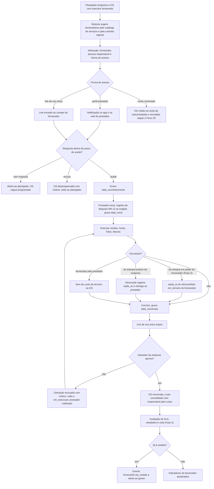

### 18.4 Passos

1. **Cadastro.** O fornecedor tem o papel compatível com o serviço: `subcontratada`, `assistencia_tecnica` ou `oficina` (`locador` só para os ativos que ele locou, Fluxo 22) (RN-TER-001, RN-TER-002). Os papéis `posto_combustivel` e `seguradora` não executam OS (RN-TER-004). O catálogo (`servico_fornecedor`) traz classes de ativo e marcas atendidas, área de atendimento, prazos de atendimento e de solução, preço de referência e unidade (`hora`, `visita`, `servico`) (RN-TER-003).
2. **Atribuição.** Ao programar (T3 ou T4), o `planejador` define `executor_tipo = fornecedor`, o `fornecedor_id`, a pessoa responsável do fornecedor (opcional) e a forma de acesso. O Sistema sugere fornecedores cujo catálogo cobre a classe e a marca do ativo e cuja área atende a localização; com contrato de prestação vigente que cobre o ativo, o contrato vem primeiro (RN-TER-020, Fase 2). O preço previsto vem do contrato ou do catálogo (RN-TER-016).
3. **Aceite.** O prestador aceita ou recusa dentro do prazo de aceite (padrão 4 horas; 1 hora para prioridade `urgente`). O aceite grava `data_reconhecimento` (RN-OS-016). A recusa exige motivo e desprograma a OS (T5) para nova atribuição (RN-TER-011).
4. **Link de uso único.** Quando escolhido, o Sistema gera um `link_execucao` ligado a uma OS e a um contato do fornecedor, com validade (padrão 72 horas) e token guardado só como hash. O link mostra apenas os dados necessários à execução: ativo (TAG, descrição, localização), tarefas, procedimento e anexos marcados como visíveis ao fornecedor. Ao abrir, a pessoa informa nome e documento; o link fica inutilizado ao concluir a OS, ao expirar ou ao ser revogado (RN-TER-013). O token vai no fragmento da URL (`/l/#<token>`), nunca no caminho nem na query; a página o envia no corpo da ativação e recebe uma sessão curta, usada nas demais chamadas (RN-TER-018).
5. **Início.** O prestador inicia (T6) no app ou pelo link. Valem as mesmas verificações da equipe interna: registro de bloqueio e etiquetagem NR-12 12.11.3 quando o ativo exige (RN-CON-006) e, na Fase 2, capacitação válida das pessoas do fornecedor (RN-CON-031) (RN-TER-014).
6. **Execução.** Tarefas, apontamentos de horas, fotos, leituras de medidor e pausas com motivo seguem o Fluxo 02. O app do prestador funciona offline com o pacote restrito ao seu fornecedor (RN-MOB-011). Pelo link, a execução exige conexão.
7. **Peças.**
   - **Estoque em poder do fornecedor (Fase 2):** a reserva e a `saida_os` saem do almoxarifado `em_terceiro` do próprio fornecedor (RN-EST-023), registradas pelo prestador. Sobra volta por `devolucao_os` ao mesmo almoxarifado (Fluxo 19).
   - **Estoque próprio da empresa:** o `almoxarife` registra a `saida_os` e entrega ao prestador.
   - **Peça fornecida pelo prestador:** entra como item de custo de terceiro na OS, sem passar pelo estoque (RN-TER-035).
   - Peça reparável retirada com defeito vai para a quarentena (Fluxo 20).
8. **Conclusão.** O prestador conclui (T10) com os campos de 2.4. O apontamento é dispensado quando a unidade de preço é `visita` ou `servico` (RN-TER-014). Em máquina NR-12, o prestador preenche os campos 5 e 6 e assina como executor (Fluxo 06).
9. **Liberação.** Só um usuário da empresa com a permissão de liberação encerra ou recusa a liberação. O prestador nunca encerra (RN-TER-015). A recusa devolve a OS para `em_execucao` com motivo e notifica o prestador; se o link já expirou, o `planejador` gera um novo.
10. **Custo.** No encerramento, o custo de terceiro da OS é o da nota registrada; sem nota, o preço previsto do contrato ou do catálogo multiplicado pela quantidade apontada (horas, visitas ou serviços), marcado como "custo estimado" até a nota chegar (RN-TER-016). O custo é atribuído ao responsável pelo custo da OS (RN-OS-019).
11. **Avaliação (Fase 2).** O Sistema mede o SLA de atendimento e de solução (RN-TER-021), registra retrabalho (RN-TER-024) e pede a nota do liberador (RN-TER-023). SLA violado gera o evento `fornecedor.sla_violado` (RN-TER-022).

### 18.5 Medição do SLA do fornecedor

```
início do relógio = instante da atribuição ao fornecedor (envio ao prestador ou geração do link)
atendimento       = data_inicio − início do relógio − Σ pausas aguardando_aprovacao anteriores ao início
solução           = data_conclusao − início do relógio − Σ pausas aguardando_aprovacao
SLA cumprido      = atendimento ≤ prazo de atendimento  e  solução ≤ prazo de solução
```

- Prazos: do contrato de prestação vigente que cobre o ativo; sem contrato, do catálogo de serviços, só como referência informativa (sem evento de violação).
- O calendário é corrido (padrão) ou o horário comercial da unidade, conforme o parâmetro da empresa.
- Uma liberação recusada não reinicia o relógio: a solução é medida até a última `data_conclusao`.

### 18.6 Exceções

| Situação | Tratamento |
|---|---|
| Prestador não responde no prazo de aceite | Alerta ao `planejador`; a OS segue `programada`. O `planejador` reatribui ou estende o prazo |
| Link expirado antes do uso ou perdido | O `planejador` gera novo link; o anterior é revogado. Cada link vale para uma única OS |
| Link aberto por pessoa diferente do contato | A pessoa informa nome e documento, gravados na auditoria. A empresa pode exigir código de confirmação enviado ao contato cadastrado (parâmetro) |
| Prestador tenta acessar OS, ativo ou almoxarifado de outro fornecedor | Resposta "não encontrado", sem revelar a existência do registro; tentativa gravada na auditoria (RN-TER-012) |
| Fornecedor desativado ou papel removido com OS em curso | Usuários `prestador` desse fornecedor perdem o acesso e os links são revogados; as OS em curso ficam com pendência para o `planejador` reatribuir. Fatos já registrados são preservados (RN-MOB-006) |
| Consumo de peça sem saldo no almoxarifado `em_terceiro` | Consumo declarado; pendência ao `almoxarife`; o saldo nunca fica negativo (RN-EST-004, RN-EST-011) |
| Pessoa do fornecedor sem capacitação exigida (Fase 2) | Atribuição ou início recusados (RN-CON-030, RN-CON-031). Pelo link sem pessoa cadastrada, a conclusão exige anexo do certificado |
| OS de garantia de serviço anterior do mesmo fornecedor | `responsavel_custo = garantia`; o preço previsto é zero (RN-TER-032) |

### 18.7 Regras aplicadas

RN-TER-001 a RN-TER-004, RN-TER-010 a RN-TER-018, RN-TER-020 a RN-TER-024, RN-SRV-004, RN-SRV-047, RN-SRV-050 a RN-SRV-054, RN-TER-032, RN-TER-035, RN-OS-016, RN-OS-019, RN-EST-004, RN-EST-011, RN-EST-023, RN-CON-006, RN-CON-030, RN-CON-031, RN-MOB-006, RN-MOB-011.

---

## Fluxo 19 — Estoque em poder de subcontratada: remessa, consumo, retorno, inventário e conciliação

**Módulos:** EST, TER, OS · **Fase:** Fase 2, plano Profissional

### 19.1 Atores

`almoxarife` (remessa, retorno, ajustes), `prestador` da subcontratada (confirma recebimento, consome em OS, conta o inventário), `planejador`, `gestor` (aprova ajustes acima da tolerância), Sistema, ERP (emite as NF-e; a Tenaz só registra número e chave).

### 19.2 Pré-requisitos

- Fornecedor com o papel `subcontratada` (RN-TER-001).
- Almoxarifado do tipo `em_terceiro`, ligado à unidade e ao `fornecedor_id` dessa subcontratada (RN-EST-021). Um fornecedor pode ter um almoxarifado `em_terceiro` por unidade.

### 19.3 Diagrama

```mermaid
flowchart TD
    R1["Almoxarife monta a remessa: itens, quantidades e números de série"] --> R2["ERP emite a NF-e de remessa"]
    R2 --> R3["Almoxarife registra nfe_numero e nfe_chave"]
    R3 --> R4["remessa_terceiro: sai do almoxarifado proprio e entra no em_terceiro como quantidade em trânsito"]
    R4 --> R5["Itens em trânsito e serializadas em_transito: sem reserva e sem saida_os"]
    R5 --> R6["Prestador confirma o recebimento"]
    R6 --> R7{"Quantidades e séries conferem?"}
    R7 -->|não| R8["Pendência de divergência; ajuste com motivo após análise"]
    R7 -->|sim| R9["Saldo físico e disponível no em_terceiro; serializadas em_estoque"]
    R8 --> R9
    R9 --> R10["OS atribuída à subcontratada reserva no em_terceiro"]
    R10 --> R11["Prestador registra saida_os"]
    R11 --> R12{"Sobrou peça?"}
    R12 -->|sim| R13["devolucao_os ao em_terceiro"]
    R12 -->|não| R14["OS concluída"]
    R13 --> R14
    R14 --> R15{"Retornar sobras à empresa?"}
    R15 -->|sim| R16["ERP emite NF-e de retorno; retorno_terceiro ao almoxarifado proprio"]
    R15 -->|não| R17["Saldo permanece com a subcontratada"]
    R16 --> R18["Inventário periódico do em_terceiro: contagem cega"]
    R17 --> R18
    R18 --> R19["Conciliação: saldo esperado x contagem x NF-e"]
    R19 --> R20{"Divergência acima da tolerância?"}
    R20 -->|sim| R21["Gestor aprova ajuste; divergência imputável ao fornecedor vai ao relatório de conciliação"]
    R20 -->|não| R22["Almoxarife registra ajuste com motivo"]
```

### 19.4 Passos

1. **Remessa.** O `almoxarife` monta a remessa (itens, quantidades e, para item com `controla_serie`, cada número de série). O ERP emite a NF-e de remessa; o `almoxarife` registra `nfe_numero` e `nfe_chave` (RN-EST-025). O Sistema grava um movimento `remessa_terceiro` que baixa o almoxarifado `proprio` de origem e registra a quantidade no `em_terceiro` de destino **em trânsito** **(proposto: `quantidade_em_transito`)**, ao custo médio da origem. A quantidade em trânsito entra no estoque geral, mas não no saldo físico nem no disponível do destino; peças serializadas ficam `em_transito`. Nada em trânsito pode ser reservado nem consumido em OS (RN-EST-050, que substitui RN-EST-024; sumário 3.6).
2. **Recebimento.** O `prestador` confirma o recebimento item a item. A quantidade confirmada passa de "em trânsito" para o saldo físico do `em_terceiro`, e só então fica disponível; peça serializada passa a `em_estoque` no almoxarifado `em_terceiro`. Divergência (falta, sobra ou série diferente) abre pendência; depois da análise, o `almoxarife` registra `ajuste` com motivo no almoxarifado responsável pela falta (RN-EST-010).
3. **Consumo em OS.** A OS atribuída à subcontratada reserva as peças previstas no seu almoxarifado `em_terceiro` (RN-EST-023). O prestador registra `saida_os`, sempre vinculada a uma OS do seu fornecedor; sobras voltam por `devolucao_os` ao mesmo almoxarifado (RN-EST-005). O consumo entra no custo da OS ao custo médio do almoxarifado `em_terceiro`.
4. **Retorno de sobras.** O ERP emite a NF-e de retorno; o `almoxarife` registra `retorno_terceiro` do `em_terceiro` para um almoxarifado `proprio`, com número e chave da NF-e, limitado ao saldo físico (RN-EST-026).
5. **Inventário.** Na periodicidade definida (padrão 90 dias) ou a pedido, o Sistema abre um inventário do almoxarifado `em_terceiro`. O prestador ou o `almoxarife` (em visita) conta sem ver o saldo do sistema (contagem cega) (RN-EST-027).
6. **Conciliação.** O Sistema compara, por item: saldo esperado, contagem e documentos fiscais (RN-EST-028).

   ```
   saldo esperado = Σ remessa_terceiro com recebimento confirmado − Σ retorno_terceiro − Σ saida_os + Σ devolucao_os ± Σ ajuste aprovados
   divergência    = contagem − saldo esperado
   ```

   A quantidade ainda em trânsito fica fora da contagem e aparece à parte no relatório (RN-EST-050).

   O relatório de conciliação por subcontratada lista: divergências de contagem (quantidade e valor), remessas sem NF-e registrada, remessas cuja NF-e ainda não foi coberta por retorno ou por consumo em OS depois do prazo de alerta (padrão 180 dias, sujeito à pendência P8) e consumos em OS ainda não liberadas.
7. **Ajuste.** Divergência dentro da tolerância (padrão 2% do valor do item no almoxarifado) é ajustada pelo `almoxarife` com motivo; acima, exige aprovação do `gestor`. A falta pode ser marcada como **imputável ao fornecedor**, o que a leva ao relatório de conciliação para cobrança fora da Tenaz (RN-EST-027).

### 19.5 Exceções

| Situação | Tratamento |
|---|---|
| Tentativa de criar almoxarifado `em_terceiro` com fornecedor sem papel `subcontratada` | Recusada (RN-EST-021) |
| Remover o papel `subcontratada` ou desativar o almoxarifado com saldo, remessa em trânsito ou OS em curso | Recusado até o retorno total ou o ajuste aprovado do saldo (RN-EST-021, RN-EST-029) |
| Transferir de um `em_terceiro` para outro de fornecedor diferente | Não é permitido direto: retorno ao `proprio` e nova remessa, cada um com sua NF-e (RN-EST-029, P8) |
| Saída maior que o saldo do `em_terceiro` | Recusada; offline vira consumo declarado e pendência (RN-EST-004, RN-EST-011) |
| OS cancelada com peças saídas do `em_terceiro` | Devolução ao mesmo almoxarifado antes do cancelamento (RN-OS-004) |
| Prestador tenta movimentar almoxarifado de outro fornecedor ou `proprio` | Recusado (RN-TER-012) |
| NF-e ainda não emitida no momento do despacho | Com o parâmetro "NF-e obrigatória na remessa" ligado (padrão), a remessa não é registrada. Desligado, a remessa fica marcada "NF-e pendente", com alerta diário até o registro |
| Peça serializada recebida com série diferente da remessa | Pendência de divergência; a série enviada continua `em_transito` até a análise (RN-EST-031) |
| Prestador tenta registrar `saida_os` ou reservar peça ainda em trânsito (inclusive offline) | Recusado: a peça só é consumível depois da confirmação de recebimento. Offline, vira consumo declarado com pendência ao `almoxarife`, que confirma o recebimento ou registra a divergência antes de efetivar (RN-EST-050, RN-EST-011) |
| Remessa em trânsito há mais que o prazo de alerta sem confirmação | Alerta ao `almoxarife` e ao `gestor` (parâmetro, padrão 5 dias) (RN-EST-051) |

### 19.6 Regras aplicadas

RN-EST-004, RN-EST-005, RN-EST-010, RN-EST-011, RN-EST-020 a RN-EST-029 (RN-EST-024 substituída por RN-EST-050), RN-EST-030, RN-EST-031, RN-EST-050, RN-EST-051, RN-OS-004, RN-TER-001, RN-TER-012.

---

## Fluxo 20 — Peça com defeito: quarentena, decisão, ordem de reparo e retorno

**Módulos:** EST, OS, TER · **Fase:** Fase 2, plano Profissional

### 20.1 Atores

`tecnico` ou `prestador` (retira a peça), `almoxarife` (quarentena, envio, retorno), quem tem a permissão `est.decidir_destino` (decide o destino; padrão `gestor`, `planejador` e `almoxarife`), `gestor` (aprova o orçamento por alçada), `planejador`, fornecedor com papel `assistencia_tecnica`, `oficina` ou `subcontratada` (ou o `fornecedor_pecas` que vendeu a peça, em garantia), Sistema, ERP (emite as NF-e).

### 20.2 Situação da peça serializada

Conforme o sumário: `em_estoque`, `instalada`, `em_transito`, `em_conserto`, `baixada`. A peça está sempre em um único lugar: um almoxarifado, um ativo ou com um fornecedor (RN-EST-031).

```mermaid
stateDiagram-v2
    [*] --> em_estoque : entrada
    em_estoque --> instalada : saida_os (instalar no ativo)
    instalada --> em_estoque : retirar na OS (defeito vai à quarentena)
    em_estoque --> em_transito : remessa_terceiro
    em_transito --> em_estoque : recebimento confirmado (antes disso, não é consumível)
    em_estoque --> em_conserto : envio_conserto (ordem de reparo)
    em_conserto --> em_estoque : retorno_conserto (recondicionada ou sem reparo)
    em_conserto --> baixada : irreparável descartada pelo fornecedor
    em_estoque --> baixada : baixa_sucata
    baixada --> [*]
```

### 20.3 Estados da ordem de reparo

Conforme o sumário: `aberta` → `enviada` → `em_orcamento` → `aprovada` → `retornada`; saídas alternativas `irreparavel` e `cancelada`. Número `OR-<AAAA>-<NNNNNN>` (RN-EST-044).

```mermaid
stateDiagram-v2
    [*] --> aberta : abrir com fornecedor e peças
    aberta --> enviada : enviar (NF-e de remessa)
    enviada --> em_orcamento : registrar orçamento
    em_orcamento --> aprovada : aprovar dentro da alçada
    aprovada --> retornada : registrar retorno (NF-e de retorno)
    enviada --> irreparavel : declarar irreparável
    em_orcamento --> irreparavel : declarar irreparável ou orçamento recusado
    aprovada --> irreparavel : declarar irreparável durante o reparo
    aberta --> cancelada : cancelar
    enviada --> cancelada : cancelar (exige retorno físico)
    em_orcamento --> cancelada : orçamento recusado; outro fornecedor (exige retorno físico)
    retornada --> [*]
    irreparavel --> [*]
    cancelada --> [*]
```

| De | Para | Ação (API) | Quem | Campos obrigatórios | Estoque |
|---|---|---|---|---|---|
| — | `aberta` | abrir | `almoxarife`, `gestor` | Fornecedor (RN-EST-045), peças (séries, quando serializadas), decisão `reparar` ou `garantia` registrada, prazo previsto | Nenhum movimento |
| `aberta` | `enviada` | `enviar` | `almoxarife` | `nfe_numero`, `nfe_chave` da NF-e de remessa para conserto (RN-EST-025) | `envio_conserto` sai da quarentena; serializada `em_conserto` |
| `enviada` | `em_orcamento` | `registrar-orcamento` | `almoxarife`, `prestador` do fornecedor | `orcamento_fornecedor`: valor, prazo, `garantia_dias`; em garantia, valor zero | Nenhum |
| `em_orcamento` | `aprovada` | `aprovar` | `gestor` conforme alçada (RN-EST-046) | Orçamento aprovado; em garantia, aprovação sem alçada | Nenhum |
| `aprovada` | `retornada` | `registrar-retorno` | `almoxarife` | NF-e de retorno, nota do serviço, custo final, `garantia_dias`, almoxarifado `proprio` de destino | `retorno_conserto` como recondicionada (RN-EST-047) |
| `enviada`, `em_orcamento`, `aprovada` | `irreparavel` | `declarar-irreparavel` | `almoxarife`, `gestor` | Laudo ou justificativa do fornecedor; destino: devolvida sem reparo ou descartada pelo fornecedor (com comprovante) | Devolvida: `retorno_conserto` à quarentena e depois `baixa_sucata`; descartada: `baixa_sucata` direto. Serializada `baixada` (RN-EST-049) |
| `aberta`, `enviada`, `em_orcamento` | `cancelada` | `cancelar` | `gestor` | Motivo. Se a peça já foi enviada, NF-e de retorno e `retorno_conserto` sem reparo à quarentena | Peça volta à quarentena, ainda com decisão pendente |

Os eventos `ordem_reparo.enviada` e `ordem_reparo.retornada` são publicados depois do commit (RN-INT-007).

### 20.4 Diagrama do processo

```mermaid
flowchart TD
    D1["Técnico retira peça de item reparável na OS"] --> D2["Registra série, sintoma e foto"]
    D2 --> D3["devolucao_os para o almoxarifado quarentena, valor zero, sem crédito na OS"]
    D3 --> D4["Histórico da peça: instalação encerrada com data, leitura e OS"]
    D4 --> D5["Sistema sugere a decisão: garantia, reparar ou sucatear"]
    D5 --> D6{"Decisão registrada por quem tem est.decidir_destino"}
    D6 -->|sucatear| D7["baixa_sucata com motivo e valor residual; serializada baixada"]
    D6 -->|"reparar ou garantia"| D8["Ordem de reparo OR aberta com fornecedor"]
    D8 --> D9["ERP emite NF-e de remessa para conserto; envio_conserto; OR enviada"]
    D9 --> D10["Fornecedor envia orçamento; OR em_orcamento"]
    D10 --> D11{"Orçamento aprovado na alçada?"}
    D11 -->|não| D12{"Outro fornecedor ou irreparável?"}
    D12 -->|"outro fornecedor"| D13["OR cancelada; peça retorna à quarentena; nova OR"]
    D13 --> D8
    D12 -->|irreparável| D14["OR irreparavel; peça sucateada ou descartada"]
    D11 -->|sim| D15["OR aprovada; fornecedor repara"]
    D15 --> D16{"Reparo possível?"}
    D16 -->|não| D14
    D16 -->|sim| D17["NF-e de retorno e nota do serviço registradas"]
    D17 --> D18["retorno_conserto: peça recondicionada no almoxarifado proprio, custo do reparo e garantia"]
    D18 --> D19["OR retornada; histórico de reparo na peça"]
```

### 20.5 Passos

1. **Retirada.** Na OS, ao substituir peça de item com `reparavel = true`, o técnico registra a peça retirada: número de série (se `controla_serie`), sintoma e foto. A peça entra no almoxarifado `quarentena` da unidade por `devolucao_os`, com valor zero e sem crédito no custo da OS (RN-EST-040). Se serializada, a instalação é encerrada no histórico com data, leitura do medidor do ativo e OS (RN-EST-033).
2. **Instalação da substituta.** A peça nova ou recondicionada sai por `saida_os`; se serializada, passa a `instalada` no ativo, e a instalação é aberta no histórico (RN-EST-034).
3. **Sugestão.** O Sistema sugere a decisão (RN-EST-043): `garantia`, se a peça está dentro da garantia da compra ou do último reparo (prazo e, se houver, km ou horas); `sucatear`, se a peça atingiu o limite de reparos (padrão 3) ou se o custo estimado do reparo passa de 60% do custo de reposição; `reparar` nos demais casos.
4. **Decisão.** Um usuário com a permissão `est.decidir_destino` (padrão `gestor`, `planejador` e `almoxarife`; sumário 3.6) registra a decisão **(proposto: `decisao_defeito` = `reparar`, `sucatear`, `garantia`)**, com motivo, usuário e data. Peça reparável com defeito não pode ser sucateada nem enviada sem decisão registrada (RN-EST-060, que substitui RN-EST-041). Peça na quarentena sem decisão além do prazo (padrão 15 dias) gera alerta (RN-EST-042).
5. **Sucatear.** `baixa_sucata` a partir da quarentena, com motivo e valor residual; peça serializada passa a `baixada` (RN-EST-049).
6. **Abrir a ordem de reparo.** Para `reparar` ou `garantia`, o `almoxarife` abre a OR com fornecedor de papel compatível (RN-EST-045), peças, prazo previsto e marca de garantia. Várias peças do mesmo fornecedor podem ir na mesma OR.
7. **Enviar.** O ERP emite a NF-e de remessa para conserto (referência inicial de CFOP 5.915, pendência P8); o `almoxarife` registra número e chave. O movimento `envio_conserto` tira a peça da quarentena; serializada passa a `em_conserto` (RN-EST-025).
8. **Orçamento e aprovação.** O fornecedor envia o orçamento (`orcamento_fornecedor`), registrado pelo prestador ou pela empresa, com valor, prazo e garantia oferecida. O `gestor` aprova conforme a alçada (RN-EST-046). Orçamento recusado leva a `irreparavel` ou ao cancelamento da OR com retorno físico da peça e nova OR com outro fornecedor.
9. **Retorno.** O ERP emite a NF-e de retorno (referência 5.916, P8); o `almoxarife` registra a NF-e de retorno e a nota do serviço. Nota acima do orçamento aprovado mais a tolerância exige nova aprovação (RN-TER-031). O `retorno_conserto` dá entrada da peça no almoxarifado `proprio` de destino como **recondicionada**, com custo igual ao custo do reparo (serviço, peças do fornecedor e frete) e garantia de `data de retorno + garantia_dias` (RN-EST-047). Serializada: `em_estoque`, `recondicionada = true`, reparo registrado no histórico (OR, fornecedor, custo, garantia).
10. **Garantia com substituição.** Se o fornecedor troca a peça em vez de repará-la, a série original passa a `baixada` com motivo "substituída em garantia" e a nova série entra pelo `retorno_conserto` com custo zero e a garantia informada (RN-EST-049).
11. **Custo.** O custo do reparo não é lançado na OS que retirou a peça: ele entra no custo da peça recondicionada e chega a uma OS quando a peça for consumida de novo.

### 20.6 Exceções

| Situação | Tratamento |
|---|---|
| Item não reparável retirado com defeito | Não vai à quarentena: é descartado; se havia saldo físico a corrigir, `ajuste` com motivo |
| Série ilegível na peça retirada | Registro com série "não identificada" e etiqueta interna gerada; o `almoxarife` vincula a série real se ela for identificada |
| OR com várias peças e retorno parcial | Cada peça tem destino próprio (retornada, irreparável). A OR passa a `retornada` quando todas as peças voltaram reparadas; se alguma for irreparável e as demais retornarem, a OR fica `retornada` com as irreparáveis baixadas individualmente |
| Prazo previsto da OR vencido | Alerta ao `almoxarife` e ao `gestor`; sem orçamento em 10 dias (padrão) após o envio, novo alerta (RN-EST-048) |
| Peça recondicionada falha dentro da garantia do reparo | A sugestão de decisão passa a ser `garantia` com o mesmo fornecedor; a nova OR é marcada como retrabalho do reparo anterior |
| Peça enviada pela subcontratada a partir do `em_terceiro` | Retorna primeiro ao almoxarifado `quarentena` da empresa (retorno_terceiro com NF-e) e segue este fluxo |
| Tentativa de `baixa_sucata` de peça reparável sem decisão | Recusada com a indicação de registrar a decisão (RN-EST-060) |
| Usuário sem `est.decidir_destino` tenta registrar a decisão | Recusado, com a indicação de quem tem a permissão na unidade (RN-EST-060) |

### 20.7 Regras aplicadas

RN-EST-004, RN-EST-010, RN-EST-022, RN-EST-025, RN-EST-030 a RN-EST-034, RN-EST-040 a RN-EST-049 (RN-EST-041 substituída por RN-EST-060), RN-EST-050, RN-EST-060, RN-TER-031, RN-TER-034, RN-INT-007.

---

## Fluxo 21 — Locação cedida: contrato, vistorias, manutenção durante a locação e cobrança

**Módulos:** LOC, ATV, SOL, OS, CHK, MED, IND · **Fase:** Fase 2, plano Profissional

A empresa loca ativos próprios a um `locatario` (sentido `cedido`).

### 21.1 Atores

`gestor` (contrato), `planejador` (OS e classificação de custo), `tecnico` (vistorias e manutenção), `locatario` (só pelo portal web no lançamento do LOC: solicitações, acompanhamento, assinatura da vistoria, contestação; RN-LOC-032), Sistema, ERP (emite a fatura).

### 21.2 Estados do contrato de locação

Conforme o sumário 3.3 e 3.6: `rascunho` → `vigente` → `encerrado`, ou `cancelado`. Só `rascunho` vai para `cancelado`; contrato `vigente` termina sempre por `encerrar`, com motivo quando o encerramento é antecipado (RN-LOC-001, RN-LOC-008). Número `CL-<AAAA>-<NNNNNN>`.

```mermaid
stateDiagram-v2
    [*] --> rascunho : criar
    rascunho --> vigente : ativar
    rascunho --> cancelado : cancelar (só de rascunho)
    vigente --> encerrado : encerrar (todos os itens devolvidos; motivo se antecipado)
    encerrado --> [*]
    cancelado --> [*]
```

| De | Para | Ação (API) | Quem | Pré-condições |
|---|---|---|---|---|
| — | `rascunho` | criar | `gestor` | Sentido, locatário (ou locador, Fluxo 22) |
| `rascunho` | `vigente` | `ativar` | `gestor` | Ao menos um item, vigência, local de uso, franquia (se houver), matriz de responsabilidade completa; nenhum ativo em outro contrato cedido vigente com período sobreposto (RN-LOC-002, RN-LOC-003). Evento `contrato_locacao.ativado` |
| `rascunho` | `cancelado` | `cancelar` | `gestor` | Motivo (RN-LOC-001) |
| `vigente` | `encerrado` | `encerrar` | `gestor` | Todos os itens com vistoria de devolução ou baixa justificada (RN-LOC-007). Motivo obrigatório se antes do fim da vigência (RN-LOC-008). Evento `contrato_locacao.encerrado` |

### 21.3 Matriz de responsabilidade

Cada contrato tem uma linha de `responsabilidade_locacao` por categoria. A categoria (`preventiva`, `corretiva_desgaste`, `avaria_mau_uso`, `pneus`, `deslocamento`, canônicas no sumário 3.6) define o `responsavel_custo` padrão da OS (RN-LOC-010, RN-LOC-011). A alteração do padrão grava `justificativa_responsavel_custo`.

| Categoria | Quando se aplica à OS | Responsável típico no sentido `cedido` |
|---|---|---|
| `preventiva` | OS de `preventiva`, `preditiva` ou `inspecao_legal` | `empresa` |
| `corretiva_desgaste` | OS corretiva não classificada como avaria por mau uso | `empresa` |
| `avaria_mau_uso` | OS corretiva classificada pelo `planejador` como avaria por mau uso (RN-LOC-012) ou gerada por avaria na vistoria de devolução | `locatario` |
| `pneus` | OS de troca ou conserto de pneu | Conforme contrato |
| `deslocamento` | Item de custo "deslocamento" da OS executada no local de uso | Conforme contrato |

### 21.4 Diagrama

```mermaid
flowchart TD
    L1["Gestor cria contrato rascunho: locatário, itens, vigência, local de uso, franquia, matriz"] --> L2{"Algum ativo em outro contrato cedido vigente no período?"}
    L2 -->|sim| L3["Ativação recusada"]
    L2 -->|não| L4["Contrato vigente; evento contrato_locacao.ativado"]
    L4 --> L5["Vistoria de entrega por item: checklist, leituras, fotos, avarias preexistentes, assinatura das duas partes"]
    L5 --> L6["Ativo segue operando; localização passa a ser o local de uso"]
    L6 --> L7{"Evento durante a locação"}
    L7 -->|"locatário relata problema"| L8["Solicitação pelo portal do locatário"]
    L8 --> L9["Triagem normal; OS com responsável pelo custo da matriz"]
    L7 -->|"plano vence"| L10["OS preventiva com responsável da linha preventiva"]
    L9 --> L11{"Planejador classifica como avaria por mau uso?"}
    L11 -->|sim| L12["responsavel_custo = locatario com evidências; locatário notificado e pode contestar"]
    L11 -->|não| L13["Custo conforme a matriz"]
    L10 --> L13
    L12 --> L14["OS executada e encerrada"]
    L13 --> L14
    L14 --> L7
    L7 -->|"fim da locação do item"| L15["Vistoria de devolução: comparação com a entrega"]
    L15 --> L16{"Avaria nova?"}
    L16 -->|sim| L17["OS corretiva_planejada com responsavel_custo = locatario e fotos"]
    L16 -->|não| L18["Item devolvido sem avaria"]
    L17 --> L19["Horas ou km excedentes calculados contra a franquia"]
    L18 --> L19
    L19 --> L20["Ativo volta à localização de origem"]
    L20 --> L21{"Todos os itens devolvidos?"}
    L21 -->|não| L7
    L21 -->|sim| L22["Contrato encerrado; evento contrato_locacao.encerrado"]
    L22 --> L23["Relatório de cobrança: avarias e excedentes; fatura emitida pelo ERP"]
```

### 21.5 Passos

1. **Contrato.** O `gestor` cria o contrato `cedido` em `rascunho`: locatário (empresa ou pessoa, com CNPJ ou CPF), ativos (itens com datas previstas de entrega e devolução), vigência, local de uso (`local_uso`), franquia de horas ou km (`franquia_horas`, `franquia_km`) e a matriz de responsabilidade (RN-LOC-001, RN-LOC-010). Só ativo com `propriedade = proprio` e não `inativo` pode ser cedido (RN-LOC-004).
2. **Ativação.** Ao ativar, o Sistema verifica que nenhum ativo está em outro contrato cedido vigente com período sobreposto (RN-LOC-003) e que a matriz está completa (RN-LOC-002).
3. **Vistoria de entrega.** Para cada item, o `tecnico` faz a `vistoria_locacao` de tipo `entrega` no app: checklist da classe, leitura de cada medidor (origem `manual`, validada pelo Fluxo 04), fotos, avarias preexistentes e assinatura eletrônica avançada das duas partes (RN-LOC-020, RN-LOC-022). O evento `vistoria_locacao.registrada` é publicado. A locação do item começa nesse instante.
4. **Durante a locação.** O ativo continua com o status calculado normalmente (em geral `operando`) e sua localização passa a ser o local de uso do locatário (RN-LOC-005). Os planos continuam gerando OS.
5. **Solicitação do locatário.** O usuário de perfil `locatario` abre solicitações pelo portal web (o app MOB não tem o perfil `locatario` no lançamento, RN-LOC-032) só para os ativos locados a ele em contrato vigente e acompanha as OS desses ativos. A solicitação tem origem `portal_locatario` (RN-LOC-030, RN-LOC-031). A solicitação entra na triagem normal (Fluxo 01).
6. **Responsável pelo custo.** Toda OS em ativo com item de contrato vigente recebe o `responsavel_custo` padrão da matriz, pela categoria da OS. O `planejador` só altera com justificativa auditada (RN-LOC-011). Ao classificar uma corretiva como avaria por mau uso, ele registra evidências (descrição e fotos); o locatário é notificado no portal e pode contestar no prazo (padrão 5 dias); a contestação é decidida pelo `gestor` (RN-LOC-012).
7. **Vistoria de devolução.** No fim da locação do item, a vistoria de tipo `devolucao` repete checklist, leituras e fotos e é comparada com a de entrega. Cada avaria nova gera OS `corretiva_planejada` com `responsavel_custo = locatario`, vinculada à vistoria e às fotos (RN-LOC-021). O ativo volta à localização de origem (ou a outra informada).
8. **Franquia.** O uso do item é `leitura acumulada na devolução − leitura acumulada na entrega`; o excedente é `uso − franquia proporcional ao período do item` (RN-LOC-014).
9. **Encerramento.** Com todos os itens devolvidos, o `gestor` encerra o contrato (RN-LOC-007).
10. **Relatório de cobrança.** O relatório por contrato e período lista as OS encerradas com `responsavel_custo = locatario` (com custo e evidências), as horas ou km excedentes e os itens de deslocamento a cargo do locatário. A fatura é emitida pelo ERP; cada linha exportada fica marcada para não ser cobrada duas vezes (RN-LOC-013).

### 21.6 Exceções

| Situação | Tratamento |
|---|---|
| Locatário se recusa a assinar a vistoria | A vistoria é registrada com "recusa de assinatura", fotos e nome de quem presenciou; vale para o contrato (RN-LOC-023) |
| Vigência vencida sem devolução | O contrato segue `vigente`, com alerta diário ao `gestor` ("devolução em atraso"); o uso continua contando para a franquia (RN-LOC-007) |
| Ativo cedido quebra e é substituído | O substituto entra como novo item com vistoria de entrega; o substituído sai com vistoria de devolução (RN-LOC-042) |
| Roubo, perda ou sinistro durante a locação | Registro de `sinistro` (FRO); o item é encerrado sem vistoria de devolução por baixa justificada do `gestor` (RN-LOC-007) |
| Locatário tenta ver ativo de outro contrato ou de outro locatário | Resposta "não encontrado"; tentativa auditada (RN-LOC-030) |
| Tentativa de incluir ativo já cedido em outro contrato vigente no mesmo período | Recusada, com o número do contrato conflitante (RN-LOC-003) |
| Contrato `vigente` que não chegou a ser usado | Não é cancelado: os itens são encerrados por baixa justificada e o contrato é encerrado com motivo. Cancelamento só a partir de `rascunho` (RN-LOC-001, RN-LOC-008) |
| Encerramento antes do fim da vigência (rescisão) | Permitido com todos os itens devolvidos ou baixados e motivo obrigatório; o motivo aparece no relatório de cobrança (RN-LOC-008) |
| Locatário tenta usar o app de campo | Sem acesso: o perfil `locatario` só existe no portal web no lançamento (RN-LOC-032) |
| Avaria preexistente não registrada na entrega | Não pode ser cobrada do locatário sem evidência; o `planejador` justifica a classificação (RN-LOC-012) |

### 21.7 Regras aplicadas

RN-LOC-001 a RN-LOC-005, RN-LOC-007, RN-LOC-008, RN-LOC-010 a RN-LOC-014, RN-LOC-020 a RN-LOC-023, RN-LOC-030 a RN-LOC-032, RN-LOC-042, RN-OS-019, RN-MED-009, RN-CON-005, RN-INT-007.

---

## Fluxo 22 — Locação tomada: contrato com locador, manutenção, SLA de substituição e devolução

**Módulos:** LOC, TER, ATV, OS, MED · **Fase:** Fase 2, plano Profissional

A empresa usa ativos de um `fornecedor` com papel `locador` (sentido `tomado`).

### 22.1 Atores

`gestor` (contrato), `planejador`, `tecnico`, locador (fornecedor com papel `locador`, pelo perfil `prestador` ou pelo link de uso único), Sistema.

### 22.2 Diagrama

```mermaid
flowchart TD
    T1["Gestor cria contrato tomado: locador, itens, vigência, franquia, matriz, SLA de substituição"] --> T2["Ativo cadastrado ou vinculado com propriedade de_terceiro e medidores"]
    T2 --> T3["Ativar contrato"]
    T3 --> T4["Vistoria de entrega no recebimento: leituras, fotos, avarias preexistentes, assinaturas"]
    T4 --> T5["Ativo opera na unidade"]
    T5 --> T6{"Necessidade de manutenção"}
    T6 --> T7{"Matriz: a cargo de quem?"}
    T7 -->|locador| T8["OS com executor fornecedor = locador e responsavel_custo = locador"]
    T8 --> T9["Locador acionado pelo app ou pelo link; aceite e execução do Fluxo 18"]
    T7 -->|empresa| T10["OS normal com responsavel_custo = empresa"]
    T9 --> T11{"Ativo parado por falha a cargo do locador além do SLA de substituição?"}
    T11 -->|sim| T12["Alerta ao gestor; evento fornecedor.sla_violado"]
    T12 --> T13{"Locador envia substituto?"}
    T13 -->|sim| T14["Substituto: vistoria de entrega; original: vistoria de devolução"]
    T13 -->|não| T15["Tempo de indisponibilidade registrado para negociação com o locador"]
    T11 -->|não| T16["OS concluída e liberada pela empresa"]
    T10 --> T16
    T14 --> T5
    T15 --> T16
    T16 --> T5
    T5 --> T17["Fim da vigência: vistoria de devolução"]
    T17 --> T18["Ativo passa a inativo com motivo devolvido ao locador"]
    T18 --> T19["Contrato encerrado; relatório de excedentes e avarias a pagar"]
```

### 22.3 Passos

1. **Contrato.** O `gestor` cria o contrato `tomado` com o fornecedor de papel `locador`, itens, vigência, franquia, matriz de responsabilidade e **SLA de substituição** em horas (RN-LOC-001, RN-LOC-041).
2. **Ativo.** Cada ativo tomado é cadastrado (ou vinculado, se já existe) com `propriedade = de_terceiro` e ligado ao locador; os medidores são cadastrados para franquia e planos (RN-LOC-006).
3. **Ativação e entrega.** Ativado o contrato, o recebimento de cada item tem vistoria de entrega com leituras, fotos e avarias preexistentes, assinada pelas duas partes (RN-LOC-020).
4. **Manutenção a cargo do locador.** Quando a matriz põe a categoria a cargo do locador, a OS (corretiva ou gerada por plano) nasce com `executor_tipo = fornecedor`, `fornecedor_id` do locador e `responsavel_custo = locador` (RN-LOC-040). O locador é acionado e executa conforme o Fluxo 18: perfil `prestador` ou link de uso único, aceite, execução e liberação pela empresa. Os planos de preventiva a cargo do locador geram OS para ele; a empresa acompanha a aderência (RN-LOC-043).
5. **Manutenção a cargo da empresa.** Categorias que a matriz deixa com a empresa (ex.: avaria por mau uso, pneus) seguem o fluxo normal, com `responsavel_custo = empresa`.
6. **SLA de substituição.** Quando o ativo tomado fica `parado` por falha a cargo do locador, o relógio do SLA de substituição começa no instante da parada e termina na vistoria de entrega do substituto ou no retorno do ativo a `operando`. Passado o prazo, o Sistema alerta o `gestor` e publica `fornecedor.sla_violado`; o tempo excedente fica registrado para negociação com o locador (RN-LOC-041).
7. **Substituição.** O substituto entra como novo item do contrato, com vistoria de entrega; o original sai com vistoria de devolução e passa a `inativo` se não voltar (RN-LOC-042).
8. **Devolução.** No fim da vigência, a vistoria de devolução registra leituras, fotos e avarias. O ativo passa a `inativo` com motivo "devolvido ao locador", sai dos planos e deixa de contar na cobrança de veículos da Tenaz (RN-LOC-006, RN-ATV-003).
9. **Encerramento.** Com todos os itens devolvidos, o contrato é encerrado. O relatório lista horas ou km excedentes e avarias cobradas pelo locador, para conferência da fatura dele (RN-LOC-013, RN-LOC-014).

### 22.4 Exceções

| Situação | Tratamento |
|---|---|
| Locador sem acesso ao sistema e sem link | A empresa registra a execução com o relatório do locador; o custo continua `locador` |
| Locador demora a atender, mas o ativo não está parado | Vale o SLA de atendimento do Fluxo 18 (RN-TER-021); o SLA de substituição só corre com o ativo `parado` |
| Empresa causa avaria por mau uso | A OS é classificada como `avaria_mau_uso`; a matriz define se o custo é da empresa (padrão) |
| Ativo tomado vira próprio (compra ao fim do contrato) | O item é encerrado com vistoria de devolução simplificada e o ativo passa a `propriedade = proprio`, com auditoria; o histórico de OS é mantido |
| Tentativa de ceder a terceiros um ativo tomado | Recusada: sublocação não é permitida (RN-LOC-004; sumário 3.6) |
| Devolução antes do fim da vigência | Encerramento antecipado com motivo obrigatório; ativo devolvido passa a `inativo` (RN-LOC-006, RN-LOC-008) |

### 22.5 Regras aplicadas

RN-LOC-001, RN-LOC-002, RN-LOC-004, RN-LOC-006, RN-LOC-007, RN-LOC-008, RN-LOC-010, RN-LOC-011, RN-LOC-013, RN-LOC-014, RN-LOC-020, RN-LOC-040 a RN-LOC-043, RN-TER-002, RN-TER-010 a RN-TER-015, RN-TER-021, RN-TER-022, RN-ATV-003, RN-IND-008.

---

## Fluxo 23 — Conta da subcontratada: técnicos, especialidades, clientes atendidos e equipamentos de clientes

**Módulos:** SRV, ADM, ATV, MED, CON · **Fase:** MVP, plano Serviços (sumário 2.2)

A subcontratada ou assistência técnica tem **conta própria** na Tenaz: uma `empresa` com o módulo SRV, isolada por RLS como qualquer outra (sumário 3.5). Ela usa as mesmas entidades do restante do produto, com o significado do lado de quem presta o serviço. Pode operar sozinha, com clientes que não usam a Tenaz, ou conectada a clientes que usam (Fluxo 25).

### 23.1 Atores

`administrador` da subcontratada (conta, usuários, especialidades), `gestor` e `planejador` da subcontratada (clientes, equipamentos, catálogo de serviços), `tecnico` (cadastro rápido de equipamento em campo, quando permitido), Sistema.

### 23.2 Cadastros

| Necessidade | Registro | Campos mínimos | Regras |
|---|---|---|---|
| Técnico | `pessoa` + `usuario` com perfil `tecnico` | Nome, documento, contato, especialidades; capacitações e documentos (CON) | RN-SRV-002, RN-ADM-006 |
| Especialidade | `especialidade_tecnico` (catálogo da conta) e ligação `pessoa_especialidade` | Nome único na conta; classes de ativo relacionadas (opcional) | RN-SRV-003 |
| Cliente atendido | `cliente_servico` | `tipo_pessoa` (`juridica`, `fisica`), `documento` (CNPJ ou CPF), `nome`, `contatos`, `enderecos_atendimento`; `conexao_empresa_id` quando conectado | RN-SRV-010, RN-SRV-011 |
| Equipamento de cliente | `ativo` com `propriedade = de_cliente` e `cliente_servico_id` | TAG, descrição, tipo, classe, endereço de atendimento; fabricante, modelo, número de série e medidores quando houver | RN-SRV-012, RN-SRV-013 |
| Catálogo de serviços | `servico_fornecedor` da própria conta (o que a subcontratada oferece) | Descrição, classes e marcas atendidas, prazos de atendimento e de solução, preço de referência e unidade | RN-TER-003, RN-SRV-021 |

### 23.3 Diagrama

```mermaid
flowchart TD
    C1["Administrador cria a conta SRV no plano Serviços"] --> C2["Cadastra o catálogo de especialidades"]
    C2 --> C3["Cadastra técnicos: pessoa, usuário com perfil tecnico, especialidades, capacitações"]
    C3 --> C4{"Usuário ativo com perfil tecnico?"}
    C4 -->|sim| C5["Conta como técnico cobrado no plano Serviços"]
    C4 -->|não| C6["Pessoa sem login: pode ser citada, não executa no app"]
    C5 --> C7["Cadastra cliente atendido: tipo de pessoa e documento"]
    C6 --> C7
    C7 --> C8{"Documento válido e inédito na conta?"}
    C8 -->|não| C9["Recusado, com o cliente já cadastrado"]
    C8 -->|sim| C10["Contatos e endereços de atendimento"]
    C10 --> C11{"Cliente usa a Tenaz?"}
    C11 -->|sim| C12["Aguarda o convite do cliente: Fluxo 25"]
    C12 --> C13["Ativos cobertos chegam como cópias de_cliente"]
    C11 -->|não| C14["Cadastra equipamentos de_cliente: TAG, endereço, medidores, QR code"]
    C13 --> C15["Equipamentos prontos para OS de serviço: Fluxo 24"]
    C14 --> C15
```

### 23.4 Passos

1. **Conta.** O `administrador` cria a conta com o módulo SRV e o plano Serviços. O técnico cobrado é o usuário ativo com perfil `tecnico` na conta da subcontratada, pelo maior número diário do ciclo; `gestor`, `planejador` e `almoxarife` não pagam, salvo se também tiverem o perfil `tecnico` (RN-SRV-001, RN-SRV-002). Se a subcontratada tiver frota ou equipamentos próprios, pode contratar também os demais planos na mesma conta.
2. **Especialidades.** O `administrador` mantém o catálogo `especialidade_tecnico` da conta (ex.: refrigeração, hidráulica, elétrica de média tensão, empilhadeira elétrica), cada uma opcionalmente ligada a classes de ativo (RN-SRV-003).
3. **Técnicos.** Cada técnico é uma `pessoa` com `usuario` de perfil `tecnico`, ligada a uma ou mais especialidades por `pessoa_especialidade`. Capacitações e documentos pessoais seguem o módulo CON: alertas de vencimento no MVP (RN-CON-033) e bloqueio de atribuição na Fase 2 (RN-CON-030). A pessoa sem usuário pode ser citada na OS, mas não executa ações (RN-ADM-006).
4. **Clientes.** O `gestor` ou o `planejador` cadastra o `cliente_servico`: tipo de pessoa, CNPJ ou CPF válido e inédito na conta, nome, contatos (com quem recebe o relatório e quem assina no local) e ao menos um endereço de atendimento (RN-SRV-010). Cliente pessoa física tem os dados tratados como dados pessoais (RN-SRV-011).
5. **Equipamentos de cliente.** Cada equipamento é um `ativo` com `propriedade = de_cliente`, ligado ao cliente e a um endereço de atendimento dele. Tem hierarquia, QR code, medidores, documentos técnicos e planos preventivos como qualquer ativo (RN-SRV-012). A TAG é única na conta; a TAG que o cliente usa fica guardada à parte **(proposto: `tag_cliente`)** (RN-SRV-013). O equipamento de cliente não é veículo cobrado nem pode ser cedido em locação (RN-SRV-018).
6. **Cliente que usa a Tenaz.** A subcontratada não cria a conexão: espera o convite do cliente (Fluxo 25). No aceite, o convite é ligado ao `cliente_servico` do mesmo CNPJ, e os ativos cobertos chegam como cópias sincronizadas. Equipamento já cadastrado à mão pode ser mesclado com a cópia, preservando as OS já feitas (RN-SRV-016).
7. **Inativação.** Cliente sem OS não final e sem conexão não final pode ser inativado; seus equipamentos passam a `inativo` (RN-SRV-014).

### 23.5 Exceções

| Situação | Tratamento |
|---|---|
| CNPJ ou CPF com dígito verificador inválido, ou incompatível com o tipo de pessoa | Recusado na gravação (RN-SRV-010) |
| Cliente já cadastrado com o mesmo documento | Recusado, com o link para o cadastro existente (RN-SRV-010) |
| Duas empresas clientes usam a mesma TAG (ex.: `CMP-0001`) | A TAG da conta é única; o Sistema sugere o prefixo do cliente (ex.: `ACME-CMP-0001`) e guarda a TAG original como `tag_cliente`, única por cliente (RN-SRV-013, lacuna L-22) |
| Mesmo número de série e fabricante já cadastrado para o mesmo cliente | Aviso de possível duplicidade; o `gestor` confirma ou usa o cadastro existente (RN-SRV-012) |
| Técnico encontra em campo equipamento não cadastrado | Com o parâmetro "cadastro rápido em campo" ligado, cria o equipamento com dados mínimos e foto da placa, marcado para revisão do `gestor`; desligado, abre a OS sem execução e pede o cadastro ao escritório (RN-SRV-024) |
| Inativar cliente com OS não final ou conexão não final | Recusado, com a lista das OS e a conexão a encerrar (RN-SRV-014, RN-SRV-048) |
| Excluir especialidade ligada a técnicos | Não há exclusão: a especialidade é inativada e sai das sugestões; as ligações ficam no histórico (RN-SRV-003) |
| Titular pessoa física pede exclusão dos dados (LGPD) | O cadastro é anonimizado; OS e relatórios ficam com o nome substituído por identificador, respeitando a retenção legal (RN-SRV-011) |
| Usuário com perfil `gestor` também executa OS | Recebe o perfil `tecnico` e passa a contar como técnico cobrado (RN-SRV-002) |

### 23.6 Regras aplicadas

RN-SRV-001 a RN-SRV-003, RN-SRV-010 a RN-SRV-018, RN-SRV-024, RN-SRV-048, RN-ADM-001, RN-ADM-006, RN-ATV-010, RN-TER-003, RN-CON-030, RN-CON-033.

---

## Fluxo 24 — OS de serviço da subcontratada: abertura, distribuição, execução no app e relatório

**Módulos:** SRV, OS, MOB, EST, CHK, ATV · **Fase:** MVP, plano Serviços

Vale para toda OS da conta da subcontratada. Quando o equipamento é de um cliente conectado, as partes que trafegam entre as contas estão nos Fluxos 26 e 27; o ciclo dentro da conta da subcontratada é este. A máquina de estados é a do Fluxo 02.

### 24.1 Atores

`planejador` e `gestor` da subcontratada (abrem, distribuem, reatribuem), `tecnico` da subcontratada (recebe, assume, executa no app), cliente no local (assina, sem login), liberador da subcontratada (`os.encerrar`, só em OS sem cliente conectado), Sistema.

### 24.2 Abertura

| Campo | Obrigatório | Observação |
|---|---|---|
| Equipamento (`ativo` `de_cliente`) | Sim | O cliente vem do equipamento; o endereço de atendimento padrão também (RN-SRV-020) |
| Tipo de OS e prioridade | Sim | `baixa`, `media`, `alta`, `urgente`; `corretiva_emergencial` nasce `urgente` (RN-OS-017) |
| Serviço a realizar (`descricao_servico`) | Sim | Texto livre do que deve ser feito |
| Itens `servico_os` | Não | Serviço do catálogo da própria conta, quantidade e preço de referência copiado na inclusão (RN-SRV-021) |
| Técnico responsável e auxiliares | Na programação | Sugestão por especialidade e agenda (RN-SRV-022) |
| Data e janela previstas | Na programação | Campos de T3 ou T4 |
| Contato no local | Não | Um dos contatos do cliente |
| Checklist | Não | Modelo de checklist obrigatório ou opcional |
| `origem` | Sim | `manual`, `plano`, `checklist` ou `rascunho_ia`; OS vinda de cliente conectado tem origem a definir **(proposto: `cliente_conectado`)** (Fluxo 26, lacuna L-21) |

A abertura com técnico e data na mesma operação é a criação (T1) seguida de "programar sem planejar" (T3), que grava `data_reconhecimento`.

### 24.3 Diagrama

```mermaid
flowchart TD
    A1["Planejador abre a OS: equipamento do cliente, tipo, prioridade, serviço a realizar"] --> A2["Itens do catálogo de serviços (opcional); preço de referência copiado"]
    A2 --> A3{"Define técnico e data agora?"}
    A3 -->|sim| A4["Programar: responsável, auxiliares, data e janela"]
    A3 -->|não| A5["OS aberta na fila da equipe"]
    A5 --> A6{"Técnico da equipe assume?"}
    A6 -->|sim| A7["assumir: técnico se atribui; grava data_reconhecimento"]
    A6 -->|não| A4
    A4 --> A8["OS entra no pacote offline do técnico"]
    A7 --> A8
    A8 --> A9["Técnico recebe a tarefa e se desloca ao endereço do cliente"]
    A9 --> A10["Iniciar: registro de bloqueio se exigido; grava data_inicio e abre apontamento"]
    A10 --> A11["Executa: tarefas, checklist, fotos, leituras"]
    A11 --> A12{"Precisa interromper?"}
    A12 -->|sim| A13["Pausar com motivo: fecha apontamento"]
    A13 --> A14["Retomar: novo apontamento"]
    A14 --> A11
    A12 -->|não| A15["Componentes: consumido, substituido ou fornecido_pelo_cliente"]
    A15 --> A16["Descrição do serviço executado; código de falha nas corretivas"]
    A16 --> A17{"Cliente no local assina?"}
    A17 -->|sim| A18["Assinatura do cliente sobre o resumo da OS"]
    A17 -->|não| A19["Ausência ou recusa registrada com motivo e foto"]
    A18 --> A20["Concluir: grava data_conclusao e fecha apontamentos"]
    A19 --> A20
    A20 --> A21{"Equipamento de cliente conectado?"}
    A21 -->|sim| A22["Conclusão segue ao cliente; liberação do cliente: Fluxo 26"]
    A21 -->|não| A23{"Liberador da subcontratada aprova?"}
    A23 -->|não| A24["Liberação recusada com motivo: volta a em_execucao; assinatura invalidada se o resumo mudar"]
    A24 --> A11
    A23 -->|sim| A25["OS encerrada"]
    A22 --> A26["Relatório PDF: serviço, componentes, horas, fotos, assinatura"]
    A25 --> A26
    A26 --> A27["Envio ao contato do cliente"]
```

### 24.4 Distribuição e reatribuição

| Situação | Quem | Efeito |
|---|---|---|
| Distribuir (programar) | `planejador`, `gestor` | Define o técnico responsável e os auxiliares. O Sistema sugere técnicos com especialidade compatível com a classe do ativo ou com o serviço, ordenados pela agenda do dia e pela distância ao endereço de atendimento; a sugestão não obriga (RN-SRV-022) |
| Assumir | `tecnico` da equipe | Só OS `aberta` ou `planejada`; ao iniciar, o Sistema registra a programação implícita com o técnico e o instante do início (RN-OS-021) |
| Reatribuir antes do início | `planejador`, `gestor` | Troca o responsável ou os auxiliares; a OS sai do app do técnico anterior na próxima sincronização; os dois são notificados (RN-SRV-023) |
| Reatribuir com a OS em execução | `planejador`, `gestor` | Exige pausar antes, o que fecha os apontamentos; o novo responsável retoma (RN-SRV-023, RN-OS-011) |
| Técnico anterior sincroniza comandos depois da reatribuição | Sistema | Fatos (apontamentos, fotos, componentes) são preservados; transições recusadas viram pendência ao `gestor` (RN-MOB-006) |

### 24.5 Passos

1. **Abertura.** O `planejador` abre a OS no equipamento do cliente, com tipo, prioridade, serviço a realizar e, se quiser, itens do catálogo (RN-SRV-020, RN-SRV-021).
2. **Distribuição.** Na mesma operação ou depois, programa a OS para um técnico responsável, com auxiliares, data e janela (T3 ou T4). O técnico da equipe também pode assumir uma OS `aberta` ou `planejada` (RN-OS-021). Reatribuições seguem 24.4.
3. **Receber a tarefa.** A OS entra no pacote offline do técnico com o equipamento, o cliente, o endereço, o contato no local, o serviço a realizar, as tarefas, o checklist e os itens do estoque da conta (RN-SRV-025). O app avisa a nova tarefa e funciona até 7 dias sem conexão (RN-MOB-009).
4. **Iniciar.** O técnico inicia (T6): registro de bloqueio e etiquetagem quando o ativo exige (RN-CON-006); grava `data_inicio` na primeira vez e abre o apontamento dele. Cada auxiliar abre o próprio apontamento. Um técnico tem no máximo um apontamento aberto (RN-OS-011).
5. **Pausar e retomar.** Pausa com motivo (`aguardando_peca`, `aguardando_aprovacao`, `aguardando_terceiro`, `fim_turno`, `outro`) fecha os apontamentos abertos; retomar abre novos (RN-OS-003).
6. **Apontar horas.** Cada apontamento tem técnico, início e fim, com a hora do dispositivo validada pelo relógio do servidor (Fluxo 16). Só o `gestor` ajusta horários, com motivo (RN-OS-010, RN-SRV-030).
7. **Componentes.** O técnico registra cada componente com o tipo de material (RN-SRV-031): `consumido` (material gasto), `substituido` (peça retirada e peça instalada, com `numero_serie_retirado` e `numero_serie_instalado` quando houver série) ou `fornecido_pelo_cliente`. Componente do estoque da subcontratada gera `saida_os` do almoxarifado dela (RN-SRV-032).
8. **Fotos, leituras e checklist.** Fotos antes e depois, leituras de medidor (origem `os`) e respostas do checklist seguem os Fluxos 04 e 05.
9. **Assinatura do cliente.** Antes de concluir, o app mostra ao cliente no local o resumo da OS (serviço executado, componentes, horas) e coleta a assinatura (RN-SRV-034). Se o cliente não está ou se recusa, o técnico registra a ausência ou a recusa com motivo e foto (RN-SRV-035).
10. **Concluir.** O técnico conclui (T10) com os campos de 2.4 e os de RN-SRV-033. Grava `data_conclusao`.
11. **Liberação.** Sem cliente conectado, o liberador da subcontratada encerra ou recusa (RN-SRV-038); a empresa pode permitir que o próprio técnico encerre (RN-OS-013). Com cliente conectado, a liberação é do cliente (Fluxo 26, RN-SRV-054).
12. **Relatório.** O relatório em PDF (`GET /v1/ordens-servico/{id}/relatorio-pdf`) fica disponível a partir da conclusão, marcado como provisório até o encerramento, e é enviado ao contato do cliente (RN-SRV-036, RN-SRV-037).

### 24.6 Horas de início e fim

| Marco | Gravado quando | Uso |
|---|---|---|
| `data_inicio` | Primeiro "iniciar" da OS | SLA de atendimento, relatório |
| `data_conclusao` | "Concluir"; com liberação recusada, vale a última | SLA de solução, relatório |
| Apontamento | Início e fim de cada técnico; fecha em pausa e na conclusão | Horas por técnico, relatório |
| Pausas | Início, fim e motivo | Relatório; desconto de `aguardando_aprovacao` no SLA (RN-SRV-070) |

Horas trabalhadas da OS = Σ apontamentos de todos os técnicos. Duração da OS = `data_conclusao − data_inicio`. As duas aparecem no relatório.

### 24.7 Conteúdo do relatório em PDF

| Bloco | Conteúdo |
|---|---|
| Cabeçalho | Subcontratada (razão social, CNPJ), cliente, número da OS da subcontratada e, se vinculada, número da OS do cliente; versão do relatório e situação (provisório ou final) |
| Equipamento | TAG, `tag_cliente`, descrição, fabricante, modelo, número de série, endereço de atendimento |
| Serviço | Serviço a realizar, itens do catálogo (preço só com o parâmetro ligado), descrição do serviço executado, código de falha |
| Horas | `data_inicio`, `data_conclusao`, apontamentos por técnico, pausas com motivo |
| Componentes | Tipo de material, descrição, quantidade, séries retirada e instalada |
| Evidências | Checklist, leituras, fotos |
| Assinatura | Nome do signatário, data e hora, geolocalização (se permitida) e o hash do resumo assinado; ou o registro de ausência ou recusa |
| Rodapé | Código de verificação do documento, data de emissão e versão do sistema que o gerou (RNF-039) |

O relatório nunca mostra custos internos (custo-hora do técnico, custo médio das peças).

### 24.8 Exceções

| Situação | Tratamento |
|---|---|
| Cliente ausente ou recusa assinar | Registro de ausência ou recusa com motivo, foto e nome de quem presenciou; vale para concluir mesmo com o parâmetro "assinatura obrigatória" ligado (RN-SRV-035) |
| Liberação recusada depois da assinatura | Se o resumo assinado muda (serviço, componentes ou horas), a assinatura fica invalidada e é preciso nova assinatura ou registro de ausência antes de concluir de novo (RN-SRV-034) |
| Peça sem saldo no estoque da subcontratada | Recusada online; offline vira consumo declarado e pendência ao `almoxarife` (RN-EST-004, RN-EST-011) |
| OS cancelada enquanto o técnico trabalhava offline | Fatos preservados; as transições recusadas viram pendência ao `gestor` (RN-MOB-003, RN-MOB-006) |
| Técnico tenta iniciar segunda OS com apontamento aberto | Recusado; o app oferece pausar a atual (RN-OS-011) |
| Serviço fora do catálogo | Descrito só em `descricao_servico`, sem item `servico_os` (RN-SRV-021) |
| Envio do relatório falha (e-mail inválido ou recusado) | Pendência ao `planejador`; o relatório fica disponível para download (RN-SRV-037) |
| Cliente pede correção do relatório de OS encerrada | A OS encerrada é imutável; a correção é uma OS complementar vinculada ou anotação auditada, e o relatório ganha nova versão com a anotação (RN-OS-008, RN-SRV-036) |
| Peça substituída com série ilegível | Série registrada como "não identificada" com foto; o relatório mostra a marcação (RN-SRV-031) |

### 24.9 Regras aplicadas

RN-SRV-020 a RN-SRV-025, RN-SRV-030 a RN-SRV-038, RN-SRV-054, RN-SRV-070, RN-OS-003, RN-OS-008, RN-OS-010, RN-OS-011, RN-OS-013, RN-OS-017, RN-OS-021, RN-CON-006, RN-EST-004, RN-EST-011, RN-MOB-003, RN-MOB-006, RN-MOB-009.

---

## Fluxo 25 — Conexão entre contas: convite, aceite, campos compartilhados, ativos cobertos, suspensão e encerramento

**Módulos:** SRV, TER, ADM, ATV, MED · **Fase:** MVP (cobertura derivada do contrato de prestação na Fase 2)

Quando o cliente também usa a Tenaz, a conta dele e a conta da subcontratada se conectam por uma `conexao_empresa`, que fica no esquema da plataforma, fora do RLS por empresa (sumário 3.5). Cada conta guarda a sua cópia dos dados; nenhuma consulta lê dados de duas empresas (RN-SRV-047, ADR-009 no documento 5, risco R5).

### 25.1 Atores

Do lado do cliente: `administrador` ou `gestor` (convida, define campos e ativos cobertos, suspende, encerra). Do lado da subcontratada: `administrador` (aceita ou recusa, vincula o cliente), `gestor` (suspende, encerra). Sincronização (Fluxo 28). Sistema (expira convite, suspende por cobrança).

### 25.2 Estados da conexão

`convidada` → `ativa` → `suspensa` ou `encerrada` (sumário 3.5). `encerrada` é final (RN-SRV-040).

```mermaid
stateDiagram-v2
    [*] --> convidada : convidar (cliente)
    convidada --> ativa : aceitar (subcontratada)
    convidada --> encerrada : recusar, expirar ou cancelar convite
    ativa --> suspensa : suspender (qualquer lado)
    suspensa --> ativa : reativar (lado que suspendeu)
    ativa --> encerrada : encerrar (qualquer lado)
    suspensa --> encerrada : encerrar (qualquer lado)
    encerrada --> [*]
```

| De | Para | Ação (API) | Quem | Pré-condições e campos | Efeito |
|---|---|---|---|---|---|
| — | `convidada` | `convidar` | `administrador` ou `gestor` do cliente | Fornecedor ativo com papel `subcontratada`, `assistencia_tecnica` ou `oficina`; e-mail do destinatário; campos opcionais compartilhados; ativos cobertos; nenhuma outra conexão não final com o mesmo fornecedor ou a mesma empresa (RN-SRV-041) | Grava `data_convite`; e-mail com o convite, válido por 15 dias (parâmetro) |
| `convidada` | `ativa` | `aceitar` | `administrador` da subcontratada | CNPJ da conta que aceita igual ao CNPJ do fornecedor convidado; escolha ou criação do `cliente_servico` com o CNPJ do cliente; ciência dos campos compartilhados (RN-SRV-042) | Grava `data_aceite`; evento `conexao_empresa.ativada`; sincronização inicial dos ativos cobertos |
| `convidada` | `encerrada` | `recusar` | `administrador` da subcontratada | Motivo | Grava `data_encerramento`; cliente notificado; evento `conexao_empresa.encerrada` |
| `convidada` | `encerrada` | `encerrar` (cancelar o convite) | `administrador` ou `gestor` do cliente | Motivo | Igual a recusar |
| `convidada` | `encerrada` | expirar | Sistema | Convite sem resposta no prazo | Igual a recusar, com motivo "convite expirado" |
| `ativa` | `suspensa` | `suspender` | `administrador` ou `gestor` de qualquer lado; Sistema quando a conta da subcontratada é suspensa por cobrança | Motivo | Novas OS não trafegam; eventos ficam pendentes (RN-SRV-045, RN-SRV-049) |
| `suspensa` | `ativa` | `reativar` | `administrador` ou `gestor` do lado que suspendeu; Sistema quando a cobrança é regularizada | — | Pendentes entregues na ordem (RN-SRV-045) |
| `ativa`, `suspensa` | `encerrada` | `encerrar` | `administrador` ou `gestor` de qualquer lado | Motivo; confirmação que mostra os vínculos de OS não finais e os eventos pendentes ou em erro (RN-SRV-067) | Sincronização para; histórico mantido; grava `data_encerramento`; evento `conexao_empresa.encerrada` (RN-SRV-046) |

### 25.3 Campos compartilhados (lista fechada)

A conexão só copia campos desta lista. O núcleo é fixo; os opcionais são escolhidos pelo lado dono do dado. Campo fora da lista nunca é copiado (RN-SRV-043).

| Grupo | Direção | Campos | Configurável |
|---|---|---|---|
| Identificação das partes | Ambas | Razão social, CNPJ, nome fantasia, contato responsável pela conexão | Não (núcleo) |
| Ativo coberto | Cliente → subcontratada | `ativo_remoto_id`, TAG (vira `tag_cliente` na cópia), descrição, tipo, classe (nome), fabricante, modelo, número de série, ativo pai, endereço de atendimento | Não (núcleo) |
| Ativo coberto, opcionais | Cliente → subcontratada | Criticidade, medidores com a última leitura válida, documentos técnicos marcados como visíveis ao fornecedor, histórico das OS do ativo executadas por esse fornecedor | Sim, pelo cliente |
| OS vinculada, dados do cliente | Cliente → subcontratada | Número da OS do cliente, ativo, tipo, prioridade, descrição do problema, tarefas e procedimento, anexos visíveis ao fornecedor, data e janela desejadas, prazos de SLA do fornecedor, contato no local, exigência de bloqueio NR-12, estado da OS do cliente, `motivo_recusa_liberacao`, motivo de cancelamento | Não (núcleo) |
| OS vinculada, execução | Subcontratada → cliente | Aceite ou recusa com motivo, data agendada, transições com os instantes, pausas com motivo, apontamentos (nome do técnico, início, fim), componentes (`tipo_material`, descrição, quantidade, `numero_serie_retirado`, `numero_serie_instalado`), fotos, leituras de medidor, respostas de checklist, assinatura do cliente no local, descrição do serviço executado, código de falha, "parou o ativo" confirmado, `bloqueio_energia` e campos do executor NR-12; na Fase 2, a situação das capacitações exigidas dos técnicos | Não (núcleo) |
| OS vinculada, opcionais | Subcontratada → cliente | Itens `servico_os` com preço de referência, relatório em PDF, especialidades do técnico | Sim, pela subcontratada |
| Comentários da OS vinculada | Ambas | Texto, autor (nome e lado), data e hora; append-only | Não (núcleo) |
| Nunca compartilhado | — | Custos internos e custo-hora, valor de reposição, saldos e movimentos de estoque, responsável pelo custo, dados de outros clientes ou fornecedores, usuários e perfis, documentos pessoais, certificados de capacitação, dados de saúde, auditoria interna | — |

### 25.4 Ativos cobertos

- **MVP:** o cliente escolhe na conexão os ativos cobertos, um a um ou por classe ou localização; a escolha é resolvida numa lista de ativos e reavaliada quando o ativo muda de classe ou localização (RN-SRV-044).
- **Fase 2:** além da lista, entram os ativos cobertos por contrato de prestação vigente com o fornecedor (RN-TER-020).
- O ativo de OS atribuída ao fornecedor conectado é compartilhado enquanto a OS não for final, mesmo fora da cobertura (RN-SRV-044).
- Ativo que sai da cobertura, é inativado ou baixado no cliente tem a cópia passada a `inativo` com motivo "fora da cobertura"; a cópia e as OS dela ficam no histórico da subcontratada (RN-SRV-015).

### 25.5 Diagrama

```mermaid
flowchart TD
    K1["Cliente cadastra a subcontratada como fornecedor"] --> K2["Convida: e-mail, campos opcionais e ativos cobertos"]
    K2 --> K3["conexao_empresa convidada; data_convite"]
    K3 --> K4{"Subcontratada já tem conta SRV?"}
    K4 -->|não| K5["Cria a conta SRV a partir do convite"]
    K4 -->|sim| K6["Administrador da subcontratada abre o convite"]
    K5 --> K6
    K6 --> K7{"CNPJ da conta igual ao do fornecedor convidado?"}
    K7 -->|não| K8["Aceite recusado; tentativa auditada; convite segue pendente"]
    K7 -->|sim| K9{"Aceita?"}
    K9 -->|não| K10["recusar com motivo: encerrada"]
    K9 -->|sim| K11["Vincula ou cria cliente_servico com o CNPJ do cliente"]
    K11 --> K12["ativa; data_aceite; evento conexao_empresa.ativada"]
    K12 --> K13["Sincronização inicial: cópias de_cliente dos ativos cobertos"]
    K13 --> K14{"Equipamento já cadastrado à mão com o mesmo fabricante e número de série?"}
    K14 -->|sim| K15["Sugere mesclar: cadastro manual ligado ao ativo_remoto_id"]
    K14 -->|não| K16["Cria a cópia com campos do cliente somente leitura"]
    K15 --> K17["Conexão em operação: OS trafegam pelos Fluxos 26 e 27"]
    K16 --> K17
    K17 --> K18{"Evento na conexão"}
    K18 -->|"ativo entra, muda ou sai da cobertura"| K19["Cópia criada, atualizada ou inativada"]
    K19 --> K17
    K18 -->|suspender| K20["suspensa: novas OS não trafegam; eventos pendentes"]
    K20 --> K21{"Lado que suspendeu reativa?"}
    K21 -->|sim| K22["ativa: pendentes entregues na ordem"]
    K22 --> K17
    K21 -->|"não, encerra"| K23
    K18 -->|encerrar| K23["encerrada: sincronização para; histórico mantido nos dois lados"]
    K23 --> K24["Cópias inativas; vínculos de OS não finais desfeitos com pendência"]
```

### 25.6 Passos

1. **Cadastro e convite.** O cliente tem a subcontratada como `fornecedor` com papel compatível (RN-TER-001, RN-TER-002). O `administrador` ou o `gestor` envia o convite: e-mail do destinatário, campos opcionais que o cliente compartilha e ativos cobertos (RN-SRV-041). A conexão nasce `convidada`, com `data_convite`.
2. **Conta da subcontratada.** Se a subcontratada ainda não tem conta, o convite leva à criação da conta SRV; o aceite só acontece depois.
3. **Aceite.** O `administrador` da subcontratada aceita. O Sistema confere que o CNPJ da conta é o CNPJ do fornecedor convidado; a subcontratada escolhe o `cliente_servico` com o CNPJ do cliente (ou o Sistema cria um) e indica os campos opcionais que ela compartilha (RN-SRV-042). Grava `data_aceite` e `cliente_servico.conexao_empresa_id`; publica `conexao_empresa.ativada`.
4. **Sincronização inicial.** Os ativos cobertos chegam à conta da subcontratada como `ativo` `de_cliente` com `conexao_empresa_id` e `ativo_remoto_id`; os campos que vieram do cliente ficam somente leitura (RN-SRV-015). Equipamento já cadastrado à mão com o mesmo fabricante e número de série pode ser mesclado (RN-SRV-016).
5. **Operação.** OS atribuídas pelo cliente seguem o Fluxo 26; OS abertas pela subcontratada em ativo do cliente seguem o Fluxo 27. Mudanças de cobertura e de campos dos ativos chegam pela sincronização (Fluxo 28).
6. **Alteração dos campos compartilhados.** Cada lado altera só os opcionais dos dados que ele possui. Incluir vale para as próximas sincronizações; retirar faz o campo parar de ser atualizado e o valor já copiado fica marcado "não mais compartilhado". Toda alteração fica na auditoria dos dois lados (RN-SRV-043).
7. **Suspensão.** Qualquer lado suspende com motivo. Enquanto `suspensa`, o cliente não atribui novas OS à conta conectada e a subcontratada não abre OS no cliente; as OS já vinculadas continuam sendo executadas em cada conta, e os eventos ficam pendentes. Só o lado que suspendeu reativa; na reativação, os pendentes são entregues na ordem (RN-SRV-045).
8. **Encerramento.** Qualquer lado encerra com motivo. A sincronização para; cada conta mantém o que já recebeu; as cópias passam a `inativo` com motivo "conexão encerrada"; os vínculos de OS não finais são desfeitos com pendência nos dois lados (RN-SRV-046). Uma nova conexão entre as mesmas empresas reaproveita as cópias pelo `ativo_remoto_id`.

### 25.7 Exceções

| Situação | Tratamento |
|---|---|
| Pessoa de outra empresa recebe o convite e tenta aceitar | Recusado: o CNPJ da conta não confere com o do fornecedor; tentativa auditada na plataforma e o cliente é avisado (RN-SRV-042) |
| Segundo convite ao mesmo fornecedor com conexão não final | Recusado, com a conexão existente (RN-SRV-041) |
| Fornecedor sem papel que executa OS (ex.: só `fornecedor_pecas`) | Convite recusado (RN-SRV-041, RN-TER-002) |
| Convite sem resposta | Expira em 15 dias (parâmetro); o cliente pode convidar de novo (RN-SRV-041) |
| Cliente retira da cobertura ativo com OS vinculada em curso | O ativo continua compartilhado até a OS ficar final (RN-SRV-044) |
| Ativo do cliente inativado ou baixado | Cópia passa a `inativo` com o motivo recebido; nenhuma OS nova nela (RN-SRV-015) |
| Desativar o fornecedor (cliente) ou inativar o `cliente_servico` (subcontratada) com conexão não final | Recusado até encerrar a conexão (RN-SRV-048) |
| Conta da subcontratada suspensa por cobrança | O Sistema suspende as conexões dela com motivo "conta suspensa"; regularizada a conta, o Sistema reativa (RN-SRV-049) |
| Subcontratada conectada a vários clientes | Cada conexão é isolada: cópias e OS de um cliente nunca aparecem para outro; cada `cliente_servico` tem no máximo uma conexão não final (RN-SRV-041, RN-SRV-047) |
| Reconexão depois de encerrada | Nova conexão, novo convite e novo aceite; cópias reaproveitadas pelo `ativo_remoto_id`, sem duplicar equipamentos (RN-SRV-046) |

### 25.8 Regras aplicadas

RN-SRV-015 a RN-SRV-017, RN-SRV-040 a RN-SRV-049, RN-SRV-067, RN-TER-001, RN-TER-002, RN-TER-020, RN-ADM-001, RN-ADM-002.

---

## Fluxo 26 — OS do cliente executada pela subcontratada conectada

**Módulos:** SRV, OS, TER, MOB · **Fase:** MVP

A OS nasce na conta do cliente e é executada pela subcontratada na conta dela. As duas OS ficam ligadas por `vinculo_os` com `lado_origem = cliente`. Cada campo tem um único lado dono; a liberação continua sendo do cliente (sumário 3.5).

### 26.1 Atores

Do lado do cliente: `planejador` (programa e atribui), liberador (`os.encerrar`), `gestor`. Do lado da subcontratada: `gestor` ou `planejador` (aceita, distribui), `tecnico` (executa no app). Sincronização. Sistema.

### 26.2 Estados correspondentes

| Momento | OS do cliente | OS da subcontratada | Vínculo |
|---|---|---|---|
| Atribuição ao fornecedor conectado | `programada` (T3 ou T4) | Criada em `aberta` | `pendente` → `sincronizado` |
| Aceite | `programada`; grava `data_reconhecimento` | `aberta`, aceita; vai a `programada` quando distribuída | `sincronizado` |
| Recusa | Volta a `planejada` (T5, motivo) | `cancelada` com o motivo da recusa | Desfeito |
| Início | `em_execucao` (T6 pelo Sistema, com o instante do dispositivo) | `em_execucao` | `sincronizado` |
| Pausa e retomada | `pausada`, `em_execucao` | Idem | `sincronizado` |
| Conclusão | `concluida`, `data_conclusao` | `concluida` | `sincronizado` |
| Liberação recusada | `em_execucao` (T11) | `em_execucao` com `motivo_recusa_liberacao` | `sincronizado` |
| Encerramento | `encerrada` | `encerrada` pelo Sistema, com a `data_encerramento` do cliente | Final |
| Cancelamento ou retirada pelo cliente | `cancelada`, ou outro executor | `cancelada`, motivo "cancelada pelo cliente" ou "retirada pelo cliente" | Desfeito |

"Desfeito" significa que o vínculo deixa de sincronizar e guarda o instante e o motivo **(proposto: `vinculo_os.data_desvinculo`, `vinculo_os.motivo_desvinculo`)**; as duas OS continuam no histórico de cada conta.

### 26.3 Quem altera o quê

| Campo ou ação | Cliente | Subcontratada |
|---|---|---|
| Ativo, tipo, prioridade, descrição do problema | Altera | Só lê |
| Tarefas obrigatórias e procedimento | Altera até o início | Lê; marca como feita ou "não aplicável" com justificativa |
| Data e janela desejadas | Altera | Lê; define a data agendada e o técnico |
| Responsável pelo custo | Altera | Não vê |
| Técnico responsável e auxiliares | Vê só os nomes | Altera (distribui, reatribui) |
| Aceitar ou recusar | — | Altera |
| Iniciar, pausar, retomar, concluir | Não | Altera |
| Apontamentos, componentes, fotos, leituras, checklist, assinatura do cliente no local, descrição executada, código de falha, `bloqueio_energia`, campos do executor NR-12 | Lê | Altera |
| "Parou o ativo" | Informa na abertura e corrige antes do início | Confirma na conclusão |
| Itens `servico_os` e preços | Lê, se compartilhados | Altera |
| Recusar liberação, encerrar | Altera (`os.encerrar`) | Não |
| Cancelar ou retirar do fornecedor | Altera, nos estados de RN-SRV-055 | Não; pede devolução por comentário |
| Comentários | Inclui | Inclui |

O lado que não é dono vê o campo, mas não o altera: a tentativa é recusada com a indicação de quem pode alterar (RN-SRV-051).

### 26.4 Diagrama

```mermaid
sequenceDiagram
    participant PC as Planejador do cliente
    participant C as Conta do cliente
    participant S as Sincronização
    participant P as Conta da subcontratada
    participant T as Técnico no app
    participant LC as Liberador do cliente
    PC->>C: Programa a OS com executor = fornecedor conectado
    C->>C: Grava o evento no outbox na mesma transação
    C-->>S: Evento disponível após o commit
    S->>P: Cria a OS aberta vinculada (transação na conta da subcontratada)
    S-->>C: vinculo_os sincronizado
    P->>P: Gestor aceita e distribui ao técnico
    P-->>S: Aceite
    S->>C: Grava data_reconhecimento
    P->>T: OS no pacote offline
    T->>P: Inicia, aponta, pausa, registra componentes, fotos e assinatura, conclui
    P-->>S: Eventos de execução na ordem
    S->>C: Reaplica as transições com os instantes originais, validadas pelas regras do cliente
    alt Liberação aprovada
        LC->>C: Encerra (os.encerrar)
        C-->>S: Encerramento
        S->>P: OS encerrada pelo Sistema
    else Liberação recusada
        LC->>C: Recusa com motivo_recusa_liberacao
        C-->>S: Recusa
        S->>P: OS volta a em_execucao com o motivo
        P->>T: Notifica o técnico
    end
```

### 26.5 Passos

1. **Atribuição.** O `planejador` do cliente programa a OS (T3 ou T4) com `executor_tipo = fornecedor` e o fornecedor conectado, forma de acesso "conta conectada". A conexão precisa estar `ativa` (RN-SRV-050). O ativo passa a ser compartilhado se ainda não era (RN-SRV-044).
2. **Criação na subcontratada.** A sincronização cria a OS na conta da subcontratada, em `aberta`, com os campos do núcleo "dados do cliente" e o vínculo com `lado_origem = cliente` (RN-SRV-050). A subcontratada é notificada.
3. **Aceite.** O `gestor` ou o `planejador` da subcontratada aceita ou recusa dentro do prazo de aceite do cliente (RN-TER-011). O aceite grava `data_reconhecimento` na OS do cliente; a recusa, com motivo, desprograma a OS do cliente (T5), cancela a da subcontratada e desfaz o vínculo (RN-SRV-052).
4. **Distribuição.** A subcontratada distribui ao técnico pelo Fluxo 24 (24.4). A data agendada e o nome do técnico voltam ao cliente.
5. **Execução.** O técnico executa no app da conta da subcontratada (Fluxo 24, passos 3 a 10). Cada transição e cada fato chegam à OS do cliente pela sincronização, com os instantes originais, e são validados pelas regras da conta do cliente (RN-SRV-053). O registro de bloqueio NR-12 é exigido no app quando a OS do cliente indica a exigência (RN-CON-006).
6. **Componentes e leituras.** Os componentes aparecem na OS do cliente como registro de execução, sem movimentar o estoque dele; peça `fornecido_pelo_cliente` ou peça serializada do cliente gera pendência ao `almoxarife` do cliente. Leituras entram como `leitura_medidor` de origem `os`, validadas pelo Fluxo 04 (RN-SRV-058).
7. **Conclusão.** O técnico conclui; a OS do cliente passa a `concluida` com a mesma `data_conclusao`. Em máquina NR-12, os campos do executor chegam preenchidos e o liberador completa os demais (Fluxo 06).
8. **Liberação.** Só o liberador do cliente encerra ou recusa (RN-TER-015, RN-SRV-054). O encerramento encerra a OS da subcontratada pelo Sistema; a recusa devolve as duas OS a `em_execucao` com `motivo_recusa_liberacao`.
9. **Custo e SLA no cliente.** O custo de terceiro segue RN-TER-016 (contrato, catálogo ou nota); preços da subcontratada, se compartilhados, aparecem só como informação. O SLA do fornecedor é medido com os instantes sincronizados (RN-TER-021). O técnico da subcontratada não conta como técnico cobrado no cliente (RN-SRV-004).
10. **Relatório.** A subcontratada gera o relatório em PDF na conta dela; se o campo opcional estiver compartilhado, ele é anexado à OS do cliente (RN-SRV-036).

### 26.6 Exceções

| Situação | Tratamento |
|---|---|
| Conexão `suspensa` no momento da atribuição | Atribuição à conta conectada recusada; o `planejador` usa o perfil `prestador`, o link de uso único ou aguarda a reativação (RN-SRV-045) |
| Subcontratada não responde no prazo de aceite | Alerta ao `planejador` do cliente (RN-TER-011) e ao `gestor` da subcontratada; a OS do cliente segue `programada` |
| Cliente muda prioridade, descrição ou janela depois do aceite | A OS da subcontratada é atualizada e o técnico notificado. Tarefas obrigatórias só mudam antes do início (RN-SRV-051) |
| Cliente cancela enquanto o técnico trabalha offline | Se a OS do cliente ainda estava `programada`, o cancelamento vale; a OS da subcontratada é cancelada e o início chega depois como recusa de domínio: fatos preservados, pendência nos dois lados e tratamento do Fluxo 28 (RN-SRV-055, RN-SRV-066) |
| Cliente quer cancelar OS em execução | Não pode pausar a OS da subcontratada: pede a pausa por comentário; com a OS `pausada`, cancela ou retira do fornecedor (RN-SRV-055) |
| Subcontratada quer devolver OS já aceita | Pausa com motivo `outro` e pede a devolução por comentário; o cliente retira do fornecedor (troca de executor) ou cancela. Apontamentos já recebidos ficam na OS do cliente (RN-SRV-055) |
| Transição chega sem o registro de bloqueio NR-12 exigido | Recusa de domínio no cliente; erro de sincronização (Fluxo 28); a subcontratada é avisada para completar o registro (RN-SRV-053, RN-CON-006) |
| Leitura de medidor recusada ou pendente no cliente | Não bloqueia a OS; a leitura fica `pendente` ou `rejeitada` no cliente pelo Fluxo 04 (RN-SRV-058) |
| Técnico da subcontratada sem capacitação exigida (Fase 2) | A situação das capacitações chega com a distribuição; capacitação vencida recusa a atribuição no cliente, como em RN-CON-030 (RN-SRV-059) |
| Retrabalho de OS executada pela subcontratada | RN-TER-024 vale para o fornecedor conectado; a nova OS segue este fluxo |

### 26.7 Regras aplicadas

RN-SRV-004, RN-SRV-036, RN-SRV-044, RN-SRV-045, RN-SRV-050 a RN-SRV-055, RN-SRV-058, RN-SRV-059, RN-SRV-066, RN-TER-011, RN-TER-015, RN-TER-016, RN-TER-021, RN-TER-024, RN-OS-001, RN-CON-006, RN-CON-030.

---

## Fluxo 27 — OS aberta pela subcontratada em ativo do cliente conectado

**Módulos:** SRV, OS, ATV · **Fase:** MVP

A subcontratada encontra um problema num ativo do cliente conectado (ex.: falha vista numa visita preventiva) e abre a OS na conta dela. A OS nasce no cliente como `aberta`, com origem `prestador`, e segue a triagem do cliente (sumário 3.5). O vínculo tem `lado_origem = prestador`.

### 27.1 Atores

Do lado da subcontratada: `tecnico`, `planejador` ou `gestor` (abre). Do lado do cliente: `planejador` ou `gestor` (triagem e programação). Sincronização. Sistema.

### 27.2 Diagrama

```mermaid
flowchart TD
    O1["Subcontratada encontra problema em ativo de_cliente sincronizado"] --> O2{"Situação da conexão"}
    O2 -->|"encerrada ou ativo sem cópia sincronizada"| O3["OS só na conta da subcontratada: Fluxo 24"]
    O2 -->|suspensa| O4["OS local com vínculo pendente; enviada na reativação"]
    O2 -->|ativa| O5["OS aberta na subcontratada: tipo e prioridade propostos, descrição, parou o ativo, fotos"]
    O4 --> O5
    O5 --> O6["Sincronização cria no cliente a OS aberta com origem prestador e executor sugerido = fornecedor"]
    O6 --> O7{"Parou o ativo = sim?"}
    O7 -->|sim| O8["Ativo do cliente passa a parado; alerta se criticidade A"]
    O7 -->|não| O9["Fila de triagem do cliente"]
    O8 --> O9
    O9 --> O10{"Decisão do planejador do cliente"}
    O10 -->|"programa com a mesma subcontratada"| O11["OS do cliente programada; OS da subcontratada liberada para execução: Fluxo 26"]
    O10 -->|"outro executor"| O12["Vínculo desfeito; OS da subcontratada cancelada: não aprovada pelo cliente"]
    O10 -->|"cancela, inclusive por duplicidade"| O13["OS do cliente cancelada com motivo; OS da subcontratada cancelada"]
    O5 --> O14{"Corretiva emergencial e conexão permite atendimento sem aprovação prévia?"}
    O14 -->|sim| O15["Técnico inicia antes da triagem; cliente recebe a OS em execução (T7)"]
    O15 --> O11
    O14 -->|não| O16["OS da subcontratada aguarda o cliente: pode ser distribuída, não iniciada"]
```

### 27.3 Passos

1. **Abertura.** Na conta da subcontratada, o técnico ou o `planejador` abre a OS no ativo `de_cliente` sincronizado: tipo e prioridade propostos, descrição do problema, "parou o ativo", fotos (RN-SRV-056).
2. **Criação no cliente.** Com a conexão `ativa`, a sincronização cria a OS no cliente em `aberta`, com `origem = prestador`, executor sugerido igual ao fornecedor conectado e o responsável pelo custo padrão das regras do cliente (matriz de locação, garantia ou `empresa`, RN-OS-019). Grava o vínculo com `lado_origem = prestador`.
3. **Status do ativo.** Se "parou o ativo" = sim, o ativo do cliente passa a `parado` pelas regras da conta do cliente (RN-ATV-001), com alerta imediato se a criticidade é A.
4. **Triagem.** O `planejador` do cliente vê a OS na fila, com o SLA de triagem por criticidade (RN-SOL-006 aplicado à OS de origem `prestador`). O Sistema mostra as OS não encerradas do mesmo ativo dos últimos 7 dias, para evitar duplicidade. O cliente pode corrigir tipo, prioridade, descrição e "parou o ativo" (campos dele, RN-SRV-051).
5. **Decisão.** O cliente programa com a mesma subcontratada (segue o Fluxo 26 a partir do passo 3, e o aceite é implícito, porque a OS partiu dela), atribui a outro executor (vínculo desfeito; a OS da subcontratada é cancelada com motivo "não aprovada pelo cliente") ou cancela com motivo (RN-SRV-056).
6. **Espera.** Enquanto o cliente não programa, a OS da subcontratada fica `aberta` ou `programada` (pode ser distribuída), mas não inicia (RN-SRV-057).
7. **Emergência.** Se a conexão permite atendimento emergencial sem aprovação prévia (parâmetro da conexão, definido pelo cliente, desligado por padrão), uma `corretiva_emergencial` pode ser iniciada pela subcontratada antes da triagem; o cliente recebe a OS já em execução (T7) e a triagem acontece depois (RN-SRV-057).

### 27.4 Exceções

| Situação | Tratamento |
|---|---|
| Equipamento cadastrado à mão pela subcontratada para um cliente conectado | A OS fica só na conta da subcontratada; o Sistema sugere mesclar o equipamento com a cópia sincronizada (RN-SRV-016) |
| Conexão `suspensa` | A OS é gravada localmente com vínculo `pendente` e enviada na reativação; o técnico não inicia antes da triagem, salvo a emergência do passo 7 (RN-SRV-045, RN-SRV-057) |
| Cliente não faz a triagem no prazo | Alerta ao `gestor` do cliente pelo SLA de triagem; a subcontratada vê "aguardando cliente" com a idade |
| OS gerada por plano preventivo da subcontratada em ativo sincronizado | Segue este fluxo: origem `plano` na conta da subcontratada e `prestador` no cliente; a triagem do cliente evita duplicar o plano do próprio cliente |
| Cliente corrige "parou o ativo" para não | O intervalo de parada é encerrado no instante da correção, com auditoria; a subcontratada vê a correção |
| Técnico inicia sem aprovação e sem permissão de emergência | Recusado online; offline, o fato é preservado e vira pendência nos dois lados (RN-SRV-057, RN-MOB-006) |

### 27.5 Regras aplicadas

RN-SRV-016, RN-SRV-045, RN-SRV-051, RN-SRV-056, RN-SRV-057, RN-OS-005, RN-OS-019, RN-ATV-001, RN-SOL-006, RN-MOB-006.

---

## Fluxo 28 — Falha de sincronização e reprocessamento

**Módulos:** SRV, INT, ADM · **Fase:** MVP

### 28.1 Atores

Sincronização (processo da plataforma com papel próprio no banco), Sistema, `gestor` e `administrador` de cada conta, operação da Tenaz (vê só métricas e identificadores, nunca o conteúdo).

### 28.2 Mecanismo

Conforme o ADR-009 (documento 5) e o risco R5:

- **Outbox nos dois lados.** Todo fato ou transição que muda um campo compartilhado grava um evento no outbox da conta de origem, na mesma transação do fato (RN-SRV-060).
- **Sem leitura cruzada.** A sincronização lê o outbox da conta de origem e grava na conta de destino em transações separadas, cada uma restrita a uma única empresa, com papel de banco próprio (RN-SRV-047).
- **Lista fechada.** Só os campos de 25.3 permitidos pela conexão são copiados (RN-SRV-043).
- **Idempotência e ordem.** Cada evento tem identificador único, usado como chave de idempotência no destino; os eventos de um mesmo vínculo (ou de um mesmo ativo coberto) são aplicados na ordem de criação (RN-SRV-061).
- **Auditoria nos dois lados.** Toda gravação feita pela sincronização gera `evento_auditoria` com origem `conexao`, o identificador da conexão e o do evento (RN-SRV-047).

### 28.3 Classes de falha

| Classe | Exemplos | Tratamento |
|---|---|---|
| Transitória | Conta de destino indisponível, bloqueio de linha, tempo esgotado | Vínculo segue `pendente`; novas tentativas com intervalo crescente (padrão 1, 5, 15 e 60 minutos, depois a cada 6 horas até 24 horas). Esgotadas, vira `erro` (RN-SRV-062) |
| Da conexão | Conexão `suspensa` | Evento fica `pendente` sem contar tentativas até a reativação (RN-SRV-045) |
| Da conexão | Conexão `encerrada` | Evento descartado com auditoria e listado no relatório de divergência (RN-SRV-067) |
| De domínio | Regra da conta de destino recusa: OS já cancelada ou encerrada, transição inválida, ativo inativo, bloqueio NR-12 ausente | `erro` imediato, sem novas tentativas automáticas (RN-SRV-062, RN-SRV-066) |
| De contrato | Campo fora da lista, registro remoto inexistente, versão de evento desconhecida, lacuna na sequência do vínculo além do prazo | `erro` imediato e alerta à operação da Tenaz (possível defeito) (RN-SRV-062) |

### 28.4 Diagrama

```mermaid
flowchart TD
    Y1["Fato gravado na conta de origem e evento no outbox na mesma transação"] --> Y2["Sincronização lê o outbox da conta de origem"]
    Y2 --> Y3{"Conexão"}
    Y3 -->|suspensa| Y4["Evento pendente até a reativação"]
    Y3 -->|encerrada| Y5["Evento descartado; auditoria e relatório de divergência"]
    Y3 -->|ativa| Y6["Filtra pela lista fechada de campos"]
    Y6 --> Y7{"Evento anterior do mesmo vínculo em erro?"}
    Y7 -->|sim| Y8["Evento aguarda na fila do vínculo"]
    Y7 -->|não| Y9["Grava na conta de destino em transação própria, com chave de idempotência"]
    Y9 --> Y10{"Resultado"}
    Y10 -->|"sucesso ou já aplicado"| Y11["vinculo_os sincronizado; evento vinculo_os.sincronizado"]
    Y10 -->|"falha transitória"| Y12{"Tentativas esgotadas?"}
    Y12 -->|não| Y13["Nova tentativa com intervalo crescente"]
    Y13 --> Y9
    Y12 -->|sim| Y14["vinculo_os erro; evento vinculo_os.erro; pendência nas duas contas"]
    Y10 -->|"recusa de domínio ou de contrato"| Y14
    Y14 --> Y15{"Ação de quem tem a pendência"}
    Y15 -->|"corrige a causa e reprocessa"| Y9
    Y15 -->|ressincronizar| Y16["Reenvia o estado atual dos campos de cada lado e os fatos que faltam"]
    Y16 --> Y9
    Y15 -->|"descarta com motivo (só a conta de origem)"| Y17["Evento descartado; auditoria nos dois lados"]
    Y11 --> Y18["Próximos eventos do vínculo seguem"]
    Y17 --> Y18
    Y8 --> Y18
```

### 28.5 Passos

1. **Gravação na origem.** O fato é gravado na conta de origem com o evento no outbox; o usuário nunca espera a outra conta (RN-SRV-060).
2. **Entrega.** Depois do commit, a sincronização entrega o evento à conta de destino, filtrado pela lista fechada, numa transação só dessa conta, com a chave de idempotência (RN-SRV-047, RN-SRV-061).
3. **Sucesso.** O vínculo fica `sincronizado` e o evento `vinculo_os.sincronizado` é publicado depois do commit (RN-SRV-065).
4. **Falha transitória.** Novas tentativas automáticas com intervalo crescente; o vínculo fica `pendente` (RN-SRV-062).
5. **Erro.** Recusa de domínio ou de contrato, ou tentativas esgotadas, levam o vínculo a `erro`, publicam `vinculo_os.erro` e abrem pendência ao `gestor` de cada conta. Cada lado vê o motivo do seu lado e só os dados compartilhados do outro (RN-SRV-063). Os eventos seguintes do mesmo vínculo esperam; os de outros vínculos seguem.
6. **Tratamento.** Quem tem a pendência corrige a causa (ex.: completa o registro de bloqueio, reativa o ativo) e escolhe (RN-SRV-064):
   - **Reprocessar:** reenvia o mesmo evento com a mesma chave. Qualquer um dos lados pode pedir.
   - **Ressincronizar o vínculo:** cada lado reenvia o estado atual dos campos de que é dono e os fatos append-only que o outro lado ainda não tem (comparados pelo identificador). Qualquer um dos lados pode pedir.
   - **Descartar:** só a conta de origem do evento, com motivo; o descarte fica na auditoria dos dois lados e libera a fila do vínculo.
7. **Fatos que chegam a OS final.** Se o destino é OS `cancelada` ou `encerrada`, os fatos recebidos não alteram a OS: ficam guardados como "registros recebidos após o fechamento", ligados a ela. O `gestor` do cliente cria uma OS complementar com eles ou os descarta com motivo (RN-SRV-066).
8. **Escalonamento.** Vínculo em `erro` sem ação há mais de 24 horas (parâmetro) gera alerta ao `administrador` das duas contas (RN-SRV-063).

### 28.6 Exceções

| Situação | Tratamento |
|---|---|
| Mesmo evento entregue duas vezes | O destino reconhece a chave de idempotência e devolve o resultado da primeira aplicação (RN-SRV-061) |
| Evento chega fora de ordem (ex.: "concluir" antes de "iniciar") | Aguarda o anterior na fila do vínculo; lacuna na sequência além de 1 hora vira erro de contrato e sugere ressincronizar (RN-SRV-061, RN-SRV-062) |
| Conexão encerrada com eventos pendentes ou em erro | O encerramento mostra a quantidade e pede confirmação; os eventos são descartados e listados no relatório de divergência entregue a cada lado, só com os dados dele (RN-SRV-067) |
| Erro na sincronização de ativo coberto (não de OS) | Mesmo tratamento, com a pendência ligada à conexão e ao ativo, em vez do vínculo de OS (RN-SRV-063) |
| Técnico offline sincroniza execução de OS cancelada no cliente | Os fatos são aceitos na conta da subcontratada (RN-MOB-004); a entrega ao cliente cai no passo 7 (RN-SRV-066) |
| Falha de transação no meio de um lote | Cada evento é uma transação no destino; o lote nunca fica parcialmente aplicado dentro de um evento (RN-SRV-047) |

### 28.7 Regras aplicadas

RN-SRV-043, RN-SRV-045, RN-SRV-047, RN-SRV-060 a RN-SRV-067, RN-MOB-004, RN-MOB-006, RN-ADM-002, RN-INT-006, RN-INT-007.

---

## Fluxo 29 — Regras configuráveis: avaliação, disparo e bloqueio até documento

**Módulos:** ADM, CON, ATV, OS, SOL, CHK, MED, MOB · **Fase:** MVP, plano Essencial (condições `capacitacao_vencida` e `etapa_projeto_atrasada` e efeito `impedir_atribuicao` na Fase 2)

A empresa liga comportamentos do seu segmento a fatos que a Tenaz já registra, com regras `regra_automacao` no formato **condição → efeito**, escolhidos de catálogos fechados (sumário 3.7). A regra não cria estado, tela nem fluxo: ela acrescenta um efeito a um fato. Não se confunde com a regra de telemática (`regra_telematica`, RN-INT-002, Fluxo 15), que continua própria das integrações.

### 29.1 Atores

`administrador` e `gestor` (criam, simulam, ativam e inativam regras, com a permissão `adm.gerenciar_regras`; aplicam pacotes e definem campos extras, com `adm.gerenciar_configuracao`), `gestor` (levanta bloqueio manualmente, com motivo), `tecnico`, `prestador` e subcontratada conectada (registram os fatos: conclusão de OS, checklist, leitura), Sistema (avaliação e rotina diária), destinatários das notificações.

### 29.2 Catálogo de condições

Cada condição tem um **fato** que a dispara, um **instante do fato** (usado no início do bloqueio e na comparação com a emissão do documento) e uma **chave do fato**, que garante que o mesmo fato não aplique o efeito duas vezes (RN-ADM-010).

| Condição | Fato que dispara | Instante do fato | Chave do fato | Alvo | Fase |
|---|---|---|---|---|---|
| `documento_vencido` | `documento_vencimento` do tipo do parâmetro passou da validade e o ativo não tem outro documento do mesmo tipo válido | 00:00 do dia seguinte à validade, no fuso da unidade | Regra + documento vencido | Ativo do documento | MVP |
| `documento_a_vencer` | Faltam N dias (parâmetro) para a validade de um documento do tipo do parâmetro e não há documento mais novo do mesmo tipo | 00:00 do dia em que faltam N dias | Regra + documento | Ativo do documento | MVP |
| `os_concluida_com_campo` | OS concluída (T10) com o campo extra `sim_nao` do parâmetro igual a sim (RN-OS-023) | `data_conclusao` | Regra + OS (uma vez por OS) | Ativo da OS | MVP |
| `item_checklist_reprovado` | `checklist_execucao` enviada com o item do parâmetro reprovado | Data e hora da execução | Regra + execução + item | Ativo do checklist | MVP |
| `leitura_fora_faixa` | Leitura válida do medidor do parâmetro com valor ou uso diário fora da faixa mínima e máxima dada na regra (proposta) | Instante da leitura | Regra + leitura | Ativo do medidor | MVP |
| `capacitacao_vencida` | Capacitação do tipo do parâmetro de uma `pessoa` venceu | 00:00 do dia seguinte à validade | Regra + capacitação | Pessoa | Fase 2 |
| `etapa_projeto_atrasada` | Etapa de projeto atrasada (RN-PRJ-010) | 00:00 do dia seguinte à data prevista de fim | Regra + etapa | Etapa e seu responsável | Fase 2 |

Leitura `pendente` ou `rejeitada` (Fluxo 04) não dispara a condição; ela é avaliada quando a leitura fica válida.

### 29.3 Catálogo de efeitos

| Efeito | O que faz | Parâmetros | Como termina | Fase |
|---|---|---|---|---|
| `notificar` | Envia uma notificação por disparo | Destinatários (perfis, pessoas, responsável do ativo) e canal | — | MVP |
| `abrir_solicitacao` | Cria solicitação `nova` com origem `regra` e "ativo parado" = não (RN-ADM-014) | Prioridade (padrão: a da criticidade) e texto | Segue a triagem (Fluxo 01) | MVP |
| `bloquear_ativo` | Cria `bloqueio_ativo` com `origem = regra`; o ativo fica `parado` (RN-CON-040) | Motivo | Só pelo `gestor`, com motivo (RN-CON-041) | MVP |
| `bloquear_ativo_ate_documento` | Cria o mesmo bloqueio, com o tipo de documento que o levanta | Tipo de documento exigido, motivo | Sozinho, com o documento (RN-CON-042), ou pelo `gestor`, salvo documento exigido por lei (RN-CON-043) | MVP |
| `impedir_atribuicao` | Impede atribuir a pessoa a OS dos ativos do filtro, além do que RN-CON-030 já impede | — | Com a capacitação renovada | Fase 2 |

### 29.4 Combinações permitidas

Só estas combinações são aceitas ao criar ou alterar uma regra (RN-ADM-009). A tabela é também o caso de teste da validação da regra.

| Condição | `notificar` | `abrir_solicitacao` | `bloquear_ativo` | `bloquear_ativo_ate_documento` | `impedir_atribuicao` |
|---|---|---|---|---|---|
| `documento_vencido` | sim | sim | sim (documento com alvo ativo) | sim (documento com alvo ativo) | não |
| `documento_a_vencer` | sim | não (abriria solicitação repetida a cada dia) | sim (documento com alvo ativo) | sim (documento com alvo ativo) | não |
| `os_concluida_com_campo` | sim | sim | sim | sim | não |
| `item_checklist_reprovado` | sim | sim | sim | sim | não |
| `leitura_fora_faixa` | sim | sim | sim | sim | não |
| `capacitacao_vencida` (Fase 2) | sim | não | não | não | sim |
| `etapa_projeto_atrasada` (Fase 2) | sim | não | não | não | não |

### 29.5 Diagrama da avaliação

```mermaid
flowchart TD
    R0["Rotina diária às 06:00 no fuso da unidade: condições de prazo"] --> R2
    R1["Fato gravado: documento vence, OS concluída, checklist enviado, leitura registrada"] --> R2["Após o commit, Sistema busca as regras ativas com essa condição"]
    R2 --> R3{"Ativo do fato está inativo, inclusive em implantação?"}
    R3 -->|sim| R4["Não avalia"]
    R3 -->|não| R5{"Filtro casa: classe, unidade, criticidade e parâmetros da condição?"}
    R5 -->|não| R4
    R5 -->|sim| R6{"Já há disparo desta regra para a chave do fato?"}
    R6 -->|sim| R7["Não repete o efeito"]
    R6 -->|não| R8["Grava disparo_regra e aplica o efeito"]
    R8 --> R9{"Efeito"}
    R9 -->|notificar| R10["Notifica os destinatários"]
    R9 -->|abrir_solicitacao| R11{"Solicitação ou OS desta regra em aberto no ativo?"}
    R11 -->|sim| R12["Incrementa o contador de ocorrências"]
    R11 -->|não| R13["Solicitação nova com origem regra; segue a triagem"]
    R9 -->|bloquear_ativo| R14["bloqueio_ativo origem regra; ativo parado; só o gestor levanta, com motivo"]
    R9 -->|bloquear_ativo_ate_documento| R15["bloqueio_ativo origem regra com o tipo de documento exigido; ativo parado"]
    R15 --> R16{"Documento do tipo exigido registrado no ativo, emissão não anterior ao fato e validade vigente?"}
    R16 -->|sim| R17["Bloqueio levantado sozinho; status recalculado"]
    R16 -->|não| R18["Bloqueio mantido; o gestor pode levantar com motivo, salvo documento exigido por lei"]
```

### 29.6 Exemplo: radar com lacre rompido

O pacote `fiscalizacao_eletronica` (sumário 3.7) traz a regra "OS concluída com 'Rompeu lacre?' = sim → `bloquear_ativo_ate_documento` (tipo Verificação metrológica)", entregue inativa até a pendência **P9**. Depois de revisada e ativada pela empresa:

```mermaid
sequenceDiagram
    participant T as Técnico do prestador no app
    participant S as Servidor da conta
    participant R as Avaliação de regras
    participant G as Gestor
    participant V as Órgão de verificação
    T->>T: Conclui offline a OS do radar com Rompeu lacre = sim
    T->>S: Sincroniza o comando concluir com o instante original
    S->>S: Valida a conclusão e grava data_conclusao
    S->>R: Fato os_concluida_com_campo depois do commit
    R->>R: Regra ativa, classe Radar fixo no filtro, chave do fato sem disparo
    R->>S: Cria bloqueio_ativo origem regra exigindo Verificação metrológica
    S->>S: Radar parado desde data_conclusao, com auditoria
    R->>G: Notifica o bloqueio com o motivo e o próximo passo
    V-->>G: Nova verificação feita e certificado emitido
    G->>S: Registra o documento Verificação metrológica com emissão e validade
    S->>S: Tipo exigido, emissão não anterior ao fato e validade vigente
    S->>S: Levanta o bloqueio e recalcula o status do radar
```

A segunda regra do pacote, "verificação vencida → `bloquear_ativo_ate_documento`", é avaliada pela rotina diária: o radar com verificação vencida fica `parado` desde 00:00 do dia seguinte à validade até o registro de uma verificação com emissão posterior à da verificação vencida.

### 29.7 Passos

1. **Criação.** O `gestor` cria a regra a partir de um modelo (do pacote de segmento, RN-ADM-016) ou do zero: nome, condição e parâmetros, filtro (classes de ativo, unidades, criticidades), efeito e parâmetros. A combinação é validada pela tabela 29.4 e a regra nasce `inativa` (RN-ADM-009).
2. **Simulação.** Antes de ativar, o `gestor` simula: o Sistema mostra os ativos que a regra afetaria hoje e não grava nada (RN-ADM-012).
3. **Ativação.** Ao ativar, as condições de prazo são avaliadas na hora sobre o estado atual (ex.: documentos já vencidos); fatos pontuais anteriores (OS concluídas, checklists, leituras) não são avaliados (RN-ADM-013).
4. **Avaliação.** A cada fato do catálogo 29.2, depois do commit, e na rotina diária, o Sistema avalia as regras ativas da condição sobre o ativo do fato, descarta ativo `inativo` (inclusive `em_implantacao`) e aplica o filtro (RN-ADM-010, RN-ADM-015).
5. **Disparo.** Se a chave do fato ainda não disparou a regra, o Sistema grava um `disparo_regra` e aplica o efeito (RN-ADM-012). O mesmo fato nunca dispara de novo a mesma regra, mesmo que o efeito tenha sido desfeito.
6. **Efeito.** Notificação, solicitação com origem `regra` (deduplicada, RN-ADM-014) ou bloqueio de origem `regra`, que deixa o ativo `parado` desde o instante do fato (RN-CON-040).
7. **Fim do bloqueio.** O bloqueio `bloquear_ativo` só sai pelo `gestor`, com motivo (RN-CON-041). O bloqueio `bloquear_ativo_ate_documento` sai sozinho quando o documento exigido é registrado (RN-CON-042), ou pelo `gestor`, salvo se o tipo for exigido por lei (RN-CON-043). O status é recalculado (RN-ATV-001).
8. **Histórico.** Cada regra e cada ativo mostram os disparos, o efeito e o desfecho.

### 29.8 Casos do bloqueio até documento

Casos de teste da regra do radar (29.6), com a OS concluída em 10/11 às 20:00 e "Rompeu lacre?" = sim.

| # | Situação | Resultado esperado |
|---|---|---|
| 1 | Regra ativa, radar da classe do filtro, primeira conclusão da OS | Bloqueio de origem `regra` desde 10/11 20:00; radar `parado`; `disparo_regra` gravado |
| 2 | Liberação recusada e nova conclusão da mesma OS com "sim" | Sem novo disparo: a chave é a OS (RN-ADM-010) |
| 3 | Primeira conclusão com "não", nova conclusão com "sim" depois da recusa | Dispara na segunda conclusão, com o instante dela |
| 4 | Verificação metrológica registrada com emissão em 10/11 e validade futura | Bloqueio levantado no instante do registro: a emissão não tem hora, e o mesmo dia vale (RN-CON-042) |
| 5 | Verificação com emissão em 09/11 | Não levanta; a mensagem diz que a emissão é anterior ao fato e o que registrar |
| 6 | Documento de outro tipo (ex.: laudo elétrico) | Não levanta |
| 7 | Verificação com validade já vencida no registro | Não levanta |
| 8 | OS feita no componente câmera do radar | O bloqueio vai para o radar, ancestral do tipo `equipamento` (RN-ADM-015); o documento precisa estar no radar |
| 9 | Radar com dois bloqueios que exigem verificação (lacre e verificação vencida) | Uma verificação que atende os dois levanta os dois |
| 10 | `gestor` tenta levantar à mão e o tipo Verificação metrológica está marcado como exigido por lei | Recusado: só o documento levanta (RN-CON-043) |
| 11 | Regra inativada com o bloqueio vigente | O bloqueio continua; a regra lista os bloqueios vigentes para decisão (RN-ADM-013) |
| 12 | OS concluída offline às 10:00 e sincronizada às 16:00 | Bloqueio com início às 10:00; intervalos de status recalculados com auditoria (RN-ADM-010) |
| 13 | Encerramento da OS do lacre | Não levanta o bloqueio de regra (RN-CON-041) |
| 14 | Documento que levantou o bloqueio é corrigido ou invalidado depois | O bloqueio não é recriado; o `gestor` é alertado para decidir (RN-CON-043) |

### 29.9 Exceções

| Situação | Tratamento |
|---|---|
| Regra com combinação fora da tabela 29.4 | Recusada na gravação, com a combinação permitida mais próxima |
| Mais de 50 regras ativas na empresa | A ativação é recusada (parâmetro, proposta) (RN-ADM-009) |
| Regra que bloqueia um ativo com OS em execução | A OS continua: a regra nunca muda o estado de uma OS (RN-ADM-011) |
| Ativo do cliente conectado bloqueado por regra | O efeito vale só na conta onde a regra existe: o status do ativo não é campo compartilhado na conexão (sumário 3.6, Fluxo 25, RN-SRV-015) (RN-ADM-011) |
| OS do cliente executada pela subcontratada conectada com regra `os_concluida_com_campo` | A condição não dispara com dados da subcontratada: os campos extras não trafegam na conexão (sumário 3.6). Solução em aberto (lacuna L-39; ponto 38 do documento 1) (RN-ADM-015) |
| Regra na conta da subcontratada | Vale para os ativos `de_cliente` da própria conta; nada é gravado na conta do cliente (RN-ADM-015) |
| Mesmo item de checklist com regra `abrir_solicitacao` e com a solicitação padrão de RN-CHK-001 | As duas valem: a regra acrescenta, não substitui o padrão (RN-ADM-011); a deduplicação de cada uma é feita pela própria origem |
| Documento vencido com regra de bloqueio em veículo | O bloqueio de despacho (RN-CON-021) continua independente do bloqueio de regra (RN-CON-044) |
| Ativo entra em operação com uma condição de prazo já satisfeita | Avaliada na hora da entrada em operação (RN-ADM-015) |

### 29.10 Regras aplicadas

RN-ADM-009 a RN-ADM-016, RN-CON-040 a RN-CON-044, RN-ATV-001, RN-ATV-005, RN-OS-023, RN-SOL-007, RN-CHK-001, RN-CHK-005, RN-CON-021, RN-CON-025, RN-MOB-006, RN-SRV-015.

---

## Fluxo 30 — Implantação por projeto: modelo, projeto, etapas, OS de implantação, entrega e entrada em operação

**Módulos:** PRJ, ATV, OS, CON, TER, SRV, MOB, IND · **Fase:** Fase 2, plano Profissional (PRJ). O caminho sem projeto (ativo `em_implantacao`, OS `implantacao` e `colocar_em_operacao`) é do MVP, plano Essencial.

O projeto não executa trabalho: ele organiza as OS `implantacao` de cada etapa, na ordem das dependências, e coloca os ativos em operação no fim.

### 30.1 Atores

`administrador`, `gestor` e `planejador` (modelos e projetos, com a permissão `prj.gerenciar`), `administrador` e `gestor` (dispensa de etapa, com `prj.dispensar_etapa`; ajuste da medição do prestador, com `prj.ajustar_medicao`), `planejador` (etapas e OS), responsável da etapa, `tecnico`, `prestador` e subcontratada conectada (executam as OS), liberador (`os.encerrar`), representante do cliente atendido (assina o termo de entrega, quando houver), Sistema.

### 30.2 Estados do projeto

Conforme o sumário 3.3. Número `PJ-<AAAA>-<NNNNNN>`.

```mermaid
stateDiagram-v2
    [*] --> rascunho : criar a partir de um modelo
    rascunho --> em_andamento : iniciar
    em_andamento --> suspenso : suspender com motivo
    suspenso --> em_andamento : retomar com motivo
    em_andamento --> concluido : concluir
    rascunho --> cancelado : cancelar com motivo
    em_andamento --> cancelado : cancelar com motivo
    suspenso --> cancelado : cancelar com motivo
    concluido --> [*]
    cancelado --> [*]
```

| De | Para | Ação (API) | Quem | Pré-condições e efeitos |
|---|---|---|---|---|
| — | `rascunho` | criar | `prj.gerenciar` (padrão `administrador`, `gestor`, `planejador`) | Modelo ativo; etapas copiadas em `pendente`; datas previstas calculadas (RN-PRJ-003) |
| `rascunho` | `em_andamento` | `iniciar` | `prj.gerenciar` | Ao menos um ativo ou uma localização e o responsável. As etapas sem predecessoras ficam `disponivel`. Evento `projeto.iniciado` (RN-PRJ-004) |
| `em_andamento` | `suspenso` | `suspender` | `prj.gerenciar` | Motivo. Prazos das etapas param; as OS seguem como estão (RN-PRJ-011) |
| `suspenso` | `em_andamento` | `retomar` | `prj.gerenciar` | Motivo. Datas previstas deslocadas; disponibilidade das etapas reavaliada (RN-PRJ-011) |
| `em_andamento` | `concluido` | `concluir` | `prj.gerenciar` | Todas as etapas `concluida` ou `dispensada`, a de entrega `concluida`, termo de entrega assinado. Executa `colocar_em_operacao` nos ativos ainda `em_implantacao`. Evento `projeto.concluido` (RN-PRJ-016) |
| `rascunho`, `em_andamento`, `suspenso` | `cancelado` | `cancelar` | `prj.gerenciar` | Motivo; nenhuma OS do projeto em `em_execucao`; destino de cada ativo `em_implantacao`. Evento `projeto.cancelado` (RN-PRJ-012) |

Projeto `concluido` ou `cancelado` não é editado (RN-PRJ-002).

### 30.3 Estados da etapa de projeto

Conforme o sumário 3.3 e 3.6: o estado é `disponivel`, e não "liberada", para não confundir com a liberação da OS.

```mermaid
stateDiagram-v2
    [*] --> pendente : projeto criado
    pendente --> disponivel : predecessoras concluida ou dispensada
    disponivel --> em_andamento : primeira OS iniciada ou início manual
    em_andamento --> concluida : concluir com as exigências cumpridas
    pendente --> dispensada : dispensar com motivo
    disponivel --> dispensada : dispensar com motivo
    concluida --> [*]
    dispensada --> [*]
```

| De | Para | Gatilho | Quem | Pré-condições e efeitos |
|---|---|---|---|---|
| — | `pendente` | criação do projeto | Sistema | Copiada do modelo com executor, peso, exigências e valor de referência |
| `pendente` | `disponivel` | disponibilizar | Sistema | Projeto `em_andamento` e todas as predecessoras `concluida` ou `dispensada`. Notifica o responsável e gera as OS da etapa (RN-PRJ-005) |
| `disponivel` | `em_andamento` | início | Sistema (primeira OS grava `data_inicio`) ou responsável (etapa sem OS) | RN-PRJ-006 |
| `em_andamento` | `concluida` | concluir | Responsável da etapa, `planejador`, `gestor` | OS da etapa `encerrada` ou `cancelada`, ao menos uma `encerrada` quando a etapa gera OS; documentos e campos exigidos (RN-PRJ-007, RN-PRJ-008). Torna as sucessoras disponíveis |
| `pendente`, `disponivel` | `dispensada` | dispensar | `prj.dispensar_etapa` (padrão `administrador`, `gestor`) | Motivo; nunca a etapa de entrega; OS não iniciadas canceladas pelo Sistema (RN-PRJ-009). Torna as sucessoras disponíveis |

"Atrasada" não é estado: é condição calculada (RN-PRJ-010).

### 30.4 Diagrama do processo

```mermaid
flowchart TD
    P1["Planejador cria o projeto a partir do modelo: ativos em_implantacao, ponto, responsável"] --> P2["Etapas copiadas em pendente; datas previstas pelas durações e dependências"]
    P2 --> P3["Iniciar: projeto em_andamento; etapas sem predecessoras disponíveis"]
    P3 --> P4["Etapa disponivel: Sistema gera as OS implantacao com origem projeto"]
    P4 --> P5["OS atribuída ao técnico interno ou ao prestador da cidade"]
    P5 --> P6["Primeira OS iniciada: etapa em_andamento"]
    P6 --> P7["OS executada no app, concluída e encerrada pelo liberador"]
    P7 --> P8{"OS da etapa encerradas ou canceladas, documentos e campos exigidos registrados?"}
    P8 -->|não| P7
    P8 -->|sim| P9["Etapa concluida; cada sucessora fica disponivel quando todas as suas predecessoras terminam"]
    P9 --> P10{"Etapa de entrega concluída?"}
    P10 -->|não| P4
    P10 -->|sim| P11["Termo de entrega gerado e assinado"]
    P11 --> P12["Concluir projeto: colocar_em_operacao em todos os ativos em_implantacao, numa transação"]
    P12 --> P13["Ativos em_operacao e operando; planos ativados; itens incluídos no contrato com cliente"]
```

### 30.5 Exemplo: implantação de um ponto de fiscalização

Modelo "Implantação de ponto de fiscalização" do pacote `fiscalizacao_eletronica` (RF-PRJ-001). A cidade é a unidade, o ponto é a localização, o radar e seus componentes são criados `em_implantacao`, e o prestador da cidade é o executor das etapas de campo.

| # | Etapa | Predecessoras | Executor padrão | Gera OS | Exige para concluir | Peso |
|---|---|---|---|---|---|---|
| 1 | Autorização | — | `interno` | Não | Campo "Número da autorização" | 5 |
| 2 | Energia | 1 | `fornecedor` | Sim | Campo extra "Protocolo da concessionária" | 15 |
| 3 | Fundação e poste | 1 | `fornecedor` | Sim | Tarefas com foto | 20 |
| 4 | Laços | 1 | `fornecedor` | Sim | — | 15 |
| 5 | Montagem | 2, 3, 4 | `fornecedor` | Sim | Campo extra "Lacres instalados" | 20 |
| 6 | Aferição | 5 | `fornecedor` | Sim | Documento Verificação metrológica no radar, emitido depois do início da etapa (depende de **P9**) | 20 |
| 7 | Entrega | 6 | `interno` | Não | Termo de entrega assinado; etapa de entrega | 5 |

Energia, fundação e laços correm em paralelo depois da autorização; a montagem espera as três. Com a autorização e a energia concluídas e a fundação dispensada (poste já existente), o avanço físico é (5 + 15 + 20) / 100 = 40% (RN-PRJ-014).

### 30.6 Passos

1. **Modelo.** O `gestor` mantém o modelo com etapas, dependências sem ciclo, pesos, executor padrão, procedimento da OS, exigências e valor de referência; editar gera versão nova (RN-PRJ-001).
2. **Projeto.** O `planejador` cria o projeto a partir do modelo, com os ativos `em_implantacao` (criados à mão, por importação ou junto com o projeto), a localização, o responsável e, se houver, o cliente atendido e o contrato com cliente. Em `rascunho`, inclui e retira ativos (RN-PRJ-003).
3. **Início.** Ao iniciar, as etapas sem predecessoras ficam `disponivel` (RN-PRJ-004).
4. **OS da etapa.** Quando a etapa fica `disponivel`, o Sistema gera as OS `implantacao` da etapa, com `origem = projeto`, o procedimento e o executor da etapa; uma por ativo quando a etapa se repete por ativo (RN-PRJ-005, RN-PRJ-013). O `planejador` atribui ao técnico interno ou ao fornecedor, inclusive com conta conectada (Fluxo 26).
5. **Execução.** As OS seguem o Fluxo 02, no app offline, com campos extras obrigatórios (RN-OS-024). A primeira OS iniciada põe a etapa em `em_andamento` (RN-PRJ-006). O ativo continua `inativo`: a OS `implantacao` não muda o status do ativo em implantação (seção 0.6).
6. **Conclusão da etapa.** Com as OS `encerrada` ou `cancelada`, os documentos exigidos registrados em cada ativo e os campos preenchidos, o responsável conclui a etapa; as sucessoras ficam `disponivel` (RN-PRJ-007, RN-PRJ-008).
7. **Dispensa.** Etapa desnecessária é dispensada por quem tem `prj.dispensar_etapa`, com motivo, antes de começar (RN-PRJ-009).
8. **Acompanhamento.** Cronograma, avanço físico, etapas atrasadas, custo previsto e realizado e desvio de prazo (RN-PRJ-010, RN-PRJ-014). O custo das OS é custo de implantação, nunca de manutenção (RN-IND-010).
9. **Medição do prestador.** Por fornecedor e período, as etapas concluídas por ele e o valor de cada uma vão para o pagamento no ERP (RN-PRJ-015).
10. **Entrega.** A etapa de entrega gera o termo em PDF com ativos, etapas, documentos e fotos, assinado pelo responsável e, quando houver, pelo representante do cliente atendido (RN-CON-005).
11. **Entrada em operação.** Concluir o projeto executa `colocar_em_operacao` em todos os ativos ainda `em_implantacao`, numa única transação: fase `em_operacao`, status `operando`, `data_entrada_operacao` e planos ativados (RN-ATV-013, RN-PRJ-016). Com contrato com cliente, os ativos entram como itens a partir dessa data (RN-CTR-003).

**Caminho sem projeto (MVP).** O ativo é cadastrado `em_implantacao`, recebe OS `implantacao` (RN-OS-022) e é posto em operação pela ação `colocar_em_operacao`, sozinho ou em lote (RN-ATV-013).

### 30.7 Casos da entrada em operação

| # | Situação | Resultado esperado |
|---|---|---|
| 1 | Ativo já `em_operacao` | Recusado: a fase não volta e não se repete (RN-ATV-015) |
| 2 | Ativo `em_implantacao` com OS `implantacao` em `concluida` aguardando liberação | Recusado, com o número da OS a liberar (RN-ATV-013) |
| 3 | Uma OS `implantacao` `cancelada` e outra `encerrada` | Aceito |
| 4 | Classe exige verificação metrológica válida e ela falta ou venceu | Recusado, com o tipo de documento faltante |
| 5 | Ativo com `bloqueio_ativo` vigente | Recusado até o bloqueio sair (RN-ATV-013) |
| 6 | Data de entrada informada no futuro, ou antes da última `data_conclusao` de OS `implantacao` | Recusado (RN-ATV-014) |
| 7 | Usuário sem `atv.colocar_em_operacao` | Recusado |
| 8 | Lote de 10 ativos fora de projeto, 2 com pendência | 8 entram em operação; 2 recusados com o motivo de cada um |
| 9 | Conclusão de projeto com 1 dos 10 ativos com pendência | Nada é gravado; o Sistema lista o ativo e o motivo (RN-PRJ-016) |
| 10 | Pedido para voltar um ativo a `em_implantacao` | Não existe a ação; a reinstalação é transferência com projeto (RN-ATV-015) |
| 11 | Ativo entra em operação com plano trimestral por tempo | Primeiro vencimento = `data_entrada_operacao` + 3 meses; nada é contado antes (RN-ATV-014) |

### 30.8 Exceções

| Situação | Tratamento |
|---|---|
| Problema encontrado depois de concluir uma etapa | A etapa `concluida` não volta. Nova OS `implantacao` no ativo, se ele ainda está `em_implantacao`; depois da entrada em operação, OS corretiva (RN-PRJ-007) |
| Todas as OS de uma etapa `em_andamento` foram canceladas | A etapa não conclui sem uma OS `encerrada`; o `planejador` gera nova OS (RN-PRJ-007) |
| Ativo já em outro projeto não concluído | Inclusão recusada, com o número do projeto (RN-PRJ-003, proposta) |
| Projeto suspenso com OS em execução no campo | As OS seguem; nenhuma etapa fica `disponivel` nem é concluída até retomar (RN-PRJ-011) |
| Cancelar projeto com OS `em_execucao` | Recusado: pausar antes (RN-PRJ-012, RN-OS-004). OS `concluida` seguem para a liberação |
| Cancelar projeto com ativos `em_implantacao` | Para cada ativo: manter em implantação ou baixar com motivo (RN-PRJ-012) |
| Etapa repetida por ativo num projeto de vários radares | Uma OS por ativo; a etapa conclui quando todas estão finais (RN-PRJ-005) |
| OS da etapa executada pela subcontratada conectada | Na conta dela chega só a OS, com o tipo `implantacao`; projeto, etapas e campos extras não são compartilhados (RN-PRJ-013, RN-OS-022) |
| Reinstalação de radar em outro ponto | Transferência com projeto; a OS `implantacao` com "exige parada" = sim deixa o radar `em_manutencao`; o intervalo sai dos KPIs técnicos e conta na medição do contrato (RN-ATV-015, RN-IND-009, RN-CTR-004) |
| Projeto só com localização e etapa que exige documento | Recusado na criação: documento exigido precisa de ativo (RN-PRJ-008, proposta) |

### 30.9 Regras aplicadas

RN-PRJ-001 a RN-PRJ-016, RN-ATV-011 a RN-ATV-015, RN-OS-022, RN-OS-024, RN-IND-009, RN-IND-010, RN-CTR-003, RN-OS-001, RN-OS-004, RN-OS-007, RN-CON-005, RN-ADM-010.

---

## Fluxo 31 — Contrato com cliente: medição mensal, paradas por causa externa e fechamento

**Módulos:** CTR, OS, ATV, IND, SRV (`cliente_servico`) · **Fase:** Fase 2, plano Profissional

A empresa presta serviço a um cliente atendido (ex.: prefeitura) com meta de disponibilidade e desconto por faixa. A medição mensal apura a **disponibilidade contratual** de cada item a partir das mesmas paradas que alimentam os indicadores técnicos, sem mudar esses indicadores (RN-IND-011).

### 31.1 Atores

`administrador` e `gestor` (contrato e itens, com `ctr.gerenciar`; decisão das exclusões e fechamento da medição, com `ctr.fechar_medicao`; reabertura, com `ctr.reabrir_medicao`), `planejador` (OS dos itens), `tecnico` e `prestador` (registram a causa externa e as evidências na conta do contrato), Sistema (abertura e cálculo), ERP (fatura com o desconto), cliente atendido (recebe a medição em PDF e XLSX; acesso próprio depende de **P10**).

### 31.2 Estados do contrato com cliente

Conforme o sumário 3.3, como o contrato de locação. Número `CT-<AAAA>-<NNNNNN>`.

```mermaid
stateDiagram-v2
    [*] --> rascunho : criar
    rascunho --> vigente : ativar
    rascunho --> cancelado : cancelar (só de rascunho)
    vigente --> encerrado : encerrar
    encerrado --> [*]
    cancelado --> [*]
```

| De | Para | Ação (API) | Quem | Pré-condições e efeitos |
|---|---|---|---|---|
| — | `rascunho` | criar | `ctr.gerenciar` (padrão `administrador`, `gestor`) | Cliente atendido, vigência |
| `rascunho` | `vigente` | `ativar` | `ctr.gerenciar` | Ao menos um item, meta, calendário de apuração, faixas válidas (RN-CTR-002); nenhum ativo em outro contrato com cliente vigente no mesmo período (RN-CTR-003). Evento `contrato_cliente.ativado` |
| `rascunho` | `cancelado` | `cancelar` | `ctr.gerenciar` | Motivo |
| `vigente` | `encerrado` | `encerrar` | `ctr.gerenciar` | Motivo se antes do fim da vigência. Evento `contrato_cliente.encerrado`. A medição do último período segue até o fechamento |

### 31.3 Estados da medição do contrato

```mermaid
stateDiagram-v2
    [*] --> em_apuracao : abrir o período
    em_apuracao --> fechada : fechar com todas as decisao_exclusao decididas
    fechada --> em_apuracao : reabrir com motivo e ctr.reabrir_medicao
```

| De | Para | Ação | Quem | Pré-condições e efeitos |
|---|---|---|---|---|
| — | `em_apuracao` | abrir | Sistema, no dia 1 do mês seguinte (proposta) | Uma por contrato e período (RN-CTR-008) |
| `em_apuracao` | `fechada` | fechar | `ctr.fechar_medicao` (padrão `administrador`, `gestor`) | Nenhuma parada candidata com `decisao_exclusao = pendente`; grava a memória de cálculo; imutável. Evento `medicao_contrato.fechada` (RN-CTR-011) |
| `fechada` | `em_apuracao` | reabrir | Usuário com `ctr.reabrir_medicao` | Motivo; recálculo com os dados atuais; divergências contra a versão anterior (RN-CTR-012) |

### 31.4 Diagrama do processo mensal

```mermaid
flowchart TD
    M1["Contrato vigente com itens, meta, calendário, faixas e causas aceitas"] --> M2["Durante o mês: OS dos itens com paradas; causa externa marcada com evidência"]
    M2 --> M3["Painel do contrato projeta a disponibilidade e o desconto"]
    M3 --> M4["Dia 1 do mês seguinte: medição do período em_apuracao"]
    M4 --> M5["Sistema calcula por item: horas requeridas no calendário, paradas cortadas no período e candidatas a exclusão"]
    M5 --> M6{"Causa externa aceita no contrato?"}
    M6 -->|não| M7["Conta como parada; marcada causa não aceita"]
    M6 -->|sim| M8{"decisao_exclusao: aprovada?"}
    M8 -->|sim| M9["Intervalo excluído da medição"]
    M8 -->|"não, com motivo"| M7
    M7 --> M10{"Alguma decisao_exclusao pendente?"}
    M9 --> M10
    M10 -->|sim| M8
    M10 -->|não| M11["Disponibilidade contratual por item, faixa e desconto"]
    M11 --> M12["Fechar com ctr.fechar_medicao: memória de cálculo gravada; medição imutável; evento medicao_contrato.fechada"]
    M12 --> M13["PDF e XLSX ao cliente; valor com desconto ao ERP"]
    M12 --> M14{"Divergência depois do fechamento?"}
    M14 -->|sim| M15["Reabrir com motivo e ctr.reabrir_medicao; recálculo e divergências"]
    M15 --> M8
```

### 31.5 Passos

1. **Contrato.** Quem tem `ctr.gerenciar` cria o contrato em `rascunho`: cliente atendido, vigência, meta, calendário de apuração (`continuo_24x7` ou calendário do contrato), prazos de atendimento e solução por prioridade, faixas de desconto, causas externas aceitas e valor de referência; inclui os itens com valor mensal e, se for o caso, meta própria (RN-CTR-002, RN-CTR-003, RN-CTR-005).
2. **Ativação.** Com itens, meta, calendário e faixas válidas, o contrato fica `vigente` (RN-CTR-001).
3. **Durante o mês.** As OS dos itens seguem o Fluxo 02. Os prazos do contrato valem para as corretivas dos itens; o estouro gera `contrato_cliente.sla_violado` (RN-CTR-006). Quem registra a parada marca a `causa_externa` e anexa a evidência (boletim de ocorrência, protocolo da concessionária, fotos) (RN-OS-026, RN-CTR-007). O painel mostra a projeção (RN-CTR-015).
4. **Abertura da medição.** No dia 1 do mês seguinte, o Sistema abre a medição do período em `em_apuracao` (RN-CTR-008).
5. **Cálculo.** Para cada item: janela do item no período, horas requeridas no calendário, intervalos de parada cortados no período e no calendário, candidatas a exclusão (seção 33.9, RN-CTR-009).
6. **Decisão das exclusões.** Cada parada com causa externa aceita no contrato nasce com `decisao_exclusao = pendente`; quem tem `ctr.fechar_medicao` a marca `aprovada` ou `recusada` (com motivo). Causa não aceita não é candidata (RN-CTR-007, RN-CTR-010).
7. **Fechamento.** Sem nenhuma `decisao_exclusao` pendente, quem tem `ctr.fechar_medicao` fecha: a memória de cálculo é gravada e a medição fica imutável (RN-CTR-011).
8. **Envio.** A medição sai em PDF e XLSX, com "como calculamos"; o valor com desconto vai para o ERP. A Tenaz não fatura.
9. **Reabertura.** Erro descoberto depois é corrigido reabrindo a medição, com motivo e `ctr.reabrir_medicao` (RN-CTR-012). Mudança em OS depois do fechamento aparece como divergência, sem alterar a medição fechada (RN-CTR-013).

### 31.6 Exemplo: radar da prefeitura em novembro

Contrato `CT-2026-000004` com a prefeitura: meta 98%, calendário `continuo_24x7`, faixas `[95, 98)` 5%, `[90, 95)` 10% e `[0, 90)` 20%, causas aceitas `vandalismo`, `acidente_terceiro` e `falta_energia`, evidência obrigatória. Item: radar RAD-0007, valor mensal R$ 4.000,00. Novembro tem 30 dias: horas requeridas = 720 h.

| # | Parada | Intervalo | Horas em novembro | Causa externa | `decisao_exclusao` | Conta na medição |
|---|---|---|---|---|---|---|
| 1 | Falha da câmera | 31/10 22:00 a 01/11 02:00 | 2 (as outras 2 ficaram em outubro) | — | — | 2 |
| 2 | Gabinete arrombado | 10/11 08:00 a 10/11 20:00 (`data_conclusao`) | 12 | `vandalismo` com boletim | `aprovada` | 0 |
| 3 | Bloqueio até nova verificação, disparado pela OS 2 ("Rompeu lacre?" = sim) | 10/11 20:00 a 12/11 08:00 (registro da verificação) | 36 | Herdada da OS 2 (RN-CTR-014) | A da OS 2: `aprovada` | 0 |
| 4 | Falta de energia | 20/11 14:00 a 20/11 18:00 | 4 | `falta_energia` sem protocolo | `recusada`: sem evidência | 4 |
| 5 | Preventiva com parada | 25/11 09:00 a 25/11 11:00 | 2 | — | — | 2 |
| 6 | Falha aberta no fim do mês | 30/11 20:00 a 01/12 00:00 (continua em dezembro) | 4 | — | — | 4 |

- Horas paradas não excluídas = 2 + 4 + 2 + 4 = 12 h. Disponibilidade contratual = (720 − 12) / 720 × 100 = **98,33%**: meta atingida, sem desconto.
- Se a exclusão do vandalismo fosse recusada: 60 h paradas, disponibilidade 91,67%, faixa `[90, 95)`, desconto de 10% = R$ 400,00.
- A disponibilidade operacional técnica do radar no mês (Ao, seção 33.2, regime 24 h e 7 dias) é (720 − 60) / 720 × 100 = 91,67% nos dois casos: a causa externa não muda a Ao, o MTTR nem o MTBF (RN-IND-011). A OS 2 é falha e entra no MTTR.

### 31.7 Exceções

| Situação | Tratamento |
|---|---|
| Item incluído no meio do mês ou ativo que entrou em operação no meio do mês | Conta só a janela do item; o valor de referência do desconto é proporcional às horas requeridas da janela (RN-CTR-003, RN-CTR-011, proposta) |
| Item sem horas requeridas no período | Fora da medição, sem desconto, listado (RN-CTR-009) |
| Parada que começa num mês e termina no outro | Cortada nos limites de cada período; a decisão de exclusão é da OS e vale para os dois (RN-CTR-010, RN-IND-005) |
| Parada ainda aberta no fechamento | Conta até o fim do período; o restante entra no período seguinte |
| Causa externa marcada depois do encerramento da OS | Não é possível: a OS encerrada é imutável (RN-OS-008, RN-OS-026); ver lacuna L-34 |
| Causa externa marcada na conta da subcontratada conectada | Não chega ao cliente: a causa externa nunca é compartilhada na conexão no lançamento (sumário 3.6); o cliente marca na própria OS, com as fotos que chegaram |
| Parada operacional manual (sem OS) num item coberto | Conta como parada na medição; não há causa externa sem OS (RN-CTR-009, proposta) |
| Ativo coberto vai ser baixado ou posto em reserva | Exige excluir o item antes, com data (RN-CTR-004, proposta) |
| Reinstalação de item coberto em outro ponto | Conta como parada, salvo exclusão aprovada com causa `solicitacao_cliente` (RN-CTR-004) |
| OS alterada depois do fechamento (ex.: `data_conclusao` ajustada pelo `gestor`) | A medição fechada não muda; a divergência aparece no painel e na reabertura (RN-CTR-013) |
| Item com meta própria acima da meta do contrato | Disponibilidade entre as duas metas recebe o desconto da primeira faixa (RN-CTR-002, proposta) |
| Contrato encerrado com a medição do último mês em apuração | A medição segue até o fechamento (RN-CTR-001) |

### 31.8 Regras aplicadas

RN-CTR-001 a RN-CTR-015, RN-OS-026, RN-IND-005, RN-IND-011, RN-ATV-001, RN-ATV-006, RN-OS-008, RN-ADM-004.

---

## 32. Catálogo de regras de negócio

Fonte: "NR-12", "NR-13" e outras normas indicam o texto legal conforme verificado no estudo de mercado; "Estudo" indica o [estudo de mercado](pesquisa/reports/Benchmarking%20manuten%C3%A7%C3%A3o%20e%20frota%20Brasil.md); "Sumário" indica o [sumário executivo](0_SUMARIO_EXECUTIVO.md) 0.5 (as citações "Sumário 2.1", "3.3" e similares de regras das versões 0.2 e 0.3 continuam válidas na versão 0.5); "Decisão de produto" indica escolha da Tenaz, sujeita a validação com clientes. As sete regras marcadas com **[P-n]** são as regras prioritárias do estudo (seção "Regras de negócio prioritárias"). Regra que mudou de módulo, ou cujo enunciado mudou por decisão do sumário 0.4, continua no catálogo com o ID antigo e a indicação "Substituída por", para que quem já a cita continue encontrando o texto.

### 32.1 ADM — Administração

| ID | Enunciado | Fonte | Fase |
|---|---|---|---|
| RN-ADM-001 | Todo registro pertence a uma `empresa` (`empresa_id`). Nenhuma operação lê, grava ou agrega dados de outra empresa, inclusive em relatórios, IA, integrações, portal do locatário e acesso de prestador. | Decisão de produto; sumário, risco R2 | MVP |
| RN-ADM-002 | Toda criação, transição de estado e alteração de campo em solicitação, OS, ativo, plano, estoque, ordem de reparo, contrato de locação, vistoria, documento, capacitação, pessoa e permissão gera `evento_auditoria` imutável com usuário (ou link de uso único), data e hora, origem (web, app, API, integração, IA, link), valores antes e depois, IP e dispositivo. Retenção mínima de 5 anos, configurável para mais. | Estudo (auditoria; NR-12 e NR-13 exigem registros à disposição da fiscalização; prazo é proposta) | MVP |
| RN-ADM-003 | Alteração de parâmetro vale a partir do momento em que é feita. Registros encerrados não são recalculados. KPIs são recalculados com o parâmetro vigente e exibem qual parâmetro usaram. | Decisão de produto | MVP |
| RN-ADM-004 | Datas e horas são gravadas em UTC. Prazos em dias, marcos de alerta e rotinas diárias usam o fuso da unidade dona do registro. | Decisão de produto | MVP |
| RN-ADM-005 | Cada ação de transição exige permissão do perfil. Os perfis padrão têm as permissões indicadas nos fluxos; a empresa pode criar perfis, mas não pode desligar as verificações de conformidade (RN-CON-001, RN-CON-006, RN-CON-021, RN-CON-030) nem o isolamento dos perfis `prestador` e `locatario` (RN-TER-012, RN-LOC-030). | Decisão de produto | MVP |
| RN-ADM-006 | `pessoa` é o registro de quem executa, conduz ou responde por algo (técnico, motorista, condutor eventual, técnico de fornecedor, PLH), com ou sem `usuario`. CNH, ASO, capacitações e documentos pessoais ligam-se à pessoa, nunca ao usuário. `usuario.pessoa_id` é opcional. Pessoa sem usuário pode ser atribuída, indicada como condutor e citada em registros, mas não executa ações no sistema. | Sumário 3.1 | MVP |
| RN-ADM-007 | Perfis padrão: `administrador`, `gestor`, `planejador`, `tecnico`, `almoxarife`, `comprador`, `plh`, `motorista`, `solicitante`, `visualizador`, `prestador` e `locatario`. A liberação (encerramento) de OS é a permissão `os.encerrar`, padrão em `gestor` e `planejador`, e pode ser concedida a outro perfil, nunca a `prestador` nem a `locatario`. | Sumário 3.1 | MVP (`locatario` na Fase 2) |
| RN-ADM-008 | Dados de saúde (ASO, exame toxicológico) só são visíveis com a permissão `pessoa.saude.ler`, que não está em nenhum perfil padrão. Sem ela, o usuário vê só a situação (apto, vencido, bloqueado). Concessão e leitura ficam na auditoria. | Sumário 3.1; LGPD | MVP |
| RN-ADM-009 | `regra_automacao` combina uma condição e um efeito dos catálogos fechados do sumário 3.7, com parâmetros e filtro por classes de ativo, unidades e criticidades. Só as combinações da tabela 29.4 são aceitas; efeito de bloqueio exige condição cujo alvo é ativo, e `bloquear_ativo_ate_documento` exige um tipo de documento com alvo ativo. A regra nasce `inativa`. Criar, alterar, ativar e inativar exigem a permissão `adm.gerenciar_regras` (padrão `administrador` e `gestor`). No máximo 50 regras ativas por empresa (parâmetro, proposta). Condição ou efeito novo entra só por requisito, com teste, nunca por configuração. | Sumário 3.7; RF-ADM-016; decisão de produto (matriz de combinações) | MVP |
| RN-ADM-010 | A regra é avaliada no fato que a dispara (tabela 29.2), depois do commit do fato, e numa rotina diária idempotente às 06:00 no fuso da unidade para as condições de prazo (`documento_vencido`, `documento_a_vencer`, `capacitacao_vencida`, `etapa_projeto_atrasada`). A mesma chave do fato nunca aplica o efeito da mesma regra duas vezes, mesmo depois de o efeito ter sido desfeito. A avaliação é só no servidor; o fato registrado no app offline é avaliado quando o comando é processado, com o instante original do fato. | Sumário 3.7; RF-ADM-016; decisão de produto (chave e instante do fato) | MVP (condições de prazo da Fase 2 na Fase 2) |
| RN-ADM-011 | Uma regra nunca muda o estado de uma OS, nunca altera fórmula nem parâmetro de indicador e nunca grava dado em outra conta. O efeito vale só na conta onde a regra existe: o status do ativo não é campo compartilhado na conexão entre contas, então um bloqueio de regra no cliente não aparece na cópia do ativo na subcontratada, e vice-versa. Os comportamentos padrão (alertas de documento, RN-CON-020; bloqueio de despacho, RN-CON-021; solicitação por item reprovado, RN-CHK-001; item crítico, RN-CHK-005) continuam valendo sem regra: a regra acrescenta efeitos, não desliga padrões. | Sumário 3.6 e 3.7; RF-ADM-016 | MVP |
| RN-ADM-012 | Cada aplicação de efeito grava um `disparo_regra` append-only com a regra e sua versão, a condição, a chave e o instante do fato, o alvo (ativo, pessoa ou etapa), o efeito, o registro criado (bloqueio, solicitação, notificação) e o instante do disparo. Fato que casa com a regra mas não cria registro (solicitação deduplicada, RN-ADM-014) também gera disparo, com o resultado. A simulação mostra os ativos que a regra afetaria hoje e não grava disparo nem efeito. | RF-ADM-016; decisão de produto | MVP |
| RN-ADM-013 | Alterar uma regra gera versão nova, que vale para fatos com instante igual ou posterior à alteração (RN-ADM-003). Ao ativar, as condições de prazo são avaliadas na hora sobre o estado atual; fatos pontuais anteriores à ativação (OS concluída, checklist, leitura) não são avaliados. Inativar não levanta bloqueios já criados: o Sistema lista os bloqueios vigentes da regra para decisão do `gestor`. | RF-ADM-016; decisão de produto (avaliação na ativação) | MVP |
| RN-ADM-014 | `abrir_solicitacao` cria solicitação `nova` com origem `regra`, "ativo parado" = não, prioridade do parâmetro do efeito (padrão: a da criticidade, RN-ATV-004) e texto com a regra e o fato. Se já existe, no mesmo ativo, solicitação em `nova` ou `em_triagem` aberta pela mesma regra, ou OS não encerrada nem cancelada gerada dela, o Sistema incrementa o contador de ocorrências em vez de abrir outra, como em RN-SOL-007. A solicitação segue a triagem normal (Fluxo 01). | Sumário 3.6 (origem `regra`); RF-ADM-016 | MVP |
| RN-ADM-015 | O alvo do efeito é o ativo do fato; fato em `componente` leva o bloqueio ao ancestral mais próximo do tipo `equipamento` ou `veiculo` (RN-ATV-005), e é nele que o documento exigido é procurado. O filtro é aplicado ao ativo do fato. Ativo `inativo`, inclusive `em_implantacao`, não é avaliado; na entrada em operação (RN-ATV-013), as condições de prazo das regras ativas são avaliadas na hora. Na conta da subcontratada, as regras valem para os próprios ativos, inclusive `de_cliente`, e o efeito fica na própria conta. Na conta do cliente, a condição `os_concluida_com_campo` não dispara com OS executada por subcontratada conectada, porque os campos extras não trafegam na conexão; a solução está em aberto (lacuna L-39). | Decisão de produto; RN-ATV-005; sumário 3.5 e 3.6; RF-ADM-016 | MVP |
| RN-ADM-016 | Aplicar um `pacote_segmento` exige `adm.gerenciar_configuracao` e é atômico: cria tudo o que falta ou nada. Só cria o que falta na conta, identificado pela chave natural do item (sigla da classe, código do tipo de documento, nome da regra); nunca altera nem apaga o que a empresa já tem ou editou. Itens de módulo não contratado são ignorados e listados. Regras vindas de pacote nascem `inativa`. Cada aplicação gera `aplicacao_pacote` com pacote, versão, quem aplicou, itens criados e ignorados. O catálogo de pacotes é global e só leitura para as contas. | Sumário 3.6 e 3.7; RF-ADM-017 | Fase 2 |
| RN-ADM-017 | Criar a conta grava, numa única transação, a `empresa`, a unidade inicial com os turnos informados pelo responsável (RN-ADM-019), os doze perfis padrão com as permissões da matriz de RF-ADM-005 (o catálogo inteiro, inclusive as de Fase 2 e 3) e o responsável como `usuario` `convidado` com os perfis `administrador` e `gestor`, para que a empresa com uma só pessoa já libere OS (`os.encerrar`). Se qualquer parte falhar, nada fica gravado. A criação sem nenhum turno é recusada com `422`: o sistema não impõe calendário. O convite sai depois da gravação: falha no envio não desfaz a conta, o responsável continua `convidado` e o convite é reenviado (RN-ADM-023). O CNPJ tem dígitos verificadores válidos e é único entre as empresas da Tenaz; a empresa `cancelada` que volta é reativada, não recriada (proposta; RF-ADM-001 propõe "único entre empresas ativas"). Conta sem plano principal exige o módulo SRV (plano Serviços); sem plano informado e sem SRV, a conta nasce no Essencial (proposta). A conta com SRV nasce com os mesmos perfis e a mesma matriz. | RF-ADM-001; RF-SRV-001; sumário 2.2 e 3.6 (criação da conta); decisão de produto (proposta) | MVP |
| RN-ADM-018 | O código da unidade é único na empresa. No Essencial, e na conta só do plano Serviços (proposta: o sumário 2.2 não inclui multiunidade), a empresa tem uma unidade, contadas as inativas; a segunda é recusada com `403 plano_nao_inclui_recurso`, que indica o Profissional. A unidade nunca é excluída: é inativada e reativada. A última unidade ativa da empresa não é inativada (proposta): a empresa ficaria sem onde cadastrar ativos, pessoas e almoxarifados. Inativar unidade já inativa, ou reativar unidade ativa, é `409 transicao_invalida`. A partir da entrada de ATV e EST, inativar unidade com ativo não `inativo`, OS não encerrada nem cancelada ou saldo em almoxarifado é recusado, com a lista do que impede (proposta). | RF-ADM-002; sumário 2.1; decisão de produto (proposta) | MVP |
| RN-ADM-019 | Toda unidade tem pelo menos um turno (`turno_unidade`): criar unidade sem turno, inclusive a unidade inicial na criação da conta, e remover o último turno são recusados com `422` (regra do serviço, documento 2, seção 5.1). O calendário é sempre informado por quem cadastra: o sistema não impõe calendário padrão e só oferece modelos que preenchem o formulário (comercial: segunda a sexta, 08:00 às 17:00; contínuo: segunda a domingo, 00:00 às 24:00), editáveis antes de gravar. Turno: dia da semana de 1 (segunda) a 7 (domingo); início de 00:00 a 23:59; fim de 00:00 a 24:00 e diferente do início; fim menor que o início termina no dia seguinte (o de domingo termina na segunda). Dois turnos da mesma unidade não se sobrepõem, contando a parte de um turno que atravessa a meia-noite sobre os turnos do dia seguinte; turnos encostados (fim de um igual ao início do outro) são aceitos. Um feriado por data na unidade, valendo o dia inteiro no fuso da unidade. O uso do calendário no tempo requerido dos indicadores segue a seção 33.1 até a decisão da lacuna L-40. | RF-ADM-002; sumário 3.6 (criação da conta); documento 2, seção 5.1 | MVP |
| RN-ADM-020 | O CPF da `pessoa` é opcional; informado, tem dígitos verificadores válidos (sequência de um dígito repetido é inválida) e é único na empresa, inclusive contra pessoa inativa: a pessoa que volta é reativada, não recadastrada. Vínculo (`pessoa.vinculo`): `empregado` (padrão), `terceiro` ou `autonomo` (profissional sem empregador nem fornecedor, como o condutor eventual contratado por serviço). Uma pessoa tem no máximo um `usuario` na empresa. Pessoa com fornecedor tem vínculo `terceiro` e só se liga a usuário `prestador` do mesmo fornecedor, conferido nos dois sentidos: ao criar ou editar o usuário e ao editar a pessoa; a pessoa ligada a usuário `prestador` mantém o fornecedor dele (proposta). Situação (`pessoa.situacao`): só `ativa` e `inativa`; não há `desligada`. A pessoa nunca é excluída: inativada, continua no banco e ligada ao histórico dos serviços de que participou (OS, condução, assinatura, capacitação; por exemplo, o motorista temporário de um transporte de equipamento), e é reativada quando volta. A lista de pessoas mostra o CPF mascarado; o detalhe com o CPF inteiro grava `visualizacao_sensivel` na trilha. O titular lê a própria pessoa sem `adm.ler_pessoas`. | RF-ADM-015; sumário 3.6 (vínculo e situação da pessoa); documento 2, seção 9.1; decisão de produto (proposta) | MVP |
| RN-ADM-021 | Inativar pessoa ligada a usuário `ativo` ou `convidado` é recusado com `409`, e a mensagem diz o próximo passo: inativar o usuário antes. A inativação em cascata não é feita porque `adm.gerenciar_pessoas` (padrão `gestor` e `planejador`) não inclui inativar usuário e contornaria RN-ADM-024. Ligar usuário a pessoa inativa é recusado. Inativar o usuário não inativa a pessoa: ela continua podendo ser atribuída, indicada como condutor e citada (RN-ADM-006). | Decisão de produto (proposta); RN-ADM-006 | MVP |
| RN-ADM-022 | O e-mail do `usuario` é obrigatório e único na empresa enquanto a P11 estiver aberta. O usuário tem pelo menos um perfil, sem repetição. Usuário com fornecedor tem só o perfil `prestador`; com locatário, só o `locatario`; nunca os dois vínculos; usuário interno nunca recebe perfil externo. Perfil personalizado conta pelo perfil de origem. E-mail, vínculo externo e login ligado não mudam depois de gravados: para trocar, inativa-se o usuário e cria-se outro. O usuário nunca é excluído: é inativado. | RF-ADM-004; RF-ADM-005; documento 2, seção 5.1 | MVP |
| RN-ADM-023 | `usuario.situacao`: `convidado` → `ativo` no aceite do convite, que liga o login (`identidade`) e confirma o e-mail; `convidado` ou `ativo` → `inativo`; `inativo` → `ativo` se o usuário já tinha aceitado um convite, ou → `convidado`, com convite novo, se nunca aceitou (proposta). Qualquer outra transição é `409 transicao_invalida`, com o estado atual. Só o usuário `ativo` autentica. Inativar revoga, na mesma transação, as sessões e os refresh tokens do usuário naquela empresa; o acesso da mesma identidade a outras empresas continua. O convite é um link de uso único válido por 7 dias (proposta; teto do documento 2); reenviar revoga o anterior; só usuário `convidado` recebe convite, e o link de quem deixou de ser `convidado` é recusado. Se o e-mail já entra em outra empresa, o aceite não pede senha: vale a que a identidade já tem. | RF-ADM-004; sumário 3.6; documento 2, seção 5.1; decisão de produto (proposta) | MVP |
| RN-ADM-024 | A empresa mantém pelo menos um usuário `ativo` com perfil do tipo `administrador` (padrão ou derivado dele). Inativar o último, ou retirar dele o perfil, é recusado com `409` (código `ULTIMO_ADMINISTRADOR`, a registrar no documento 3). Administrador `convidado` não conta. Duas operações simultâneas que retirariam cada uma um dos dois últimos administradores são serializadas: a segunda é recusada. | RF-ADM-004 | MVP |
| RN-ADM-025 | Ninguém altera os próprios perfis. Só quem tem o perfil `administrador` altera um usuário administrador (dados, perfis, permissões avulsas, situação, sessões) ou atribui o perfil `administrador`. Quem atribui um perfil, inclusive na criação do usuário, precisa ter todas as permissões dele; o `administrador` é isento de `os.encerrar`, `est.decidir_destino`, `pessoa.saude.ler` e `ter.manter_catalogo_proprio`, para poder atribuir `gestor`, `planejador`, `almoxarife` e `prestador`. Retirar perfil não exige ter as permissões dele. | RF-ADM-005; sumário 3.6; documento 9, seção 5.4 | MVP |
| RN-ADM-026 | A permissão avulsa (`usuario_permissao`) é sempre do catálogo de RF-ADM-005. Ninguém concede nem retira permissão de si mesmo. Concede e retira quem tem `adm.gerenciar_usuarios` e a própria permissão; `os.encerrar`, `est.decidir_destino` e `pessoa.saude.ler` só o `administrador` concede ou retira, sempre de outro usuário (proposta: o documento 9 diz que o administrador as concede sem tê-las, não que só ele as concede). Usuário `prestador` ou `locatario` nunca recebe as permissões vedadas a externos e não recebe permissão avulsa fora do conjunto padrão do seu perfil, que é fechado (proposta). Concessão e retirada geram evento de auditoria (RN-ADM-008). | RF-ADM-005; sumário 3.6; documento 9, seção 5.4; decisão de produto (proposta) | MVP |
| RN-ADM-027 | Toda falha de login responde do mesmo jeito, sem revelar se o e-mail existe, se a senha está errada ou se a conta está bloqueada. Cada senha errada soma uma falha à `identidade`, inclusive a senha atual errada na troca de senha, e cada código TOTP errado também soma (proposta): o desafio de MFA não pode ser reaberto sem limite por quem já sabe a senha. A cada 5 falhas seguidas, a identidade fica bloqueada (`identidade.bloqueada_ate`) por 15 minutos, tempo que dobra a cada novo bloqueio até 24 horas (proposta; RF-ADM-006 fixa as 5 tentativas). Tentativa durante o bloqueio não soma falha. Só o login completo (senha e, se houver, TOTP) e a redefinição de senha zeram as falhas e o bloqueio. O bloqueio não derruba sessões abertas: o app em campo continua funcionando. Com MFA ativo, a senha certa abre um desafio TOTP de 5 minutos com 5 tentativas; esgotado ou vencido, o login recomeça pela senha. Com `empresa.mfa_obrigatorio` ligado pelo `administrador`, o usuário sem MFA ativado, ao entrar nessa empresa (no login ou na troca de empresa), recebe só uma sessão restrita à ativação do MFA; as demais rotas e o app respondem como não autenticado até a ativação. Enquanto a identidade tiver acesso habilitado a alguma empresa que exige MFA, desativar o MFA é recusado (proposta). | RF-ADM-006; RNF-017; sumário 3.6 (MFA da empresa); documento 9, seção 5.3; decisão de produto (proposta) | MVP |
| RN-ADM-028 | A identidade com acesso habilitado a mais de uma empresa escolhe a empresa ao entrar; sem escolha, vale a da última sessão. Empresa em que o usuário está `convidado` ou `inativo` responde como inexistente. Trocar de empresa emite credencial nova na empresa de destino e revoga a atual: uma credencial nunca vale para duas empresas. No app, a troca exige `mob.usar_app` na empresa de destino; o `locatario` não entra no app. | RF-ADM-004; RF-SRV-001; RF-MOB-001; documento 3, seção 4.7 | MVP |
| RN-ADM-029 | Geram `evento_auditoria`: login (com o canal e, na troca de empresa, o motivo), falha de login (motivo `senha_incorreta`, `conta_bloqueada` ou `mfa_incorreto`), logout, encerramento de sessões pelo administrador (com quem pediu), troca e redefinição de senha e aceite de convite. O evento de uma sessão vai só para a empresa da sessão; o que é da identidade (falha de login, troca e redefinição de senha) vai para cada empresa em que ela tem acesso habilitado, sem citar as outras. Falha com e-mail inexistente vai só para o log de segurança. Não há login sem evento: se a gravação na trilha falhar, a sessão não é entregue. | RF-ADM-006; RF-ADM-011; documento 2, seção 9.1 | MVP |
| RN-ADM-030 | Além do que RN-ADM-002 lista, geram evento com valores antes e depois a criação, a alteração, a inativação e a reativação de `empresa` (inclusive a troca de CNPJ e de `mfa_obrigatorio`), `unidade`, `turno_unidade`, `feriado_unidade` e `usuario`, a atribuição e a retirada de perfil e a concessão e a retirada de permissão avulsa. A criação da conta e o aceite do convite, feitos antes de existir sessão, registram o ator `sistema`. Nenhum perfil, inclusive `administrador`, altera ou exclui evento; consultar a trilha exige `adm.ler_auditoria`. | RF-ADM-011; RN-ADM-002; sumário 3.6 (CNPJ da empresa) | MVP |
| RN-ADM-031 | **Revogada** (recusada pelo dono do produto na etapa E01, sumário 3.6, "CNPJ da empresa"). Texto proposto: o CNPJ da empresa não seria alterado pelo `administrador` depois da criação, só pelo suporte da Tenaz, porque o aceite de conexão entre contas confia no CNPJ da conta (RN-SRV-042). Decisão: o `administrador` altera o CNPJ, com registro na trilha (RN-ADM-030); a troca de CNPJ de conta com conexões é tratada na etapa da conexão entre contas. | Proposta recusada; sumário 3.6 | — |

### 32.2 ATV — Ativos

| ID | Enunciado | Fonte | Fase |
|---|---|---|---|
| RN-ATV-001 | O status operacional do ativo (`operando`, `em_manutencao`, `parado`, `inativo`) é derivado dos fatos do sistema com precedência `inativo` > `parado` > `em_manutencao` > `operando` (seção 0.6) e recalculado a cada evento. `parado`: falha que parou o ativo, corretiva emergencial em curso, parecer NR-12 `inapto`, `bloqueio_ativo` ou parada manual. `em_manutencao`: OS de retirada programada em `em_execucao`, `pausada` ou `concluida`. Cada mudança grava um intervalo com início, fim e causa. | Sumário 3.3 | MVP |
| RN-ATV-002 | Parada manual exige perfil `gestor` e motivo classificado como manutenção ou operacional. Parada operacional não conta como indisponibilidade de manutenção. | Decisão de produto | MVP |
| RN-ATV-003 | **Substituída por RN-ATV-012** (o sumário 0.5 acrescentou o ativo em implantação, que é `inativo` e recebe OS `implantacao`). Texto original: Ativo `inativo` não recebe OS nova, não tem planos avaliados, não aceita leitura nova (exceto importação de histórico anterior à inativação) e não conta como veículo cobrado. | Sumário 2.1 (veículo cobrado = `veiculo` não `inativo`) | MVP |
| RN-ATV-004 | A prioridade padrão da OS vem da criticidade do ativo: A → `alta`, B → `media`, C → `baixa`. `corretiva_emergencial` é sempre `urgente` (RN-OS-017). A triagem pode alterar, com registro. | Sumário 3.1 | MVP |
| RN-ATV-005 | Parada registrada em OS de `componente` aplica-se ao ativo indicado pelo usuário; o padrão é o ancestral mais próximo do tipo `equipamento` ou `veiculo`. | Decisão de produto | MVP |
| RN-ATV-006 | O status volta a `operando` no encerramento da OS, se não restar outra causa. Os KPIs de tempo (MTTR, disponibilidade) usam `data_inicio`, `data_conclusao` e os intervalos de parada, nunca `data_encerramento`; o tempo de liberação é medido à parte. | Sumário 3.3 | MVP |
| RN-ATV-007 | "Atenção" não é status gravado: é condição calculada sobre `operando` (plano vencendo, documento vencendo, leitura fora da faixa). | Sumário 3.3 | MVP |
| RN-ATV-008 | "Apto para despacho" é verificação separada do status: um veículo `operando` pode estar impedido de despacho por documento crítico vencido, checklist pré-viagem ausente ou motorista inapto (Fluxo 08). | Sumário 3.3 | MVP |
| RN-ATV-009 | **Substituída por RN-ATV-010** (o sumário 0.4 acrescentou a propriedade `de_cliente`). Texto original: Localizações e ativos formam árvores de até 6 níveis. Todo ativo tem `propriedade` (`proprio` ou `de_terceiro`), `valor_reposicao`, `horas_operacao_dia` e `dias_operacao_semana` (padrão da classe). Pneu é entidade própria, não ativo. | Sumário 3.1 | MVP |
| RN-ATV-010 | Localizações e ativos formam árvores de até 6 níveis. Todo ativo tem `propriedade`: `proprio`, `de_terceiro` (tomado em locação ou em comodato) ou `de_cliente` (equipamento de um cliente atendido, só em conta com o módulo SRV, ligado a `cliente_servico`, RN-SRV-012). Todo ativo tem `valor_reposicao`, `horas_operacao_dia` e `dias_operacao_semana` (padrão da classe). Pneu é entidade própria, não ativo. Substitui RN-ATV-009. | Sumário 3.1 | MVP |
| RN-ATV-011 | Todo ativo tem `fase_ciclo_vida`: `em_implantacao` ou `em_operacao` (padrão na criação: `em_operacao`, proposta). O ativo `em_implantacao` tem status `inativo` (seção 0.6) e a interface mostra "Em implantação"; ele fica fora dos KPIs (RN-IND-009), não é veículo cobrado, tem os planos suspensos e não é avaliado por regras (RN-ADM-015). Vale também para ativo `de_cliente` e `de_terceiro`. A fase não é campo compartilhado na conexão entre contas no lançamento. | Sumário 3.1 e 3.3; RF-ATV-013 | MVP |
| RN-ATV-012 | Ativo `inativo` não recebe OS nova, não tem planos avaliados, não aceita leitura nova (exceto importação de histórico anterior à inativação) e não conta como veículo cobrado. Exceção: o ativo `em_implantacao` recebe OS do tipo `implantacao` (e só desse tipo), solicitação cuja aprovação gera OS `implantacao`, a leitura inicial manual de cada medidor, as leituras de origem `os` dessas OS e documentos com vencimento. Substitui RN-ATV-003. | Sumário 2.1 e 3.3; RF-ATV-013 | MVP |
| RN-ATV-013 | `colocar_em_operacao` só é aceita com: fase `em_implantacao`; nenhuma OS `implantacao` do ativo fora de `encerrada` ou `cancelada`; campos obrigatórios da classe preenchidos; documentos críticos válidos quando a classe exige (ex.: verificação metrológica); nenhum `bloqueio_ativo` vigente (proposta); e a permissão `atv.colocar_em_operacao` (padrão `administrador`, `gestor` e `planejador`). Na mesma transação: fase `em_operacao`, status `operando`, `data_entrada_operacao` gravada e planos ativados; depois do commit, evento `ativo.colocado_em_operacao` e avaliação das regras (RN-ADM-015). Em lote, cada ativo é validado e respondido em separado; na conclusão de projeto, a operação é atômica (RN-PRJ-016). | Sumário 3.3; RF-ATV-013; decisão de produto (bloqueio vigente impede) | MVP |
| RN-ATV-014 | `data_entrada_operacao` é o instante da ação; o usuário pode informar data anterior, nunca futura nem anterior à última `data_conclusao` de OS `implantacao` do ativo (proposta). Os planos passam a ter como base essa data e a leitura atual de cada medidor, sem vencimento contado antes dela (como RN-PRE-011), e o tempo requerido dos KPIs começa nela. | RF-ATV-013; decisão de produto | MVP |
| RN-ATV-015 | A fase não volta de `em_operacao` para `em_implantacao`. A reinstalação de um ativo em operação em outro ponto é transferência (RF-ATV-011) com projeto, cuja OS `implantacao` com "exige parada" = sim deixa o ativo `em_manutencao` durante a execução (ou `parado`, se houver outra causa). Esse intervalo sai dos KPIs técnicos (RN-IND-009) e conta na medição do contrato com cliente (RN-CTR-004). | Sumário 3.3; RF-ATV-013 | MVP (reinstalação por projeto na Fase 2) |

### 32.3 MED — Medidores

| ID | Enunciado | Fonte | Fase |
|---|---|---|---|
| RN-MED-001 | Leitura menor que a última leitura válida anterior do mesmo segmento é recusada, salvo troca de medidor ou virada do contador. | Estudo (validação sem regressão) | MVP |
| RN-MED-002 | Leitura cuja taxa de incremento por hora decorrida passa do teto da classe fica `pendente` e não é usada até confirmação do `gestor`. Padrões: horímetro 1,05 h/h; hodômetro 120 km/h e 1.500 km/dia em intervalos acima de 24 h. | Estudo (teto de salto); valores: decisão de produto | MVP |
| RN-MED-003 | Troca de hodômetro ou horímetro registra leitura final do antigo (ou estimativa marcada), leitura inicial do novo, data e motivo. O valor acumulado soma os segmentos (`segmento_medidor`) e é o valor usado por planos, pneus, consumo, franquia de locação e KPIs. | Estudo (troca de hodômetro) | MVP |
| RN-MED-004 | Medidor com limite cadastrado reconhece virada do contador quando a leitura anterior está a menos de 1% do limite e a nova é menor que 1% do limite. | Decisão de produto | MVP |
| RN-MED-005 | Leitura com data mais de 5 minutos no futuro é recusada. Leitura retroativa é aceita se o valor ficar entre as leituras válidas vizinhas. | Decisão de produto | MVP |
| RN-MED-006 | Leituras de origens diferentes que divergem além da tolerância (km: maior entre 2% e 50 km; horas: maior entre 2% e 5 h) deixam `pendente` a de menor prioridade. Prioridade padrão: `telematica`, `os`, `manual`, `importacao`, `cartao_combustivel`; `iot` recebe prioridade na ativação (Fase 3). Três conflitos entre as mesmas origens em 30 dias geram alerta de calibração. | Decisão de produto | MVP (telemática e cartão na Fase 2) |
| RN-MED-007 | Toda leitura válida atualiza o acumulado e o uso médio de 30 dias e recalcula os vencimentos dos planos e o km dos pneus montados. | Decisão de produto | MVP |
| RN-MED-008 | Leitura nunca é apagada nem alterada. Correção invalida a leitura com motivo e, se for o caso, registra nova leitura. OS já gerada por leitura invalidada não é cancelada automaticamente; o `planejador` é alertado. | Decisão de produto | MVP |
| RN-MED-009 | Toda leitura tem origem: `manual` (inclui checklist, abastecimento digitado e vistoria de locação), `telematica`, `cartao_combustivel`, `os`, `importacao` (inclui CSV e API de integrador) ou `iot` (Fase 3). Não existem outras origens. | Sumário 3.1 | MVP (`telematica` e `cartao_combustivel` na Fase 2; `iot` na Fase 3) |

### 32.4 SOL — Solicitações

| ID | Enunciado | Fonte | Fase |
|---|---|---|---|
| RN-SOL-001 | Qualquer usuário, inclusive `solicitante` gratuito e `locatario` (só para ativos locados a ele), abre solicitação. Campos mínimos: ativo ou localização, descrição e "ativo parado" (sim ou não). | Estudo (solicitante gratuito); sumário | MVP |
| RN-SOL-002 | Na abertura, o Sistema mostra solicitações em `nova` ou `em_triagem` e OS não encerradas do mesmo ativo nos últimos 7 dias. A marcação `duplicada` é humana, ocorre a partir de `nova` ou `em_triagem` e exige o vínculo com a solicitação ou OS de destino. | Sumário 3.3; decisão de produto | MVP |
| RN-SOL-003 | Recusa exige motivo; o solicitante é notificado com o motivo. | Decisão de produto | MVP |
| RN-SOL-004 | Aprovação exige tipo de OS e prioridade e gera exatamente uma OS vinculada. Uma OS pode ter várias solicitações vinculadas por duplicidade. | Decisão de produto | MVP |
| RN-SOL-005 | Solicitação com "ativo parado" = sim muda o status do ativo para `parado` no instante informado da parada (padrão: abertura). A triagem pode corrigir, encerrando o intervalo de parada no instante da correção. | Sumário 3.3; decisão de produto | MVP |
| RN-SOL-006 | Solicitação em `nova` além do SLA de triagem é escalada ao `gestor`. Padrão: criticidade A, 1 hora; B, 4 horas; C, 24 horas. | Decisão de produto | MVP |
| RN-SOL-007 | Solicitação automática (checklist, telemática) não é duplicada: se existe solicitação ou OS não encerrada do mesmo ativo com a mesma origem (mesmo item de checklist ou mesmo DTC), o Sistema incrementa o contador de ocorrências. | Decisão de produto | MVP |
| RN-SOL-008 | `aprovada`, `recusada` e `duplicada` são finais. A desistência do solicitante, a partir de `nova` ou `em_triagem`, é registrada como `recusada` com motivo `desistencia`. Duplicidade marcada por engano é corrigida pelo `gestor` com "reabrir como nova", que cria outra solicitação vinculada à original. | Sumário 3.3 e 3.6 | MVP |
| RN-SOL-009 | Iniciar a triagem grava `data_reconhecimento` da solicitação uma única vez. É a base do MTTA de registros abertos por solicitação. | Sumário 3.3 | MVP |

### 32.5 OS — Ordens de serviço

| ID | Enunciado | Fonte | Fase |
|---|---|---|---|
| RN-OS-001 | Só são aceitas as transições da tabela do Fluxo 02, que reproduz o diagrama do sumário 3.3. A validação ocorre no servidor, relendo o estado atual na transação. | Sumário 3.3 | MVP |
| RN-OS-002 | Cada transição exige os campos e pré-condições da tabela do Fluxo 02. | Decisão de produto | MVP |
| RN-OS-003 | Pausa exige motivo: `aguardando_peca`, `aguardando_aprovacao`, `aguardando_terceiro`, `fim_turno` ou `outro`. `outro` exige texto; `aguardando_peca` exige o item faltante. Pausar fecha o apontamento aberto. | Sumário (motivos); decisão de produto | MVP |
| RN-OS-004 | Cancelamento exige motivo e só ocorre a partir de `aberta`, `planejada`, `programada` ou `pausada`, nunca de `em_execucao`, `concluida` ou `encerrada`. Peças saídas para a OS devem ser devolvidas antes. Se a OS mantinha o ativo parado, quem cancela informa o status final do ativo. Grava `data_cancelamento`. | Sumário 3.3 | MVP |
| RN-OS-005 | A transição direta de `aberta` para `em_execucao` só é permitida em OS `corretiva_emergencial`; quem inicia passa a ser o responsável. | Sumário 3.3 | MVP |
| RN-OS-006 | Concluir exige: tarefas obrigatórias resolvidas, ao menos um apontamento (exceto OS de fornecedor cobrada por visita ou serviço, RN-TER-014), "parou o ativo" confirmado, descrição do serviço, código de falha nas corretivas (RN-OS-018), leituras exigidas pelo plano, destino das peças saídas e, na Fase 2, destino das peças reparáveis retiradas (RN-EST-040). Grava `data_conclusao`. | Estudo (timestamps, "parou o ativo?", codificação de falha); decisão de produto | MVP |
| RN-OS-007 | Encerrar exige a permissão de liberação (`os.encerrar`), registro NR-12 completo quando aplicável e nenhum apontamento aberto. O encerramento grava `data_encerramento`, libera reservas, consolida custos por responsável e recalcula o status do ativo. | Sumário 3.3; NR-12 | MVP |
| RN-OS-008 | `encerrada` e `cancelada` são finais. OS encerrada é imutável; correções se fazem por OS complementar vinculada ou anotação auditada. | Sumário; decisão de produto | MVP |
| RN-OS-009 | O liberador pode recusar a liberação de OS `concluida`, devolvendo-a para `em_execucao` com motivo obrigatório. | Sumário 3.3 | MVP |
| RN-OS-010 | Os marcos `data_abertura`, `data_reconhecimento`, `data_inicio`, `data_conclusao`, `data_encerramento` e `data_cancelamento`, além dos instantes de planejamento, programação, pausas e retomadas, são gravados pelo Sistema. Só o `gestor` os ajusta, com motivo e valor original na auditoria. | Sumário 3.3; estudo (timestamps da OS) | MVP |
| RN-OS-011 | Um técnico tem no máximo um apontamento aberto por vez. | Decisão de produto | MVP |
| RN-OS-012 | OS corretiva aberta no mesmo ativo e com o mesmo modo de falha (ou, sem modo identificado, por marcação do `planejador`) até 30 dias após o encerramento de outra é marcada como retrabalho e vinculada à anterior. | Estudo (first-time fix); prazo: decisão de produto | MVP |
| RN-OS-013 | A empresa pode permitir que o próprio técnico encerre a OS que concluiu, exceto em máquina NR-12, em `inspecao_legal` e em OS de fornecedor, que exigem liberador da empresa distinto do executor. | Decisão de produto | MVP |
| RN-OS-014 | OS de `preventiva`, `preditiva` ou `inspecao_legal` gerada por plano nasce em `planejada`, com tarefas, HH e peças do procedimento. | Sumário 3.3 | MVP |
| RN-OS-015 | OS pode ser ligada só a uma localização, sem ativo (manutenção predial). Ela não afeta status de ativo nem KPIs por ativo. | Sumário 3.1 | MVP |
| RN-OS-016 | `data_reconhecimento` é gravada uma única vez, na ação `reconhecer` (sem mudança de estado) ou implicitamente ao programar, iniciar, assumir ou aceitar (fornecedor). É a base do MTTA da OS criada sem solicitação. | Sumário 3.3 | MVP |
| RN-OS-017 | A prioridade da OS e da solicitação é `baixa`, `media`, `alta` ou `urgente`. OS `corretiva_emergencial` nasce `urgente`. | Sumário 3.1 | MVP |
| RN-OS-018 | Os códigos de falha (modo, causa, atividade, inspirados na ISO 14224) usam o catálogo padrão em todos os planos desde o MVP; o catálogo personalizável é do plano Profissional (Fase 2). OS corretiva só é concluída com modo e causa informados; o catálogo tem a causa "não identificada". | Sumário 2.1 | MVP (personalizável na Fase 2) |
| RN-OS-019 | Toda OS tem executor (`executor_tipo`: `interno` ou `fornecedor`, com `fornecedor_id`) e responsável pelo custo (`responsavel_custo`: `empresa`, `locatario`, `locador`, `garantia` ou `fornecedor`). O padrão é `empresa`; em ativo com item de contrato de locação vigente, vem da matriz (RN-LOC-011); em garantia aceita, `garantia` (RN-TER-032); em retrabalho de fornecedor, `fornecedor` (RN-TER-024). | Sumário 3.3 | MVP (`locatario` e `locador` na Fase 2) |
| RN-OS-020 | OS em `aberta` pode ser programada sem planejar (`aberta` → `programada`) com data, duração e responsável; tarefas, HH e peças podem ser completadas depois sem mudar o estado. | Sumário 3.3 | MVP |
| RN-OS-021 | A ação `assumir` permite ao `tecnico` atribuir-se como responsável de uma OS `aberta` ou `planejada` da sua equipe, sem mudar o estado; grava `data_reconhecimento` se vazia. OS `programada` não é assumida: a troca de responsável é feita pelo `planejador`. Ao iniciar uma OS assumida, o Sistema registra antes a programação (T3 ou T4) com o técnico como responsável e o instante do início como data prevista, e aplica T6 com as mesmas verificações. Na Fase 2, assumir exige capacitação válida (RN-CON-030). | Sumário 3.6; decisão de produto (programação implícita no início) | MVP |
| RN-OS-022 | A OS `implantacao` só é aceita em ativo `em_implantacao` ou ligada a uma etapa de projeto (inclusive ativo `em_operacao` em reinstalação e OS só de localização do projeto) e nunca é gerada por plano. Segue o mesmo ciclo de vida e as mesmas transições do Fluxo 02; não é falha (RN-IND-006): "parou o ativo" é sempre não e não exige código de falha. Fica fora dos KPIs de manutenção (RN-IND-009) e seu custo é de implantação (RN-IND-010). Na conta da subcontratada, a OS recebida do cliente conectado mantém o tipo `implantacao` sem essa verificação, que é feita na conta do cliente. Trocar o tipo de ou para `implantacao` depois de `concluida` exige `gestor`, motivo e auditoria. | Sumário 3.1; RF-OS-002 | MVP |
| RN-OS-023 | `campo_extra_os` é definido por tipo de OS e classe de ativo, com chave única na empresa (minúsculas, sem acento), tipo `texto`, `numero`, `data`, `lista` ou `sim_nao` e obrigatoriedade `nenhum`, `abertura` ou `conclusao`; no máximo 30 ativos por combinação de tipo de OS e classe (proposta). Criar e editar definições exige `adm.gerenciar_configuracao`. O tipo não muda depois de haver valor gravado. O valor é validado pelo tipo. A validação de presença e de tipo é a mesma no servidor e no app offline, provada pelos casos compartilhados em JSON junto com os da máquina de estados da OS: o app não enfileira `concluir` com campo obrigatório vazio. | Sumário 3.7; RF-OS-021 | MVP |
| RN-OS-024 | Campo obrigatório na abertura é exigido em T1 feito por usuário (web, app, API, link) e na aprovação da solicitação. OS criada pelo Sistema (plano, telemática, vistoria, projeto, sincronização entre contas) não é recusada por campo de abertura vazio: o campo passa a ser exigido na conclusão. Campo obrigatório na conclusão impede T10. Campo obrigatório novo não afeta OS já concluídas, nem a conclusão feita no app offline antes de o aparelho receber a definição nova: o servidor aceita essa conclusão sem o campo e a sinaliza para revisão (proposta). Na OS vinculada a uma conta conectada, os campos obrigatórios na conclusão da conta do cliente não impedem a conclusão reaplicada pela sincronização (RN-SRV-053), porque os campos extras não trafegam; ficam vazios e a condição `os_concluida_com_campo` não dispara (RN-ADM-015, lacuna L-39). | RF-OS-021; sumário 3.6; decisão de produto (OS do Sistema e OS vinculada) | MVP |
| RN-OS-025 | Inativar a definição de campo extra não apaga valores; a OS mostra o rótulo vigente na data do registro. Os valores de `ordem_servico.campos_extras` não trafegam na conexão entre contas no lançamento e nunca entram em fórmula de indicador; aparecem no relatório da OS em PDF e na impressão. No link de uso único aparecem só os campos marcados como do prestador (proposta). | Sumário 3.6; RF-OS-021 | MVP |
| RN-OS-026 | `ordem_servico.causa_externa` é opcional, da lista canônica (`vandalismo`, `acidente_terceiro`, `falta_energia`, `obra_terceiro`, `solicitacao_cliente`, `caso_fortuito`), com evidências anexadas, e é registrada na abertura ou durante a execução até o encerramento (OS encerrada é imutável, RN-OS-008), pela web, pelo app ou pelo prestador. Não muda o status do ativo nem qualquer indicador técnico (RN-IND-011); só a medição do contrato com cliente desconta a parada, depois de aprovada (RN-CTR-010). | Sumário 3.6; RF-CTR-003 | Fase 2 |

### 32.6 PRE — Planos de manutenção

| ID | Enunciado | Fonte | Fase |
|---|---|---|---|
| RN-PRE-001 | Gatilho por tempo vence em `V_t = B_t + I_t`. Intervalo em meses soma meses de calendário; dia inexistente vira o último dia do mês. | Estudo (preventiva por tempo) | MVP |
| RN-PRE-002 | Gatilho por medidor vence em `V_m = B_m + I_m` sobre o valor acumulado. A data estimada usa o uso médio de 30 dias (mínimo de duas leituras em 7 dias) ou o padrão da classe. | Estudo (preventiva por medidor) | MVP |
| RN-PRE-003 | Plano "o que vencer primeiro" gera a OS quando o primeiro gatilho atinge o ponto de geração. Na execução, todos os gatilhos reiniciam a partir da data e da leitura de execução. | Estudo; decisão de produto | MVP |
| RN-PRE-004 | A OS é gerada com antecipação `A_t` (padrão 7 dias) ou `A_m` (padrão 10% do intervalo), ou quando a data estimada do vencimento por medidor fica a menos de `A_t`. | Estudo (antecipação); padrões: decisão de produto | MVP |
| RN-PRE-005 | Cada plano tem tolerância antes e depois do vencimento (padrão 10% do intervalo, mínimo 1 dia ou 1 unidade). A janela fica gravada na OS e define a aderência (RN-IND-002). | Estudo (janela parametrizável); decisão de produto | MVP |
| RN-PRE-006 | Plano de gatilho único pode reprogramar a partir da execução ou do vencimento previsto. Na base prevista, vencimentos já ultrapassados na execução são pulados e registrados como perdidos. Padrão: previsto, exceto `inspecao_legal`. | Decisão de produto | MVP |
| RN-PRE-007 | Um plano tem no máximo uma OS não encerrada e não cancelada. Vencimento atingido com OS ainda aberta é registrado como vencimento perdido, sem nova OS. | Decisão de produto | MVP |
| RN-PRE-008 | OS de preventiva não concluída até o fim da janela fica marcada como atrasada e conta como não cumprida. Cancelada, reprograma como vencimento pulado e conta como não cumprida, salvo ativo inativado ou plano desativado antes do vencimento. | Decisão de produto | MVP |
| RN-PRE-009 | Medidor de plano sem leitura válida há mais de 15 dias gera alerta "medidor desatualizado". | Decisão de produto | MVP |
| RN-PRE-010 | Alteração de plano de classe afeta somente OS geradas depois dela. | Decisão de produto | MVP |
| RN-PRE-011 | Inativação do ativo suspende seus planos. Na reativação, a base passa a ser a data da reativação e a leitura atual. | Decisão de produto | MVP |
| RN-PRE-012 | Plano de `inspecao_legal` reprograma sempre a partir da data de execução e nunca ultrapassa o prazo legal. OS de inspeção legal não é pulada: só o `gestor` cancela, com OS substituta ou inativação do ativo, e o atraso gera alerta crítico diário. | NR-13 (prazos máximos); decisão de produto | MVP (NR-13 na Fase 2) |
| RN-PRE-013 | Concluir OS de plano com gatilho por medidor exige a leitura de cada medidor do plano, gravada com origem `os`. | Decisão de produto | MVP |

### 32.7 CHK — Checklists

| ID | Enunciado | Fonte | Fase |
|---|---|---|---|
| RN-CHK-001 | Item reprovado marcado como "gera solicitação" cria uma solicitação por item, com origem checklist, fotos e ativo, sujeita à deduplicação de RN-SOL-007. | Estudo (item reprovado gera solicitação); sumário | MVP |
| RN-CHK-002 | Item numérico fora da faixa do modelo reprova automaticamente. Foto e comentário são obrigatórios no item reprovado quando o modelo exige. | Decisão de produto | MVP |
| RN-CHK-003 | A execução grava a versão do modelo usada, data e hora do dispositivo, geolocalização (se permitida) e assinatura eletrônica avançada do executor. A execução vale mesmo se o modelo mudar depois. | Sumário 2.1 (assinatura eletrônica avançada); decisão de produto | MVP |
| RN-CHK-004 | Classe de veículo que exige checklist pré-viagem só está apta para despacho com checklist pré-viagem aprovado dentro da validade (padrão 12 horas ou fim da jornada). | Decisão de produto | MVP |
| RN-CHK-005 | Item crítico reprovado cria solicitação com ativo parado e `bloqueio_ativo` (status `parado`). O bloqueio sai com o encerramento da OS gerada ou com liberação do `gestor` com justificativa. | Decisão de produto | MVP |
| RN-CHK-006 | Leitura de medidor informada no checklist gera `leitura_medidor` com origem `manual`. | Sumário 3.1 (origem `manual` inclui checklist) | MVP |
| RN-CHK-007 | O registro da inspeção rotineira do operador de máquina NR-12 no início do turno é opcional; a empresa decide se exige. | NR-12, item 12.14.2.1 | MVP |

### 32.8 EST — Estoque e compras

| ID | Enunciado | Fonte | Fase |
|---|---|---|---|
| RN-EST-001 | Saldo disponível = saldo físico − reservado. Reserva não movimenta o físico. | Decisão de produto | MVP |
| RN-EST-002 | A programação da OS reserva as peças previstas; disponível insuficiente gera reserva parcial e pendência de falta. | Decisão de produto | MVP |
| RN-EST-003 | Saída para OS só é aceita com a OS em `programada`, `em_execucao` ou `pausada`, e é valorizada pelo custo médio do almoxarifado de origem. | Decisão de produto | MVP |
| RN-EST-004 | O saldo físico de um item nunca fica negativo em nenhum almoxarifado, de qualquer tipo (`proprio`, `em_terceiro`, `quarentena`). O estoque geral não compensa a falta em um almoxarifado com a sobra em outro. | Decisão de produto | MVP |
| RN-EST-005 | Devolução é limitada ao que saiu para a mesma OS, volta ao mesmo almoxarifado de origem (ou à quarentena, RN-EST-040) e ocorre antes da conclusão. Na conclusão, o técnico declara o destino de cada saída. | Decisão de produto | MVP |
| RN-EST-006 | O encerramento ou cancelamento da OS libera as reservas não consumidas. | Decisão de produto | MVP |
| RN-EST-007 | Disponível menor ou igual ao mínimo gera alerta (MVP) e, na Fase 2, `requisicao_compra` em rascunho com quantidade `máximo − (disponível + em pedido)`. Há no máximo uma requisição aberta por item e almoxarifado. | Decisão de produto | MVP (alerta); Fase 2 (requisição) |
| RN-EST-008 | Entrada por NF-e exige chave de acesso inédita, destinatário igual ao CNPJ da empresa ou unidade e emitente igual ao fornecedor do pedido. A efetivação atualiza o custo médio ponderado. | Estudo (NF-e); decisão de produto | Fase 2 |
| RN-EST-009 | A entrada atende primeiro as reservas pendentes, por prioridade da OS e depois data da reserva, e notifica as OS pausadas com `aguardando_peca`. | Decisão de produto | Fase 2 |
| RN-EST-010 | `movimentacao_estoque` é append-only. Correção é feita por movimento inverso com motivo. | Decisão de produto | MVP |
| RN-EST-011 | Consumo de peça registrado offline é "consumo declarado": o servidor efetiva a saída se houver saldo, senão abre pendência para o `almoxarife`. | Decisão de produto | MVP |
| RN-EST-020 | `almoxarifado.tipo` é `proprio`, `em_terceiro` ou `quarentena`. O estoque geral de um item é a soma do saldo físico em todos os almoxarifados; há visão por almoxarifado e por subcontratada. | Sumário 3.1 | MVP (`proprio`); Fase 2 (`em_terceiro`, `quarentena`) |
| RN-EST-021 | Almoxarifado `em_terceiro` exige `fornecedor_id` de fornecedor com o papel `subcontratada`. O papel não pode ser removido do fornecedor enquanto algum almoxarifado `em_terceiro` dele tiver saldo, remessa em trânsito ou OS em curso. | Sumário 2.2; decisão de produto | Fase 2 |
| RN-EST-022 | O saldo do almoxarifado `quarentena` não é disponível para reserva nem para saída em OS. Só sai por `envio_conserto`, `baixa_sucata` ou `ajuste`. | Sumário 3.1; decisão de produto | Fase 2 |
| RN-EST-023 | OS executada por subcontratada reserva e consome peças do almoxarifado `em_terceiro` desse fornecedor. O `prestador` só registra `saida_os` e `devolucao_os` nesse almoxarifado e só para OS do seu fornecedor. | Sumário 3.1 (perfil `prestador`) | Fase 2 |
| RN-EST-024 | **Substituída por RN-EST-050** (sumário 3.6: peça em trânsito não é consumível antes da confirmação de recebimento). Texto original: `remessa_terceiro` baixa o almoxarifado `proprio` de origem e credita o `em_terceiro` de destino no mesmo movimento, ao custo médio da origem. Peça serializada fica `em_transito` até o prestador confirmar o recebimento; divergência no recebimento abre pendência e é resolvida por `ajuste` com motivo. | Decisão de produto | Fase 2 |
| RN-EST-025 | Movimentos `remessa_terceiro`, `retorno_terceiro`, `envio_conserto` e `retorno_conserto` registram `nfe_numero` e `nfe_chave` (44 dígitos) da NF-e emitida pelo ERP; a Tenaz não emite NF-e. Com o parâmetro "NF-e obrigatória na remessa" ligado (padrão), o movimento não é registrado sem ela; desligado, fica marcado "NF-e pendente" com alerta diário. CFOPs e tratamento fiscal dependem da pendência **P8**. | Sumário 2.2; sumário, pendência P8 | Fase 2 |
| RN-EST-026 | `retorno_terceiro` move saldo de um `em_terceiro` para um `proprio` e é limitado ao saldo físico do `em_terceiro`. | Decisão de produto | Fase 2 |
| RN-EST-027 | O estoque em terceiro tem inventário periódico (padrão a cada 90 dias) com contagem cega. Divergência dentro da tolerância (padrão 2% do valor do item no almoxarifado) é ajustada pelo `almoxarife` com motivo; acima, exige aprovação do `gestor`. A falta pode ser marcada como imputável ao fornecedor. | Decisão de produto | Fase 2 |
| RN-EST-028 | A conciliação por subcontratada compara, por item, o saldo esperado (`Σ remessa − Σ retorno − Σ saida_os + Σ devolucao_os ± Σ ajuste`) com a contagem e lista remessas sem NF-e, remessas não cobertas por retorno ou consumo depois do prazo de alerta (padrão 180 dias, sujeito à P8) e faltas imputáveis ao fornecedor. | Decisão de produto; sumário, pendência P8 | Fase 2 |
| RN-EST-029 | Não há transferência direta entre almoxarifados `em_terceiro`: a peça retorna ao `proprio` e segue em nova remessa. Almoxarifado `em_terceiro` só é desativado com saldo zero e sem remessa em trânsito. | Decisão de produto; P8 | Fase 2 |
| RN-EST-030 | Item com `controla_serie = true` exige o número de série em todo movimento; cada movimento de peça serializada tem quantidade 1. | Sumário 3.1 | Fase 2 |
| RN-EST-031 | Uma peça serializada está em um único lugar por vez: em um almoxarifado (`em_estoque`), instalada em um ativo (`instalada`), em trânsito para um almoxarifado `em_terceiro` (`em_transito`), com um fornecedor em ordem de reparo (`em_conserto`) ou `baixada`. Movimento que a colocaria em dois lugares é recusado. | Sumário 3.1 | Fase 2 |
| RN-EST-032 | O número de série é único por item de estoque dentro da empresa. | Decisão de produto | Fase 2 |
| RN-EST-033 | O histórico da peça serializada é append-only: instalações (ativo, data, leitura do medidor, OS de instalação e de retirada) e reparos (ordem de reparo, fornecedor, custo, garantia). | Sumário 3.1 | Fase 2 |
| RN-EST-034 | Instalação e retirada de peça serializada em ativo só ocorrem por OS (`saida_os` e retirada registrada na OS). | Decisão de produto | Fase 2 |
| RN-EST-040 | Peça de item com `reparavel = true` retirada com defeito numa OS entra no almoxarifado `quarentena` da unidade por `devolucao_os`, com valor zero e sem crédito no custo da OS. | Sumário 2.2 | Fase 2 |
| RN-EST-041 | **Substituída por RN-EST-060** (sumário 3.6: destino decidido pela permissão `est.decidir_destino`). Texto original: Peça reparável com defeito não pode ser sucateada (`baixa_sucata`) nem enviada para conserto sem decisão registrada (`reparar`, `sucatear` ou `garantia`), com motivo, usuário e data. A decisão é do `gestor` (padrão). | Decisão de produto | Fase 2 |
| RN-EST-042 | Peça na quarentena sem decisão além do prazo (padrão 15 dias) gera alerta ao `almoxarife` e ao `gestor`, repetido semanalmente. | Decisão de produto | Fase 2 |
| RN-EST-043 | O Sistema sugere a decisão: `garantia` se a peça está dentro da garantia da compra ou do último reparo; `sucatear` se atingiu o limite de reparos (padrão 3) ou se o custo estimado do reparo passa de 60% do custo de reposição; `reparar` nos demais casos. A sugestão não substitui a decisão. | Decisão de produto | Fase 2 |
| RN-EST-044 | A `ordem_reparo` (número `OR-AAAA-NNNNNN`) segue os estados `aberta` → `enviada` → `em_orcamento` → `aprovada` → `retornada`, com saídas `irreparavel` (a partir de `enviada`, `em_orcamento` ou `aprovada`) e `cancelada` (a partir de `aberta`, `enviada` ou `em_orcamento`; se a peça já foi enviada, exige o retorno físico à quarentena). `retornada`, `irreparavel` e `cancelada` são finais. | Sumário 3.3; decisão de produto (origens das saídas) | Fase 2 |
| RN-EST-045 | A ordem de reparo é aberta para fornecedor com papel `assistencia_tecnica`, `oficina` ou `subcontratada`, ou, em garantia, para o `fornecedor_pecas` que vendeu a peça. O envio exige a NF-e de remessa (RN-EST-025). | Sumário 2.2; decisão de produto | Fase 2 |
| RN-EST-046 | O reparo só é executado com orçamento aprovado conforme a alçada de valor da empresa; em garantia, o orçamento tem valor zero e dispensa alçada. Nota do reparo acima do aprovado mais a tolerância exige nova aprovação (RN-TER-031). | Decisão de produto | Fase 2 |
| RN-EST-047 | No retorno, a peça entra num almoxarifado `proprio` como recondicionada (`recondicionada = true`), com custo igual ao custo do reparo (serviço, peças do fornecedor e frete) e garantia de `data de retorno + garantia_dias`. O custo do reparo não é lançado na OS que retirou a peça. | Sumário 2.2 e 3.3 | Fase 2 |
| RN-EST-048 | Ordem de reparo com prazo previsto vencido, ou sem orçamento 10 dias (padrão) após o envio, gera alerta ao `almoxarife` e ao `gestor`. | Decisão de produto | Fase 2 |
| RN-EST-049 | Peça irreparável é devolvida sem reparo (`retorno_conserto` à quarentena e `baixa_sucata`) ou descartada pelo fornecedor com comprovante (`baixa_sucata`); peça substituída em garantia tem a série original baixada e a nova entra com custo zero. Peça serializada baixada passa a `baixada`. | Sumário 3.3; decisão de produto | Fase 2 |
| RN-EST-050 | `remessa_terceiro` baixa o almoxarifado `proprio` de origem e registra a quantidade no `em_terceiro` de destino como **em trânsito** (proposto `quantidade_em_transito`), ao custo médio da origem. A quantidade em trânsito entra no estoque geral, mas não no saldo físico nem no disponível do destino; peça serializada fica `em_transito`. Nada em trânsito pode ser reservado nem consumido em OS até o prestador confirmar o recebimento; a confirmação passa a quantidade ao saldo físico. Divergência no recebimento abre pendência resolvida por `ajuste` com motivo. No inventário, a quantidade em trânsito fica fora da contagem e aparece à parte. Substitui RN-EST-024. | Sumário 3.6; decisão de produto (quantidade em trânsito para item não serializado) | Fase 2 |
| RN-EST-051 | Remessa sem confirmação de recebimento além do prazo (padrão 5 dias) gera alerta diário ao `almoxarife` e ao `gestor`. | Decisão de produto | Fase 2 |
| RN-EST-060 | Peça reparável com defeito não pode ser sucateada (`baixa_sucata`) nem enviada para conserto sem decisão registrada (`reparar`, `sucatear` ou `garantia`), com motivo, usuário e data. Registrar a decisão exige a permissão `est.decidir_destino`, padrão nos perfis `gestor`, `planejador` e `almoxarife`, que a empresa pode conceder a outros perfis (RN-ADM-005). Substitui RN-EST-041. | Sumário 3.6 | Fase 2 |

### 32.9 TER — Terceiros

| ID | Enunciado | Fonte | Fase |
|---|---|---|---|
| RN-TER-001 | `fornecedor` é o cadastro único de empresas externas, com CNPJ (ou CPF) único por empresa e um ou mais `papeis`: `fornecedor_pecas`, `subcontratada`, `assistencia_tecnica`, `oficina`, `locador`. | Sumário 3.1 | MVP |
| RN-TER-002 | OS com executor fornecedor exige fornecedor com papel `subcontratada`, `assistencia_tecnica` ou `oficina`; o papel `locador` só executa OS de ativos que ele locou à empresa (Fluxo 22). | Sumário 3.1; decisão de produto | MVP (`locador` na Fase 2) |
| RN-TER-003 | O catálogo `servico_fornecedor` registra descrição, classes de ativo e marcas atendidas, área de atendimento, `prazo_atendimento_horas`, `prazo_solucao_horas`, `preco_referencia` e `unidade_preco` (`hora`, `visita`, `servico`). Na atribuição, o Sistema sugere fornecedores cujo catálogo cobre a classe e a marca do ativo e cuja área atende a localização. | Sumário 2.1 e ficha 0.3 | MVP |
| RN-TER-004 | Além dos papéis de RN-TER-001, o fornecedor pode ter os papéis `posto_combustivel` (abastecimentos, Fluxo 12) e `seguradora` (seguros e sinistros). Esses papéis não executam OS nem recebem convite de conexão (RN-TER-002, RN-SRV-041). | Sumário 3.6 | MVP (uso em FRO na Fase 2) |
| RN-TER-010 | OS com `executor_tipo = fornecedor` exige `fornecedor_id` e pode indicar a `pessoa` responsável do fornecedor. Técnico interno pode acompanhar a OS sem ser o executor. | Sumário 3.3 | MVP |
| RN-TER-011 | OS atribuída a fornecedor aguarda aceite dentro do prazo (padrão 4 horas; 1 hora em prioridade `urgente`). O aceite grava `data_reconhecimento`; a recusa exige motivo e desprograma a OS (`programada` → `planejada`). Sem resposta no prazo, alerta ao `planejador`. | Decisão de produto | MVP |
| RN-TER-012 | O usuário de perfil `prestador` (com `usuario.fornecedor_id`) só vê e executa OS atribuídas ao seu fornecedor, só vê os ativos dessas OS e só movimenta o almoxarifado `em_terceiro` desse fornecedor. Registro de outro fornecedor ou da empresa fora desse escopo responde "não encontrado". O isolamento é adicional ao RLS por empresa e tem teste automatizado em todo build. | Sumário 3.1; sumário, risco R4 | MVP |
| RN-TER-013 | O `link_execucao` vale para uma única OS e um contato do fornecedor, expira em 72 horas (padrão), ao concluir a OS ou ao ser revogado, e guarda só o hash do token. Permite ver os dados mínimos da OS, aceitar ou recusar, iniciar, registrar tarefas, horas, fotos, leituras, peças e descrição e concluir; não permite encerrar, ver outras OS nem alterar cadastros. Quem o usa informa nome e documento, gravados na auditoria. | Sumário 2.1; decisão de produto | MVP |
| RN-TER-014 | A execução pelo prestador segue as transições e verificações do Fluxo 02 (registro de bloqueio NR-12, capacitação das pessoas do fornecedor na Fase 2). O apontamento de horas é dispensado quando o serviço é cobrado por `visita` ou `servico`. | Decisão de produto | MVP |
| RN-TER-015 | A liberação da OS executada por fornecedor é sempre de um usuário da empresa com a permissão `os.encerrar`. O `prestador` e o link de uso único não encerram nem recusam liberação. | Sumário 3.1; decisão de produto | MVP |
| RN-TER-016 | O custo previsto da OS de fornecedor vem do contrato de prestação vigente ou, sem contrato, do preço de referência do catálogo × quantidade apontada. A nota registrada substitui o valor previsto; sem nota, o custo aparece como estimado. | Decisão de produto | MVP |
| RN-TER-017 | Usuário com perfil `prestador` que executa OS no ciclo conta como técnico cobrado; o link de uso único não conta. | Sumário 2.1 | MVP |
| RN-TER-018 | O token do `link_execucao` vai no fragmento da URL (`/l/#<token>`), nunca no caminho nem na query. A página envia o token no corpo da ativação e recebe uma sessão curta, usada nas demais chamadas; o token não aparece em log de servidor nem em cabeçalho de referência. Complementa RN-TER-013. | Sumário 3.6 | MVP |
| RN-TER-020 | `contrato_prestacao` registra vigência, escopo, ativos ou classes cobertos, SLA de atendimento e de solução e preços. OS de ativo coberto por contrato vigente com o fornecedor herda SLA e preço do contrato. | Sumário 3.1 | Fase 2 |
| RN-TER-021 | O SLA do fornecedor é medido a partir da atribuição: atendimento até `data_inicio` e solução até a última `data_conclusao`, descontadas as pausas `aguardando_aprovacao`. Calendário corrido (padrão) ou horário comercial da unidade. Sem contrato, os prazos do catálogo são só informativos. | Decisão de produto | Fase 2 |
| RN-TER-022 | Violação de SLA de contrato (atendimento, solução ou substituição de locador) gera o evento `fornecedor.sla_violado` e alerta ao `gestor`. | Ficha 0.3 (eventos); decisão de produto | Fase 2 |
| RN-TER-023 | Cada OS de fornecedor encerrada gera uma `avaliacao_fornecedor` com SLA cumprido, retrabalho e nota (1 a 5) dada pelo liberador. Os indicadores do fornecedor são consolidados por período. | Sumário 3.1 | Fase 2 |
| RN-TER-024 | Retrabalho (RN-OS-012) de OS executada por fornecedor sugere `responsavel_custo = fornecedor` e o mesmo fornecedor como executor; a confirmação é do `planejador`. | Decisão de produto | MVP |
| RN-TER-030 | Serviço de oficina externa ou assistência técnica com orçamento só tem execução autorizada com `orcamento_fornecedor` aprovado conforme a alçada de valor da empresa, salvo preço fixo de contrato. Substitui RN-FRO-030. | Estudo (fluxo orçamento → aprovação → execução → nota) | Fase 2 |
| RN-TER-031 | Nota de serviço ou de reparo acima do orçamento aprovado mais a tolerância (padrão 5%) exige nova aprovação da diferença. Substitui RN-FRO-031. | Decisão de produto | Fase 2 |
| RN-TER-032 | Peças e serviços de terceiros têm garantia por prazo e, se houver, por km ou horas. Nova OS corretiva no mesmo ativo dentro da garantia gera aviso de possível garantia; confirmada, a OS recebe `responsavel_custo = garantia` e o mesmo fornecedor como executor. Substitui RN-FRO-032. | Estudo (garantia de peças e serviços) | Fase 2 |
| RN-TER-033 | Ativo enviado a fornecedor tem data e leitura de saída e de retorno obrigatórias; o status segue RN-ATV-001. Km rodado acima do trajeto informado mais 20% gera alerta. Substitui RN-FRO-033. | Decisão de produto | Fase 2 |
| RN-TER-034 | `orcamento_fornecedor` tem situação `pendente`, `aprovado` ou `recusado` (proposto) e liga-se a uma OS ou a uma ordem de reparo. Cada OS ou ordem de reparo tem no máximo um orçamento `aprovado`. | Sumário 3.2; situação: decisão de produto | Fase 2 |
| RN-TER-035 | Peças e serviços faturados por terceiro e aplicados direto na OS (NF-e de peças, NFS-e de serviço) entram no custo da OS sem passar pelo estoque. | Decisão de produto | MVP |

### 32.10 LOC — Locação

| ID | Enunciado | Fonte | Fase |
|---|---|---|---|
| RN-LOC-001 | `contrato_locacao` (número `CL-AAAA-NNNNNN`) tem `sentido` `cedido` (com `locatario_id`) ou `tomado` (com `fornecedor_id` de papel `locador`) e estados `rascunho` → `vigente` → `encerrado`, ou `cancelado` a partir de `rascunho`. `encerrado` e `cancelado` são finais. | Sumário 3.3 e 3.6 | Fase 2 |
| RN-LOC-002 | Ativar exige ao menos um item, vigência, local de uso (cedido), franquia quando contratada e matriz de responsabilidade com todas as categorias preenchidas. | Decisão de produto | Fase 2 |
| RN-LOC-003 | Um ativo não pode estar em dois contratos `cedido` vigentes com períodos de item sobrepostos. A ativação ou inclusão de item que violaria a regra é recusada com o contrato conflitante. | Decisão de produto | Fase 2 |
| RN-LOC-004 | Só ativo com `propriedade = proprio` e status diferente de `inativo` pode ser cedido. Ativo `de_terceiro` não é cedido: sublocação não é permitida. | Sumário 3.6 | Fase 2 |
| RN-LOC-005 | Ativo cedido em locação vigente mantém o status calculado por RN-ATV-001 (em geral `operando`); sua localização passa a ser o local de uso do locatário da vistoria de entrega até a de devolução. | Sumário 3.3 | Fase 2 |
| RN-LOC-006 | Ativo tomado tem `propriedade = de_terceiro` e fica ligado ao locador. Devolvido ao locador, passa a `inativo` com motivo "devolvido ao locador". | Sumário 3.1 e 3.6 | Fase 2 |
| RN-LOC-007 | O contrato só é encerrado com todos os itens com vistoria de devolução ou baixa justificada pelo `gestor` (roubo, perda, sinistro, compra). Vigência vencida sem devolução mantém o contrato `vigente` com alerta diário. | Decisão de produto | Fase 2 |
| RN-LOC-008 | Contrato `vigente` nunca vai para `cancelado`: termina por `encerrar`. Encerramento antes do fim da vigência exige motivo, que fica no contrato e no relatório de cobrança. | Sumário 3.6 | Fase 2 |
| RN-LOC-010 | A matriz `responsabilidade_locacao` tem uma linha por categoria (`preventiva`, `corretiva_desgaste`, `avaria_mau_uso`, `pneus`, `deslocamento`) com o responsável: `empresa` ou `locatario` no sentido `cedido`; `empresa` ou `locador` no sentido `tomado`. | Sumário 3.1 e 3.6 | Fase 2 |
| RN-LOC-011 | O `responsavel_custo` padrão de OS em ativo com item de contrato vigente vem da matriz, pela categoria da OS. Só `planejador` ou `gestor` o alteram, com justificativa obrigatória gravada na auditoria. | Sumário 3.3 | Fase 2 |
| RN-LOC-012 | Classificar uma OS como avaria por mau uso exige evidência (descrição e fotos). O locatário é notificado no portal e pode contestar no prazo (padrão 5 dias); o `gestor` decide a contestação. Avaria sem evidência na vistoria de entrega ou na OS não é cobrada. | Decisão de produto | Fase 2 |
| RN-LOC-013 | O relatório de cobrança, por contrato e período, lista OS encerradas com `responsavel_custo = locatario`, horas ou km excedentes e itens de deslocamento a cargo do locatário. A fatura é emitida pelo ERP; cada linha exportada é marcada para não ser cobrada duas vezes. | Sumário 3.3 | Fase 2 |
| RN-LOC-014 | Uso do item = leitura acumulada na devolução (ou no fim do período apurado) − leitura acumulada na entrega. Excedente = uso − franquia proporcional ao período do item. | Decisão de produto | Fase 2 |
| RN-LOC-020 | Cada item tem `vistoria_locacao` de tipo `entrega` antes do início do uso, com checklist, leitura de cada medidor, fotos, avarias preexistentes e assinatura eletrônica avançada das duas partes. | Sumário 3.1 | Fase 2 |
| RN-LOC-021 | A vistoria de tipo `devolucao` é comparada com a de entrega; cada avaria nova gera OS `corretiva_planejada` com `responsavel_custo = locatario` (cedido), vinculada à vistoria e às fotos. | Sumário 3.1 | Fase 2 |
| RN-LOC-022 | Leituras registradas na vistoria são `leitura_medidor` com origem `manual`, sujeitas às validações do Fluxo 04. | Sumário 3.1 (origens) | Fase 2 |
| RN-LOC-023 | Recusa da outra parte em assinar a vistoria é registrada com fotos e o nome de quem presenciou; a vistoria vale com essa marcação. | Decisão de produto | Fase 2 |
| RN-LOC-030 | O usuário de perfil `locatario` só vê os ativos locados a ele em contrato `cedido` vigente, as solicitações que abriu e as OS desses ativos, sem custos internos (só os valores das OS com `responsavel_custo = locatario`). Registro fora desse escopo responde "não encontrado". O isolamento é adicional ao RLS por empresa e tem teste automatizado. O perfil é gratuito. | Sumário 2.1 e 3.1 | Fase 2 |
| RN-LOC-031 | Solicitação aberta pelo locatário tem origem `portal_locatario`, fica vinculada ao contrato e segue a triagem normal. Encerrado o contrato, o locatário mantém só a leitura das próprias solicitações por 90 dias. | Sumário 3.6; decisão de produto (acesso de 90 dias) | Fase 2 |
| RN-LOC-032 | No lançamento do LOC, o perfil `locatario` usa só o portal web; o app de campo (MOB) não oferece esse perfil. | Sumário 3.6 | Fase 2 |
| RN-LOC-040 | Em ativo tomado, a manutenção que a matriz põe a cargo do locador gera OS com `executor_tipo = fornecedor`, `fornecedor_id` do locador e `responsavel_custo = locador`. | Sumário 3.3 | Fase 2 |
| RN-LOC-041 | O contrato tomado define o SLA de substituição em horas. O relógio começa quando o ativo fica `parado` por falha a cargo do locador e para na vistoria de entrega do substituto ou no retorno do ativo a `operando`. A violação gera alerta e `fornecedor.sla_violado`. | Sumário 2.3; decisão de produto | Fase 2 |
| RN-LOC-042 | A substituição de ativo locado (nos dois sentidos) é registrada como novo item com vistoria de entrega e saída do item original com vistoria de devolução. | Decisão de produto | Fase 2 |
| RN-LOC-043 | Planos de preventiva de ativo tomado com preventiva a cargo do locador geram OS com o locador como executor; a aderência entra no PM compliance da empresa em indicador separado. | Decisão de produto | Fase 2 |

### 32.11 FRO — Frota

| ID | Enunciado | Fonte | Fase |
|---|---|---|---|
| RN-FRO-001 | Pneu é identificado por número de fogo único na empresa. Uma posição de veículo comporta um pneu, e um pneu ocupa no máximo uma posição. | Estudo (pneu como ativo próprio) | Fase 2 |
| RN-FRO-002 | Montagem, desmontagem e rodízio registram km do veículo e sulco. | Estudo (sulco por posição) | Fase 2 |
| RN-FRO-003 | O km do pneu é a soma dos trechos em que esteve montado, calculados sobre o valor acumulado do hodômetro, por vida e no total. | Decisão de produto | Fase 2 |
| RN-FRO-004 | A recapagem incrementa a vida do pneu (novo, R1, R2...). O limite de recapagens é configurável (padrão 2). | Estudo (vida do pneu); padrão: decisão de produto | Fase 2 |
| RN-FRO-005 | Sucata é estado final e exige motivo e valor residual. | Decisão de produto | Fase 2 |
| RN-FRO-006 | CPK = (compra + recapagens + consertos − residual) / km do pneu, total e por vida. Abaixo de 1.000 km aparece como "insuficiente". | Estudo (fórmula do CPK) | Fase 2 |
| RN-FRO-007 | Sulco abaixo do mínimo de retirada da classe (padrão 3 mm) gera alerta. Pneu abaixo do mínimo legal de 1,6 mm não pode ser montado. | Decisão de produto; o mínimo legal não foi verificado no estudo | Fase 2 |
| RN-FRO-010 | Transação de cartão combustível é idempotente pelo par fornecedor do cartão e identificador da transação. Sem casamento por placa, vai para a fila de pendências. | Estudo (importação de cartão) | Fase 2 |
| RN-FRO-011 | O km informado no abastecimento importado do cartão gera leitura com origem `cartao_combustivel`, de menor prioridade padrão; o abastecimento digitado gera leitura `manual` (RN-MED-009). | Sumário (origens); decisão de produto | Fase 2 |
| RN-FRO-012 | O consumo é calculado de tanque cheio a tanque cheio, com o km acumulado da origem de maior prioridade no instante do abastecimento. | Decisão de produto | Fase 2 |
| RN-FRO-013 | Abastecimento que dispara regra de anomalia (tabela 12.5) fica em análise e gera alerta, sem bloquear o lançamento. | Estudo (alertas de anomalia); limites: decisão de produto | Fase 2 |
| RN-FRO-020 | O prazo de indicação do condutor é de 30 dias contados da data da notificação de autuação. **[P-5]** | Estudo (Serpro; prazo de 30 dias) | Fase 2 |
| RN-FRO-021 | O Sistema sugere o condutor (`pessoa`) por cruzamento de veículo e horário com checklist, telemática e escala; a indicação é sempre confirmada por pessoa. | Decisão de produto | Fase 2 |
| RN-FRO-022 | Alertas em D-10, D-5 e D-2 do prazo de indicação. Prazo vencido sem indicação muda a situação para `nao_indicada` e registra o risco de NIC. | Estudo (NIC); marcos: decisão de produto | Fase 2 |
| RN-FRO-023 | A indicação é feita no Portal Senatran com certificado digital, fora da Tenaz, que registra a data e o comprovante. A importação automática de multas depende da pendência **P3** (existência de API Senatran ou Serpro acessível a terceiros). | Estudo; sumário, pendência P3 | Fase 2 |
| RN-FRO-024 | Para empresa aderente ao SNE, o Sistema mostra o valor com 40% de desconto e o prazo do desconto. | Estudo (Serpro, SNE) | Fase 2 |
| RN-FRO-030 | **Substituída por RN-TER-030** (a oficina externa passou de FRO para TER no sumário 0.3). Texto original: OS em oficina externa só tem execução autorizada com orçamento aprovado conforme a alçada de valor da empresa. | Estudo | Fase 2 |
| RN-FRO-031 | **Substituída por RN-TER-031.** Texto original: nota de oficina acima do orçamento aprovado mais a tolerância (padrão 5%) exige nova aprovação da diferença. | Decisão de produto | Fase 2 |
| RN-FRO-032 | **Substituída por RN-TER-032.** Texto original: peças e serviços de terceiros têm garantia por prazo e, se houver, por km; nova OS corretiva no mesmo ativo dentro da garantia gera aviso de possível garantia. | Estudo | Fase 2 |
| RN-FRO-033 | **Substituída por RN-TER-033.** Texto original: ativo enviado à oficina fica `em_manutencao`; data e km de saída e retorno são obrigatórios; km rodado acima do trajeto informado mais 20% gera alerta. | Decisão de produto | Fase 2 |

### 32.12 CON — Conformidade

| ID | Enunciado | Fonte | Fase |
|---|---|---|---|
| RN-CON-001 | Nenhuma OS em máquina NR-12 é encerrada sem os sete elementos do item 12.11.2: intervenções realizadas, data, serviço, peças reparadas ou substituídas, condições de segurança, indicação conclusiva sobre a segurança da máquina e nome do responsável. **[P-1]** | NR-12, item 12.11.2; estudo | MVP |
| RN-CON-002 | O parecer conclusivo é apto, apto com restrição ou inapto. Apto com restrição exige descrição e prazo e gera OS de correção. Inapto exige justificativa, cria `bloqueio_ativo` (status `parado`) e abre OS corretiva; o bloqueio só sai com parecer posterior apto ou apto com restrição. | NR-12, item 12.11.2; estudo | MVP |
| RN-CON-003 | O inventário atualizado das máquinas NR-12, com histórico de registros, fica disponível a qualquer momento. | NR-12, item 12.18.1 | MVP |
| RN-CON-004 | Planos de preventiva ligados à segurança de máquina NR-12 compõem o cronograma de execução exigido, emitido por máquina e período. | NR-12, item 12.11.2.2 | MVP |
| RN-CON-005 | Registros NR-12, NR-13, checklists e vistorias de locação são assinados com assinatura eletrônica avançada própria (login, geolocalização, carimbo de tempo, hash e trilha) em todos os planos. Assinatura ICP-Brasil só será oferecida **se a pendência P1** confirmar que o item 1.6 da NR-1 a exige para documentos de SST. | Sumário 2.1; MP 2.200-2, art. 10, §2º; sumário, pendência P1 | MVP; ICP-Brasil condicionada a P1 |
| RN-CON-006 | Intervenção em ativo que exige bloqueio e etiquetagem só inicia com o registro do bloqueio do item 12.11.3: data, horário, motivo e nome do responsável, por OS. O registro é exigido também do prestador. | NR-12, item 12.11.3; sumário 2.1 | MVP |
| RN-CON-007 | No plano Profissional, o registro de bloqueio passa a ser feito por ponto de bloqueio (`ponto_bloqueio`), seguindo o procedimento LOTO do ativo, e a remoção de cada ponto é registrada antes da conclusão. | Sumário 2.1 (LOTO com pontos de bloqueio e procedimento) | Fase 2 |
| RN-CON-010 | A próxima inspeção NR-13 é a data da última inspeção mais o prazo máximo da tabela por tipo, categoria, condição especial e existência de SPIE (seção 7.3). O PLH pode definir prazo menor, nunca maior. | NR-13 (Portaria MTP 1.846/2022); estudo | Fase 2 |
| RN-CON-011 | Os prazos com SPIE para vasos das categorias III, IV e V seguem o texto consolidado do estudo, mas ficam marcados como **pendentes da P6** (divergência entre fontes, conferir no DOU): o Sistema exibe aviso e exige confirmação do PLH no plano. A tabela de prazos é parametrizada e versionada. | Estudo; sumário, pendência P6 | Fase 2 |
| RN-CON-012 | O relatório de inspeção NR-13 deve ser emitido em até 60 dias da inspeção, ou 90 dias em parada geral de manutenção. Alertas em D-15 e D-5; depois do prazo, pendência crítica. | NR-13; estudo | Fase 2 |
| RN-CON-013 | Os prazos "com SPIE" só valem com certificado do SPIE válido na unidade. Vencido o certificado, as próximas inspeções são recalculadas pela coluna "sem SPIE". | NR-13; decisão de produto | Fase 2 |
| RN-CON-014 | O prazo de tubulação é o maior prazo de inspeção interna do vaso ou caldeira mais crítico interligado; pode ser dobrado com justificativa, até 10 anos. | NR-13; estudo | Fase 2 |
| RN-CON-015 | Tanque metálico segue o programa do responsável técnico; o prazo é digitado, sem valor sugerido. | NR-13; estudo | Fase 2 |
| RN-CON-016 | O Registro de Segurança do equipamento NR-13 recebe cada inspeção com nome e assinatura do PLH (perfil `plh`); a forma de assinatura segue RN-CON-005 e a pendência P1. | NR-13; sumário, pendência P1 | Fase 2 |
| RN-CON-020 | Documento com vencimento gera alertas em D-60, D-30, D-7 e D0 (padrão, configurável por tipo), uma vez por marco, e repete a cada 7 dias enquanto vencido. | Estudo (alertas D-60, D-30, D-7) | MVP |
| RN-CON-021 | Veículo com documento crítico para despacho vencido fica bloqueado para despacho. A aptidão, com os motivos, é exposta por API e webhook para o TMS. **[P-4]** | Estudo | MVP |
| RN-CON-022 | A validade de CIV e CIPP é sempre digitada a partir do certificado; o Sistema não calcula nem sugere. O cálculo sugerido só será oferecido se a **pendência P2** confirmar a tabela oficial (anexos das Portarias Inmetro 127 e 128/2022). **[P-3]** | Estudo; Resolução ANTT 5.998/2022; sumário, pendência P2 | MVP |
| RN-CON-023 | A validade sugerida da verificação do cronotacógrafo é a data da verificação mais 2 anos, editável. | Portaria Inmetro 481/2021, subitem 6.3.1; estudo | MVP |
| RN-CON-024 | Bloqueio de despacho de implemento acoplado bloqueia a composição inteira. | Decisão de produto | MVP |
| RN-CON-025 | O bloqueio por documento sai automaticamente quando um documento novo e válido do mesmo tipo é anexado. Documento exigido por lei não admite liberação manual. Documento interno marcado como crítico pela empresa admite liberação do `gestor` com justificativa por até 72 horas, uma vez por vencimento. | Decisão de produto | MVP |
| RN-CON-026 | Os seguros exigidos para inscrição e renovação do RNTRC são documentos críticos com vencimento; qualquer um vencido gera alerta crítico. | Resolução ANTT 6.068/2025; estudo | MVP |
| RN-CON-030 | Nenhuma OS regulada é atribuída a técnico (interno ou pessoa de fornecedor) com capacitação exigida vencida ou que vence antes do fim previsto da OS. **[P-2]** | Estudo; sumário 2.1 (plano Profissional) | Fase 2 |
| RN-CON-031 | A capacitação é verificada na atribuição, no início e em cada retomada. Se vencer durante uma execução em curso, o trabalho segue até a próxima pausa e a retomada é recusada. | Decisão de produto | Fase 2 |
| RN-CON-032 | Não existe liberação manual de capacitação vencida para OS regulada; o único caminho é registrar a capacitação renovada. | Decisão de produto | Fase 2 |
| RN-CON-033 | Capacitações das pessoas geram alertas em D-60, D-30 e D-7 à pessoa (se tiver usuário) e ao `gestor`. | Decisão de produto | MVP |
| RN-CON-034 | Motorista com CNH vencida, ou sem capacitação MOPP válida para produto perigoso, não é apto para despacho. | Estudo (CNH, MOPP na agenda); decisão de produto | MVP |
| RN-CON-035 | MOPP é sempre `capacitacao` da `pessoa`, nunca `documento_vencimento`. CNH e ASO são documentos da pessoa. | Sumário 3.1 | MVP |
| RN-CON-040 | `bloqueio_ativo.origem` é `manual`, `conformidade` ou `regra`. Qualquer bloqueio vigente deixa o ativo `parado` (RN-ATV-001); o de origem `regra` começa no instante do fato que o disparou (RN-ADM-010). Bloqueios são independentes: o ativo só deixa de estar `parado` por bloqueio quando o último é levantado. Todo levantamento grava quem, quando, como (documento, manual, parecer, OS) e o motivo. | Sumário 3.6 | MVP |
| RN-CON-041 | Bloqueio de origem `regra` com efeito `bloquear_ativo` só é levantado à mão, pelo `gestor` (permissão de bloqueio), com motivo. O encerramento de OS no ativo não levanta bloqueio de regra, ao contrário do bloqueio por item crítico de checklist (RN-CHK-005). | RF-ADM-016 | MVP |
| RN-CON-042 | Bloqueio de origem `regra` com efeito `bloquear_ativo_ate_documento` é levantado sozinho, na transação que registra no ativo bloqueado um `documento_vencimento` que: é do tipo exigido pelo efeito; tem data de emissão igual ou posterior à data do fato no fuso da unidade (a emissão não tem hora, e o mesmo dia vale); e tem validade vigente no registro. Nas condições de documento (`documento_vencido`, `documento_a_vencer`), a referência é a emissão do documento que venceu ou vai vencer: o novo precisa ter emissão posterior a ela (proposta). O intervalo de parada termina no instante do registro, não na data de emissão. O mesmo documento levanta todos os bloqueios vigentes do ativo que exigem esse tipo. | Sumário 3.6; decisão de produto (referência das condições de documento, data sem hora, fim do intervalo) | MVP |
| RN-CON-043 | O `gestor` pode levantar à mão o bloqueio até documento, com motivo, salvo quando o tipo de documento exigido é exigido por lei: aí só o documento levanta, como em RN-CON-025. Documento que levantou um bloqueio e é corrigido ou invalidado depois não recria o bloqueio; o `gestor` é alertado para decidir. | Decisão de produto; RN-CON-025 | MVP |
| RN-CON-044 | O bloqueio de origem `regra` é independente do bloqueio de despacho (verificação calculada, RN-CON-021) e do registro de bloqueio e etiquetagem (`bloqueio_energia`, RN-CON-006): levantar um não levanta os outros. Documento crítico vencido continua impedindo o despacho mesmo sem regra. | Sumário 3.6 | MVP |

### 32.13 IND — Indicadores

| ID | Enunciado | Fonte | Fase |
|---|---|---|---|
| RN-IND-001 | O MTTR é parametrizável: a empresa escolhe quais motivos de pausa são excluídos do tempo de reparo; a opção principal é incluir ou não a espera de peça (`aguardando_peca`). Padrão: exclui `aguardando_peca` e `fim_turno`. **[P-6]** | Estudo | MVP |
| RN-IND-002 | A janela de aderência da preventiva é configurável por empresa e por plano (tolerância antes e depois do vencimento), assim como o tratamento da execução antecipada (padrão: conta como cumprida). **[P-6]** | Estudo (SMRP 5.4.14) | MVP |
| RN-IND-003 | Todo benchmark exibido traz a fonte: "ABRAMAN 2022" para o custo de manutenção sobre faturamento; "referência de mercado" para os demais. **[P-7]** | Estudo | MVP |
| RN-IND-004 | Cada KPI exibe "como calculamos": fórmula, filtros, parâmetros vigentes e quantidade de registros considerados e excluídos. | Estudo | MVP |
| RN-IND-005 | Intervalos que cruzam a fronteira do período são cortados nos limites do período; OS abertas no fim do período seguem as regras de cada KPI (seção 33). | Decisão de produto | MVP |
| RN-IND-006 | Falha, para MTBF e disponibilidade inerente, é OS `corretiva_planejada` ou `corretiva_emergencial` com "parou o ativo" = sim, não cancelada. | Estudo; decisão de produto | MVP |
| RN-IND-007 | KPI cujo resultado depende de janela ainda não fechada (aderência, first-time fix) é exibido como provisório até a janela fechar. | Decisão de produto | MVP |
| RN-IND-008 | O custo de manutenção é apurado por responsável pelo custo. Os painéis de custo da empresa (custo de manutenção, Custo/RAV, CMF, custo por km) usam só `responsavel_custo = empresa`; custos de `locatario`, `locador`, `garantia` e `fornecedor` aparecem em visões separadas. | Sumário 3.3; decisão de produto | MVP |
| RN-IND-009 | A OS `implantacao` e o ativo `em_implantacao` ficam fora de MTBF, MKBF, MTTR, MTTA, Ai, Ao, disponibilidade física, % planejada, PM compliance (cumprimento de preventiva), backlog de manutenção e first-time fix. O ativo `em_implantacao` está `inativo` e sai do tempo requerido; o intervalo mantido por OS `implantacao` em ativo `em_operacao` (reinstalação) sai do tempo requerido e não entra na indisponibilidade. A carga das OS `implantacao` aparece à parte, como backlog de implantação. Schedule compliance e wrench time, que medem a programação e a produtividade da equipe, incluem as OS `implantacao` (proposta). | Sumário 3.1; RF-OS-002 | MVP |
| RN-IND-010 | O custo das OS `implantacao` (mão de obra, peças e terceiros, consolidado como em RN-OS-007) é custo de implantação: aparece por projeto (custo realizado, RN-PRJ-014), unidade e fornecedor, e nunca entra em custo de manutenção, Custo/RAV, CMF nem custo por km. | Sumário 3.1; RF-OS-002 | MVP |
| RN-IND-011 | A causa externa e as exclusões aprovadas na medição do contrato não alteram nenhum indicador técnico (MTBF, MTTR, Ai, Ao, disponibilidade física, retrabalho): a falha por vandalismo é falha e a parada conta. A disponibilidade contratual (seção 33.9) é um indicador separado, com o denominador no calendário de apuração do contrato, e nunca substitui a Ao. | Sumário 3.6; RF-CTR-003 | Fase 2 |

### 32.14 INT — Integrações

| ID | Enunciado | Fonte | Fase |
|---|---|---|---|
| RN-INT-001 | Eventos externos são casados com o ativo por VIN, depois por placa. Sem casamento, vão para a fila de pendências; o Sistema nunca cria ativo a partir de integração. | Estudo (casamento por VIN; correção manual) | Fase 2 |
| RN-INT-002 | Regra configurável "DTC → ação", buscada do mais específico ao mais geral (ativo, classe, empresa), com condição (código ou SPN/FMI, severidade, recorrência) e ação (registrar, alertar, criar solicitação, criar OS com tipo e prioridade). | Estudo | Fase 2 |
| RN-INT-003 | DTC já coberto por solicitação ou OS não encerrada do mesmo ativo só incrementa o contador de ocorrências. | Decisão de produto | Fase 2 |
| RN-INT-004 | DTC com severidade "parar imediatamente" gera registro com prioridade `urgente` e alerta imediato, sem mudar o status do ativo automaticamente. | Estudo (severidades Geotab/Noregon); decisão de produto | Fase 2 |
| RN-INT-005 | A telemática grava no máximo uma leitura por medidor por hora, mais a última do dia, com origem `telematica`. | Decisão de produto | Fase 2 |
| RN-INT-006 | Todo evento ou requisição de escrita externa é idempotente pela chave do provedor ou pela `Idempotency-Key` da API. | Estudo (Idempotency-Key) | MVP |
| RN-INT-007 | Webhooks (plano Profissional) usam o nome completo da entidade e o fato no particípio (ex.: `ordem_servico.criada`, `ordem_servico.encerrada`, `documento_vencimento.vencendo`, `leitura_medidor.registrada`, `ordem_reparo.enviada`, `ordem_reparo.retornada`, `movimentacao_estoque.registrada`, `contrato_locacao.ativado`, `contrato_locacao.encerrado`, `vistoria_locacao.registrada`, `fornecedor.sla_violado`; do SRV, `conexao_empresa.ativada`, `conexao_empresa.encerrada`, `vinculo_os.sincronizado`, `vinculo_os.erro`, RN-SRV-065; da configuração por segmento, `ativo.colocado_em_operacao`, `projeto.iniciado`, `projeto.concluido`, `projeto.cancelado`, `contrato_cliente.ativado`, `contrato_cliente.encerrado`, `contrato_cliente.sla_violado`, `medicao_contrato.fechada`) e são publicados depois do commit. | Sumário 3.4; ficha 0.3 | MVP (eventos de EST estendido e LOC na Fase 2) |

### 32.15 MOB — App de campo

| ID | Enunciado | Fonte | Fase |
|---|---|---|---|
| RN-MOB-001 | Todo comando do app tem UUID gerado no dispositivo; o servidor o processa uma única vez e devolve o mesmo resultado em reenvios. Os UUIDs ficam guardados por 30 dias. | Estudo (outbox de comandos idempotentes) | MVP |
| RN-MOB-002 | Comandos de um dispositivo são processados na ordem em que foram criados. | Decisão de produto | MVP |
| RN-MOB-003 | Transições de estado vindas do app são decididas pelas regras de domínio sobre o estado atual do servidor (ex.: OS cancelada recusa "concluir"). | Estudo (conflitos de sincronização) | MVP |
| RN-MOB-004 | Apontamentos, fotos, leituras, respostas de checklist e comentários são eventos append-only: sempre aceitos, sujeitos à validação de domínio, sem conflito entre si. | Estudo | MVP |
| RN-MOB-005 | Campos editáveis simples seguem "último a escrever por campo", ordenado por relógio lógico híbrido; o valor sobrescrito fica na auditoria. | Estudo (LWW por campo) | MVP |
| RN-MOB-006 | Fato executado offline (trabalho, consumo, leitura) é preservado mesmo quando a regra de domínio recusa a transição associada; o Sistema registra pendência ou não conformidade para o `gestor`. | Decisão de produto | MVP |
| RN-MOB-007 | Registros criados offline recebem identificador provisório; o número definitivo (`SS-...`, `OS-...`) é atribuído pelo servidor na sincronização. | Sumário (numeração sequencial por empresa) | MVP |
| RN-MOB-008 | Cadastros mestres são somente leitura no app offline. | Decisão de produto | MVP |
| RN-MOB-009 | O app opera ao menos 7 dias sem conexão sem perda de registro e avisa o usuário após 72 horas sem sincronizar. | Sumário (meta de offline) | MVP |
| RN-MOB-010 | Comando recusado nunca é descartado em silêncio: aparece nas pendências de sincronização do app e no painel do `gestor`, com o motivo. | Decisão de produto | MVP |
| RN-MOB-011 | O pacote offline do perfil `prestador` contém só as OS atribuídas ao seu fornecedor, os ativos dessas OS e o almoxarifado `em_terceiro` desse fornecedor; o servidor reaplica o isolamento de RN-TER-012 em cada comando sincronizado. | Sumário 3.1; sumário, risco R4 | MVP |

### 32.16 IA — Assistente

| ID | Enunciado | Fonte | Fase |
|---|---|---|---|
| RN-IA-001 | A IA produz apenas rascunhos. Nenhuma solicitação, OS ou alteração é gravada sem confirmação explícita, item a item, de um usuário. | Estudo (nenhuma gravação sem confirmação humana) | Fase 2 |
| RN-IA-002 | A IA usa somente dados da empresa do usuário e respeita as permissões dele. | Estudo; RN-ADM-001 | Fase 2 |
| RN-IA-003 | Campos sugeridos pela IA aparecem marcados como sugestão, com as fontes consultadas. | Estudo (citação de fontes) | Fase 2 |
| RN-IA-004 | A IA não preenche parecer NR-12, assinatura, campos do PLH nem indicação de condutor. | Decisão de produto | Fase 2 |
| RN-IA-005 | A IA pode ser desligada por empresa e por usuário; prompts e respostas ficam registrados por empresa. | Estudo (governança de IA) | Fase 2 |
| RN-IA-006 | Rascunho não confirmado expira em 7 dias; sua mídia é apagada ao fim do prazo de retenção. | Decisão de produto; LGPD | Fase 2 |
| RN-IA-007 | Áudio e foto capturados offline ficam na fila e são processados quando houver conexão. | Decisão de produto | Fase 2 |

### 32.17 SRV — Gestão de serviços do prestador

| ID | Enunciado | Fonte | Fase |
|---|---|---|---|
| RN-SRV-001 | A conta de uma subcontratada ou assistência técnica é uma `empresa` com o módulo SRV, isolada como qualquer empresa (RN-ADM-001). Ela pode contratar também os demais planos, se tiver frota ou equipamentos próprios. | Sumário 2.2 e 3.5 | MVP |
| RN-SRV-002 | No plano Serviços, técnico cobrado é o usuário ativo com perfil `tecnico` na conta da subcontratada, pelo maior número diário do ciclo. `gestor`, `planejador` e `almoxarife` não pagam; se também executam OS, recebem o perfil `tecnico` e passam a contar. | Sumário 2.1 e 2.2 | MVP |
| RN-SRV-003 | `especialidade_tecnico` é um catálogo por empresa, com nome único na conta e, opcionalmente, classes de ativo relacionadas; a ligação com o técnico é `pessoa_especialidade`. Especialidade ligada a técnicos não é excluída, só inativada, e sai das sugestões de distribuição. | Sumário 3.2 e 3.5; decisão de produto (inativação) | MVP |
| RN-SRV-004 | Na empresa contratante, o técnico de subcontratada com conta própria conectada não conta como técnico cobrado e não ganha `usuario` na conta do cliente: o que ele faz chega pela sincronização. O perfil `prestador` (RN-TER-017) continua valendo para subcontratadas sem conta própria. | Sumário 2.2 | MVP |
| RN-SRV-010 | `cliente_servico` tem `tipo_pessoa` (`juridica` ou `fisica`), `documento` (CNPJ para `juridica`, CPF para `fisica`, com dígitos verificadores válidos), `nome`, `contatos`, `enderecos_atendimento` e, quando conectado, `conexao_empresa_id`. O documento é único na conta. Receber equipamento ou OS exige ao menos um endereço de atendimento. | Sumário 3.1 e 3.5; decisão de produto (validações) | MVP |
| RN-SRV-011 | Dados de cliente pessoa física (CPF, contatos, endereços) são dados pessoais: aparecem só para os perfis da conta que tratam clientes e entram na exportação e na auditoria de acesso. A pedido do titular, o cadastro é anonimizado; OS e relatórios mantêm o histórico com identificador no lugar do nome, respeitada a retenção legal. | LGPD; decisão de produto | MVP |
| RN-SRV-012 | Equipamento de cliente é um `ativo` com `propriedade = de_cliente` e `cliente_servico_id` obrigatório, ligado a um endereço de atendimento desse cliente. Tem hierarquia, QR code, medidores, documentos e planos como qualquer ativo. Mesmo fabricante e número de série já cadastrados para o mesmo cliente geram aviso de possível duplicidade. | Sumário 3.1 e 3.5 | MVP |
| RN-SRV-013 | A TAG do equipamento de cliente segue a regra geral (única na conta). A TAG usada pelo cliente fica guardada à parte (proposto `tag_cliente`), única por `cliente_servico`; o Sistema sugere a TAG da conta com o prefixo do cliente. Na cópia sincronizada, a TAG do cliente vai para esse campo. | Sumário 3.4; decisão de produto (lacuna L-22) | MVP |
| RN-SRV-014 | `cliente_servico` só é inativado sem OS não final e sem conexão não final. Ao inativar, os equipamentos dele passam a `inativo` com motivo "cliente inativado"; a reativação do cliente não reativa os equipamentos automaticamente. | Decisão de produto | MVP |
| RN-SRV-015 | A cópia sincronizada de ativo do cliente tem `conexao_empresa_id` e `ativo_remoto_id`; há no máximo uma cópia por ativo remoto e conexão. Os campos que vieram do cliente são somente leitura na conta da subcontratada. O status operacional da cópia é calculado só com os fatos da conta da subcontratada; o status do ativo original nunca é copiado. Ativo que sai da cobertura, é inativado ou baixado no cliente tem a cópia passada a `inativo` com o motivo, sem apagar histórico. | Sumário 3.5; decisão de produto (status local) | MVP |
| RN-SRV-016 | Equipamento cadastrado à mão pela subcontratada pode ser mesclado com a cópia sincronizada do mesmo ativo (sugestão por fabricante e número de série): o cadastro passa a ter `conexao_empresa_id` e `ativo_remoto_id`, os campos do cliente prevalecem e as OS anteriores são preservadas. A mesclagem é auditada e não pode ser desfeita. | Decisão de produto | MVP |
| RN-SRV-017 | Equipamento cadastrado pela subcontratada nunca é enviado à conta do cliente: a sincronização de ativos vai só do cliente para a subcontratada. Para incluir um ativo, a subcontratada pede ao cliente a inclusão na cobertura. | Sumário 3.5 (item 2); decisão de produto | MVP |
| RN-SRV-018 | Ativo `de_cliente` não conta como veículo cobrado e não pode ser cedido em locação nem tomado em contrato de locação. | Sumário 2.2 (plano Serviços cobra por técnico); decisão de produto (lacuna L-24) | MVP |
| RN-SRV-020 | OS da conta da subcontratada exige equipamento `de_cliente` (o cliente e o endereço de atendimento vêm dele), tipo, prioridade, `descricao_servico` (serviço a realizar) e origem. Técnico responsável, data e janela são exigidos na programação (T3 ou T4). | Sumário 3.5 | MVP |
| RN-SRV-021 | Itens `servico_os` referenciam o catálogo `servico_fornecedor` da própria conta, com quantidade maior que zero e preço de referência copiado na inclusão; mudança posterior do catálogo não altera a OS. Os itens são editáveis por `planejador` e `gestor` até o encerramento. A OS pode não ter itens: o serviço fica só na descrição. | Sumário 3.5; decisão de produto | MVP |
| RN-SRV-022 | A OS de serviço tem um técnico responsável e pode ter auxiliares, todos com usuário `tecnico` ativo. Na distribuição, o Sistema sugere técnicos com especialidade compatível com a classe do ativo ou com o serviço, ordenados pela agenda do período e pela distância ao endereço de atendimento. A sugestão não obriga; na Fase 2, capacitação exigida vencida bloqueia (RN-CON-030). | Sumário 3.5; decisão de produto | MVP |
| RN-SRV-023 | Reatribuir responsável ou auxiliares é permitido em `aberta`, `planejada`, `programada` e `pausada`. Com a OS em `em_execucao`, é preciso pausar antes, o que fecha os apontamentos. Os técnicos envolvidos são notificados; comandos do técnico anterior sincronizados depois seguem RN-MOB-006. | Decisão de produto | MVP |
| RN-SRV-024 | Com o parâmetro "cadastro rápido em campo" ligado (padrão desligado), o técnico cria equipamento `de_cliente` com dados mínimos (cliente, descrição, foto da placa), marcado para revisão do `gestor`. Desligado, só `gestor` e `planejador` cadastram equipamentos. | Decisão de produto | MVP |
| RN-SRV-025 | O pacote offline do técnico da subcontratada contém as OS atribuídas a ele, os equipamentos dessas OS com cliente, endereço e contato no local, o catálogo de serviços, os modelos de checklist e os itens do estoque da conta. Não contém outros clientes, custos internos nem dados de outros técnicos além do nome. | Decisão de produto; RN-MOB-008 | MVP |
| RN-SRV-030 | A execução da OS de serviço segue o Fluxo 02. `data_inicio` é gravada no primeiro início e `data_conclusao` em cada conclusão (vale a última). Cada técnico tem apontamentos com início e fim, abertos ao iniciar ou retomar e fechados ao pausar ou concluir. Horas trabalhadas da OS = Σ apontamentos. | Sumário 3.5 | MVP |
| RN-SRV-031 | Cada componente da OS tem `tipo_material`: `consumido` (material gasto), `substituido` (peça retirada e peça instalada) ou `fornecido_pelo_cliente`. Em `substituido`, `numero_serie_retirado` e `numero_serie_instalado` são obrigatórios quando a peça tem série; série ilegível é registrada como "não identificada" com foto. | Sumário 3.5 | MVP |
| RN-SRV-032 | Componente `consumido` ou peça instalada em `substituido` que sai do estoque da subcontratada gera `saida_os` do almoxarifado dela, com as regras de estoque (RN-EST-003, RN-EST-004, RN-EST-011). Componente `fornecido_pelo_cliente` não movimenta o estoque da subcontratada nem entra no custo dela. | Sumário 2.2 (estoque básico no plano Serviços) | MVP |
| RN-SRV-033 | Concluir OS de serviço exige, além de 2.4: descrição do serviço executado, ao menos um apontamento, componentes declarados (ou "nenhum"), checklist obrigatório respondido, a quantidade mínima de fotos do parâmetro (padrão 0) e, com o parâmetro "assinatura do cliente obrigatória" ligado (padrão), a assinatura do cliente no local ou o registro de ausência ou recusa (RN-SRV-035). | Sumário 3.5; decisão de produto | MVP |
| RN-SRV-034 | A assinatura do cliente no local é coletada no app sobre o resumo da OS (serviço executado, componentes, horas) e grava nome do signatário, documento (opcional), imagem da assinatura, data e hora do dispositivo, geolocalização (se permitida) e o hash do resumo, como assinatura eletrônica avançada (RN-CON-005). Mudança posterior em campo do resumo invalida a assinatura e exige nova coleta ou registro de ausência antes de concluir de novo. | Sumário 2.2 e 3.5; decisão de produto | MVP |
| RN-SRV-035 | Cliente ausente ou que se recusa a assinar é registrado com motivo, foto e, se houver, nome de quem presenciou. O registro substitui a assinatura para concluir e aparece no relatório. | Decisão de produto | MVP |
| RN-SRV-036 | O relatório em PDF da OS (`GET /v1/ordens-servico/{id}/relatorio-pdf`) traz serviço a realizar e executado, componentes, horas, checklist, leituras, fotos e assinatura ou registro de ausência, mais a versão do sistema que o gerou (RNF-039). Fica disponível a partir de `concluida`, marcado como provisório até `encerrada`. Cada emissão tem número de versão e código de verificação. Nunca mostra custos internos; preços dos itens só com o parâmetro ligado (padrão desligado). | Sumário 3.5; RNF-039 | MVP |
| RN-SRV-037 | O relatório é enviado aos contatos do cliente marcados para recebê-lo, por ação de usuário ou automaticamente no encerramento (parâmetro, padrão desligado). Cada envio fica na auditoria; falha de envio gera pendência ao `planejador`. | Decisão de produto | MVP |
| RN-SRV-038 | OS de equipamento sem cliente conectado é encerrada pelo liberador da própria subcontratada (`os.encerrar`), conforme RN-OS-007 e RN-OS-013. OS vinculada com lado dono cliente nunca é encerrada pela subcontratada (RN-SRV-054). | Sumário 3.5 e 3.6 | MVP |
| RN-SRV-040 | `conexao_empresa` fica no esquema da plataforma, fora do RLS por empresa, com `empresa_cliente_id`, `empresa_prestadora_id`, `fornecedor_id` (na conta do cliente), `cliente_servico_id` (na conta da subcontratada), `estado`, `campos_compartilhados`, `data_convite`, `data_aceite` e `data_encerramento`. Estados: `convidada` → `ativa` ↔ `suspensa`, e `encerrada` (final) a partir de qualquer outro. Só as transições do Fluxo 25 são aceitas. | Sumário 3.2 e 3.5 | MVP |
| RN-SRV-041 | O convite parte sempre do cliente, por `administrador` ou `gestor`, para fornecedor ativo com papel `subcontratada`, `assistencia_tecnica` ou `oficina`. Há no máximo uma conexão não final por fornecedor e por par de empresas, e cada `cliente_servico` tem no máximo uma conexão não final. O convite expira em 15 dias (parâmetro) e passa a `encerrada` com motivo "convite expirado". | Sumário 3.5 (item 1); decisão de produto | MVP |
| RN-SRV-042 | Só o `administrador` da conta da subcontratada aceita, e só se o CNPJ da conta é igual ao CNPJ do fornecedor convidado. O aceite liga a conexão a um `cliente_servico` com o CNPJ do cliente (existente ou criado), grava `data_aceite` e publica `conexao_empresa.ativada`. Tentativa de aceite com CNPJ diferente é recusada, auditada e avisada ao cliente. | Sumário 3.5; risco R5 | MVP |
| RN-SRV-043 | A conexão só copia os campos da lista fechada de 25.3. O núcleo é fixo; os opcionais são escolhidos pelo lado dono do dado. Incluir campo vale para as próximas sincronizações; retirar faz o campo parar de ser atualizado e o valor já copiado fica marcado "não mais compartilhado". Custos internos, valor de reposição, estoque, responsável pelo custo, usuários, documentos pessoais, certificados e dados de saúde nunca são compartilhados. | Sumário 3.5 (itens 2 e 6); risco R5 | MVP |
| RN-SRV-044 | No MVP, os ativos cobertos são os escolhidos pelo cliente na conexão (um a um, por classe ou por localização, resolvidos em lista). Na Fase 2, entram também os ativos cobertos por contrato de prestação vigente com o fornecedor. O ativo de OS atribuída ao fornecedor conectado é compartilhado enquanto a OS não for final, mesmo fora da cobertura. | Sumário 3.5 (item 2); decisão de produto (lista no MVP, lacuna L-23) | MVP (contrato na Fase 2) |
| RN-SRV-045 | Qualquer lado suspende a conexão, com motivo; só o lado que suspendeu reativa. Suspensa, a conexão não aceita novas OS atribuídas pelo cliente nem novas OS do prestador para o cliente; OS já vinculadas continuam sendo executadas em cada conta e seus eventos ficam pendentes, sem contar tentativas. Na reativação, os pendentes são entregues na ordem. | Decisão de produto | MVP |
| RN-SRV-046 | Qualquer lado encerra a conexão, com motivo. O encerramento é final, para a sincronização e não apaga histórico: cada conta mantém o que recebeu. As cópias de ativos passam a `inativo` com motivo "conexão encerrada"; os vínculos de OS não finais são desfeitos, com pendência ao `planejador` do cliente (reatribuir ou registrar a execução por outra forma) e à subcontratada (a OS dela segue local). Nova conexão entre as mesmas empresas reaproveita as cópias pelo `ativo_remoto_id`. | Sumário 3.5 (item 7) | MVP |
| RN-SRV-047 | Nenhuma consulta lê dados de duas empresas. A sincronização é a única via entre contas: um processo com papel de banco próprio lê o outbox da conta de origem e grava na conta de destino em transação separada, restrita a essa empresa, só com os campos permitidos. Toda gravação dela gera `evento_auditoria` com origem `conexao` nos dois lados. Há teste automatizado com três contas em todo build. Complementa RN-ADM-001. | Sumário 3.5 (item 6); risco R5; ADR-009 | MVP |
| RN-SRV-048 | Desativar o fornecedor ou retirar dele o papel que executa OS (na conta do cliente), ou inativar o `cliente_servico` (na conta da subcontratada), é recusado enquanto houver conexão não final entre eles. | Decisão de produto | MVP |
| RN-SRV-049 | Conta de subcontratada suspensa por cobrança tem as conexões suspensas pelo Sistema com motivo "conta suspensa"; regularizada a conta, o Sistema as reativa. | Decisão de produto | MVP |
| RN-SRV-050 | Programar OS (T3 ou T4) com executor fornecedor conectado e conexão `ativa` cria a OS correspondente na conta da subcontratada, em `aberta`, e o `vinculo_os` com `lado_origem = cliente` e `estado_sincronizacao = pendente`. Uma OS tem no máximo um vínculo não desfeito. | Sumário 3.5 (item 3) | MVP |
| RN-SRV-051 | Cada campo da OS vinculada tem um único lado dono (tabela 26.3). O cliente é dono de ativo, tipo, prioridade, descrição do problema, tarefas obrigatórias (até o início), janela desejada, responsável pelo custo, cancelamento e liberação; a subcontratada é dona de técnicos, aceite, transições de execução, apontamentos, componentes, fotos, leituras, checklist, assinatura, descrição executada, código de falha e registros NR-12 do executor. "Parou o ativo" é informado por quem abre, corrigido pelo cliente até o início e confirmado pela subcontratada na conclusão. Alteração pelo lado não dono é recusada com a indicação de quem altera. Comentários são append-only e de ambos. | Sumário 3.5 (itens 3 a 5); decisão de produto | MVP |
| RN-SRV-052 | O aceite ou a recusa da OS vinculada é feito na conta da subcontratada por `gestor` ou `planejador`, dentro do prazo de aceite do cliente (RN-TER-011). O aceite grava `data_reconhecimento` na OS do cliente. A recusa, com motivo, desprograma a OS do cliente (T5), cancela a OS da subcontratada e desfaz o vínculo. | Sumário 3.5; decisão de produto | MVP |
| RN-SRV-053 | As transições de execução feitas na subcontratada são reaplicadas pelo Sistema na OS do cliente com os instantes originais (`data_inicio`, pausas, `data_conclusao`) e validadas pelas regras da conta do cliente (RN-OS-001, RN-CON-006). Recusa de domínio vira erro de sincronização (Fluxo 28) e nunca descarta o fato registrado. | Sumário 3.5 (item 5); princípio 0.5.1 | MVP |
| RN-SRV-054 | A liberação da OS vinculada é sempre do cliente (`os.encerrar`, RN-TER-015). O encerramento no cliente encerra a OS da subcontratada pelo Sistema, com a mesma `data_encerramento`; a recusa devolve as duas OS a `em_execucao` com `motivo_recusa_liberacao`. | Sumário 3.5 (item 5) e 3.6 | MVP |
| RN-SRV-055 | Só o cliente cancela a OS vinculada ou a retira do fornecedor (troca de executor), nos estados `aberta`, `planejada`, `programada` e `pausada`. A OS da subcontratada é cancelada com motivo "cancelada pelo cliente" ou "retirada pelo cliente" e o vínculo é desfeito. O cliente não pausa a OS em execução da subcontratada; a subcontratada não cancela a OS do cliente e pede devolução por comentário. Fatos já recebidos ficam na OS do cliente. | Sumário 3.3 (cancelamento); decisão de produto | MVP |
| RN-SRV-056 | OS aberta pela subcontratada em ativo `de_cliente` sincronizado, com conexão `ativa`, cria na conta do cliente uma OS `aberta` com `origem = prestador`, executor sugerido igual ao fornecedor conectado, responsável pelo custo pelas regras do cliente (RN-OS-019) e vínculo com `lado_origem = prestador`. "Parou o ativo" = sim deixa o ativo do cliente `parado`. A OS segue a triagem do cliente, com o SLA de triagem por criticidade: programar com a mesma subcontratada (aceite implícito), atribuir a outro executor (a OS da subcontratada é cancelada com motivo "não aprovada pelo cliente") ou cancelar. | Sumário 3.5 (item 4) e 3.6 (origem `prestador`) | MVP |
| RN-SRV-057 | OS vinculada com `lado_origem = prestador` pode ser distribuída na subcontratada, mas só inicia depois que o cliente a programa com o mesmo fornecedor. Exceção: `corretiva_emergencial` quando a conexão permite atendimento emergencial sem aprovação prévia (parâmetro da conexão, definido pelo cliente, padrão desligado); o cliente recebe a OS já em execução (T7). | Decisão de produto | MVP |
| RN-SRV-058 | Componentes e leituras sincronizados não movimentam o estoque do cliente. Componente `fornecido_pelo_cliente`, ou peça serializada do cliente retirada ou instalada, gera pendência ao `almoxarife` do cliente para registrar o movimento. Leituras entram como `leitura_medidor` de origem `os`, validadas pelo Fluxo 04; leitura recusada ou pendente não bloqueia a OS. | Decisão de produto | MVP |
| RN-SRV-059 | Na OS do cliente, os técnicos da subcontratada aparecem pelo nome, como executantes do fornecedor, sem `pessoa` nem `usuario` na conta do cliente; o nome atende ao campo "responsável" do registro NR-12. Na Fase 2, a situação das capacitações exigidas (válida até) dos técnicos distribuídos é enviada pela sincronização e verificada como em RN-CON-030. | Sumário 3.5; NR-12, item 12.11.2 | MVP (capacitação na Fase 2) |
| RN-SRV-060 | Todo fato ou transição que muda campo compartilhado grava um evento no outbox da conta de origem na mesma transação do fato. A entrega acontece depois do commit; o usuário nunca espera a outra conta. | ADR-009; princípio 0.5.3 | MVP |
| RN-SRV-061 | Cada evento de sincronização tem identificador único, usado como chave de idempotência no destino: reentrega devolve o resultado da primeira aplicação. Os eventos de um mesmo vínculo ou de um mesmo ativo coberto são aplicados na ordem de criação; evento em erro segura os seguintes do mesmo vínculo, não os de outros. Lacuna na sequência por mais de 1 hora vira erro. | ADR-009; RN-INT-006 | MVP |
| RN-SRV-062 | Falha transitória (indisponibilidade, bloqueio, tempo esgotado) tem novas tentativas automáticas com intervalo crescente (padrão 1, 5, 15 e 60 minutos, depois a cada 6 horas até 24 horas), com o vínculo `pendente`; esgotadas, vira `erro`. Recusa de domínio ou de contrato (campo fora da lista, registro remoto inexistente, versão desconhecida) vira `erro` imediato; erro de contrato alerta também a operação da Tenaz. | ADR-009; decisão de produto | MVP |
| RN-SRV-063 | Em `erro`, o vínculo (ou a sincronização do ativo coberto) publica `vinculo_os.erro` e abre pendência ao `gestor` de cada conta, com o motivo do lado dela e só os dados compartilhados do outro lado. Erro sem ação por mais de 24 horas (parâmetro) alerta o `administrador` das duas contas. | Decisão de produto | MVP |
| RN-SRV-064 | Para tratar o erro: **reprocessar** (reenvia o mesmo evento com a mesma chave; qualquer lado), **ressincronizar o vínculo** (cada lado reenvia o estado atual dos campos de que é dono e os fatos append-only que faltam ao outro, comparados pelo identificador; qualquer lado) ou **descartar** (só a conta de origem do evento, com motivo, auditado nos dois lados). | ADR-009; decisão de produto | MVP |
| RN-SRV-065 | A sincronização publica, depois do commit, `conexao_empresa.ativada`, `conexao_empresa.encerrada`, `vinculo_os.sincronizado` e `vinculo_os.erro`, cada um só para a conta que recebe o fato. | Sumário 3.4 (padrão de eventos); decisão de produto (nomes comuns aos documentos 3 e 5) | MVP |
| RN-SRV-066 | Fatos sincronizados que chegam a OS `cancelada` ou `encerrada` não alteram a OS: ficam guardados como "registros recebidos após o fechamento", ligados a ela, com pendência ao `gestor` da conta de destino, que cria uma OS complementar com eles ou os descarta com motivo. | RN-OS-008; RN-MOB-006; decisão de produto | MVP |
| RN-SRV-067 | Encerrar conexão com eventos pendentes ou em erro exige confirmação que mostra a quantidade. Os eventos são descartados com auditoria e listados num relatório de divergência entregue a cada lado, só com os dados dele. | Decisão de produto | MVP |
| RN-SRV-070 | O SLA da OS na conta da subcontratada usa, nesta ordem: os prazos recebidos do cliente conectado; o menor prazo dos itens `servico_os` pelo catálogo; nenhum (OS fora do indicador). O relógio começa em `data_abertura` da OS na conta da subcontratada; atendimento termina em `data_inicio` e solução na última `data_conclusao`, descontadas as pausas `aguardando_aprovacao`. Calendário corrido (padrão) ou horário comercial (parâmetro). | Decisão de produto (alinhada a RN-TER-021) | MVP |
| RN-SRV-071 | Horas por técnico = Σ apontamentos do técnico com intervalo cortado no período (RN-IND-005), por cliente e por OS. Utilização = horas apontadas / horas disponíveis do técnico no período (jornada do cadastro) × 100. | Decisão de produto | MVP |
| RN-SRV-072 | "OS por cliente" conta as OS da conta da subcontratada por `cliente_servico`, com `data_abertura` no período, separadas por estado (em aberto, concluídas, encerradas, canceladas), tipo e origem (próprias ou vindas de cliente conectado). | Sumário 3.5 (relatório de serviços por cliente) | MVP |
| RN-SRV-073 | Os indicadores da subcontratada usam só dados da própria conta, inclusive as cópias sincronizadas; nunca dados do cliente que não foram compartilhados. | RN-ADM-001; RN-SRV-047 | MVP |

### 32.18 PRJ — Projetos e implantação

| ID | Enunciado | Fonte | Fase |
|---|---|---|---|
| RN-PRJ-001 | `modelo_projeto` tem ao menos uma etapa (`modelo_etapa_projeto`) e no máximo 40 (parâmetro, proposta), predecessoras do mesmo modelo sem ciclo, pesos maiores ou iguais a zero com soma maior que zero e no máximo uma etapa de entrega. Editar gera versão nova; o projeto guarda a versão usada e não muda quando o modelo muda. Manter modelos exige `prj.gerenciar`. | RF-PRJ-001; sumário 3.6 | Fase 2 |
| RN-PRJ-002 | O projeto só aceita as transições da tabela 30.2: `rascunho` → `em_andamento` → `concluido`, `em_andamento` ↔ `suspenso` com motivo, `cancelado` a partir de `rascunho`, `em_andamento` ou `suspenso` com motivo. Todas exigem `prj.gerenciar` (padrão `administrador`, `gestor` e `planejador`). Projeto `concluido` ou `cancelado` não é editado. Número `PJ-<AAAA>-<NNNNNN>`. Eventos `projeto.iniciado`, `projeto.concluido` e `projeto.cancelado`, depois do commit. | Sumário 3.3, 3.4 e 3.6; RF-PRJ-002 | Fase 2 |
| RN-PRJ-003 | O projeto nasce de um modelo ativo, com as etapas copiadas em `pendente` (executor, peso, exigências, valor de referência) e as datas previstas calculadas pelo início previsto, pelas durações e pelas dependências: cada etapa começa no maior fim previsto das suas predecessoras. Ativos e localização são incluídos e retirados só em `rascunho`. Um ativo está em no máximo um projeto que não esteja `concluido` nem `cancelado` (proposta). Ativo `em_operacao` só entra em projeto de reinstalação (RN-ATV-015). | RF-PRJ-002 | Fase 2 |
| RN-PRJ-004 | Iniciar exige ao menos um ativo ou uma localização e o responsável; grava a data real de início e torna `disponivel` cada etapa sem predecessoras. | RF-PRJ-002 | Fase 2 |
| RN-PRJ-005 | A etapa `pendente` passa a `disponivel` quando o projeto está `em_andamento` e todas as predecessoras estão `concluida` ou `dispensada`; o responsável é notificado. Etapa que gera OS cria, nesse momento, as OS `implantacao` (parâmetro do modelo, padrão ligado, proposta): uma por ativo do projeto quando a etapa se repete por ativo, senão uma (proposta). | Sumário 3.3 e 3.6; RF-PRJ-003, RF-PRJ-004 | Fase 2 |
| RN-PRJ-006 | A etapa `disponivel` passa a `em_andamento` quando a primeira OS da etapa grava `data_inicio`, ou por ação do responsável em etapa sem OS. Pausar ou cancelar OS não devolve a etapa a `disponivel`. | RF-PRJ-003 | Fase 2 |
| RN-PRJ-007 | Concluir a etapa (responsável da etapa, `planejador` ou `gestor`) exige as OS da etapa `encerrada` ou `cancelada`, com ao menos uma `encerrada` quando a etapa gera OS, os documentos exigidos válidos (RN-PRJ-008) e os campos exigidos preenchidos. Grava a data real de fim e reavalia as sucessoras (RN-PRJ-005). A etapa `concluida` não volta: correção posterior é nova OS `implantacao` no ativo ainda `em_implantacao`, ou OS corretiva depois da entrada em operação. | Sumário 3.3; RF-PRJ-003 | Fase 2 |
| RN-PRJ-008 | Documento exigido pela etapa é um `documento_vencimento` do tipo exigido registrado em cada ativo do projeto, com emissão igual ou posterior ao dia em que a etapa passou a `em_andamento` (proposta) e validade vigente na conclusão. Campo exigido é o valor do campo extra numa OS `encerrada` da etapa, ou registrado na própria etapa quando ela não gera OS. Projeto só com localização não usa modelo com etapa que exige documento (proposta). | RF-PRJ-003; decisão de produto | Fase 2 |
| RN-PRJ-009 | Dispensar a etapa só a partir de `pendente` ou `disponivel`, com motivo e a permissão `prj.dispensar_etapa` (padrão `administrador` e `gestor`). A etapa de entrega não é dispensada (proposta). As OS da etapa, ainda não iniciadas, são canceladas pelo Sistema com motivo "etapa dispensada". A etapa `dispensada` conta no avanço físico, não tem custo, não entra na medição do prestador e reavalia as sucessoras. | Sumário 3.3 e 3.6; RF-PRJ-003, RF-PRJ-006, RF-PRJ-007 | Fase 2 |
| RN-PRJ-010 | "Atrasada" é condição calculada, não estado: projeto `em_andamento`, etapa nem `concluida` nem `dispensada` e data prevista de fim anterior a hoje no fuso da unidade. Pode disparar a condição `etapa_projeto_atrasada` (RN-ADM-010). Desvio de prazo da etapa = data real de fim (ou hoje) − data prevista de fim, em dias. | RF-PRJ-003, RF-PRJ-005 | Fase 2 |
| RN-PRJ-011 | Suspender e retomar exigem motivo. Projeto `suspenso` não torna etapas disponíveis, não conclui etapas e não conta atraso; as OS seguem como estão e o `planejador` decide sobre cada uma. Ao retomar, as datas previstas das etapas não concluídas nem dispensadas são deslocadas pela duração da suspensão (proposta) e as etapas são reavaliadas. | RF-PRJ-002 | Fase 2 |
| RN-PRJ-012 | Cancelar exige motivo e nenhuma OS do projeto em `em_execucao` (pausar antes, como em RN-OS-004). As OS em `aberta`, `planejada`, `programada` ou `pausada` são canceladas pelo Sistema com motivo "projeto cancelado" (proposta); as `concluida` seguem para a liberação. Os ativos `em_implantacao` não são apagados: para cada um, o usuário escolhe manter em implantação ou baixar (RF-ATV-011), com motivo. | RF-PRJ-002; RN-OS-004 | Fase 2 |
| RN-PRJ-013 | A OS da etapa tem `tipo = implantacao`, `origem = projeto`, a etapa de origem, o ativo ou a localização do projeto, as tarefas do procedimento da etapa e o executor da etapa; segue o Fluxo 02 e os campos extras da OS (RN-OS-024). Atribuída a fornecedor com conta conectada (Fluxo 26), chega à outra conta só a OS: a etapa de projeto da OS nunca é compartilhada no lançamento. | Sumário 3.6 (origem `projeto`, campos não compartilhados); RF-PRJ-004 | Fase 2 |
| RN-PRJ-014 | Avanço físico = Σ pesos das etapas `concluida` e `dispensada` / Σ pesos × 100. Custo realizado = Σ custo das OS `implantacao` do projeto, apropriado pela data de cada lançamento, inclusive de OS abertas (RN-IND-010), + lançamentos avulsos do projeto; a etapa `dispensada` não tem custo. Os números mostram "como calculamos" (RN-IND-004). | RF-PRJ-005 | Fase 2 |
| RN-PRJ-015 | A medição de etapas do prestador lista, por fornecedor e período, as etapas `concluida` executadas por ele com data real de fim no período; etapa `dispensada` não entra e cada etapa entra numa única medição (proposta). O valor padrão é o valor da etapa no projeto, vindo do modelo ou do contrato de prestação (RN-TER-020). Ajustar uma linha exige motivo e `prj.ajustar_medicao`. A Tenaz não paga: o valor vai para o ERP. | Sumário 3.6; RF-PRJ-006 | Fase 2 |
| RN-PRJ-016 | Concluir o projeto exige todas as etapas `concluida` ou `dispensada`, a de entrega `concluida`, e o termo de entrega gerado e assinado pelo responsável (RN-CON-005). Na mesma transação, executa `colocar_em_operacao` (RN-ATV-013) em todos os ativos do projeto ainda `em_implantacao`, com a data real de fim da etapa de entrega como `data_entrada_operacao`; se um ativo falha numa validação, nada é gravado e o Sistema lista os ativos e os motivos (proposta). Com contrato com cliente no projeto, os ativos entram como itens a partir da `data_entrada_operacao` (RN-CTR-003, proposta). | RF-PRJ-007; RF-ATV-013 | Fase 2 |

### 32.19 CTR — Contratos com clientes

| ID | Enunciado | Fonte | Fase |
|---|---|---|---|
| RN-CTR-001 | O contrato com cliente só aceita `rascunho` → `vigente` (`ativar`) → `encerrado` (`encerrar`, com motivo se antecipado) e `rascunho` → `cancelado`. Criar, ativar, encerrar, cancelar e manter itens exigem `ctr.gerenciar` (padrão `administrador` e `gestor`). Ativar exige ao menos um item, meta, calendário de apuração e faixas válidas (RN-CTR-002). `encerrado` e `cancelado` não são editados; a medição do último período segue até o fechamento. Número `CT-<AAAA>-<NNNNNN>`. Eventos `contrato_cliente.ativado` e `contrato_cliente.encerrado`. Alertas de fim de vigência em D-60, D-30 e D-7 (proposta). | Sumário 3.3, 3.4 e 3.6; RF-CTR-001 | Fase 2 |
| RN-CTR-002 | A meta do contrato fica entre 0 e 100. As faixas (`faixa_desconto_contrato`) são intervalos `[de, até)` em % de disponibilidade, com desconto em % do valor do item, contíguos e sem sobreposição: a primeira tem `até` igual à meta e as demais seguem para baixo. Disponibilidade maior ou igual à meta aplicável não tem desconto; abaixo do `de` da última faixa vale o desconto da última faixa. Com meta própria do item acima da meta do contrato, a disponibilidade entre as duas metas recebe o desconto da primeira faixa (proposta). | RF-CTR-001, RF-CTR-002; decisão de produto | Fase 2 |
| RN-CTR-003 | Item coberto (`item_contrato_cliente`) é ativo `proprio`, `de_terceiro` ou `de_cliente`, não `inativo` na inclusão, salvo `em_implantacao`; um ativo está em no máximo um contrato com cliente vigente no mesmo período. A janela do item no período vai de max(inclusão, `data_entrada_operacao`, início da vigência) a min(exclusão, fim da vigência). Meta própria do item, quando houver, substitui a do contrato. Depois de `vigente`, inclusão e exclusão só por aditivo, com data (proposta). | RF-CTR-002 | Fase 2 |
| RN-CTR-004 | Baixar, vender ou pôr em reserva (RF-ATV-011) um ativo com item vigente exige excluir antes o item, com data (proposta), para que o tempo `inativo` não se confunda com parada. A reinstalação de item coberto (RN-ATV-015) conta como parada na medição, salvo exclusão `aprovada` com causa `solicitacao_cliente`. | Decisão de produto | Fase 2 |
| RN-CTR-005 | O calendário de apuração é `continuo_24x7` (todas as horas) ou o calendário do contrato (dias da semana e faixas de horário; feriados só se cadastrados nele, proposta), aplicado no fuso da unidade de cada item (RN-ADM-004). Só as horas dentro do calendário contam como requeridas e como paradas. O regime de operação do ativo não é usado na medição. | RF-CTR-001, RF-CTR-004 | Fase 2 |
| RN-CTR-006 | Os prazos de atendimento e de solução por prioridade valem para as OS corretivas dos itens cobertos (proposta). O relógio começa em `data_abertura` da OS, ou da solicitação que a originou; o atendimento termina em `data_inicio` e a solução na última `data_conclusao`, contados dentro do calendário de apuração e descontadas só as pausas `aguardando_aprovacao` (proposta, como RN-SRV-070). O estouro gera `contrato_cliente.sla_violado` e notifica o `gestor`. | RF-CTR-001; decisão de produto | Fase 2 |
| RN-CTR-007 | OS de item coberto com `causa_externa` aceita pelo contrato é candidata a exclusão e nasce com `decisao_exclusao = pendente`; causa fora da lista aceita aparece como "causa não aceita" e conta como parada. Com evidência obrigatória no contrato (padrão ligado, proposta), candidata sem evidência só pode ser `recusada`. A causa externa não muda status, MTTR, MTBF nem disponibilidade técnica (RN-IND-011). | Sumário 3.6; RF-CTR-003 | Fase 2 |
| RN-CTR-008 | Há uma `medicao_contrato` por contrato e período mensal (mês civil, cada item no fuso da sua unidade), aberta pelo Sistema em `em_apuracao` no dia 1 do mês seguinte (proposta) e recalculada a cada fato até o fechamento. Contrato vigente em parte do mês tem a medição só da parte vigente. | Sumário 3.3; RF-CTR-004 | Fase 2 |
| RN-CTR-009 | Disponibilidade contratual do item = (HR − HPne) / HR × 100, com horas requeridas (HR), horas paradas não excluídas (HPne) e o corte das paradas definidos na seção 33.9: intervalos cortados na janela do item, nos limites do período e no calendário; intervalos sobrepostos contam uma vez; instante com ao menos uma causa não excluída conta como parado. Parada operacional manual de item coberto conta como parada (proposta). O valor é arredondado a duas casas, meio para cima, antes da comparação com a meta e as faixas (proposta). Item sem horas requeridas no período fica fora, sem desconto. | RF-CTR-004; decisão de produto | Fase 2 |
| RN-CTR-010 | `decisao_exclusao` vai de `pendente` para `aprovada` ou `recusada` (com motivo), por quem tem `ctr.fechar_medicao` (padrão `administrador` e `gestor`). A decisão é da OS e vale para todos os períodos que a parada atravessa; só muda por reabertura da medição (RN-CTR-012). A exclusão `aprovada` tira da medição o intervalo da OS, do início da parada à última `data_conclusao`, e, quando houver, o do bloqueio de regra originado por ela (RN-CTR-014). | Sumário 3.6; RF-CTR-003, RF-CTR-004 | Fase 2 |
| RN-CTR-011 | Fechar a medição exige `ctr.fechar_medicao` e nenhuma candidata do período com `decisao_exclusao = pendente`. O fechamento grava a memória de cálculo (intervalos, cortes, decisões, parâmetros, HR, HPne, disponibilidade, meta, faixa, desconto em % e em valor por item e o total) e torna a medição imutável. Desconto em valor = desconto da faixa × valor mensal do item × HR da janela do item / HR do mês inteiro no calendário (proposta). Evento `medicao_contrato.fechada`. A Tenaz não fatura: o valor com desconto vai para o ERP. | Sumário 3.3 e 3.6; RF-CTR-004 | Fase 2 |
| RN-CTR-012 | Reabrir uma medição `fechada` exige motivo e `ctr.reabrir_medicao`. A medição volta a `em_apuracao`, é recalculada com os dados atuais e mostra as divergências contra a memória do fechamento anterior, que fica guardada como versão. Novo fechamento gera nova versão e novo evento. | Sumário 3.3; RF-CTR-004 | Fase 2 |
| RN-CTR-013 | Mudança em OS, parada, bloqueio ou item depois do fechamento não altera a medição `fechada`: aparece como divergência no painel do contrato e na reabertura. | RF-CTR-004 | Fase 2 |
| RN-CTR-014 | O bloqueio de origem `regra` disparado por uma OS (condição `os_concluida_com_campo`) herda, para a medição, a causa externa e a `decisao_exclusao` dessa OS (proposta): o tempo até a nova verificação, causado pelo vandalismo, é excluído junto com a parada se a exclusão for `aprovada`. Bloqueio de regra disparado por documento vencido nunca é excluído. | Decisão de produto | Fase 2 |
| RN-CTR-015 | O painel do contrato usa o mesmo cálculo da medição, com o período até o instante atual, ordena os itens pelo impacto no desconto e lista as candidatas com `decisao_exclusao = pendente`. O acesso do cliente final depende de P10; até lá, a medição sai em PDF e XLSX. | RF-CTR-005; sumário, pendência P10 | Fase 2 |

### 32.20 Resumo por módulo

| Módulo | Regras no catálogo | Novas na versão 0.2 | Novas na versão 0.3 | Novas na versão 0.4 | Novas na versão 0.5 | Substituídas | Prioritárias do estudo |
|---|---|---|---|---|---|---|---|
| ADM | 31 | 3 | — | 8 (RN-ADM-009 a RN-ADM-016) | 15 (RN-ADM-017 a RN-ADM-031) | 1 revogada (RN-ADM-031) | — |
| ATV | 15 | 4 | 1 (RN-ATV-010) | 5 (RN-ATV-011 a RN-ATV-015) | — | 2 (RN-ATV-003, RN-ATV-009) | — |
| MED | 9 | 1 | — | — | — | — | — |
| SOL | 9 | 1 | — | — | — | — | — |
| OS | 26 | 5 | 1 (RN-OS-021) | 5 (RN-OS-022 a RN-OS-026) | — | — | — |
| PRE | 13 | — | — | — | — | — | — |
| CHK | 7 | — | — | — | — | — | — |
| EST | 39 | 25 | 3 (RN-EST-050, RN-EST-051, RN-EST-060) | — | — | 2 (RN-EST-024, RN-EST-041) | — |
| TER | 24 | 22 | 2 (RN-TER-004, RN-TER-018) | — | — | — | — |
| LOC | 24 | 22 | 2 (RN-LOC-008, RN-LOC-032) | — | — | — | — |
| FRO | 20 | — | — | — | — | 4 | P-5 (RN-FRO-020) |
| CON | 32 | 2 | — | 5 (RN-CON-040 a RN-CON-044) | — | — | P-1 (RN-CON-001), P-2 (RN-CON-030), P-3 (RN-CON-022), P-4 (RN-CON-021) |
| IND | 11 | 1 | — | 3 (RN-IND-009 a RN-IND-011) | — | — | P-6 (RN-IND-001, RN-IND-002), P-7 (RN-IND-003) |
| INT | 7 | 1 | — | — | — | — | — |
| MOB | 11 | 1 | — | — | — | — | — |
| IA | 7 | — | — | — | — | — | — |
| SRV | 60 | — | 60 | — | — | — | — |
| PRJ | 16 | — | — | 16 (RN-PRJ-001 a RN-PRJ-016) | — | — | — |
| CTR | 15 | — | — | 15 (RN-CTR-001 a RN-CTR-015) | — | — | — |
| **Total** | **376** | **88** | **69** | **57** | **15** | **8 substituídas e 1 revogada** | 7 regras prioritárias em 8 IDs |

Regras em vigor: 367 (376 IDs no catálogo menos 8 substituídas e 1 revogada). A versão 0.5 acrescentou RN-ADM-017 a RN-ADM-031 (conta e acesso, etapa E01), sem mudar nenhuma regra existente; RN-ADM-031 nasceu revogada, porque a proposta foi recusada pelo dono do produto na mesma etapa, e o ID não é reaproveitado. A versão 0.4 substituiu RN-ATV-003 por RN-ATV-012 (ativo em implantação), acrescentou à lista de exemplos de RN-INT-007 os eventos da configuração por segmento e atualizou as referências de seção de RN-IND-005, sem mudar o que essas regras determinam.

Na versão 0.3, além das regras novas, o catálogo atualizou a fonte (sumário 3.6) de RN-SOL-008, RN-LOC-001, RN-LOC-004, RN-LOC-006, RN-LOC-010 e RN-LOC-031, sem mudar o que elas determinam, e acrescentou os eventos do SRV à lista de exemplos de RN-INT-007.

---

## 33. Cálculo dos indicadores

### 33.1 Definições comuns

| Termo | Definição |
|---|---|
| Período `P` | Intervalo `[início, fim)` no fuso da unidade. Painéis consolidados de várias unidades usam o fuso de cada unidade para os seus registros |
| Regime de operação | Campos `horas_operacao_dia` e `dias_operacao_semana` do ativo (padrão da classe; sem padrão, 24 h e 7 dias) (RN-ATV-010) |
| Tempo requerido `TR` | Horas do regime dentro de `P`, menos intervalos em `inativo` (inclusive em implantação, `fase_ciclo_vida = em_implantacao`), em parada operacional (RN-ATV-002) e mantidos por OS `implantacao` em ativo `em_operacao` (reinstalação, RN-IND-009). Para o ativo que entrou em operação dentro de `P`, conta a partir de `data_entrada_operacao` (RN-ATV-014) |
| Indisponibilidade de manutenção `TI` | União dos intervalos em `em_manutencao` e em `parado` por causa de manutenção (solicitação ou OS com parada, `bloqueio_ativo` de qualquer origem, inclusive `regra`, item crítico de checklist), cortada a `P` e ao regime. Intervalos mantidos por OS `implantacao` não entram (RN-IND-009). Intervalos sobrepostos contam uma vez. O intervalo de uma OS termina em `data_conclusao`, não no encerramento: o tempo em `concluida` aguardando liberação fica fora de `TI` e é medido como "tempo de liberação" (RN-ATV-006) |
| Falha | OS `corretiva_planejada` ou `corretiva_emergencial` com "parou o ativo" = sim, não cancelada (RN-IND-006). Início = instante da parada; fim = `data_conclusao` |
| Tempo de reparo de uma OS | `(data_conclusao − data_inicio) − Σ pausas cujo motivo está no conjunto excluído (RN-IND-001)`. Com liberação recusada, vale a última `data_conclusao` |
| Custo considerado | Só `responsavel_custo = empresa` nos painéis de custo da empresa; demais responsáveis em visões separadas (RN-IND-008). Custo de OS `implantacao` nunca é custo de manutenção (RN-IND-010) |
| OS e ativo em implantação | Fora de todos os indicadores de manutenção; ver 33.8 (RN-IND-009) |
| Causa externa | Não muda nada nesta seção: a parada por causa externa conta em `TI`, e a falha por vandalismo é falha. Só a disponibilidade contratual (33.9) desconta a parada, depois de aprovada (RN-IND-011) |
| Corte no período | Intervalo que cruza a fronteira de `P` é cortado nos limites de `P` (RN-IND-005) |

Todos os painéis mostram "como calculamos" (RN-IND-004) e, quando houver, o benchmark com a fonte (RN-IND-003).

### 33.2 Disponibilidade e confiabilidade

**MTTR**

```
MTTR = Σ tempo de reparo das falhas concluídas em P / nº de falhas concluídas em P
```

- Entram: falhas com conclusão (`concluida`) dentro de `P`, inclusive as que já estão `encerrada`.
- OS aberta no fim do período: não entra; entra no período em que for concluída, com o tempo de reparo inteiro. O painel mostra à parte "reparos em andamento" e a idade de cada um.
- Parâmetro (RN-IND-001): conjunto de motivos de pausa excluídos. Predefinições: "sem espera de peça" (exclui `aguardando_peca` e `fim_turno`; padrão), "com espera de peça" (exclui só `fim_turno`), "reparo ativo" (exclui todos os motivos). O painel mostra a predefinição usada.

**Tempo médio de restabelecimento** (complementa o MTTR com a visão do operador)

```
Σ (data_conclusao − início da parada) das falhas concluídas em P / nº dessas falhas
```

**Tempo de liberação** (acompanha a gestão, não entra em MTTR nem em disponibilidade)

```
Σ (data_encerramento − data_conclusao) das OS encerradas em P / nº dessas OS
```

**MTTA**

```
MTTA = Σ (data_reconhecimento − data_abertura) / nº de registros reconhecidos em P
```

- Abertura: `data_abertura` da solicitação, ou da OS quando criada sem solicitação.
- Reconhecimento: `data_reconhecimento` da solicitação (gravada ao iniciar a triagem, RN-SOL-009) ou da OS sem solicitação (ação `reconhecer`, ou implícita ao programar, iniciar, assumir ou aceitar, RN-OS-016).
- Solicitação recusada por desistência a partir de `nova` não tem reconhecimento e fica fora da média.
- Entram: registros corretivos abertos em `P` e já reconhecidos. Os não reconhecidos no fim de `P` ficam fora da média e aparecem como "aguardando reconhecimento", com idade.

**MTBF e MKBF**

```
MTBF (horas) = (TR − TI) em P / nº de falhas iniciadas em P
MKBF (km)    = km rodados em P / nº de falhas iniciadas em P
MTBF (horas de motor) = horas de horímetro em P / nº de falhas iniciadas em P
```

- Falha é contada no período em que começou (instante da parada), mesmo que ainda esteja aberta no fim de `P`.
- km e horas rodados em `P` = valor acumulado interpolado em `fim` − valor acumulado interpolado em `início`, usando leituras válidas.
- Sem falhas no período: o painel exibe "sem falhas; operação de X h", nunca infinito.
- Retrabalho conta como falha.

**Disponibilidade inerente (Ai)**

```
Ai = MTBF / (MTBF + MTTR)
```

Usa o MTTR com a predefinição "reparo ativo" independentemente do parâmetro da empresa, porque Ai considera só reparo ativo. O painel indica isso.

**Disponibilidade operacional (Ao)** — métrica principal da frota

```
Ao = (TR − TI) / TR × 100
```

- Inclui espera de peça, aprovação e terceiro. Não inclui o tempo de liberação (entre `data_conclusao` e `data_encerramento`), conforme o sumário 3.3.
- OS aberta no fim do período: a indisponibilidade conta até `fim`; o restante entra no período seguinte.

**Disponibilidade física**

```
DF = (horas calendário de P − horas em manutenção em P) / horas calendário de P × 100
```

- Horas em manutenção = `TI` sem o corte pelo regime de operação.

### 33.3 Preventiva e programação

**PM compliance (aderência da preventiva)**

```
PM compliance = cumpridas / devidas × 100
```

- Devidas em `P`: OS de `preventiva` geradas por plano com data de vencimento em `P` (OS `implantacao` nunca é gerada por plano, e o ativo em implantação tem os planos suspensos, RN-IND-009), mais os vencimentos perdidos em `P` (RN-PRE-007). `inspecao_legal` tem indicador próprio com a mesma fórmula; a empresa pode somá-los. Preventivas de ativo tomado executadas pelo locador formam um indicador separado (RN-LOC-043).
- Cumpridas: concluídas dentro da janela `[V − T_antes, V + T_depois]` gravada na OS (RN-IND-002). Para gatilho por medidor, a janela é avaliada em unidades do medidor com a leitura da conclusão.
- Execução antes da janela: conta como cumprida por padrão; configurável.
- Canceladas: contam como não cumpridas, salvo exclusões de RN-PRE-008 (saem do denominador).
- OS aberta no fim do período: se a janela ainda não fechou no momento do cálculo, a OS fica fora do numerador e do denominador e o resultado é marcado como provisório (RN-IND-007). Se a janela já fechou, conta como não cumprida.
- Benchmark: ≥ 90% (referência de mercado).

**Schedule compliance (aderência à programação)**

```
Schedule compliance = HH apontadas na semana em OS da programação congelada / HH programadas × 100
```

- Programação congelada: OS em `programada` com início previsto na semana, no instante de congelamento (padrão: segunda-feira 00:00).
- HH apontadas em OS fora da programação congelada não entram no numerador.

**Backlog (semanas)**

```
Backlog = Σ HH restantes das OS de manutenção (tipo diferente de implantacao) em aberta, planejada, programada, em_execucao e pausada no instante fim de P
          / HH disponíveis por semana
```

- HH restantes = máximo(0, HH estimadas − HH apontadas). OS sem estimativa usam o padrão por tipo de OS (parâmetro) e são contadas à parte. OS com executor `fornecedor` ficam fora do backlog da equipe interna e aparecem em "backlog de terceiros", por fornecedor.
- HH disponíveis por semana = Σ horas semanais dos técnicos ativos da unidade (cadastro).
- As OS `implantacao` formam o "backlog de implantação", com a mesma fórmula, exibido à parte (RN-IND-009).
- É uma fotografia no fim do período, não uma média.

**% de trabalho planejado**

```
% planejada = HH apontadas em OS de tipo diferente de corretiva_emergencial e de implantacao
             / HH apontadas em P em OS de tipo diferente de implantacao × 100
```

- Entra por data do apontamento, inclusive em OS ainda abertas.
- HH de OS `implantacao` saem do numerador e do denominador (RN-IND-009).
- Benchmark: ≥ 85% (referência de mercado).

**First-time fix**

```
First-time fix = corretivas encerradas em P sem retrabalho vinculado em 30 dias / corretivas encerradas em P × 100
```

- Corretivas encerradas nos últimos 30 dias de `P` deixam o resultado provisório até a janela fechar (RN-IND-007).

**Wrench time** (Fase 2, depende do cadastro de jornada)

```
Wrench time = HH apontadas em execução / HH pagas × 100
```

- Benchmark: 50% a 55% (referência de mercado).

### 33.4 Custos

| Indicador | Fórmula | Regras |
|---|---|---|
| Custo de manutenção | Mão de obra (horas apontadas × custo-hora do técnico) + peças (saídas − devoluções, a custo médio) + terceiros (notas ou custo estimado, RN-TER-016), das OS de tipo diferente de `implantacao` | Apropriado pela data de cada lançamento, inclusive de OS abertas. O painel separa "custo de OS encerradas" e "custo em andamento". Só `responsavel_custo = empresa`; os demais responsáveis em visão separada (RN-IND-008). Custo/RAV, CMF e custo por km usam este custo e por isso também excluem a implantação (RN-IND-010) |
| Custo de implantação | Mesma composição, só das OS `implantacao`, mais lançamentos avulsos do projeto | Por projeto, unidade e fornecedor; comparado ao orçamento do projeto (RN-PRJ-014). Nunca somado ao custo de manutenção (RN-IND-010) |
| Custo / RAV | Custo de manutenção anual (12 meses móveis) / `valor_reposicao` do ativo × 100 | Ativo sem `valor_reposicao` fica fora e é listado. Benchmark: 1% a 3% (referência de mercado) |
| Custo de reparo de peças | Σ custo das ordens de reparo retornadas em P / Σ custo de reposição das peças reparadas | Mostra a economia do reparo frente à compra (Fluxo 20) |
| CMF | Custo de manutenção / faturamento bruto do período × 100 | Faturamento informado pela empresa por mês. Benchmark: até 4% (ABRAMAN 2022) |
| Custo por km | (manutenção + pneus + combustível + Arla + lubrificantes) / km rodados em P | Pneus: custo apropriado por km rodado (CPK × km do período), não pela data da compra |
| CPK do pneu | (compra + recapagens + consertos − residual) / km do pneu | Fluxo 11 |
| Consumo | Σ km dos ciclos encerrados em P / Σ litros desses ciclos | Fluxo 12 |

### 33.5 Benchmarks exibidos

| KPI | Valor exibido | Fonte exibida (RN-IND-003) |
|---|---|---|
| CMF | Até 4% do faturamento | ABRAMAN 2022 |
| PM compliance | ≥ 90% | Referência de mercado |
| % planejada | ≥ 85% | Referência de mercado |
| Wrench time | 50% a 55% | Referência de mercado |
| Custo / RAV | 1% a 3% | Referência de mercado |

### 33.6 Terceiros e locação (Fase 2)

| Indicador | Fórmula | Regras |
|---|---|---|
| SLA de atendimento do fornecedor | OS de fornecedor com atendimento no prazo / OS de fornecedor com prazo de contrato encerradas em P × 100 | Medição de RN-TER-021; por fornecedor e por contrato |
| SLA de solução do fornecedor | OS com solução no prazo / OS com prazo de contrato encerradas em P × 100 | Idem |
| Retrabalho do fornecedor | OS de fornecedor encerradas em P com retrabalho vinculado em 30 dias / OS de fornecedor encerradas em P × 100 | Provisório até a janela fechar (RN-IND-007) |
| Nota média do fornecedor | Média das notas de `avaliacao_fornecedor` em P | RN-TER-023 |
| Divergência do estoque em terceiro | Σ valor absoluto das divergências do último inventário / valor do saldo esperado × 100 | Por subcontratada (RN-EST-027) |
| Cobrança ao locatário | Σ custo das OS com `responsavel_custo = locatario` + valor dos excedentes de franquia, por contrato e período | Base do relatório de cobrança (RN-LOC-013) |
| Violação do SLA de substituição | Horas acima do SLA de substituição por contrato tomado em P | RN-LOC-041 |

### 33.7 Serviços do prestador (SRV)

Calculados na conta da subcontratada, só com dados dela, inclusive as cópias sincronizadas (RN-SRV-073). Os filtros padrão são cliente, técnico, especialidade, tipo de OS e origem (próprias ou vindas de cliente conectado).

**OS por cliente**

```
OS por cliente (c, P) = nº de OS da conta com cliente_servico = c e data_abertura em P
```

- Separadas por estado no instante do cálculo (em aberto, concluídas aguardando liberação, encerradas, canceladas), por tipo de OS e por origem (RN-SRV-072).
- Canceladas aparecem à parte e ficam fora das taxas de SLA.
- Complementos no mesmo painel: horas por cliente (Σ apontamentos em OS do cliente em P) e componentes substituídos por cliente (quantidade de itens `substituido` em OS concluídas em P).

**Horas por técnico**

```
Horas do técnico (t, P) = Σ duração dos apontamentos de t, cortados em P
Utilização (t, P)       = Horas do técnico (t, P) / horas disponíveis de t em P × 100
```

- Por data do apontamento, inclusive em OS ainda abertas (RN-SRV-071, RN-IND-005).
- Horas disponíveis vêm da jornada do cadastro do técnico; sem jornada cadastrada, a utilização não é calculada e o técnico aparece listado.
- Auxiliares contam as próprias horas; a OS não é dividida entre técnicos.

**SLA de atendimento e de solução**

```
SLA de atendimento = OS concluídas em P com atendimento no prazo / OS concluídas em P com prazo × 100
SLA de solução     = OS concluídas em P com solução no prazo   / OS concluídas em P com prazo × 100
atendimento        = data_inicio − data_abertura − Σ pausas aguardando_aprovacao anteriores ao início
solução            = data_conclusao (última) − data_abertura − Σ pausas aguardando_aprovacao
```

- O prazo vem do cliente conectado, senão do catálogo; OS sem prazo fica fora (RN-SRV-070).
- Entram as OS concluídas em `P`, inclusive as já encerradas. OS aberta no fim do período não entra; aparece como "em andamento", com o tempo decorrido contra o prazo.
- Liberação recusada não reinicia o relógio: vale a última `data_conclusao`.
- Por cliente e por técnico responsável.

**Outros indicadores do painel**

| Indicador | Fórmula | Regras |
|---|---|---|
| Tempo médio de atendimento | Σ (`data_inicio` − `data_abertura`) / nº de OS iniciadas em P | Mesmos descontos do SLA |
| Tempo até a liberação do cliente | Σ (`data_encerramento` − `data_conclusao`) das OS vinculadas encerradas em P / nº dessas OS | Mostra a espera pela liberação do cliente conectado; não entra no SLA da subcontratada |
| Retrabalho por cliente | OS encerradas em P com retrabalho vinculado em 30 dias / OS encerradas em P × 100 | RN-OS-012 aplicada na conta da subcontratada; provisório até a janela fechar (RN-IND-007) |
| Saúde da sincronização | Vínculos em `erro`, idade do erro mais antigo e eventos pendentes, por conexão | Operacional; não é KPI de desempenho (RN-SRV-063) |

### 33.8 Implantação fora dos indicadores de manutenção

A OS `implantacao` e o ativo `em_implantacao` ficam fora de MTBF, MTTR, disponibilidade, % planejada, cumprimento de preventiva e backlog de manutenção (RF-OS-002, RN-IND-009). O custo de implantação é separado do custo de manutenção (RN-IND-010).

| Indicador | Ativo `em_implantacao` | OS `implantacao` |
|---|---|---|
| MTBF, MKBF, MTBF em horas de motor | Fora: `inativo` sai de `TR`, km e horas do período não contam | Não é falha (RN-IND-006, RN-OS-022) |
| MTTR, tempo de restabelecimento, MTTA, first-time fix | Fora | Fora: não é corretiva |
| Ai, Ao, disponibilidade física | Fora do denominador | Intervalo mantido por ela sai de `TR` e não entra em `TI` (reinstalação) |
| % de trabalho planejado | — | HH fora do numerador e do denominador |
| PM compliance e indicador de inspeção legal | Planos suspensos: nada é devido | Nunca gerada por plano |
| Backlog de manutenção | — | Fora; aparece no backlog de implantação |
| Custo de manutenção, Custo/RAV, CMF, custo por km | — | Fora; custo de implantação (33.4) |
| Schedule compliance, wrench time | — | Incluídas: medem a programação e a produtividade da equipe (proposta) |
| Veículos cobrados | Fora: `inativo` | — |

O ativo passa a contar a partir de `data_entrada_operacao` (RN-ATV-014). Indicadores de implantação: avanço físico, custo realizado contra o orçamento, desvio de prazo e etapas atrasadas, por projeto e na carteira (RN-PRJ-010, RN-PRJ-014).

### 33.9 Disponibilidade contratual da medição (CTR, Fase 2)

Calculada por item do contrato com cliente e por período mensal (RN-CTR-008, RN-CTR-009). Usa as mesmas paradas dos indicadores técnicos, com outro denominador e com as exclusões aprovadas; **não altera** a disponibilidade técnica (RN-IND-011).

```
J(i, P)  = P ∩ [ max(inclusão, data_entrada_operacao, início da vigência), min(exclusão, fim da vigência) )
C(i)     = calendário de apuração do contrato, no fuso da unidade do item
HR(i, P) = horas de C(i) dentro de J(i, P)

U(i, P)  = ⋃ intervalos de indisponibilidade do item, cada um cortado a J(i, P) e a C(i)
N(i, P)  = ⋃ dos mesmos intervalos, só os que não têm decisao_exclusao = aprovada
HPne     = medida de N(i, P)          horas paradas não excluídas
HPex     = medida de U(i, P) − HPne   horas excluídas, exibidas à parte

DC(i, P) = (HR − HPne) / HR × 100     arredondada a duas casas, meio para cima
meta(i)  = meta própria do item, se houver; senão a meta do contrato
```

- **Intervalos de indisponibilidade do item:** os mesmos de `TI` (33.1), sem o corte pelo regime de operação: solicitação ou OS com parada (do início da parada à última `data_conclusao`, não ao encerramento), OS de retirada programada (de `data_inicio` à última `data_conclusao`), `bloqueio_ativo` de qualquer origem (da criação ao levantamento) e parada manual de manutenção. Diferente de `TI`, entram também a parada operacional manual (proposta) e o intervalo de OS `implantacao` de reinstalação (RN-CTR-004).
- **Sobreposição:** intervalos sobrepostos contam uma vez. Um instante coberto ao mesmo tempo por uma causa excluída e por outra não excluída conta como parado, porque está em `N`.
- **Parada que cruza o início ou o fim do período:** é cortada nos limites de `P` (RN-IND-005). A parte anterior pertence à medição do mês anterior; a parada ainda aberta no fim de `P` conta até `fim` e o restante entra no período seguinte. A `decisao_exclusao` é da OS e vale nos dois períodos (RN-CTR-010).
- **Calendário de apuração:** `continuo_24x7` conta todas as horas; o calendário do contrato conta só os dias e horários dele (feriados só se cadastrados, proposta). Parada fora do calendário não conta como parada nem como requerida (RN-CTR-005).
- **Exclusão:** só para OS com `causa_externa` aceita no contrato e `decisao_exclusao = aprovada`; o bloqueio de regra disparado pela mesma OS herda a decisão (RN-CTR-014, proposta). Causa não aceita, decisão `recusada` ou bloqueio por documento vencido contam como parada.
- **Item sem horas requeridas** (`HR = 0`): fora da medição, sem desconto, listado.

**Faixa e desconto**

```
se DC ≥ meta(i):                 desconto = 0
senão:                           faixa f com f.de ≤ DC < f.até
                                 DC abaixo da última faixa: a última faixa
                                 DC acima da primeira faixa (meta própria maior): a primeira faixa
V(i, P)        = valor mensal do item × HR(i, P) / horas de C(i) no mês inteiro
desconto valor = f.desconto % × V(i, P)
```

- **Meta própria do item:** substitui a do contrato na comparação; as faixas são as do contrato (RN-CTR-002).
- **Total do contrato:** Σ desconto valor dos itens. A disponibilidade agregada do contrato, Σ (HR − HPne) / Σ HR × 100, é informativa e não define desconto.
- **Diferenças para a Ao:** o denominador é o calendário de apuração, não o regime de operação; a parada operacional e a reinstalação contam; as paradas com exclusão aprovada saem. A Ao, o MTTR e o MTBF do mesmo ativo continuam iguais (exemplo em 31.6).
- **Como calculamos:** a memória de cálculo mostra, por item, `J`, `HR`, cada intervalo com causa, corte e decisão, `HPne`, `HPex`, `DC`, meta, faixa e desconto (RN-IND-004, RN-CTR-011).

---

## 34. Parâmetros configuráveis

| Parâmetro | Padrão | Escopo | Regra |
|---|---|---|---|
| SLA de triagem por criticidade | A 1 h; B 4 h; C 24 h | Empresa | RN-SOL-006 |
| Janela de busca de duplicadas | 7 dias | Empresa | RN-SOL-002 |
| Encerramento pelo próprio técnico | Desligado | Empresa | RN-OS-013 |
| Janela de retrabalho | 30 dias | Empresa | RN-OS-012 |
| Alerta de OS em `concluida` sem liberação | 24 h | Empresa | Fluxo 02 |
| Antecipação | 7 dias ou 10% do intervalo | Plano | RN-PRE-004 |
| Tolerância da janela | 10% do intervalo | Plano | RN-PRE-005 |
| Base de reprogramação | Previsto (exceto inspeção legal e plano combinado) | Plano | RN-PRE-006 |
| Medidor desatualizado | 15 dias | Empresa | RN-PRE-009 |
| Teto de salto | 1,05 h/h; 120 km/h; 1.500 km/dia | Classe | RN-MED-002 |
| Prioridade das origens de leitura | telemática, OS, manual, importação, cartão; `iot` definida na ativação (Fase 3) | Empresa | RN-MED-006 |
| Tolerância de conflito de leituras | km: 2% ou 50 km; horas: 2% ou 5 h | Empresa | RN-MED-006 |
| Validade do checklist pré-viagem | 12 h ou fim da jornada | Classe | RN-CHK-004 |
| Marcos de alerta de documento | D-60, D-30, D-7, D0 | Tipo de documento | RN-CON-020 |
| Antecipação da inspeção NR-13 | 90 dias | Plano | Fluxo 07 |
| Limite de recapagens | 2 | Classe | RN-FRO-004 |
| Sulco mínimo de retirada | 3 mm | Classe | RN-FRO-007 |
| Limites de anomalia de combustível | Tabela 12.5 | Empresa | RN-FRO-013 |
| Tolerância nota × orçamento (oficina, assistência e reparo) | 5% | Empresa | RN-TER-031 (antes RN-FRO-031) |
| Alçadas de aprovação de orçamento | Definidas pela empresa por valor | Empresa | RN-TER-030, RN-EST-046 |
| Prazo de aceite do fornecedor | 4 h; 1 h para prioridade `urgente` | Empresa | RN-TER-011 |
| Validade do link de uso único | 72 h | Empresa | RN-TER-013 |
| Código de confirmação no link de uso único | Desligado | Empresa | RN-TER-013 |
| Calendário do SLA de fornecedor | Corrido | Empresa | RN-TER-021 |
| NF-e obrigatória no registro de remessa e retorno | Ligado | Empresa | RN-EST-025 |
| Periodicidade do inventário do estoque em terceiro | 90 dias | Almoxarifado `em_terceiro` | RN-EST-027 |
| Tolerância de divergência do inventário em terceiro | 2% do valor do item no almoxarifado | Empresa | RN-EST-027 |
| Alerta de remessa não coberta por retorno ou consumo | 180 dias (sujeito à P8) | Empresa | RN-EST-028 |
| Prazo de decisão da peça em quarentena | 15 dias | Empresa | RN-EST-042 |
| Limite de reparos da peça para sugerir sucata | 3 | Item de estoque | RN-EST-043 |
| Custo de reparo que sugere sucata | 60% do custo de reposição | Empresa | RN-EST-043 |
| Prazo para orçamento da ordem de reparo | 10 dias após o envio | Empresa | RN-EST-048 |
| Prazo de contestação de avaria pelo locatário | 5 dias | Empresa | RN-LOC-012 |
| Acesso do locatário após o encerramento do contrato | 90 dias, só leitura das próprias solicitações | Empresa | RN-LOC-031 |
| SLA de substituição do locador | Definido em cada contrato tomado | Contrato | RN-LOC-041 |
| Matriz de responsabilidade | Definida em cada contrato | Contrato | RN-LOC-010 |
| Motivos de pausa excluídos do MTTR | `aguardando_peca`, `fim_turno` | Empresa | RN-IND-001 |
| Execução antecipada no PM compliance | Conta como cumprida | Empresa | RN-IND-002 |
| Congelamento da programação semanal | Segunda-feira 00:00 | Unidade | Seção 33.3 |
| Regime de operação (`horas_operacao_dia`, `dias_operacao_semana`) | 24 h, 7 dias | Classe ou ativo | RN-ATV-010, seção 33.1 |
| Aviso de app sem sincronizar | 72 h | Empresa | RN-MOB-009 |
| Expiração de rascunho de IA | 7 dias | Empresa | RN-IA-006 |
| Alerta de remessa em trânsito sem confirmação de recebimento | 5 dias | Empresa | RN-EST-051 |
| Validade do convite de conexão | 15 dias | Empresa (cliente que convida) | RN-SRV-041 |
| Atendimento emergencial sem aprovação prévia | Desligado | Conexão (definido pelo cliente) | RN-SRV-057 |
| Prazo de triagem de OS aberta pela subcontratada | Igual ao SLA de triagem por criticidade | Empresa (cliente) | RN-SRV-056, RN-SOL-006 |
| Cadastro rápido de equipamento em campo | Desligado | Empresa (subcontratada) | RN-SRV-024 |
| Assinatura do cliente obrigatória para concluir | Ligado (aceita registro de ausência ou recusa) | Empresa (subcontratada) | RN-SRV-033, RN-SRV-035 |
| Fotos mínimas na conclusão da OS de serviço | 0 | Empresa (subcontratada) ou tipo de OS | RN-SRV-033 |
| Preços dos itens no relatório em PDF | Desligado | Empresa (subcontratada) | RN-SRV-036 |
| Envio automático do relatório ao cliente no encerramento | Desligado | Empresa (subcontratada) ou cliente atendido | RN-SRV-037 |
| Calendário do SLA da subcontratada | Corrido | Empresa (subcontratada) | RN-SRV-070 |
| Novas tentativas da sincronização | 1, 5, 15 e 60 min; depois a cada 6 h até 24 h | Plataforma | RN-SRV-062 |
| Lacuna máxima na sequência de eventos de um vínculo | 1 h | Plataforma | RN-SRV-061 |
| Alerta ao administrador por vínculo em erro sem ação | 24 h | Empresa | RN-SRV-063 |
| Regras ativas por empresa | 50 (proposta) | Empresa | RN-ADM-009 |
| Horário da rotina diária das regras | 06:00 no fuso da unidade | Plataforma | RN-ADM-010 |
| Antecedência de `documento_a_vencer` | Definida em cada regra | Regra | RN-ADM-010 |
| Faixa de `leitura_fora_faixa` | Mínimo e máximo definidos em cada regra (proposta) | Regra | Tabela 29.2 |
| Campos extras ativos por tipo de OS e classe | 30 (proposta) | Empresa | RN-OS-023 |
| Etapas por modelo de projeto | 40 (proposta) | Plataforma | RN-PRJ-001 |
| Geração das OS da etapa ao ficar disponível | Ligado (proposta) | Modelo de projeto | RN-PRJ-005 |
| Calendário de apuração | `continuo_24x7` | Contrato com cliente | RN-CTR-005 |
| Evidência obrigatória para exclusão por causa externa | Ligado (proposta) | Contrato com cliente | RN-CTR-007 |
| Abertura automática da medição | Dia 1 do mês seguinte (proposta) | Plataforma | RN-CTR-008 |
| Alertas de fim de vigência do contrato com cliente | D-60, D-30, D-7 (proposta) | Contrato com cliente | RN-CTR-001 |
| Arredondamento da disponibilidade contratual | Duas casas, meio para cima (proposta) | Plataforma | RN-CTR-009 |
| Modelos de calendário oferecidos no cadastro da unidade | Comercial (segunda a sexta, 08:00 às 17:00) e contínuo (segunda a domingo, 00:00 às 24:00); só preenchem o formulário | Plataforma | RN-ADM-019 |
| Falhas de login para bloquear | 5 seguidas | Plataforma | RN-ADM-027 |
| Duração do bloqueio por falhas de login | 15 min, dobrando a cada novo bloqueio, até 24 h (proposta) | Plataforma | RN-ADM-027 |
| Desafio de MFA | 5 min, 5 tentativas | Plataforma | RN-ADM-027 |
| MFA obrigatório (`empresa.mfa_obrigatorio`) | Desligado | Empresa | RN-ADM-027 |
| Validade do convite de usuário | 7 dias (proposta; teto do documento 2) | Plataforma | RN-ADM-023 |
| Validade do link de redefinição de senha | 1 h (proposta; teto do documento 2) | Plataforma | RN-ADM-027 |
| Sessão web | 12 h de inatividade, 7 dias no máximo | Plataforma | RNF-017 |
| Renovação da sessão do app | 30 dias de inatividade | Plataforma | RNF-017 |

---

## 35. Lacunas e pendências

### 35.1 Lacunas da versão 0.1 resolvidas pelo sumário 0.3

| # | Lacuna | Como o sumário 0.3 resolveu | Onde está aplicado |
|---|---|---|---|
| L-01 | O diagrama da OS não mostrava retorno de `concluida` para `em_execucao`, atalho `aberta` → `em_execucao`, `programada` → `planejada` nem OS de plano nascendo em `planejada`; era ambíguo o cancelamento a partir de `em_execucao` e `pausada` | Diagrama completo no sumário 3.3: programar sem planejar, desprogramar, emergencial, liberação recusada, OS de plano em `planejada`; cancelamento só a partir de `aberta`, `planejada`, `programada` e `pausada` | Fluxo 02; RN-OS-001, RN-OS-004, RN-OS-005, RN-OS-009, RN-OS-014, RN-OS-020 |
| L-02 | O status do ativo não distinguia bloqueio de conformidade nem aptidão para despacho | `bloqueio_ativo` causa `parado`; `parado` prevalece sobre `em_manutencao`; "Atenção" é calculada; apto para despacho é verificação separada. "Apto com restrição" continua atributo do registro NR-12 | Seção 0.6; RN-ATV-001, RN-ATV-007, RN-ATV-008 |
| L-03 | A solicitação não tinha estado para desistência | Desistência é `recusada` com motivo `desistencia` | Fluxo 01; RN-SOL-008 |
| L-04 | Não se sabia se OS podia existir só com localização | OS pode ser de ativo ou só de localização, fora dos KPIs por ativo | RN-OS-015 |
| L-05 | As origens de leitura não incluíam checklist | Origem `manual` inclui checklist e abastecimento digitado; `importacao` inclui CSV e API de integrador; `iot` na Fase 3 | Fluxo 04; RN-MED-009, RN-CHK-006 |
| L-06 | Não havia entidade para pessoa sem usuário | Entidade `pessoa`, com ou sem `usuario`; CNH, ASO e capacitações ligados à pessoa | RN-ADM-006; Fluxos 09 e 13 |
| L-07 | Não havia perfil para PLH, comprador nem liberador | Perfis `plh` e `comprador`; liberação é a permissão `os.encerrar`, padrão em `gestor` e `planejador`; dados de saúde com `pessoa.saude.ler` | RN-ADM-007, RN-ADM-008; Fluxos 07 e 10 |
| L-08 | O ativo não tinha valor de reposição nem regime de operação | Campos `valor_reposicao`, `horas_operacao_dia`, `dias_operacao_semana` | RN-ATV-009 (substituída por RN-ATV-010); seção 33 |
| L-09 | Códigos de falha só no Profissional | Catálogo padrão no Essencial e no MVP; personalizável no Profissional (Fase 2) | RN-OS-018 |
| L-10 | "Veículo ativo" não estava definido | Veículo cobrado = ativo `veiculo` com status diferente de `inativo`; maior número diário do ciclo | RN-ATV-003 |

Também ficou resolvida a dúvida do documento 7 (item 13.2) sobre a corretiva planejada em execução: falha que parou o ativo mantém `parado` até o encerramento; retirada programada sem falha fica `em_manutencao` durante a execução (seção 0.6).

### 35.2 Lacunas resolvidas pelo sumário 0.4

As lacunas L-11 a L-13 e L-15 a L-20 da versão 0.2 foram fechadas pelas decisões do sumário 3.6.

| # | Lacuna | Como o sumário 0.4 resolveu | Onde está aplicado |
|---|---|---|---|
| L-11 | Desistência como `recusada` sem o caminho `nova` → `recusada` | `nova` → `recusada` permitido para desistência (motivo `desistencia`) | Fluxo 01; RN-SOL-008 |
| L-12 | `duplicada` final sem correção de marcação errada | `duplicada` é final; a correção é "reabrir como nova" | Fluxo 01; RN-SOL-008 |
| L-13 | Estados de onde o contrato de locação vai para `cancelado` | Só `rascunho`; contrato `vigente` termina por `encerrar`, com motivo quando antecipado | Fluxos 21 e 22; RN-LOC-001, RN-LOC-008 (nova) |
| L-15 | Sublocação não prevista | Sublocação não é permitida | Fluxo 22; RN-LOC-004 |
| L-16 | Categorias da matriz de responsabilidade e item "deslocamento" | Categorias canônicas `preventiva`, `corretiva_desgaste`, `avaria_mau_uso`, `pneus`, `deslocamento` | Fluxos 21 e 22; RN-LOC-010, RN-LOC-013 |
| L-17 | Destino do ativo tomado devolvido | Ativo `de_terceiro` devolvido ao locador passa a `inativo` | Seção 0.6; Fluxo 22; RN-LOC-006 |
| L-18 | Saldo "em trânsito" na remessa a terceiro | Peça em trânsito não é consumível antes da confirmação de recebimento. Este documento aplica a regra também a item não serializado, com quantidade em trânsito separada do físico (ver L-28) | Fluxos 10, 19 e 20; RN-EST-050 (substitui RN-EST-024), RN-EST-051 |
| L-19 | Origem da solicitação do locatário | Origem `portal_locatario` | Fluxos 01 e 21; RN-LOC-031 |
| L-20 | Quem decide o destino da peça com defeito | Permissão `est.decidir_destino`, padrão `gestor`, `planejador`, `almoxarife` | Fluxo 20; RN-EST-060 (substitui RN-EST-041) |

O sumário 0.4 também fixou a permissão `os.encerrar`, a ação `assumir` (RN-OS-021), os valores de `origem` da OS, os escopos de acesso externo, o token do link no fragmento da URL (RN-TER-018), os papéis `posto_combustivel` e `seguradora` (RN-TER-004), a entidade `bloqueio_energia` e o locatário só no portal web (RN-LOC-032).

### 35.3 Lacunas abertas

| # | Lacuna | Como este documento tratou | Ação sugerida |
|---|---|---|---|
| L-14 | O sumário não define a situação do `orcamento_fornecedor`, o aceite do fornecedor nem a situação do `link_execucao` | Orçamento `pendente`, `aprovado`, `recusado`; aceite como ação sem estado; link `ativo`, `usado`, `expirado`, `revogado` (RN-TER-011, RN-TER-013, RN-TER-034) | Incluir no sumário e no documento 2 |
| L-21 | A lista de `origem` da OS (sumário 3.6) não tem valor para a OS criada na conta da subcontratada a partir de uma OS do cliente conectado | Proposto `cliente_conectado`; o `vinculo_os.lado_origem = cliente` também identifica o caso (Fluxos 24 e 26) | Incluir o valor no sumário 3.6 ou decidir que essa OS usa `manual` com o vínculo |
| L-22 | A TAG é única por empresa, mas clientes diferentes da mesma subcontratada podem usar a mesma TAG | TAG da conta única, com prefixo do cliente sugerido; TAG original em `tag_cliente` (proposto), única por cliente (RN-SRV-013) | Confirmar no sumário 3.4 e no documento 2 |
| L-23 | O sumário 3.5 diz que os ativos compartilhados são os cobertos pelo contrato de prestação, que só chega na Fase 2, enquanto o SRV é MVP | No MVP, a cobertura é a lista escolhida pelo cliente na conexão; na Fase 2, soma-se o contrato (RN-SRV-044) | Confirmar no sumário |
| L-24 | O sumário não diz se ativo `de_cliente` do tipo `veiculo` conta como veículo cobrado | Não conta: o plano Serviços cobra só por técnico (RN-SRV-018) | Confirmar no sumário 2.1 e 2.2 |
| L-25 | Não há tipo de apontamento para o deslocamento do técnico até o cliente | Deslocamento não é registrado como apontamento; aparece só pela diferença entre agenda e `data_inicio` | Decidir se o apontamento ganha tipo (`execucao`, `deslocamento`) e se o deslocamento entra no SLA e nas horas por técnico |
| L-26 | Consumo do estoque da empresa em poder da subcontratada (Fluxo 19, Fase 2) quando a subcontratada usa a conta própria conectada | A sincronização não movimenta estoque; o componente gera pendência ao `almoxarife` do cliente (RN-SRV-058) | Definir na Fase 2 se o consumo sincronizado vira consumo declarado no `em_terceiro` (RN-EST-011) |
| L-27 | Desconto de canal para subcontratada conectada a cliente pagante (sumário 2.2) | Sem regra: depende de P4 | Decidir após P4 e criar regra em SRV 001 a 009 |
| L-28 | O sumário fala de "peça em trânsito", mas o saldo de item não serializado não tem campo para o trânsito | Quantidade em trânsito separada do físico (proposto `quantidade_em_transito`) (RN-EST-050) | Confirmar no documento 2 |
| L-29 | Ligação da OS que trafega entre contas: o documento 2 escolhe entre uma linha de `vinculo_os` em cada conta ou um registro na plataforma | Este documento só exige que o vínculo tenha estado de sincronização e, quando desfeito, instante e motivo (proposto `data_desvinculo`, `motivo_desvinculo`) (Fluxo 26) | Confirmar no documento 2 |
| L-30 | O convite de conexão só parte do cliente | A subcontratada não pede conexão no MVP (RN-SRV-041) | Avaliar pedido de conexão pela subcontratada depois do lançamento |
| L-31 | RF-ATV-013 fala de reinstalação "com OS `implantacao` ou projeto" em ativo já em operação, mas RF-OS-002 só aceita a OS `implantacao` em ativo `em_implantacao` ou ligada a etapa de projeto, e o PRJ é da Fase 2 | RN-OS-022 segue RF-OS-002: sem projeto, a OS `implantacao` só em ativo `em_implantacao`. No MVP não há reinstalação como implantação (RN-ATV-015) | Decidir se a reinstalação sem projeto (MVP) aceita OS `implantacao` em ativo `em_operacao` ligada a uma transferência |
| L-32 | A condição `leitura_fora_faixa` não define a faixa (RF-ADM-016 cita só o medidor) | Faixa mínima e máxima de valor ou de uso diário nos parâmetros da regra (proposta, tabela 29.2) | Confirmar no documento 1 e no sumário 3.7 |
| L-33 | O sumário 3.6 diz "emissão posterior ao fato que disparou a regra", mas a emissão é uma data sem hora e, nas condições de documento, o fato é o vencimento: a verificação feita na véspera do vencimento e registrada depois não levantaria o bloqueio | Mesmo dia vale; nas condições de documento, a referência é a emissão do documento que venceu (RN-CON-042, proposta) | Confirmar a interpretação no sumário 3.6 |
| L-34 | A causa externa só pode ser marcada até o encerramento (OS encerrada é imutável, RN-OS-008), mas a parada costuma ser revisada na medição, depois do encerramento | Não se marca causa em OS encerrada (RN-OS-026) | Decidir se a medição aceita marcar causa externa em OS encerrada como exceção auditada a RN-OS-008, enquanto a medição estiver `em_apuracao` |
| L-35 | RF-OS-002 lista os KPIs de que a OS `implantacao` fica fora, mas não cita schedule compliance nem wrench time | Incluídas, porque medem programação e produtividade da equipe (RN-IND-009, proposta) | Confirmar no documento 1 |
| L-36 | Critérios de cálculo da medição que o documento 1 não fixa | Valor do desconto proporcional à janela do item, arredondamento a duas casas, parada operacional contando como parada, meta própria acima da do contrato recebendo a primeira faixa, bloqueio de regra herdando a decisão da OS que o disparou (RN-CTR-002, RN-CTR-009, RN-CTR-011, RN-CTR-014, propostas) | Validar com o dono do produto e com um contrato real de fiscalização eletrônica |
| L-37 | RF-ADM-016 fala de "quem tem a permissão de bloqueio" para levantar o bloqueio de regra, e o sumário 3.6 não nomeia essa permissão | Padrão `gestor` (RN-CON-041, RN-CON-043) | Nomear a permissão no sumário 3.6 (formato `<módulo>.<ação>`) |
| L-38 | Nomes usados pelo documento 1 e por este documento que não estão no sumário: situação da regra (`ativa`, `inativa`), calendário `continuo_24x7`, tipos de campo extra (`texto`, `numero`, `data`, `lista`, `sim_nao`), momento da obrigatoriedade (`nenhum`, `abertura`, `conclusao`) e os eventos `ativo.colocado_em_operacao`, `projeto.iniciado`, `projeto.concluido`, `projeto.cancelado`, `contrato_cliente.ativado`, `contrato_cliente.encerrado`, `contrato_cliente.sla_violado`, `medicao_contrato.fechada` | Usados como no documento 1 | Incluir no sumário 3.6 |
| L-39 | Campo extra que dispara regra no cliente (ex.: "Rompeu lacre?") não chega quando a OS é executada por subcontratada conectada, porque os campos extras não trafegam na conexão (ponto 38 do documento 1) | A condição `os_concluida_com_campo` não dispara com dados da subcontratada; os campos obrigatórios na conclusão do cliente não impedem a conclusão sincronizada (RN-ADM-015, RN-OS-024) | Decidir no sumário entre as opções do documento 1: grupo novo da conexão, confirmação pelo cliente na liberação ou regra restrita a OS sem conexão |
| L-40 | Base do tempo requerido do ativo sem regime de operação: RF-ADM-002 e RF-ATV-002 (documento 1) dizem que vale o calendário da unidade (`turno_unidade`, `feriado_unidade`); a seção 33.1 deste documento e a decisão D9 do documento 2 dizem 24 horas e 7 dias. O documento 1 também usa o calendário da unidade nos prazos de triagem e reconhecimento (RF-SOL-005) e nos checklists esperados (RF-CHK-006) | **Resolvida em parte pelo sumário 0.6 (3.6, criação da conta):** o calendário é sempre informado por quem cadastra, sem padrão imposto, com modelos que só preenchem o formulário (RN-ADM-017, RN-ADM-019). **Continua aberta** a parte do cálculo: a decisão não diz se o calendário da unidade entra no tempo requerido; a seção 33.1 continua valendo (fórmulas não mudam sem decisão) | Decidir no sumário a ordem da base do tempo requerido: regime do ativo, padrão da classe, calendário da unidade, 24×7; e se o regime em horas por dia se combina com os turnos. Avisar `tenaz-produto` |
| L-41 | Validade do convite de conexão: 15 dias neste documento (Fluxo 25 e seção 34), 14 dias nos documentos 1 (RF-SRV-014), 2, 3 e 9 | RN-SRV-041 não fixa o número; o parâmetro da seção 34 diz 15 dias | Alinhar a 14 dias, valor do documento dono do requisito, na próxima revisão do Fluxo 25 |
| L-42 | Situação e vínculo da `pessoa` sem nome no sumário: o documento 2 tinha situação `ativa`, `inativa`, `desligada` e vínculo `empregado`, `terceiro`, `autonomo`; RF-ADM-015 propunha só `empregado` e `terceiro` | **Resolvida pelo sumário 0.6 (3.6, vínculo e situação da pessoa):** vínculo `empregado`, `terceiro` ou `autonomo`; situação só `ativa` ou `inativa`, sem `desligada`; pessoa inativa nunca é excluída e continua ligada ao histórico (RN-ADM-020) | Alinhar RF-ADM-015 no documento 1 e retirar `desligada` de `ck_pessoa_situacao` no documento 2 e na migração |
| L-43 | Empresa com um só administrador não libera OS: o responsável nascia só com `administrador` (RF-ADM-001), que não tem `os.encerrar` (sumário 3.6), e ninguém altera os próprios perfis (RN-ADM-025) | **Resolvida pelo sumário 0.6 (3.6, criação da conta):** o responsável nasce com `administrador` e `gestor` (RN-ADM-017) | Alinhar RF-ADM-001 no documento 1 |

As lacunas L-21, L-22, L-23, L-24, L-28 e L-30 já têm decisão no sumário 3.6 (`cliente_conectado`, `tag_cliente`, lista de ativos escolhida pelo cliente no MVP, veículo `de_cliente` não cobrado, `quantidade_em_transito`, só o cliente convida). A baixa formal delas, com a retirada da marca "(proposto)" nos Fluxos 10, 19, 23, 24 e 26, fica para a próxima revisão deste documento.

### 35.4 Nomes propostos, a incluir no sumário

Os nomes que os sumários 0.3, 0.4 e 0.5 tornaram canônicos saíram desta lista (seção 0.4). A versão 0.4 deste documento não propõe nomes novos: usa os do sumário 0.5 e, onde ele ainda não tem nome, os do documento 1 (lacuna L-38).

| Conceito | Nome proposto | Usado em |
|---|---|---|
| Situação da leitura | `valida`, `pendente`, `rejeitada` | Fluxo 04 |
| Estados do pneu | `em_estoque`, `montado`, `em_recapagem`, `em_conserto`, `sucata` | Fluxo 11 |
| Situação da indicação de multa | `pendente_indicacao`, `indicada`, `nao_indicada` | Fluxo 13 |
| Situação do orçamento de fornecedor | `pendente`, `aprovado`, `recusado` | Fluxos 14 e 20 |
| Inspeção NR-13 | `inspecao_nr13` | Fluxo 07 |
| Situação do link de uso único | `ativo`, `usado`, `expirado`, `revogado` | Fluxo 18 |
| Decisão sobre peça com defeito | `decisao_defeito`: `reparar`, `sucatear`, `garantia` | Fluxo 20 |
| Quantidade em trânsito de item não serializado | `quantidade_em_transito` | Fluxos 10 e 19 |
| Origem da OS criada a partir do cliente conectado | `cliente_conectado` | Fluxos 24 e 26 |
| TAG do equipamento usada pelo cliente | `tag_cliente` | Fluxos 23 e 24 |
| Vínculo de OS desfeito | `data_desvinculo`, `motivo_desvinculo` | Fluxo 26 |
| Origem da auditoria gravada pela sincronização | `conexao` | Seção 0.2; Fluxo 28 |

### 35.5 Pendências do sumário que afetam regras

| Pendência | Regras afetadas | Comportamento até a resolução |
|---|---|---|
| P1 — ICP-Brasil (item 1.6 da NR-1) | RN-CON-005, RN-CON-016 | Assinatura eletrônica avançada própria em todos os planos; ICP-Brasil só se exigida |
| P2 — Tabela de validade de CIV e CIPP | RN-CON-022 | Validade sempre digitada a partir do certificado |
| P3 — API Senatran ou Serpro | RN-FRO-023 | Cadastro manual de multas e indicação fora da Tenaz |
| P6 — Prazos NR-13 com SPIE, cat. III a V | RN-CON-011 | Valores do texto consolidado com aviso e confirmação do PLH |
| P8 — CFOPs e tratamento fiscal de remessa e retorno a subcontratada, envio para conserto e locação | RN-EST-025, RN-EST-028, RN-EST-029, RN-EST-045 | A Tenaz registra número e chave da NF-e emitida pelo ERP, sem validar CFOP; referência inicial 5.915/5.916 para conserto; prazo de alerta de remessa sem retorno de 180 dias a confirmar |
| R4 — Prestador vê dados de outra empresa ou de outro prestador | RN-TER-012, RN-MOB-011 | Filtro por fornecedor além do RLS por empresa; teste automatizado em todo build |
| P4 — Validação de preço (plano Serviços e desconto de canal) | RN-SRV-002 (lacuna L-27) | Técnico cobrado conforme o sumário 2.2; desconto de canal sem regra até a decisão |
| R5 — Sincronização copia dado além do permitido ou para a conta errada | RN-SRV-042, RN-SRV-043, RN-SRV-047, RN-SRV-061 | Lista fechada de campos, papel de banco próprio, transações separadas por conta, auditoria nos dois lados, conferência de CNPJ no aceite, teste automatizado com três contas em todo build |
| R6 — SRV no MVP aumenta o escopo | Fluxos 23 a 28 | O SRV reaproveita OS, apontamento, ativos, estoque básico e app; nenhuma regra nova muda a máquina de estados da OS |
| P9 — Regras metrológicas de medidores de velocidade (verificação, reparo que exige nova verificação, lacres) | RN-ADM-016, RN-CON-042, RN-PRJ-008 (aferição) | O pacote `fiscalizacao_eletronica` entrega as regras inativas e a validade da verificação é digitada; a empresa ativa depois de revisar (Fluxos 29 e 30) |
| P10 — Acesso do cliente final do contrato | RN-CTR-015 | Painel interno; a medição sai em PDF e XLSX (Fluxo 31) |
| R7 — A configuração virar um sistema "faça você mesmo" | RN-ADM-009, RN-ADM-011 | Catálogos fechados de condição e efeito, combinações da tabela 29.4, estados e fórmulas fixos; condição ou efeito novo só por requisito com teste |

---

**Histórico de versões**

- v0.1 (12/11/2026): primeira versão, em elaboração.
- v0.2 (12/11/2026): alinhada ao sumário executivo 0.3. Transições da OS e da solicitação, status do ativo, Fluxos 18 a 22 de TER, EST e LOC; catálogo (23), indicadores (24), parâmetros (25), lacunas (26).
- v0.3 (12/11/2026): alinhada ao sumário executivo 0.4. Módulo SRV, Fluxos 23 a 28, RN-SRV-001 a RN-SRV-073; catálogo (29), indicadores (30), parâmetros (31), lacunas (32).
- v0.5 (12/11/2026): etapa E01, alinhada ao sumário executivo 0.6. RN-ADM-017 a RN-ADM-031 (conta, unidade e calendário, pessoa, usuário e convite, último administrador, anti-escalada, permissão avulsa, login, bloqueio e MFA obrigatório por empresa, troca de empresa, eventos de autenticação, trilha de ADM); RN-ADM-031 (CNPJ só pelo suporte) revogada por decisão do dono do produto; parâmetros da autenticação e do calendário; lacunas L-40 (aberta só na base do tempo requerido) a L-43 (L-42 e L-43 resolvidas); 376 IDs (367 em vigor).
- v0.4 (12/11/2026): alinhada ao sumário executivo 0.5. Configuração por segmento: Fluxos 29 (regras configuráveis), 30 (implantação por projeto) e 31 (medição do contrato com cliente); RN-ADM-009 a RN-ADM-016, RN-ATV-011 a RN-ATV-015 (RN-ATV-003 substituída por RN-ATV-012), RN-OS-022 a RN-OS-026, RN-CON-040 a RN-CON-044, RN-IND-009 a RN-IND-011, RN-PRJ-001 a RN-PRJ-016, RN-CTR-001 a RN-CTR-015; implantação fora dos KPIs de manutenção e disponibilidade contratual (33.8 e 33.9); 31 fluxos e 361 IDs (353 em vigor); catálogo (32), indicadores (33), parâmetros (34), lacunas (35).

*Fluxos de Processo e Regras de Negócio — Tenaz | Versão 0.5 | 12/11/2026*
