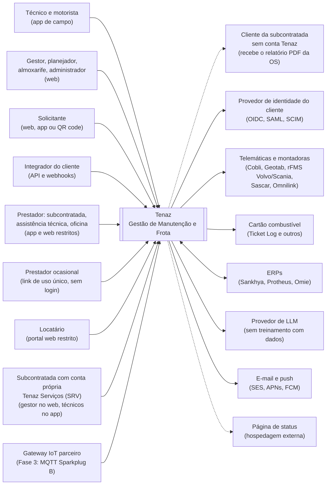
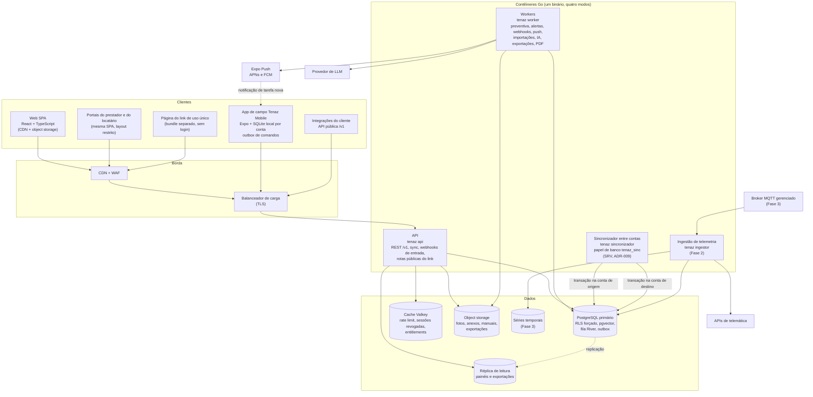
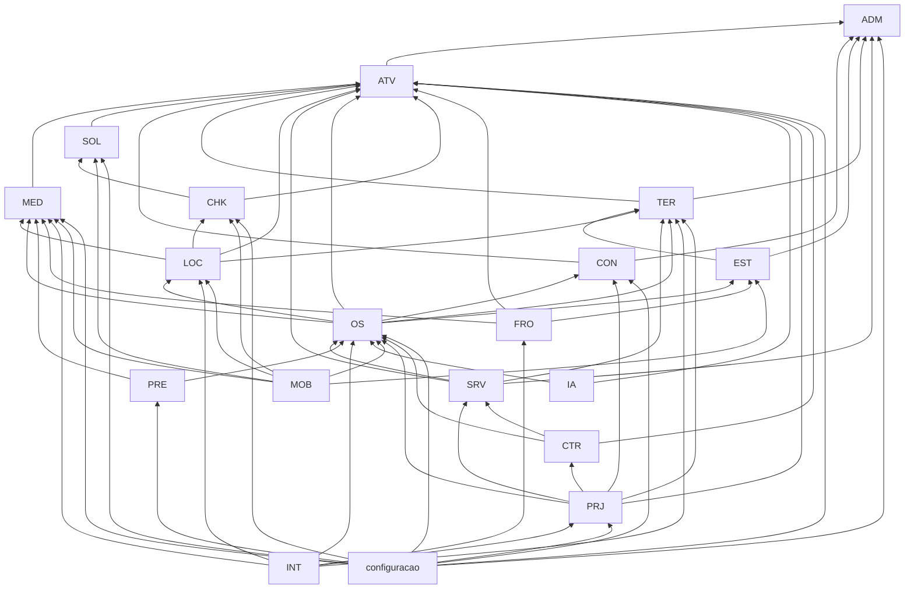
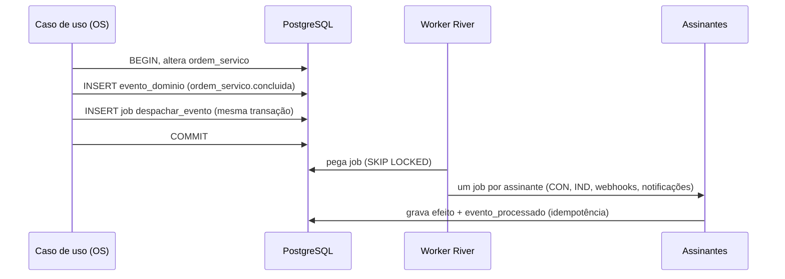
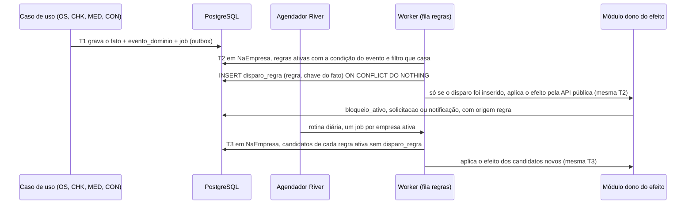
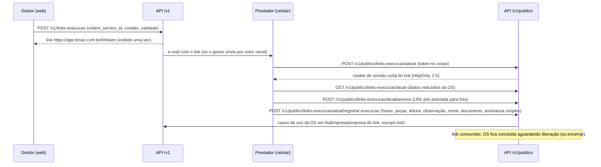
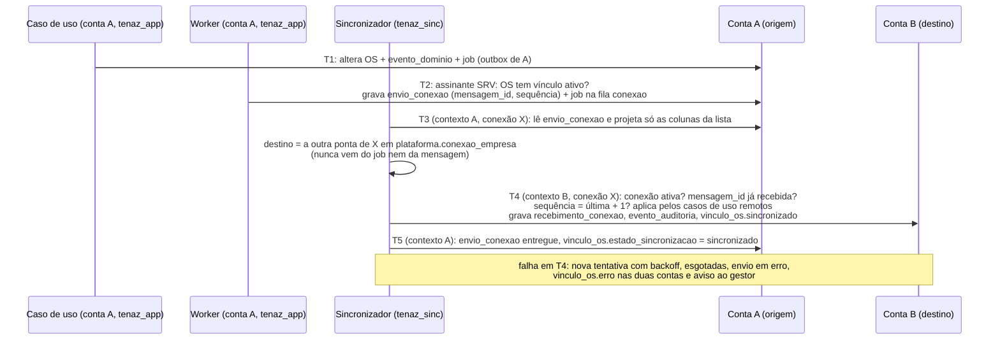
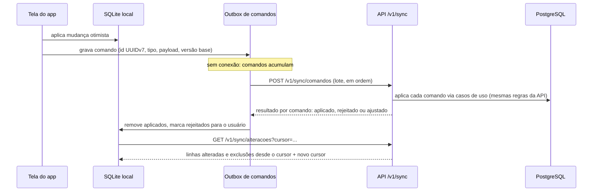

# Arquitetura de Software — Tenaz

**Versão:** 0.6 · **Data:** 12/11/2026 · **Status:** Em elaboração
**Produto:** Tenaz · Gestão de Manutenção e Frota
Alinhado ao sumário executivo 0.6

Este documento descreve como a Tenaz é construída: stack, contêineres, estrutura do monólito modular, isolamento entre empresas e de acessos externos (prestador, locatário e link de uso único), conexão entre contas (cliente e subcontratada, módulo SRV), repositório, convenções, testes, app offline, telemática, IA, infraestrutura e observabilidade. As decisões estruturais estão registradas como ADRs na seção 15. O alinhamento com o sumário e as pendências abertas estão na seção 16.

**Mudanças da versão 0.3 deste documento:** escopo externo `prestador` no lugar de `fornecedor`; permissão de liberação `os.encerrar`; rotas definitivas do link de uso único (sumário 3.6); módulo SRV (pacote `servicos`) nos diagramas, nas dependências, nos testes e no app; processo de sincronização entre contas (seção 6.8) e [ADR-009](#adr-009--conexão-entre-contas); teste automatizado com três contas (seção 9.3).

**Mudanças da versão 0.4 deste documento:** as funções de contexto e de escopo passam a ser citadas com os nomes do documento dono do assunto, [2_ARQUITETURA_BANCO_DADOS.md](2_ARQUITETURA_BANCO_DADOS.md): esquema `app` em vez de `tenaz`, `app.escopo_atual()` em vez de `tenaz.escopo_tipo()`, e a variável de transação `app.escopo` em vez de `app.escopo_tipo`. A divergência foi encontrada na implementação da fundação técnica (etapa [011](etapas/011_2026-11-12_fundacao-tecnica.md)) e resolvida em favor do documento 2, conforme a ordem de fontes da verdade de [CLAUDE.md](../CLAUDE.md), seção 2. Nenhuma decisão de arquitetura mudou: só a grafia dos nomes citados.

**Complemento na versão 0.5:** os três resíduos daquela troca apontados na seção 16 foram corrigidos — as seções 6.4 e 6.8 passaram a citar `app.empresas_ativas()`, `app.conexao_atual()` e `app.escopo = 'interno'`.

**Mudanças da versão 0.5 deste documento:** configuração por segmento (sumário 0.5, seção 3.7; etapa 012). Novo [ADR-010](#adr-010--configuração-por-segmento-com-catálogos-fechados): núcleo canônico fixo e configuração por blocos de catálogo fechado, regras de condição e efeito avaliadas por evento interno e por rotina diária idempotente na fila River, com registro em `disparo_regra`, campos extras da OS em jsonb validados pela definição (também no app, antes de enfileirar o comando) e pacotes de segmento aplicados por cópia idempotente. Mecânica na nova seção 5.6. Pacotes Go `projetos` (PRJ), `contratos` (CTR) e `configuracao` no mapa de módulos e nas regras de dependência (seções 5.1 e 5.3); eventos citados pelos requisitos novos (seção 5.5); jobs novos na fila (seção 4.3); `campo_extra_os` na lista de tabelas com acesso externo (seção 6.6); repositório (seção 7); fluxos E2E 14 a 17 e verificações novas de isolamento (seções 9.2 e 9.3); cache de configuração, comandos e conflito de campo obrigatório no app offline (seções 10.2, 10.3 e 10.5); entitlements de PRJ e CTR (seção 13.4); alinhamento e pendências novas (seção 16). Fora a linha de versão, a de alinhamento e a frase de abertura da seção 16, nenhum texto das versões anteriores foi reescrito; só acréscimos.

**Mudanças da versão 0.6 deste documento:** etapa E01 (conta e acesso), sumário 0.6. Novo [ADR-011](#adr-011--papel-de-banco-próprio-para-as-credenciais-de-autenticação), que resolve o achado ISO-E01-02 da revisão de isolamento: as tabelas de autenticação do esquema `plataforma` (`identidade`, `acesso_empresa`, `sessao`, `token_renovacao`, `codigo_autorizacao`, `desafio_mfa`, `token_email`) passam a ser alcançadas só pelo papel `tenaz_autenticacao`, com pool exclusivo do pacote de autenticação; o `tenaz_app` e o `tenaz_job` perdem todo privilégio nelas. Mecânica na nova seção 6.9; camadas de defesa (6.1), resolução da sessão no middleware (6.3), credencial por modo de execução (4.1), regra 12 de dependência (5.3), verificações da suíte (9.3) e pooler (13.1). Na mesma passada, a pendência E01-3 do documento 2: `app.escopo_id()` não é criada; a seção 6.6 passa a usar `app.fornecedor_atual()`, `app.locatario_atual()` e `app.link_hash_atual()`, e a política do link confere que o link não está revogado, expirado nem usado. A sessão do app passa a durar 30 dias de inatividade, como em RNF-017 (seção 10.6), e o modelo de identidade do login único no app deixa de ser pendência (seção 10.8). Alinhamento ao sumário 0.6 na seção 16.

**Emenda na versão 0.6 (mesma etapa E01, achado ISO-E01-08):** o ADR-011 passa a fixar também o **dono** das tabelas de credencial. Sem RLS, o dono lê tudo, e com dono `tenaz_dono` o `tenaz_manutencao`, membro dele com herança, lia todas as credenciais. As sete tabelas e as duas funções `SECURITY DEFINER` que as tocam pertencem agora ao papel `tenaz_credencial`, sem membros de runtime (decisões 1 e 9, alternativas, risco residual). Seções 6.1, 6.4, 6.9 e 9.3; pendências E01-14 (`conexao_empresa`) e herança do `tenaz_manutencao` na seção 16. Na mesma emenda, a tabela da seção 9.3 passa a descrever exatamente o que a suíte de isolamento de `backend/testes/vazamento/` verifica: linhas novas "Visões", "Papéis e relações de membro", "Moldes da trilha", "Corrida de atribuição", "Contexto no pool" e "Portão de achados"; linhas "Mapa de privilégios", "Dono das credenciais" e "Ataques do achado ISO-E01-02" reescritas conforme os testes.

**Alinhamento ao código de E01 na versão 0.6:** o layout de módulo validado no ADM vira regra (seção 5.2): casos de uso no pacote raiz, HTTP em `<modulo>/rotas`, composição única em `internal/servidor` (seções 2.5 e 7); o desvio do código sqlc do ADM fica como pendência. A seção 2.5 passa a descrever a geração real do contrato (`tenaz openapi`) e marca `oasdiff` e a documentação pública como ainda não implantados. A seção 8.2 passa ao formato de erro real (códigos `snake_case` do documento 3, `type` em `https://api.tenaz.com.br/erros/<codigo>`, `id_rastreio`, `erros[]`). A seção 9.5 fixa a posição na divergência A-38 (`ambiente` não sai de `GET /v1/versao`).

Os nomes de módulos (ADM, ATV, OS...) e de entidades (`empresa`, `ativo`, `ordem_servico`...) seguem o [Sumário Executivo](0_SUMARIO_EXECUTIVO.md). As metas de disponibilidade, recuperação e segurança estão em [9_SEGURANCA_CONFIABILIDADE.md](9_SEGURANCA_CONFIABILIDADE.md).

**Convenção deste documento:** o que aparece marcado como **(proposta)** é decisão de projeto ainda não validada em código ou com custos reais. O que não tem marca é premissa já aceita pelo dono do produto.

---

## Índice

1. [Princípios](#1-princípios)
2. [Stack](#2-stack)
3. [Visão de contexto](#3-visão-de-contexto)
4. [Visão de contêineres](#4-visão-de-contêineres)
5. [Monólito modular](#5-monólito-modular)
6. [Isolamento entre empresas no código](#6-isolamento-entre-empresas-no-código)
7. [Estrutura do repositório](#7-estrutura-do-repositório)
8. [Convenções de código](#8-convenções-de-código)
9. [Testes e CI/CD](#9-testes-e-cicd)
10. [App offline-first](#10-app-offline-first)
11. [Telemática e IoT](#11-telemática-e-iot)
12. [Inteligência artificial](#12-inteligência-artificial)
13. [Infraestrutura](#13-infraestrutura)
14. [Observabilidade](#14-observabilidade)
15. [Decisões de arquitetura (ADRs)](#15-decisões-de-arquitetura-adrs)
16. [Alinhamento com o sumário e pendências](#16-alinhamento-com-o-sumário-e-pendências)

---

## 1. Princípios

| # | Princípio | Consequência prática |
|---|---|---|
| 1 | **Isolamento entre empresas acima de tudo** | Toda tabela de dados de cliente tem `empresa_id`, RLS forçado e filtro explícito no repositório. Um build com vazamento não vai para produção. |
| 2 | **Simples antes de distribuído** | Um binário Go, um banco PostgreSQL, uma fila dentro do banco. Um componente novo só entra com um gatilho mensurável (ver ADRs). |
| 3 | **O campo não tem sinal** | O app trata a conexão como exceção. Toda ação de campo funciona offline e converge sem perda. |
| 4 | **Um contrato, vários clientes** | A API pública, o web, o app e os integradores usam a mesma API REST `/v1`, descrita em OpenAPI 3.1. Não existe API "interna" paralela. |
| 5 | **Dados no Brasil** | Dados primários na região São Paulo. Qualquer saída do país é explícita e declarada no DPA. O local da cópia de recuperação de desastre é a pendência P7 (seção 13.5). |
| 6 | **Humano no comando da IA** | A IA lê, sugere e rascunha. Só grava depois de confirmação humana. |
| 7 | **Publicar o que se mede** | SLOs, RPO, RTO e histórico de incidentes são métricas reais, não texto de marketing. |
| 8 | **Acesso externo é exceção estreita** | Prestador, locatário e link de uso único veem só o que lhes foi atribuído, por uma camada de escopo adicional ao RLS por empresa (seção 6.6), com teste automatizado em todo build. |
| 9 | **Cada conta guarda a sua cópia** | Contas conectadas (cliente e subcontratada) nunca leem dados uma da outra. Um processo de sincronização com papel de banco próprio copia só os campos permitidos, gravando em cada conta numa transação separada (seção 6.8, ADR-009). |

---

## 2. Stack

### 2.1 Backend

| Item | Escolha | Observação |
|---|---|---|
| Linguagem | Go (versão estável vigente, 1.26 ou superior) | Política: só usar versões com suporte oficial. Atualização em até 60 dias após cada lançamento. |
| HTTP e contrato | `net/http` padrão + **Huma v2** (proposta) | Huma gera o OpenAPI 3.1 a partir dos tipos Go, valida a entrada contra o schema e responde erros no formato RFC 9457. Alternativa avaliada: `ogen` (spec-first). |
| Acesso a dados | **sqlc** + **pgx v5** | SQL explícito, tipado na compilação. Sem ORM. |
| Migrações | **goose** (proposta), arquivos `.sql` versionados | Padrão expandir e contrair (expand/contract) para não derrubar versões antigas durante o deploy. |
| Jobs e eventos | **River** (fila no PostgreSQL) | Ver [ADR-005](#adr-005--fila-de-jobs-no-postgresql). |
| Logs | `log/slog` em JSON | Campos obrigatórios na seção 14. |
| Telemetria | OpenTelemetry Go SDK | Traces, métricas e correlação com logs. |
| Testes | `testing` + testify + **testcontainers-go** | Postgres real nos testes de integração. |

### 2.2 Web

| Item | Escolha |
|---|---|
| Base | React 19 + TypeScript (modo `strict`), Vite, SPA |
| Dados do servidor | TanStack Query + cliente gerado do OpenAPI (`openapi-typescript` + `openapi-fetch`) |
| Rotas | React Router (proposta) |
| Formulários | React Hook Form + Zod |
| Interface | Tailwind CSS + componentes Radix, com os tokens da [marca](../marca/README.md). Detalhes em `7_PADROES_DESIGN.md`. |
| Internacionalização | i18next (proposta), com `pt-BR` como idioma de origem |
| Testes | Vitest + Testing Library; Playwright para E2E |

### 2.3 App de campo (MOB)

| Item | Escolha |
|---|---|
| Base | React Native com **Expo** (SDK estável mais recente) + TypeScript |
| Banco local | **SQLite** via `expo-sqlite`, criptografado com SQLCipher (proposta) |
| Acesso ao SQLite | Drizzle ORM com consultas reativas (proposta) |
| Credenciais | `expo-secure-store` (Keychain e Keystore) |
| Recursos nativos | Câmera e QR code, localização sob demanda, notificações push, compressão de foto |
| Distribuição | EAS Build (lojas) e EAS Update (atualização do JavaScript sem loja, por canal) |
| Testes | Jest + React Native Testing Library; Maestro para E2E em emulador (proposta) |

### 2.4 Dados e plataforma

| Item | Escolha |
|---|---|
| Banco | PostgreSQL gerenciado (versão 17 ou superior suportada pelo provedor), com RLS forçado |
| Busca vetorial | Extensão `pgvector` no mesmo banco |
| Arquivos | Object storage compatível com S3 |
| Cache | Valkey gerenciado (proposta), nunca como fonte de verdade |
| Contêineres | Docker, imagem mínima (ver 9_SEGURANCA_CONFIABILIDADE.md) |
| Nuvem | AWS `sa-east-1` (proposta, ver [ADR-006](#adr-006--nuvem-aws-na-região-são-paulo)) |
| IaC | OpenTofu (proposta) |

### 2.5 Contrato único

A API é a única fronteira entre os clientes e o backend.

1. Os tipos de requisição e resposta são structs Go anotadas, registradas no Huma (v2). As rotas de todos os pacotes são montadas num ponto só, `internal/servidor` (`servidor.Montar`), usado pelo processo `tenaz api`, pela geração do contrato e pelos testes de rota: o contrato gerado é exatamente o que o servidor atende. O subcomando `tenaz openapi` escreve `backend/api/openapi.yaml` (OpenAPI 3.1); a tarefa `contrato` de `ferramentas/tarefas.sh` o regrava e regera os tipos TypeScript.
2. O arquivo gerado é versionado no repositório. O CI (tarefa `conferir-contrato`) falha se o arquivo gerado diferir do versionado (alguém mudou a API sem regenerar).
3. O CI compara o contrato com o da branch principal usando `oasdiff`, e mudança incompatível em `/v1` bloqueia o merge. **(proposta: ainda não está na esteira; pendência na seção 16)**
4. O pacote `pacotes/api-tipos` gera os tipos TypeScript a partir do arquivo, e o CI confere que os tipos versionados estão em dia. A web importa dali (`@tenaz/api-tipos`); o app passa a importar quando tiver chamadas à API. Um campo renomeado no Go quebra a compilação do TypeScript no mesmo PR.
5. A documentação pública da API é gerada do mesmo arquivo. **(proposta: ainda não implantada)**

---

## 3. Visão de contexto

Quem usa a Tenaz e com quais sistemas ela conversa.



| Sistema externo | Direção | Fase | Observação |
|---|---|---|---|
| Provedor de identidade | Tenaz consulta | MVP (OIDC), Fase 2 (SAML, SCIM) | Google e Microsoft Entra primeiro |
| Telemáticas e montadoras | Tenaz consulta ou recebe webhook | Fase 2 | Modelo canônico de evento (seção 11) |
| Cartão combustível | Tenaz importa | Fase 2 | Arquivo ou API, conforme o fornecedor |
| ERPs | Bidirecional | Fase 2 | Conector por ERP; o ERP é dono dos itens fiscais, das contas a pagar e da **emissão** de NF-e (remessa e retorno a subcontratada, envio para conserto, fatura de locação e de avarias). O cadastro de `fornecedor` com papéis é do módulo TER e é sincronizado com o ERP; a Tenaz só registra número e chave da NF-e emitida |
| Provedor de LLM | Tenaz chama | Fase 2 | Atrás de uma interface interna; troca de provedor sem mudar módulos |
| E-mail e push | Tenaz envia | MVP | Notificações, alertas de vencimento e envio do link de uso único ao prestador ocasional |
| Prestadores e locatários | Usam a Tenaz | MVP (prestador e link), Fase 2 (locatário) | Não são sistemas: são pessoas de empresas externas com acesso restrito ao que lhes foi atribuído (seção 6.6) |
| Subcontratada com conta própria (SRV) | Usa a Tenaz como empresa | MVP | Não é sistema externo: é outra `empresa` da Tenaz, isolada pelo mesmo RLS. Quando o cliente também usa a Tenaz, as duas contas se conectam e a OS trafega pelo sincronizador entre contas (seção 6.8, ADR-009). Seus técnicos usam o mesmo Tenaz Mobile (seção 10.8) |
| Cliente da subcontratada sem conta Tenaz | Recebe da Tenaz | MVP | Recebe o relatório PDF da OS (`GET /v1/ordens-servico/{id}/relatorio-pdf`), enviado pela subcontratada por e-mail ou baixado e repassado por ela. Não acessa a Tenaz |
| Gateway IoT parceiro | Envia para a Tenaz | Fase 3 | A Tenaz nunca se conecta a CLP ou SCADA do cliente |
| Página de status | Tenaz publica | MVP | Fora da infraestrutura principal, para continuar no ar durante incidentes |

---

## 4. Visão de contêineres



| Contêiner | Responsabilidade | Escala | Fase |
|---|---|---|---|
| Web SPA | Interface do gestor, planejador, almoxarife, comprador e administrador | Arquivos estáticos na CDN | MVP |
| Portais do prestador e do locatário | Mesma SPA com layout e menu restritos, carregados conforme o escopo da sessão (seção 6.6). O prestador vê só as OS do seu fornecedor e o almoxarifado em poder dele; o locatário vê só os ativos locados a ele, suas solicitações e OS | Arquivos estáticos na CDN | MVP (prestador), Fase 2 (locatário) |
| Página do link de uso único | Bundle web separado e mínimo, para celular, sem acesso à sessão da SPA principal; mostra uma única OS e registra a execução (seção 6.7) | Arquivos estáticos na CDN | MVP |
| App de campo (Tenaz Mobile) | Técnico da empresa, técnico da subcontratada com conta própria (SRV), motorista, solicitante e usuário de prestador; offline; troca de conta para quem atua em mais de uma (seção 10.8) | No dispositivo | MVP |
| API (`tenaz api`) | REST `/v1`, autenticação, autorização, escopo externo, sincronização do app, recepção de webhooks de terceiros, rotas públicas do link de uso único, gestão de conexões entre contas (`/v1/conexoes-empresa`) | Horizontal, sem estado; mínimo de 2 tarefas em zonas diferentes | MVP |
| Workers (`tenaz worker`) | Geração de OS preventiva, alertas de vencimento, envio de webhooks (MVP, plano Profissional), notificações push de tarefa nova, envio e expiração de links de uso único, geração do relatório PDF da OS, importação de CSV e NF-e, indexação de documentos para IA, exportação completa da empresa; na Fase 2, prazos de ordem de reparo, verificação de SLA de fornecedor e vencimento de contratos de locação | Horizontal; mínimo de 2 tarefas | MVP |
| Sincronizador (`tenaz sincronizador`) | Único componente que grava dados vindos de outra conta: consome a fila `conexao`, lê o evento na conta de origem e aplica na conta de destino, em transações separadas, com o papel de banco `tenaz_sinc` (seção 6.8, ADR-009). Credencial própria, inacessível às tarefas da API e dos workers | Horizontal; mínimo de 2 tarefas; ordem garantida por vínculo | MVP |
| Ingestão (`tenaz ingestor`) | Conectores de telemática, normalização para o modelo canônico, consumo MQTT na Fase 3 | Separado da API para não disputar recursos | Fase 2 |
| PostgreSQL primário | Fonte de verdade, fila de jobs, outbox, vetores | Vertical; réplica para leitura | MVP |
| Réplica de leitura | Painéis de IND, relatórios, exportações | Uma réplica; mais se o lag ou a carga exigirem | MVP |
| Cache | Rate limit por chave de API, lista de sessões revogadas, cache de entitlements | Nó pequeno com réplica | MVP (proposta) |
| Object storage | Arquivos com chave prefixada por `empresa_id` | Gerenciado | MVP |
| Séries temporais | Dados de sensor de alta frequência | Ver seção 11 | Fase 3 |

### 4.1 Um binário, quatro modos

O backend compila um único binário estático `tenaz` com subcomandos: `api`, `worker`, `sincronizador`, `ingestor` e `migrate`. Os quatro modos de serviço compartilham código e configuração, mas rodam como serviços separados para escalar e falhar de forma independente. **(proposta)**

Motivos: uma imagem só para construir, assinar e escanear; versões sempre coerentes entre API, workers e sincronizador; custo baixo de memória por tarefa.

O `sincronizador` é um modo separado, e não uma fila a mais dentro do `worker`, por um motivo de segurança: ele é o único que conecta ao banco com o papel `tenaz_sinc`. A credencial desse papel fica num segredo que só a tarefa do sincronizador lê (política IAM própria). Uma falha na API ou nos workers não dá acesso ao papel que atravessa contas, e o papel `tenaz_app` nunca grava em duas empresas no mesmo processo de requisição.

**Credencial de banco por modo (versão 0.6).** Cada modo recebe só as credenciais de que precisa, cada uma num segredo próprio lido pela política IAM daquela tarefa:

| Modo | Papéis de banco | Observação |
|---|---|---|
| `api` | `tenaz_app` (pool da aplicação, réplica com `tenaz_leitura`) e `tenaz_autenticacao` (pool pequeno, só do pacote de autenticação) | O segundo pool existe só neste modo ([ADR-011](#adr-011--papel-de-banco-próprio-para-as-credenciais-de-autenticação), seção 6.9) |
| `worker` | `tenaz_app` e `tenaz_job` | Não recebe a credencial de autenticação: a purga das credenciais vencidas é uma função `SECURITY DEFINER` estreita (seção 6.9) |
| `sincronizador` | `tenaz_sinc` | Seção 6.8 |
| `ingestor` | `tenaz_app` | Fase 2 |
| `migrate` | `tenaz_migrador` | Só no pipeline de deploy |

### 4.2 Uso da réplica de leitura

- Vão para a réplica: painéis de IND, relatórios, exportações e consultas da IA que só leem.
- Ficam no primário: qualquer leitura logo após uma escrita do mesmo usuário, a sincronização do app e toda validação de regra de negócio.
- O contexto de empresa (`app.empresa_id`) funciona igual na réplica, porque é definido dentro da transação de leitura.
- Se o atraso da réplica passar de 30 segundos, as leituras voltam para o primário e um alerta dispara. **(proposta)**

### 4.3 Fila de jobs

No início, a fila é uma tabela no próprio PostgreSQL, consumida com `FOR UPDATE SKIP LOCKED`, por meio da biblioteca **River**. O job é inserido **na mesma transação** da mudança de negócio. Se a transação falhar, o job não existe; se ela confirmar, o job existe. Isso elimina a classe de bugs "gravou mas não avisou".

Gatilhos para migrar parte da carga para uma fila dedicada (SQS ou NATS JetStream) estão no [ADR-005](#adr-005--fila-de-jobs-no-postgresql). A telemetria de alta frequência nunca passa pela fila de jobs evento a evento: ela é agrupada em lotes pelo `ingestor`.

**Jobs da configuração por segmento (versão 0.5).** Rodam no `tenaz worker`, na mesma fila River, sem componente novo ([ADR-010](#adr-010--configuração-por-segmento-com-catálogos-fechados), seção 5.6) **(proposta)**:

| Job | Quando | Fase |
|---|---|---|
| Avaliação de regras por evento | Assinante do outbox (seção 5.5) para os eventos que correspondem às condições do catálogo | MVP |
| Rotina diária de regras | Agendada uma vez por dia, um job por empresa ativa (padrão da seção 6.4), depois da rotina de alertas de vencimento | MVP |
| Aplicação de pacote de segmento | Sob demanda, um job único por empresa, pacote e versão | Fase 2 |
| Medição mensal do contrato com cliente | Abertura no primeiro dia do mês seguinte, um job por empresa com CTR | Fase 2 |
| Prazos de contrato com cliente e de etapa de projeto | Assinantes de `ordem_servico.*` e rotina diária por empresa | Fase 2 |

Os jobs de regras usam uma fila River própria, `regras` **(proposta)**, para que uma avaliação lenta não atrase webhooks, push e o sincronizador.

---

## 5. Monólito modular

### 5.1 Um pacote por módulo

Cada módulo do sumário vira um pacote Go em `backend/internal/modulos/`. Três nomes colidem com identificadores da linguagem (`os`, `int` e `sync`) e viram `ordemservico`, `integracoes` e `mob`, como define o sumário (seção 3.4). Os módulos TER, LOC e SRV usam o nome por extenso, `terceiros`, `locacao` e `servicos`.

| Código | Pacote Go | Motivo do nome |
|---|---|---|
| ADM | `adm` | |
| ATV | `atv` | |
| MED | `med` | |
| SOL | `sol` | |
| OS | `ordemservico` | `os` colide com o pacote `os` da biblioteca padrão |
| PRE | `pre` | |
| CHK | `chk` | |
| EST | `est` | Inclui almoxarifados `proprio`, `em_terceiro` e `quarentena`, peças serializadas, remessa e retorno a terceiro e ordem de reparo |
| TER | `terceiros` | Nome por extenso, como no sumário. Dono de `fornecedor`, `servico_fornecedor`, `contrato_prestacao`, `avaliacao_fornecedor`, `orcamento_fornecedor` e `link_execucao` |
| LOC | `locacao` | Nome por extenso, como no sumário. Dono de `locatario`, `contrato_locacao`, `item_contrato_locacao`, `responsabilidade_locacao` e `vistoria_locacao` |
| SRV | `servicos` | Nome por extenso, como no sumário. Dono de `cliente_servico`, `especialidade_tecnico`, `pessoa_especialidade`, `vinculo_os` e da lógica de `plataforma.conexao_empresa`. Contém o código de aplicação de mensagens que o sincronizador executa (seção 6.8). Reaproveita OS, apontamento, ativos e app; não duplica nenhuma dessas entidades |
| FRO | `fro` | |
| CON | `con` | |
| IND | `ind` | |
| INT | `integracoes` | `int` é tipo predeclarado do Go |
| IA | `ia` | |
| MOB | `mob` | Contém a sincronização do app (o nome `sync` colidiria com a biblioteca padrão) |
| PRJ | `projetos` | Nome por extenso, como no sumário (seção 3.4). Fase 2. Dono de `modelo_projeto`, `modelo_etapa_projeto`, `projeto` e `etapa_projeto`. Não executa trabalho: organiza OS `implantacao` pelos contratos internos de `ordemservico` |
| CTR | `contratos` | Nome por extenso, como no sumário (seção 3.4). Fase 2. Dono de `contrato_cliente`, `item_contrato_cliente`, `faixa_desconto_contrato` e `medicao_contrato`. Os contratos de prestação e de locação continuam em `terceiros` e `locacao` |
| (ADM) | `configuracao` | Sem código de módulo próprio: é o pacote das regras configuráveis e dos pacotes de segmento, que o sumário põe no escopo de ADM (seções 2 e 3.4). Separado de `adm` para não criar ciclo, porque depende de ATV, CON, SOL e OS, que dependem de ADM. Dono de `regra_automacao`, `disparo_regra`, `pacote_segmento` e `aplicacao_pacote`. **Não** é dono de `campo_extra_os`: a definição do campo extra é de OS (RF-OS-021), que valida os valores na própria transação (seção 5.6) |

Código transversal fica em `backend/internal/plataforma/`: banco e transação, contexto de empresa e de escopo externo (seção 6.6), autenticação, autorização, entitlements, outbox e eventos, auditoria, armazenamento de arquivos, erros, observabilidade e configuração. A plataforma não importa nenhum módulo. A autenticação (`plataforma/autenticacao`) é o único pacote com papel de banco e pool próprios dentro da API: só ele lê e grava as tabelas de credencial (seção 6.9, regra 12 da seção 5.3).

### 5.2 Camadas dentro de um módulo

Layout validado em código pelo ADM (etapa E01) e adotado como regra para os módulos seguintes (versão 0.6):

```
backend/internal/modulos/adm/
├── adm.go                 # API pública: interface Servico, DTOs de entrada e saída
├── servico.go             # Novo(Dependencias), o tipo não exportado que implementa Servico
│                          # e os erros próprios do módulo (ex.: ErrUltimoAdministrador)
├── unidades.go, pessoas.go, usuarios.go, conta.go, auditoria.go
│                          # casos de uso, um arquivo por assunto: orquestram domínio,
│                          # repositório, auditoria, autorização e outros módulos
├── eventos.go             # eventos que o módulo publica (quando houver; regra 6 da seção 5.3)
├── rotas/                 # camada HTTP: handlers Huma que mapeiam a requisição para o Servico;
│                          # importado só pela composição em internal/servidor
├── jobs/                  # workers River do módulo, registrados pela composição do modo
│                          # worker (proposta: nenhum módulo tem job ainda)
└── internal/
    ├── dominio/           # entidades, regras, máquina de estados. Sem IO
    └── repo/
        ├── adm.sql        # consultas sqlc do módulo
        ├── repo.go        # consultas na transação de NaEmpresa; violação do banco vira erro de domínio
        └── gerado/        # regra: código gerado pelo sqlc (não editar); no ADM, ainda em
                           # plataforma/db/consultas (desvio abaixo)
```

O diretório `internal/` dentro do módulo é imposto pelo compilador Go: nenhum pacote fora de `adm/` importa `adm/internal/...`. Para outros módulos, o único ponto de entrada é o pacote raiz `adm`.

**Por que os casos de uso ficam no pacote raiz e o HTTP fica em `rotas/`, fora de `internal/`.** Os DTOs da API pública ficam no pacote raiz, e quem implementa o `Servico` precisa deles. Com os casos de uso em `internal/app`, o construtor `Novo`, no pacote raiz, importaria `internal/app`, que importaria o pacote raiz pelos DTOs: ciclo de importação. Com o HTTP em `internal/http`, a composição em `internal/servidor` não poderia importá-lo (o compilador só deixa `adm/...` importar `adm/internal/...`), e o pacote raiz teria de registrá-lo, de novo em ciclo. Alternativas descartadas: pôr os DTOs num subpacote `tipos` (um pacote a mais por módulo, sem ganho de fronteira) e registrar as rotas a partir do pacote raiz (o domínio passaria a depender de HTTP). A implementação continua escondida: só os identificadores exportados do pacote raiz são API, e o tipo que implementa `Servico` não é exportado. Os workers River seguem o mesmo raciocínio em `jobs/`.

| Camada | Pode importar | Não pode importar |
|---|---|---|
| `internal/dominio` | Biblioteca padrão, tipos da plataforma (IDs, erros, autorização, tempo) | Banco, HTTP, outros módulos |
| Pacote raiz (API pública e casos de uso) | `internal/dominio`, `internal/repo`, plataforma, **API pública** de outros módulos | `internal/` de outros módulos, `rotas` e `jobs` de qualquer módulo |
| `internal/repo` | Código gerado do sqlc, `plataforma/db`, `plataforma/erros` | Pacote raiz, `rotas`, `jobs` |
| `rotas` | Pacote raiz do próprio módulo, `plataforma/api`, `plataforma/autorizacao`, `plataforma/erros` e as interfaces de serviços da plataforma (ex.: convites de `plataforma/autenticacao`) | `internal/` do módulo (o compilador já impede), outros módulos |
| `jobs` **(proposta)** | Pacote raiz do próprio módulo, `plataforma/fila` | `internal/` do módulo, outros módulos |

Só `internal/servidor` importa `<modulo>/rotas`, e só a composição do worker importará `<modulo>/jobs`. Hoje isso vale por construção (só existe `adm/rotas`, importado só por `internal/servidor`); a regra do `depguard` entra com o segundo módulo (pendência na seção 16).

**Desvio atual do ADM: código sqlc compartilhado.** O `sqlc.yaml` gera as consultas de `adm/internal/repo/adm.sql` em `internal/plataforma/db/consultas`, o mesmo pacote das consultas de auditoria e de autorização, e `db.Q(ctx)` devolve esse tipo único. Como o pacote fica na plataforma, qualquer módulo poderia importá-lo e chamar uma consulta de ADM, e a regra 2 da seção 5.3 (nenhum módulo lê ou grava tabela de outro) passaria a depender só de revisão. A regra continua sendo a do layout acima, já seguida por `plataforma/autenticacao` (`autenticacao/internal/repo/gerado`): o código gerado de cada módulo fica no `internal/repo/gerado` dele, criado sobre a transação de `db.Tx(ctx)`. Correção antes do primeiro módulo de E02 (pendência na seção 16).

### 5.3 Regras de dependência entre módulos

As setas indicam "chama a API pública de". Ciclos são proibidos. Quando dois módulos precisam reagir um ao outro, um deles chama e o outro escuta um evento.



Dependências dos módulos novos e o motivo de cada uma:

| De → para | Motivo | Exemplo de chamada |
|---|---|---|
| TER → ADM | Usuário de perfil `prestador` fica ligado ao `fornecedor` (`usuario.fornecedor_id`) | `adm.Servico.UsuariosDoFornecedor` |
| TER → ATV | O catálogo de serviços (`servico_fornecedor`) indica classes de ativo e marcas atendidas | `atv.Servico.ValidarClasses` |
| OS → TER | **Executor da OS:** com `executor_tipo = fornecedor`, a OS valida o `fornecedor_id`, o serviço do catálogo e, na Fase 2, o contrato de prestação e o SLA aplicável; também cria e consome o link de uso único | `terceiros.Servico.ValidarExecutor`, `terceiros.Servico.CriarLinkExecucao`, `terceiros.Servico.ConsumirLink` |
| EST → TER | **Estoque em terceiro e reparo:** almoxarifado `em_terceiro` exige `fornecedor_id` de papel `subcontratada`; ordem de reparo exige fornecedor e registra o orçamento em `orcamento_fornecedor` | `terceiros.Servico.ValidarPapel`, `terceiros.Servico.RegistrarOrcamento` |
| OS → EST | Já existia; passa a incluir baixa no almoxarifado `em_terceiro` do executor e envio de peça defeituosa removida para `quarentena` | `est.Servico.BaixarConsumo`, `est.Servico.ReceberDefeituosa` |
| OS → LOC | **Responsável pelo custo:** ao criar a OS de um ativo com contrato de locação vigente, a OS pede à matriz `responsabilidade_locacao` o `responsavel_custo` padrão para o tipo de serviço; o usuário pode alterar com justificativa | `locacao.Servico.ResponsavelCustoPadrao(ativo, tipo, data)` |
| LOC → ATV | Itens do contrato são ativos; ativo `cedido` em locação passa a ter o local de uso como localização; ativo `tomado` tem `propriedade = de_terceiro` | `atv.Servico.DefinirLocalUso` |
| LOC → MED | A vistoria de entrega e de devolução registra leituras de medidor; franquia de horas ou km usa as leituras | `med.Servico.RegistrarLeitura` |
| LOC → TER | Contrato `tomado` exige fornecedor com papel `locador`; o SLA de substituição do locador vem do cadastro dele | `terceiros.Servico.ValidarPapel` |
| LOC → CHK | O checklist da vistoria usa um `checklist_modelo` | `chk.Servico.ModeloDeVistoria` |
| SRV → ADM | **Técnicos da subcontratada:** técnico é `pessoa` + `usuario` com perfil `tecnico`; SRV liga especialidades (`pessoa_especialidade`) e consulta técnicos ativos para distribuir OS | `adm.Servico.PessoasComPerfil`, `adm.Servico.ValidarPessoa` |
| SRV → ATV | **Equipamentos de clientes:** cria e atualiza `ativo` com `propriedade = de_cliente` e `cliente_servico_id`; na conexão, grava a cópia sincronizada com `conexao_empresa_id` e `ativo_remoto_id` e marca como somente leitura os campos de cadastro que pertencem ao cliente | `atv.Servico.CriarAtivoDeCliente`, `atv.Servico.AplicarCadastroRemoto` |
| SRV → TER | **Conexão do lado do cliente:** o convite parte de um `fornecedor` com papel `subcontratada` ou `assistencia_tecnica`; do lado da subcontratada, os itens `servico_os` referenciam o catálogo `servico_fornecedor` da própria conta | `terceiros.Servico.ValidarPapel`, `terceiros.Servico.ServicoDoCatalogo` |
| SRV → OS | **OS vinculada:** cria a OS correspondente na outra conta (na subcontratada, a partir da OS atribuída ao fornecedor conectado; no cliente, `aberta` com `origem = prestador`) e aplica andamento, apontamentos, componentes, fotos, conclusão, liberação e recusa recebidos pela conexão, sempre pelos casos de uso comuns da OS | `ordemservico.Servico.CriarVinculada`, `ordemservico.Servico.AplicarExecucaoRemota`, `ordemservico.Servico.AplicarLiberacaoRemota` |

Dependências novas da versão 0.5 (configuração por segmento, PRJ e CTR), todas **(proposta)**; os nomes das funções são exemplos:

| De → para | Motivo | Exemplo de chamada |
|---|---|---|
| PRJ → OS | **OS de implantação da etapa:** cria OS `implantacao` com `origem = projeto` e a etapa de origem, pelos contratos internos da OS (a OS guarda a etapa como referência, sem importar `projetos`); consulta a situação das OS da etapa para concluí-la (RF-PRJ-003, RF-PRJ-004) | `ordemservico.Servico.CriarImplantacao`, `ordemservico.Servico.SituacaoDasOS` |
| PRJ → ATV | Ativos do projeto, normalmente `em_implantacao`; a conclusão do projeto executa `colocar_em_operacao` (RF-PRJ-007, RF-ATV-013) | `atv.Servico.ColocarEmOperacao` |
| PRJ → TER | Executor `fornecedor` da etapa e valor da etapa vindo do contrato de prestação (RF-PRJ-006) | `terceiros.Servico.ValidarExecutor`, `terceiros.Servico.ValorDoContrato` |
| PRJ → CON | Documentos exigidos por etapa (tipo de documento e documento registrado no ativo depois do início da etapa) e assinatura do termo de entrega | `con.Servico.DocumentoRegistradoDesde`, `con.Servico.Assinar` |
| PRJ → CTR | Projeto ligado a um contrato com cliente; na conclusão, inclui os ativos como itens cobertos a partir da entrada em operação, na mesma transação (RF-PRJ-007, RF-CTR-002) | `contratos.Servico.ValidarContrato`, `contratos.Servico.IncluirItens` |
| PRJ → SRV | Cliente atendido do projeto (opcional), só leitura do cadastro (regra 9) | `servicos.Servico.ClienteAtendido` |
| CTR → ATV | Itens cobertos: propriedade, fase de ciclo de vida, `data_entrada_operacao` e status do ativo (RF-CTR-002) | `atv.Servico.ValidarItemCoberto` |
| CTR → OS | **Lê as paradas da OS:** registros de parada e `causa_externa` das OS dos itens, por período, para a medição e o painel (RF-CTR-003, RF-CTR-004). CTR não grava na OS: a aprovação da exclusão fica na medição | `ordemservico.Servico.ParadasDoAtivo(ativo, periodo)` |
| CTR → SRV | Cliente atendido do contrato, só leitura do cadastro (regra 9) | `servicos.Servico.ClienteAtendido` |
| INT → PRJ | Criação de projetos em lote por planilha (RF-PRJ-002, RF-INT-003) | `projetos.Servico.CriarEmLote` |
| `configuracao` → ATV | Filtro das regras por classe, unidade e criticidade; o pacote cria classes de ativo com campos extras e medidores | `atv.Servico.AtivosDoFiltro`, `atv.Servico.GarantirClasse` |
| `configuracao` → MED | Condição `leitura_fora_faixa` | `med.Servico.Leitura` |
| `configuracao` → CON | Condições `documento_vencido`, `documento_a_vencer` e, na Fase 2, `capacitacao_vencida`; efeitos `bloquear_ativo`, `bloquear_ativo_ate_documento` e, na Fase 2, `impedir_atribuicao` (CON é dono de `bloqueio_ativo` e das capacitações); o pacote cria tipos de documento | `con.Servico.DocumentosVencidos`, `con.Servico.BloquearAtivo`, `con.Servico.GarantirTipoDocumento` |
| `configuracao` → SOL | Efeito `abrir_solicitacao`, com origem `regra` | `sol.Servico.Abrir` |
| `configuracao` → CHK | Condição `item_checklist_reprovado`; o pacote cria modelos de checklist | `chk.Servico.ItemReprovado`, `chk.Servico.GarantirModelo` |
| `configuracao` → PRE | O pacote cria procedimentos e planos padrão | `pre.Servico.GarantirProcedimento`, `pre.Servico.GarantirPlanoPadrao` |
| `configuracao` → OS | Condição `os_concluida_com_campo` (valor do campo extra `sim_nao`); o pacote cria `campo_extra_os` e códigos de falha sugeridos | `ordemservico.Servico.ValorCampoExtra`, `ordemservico.Servico.GarantirCampoExtra` |
| `configuracao` → PRJ | Condição `etapa_projeto_atrasada` (Fase 2); o pacote cria modelos de projeto | `projetos.Servico.EtapasAtrasadas`, `projetos.Servico.GarantirModelo` |
| `configuracao` → ADM | Destinatários do efeito `notificar` (usuários por perfil e unidade) | `adm.Servico.UsuariosComPerfil` |

Reações que **não** são chamada direta, para não criar ciclo:

- Avaria na vistoria de devolução: LOC publica `vistoria_locacao.registrada` com as avarias; OS escuta e cria a OS corretiva com `responsavel_custo = locatario`.
- SLA de fornecedor (Fase 2): TER escuta `ordem_servico.*` (reconhecimento, início, conclusão) e publica `fornecedor.sla_violado` quando o prazo do contrato estoura.
- Retorno de ordem de reparo: EST publica `ordem_reparo.retornada`; quem precisar (IND, webhooks) escuta.
- OS vinculada: SRV escuta `ordem_servico.*`, `apontamento.*` e `anexo.*` (atribuição a fornecedor conectado, início, pausa, conclusão, liberação, recusa, cancelamento) e, se a OS tiver `vinculo_os` com conexão `ativa`, enfileira a mensagem para o sincronizador (seção 6.8). OS não importa `servicos`: quem chama é sempre SRV → OS.
- Conexão: SRV publica `conexao_empresa.ativada` e `conexao_empresa.encerrada`; TER escuta para mostrar o estado da conexão no cadastro do fornecedor; IND e webhooks escutam `vinculo_os.sincronizado` e `vinculo_os.erro`.
- Entrada em operação (versão 0.5): ATV publica `ativo.colocado_em_operacao`; PRE escuta e ativa os planos a partir de `data_entrada_operacao`. ATV não importa `pre` (PRE → OS → ATV fecharia ciclo).
- Andamento da etapa de projeto (Fase 2): PRJ escuta `ordem_servico.*` das OS com `origem = projeto` (início, encerramento, cancelamento) para passar a etapa a `em_andamento` e conferir a conclusão. OS não importa `projetos`.
- Prazos do contrato com cliente (Fase 2): CTR escuta `ordem_servico.*` das OS dos itens cobertos e publica `contrato_cliente.sla_violado` quando o prazo de atendimento ou de solução estoura, como TER faz com o SLA de fornecedor. OS não importa `contratos`.
- Regras configuráveis: `configuracao` escuta os eventos que correspondem às condições do catálogo (`ordem_servico.concluida`, `checklist_execucao.item_reprovado`, `leitura_medidor.registrada`, `documento_vencimento.vencendo`) e aplica o efeito pela API pública do módulo dono do dado (seção 5.6). Nenhum módulo importa `configuracao`.

Regras:

1. Um módulo só chama outro pela interface exportada no pacote raiz (`ordemservico.Servico`).
2. Um módulo nunca lê ou grava tabelas de outro módulo. Cada tabela tem um módulo dono, registrado em `2_ARQUITETURA_BANCO_DADOS.md`.
3. Exceção controlada: IND lê de visões e visões materializadas de leitura (prefixo `vw_`) que juntam dados de vários módulos. Essas visões são somente leitura e têm o mesmo RLS das tabelas de origem.
4. INT, IA e MOB são "módulos de borda": dependem de muitos, e ninguém depende deles.
5. As regras são verificadas no CI pelo linter `depguard` (no `golangci-lint`) com a lista de importações permitidas por módulo. **(proposta)**
6. Escutar um evento não cria dependência de importação: os tipos de payload ficam em `plataforma/eventos/contratos` e o `eventos.go` de cada módulo só os reexporta. Assim TER pode escutar `ordem_servico.*` sem importar `ordemservico`, embora OS chame TER. **(proposta)**
7. Nenhum módulo de domínio chama SRV. SRV fica acima de OS, ATV, TER e ADM e reage a eles por eventos. Assim, uma empresa sem o módulo SRV e sem conexões não executa nenhum código de `servicos` no caminho das suas requisições.
8. Só o pacote `servicos` (código de aplicação de mensagens) roda dentro do sincronizador com o papel `tenaz_sinc`, e só chama as funções de OS e ATV marcadas como "remotas" (`AplicarExecucaoRemota`, `AplicarCadastroRemoto`...), que aceitam apenas os campos da lista fechada (seção 6.8). O `depguard` impede que outros pacotes importem o cliente de banco do sincronizador.
9. **Exceção estreita à regra 7 (versão 0.5).** O sumário (seção 3.1) faz `cliente_servico` existir nas contas com SRV e nas contas com CTR. Enquanto o dono da tabela continuar sendo SRV (pendência na seção 16), CTR e PRJ podem chamar de `servicos` **só** a leitura e o cadastro de `cliente_servico` (`servicos.Servico.ClienteAtendido`), que não toca conexão, vínculo nem sincronizador. O `depguard` restringe essa importação a esse arquivo de API. **(proposta)**
10. **`configuracao` é pacote de borda**, como INT, IA e MOB (regra 4): depende de ATV, MED, SOL, CHK, PRE, CON, OS, PRJ e ADM, e ninguém depende dele. Reage por eventos e grava sempre pela API pública do módulo dono do dado; nunca grava em tabela de outro módulo (regra 2). **(proposta)**
11. **Verificação sem importação.** Quando um módulo de baixo precisa confirmar uma condição de um módulo de cima antes de uma ação síncrona, ele declara uma interface no seu pacote raiz e o módulo de cima a implementa; a ligação é feita em `cmd/tenaz`, na inicialização. Primeiro caso: `colocar_em_operacao` (RF-ATV-013) exige que não haja OS `implantacao` não encerrada e que os documentos críticos da classe estejam válidos. ATV declara `atv.VerificadorEntradaOperacao`; OS e CON o implementam. As importações continuam OS → ATV e CON → ATV, a chamada roda na mesma transação e o grafo continua sem ciclo. **(proposta, validar em código)**
12. **Credenciais só pela autenticação (versão 0.6).** Só `plataforma/autenticacao` alcança as tabelas `identidade`, `acesso_empresa`, `sessao`, `token_renovacao`, `codigo_autorizacao`, `desafio_mfa` e `token_email`, pelo repositório em `autenticacao/internal/repo` (o compilador impede outro importador) e pelo pool do papel `tenaz_autenticacao`. Módulos de negócio, inclusive ADM, chamam a API do serviço de autenticação (`EmitirConvite`, `EncerrarSessoesUsuario`...) **fora** da própria transação, depois do `COMMIT`; o repositório recusa ser chamado dentro de `NaEmpresa`. Um teste falha se algum arquivo `.sql` fora desse repositório citar uma das sete tabelas ([ADR-011](#adr-011--papel-de-banco-próprio-para-as-credenciais-de-autenticação), seção 6.9). Não é dependência nova entre módulos: módulos já podem importar a plataforma; a regra só fecha o caminho até o banco.

### 5.4 Como um módulo chama outro

Chamada síncrona, no mesmo processo e **na mesma transação**:

- A transação de banco, já com o contexto de empresa definido, viaja no `context.Context`.
- O repositório de qualquer módulo obtém a transação do contexto. Ele nunca abre conexão própria.
- Se o caso de uso de OS chama `est.Servico.ReservarItens(ctx, ...)` e a OS falha depois, a reserva é desfeita no mesmo rollback.

Exemplo de fluxo: técnico conclui uma OS de máquina NR-12.

1. `ordemservico/app` carrega a OS e valida a transição `em_execucao → concluida` no domínio.
2. Chama `con.Servico.ValidarRegistroNR12(ctx, os)` para conferir os sete campos do item 12.11.2.
3. Chama `est.Servico.BaixarConsumo(ctx, itens)`.
4. Grava a OS e publica o evento `ordem_servico.concluida` no outbox.
5. Confirma a transação. Tudo ou nada.

### 5.5 Eventos internos e outbox transacional

Usado quando a reação pode ser assíncrona ou quando a chamada direta criaria ciclo.



| Item | Definição **(proposta)** |
|---|---|
| Tabela | `evento_dominio` (append-only): `empresa_id`, `id` (UUIDv7), `tipo`, `agregado`, `agregado_id`, `versao_schema`, `payload` (jsonb), `ocorrido_em`, `usuario_id`, `origem` |
| Nome do evento | `<entidade>.<fato_no_particípio>`, com o nome completo da entidade (sumário, seção 3.4): `ordem_servico.concluida`, `ordem_servico.encerrada`, `leitura_medidor.registrada`, `plano_manutencao.vencido`, `checklist_execucao.item_reprovado`, `documento_vencimento.vencendo`, `solicitacao.aprovada`. Novos na versão 0.3: `ordem_reparo.enviada`, `ordem_reparo.retornada`, `movimentacao_estoque.registrada`, `contrato_locacao.ativado`, `contrato_locacao.encerrado`, `vistoria_locacao.registrada`, `fornecedor.sla_violado`. Novos na versão 0.4 (SRV): `conexao_empresa.ativada`, `conexao_empresa.encerrada`, `vinculo_os.sincronizado`, `vinculo_os.erro` |
| Entrega | Pelo menos uma vez. Todo assinante é idempotente: grava `evento_processado(empresa_id, evento_id, assinante)` com chave única na mesma transação do efeito |
| Ordem | Garantida por agregado (mesmo `agregado_id`), não global |
| Contexto de empresa | O job carrega `empresa_id`; o worker abre transação com esse contexto antes de qualquer leitura |
| Webhooks públicos | São um assinante. Entram no **MVP**, no plano Profissional (entitlement `webhooks`). Reusam o nome do evento interno quando ele é estável e público; o payload público é versionado à parte. Eventos de um escopo externo (prestador, locatário) nunca são entregues a destinos do prestador ou do locatário: webhooks são só da empresa |
| Retenção | 90 dias na tabela quente; depois, arquivado no object storage |

Exemplos de uso: `checklist_execucao.item_reprovado` → SOL cria solicitação; `ordem_servico.encerrada` → IND atualiza custos consolidados (separados por `responsavel_custo`) e INT dispara webhook; `leitura_medidor.registrada` → PRE reavalia gatilhos por medidor; `vistoria_locacao.registrada` com avaria → OS cria corretiva com custo do locatário; `contrato_locacao.encerrado` → IND fecha o relatório de cobrança de avarias e horas excedentes e INT dispara webhook (a volta do ativo cedido à localização de origem é chamada direta LOC → ATV, na mesma transação do encerramento); `ordem_servico.concluida` numa OS com `vinculo_os` → SRV enfileira a mensagem de conclusão para a conta do cliente; `vinculo_os.erro` → notificação ao gestor das duas contas.

Os eventos de uma conta nunca são entregues a assinantes de outra conta. O que atravessa contas não é o evento, e sim uma **mensagem de conexão** montada pelo sincronizador só com os campos permitidos (seção 6.8).

**Eventos citados pelos requisitos da versão 0.5** (nomes de [1_ESPECIFICACAO_REQUISITOS.md](1_ESPECIFICACAO_REQUISITOS.md); a lista pública de webhooks é de `3_ESPECIFICACAO_APIS.md`): `ativo.colocado_em_operacao` (RF-ATV-013); na Fase 2, `projeto.iniciado`, `projeto.concluido`, `projeto.cancelado` (RF-PRJ-002), `contrato_cliente.ativado`, `contrato_cliente.encerrado`, `contrato_cliente.sla_violado` (RF-CTR-001) e `medicao_contrato.fechada` (RF-CTR-004). O disparo de uma regra não é evento novo: fica em `disparo_regra`, e o efeito publica os eventos do módulo dono (por exemplo, a mudança de status do ativo bloqueado). Eventos gerados por efeito de regra levam `origem = regra` (seção 5.6).

### 5.6 Configuração por segmento

Sumário, seção 3.7; requisitos RF-ADM-016, RF-ADM-017, RF-ATV-013 e RF-OS-021 em [1_ESPECIFICACAO_REQUISITOS.md](1_ESPECIFICACAO_REQUISITOS.md). Decisão e alternativas no [ADR-010](#adr-010--configuração-por-segmento-com-catálogos-fechados). A empresa configura **blocos que o código já conhece**; não cria estados, telas, fluxos nem colunas.

**Núcleo canônico (não configurável).**

| Item | Onde vive | Por que é fixo |
|---|---|---|
| Estados (OS, solicitação, projeto, etapa, contratos, medição, conexão) | Domínio Go e `pacotes/dominio`, com casos JSON compartilhados (seção 7) | O app offline resolve conflitos por estado (seção 10.5) e a conexão entre contas define dono por estado (seção 6.8) |
| Fórmulas dos indicadores | IND, sobre as visões `vw_` (regra 3 da seção 5.3) | Indicadores comparáveis entre empresas e entre segmentos. A exclusão da OS `implantacao` e do ativo `em_implantacao` é regra fixa da visão, não configuração. A disponibilidade contratual de CTR é cálculo próprio de `contratos` e não altera a disponibilidade técnica de IND |
| Regras do app offline | Seções 10.3 a 10.5 | Uma regra configurável não roda no aparelho |
| Isolamento | Seção 6 | Nenhum bloco cria tabela, política ou escopo |
| Campos da conexão entre contas | `campos_conexao.yaml` (seção 6.8) | Campos extras nunca entram na lista no lançamento (sumário 3.6) |

**Blocos configuráveis e dono de cada um.**

| Bloco | Pacote dono | Onde fica | Fase |
|---|---|---|---|
| Classes de ativo | `atv` | Tabelas da empresa (já existiam) | MVP |
| Campos extras da OS | `ordemservico` | Definição em `campo_extra_os`; valores em `ordem_servico.campos_extras` (jsonb) | MVP |
| Tipos de documento | `con` | `tipo_documento` (já existia) | MVP |
| Regras de condição e efeito | `configuracao` | `regra_automacao` e `disparo_regra` | MVP |
| Fase de ciclo de vida | `atv` | `ativo.fase_ciclo_vida` e `data_entrada_operacao` | MVP |
| Modelos de projeto | `projetos` | `modelo_projeto` e `modelo_etapa_projeto` | Fase 2 |
| Contratos com clientes | `contratos` | `contrato_cliente`, `item_contrato_cliente` e `faixa_desconto_contrato` | Fase 2 |
| Pacotes de segmento | `configuracao` | `pacote_segmento` (catálogo global) e `aplicacao_pacote` (por empresa) | Fase 2 |

Toda tabela de configuração da empresa tem `empresa_id`, RLS forçado e a política `escopo_externo` padrão (só `interno`); a única que entra na lista de acesso externo é `campo_extra_os` (seção 6.6). `pacote_segmento` é a única tabela global nova.

**Catálogos fechados no código** **(proposta)**.

- Cada condição e cada efeito é um tipo Go do pacote `configuracao` que implementa a interface `Condicao` (código, validação dos parâmetros, busca de candidatos) ou `Efeito` (código, validação dos parâmetros, aplicação). O registro é uma lista fixa, compilada no binário: não há plugin, carga dinâmica, expressão nem script.
- No banco, `regra_automacao.condicao` e `regra_automacao.efeito` só aceitam os códigos do catálogo (restrição `CHECK` ou tipo enumerado, a decidir no documento 2). Código novo exige migração, requisito em [1_ESPECIFICACAO_REQUISITOS.md](1_ESPECIFICACAO_REQUISITOS.md) e teste no mesmo PR (risco R7).
- Os parâmetros da condição e do efeito ficam em jsonb e são decodificados no struct do tipo, com rejeição de campo desconhecido.
- A matriz de combinações permitidas (RF-ADM-016) é uma tabela no código. O CI falha se uma combinação permitida não tiver caso de teste.
- Os códigos da Fase 2 (`capacitacao_vencida`, `etapa_projeto_atrasada`, `impedir_atribuicao`) só entram no catálogo quando o requisito for implementado.

**Avaliação das regras.**



- **Por evento.** Para as condições ligadas a um fato (`os_concluida_com_campo`, `item_checklist_reprovado`, `leitura_fora_faixa`), o assinante de `configuracao` avalia a regra no job do outbox, logo depois do fato. O registro em `disparo_regra` e o efeito vão na **mesma transação**: ou os dois existem, ou nenhum.
- **Rotina diária idempotente.** Segue o padrão da seção 6.4 (um job por empresa ativa, cada um em `NaEmpresa`, sem `BYPASSRLS`). Avalia as condições de tempo (`documento_vencido`, `documento_a_vencer` e, na Fase 2, `capacitacao_vencida` e `etapa_projeto_atrasada`) e repassa as condições de fato, para recuperar uma avaliação perdida ou que falhou. Roda depois da rotina de alertas de vencimento e termina no mesmo prazo (RNF-009).
- **Idempotência pela chave do fato.** `disparo_regra` tem chave única `(empresa_id, regra_automacao_id, chave_fato)`. A chave identifica o fato, não o dia: documento (`documento_vencimento_id` e validade), OS (`ordem_servico_id`), item de checklist (`checklist_execucao_id` e item), leitura (`leitura_medidor_id`), capacitação (`capacitacao_id` e validade), etapa (`etapa_projeto_id` e data prevista). Um documento renovado que vence de novo dispara de novo; o mesmo vencimento, nunca. **(proposta; colunas finais no documento 2)**
- **Efeito pelo dono do dado.** `bloquear_ativo` e `bloquear_ativo_ate_documento` chamam CON, dono de `bloqueio_ativo` (`origem = regra`); `abrir_solicitacao` chama SOL (origem `regra`); `notificar` usa o mesmo caminho de envio dos alertas de vencimento. Em `bloquear_ativo_ate_documento`, o bloqueio guarda o tipo de documento exigido e a data do fato; quem levanta o bloqueio é o próprio CON, no caso de uso que registra o documento, sem nova avaliação de regra.
- **Sem cascata.** Os eventos gerados por um efeito levam `origem = regra`, e o assinante de `configuracao` os ignora. Uma regra nunca dispara outra. O teste da matriz de combinações confere isso para cada condição nova.
- **Simular sem gravar.** A simulação (RF-ADM-016) usa a mesma busca de candidatos, numa transação somente leitura na réplica (seção 4.2), sem `disparo_regra` e sem efeito.
- **Inativar.** Inativar a regra não levanta bloqueios; a lista dos bloqueios ainda ativos vem de `disparo_regra` ligado a `bloqueio_ativo` com `origem = regra`.
- **Auditoria.** Todo efeito grava `evento_auditoria` com `origem = regra` e o ID da regra **(proposta)**. Os jobs rodam no escopo `interno`.
- **Conexão entre contas.** A regra é avaliada só na conta onde o evento aconteceu, e o efeito grava só nessa conta. Um evento aplicado pelo sincronizador (`origem = conexao`) é avaliado normalmente na conta de destino, mas os campos extras não trafegam: no lançamento, `os_concluida_com_campo` não dispara na conta do cliente para a OS executada por uma subcontratada conectada (pendência na seção 16).

**Campos extras da OS.**

- A definição (`campo_extra_os`) é de OS; os valores ficam em `ordem_servico.campos_extras`, um objeto jsonb indexado pela chave da definição. Nenhuma empresa ganha coluna própria.
- A validação é **uma função** do domínio da OS em Go e a mesma função em `pacotes/dominio` (TypeScript), com os mesmos casos JSON em `backend/testes/casos/` (seção 7): chave conhecida na empresa, tipo, opções da lista, obrigatoriedade na abertura ou na conclusão para o tipo de OS e a classe do ativo. Chave desconhecida é recusada; valor de definição inativada é preservado.
- O servidor é a autoridade. A web e o app validam antes de enviar; o app valida **antes de enfileirar o comando** (seção 10.3).
- Filtro e exportação por campo extra usam operadores jsonb com índice GIN **(proposta; documento 2)**. O limite de 30 campos ativos por combinação (RF-OS-021) limita o tamanho do payload e do pull.
- Nenhuma fórmula de indicador lê `campos_extras`.
- Escopo externo: o prestador lê as definições que se aplicam às OS do seu fornecedor; o link de uso único, só as marcadas como do prestador **(proposta)**. A projeção para escopo externo leva só os valores desses campos.
- Conexão entre contas: `campos_extras` não está em `campos_conexao.yaml` e o teste com três contas confere (seção 9.3).

**Pacotes de segmento** (Fase 2) **(proposta)**.

- **Fonte versionada.** Cada pacote é um arquivo no repositório (`backend/internal/modulos/configuracao/pacotes/<codigo>.yaml`), revisado em PR e validado no CI: condições e efeitos do catálogo, combinações permitidas, regras nascendo `inativa`, chaves naturais únicas, tipos de campo válidos.
- **Catálogo global.** `tenaz migrate` publica cada versão em `pacote_segmento`, tabela sem `empresa_id`, na lista de tabelas globais do teste da seção 9.3, com só `SELECT` para `tenaz_app`; escrita só pelo papel `tenaz_dono`, nas migrações. Nenhuma conta grava no catálogo.
- **Cópia idempotente que só cria o que falta.** Um job `aplicar_pacote`, único por empresa, pacote e versão, roda numa transação em `NaEmpresa`. Percorre os itens na ordem de dependência (classes, campos extras, tipos de documento, procedimentos, planos, checklists, modelos de projeto, regras) e, para cada um, chama a função `Garantir...` do módulo dono, que cria o item só se a chave natural não existir na conta (chave única por empresa e `ON CONFLICT DO NOTHING`) e devolve "criado" ou "ignorado". Nunca altera nem apaga. Item de módulo fora do plano é "ignorado". O resultado vai para `aplicacao_pacote`.
- **Prévia** ("ver antes de aplicar"): o mesmo percurso numa transação somente leitura.
- **Cópia, não referência.** Depois de aplicado, nada na conta aponta para o pacote em tempo de execução: o que foi criado é configuração comum da empresa. Uma versão nova do pacote não muda nenhuma conta até ser aplicada, e mesmo assim só cria o que falta.

---

## 6. Isolamento entre empresas no código

O modelo é pool (tabelas compartilhadas) com RLS. A decisão e as alternativas estão no [ADR-002](#adr-002--multiempresa-em-pool-com-rls). Esta seção mostra a mecânica.

### 6.1 Camadas de defesa

| Camada | Mecanismo |
|---|---|
| Esquema | Toda tabela de dados de cliente tem `empresa_id uuid NOT NULL`, índice começando por `empresa_id` e chaves estrangeiras compostas `(empresa_id, id)`. Uma OS não consegue apontar para um ativo de outra empresa nem por erro de código. |
| Papéis do banco | Migrações rodam com `tenaz_dono`, dono das tabelas, exceto as de credencial de `plataforma`, que pertencem a `tenaz_credencial`, sem membros de runtime (seção 6.9). A aplicação conecta como `tenaz_app`: sem `BYPASSRLS`, sem superusuário, sem ser dona de tabela. Dois papéis de propósito único ficam fora dos privilégios padrão e têm credencial própria: `tenaz_sinc` (seção 6.8) e `tenaz_autenticacao` (seção 6.9). |
| Credenciais de login (versão 0.6) | As tabelas de autenticação do esquema `plataforma` ficam fora do RLS, porque são lidas antes de a empresa ser conhecida. Sem RLS, o privilégio é a defesa: só o papel `tenaz_autenticacao`, usado só pelo pacote de autenticação, as alcança; `tenaz_app`, `tenaz_job`, `tenaz_leitura` e `tenaz_sinc` recebem "permissão negada". O dono também é defesa: é `tenaz_credencial`, e não `tenaz_dono`, para que o `tenaz_manutencao`, que herda do dono comum, não as leia (achado ISO-E01-08) ([ADR-011](#adr-011--papel-de-banco-próprio-para-as-credenciais-de-autenticação)). |
| RLS | `ENABLE` e `FORCE ROW LEVEL SECURITY` em todas as tabelas com `empresa_id`, com política de leitura (`USING`) e de escrita (`WITH CHECK`). |
| Transação | O contexto de empresa é definido com `set_config('app.empresa_id', $1, true)` dentro da transação. Nunca `SET` de sessão, que vazaria entre requisições no pool. |
| Repositório | Toda consulta sqlc recebe `empresa_id` como parâmetro e filtra por ele, mesmo com RLS. Um teste lê os arquivos `.sql` e falha se alguma consulta sobre tabela de cliente não tiver `empresa_id`. |
| Sem contexto, sem dados | Se `app.empresa_id` não estiver definido, a política retorna zero linhas. Falha fechada. |
| Fora do banco | Chaves de cache e de object storage começam por `empresa_id`. Jobs carregam `empresa_id`. Logs e traces carregam `empresa_id`. |
| Escopo externo | Para prestador, locatário e link de uso único, uma segunda política RLS **restritiva** limita as linhas ao fornecedor, ao locatário ou à OS do link, dentro da empresa (seção 6.6). |
| Conexão entre contas | O sincronizador usa o papel `tenaz_sinc`, também sem `BYPASSRLS`, com uma política restritiva própria (só linhas ligadas à conexão em processamento) e `GRANT` por coluna (só os campos da lista fechada). Cada gravação acontece numa transação de uma única empresa (seção 6.8). |
| Teste | Teste de vazamento em todo build, entre empresas, entre escopos externos e entre contas conectadas, com três contas (seção 9.3). |

### 6.2 Política e função de contexto

```sql
CREATE FUNCTION app.empresa_atual() RETURNS uuid
  LANGUAGE sql STABLE
  AS $$ SELECT NULLIF(current_setting('app.empresa_id', true), '')::uuid $$;

ALTER TABLE ordem_servico ENABLE ROW LEVEL SECURITY;
ALTER TABLE ordem_servico FORCE ROW LEVEL SECURITY;

CREATE POLICY isolamento_empresa ON ordem_servico
  USING      (empresa_id = (SELECT app.empresa_atual()))
  WITH CHECK (empresa_id = (SELECT app.empresa_atual()));
```

Detalhes que importam:

- `NULLIF(..., '')`: depois que uma transação termina, a configuração volta a texto vazio, não a nulo. Sem o `NULLIF`, o cast falharia com erro em vez de devolver zero linhas.
- `(SELECT app.empresa_atual())`: o subselect faz o Postgres avaliar a função uma vez por consulta, e não uma vez por linha.

### 6.3 Transação com contexto de empresa no Go

```go
// NaEmpresa abre uma transação, define a empresa e coloca a transação no contexto.
// Todo caso de uso que toca dados de cliente passa por aqui.
func (db *DB) NaEmpresa(ctx context.Context, empresaID uuid.UUID, fn func(ctx context.Context) error) error {
    return pgx.BeginTxFunc(ctx, db.pool, pgx.TxOptions{}, func(tx pgx.Tx) error {
        if _, err := tx.Exec(ctx, `SELECT set_config('app.empresa_id', $1, true)`, empresaID.String()); err != nil {
            return fmt.Errorf("definir empresa: %w", err)
        }
        return fn(comTransacao(ctx, tx))
    })
}
```

O middleware HTTP extrai a empresa **e o escopo** (seção 6.6) da sessão autenticada e chama `NaEmpresa`. Nenhum handler recebe `empresa_id`, `fornecedor_id` ou `locatario_id` do corpo ou da URL para decidir o escopo. Na versão com escopo, `NaEmpresa` recebe também um `Escopo` (tipo, usuário e, conforme o tipo, fornecedor, locatário ou hash do link) e define `app.escopo`, `app.usuario_id`, `app.fornecedor_id`, `app.locatario_id` e `app.link_hash` na mesma transação, com o mesmo `set_config(..., true)`, seguido de `app.conferir_escopo()` (documento 2, seções 2.4 e 2.9.3). Não existe uma variável genérica `app.escopo_id` (versão 0.6, seção 6.6).

**De onde vem a empresa (versão 0.6).** A sessão é resolvida em três passos, nunca na mesma transação, porque o primeiro usa outro papel de banco (seção 6.9):

1. **Pool da autenticação** (`tenaz_autenticacao`), transação curta sem empresa: acha a sessão pelo sha256 do cookie (web) ou pelo `sid` do access token (app), confere canal, revogação, expiração e inatividade e atualiza `ultimo_uso_em`. Devolve só `sessao_id`, `empresa_id`, `usuario_id`, `identidade_id` e `canal`.
2. **Pool da aplicação** (`tenaz_app`), `NaEmpresa(empresa da sessão, escopo interno, sem usuário)`: lê o usuário, os perfis, as permissões e a empresa (documento 2, seção 2.9.2) e confere que `usuario.identidade_id` é a identidade da sessão e que o usuário está `ativo`. Divergência: 401.
3. **Pool da aplicação**, `NaEmpresa(empresa da sessão, escopo do cadastro, com usuário)`: o caso de uso, com `app.conferir_escopo()` conferindo de novo.

O `tenaz_app` nunca lê a tabela de onde a empresa veio; recebe a empresa já resolvida, do mesmo processo.

### 6.4 Rotinas que atravessam empresas

Algumas rotinas precisam percorrer todas as empresas (exemplo: verificar planos preventivos vencidos). Elas **não** usam um papel com `BYPASSRLS`. O padrão é:

1. Um job agendador chama a função `app.empresas_ativas()`, `SECURITY DEFINER`, que devolve **apenas os IDs** das empresas ativas.
2. Para cada empresa, enfileira um job com `empresa_id`.
3. Cada job roda dentro de `NaEmpresa`, com RLS ativo.

As únicas exceções com acesso amplo são as migrações (usuário `tenaz_migrador`, que assume `tenaz_dono` e, para as credenciais, `tenaz_credencial`) e o suporte de banco em emergência, com acesso registrado (ver 9_SEGURANCA_CONFIABILIDADE.md).

A sincronização entre contas conectadas (SRV) segue o mesmo padrão e **não** é exceção: ela toca duas empresas, mas nunca na mesma transação. Lê na conta de origem numa transação com o contexto da origem e grava na conta de destino em outra transação, com o contexto do destino (seção 6.8).

### 6.5 Banco dedicado (silo) no Enterprise

Previsto para a Fase 3. O mesmo binário e o mesmo esquema rodam contra outro banco. Um registro `empresa.destino_banco` indica o pool de conexões. O RLS continua ativo no banco dedicado. **(proposta)**

### 6.6 Escopo externo: prestador e locatário

Risco R4 do sumário. O RLS por empresa impede que uma empresa veja outra, mas não basta para usuários de empresas externas: dentro da mesma empresa, um prestador não pode ver OS de outro prestador, custos internos ou o resto do cadastro, e um locatário só pode ver os ativos locados a ele. Para isso existe uma **segunda camada de isolamento**, aplicada sempre junto com a da empresa. Decisão no [ADR-008](#adr-008--acesso-externo-por-escopo-restritivo-e-link-de-uso-único).

**Escopos.**

| `app.escopo` | Quem | Variável do escopo (versão 0.6) | De onde vem |
|---|---|---|---|
| `interno` | Usuários com perfis da empresa, jobs, chaves de API | nenhuma (`app.usuario_id` vazio em jobs) | Sessão, job ou chave |
| `prestador` | Usuário com perfil `prestador` | `app.fornecedor_id` = `usuario.fornecedor_id`, lida por `app.fornecedor_atual()` | Cadastro do usuário no banco |
| `locatario` | Usuário com perfil `locatario` | `app.locatario_id` = `usuario.locatario_id`, lida por `app.locatario_atual()` | Cadastro do usuário no banco |
| `link` | Portador de um link de uso único | `app.link_hash` = sha256 do segredo apresentado, lida por `app.link_hash_atual()`; sem usuário | `link_execucao` validado (6.7) |

**Por que não há `app.escopo_id` (versão 0.6).** As versões até 0.5 usavam uma variável genérica `app.escopo_id`. Ela não existe no banco: cada escopo tem a sua variável e a sua função, já nas migrações (documento 2, seção 2.9.2). Motivos: `app.conferir_escopo()` compara cada uma com a coluna própria do cadastro do usuário, e um identificador genérico misturaria fornecedor, locatário e OS no mesmo campo, de modo que um erro de tipo de escopo passaria despercebido; e o escopo `link` é resolvido pelo hash do segredo apresentado, sem um segundo identificador de OS no contexto, que o código poderia definir sem ter o segredo. Decisão aprovada pela revisão de isolamento (pendência E01-3 do documento 2), com duas condições, ambas aplicadas aqui: esta seção cita as três funções, e a política do link confere, na própria subconsulta, que o link não está revogado, expirado nem usado.

Regras:

1. O escopo é resolvido no servidor a partir do banco, a cada requisição, como as permissões. Nunca vem do token, do corpo ou da URL.
2. Perfis `prestador` e `locatario` são exclusivos: o usuário não acumula perfil interno. A regra anti-escalada impede que um administrador conceda permissão interna a usuário externo.
3. A mesma empresa externa que atende duas contratantes tem um cadastro de `fornecedor` (ou de `locatario`) e um usuário em cada empresa contratante, com um token por empresa, como qualquer usuário com acesso a duas empresas. Nada liga os dois cadastros no banco.
4. Sem `app.escopo` definido, as políticas restritivas devolvem zero linhas. Falha fechada, igual à empresa.
5. O escopo `prestador` é para a subcontratada **sem** conta própria. A subcontratada com conta Tenaz Serviços (SRV) não usa escopo externo: seus técnicos e gestores são usuários `interno` da conta dela, e o que vem do cliente chega como cópia pela conexão (seção 6.8). Os dois caminhos convivem: um cliente pode ter uma subcontratada conectada e outra que usa o perfil `prestador`.
6. Os valores de escopo são só estes quatro (sumário 3.6). O sincronizador não é um escopo: é um papel de banco distinto (`tenaz_sinc`), com política própria (seção 6.8).

**No banco.** Toda tabela com `empresa_id` recebe, além da política permissiva `isolamento_empresa`, uma política **restritiva** `escopo_externo`. Como o PostgreSQL combina políticas restritivas com `AND`, a linha precisa passar nas duas. O padrão é "só escopo interno"; apenas as tabelas da lista abaixo têm predicado para escopos externos.

```sql
CREATE FUNCTION app.escopo_atual() RETURNS text
  LANGUAGE sql STABLE
  AS $$ SELECT NULLIF(current_setting('app.escopo', true), '') $$;

-- Versão 0.6: uma função por escopo, como no documento 2 (seção 2.9.2); não existe app.escopo_id()
CREATE FUNCTION app.fornecedor_atual() RETURNS uuid
  LANGUAGE sql STABLE
  AS $$ SELECT NULLIF(current_setting('app.fornecedor_id', true), '')::uuid $$;

CREATE FUNCTION app.locatario_atual() RETURNS uuid
  LANGUAGE sql STABLE
  AS $$ SELECT NULLIF(current_setting('app.locatario_id', true), '')::uuid $$;

CREATE FUNCTION app.link_hash_atual() RETURNS bytea   -- sha256 do segredo do link
  LANGUAGE sql STABLE
  AS $$ SELECT decode(NULLIF(current_setting('app.link_hash', true), ''), 'hex') $$;

-- Padrão para tabelas sem acesso externo (ex.: pedido_compra)
CREATE POLICY escopo_externo ON pedido_compra AS RESTRICTIVE
  USING      ((SELECT app.escopo_atual()) = 'interno')
  WITH CHECK ((SELECT app.escopo_atual()) = 'interno');

-- OS: cada escopo vê só o que lhe foi atribuído
CREATE POLICY escopo_externo ON ordem_servico AS RESTRICTIVE
  USING (
    CASE (SELECT app.escopo_atual())
      WHEN 'interno'    THEN true
      WHEN 'prestador'  THEN executor_tipo = 'fornecedor'
                         AND fornecedor_id = (SELECT app.fornecedor_atual())
      WHEN 'link'       THEN id IN (SELECT l.ordem_servico_id FROM link_execucao l
                                     WHERE l.token_hash  = (SELECT app.link_hash_atual())
                                       AND l.revogado_em IS NULL      -- não revogado
                                       AND l.usado_em    IS NULL      -- não consumido
                                       AND l.expira_em   > now()      -- não expirado
                                       AND l.excluido_em IS NULL)
      WHEN 'locatario'  THEN app.ativo_locado_ao_escopo(ativo_id, data_abertura)
      ELSE false
    END)
  WITH CHECK (
    CASE (SELECT app.escopo_atual())
      WHEN 'interno'    THEN true
      WHEN 'prestador'  THEN executor_tipo = 'fornecedor'
                         AND fornecedor_id = (SELECT app.fornecedor_atual())
      WHEN 'link'       THEN id IN (SELECT l.ordem_servico_id FROM link_execucao l
                                     WHERE l.token_hash  = (SELECT app.link_hash_atual())
                                       AND l.revogado_em IS NULL
                                       AND l.usado_em    IS NULL
                                       AND l.expira_em   > now()
                                       AND l.excluido_em IS NULL)
      ELSE false        -- locatário não grava OS; abre solicitação
    END);
```

- O `WITH CHECK` impede que o prestador reatribua a OS a outro fornecedor ou a converta em execução interna.
- **Link (versão 0.6).** A subconsulta passa também pelas políticas de `link_execucao` (empresa da transação e escopo `link`), e a unicidade `(empresa_id, token_hash)` garante no máximo uma linha. Como a política confere revogação, expiração e consumo a cada consulta, um link revogado deixa de ver a OS na hora, sem depender do código da rota. Consequência para `registrar-execucao`: marcar `link_execucao.usado_em` tem de ser a **última** escrita da transação, depois das escritas na OS, nos apontamentos e nos anexos; antes disso, as escritas seguintes falhariam no `WITH CHECK`. As mesmas quatro condições valem para as demais tabelas da lista abaixo que aceitam o escopo `link`. O texto definitivo da política é do documento 2, na etapa do link (TER).
- `app.ativo_locado_ao_escopo(ativo_id, data)` é uma função SQL `STABLE` (não `SECURITY DEFINER`, portanto sujeita ao RLS) que verifica em `item_contrato_locacao` e `contrato_locacao` se o ativo estava cedido ao locatário do escopo (`app.locatario_atual()`) naquela data, entre a entrega e a devolução. Índice `(empresa_id, ativo_id)` em `item_contrato_locacao`. Se o custo da consulta pesar, a alternativa é gravar o locatário na OS no momento da criação (campo a propor no documento 2). **(proposta)**

**Tabelas com acesso externo** (lista fechada, revisada em code review e conferida pelo teste da seção 9.3; qualquer outra tabela devolve zero linhas a escopo externo):

| Tabela | Prestador (`prestador`) | Locatário (`locatario`) | Link (`link`) |
|---|---|---|---|
| `ordem_servico` e filhas (`tarefa_os`, `apontamento`, anexos da OS, assinaturas) | OS com `executor_tipo = fornecedor` do seu fornecedor; lê e registra execução | OS dos ativos cedidos a ele, no período da locação; só leitura | Só a OS do link; registra execução |
| `ativo`, `medidor`, `leitura_medidor` | Ativos das OS do seu fornecedor; só leitura, campos reduzidos; registra leitura na execução | Ativos dos contratos vigentes; só leitura | O ativo da OS; registra leitura na execução |
| `solicitacao` | Nenhuma | As que abriu e as dos ativos locados; cria | Nenhuma |
| `almoxarifado`, saldos, `movimentacao_estoque`, `peca_serializada` | Só almoxarifado `em_terceiro` do seu fornecedor; registra consumo em OS e devolução | Nenhuma | Nenhuma no MVP |
| `fornecedor`, `servico_fornecedor`, `contrato_prestacao` | O próprio cadastro, catálogo e contratos; só leitura | Nenhuma | Nenhuma |
| `locatario`, `contrato_locacao`, `item_contrato_locacao`, `vistoria_locacao` | Nenhuma | Os próprios; só leitura; assina a vistoria | Nenhuma |
| `usuario`, `pessoa` | Usuários e técnicos do próprio fornecedor | O próprio usuário | Nenhuma |
| `campo_extra_os` (versão 0.5, **proposta**) | Definições ativas que se aplicam às OS do seu fornecedor; só leitura. Os valores estão em `ordem_servico.campos_extras`, já coberta pela linha da OS | Nenhuma | Só as definições marcadas como do prestador, da OS do link; só leitura |

**Fora do banco.**

| Camada | Mecanismo |
|---|---|
| Rotas | Toda rota declara os escopos que aceita; o padrão é só `interno`. As rotas abertas a escopo externo são uma lista fechada (listar e executar OS, consultar almoxarifado em terceiro, abrir e acompanhar solicitação, consultar contrato e vistoria). Rota não declarada responde 404 a escopo externo, para não confirmar que o recurso existe. |
| Projeção | DTOs próprios para escopo externo: sem custos internos, sem preços de outros fornecedores, sem histórico de outras OS do ativo, sem dados de pessoas da empresa além do nome do responsável pela OS. |
| Funções indisponíveis | Busca global, IA, indicadores, exportação, relatórios, webhooks e chaves de API não existem para escopo externo. **(proposta)** |
| Sincronização do app | O escopo de sincronização é calculado sob o mesmo escopo (seção 10.2); o pull roda dentro de `NaEmpresa` com o escopo, então o RLS restritivo também protege o aparelho. |
| Arquivos e cache | URL assinada só depois de ler a linha sob o escopo. Chave de cache inclui `empresa_id`, o tipo do escopo e o identificador correspondente (fornecedor, locatário ou hash do link). |
| Fim do acesso | Fornecedor inativado ou sem o papel, usuário desativado, ou locatário sem contrato vigente há mais de 90 dias **(proposta)**: a versão de sessão muda e os tokens anteriores deixam de valer. |
| Cobrança | Usuário `prestador` que executa OS conta como técnico (entitlement de quantidade, seção 13.4); `locatario` e link de uso único não contam. O técnico da subcontratada conectada, que tem usuário só na conta dela, não conta no cliente (sumário 2.2). |
| Liberação | A permissão `os.encerrar` nunca é concedida a `prestador` nem a `locatario`; o link de uso único também não encerra. A regra anti-escalada recusa a concessão. |

### 6.7 Endpoint público do link de uso único

O prestador ocasional registra a execução de **uma** OS sem login, por um link enviado pelo gestor. O link é a única porta da API que aceita requisição sem sessão de usuário, por isso tem controles próprios. Entidade `link_execucao`, dona: TER. Decisão no [ADR-008](#adr-008--acesso-externo-por-escopo-restritivo-e-link-de-uso-único).



| Controle | Definição **(proposta)** |
|---|---|
| Força do token | 256 bits do gerador criptográfico do sistema, em base64url (43 caracteres). Guardado só como SHA-256 em `link_execucao.token_hash`, com índice único; a entropia alta dispensa hash lento. O token aparece uma única vez, na criação, e nunca em log. |
| Transporte | O token fica no **fragmento** da URL (`/l/#<token>`, depois de `#`), nunca no caminho nem na query, que o navegador não envia ao servidor, à CDN nem no cabeçalho `Referer`. A página lê o fragmento, apaga-o da barra de endereço e o envia uma vez no corpo do POST de ativação. A página tem `Referrer-Policy: no-referrer`, CSP restrita e nenhum script de terceiro. |
| Expiração | Padrão de 72 horas, máximo de 7 dias, configurável pela empresa. A sessão ativada dura 2 horas, renováveis até a expiração do link. |
| Uso único | O link é consumido em `registrar-execucao`, que registra e conclui numa só chamada. Depois disso a página mostra só "Execução registrada na OS-2026-004812". Só um link ativo por OS: gerar outro revoga o anterior. |
| Revogação | Manual pelo gestor a qualquer momento. Automática quando a OS é cancelada, encerrada ou muda de executor ou de fornecedor, e quando o fornecedor é inativado. O estado é lido do banco a cada requisição, sem cache, então a revogação tem efeito imediato. |
| Escopo mínimo | Uma OS, sob o escopo `link` (6.6). Leitura: número, descrição, tarefas, ativo (TAG, nome, local), prazo e contato do gestor. Escrita: apontamento de horas, peças usadas (texto livre ou itens do almoxarifado em terceiro do fornecedor, quando houver), leitura de medidor, fotos, observação, assinatura simples e conclusão. Sem listagem, busca, custos, outros IDs ou navegação. |
| Proteção contra encaminhamento | (1) O link fica preso à primeira sessão que o ativou; outro aparelho recebe "Este link já está em uso em outro aparelho. Peça um novo ao gestor." (2) Código de confirmação opcional, por empresa: 6 dígitos enviados ao contato cadastrado do fornecedor por outro canal, exigido na ativação. (3) Nome e documento de quem executou, registrados com a assinatura simples. (4) Aviso ao gestor na ativação, com horário, aparelho e localização aproximada pelo IP. |
| Rate limit | Por IP e por token, no WAF e na API: 10 ativações inválidas por IP em 10 minutos bloqueiam o IP por 1 hora; 5 erros de código de confirmação revogam o link. Token inexistente, expirado, revogado ou consumido recebem a mesma resposta (404, "Link inválido ou expirado. Peça um novo ao gestor."), em tempo constante. |
| Auditoria | `evento_auditoria` com `origem = link`: criação (quem gerou, destino, validade), envio, cada abertura e ativação (IP, aparelho, horário), cada registro, conclusão, revogação e tentativas inválidas. O `usuario_id` é o de quem gerou o link; o executor fica nos dados do registro. |
| Arquivos | Upload por URL pré-assinada limitada à OS do link, só imagem, tamanho máximo definido, validade de 5 minutos. |
| Efeito na OS | O envio aplica os casos de uso comuns da OS: `iniciar` (se a OS ainda não estiver `em_execucao`, com o horário informado) e `concluir`. A OS fica `concluida` aguardando liberação por quem tem a permissão `os.encerrar`; a liberação pode ser recusada (com `motivo_recusa_liberacao`) e voltar a `em_execucao`, como em qualquer OS. |
| Cobrança | Não conta como técnico (sumário 2.1). |

A rota de gestão é `/v1/links-execucao` (autenticada, escopo interno). As rotas públicas são as do sumário (seção 3.6): `POST /v1/publico/links-execucao/ativar` (token no corpo, devolve a sessão curta), `GET /v1/publico/links-execucao/atual`, `POST /v1/publico/links-execucao/atual/anexos` e `POST /v1/publico/links-execucao/atual/registrar-execucao`. Nenhuma rota leva `{token}` no caminho: depois da ativação, o recurso é sempre `atual`, resolvido pela sessão. As rotas sob `/v1/publico/` são as únicas sem autenticação de usuário (além de `GET /v1/versao`); o prefixo permite aplicar regras próprias de WAF, rate limit e CSP.

### 6.8 Conexão entre contas (SRV)

Risco R5 do sumário: a sincronização entre contas conectadas copia dado além do permitido ou para a conta errada. A subcontratada com conta própria (módulo SRV) e o cliente que também usa a Tenaz são **duas empresas**, isoladas pelo RLS como quaisquer outras. A conexão não abre uma conta para a outra: cada conta guarda a sua cópia, e um processo próprio copia só os campos permitidos. Decisão e alternativas no [ADR-009](#adr-009--conexão-entre-contas). As regras de negócio (quem abre, quem libera, o que acontece no encerramento) estão no sumário, seção 3.5, e em `4_FLUXOS_PROCESSO.md`.

**Onde fica cada dado.**

| Dado | Onde | Isolamento |
|---|---|---|
| `plataforma.conexao_empresa` | Esquema `plataforma`, fora do RLS por empresa, porque a linha pertence a duas empresas (`empresa_cliente_id`, `empresa_prestadora_id`) | O papel `tenaz_app` não tem privilégio na tabela. Cada conta lê as próprias conexões por funções `SECURITY DEFINER` com `search_path` fixo, que devolvem só as colunas da sua ponta (2_ARQUITETURA_BANCO_DADOS.md, seção 2.10.3). Só `tenaz_sinc` lê a tabela diretamente. Escrita só pelas funções de ciclo de vida (convite, aceite, recusa, suspensão, reativação, encerramento), que conferem a ponta e o estado. `campos_compartilhados` guarda os grupos opcionais ligados |
| `vinculo_os` | **Uma linha em cada conta (proposta)**, com `conexao_empresa_id`, `os_cliente_id`, `os_prestador_id`, `lado_origem` e `estado_sincronizacao`. A justificativa final fica no documento 2. Motivo da proposta: cada conta consulta e audita o vínculo sob o seu próprio RLS, sem ler a plataforma em cada tela, e o histórico continua em cada conta depois do encerramento | RLS por empresa comum |
| Ativos compartilhados | Seleção feita pelo cliente na conexão (ativos, localizações ou classes; na Fase 2, também os ativos cobertos pelo `contrato_prestacao`), guardada na conta do cliente. Entidade a definir no documento 2 **(proposta)**. Ativo de OS atribuída ao fornecedor conectado é compartilhado junto com a OS | RLS por empresa do cliente |
| Equipamento do cliente na subcontratada | `ativo` com `propriedade = de_cliente`, `cliente_servico_id`, `conexao_empresa_id` e `ativo_remoto_id` | RLS por empresa da subcontratada |
| OS vinculada | Uma `ordem_servico` em cada conta, cada uma com seu número (`OS-AAAA-NNNNNN` sequencial da própria conta) | RLS por empresa |
| Caixa de saída | `envio_conexao` em cada conta **(proposta)**: `empresa_id`, `mensagem_id`, `conexao_empresa_id`, `vinculo_os_id`, `sequencia`, `tipo`, `estado` (`pendente`, `entregue`, `erro`), `tentativas`, `ultimo_erro` | RLS por empresa |
| Caixa de entrada | `recebimento_conexao` em cada conta **(proposta)**: `empresa_id`, `conexao_empresa_id`, `mensagem_id` (chave única com `empresa_id`), `vinculo_os_id`, `sequencia`, `resultado`, `hash_conteudo` | RLS por empresa |

**Papel de banco `tenaz_sinc`.**

| Propriedade | Definição **(proposta)** |
|---|---|
| Atributos | `NOLOGIN` herdado por um usuário de conexão próprio; sem `BYPASSRLS`, sem superusuário, não é dono de tabela |
| Tabelas | `GRANT` só nas tabelas da lista fechada: `ordem_servico`, `tarefa_os`, `apontamento`, itens de material da OS, `servico_os`, `anexo` da OS, assinaturas, `ativo`, `medidor`, `leitura_medidor`, `vinculo_os`, `envio_conexao`, `recebimento_conexao`, `evento_auditoria` (só `INSERT`), `evento_dominio` (só `INSERT`), tabelas da fila River e `SELECT` em `plataforma.conexao_empresa`. Qualquer outra tabela responde "permissão negada", não zero linhas |
| Colunas | `GRANT SELECT (...)`, `INSERT (...)` e `UPDATE (...)` **por coluna**, exatamente as da lista de campos abaixo. Uma consulta que peça coluna fora da lista falha no banco, mesmo que o código Go esteja errado. Validar na prova de conceito a interação entre privilégio por coluna e predicados de RLS |
| Contexto | Cada transação define `app.empresa_id` (uma só empresa), `app.escopo = 'interno'` e `app.conexao_empresa_id` |
| Política restritiva | Toda tabela da lista tem a política `conexao_sinc AS RESTRICTIVE TO tenaz_sinc`: a linha precisa estar ligada a um `vinculo_os` (ou a um ativo compartilhado) da conexão em processamento |
| Credencial | Segredo próprio, lido só pela tarefa do `tenaz sincronizador` (seção 4.1); rotação automática |

```sql
CREATE FUNCTION app.conexao_atual() RETURNS uuid
  LANGUAGE sql STABLE
  AS $$ SELECT NULLIF(current_setting('app.conexao_empresa_id', true), '')::uuid $$;

-- Só o sincronizador é afetado; o papel tenaz_app não passa por esta política
CREATE POLICY conexao_sinc ON ordem_servico AS RESTRICTIVE TO tenaz_sinc
  USING (EXISTS (
    SELECT 1 FROM vinculo_os v
     WHERE v.empresa_id = ordem_servico.empresa_id
       AND v.conexao_empresa_id = (SELECT app.conexao_atual())
       AND ordem_servico.id IN (v.os_cliente_id, v.os_prestador_id)))
  WITH CHECK (EXISTS (
    SELECT 1 FROM vinculo_os v
     WHERE v.empresa_id = ordem_servico.empresa_id
       AND v.conexao_empresa_id = (SELECT app.conexao_atual())
       AND ordem_servico.id IN (v.os_cliente_id, v.os_prestador_id)));

-- Lista fechada por coluna (trecho)
GRANT SELECT (id, empresa_id, numero, tipo, prioridade, descricao, estado,
              data_reconhecimento, data_inicio, data_conclusao, data_encerramento,
              motivo_recusa_liberacao, descricao_servico)
  ON ordem_servico TO tenaz_sinc;
```

Na criação de uma OS vinculada no destino, o `vinculo_os` é gravado antes da OS, na mesma transação, com a chave estrangeira adiável, para que a política `conexao_sinc` aceite o `INSERT`.

**Fluxo de uma mensagem.**



- **Transações separadas por conta.** T3, T4 e T5 são transações distintas, cada uma com uma única `app.empresa_id`. Nenhuma consulta junta linhas de duas empresas. Se o processo cair entre T4 e T5, a repetição chega a T4, que reconhece o `mensagem_id` na caixa de entrada e responde "já aplicada" sem reaplicar.
- **Outbox nos dois lados.** A origem grava `envio_conexao` na mesma transação lógica do evento (via assinante, com `evento_processado`), e o destino grava `recebimento_conexao` na mesma transação da aplicação. Como a OS trafega nos dois sentidos (cliente atribui e libera; subcontratada executa e abre), as duas tabelas existem nas duas contas.
- **Idempotência.** `mensagem_id` é o `id` do `evento_dominio` de origem (UUIDv7). Chave única `(empresa_id, conexao_empresa_id, mensagem_id)` em `recebimento_conexao`.
- **Sem eco.** Mudança aplicada pelo sincronizador grava `origem = conexao` no evento local; o assinante SRV não gera mensagem de volta para a mesma conexão a partir dela.
- **Auditoria nos dois lados.** A origem registra "enviado à conexão X" com a lista de nomes de campos e o `hash_conteudo`; o destino registra "recebido da conexão X", com conta de origem, `mensagem_id` e o mesmo hash. Os valores não vão para log, só para a auditoria de cada conta.

**Lista fechada de campos.** Versionada no repositório (`backend/internal/modulos/servicos/campos_conexao.yaml`, **proposta**), é a mesma usada para gerar os `GRANT` por coluna, os DTOs de mensagem e o teste da seção 9.3. Mudança na lista exige revisão de segurança no PR.

| Grupo | Direção | Campos | Padrão |
|---|---|---|---|
| Cadastro do ativo | cliente → subcontratada | TAG, nome, tipo, classe (nome), fabricante, modelo, número de série, ano, unidade e localização (texto), criticidade, medidores (tipo, unidade, última leitura) | Sempre |
| Documentos técnicos do ativo | cliente → subcontratada | Manuais e documentos marcados pelo cliente como compartilháveis | Opcional, desligado |
| OS atribuída | cliente → subcontratada | Número da OS no cliente, tipo, prioridade, descrição, tarefas, prazo, nome e telefone de trabalho do contato na unidade | Sempre |
| Liberação e cancelamento | cliente → subcontratada | Encerramento (`data_encerramento`), recusa com `motivo_recusa_liberacao`, cancelamento com motivo | Sempre |
| OS aberta pela subcontratada | subcontratada → cliente | Ativo (`ativo_remoto_id`), descrição, tipo e prioridade sugeridos, fotos | Sempre |
| Execução | subcontratada → cliente | Estado, `data_reconhecimento`, `data_inicio`, pausas com motivo, `data_conclusao`, `descricao_servico`, itens `servico_os` (descrição e quantidade), apontamentos (nome do técnico, início, fim, horas), componentes (`tipo_material`, item em texto, quantidade, `numero_serie_retirado`, `numero_serie_instalado`), leituras de medidor, respostas de checklist, fotos, observações, assinatura do cliente (nome, função, imagem, hash) | Sempre |
| Preços | subcontratada → cliente | Preço de referência dos itens `servico_os` e dos componentes | Opcional, desligado; só a subcontratada liga |

Nunca trafegam: CPF, contatos pessoais, documentos, capacitações e dados de saúde de técnicos; custos internos e preços de outros fornecedores do cliente; OS do ativo não vinculadas; dados de outros clientes da subcontratada; usuários e permissões. Cada lado controla os grupos opcionais dos dados que **envia**.

**Dono de cada dado e conflitos.**

| Dado | Dono | Na outra conta |
|---|---|---|
| Cadastro do ativo | Cliente | Somente leitura na subcontratada. Ela pode acrescentar anotações locais e QR code próprio, que não voltam |
| Abertura, descrição, prioridade e prazo da OS atribuída | Cliente | Somente leitura na subcontratada; mudança no cliente sobrescreve |
| OS aberta pela subcontratada | Subcontratada até a triagem do cliente; depois, cliente | Nasce `aberta` no cliente com `origem = prestador` |
| Distribuição ao técnico, especialidade, equipe | Subcontratada | Ao cliente vai só o nome do técnico executor |
| Execução (de `em_execucao` a `concluida`, apontamentos, componentes, fotos, checklist, assinatura) | Subcontratada | Somente leitura no cliente |
| Liberação (`os.encerrar`), recusa e cancelamento | Cliente | Na subcontratada, a OS vinculada encerra, volta a `em_execucao` com o motivo ou recebe a marca "cancelada no cliente" |
| Leitura de medidor registrada na execução | Subcontratada registra; cliente valida | Entra no cliente com origem `os` e passa pelas mesmas regras de validação (`a_revisar` quando fora do padrão) |

- **Ordem.** Sequência por vínculo e por sentido, atribuída na origem. O destino só aplica `sequencia = última aplicada + 1`; menor ou igual é repetição (responde "já aplicada"); maior fica aguardando, com nova tentativa. Lacuna por mais de 15 minutos vira `erro` e pede reenvio à origem. **(proposta)**
- **Campo de outro dono.** Mensagem que tenta alterar campo que não pertence à conta de origem é recusada inteira, registrada como `erro` de conflito e gera alerta de segurança (não deveria acontecer com o código correto).
- **Transição impossível.** Mensagem que exige transição inválida no destino (ex.: conclusão chegando a uma OS já cancelada no cliente) não é descartada: os apontamentos, fotos e componentes são preservados e ligados à OS, e o gestor da conta de destino recebe uma pendência, com a mesma regra do app (seção 10.5).
- **A liberação continua do cliente.** Não existe mensagem de encerramento no sentido subcontratada → cliente. Na conta da subcontratada, a OS vinculada não pode ser encerrada localmente enquanto a conexão estiver `ativa`; sem conexão (cliente fora da Tenaz), quem tem `os.encerrar` na subcontratada encerra.

**Ciclo de vida da conexão.**

| Ação | Quem | Efeito técnico |
|---|---|---|
| `convidar` | Cliente, a partir de um `fornecedor` com papel `subcontratada` ou `assistencia_tecnica` | Conexão `convidada` com código de convite (256 bits, guardado como hash, validade de 14 dias **proposta**) enviado por e-mail ao responsável. A subcontratada sem conta é levada a criar a conta Tenaz Serviços antes de aceitar |
| `aceitar` | Subcontratada, usuário com a permissão `srv.gerenciar_conexao` (**proposta**, padrão `administrador` e `gestor`; existe também na conta do cliente para convidar, suspender e encerrar) | Confere que o CNPJ da conta que aceita é o do `fornecedor` convidado (convite encaminhado a outra empresa não serve); liga ou cria o `cliente_servico`; conexão `ativa`; `conexao_empresa.ativada` nas duas contas; cópia inicial dos ativos compartilhados |
| `recusar` | Subcontratada | Conexão `encerrada` sem dados copiados |
| `suspender` / `reativar` | Qualquer lado | Em `suspensa`, as mensagens se acumulam na caixa de saída (retidas por até 30 dias **proposta**); ao reativar, são entregues em ordem; depois de 30 dias, o vínculo é ressincronizado por estado completo |
| `encerrar` | Qualquer lado | Mensagens geradas antes de `data_encerramento` ainda são entregues por até 24 horas **(proposta)**; depois, nada mais trafega. Cada conta mantém o histórico e as cópias que já recebeu (retenção em 9_SEGURANCA_CONFIABILIDADE.md). OS vinculadas em aberto continuam em cada conta: no cliente, voltam ao fluxo comum de TER (perfil `prestador` ou link); na subcontratada, terminam localmente com o relatório PDF. `conexao_empresa.encerrada` nas duas contas |

**Reprocessamento.**

1. Nova tentativa automática com backoff exponencial (fila River `conexao`), até 24 horas. Esgotadas, `envio_conexao` e `vinculo_os` ficam em `erro` e o evento `vinculo_os.erro` é publicado nas duas contas.
2. Tela "Sincronização da conexão" em cada conta (detalhe em `7_PADROES_DESIGN.md`): vínculos em erro, motivo legível e ação **reprocessar**, que reenfileira a partir da última sequência aplicada.
3. **Ressincronizar vínculo:** a origem envia uma mensagem `estado_completo` com o valor atual de todos os campos que ela possui; o destino sobrescreve só esses campos. Usada para lacunas, suspensão longa e divergência.
4. **Reconciliação diária:** o sincronizador calcula, em cada conta e em transações separadas, o hash dos campos compartilhados de cada vínculo ativo; divergência dispara a ressincronização e conta na métrica de divergência.

**Observabilidade.**

| Sinal | Definição **(proposta)** |
|---|---|
| Atraso | Histograma do tempo entre o commit na origem (`evento_dominio.ocorrido_em`) e o commit em T4. **SLO: p95 abaixo de 60 segundos** em 30 dias (seção 14.5) |
| Fila | Mensagens pendentes por estado; idade da pendente mais antiga; tentativas |
| Erros | Por motivo: conexão não ativa, lacuna de sequência, transição impossível, campo de outro dono, campo fora da lista, ponta inválida |
| Reconciliação | Vínculos verificados e divergentes por dia |
| Logs e traces | `conexao_empresa_id`, `empresa_origem_id`, `empresa_destino_id`, `vinculo_os_id`, `mensagem_id`, `sequencia`. O contexto de trace viaja em `envio_conexao`, ligando T1 a T5 num mesmo trace. Nunca o valor dos campos |
| Visível ao usuário | Cada OS vinculada mostra o estado de sincronização e o horário da última entrega nas duas contas |

### 6.9 Credenciais de autenticação (versão 0.6)

Achado ISO-E01-02 da revisão de isolamento da etapa E01: as tabelas de autenticação do esquema `plataforma` (nomes do sumário 0.6, seção 3.2) não têm RLS, porque são lidas antes de a empresa ser conhecida, e estavam ao alcance do `tenaz_app`. Com o contexto da empresa A, o `tenaz_app` lia e-mail, `senha_hash` e `mfa_segredo_cifrado` de todas as identidades, lia `acesso_empresa` inteiro (que revela quais clientes cada subcontratada atende), lia sessões de outra empresa com IP e user agent, criava sessão web válida para um usuário de outra empresa com o cookie que escolhesse, criava código OAuth e trocava a senha de qualquer identidade. As três regras do desenho inicial (só hash, empresa fixada na criação, chave estrangeira composta) impediam mover uma credencial de empresa, mas não lê-la nem forjá-la. Decisão no [ADR-011](#adr-011--papel-de-banco-próprio-para-as-credenciais-de-autenticação). O DDL e os `GRANT` são do documento 2 (seções 2.2, 2.11 e 5.1).

**Papel `tenaz_autenticacao`.** `NOLOGIN`, `NOBYPASSRLS`, não é dono de objeto, não é membro de `tenaz_dono`, `tenaz_app` nem `tenaz_job`, e nenhum deles é membro dele. A conexão usa o usuário `tenaz_autenticacao_conexao` (`LOGIN`, herda o papel), no mesmo par que `tenaz_sinc` e `tenaz_sinc_conexao`. Fica fora dos privilégios padrão do esquema `app`.

**Dono das credenciais: `tenaz_credencial` (emenda ISO-E01-08).** Numa tabela sem RLS, o dono lê tudo, e quem herda do dono também. Com as sete tabelas de dono `tenaz_dono`, o `tenaz_manutencao` (`LOGIN`, membro de `tenaz_dono` com herança, para partições e `VACUUM`) lia `senha_hash` e o segredo de MFA de todas as identidades. Por isso as sete tabelas e as duas funções `SECURITY DEFINER` que as tocam (`plataforma.tg_acesso_empresa()` e `plataforma.purgar_credenciais_vencidas()`) pertencem a `tenaz_credencial`: `NOLOGIN`, `NOBYPASSRLS`, cujo único membro possível é o papel que aplica migração: a `00004` concede a pertença a quem a executa, se ainda não a tiver. Em homologação e produção é o `tenaz_migrador`, que vira membro; em desenvolvimento e nos testes o `tenaz_migrador` é superusuário (imagem oficial do PostgreSQL), não recebe a pertença e o papel fica sem membros. Não é membro de `tenaz_dono` nem tem como membro `tenaz_dono`, `tenaz_manutencao` ou qualquer papel de runtime. As migrações criam esses objetos com `SET ROLE tenaz_credencial` e, no `Up`, voltam a `tenaz_dono` antes de terminar (documento 2, seção 14.2). Os privilégios cruzados entre os dois donos são só os necessários a criar os objetos, às chaves estrangeiras e ao trigger, todos concedidos na `00004`:

| Concedente → beneficiário | Privilégio | Para quê |
|---|---|---|
| `tenaz_credencial` → `tenaz_dono` | `REFERENCES (id)` em `plataforma.identidade` | Chave estrangeira de `app.usuario.identidade_id`; não dá leitura |
| `tenaz_credencial` → `tenaz_dono` | `EXECUTE` em `plataforma.tg_acesso_empresa()` | Criar o trigger em `app.usuario`; função de trigger não se chama diretamente |
| `tenaz_dono` → `tenaz_credencial` | `REFERENCES (empresa_id, id, identidade_id)` em `app.usuario` | Chaves estrangeiras compostas das tabelas de credencial; não dá leitura |
| Esquemas de `tenaz_dono` → `tenaz_credencial` | `USAGE` e `CREATE` em `plataforma`; `USAGE` em `app` | Criar as tabelas e funções em `plataforma` e resolver `app.usuario` e `app.uuid_v7()`; nenhum privilégio em tabela de `app` além do `REFERENCES` acima |
| Esquema `public` → `tenaz_credencial` | `USAGE` | Tipo `citext` de `identidade.email` |

Nenhum outro privilégio entre os dois donos. A regra vale para toda tabela futura de `plataforma` sem RLS que não seja catálogo global de leitura: o dono não é `tenaz_dono` (pendência E01-14 do documento 2, a primeira é `conexao_empresa`; seção 16).

| Objeto | `tenaz_autenticacao` | `tenaz_app` | `tenaz_job` |
|---|---|---|---|
| `plataforma.identidade` | `SELECT`, `INSERT`, `UPDATE (email, senha_hash, mfa_segredo_cifrado, mfa_ativado_em, mfa_ultimo_passo, email_verificado_em, falhas_login, bloqueada_ate, bloqueada_em, ultimo_login_em, atualizado_em)` | — | — |
| `plataforma.acesso_empresa` | `SELECT` (a escrita continua só do trigger) | — | — |
| `plataforma.sessao` | `SELECT`, `INSERT`, `UPDATE (ultimo_uso_em, expira_em, revogada_em)` | — | — |
| `plataforma.token_renovacao` | `SELECT`, `INSERT`, `UPDATE (usado_em, revogado_em)` | — | — |
| `plataforma.codigo_autorizacao` | `SELECT`, `INSERT`, `UPDATE (usado_em, sessao_id)` | — | — |
| `plataforma.desafio_mfa` | `SELECT`, `INSERT`, `UPDATE (tentativas, concluido_em)` | — | — |
| `plataforma.token_email` | `SELECT`, `INSERT`, `UPDATE (usado_em, revogado_em)` | — | — |
| `app.evento_auditoria` | `INSERT` só nas colunas `empresa_id`, `ator_tipo`, `usuario_id`, `acao`, `entidade`, `entidade_id`, `depois`, `campos_alterados`, `origem`, `ip`, `dispositivo_id`, `user_agent`, `request_id`; sem `SELECT` | inalterado | inalterado |
| Função `plataforma.purgar_credenciais_vencidas()` | — | — | `EXECUTE` |
| Esquemas e funções de apoio | `USAGE` em `plataforma`, `app` e `public` (o tipo `citext` de `email` mora em `public`); `EXECUTE` em `app.uuid_v7()` e `app.empresa_atual()` | `USAGE` em `plataforma` mantido, para as funções seguras da conexão e os catálogos globais | `USAGE` em `plataforma`, para a purga |

Fora o dono `tenaz_credencial`, nenhum papel tem `DELETE` nem `TRUNCATE` nas sete tabelas; a purga apaga com o privilégio do dono, dentro da função. `tenaz_leitura`, `tenaz_sinc`, `tenaz_dono` e `tenaz_manutencao` não têm privilégio nelas, salvo o `REFERENCES (id)` do `tenaz_dono` acima. Qualquer acesso fora da tabela acima responde "permissão negada", não zero linhas.

**Quem usa o pool.** Só o pacote `internal/plataforma/autenticacao`, pelo repositório `autenticacao/internal/repo`, com o código sqlc gerado ali mesmo (regra 12 da seção 5.3). O middleware HTTP de sessão não toca o pool: chama o serviço. O pool é aberto só no modo `tenaz api` (seção 4.1), com poucas conexões. O repositório:

- recusa ser chamado dentro de uma transação de `NaEmpresa` (erro de programação) e nunca chama `NaEmpresa` nem `app.conferir_escopo()`, que lê `app.usuario` e falharia por falta de privilégio;
- abre dois tipos de transação: **sem empresa**, para achar credenciais por hash, e-mail ou id; e **na trilha de uma empresa**, que define só `app.empresa_id`, `app.origem`, `app.ip`, `app.user_agent` e `app.request_id` com `set_config(..., true)`, para gravar o evento de auditoria junto da mudança de credencial;
- só tem consultas com filtro por hash, `id`, `identidade_id`, `(empresa_id, usuario_id)` ou e-mail exato. Um teste falha se alguma consulta do repositório ler uma das sete tabelas sem um desses filtros, para que nem o pacote de autenticação enumere credenciais.

**Resolução da sessão.** Três passos em dois pools, descritos na seção 6.3. A empresa da transação de negócio vem sempre da linha da sessão, lida pelo `tenaz_autenticacao`.

**Auditoria de autenticação.** Login, falha de login, logout, troca de senha e ativação ou desativação de MFA vão para `app.evento_auditoria` de cada empresa em que a identidade tem acesso (documento 2, seção 9.1), gravados pelo próprio `tenaz_autenticacao`, no molde do `tenaz_sinc`: `INSERT` por coluna e sem leitura da trilha; o papel entra na política permissiva de inserção (empresa da transação) e ganha uma política **restritiva** própria, que só aceita `ator_tipo = 'usuario'`, `entidade = 'identidade'`, `acao` em `login`, `login_falho`, `logout` e `alteracao`, e um `usuario_id` que seja, em `acesso_empresa`, o usuário daquela identidade naquela empresa. Com isso:

- a sessão, o zerar das falhas de login e o evento de login na empresa da sessão são uma transação só, no pool da autenticação;
- o evento nas demais empresas da identidade é uma transação por empresa, que não cita as outras (a empresa B não fica sabendo que a pessoa também entra na empresa A);
- o `tenaz_app` não grava evento de autenticação, e o `tenaz_autenticacao` não grava nenhum outro tipo de evento.

**`acesso_empresa` e o trigger.** `plataforma.tg_acesso_empresa()` continua `SECURITY DEFINER`, agora de dono `tenaz_credencial` (roda com o privilégio do dono das credenciais, que o `tenaz_dono` não tem), disparado pelo `INSERT` ou `UPDATE` em `app.usuario` feito pelo `tenaz_app` na transação do ADM; ele nunca dependeu de privilégio do `tenaz_app` em `acesso_empresa`, então continua funcionando sem mudança. Ganha uma responsabilidade: quando o acesso fica desabilitado (usuário `inativo` ou excluído), revoga, na mesma transação, as sessões abertas daquele usuário naquela empresa e os refresh tokens das famílias revogadas. A inativação passa a revogar as credenciais de forma atômica sem que o ADM toque tabela de credencial; `app.conferir_escopo()` continua recusando o usuário inativo na requisição seguinte, como segunda barreira.

**Purga.** `plataforma.purgar_credenciais_vencidas()`, `SECURITY DEFINER`, dono `tenaz_credencial`, `search_path` fixo, sem parâmetro, apaga das cinco tabelas de credencial as linhas com `expira_em` há mais de 30 dias **(proposta**, o prazo da investigação de incidente) e devolve a contagem. Só o `tenaz_job` executa, por um job diário. Não recebe nenhum dado da requisição, por isso é o caso certo para uma função estreita.

**Operações que atravessam os dois papéis.** São sequências de transações, nunca uma, na ordem que torna a repetição segura: a credencial de uso único é consumida por último.

| Operação | Sequência |
|---|---|
| Login web | (1) autenticação: identidade por e-mail, senha, bloqueio, desafio de MFA, lista de acessos; (2) aplicação: `NaEmpresa(empresa escolhida, interno, sem usuário)` lê usuário, perfis e nome da empresa; (3) autenticação, na trilha da empresa: cria a sessão, zera as falhas, grava o evento `login`; (4) autenticação: evento `login` em cada outra empresa da identidade, sem derrubar o login se falhar |
| Troca de empresa | (1) autenticação: acesso à empresa pedida; (2) aplicação: carrega o ator na empresa nova; (3) autenticação, na trilha da empresa nova: revoga a sessão atual e a família, cria a nova, grava o evento |
| Convite de usuário (ADM) | (1) aplicação: o ADM cria o usuário `convidado` e confirma; (2) autenticação: `EmitirConvite` grava `token_email` com a empresa do ator autenticado (a chave estrangeira composta garante que o usuário é daquela empresa) e envia o e-mail. Falha em (2) deixa o usuário convidado sem convite válido; a resposta diz isso e o administrador reenvia |
| Aceite do convite | (1) autenticação: confere o token sem consumir e cria ou acha a identidade; (2) aplicação: liga `usuario.identidade_id` e ativa o usuário (o trigger cria o `acesso_empresa`); (3) autenticação: consome o token e grava o evento. Cada passo é idempotente |
| Encerrar sessões a pedido do administrador | Autenticação, com a empresa do ator autenticado e o usuário alvo; evento na trilha da empresa |
| Inativação de usuário | Só a aplicação; a revogação vem do trigger |

**Configuração.** `TENAZ_BANCO_URL_AUTENTICACAO` (obrigatória no modo `api` quando houver banco) e `TENAZ_BANCO_AUTENTICACAO_MAX_CONN` (padrão 5, **proposta**). Em homologação e produção, a credencial de `tenaz_autenticacao_conexao` fica num segredo próprio do Secrets Manager, lido só pela tarefa da API, com rotação automática; o processo recusa subir se a URL for igual a `TENAZ_BANCO_URL`. Em desenvolvimento e nos testes, a URL pode ser a do migrador, com `SET ROLE tenaz_autenticacao` na conexão, como já acontece com `tenaz_app`.

---

## 7. Estrutura do repositório

Monorepo. As pastas `docs/`, `marca/` e `ferramentas/` já existem e continuam onde estão. **(proposta)**

```
tenaz/
├── backend/
│   ├── cmd/tenaz/                # main.go: subcomandos api, worker, sincronizador, ingestor, migrate
│   ├── internal/
│   │   ├── servidor/             # composição única da API: plataforma/api + <modulo>/rotas;
│   │   │                         # usada por tenaz api, tenaz openapi e testes de rota (seção 2.5)
│   │   ├── plataforma/           # existentes: api, auditoria, autenticacao, autorizacao, config,
│   │   │                         # db, email, erros, migracao, obs, paginacao, resiliencia, versao;
│   │   │                         # a seguir: empresa, entitlements, eventos, fila, arquivos
│   │   └── modulos/              # cada um no layout da seção 5.2 (raiz, rotas/, jobs/, internal/)
│   │                             # adm, atv, med, sol, ordemservico, pre, chk, est,
│   │                             # terceiros, servicos, locacao, fro, con, ind, integracoes, ia, mob
│   │                             # + projetos, contratos, configuracao (versão 0.5;
│   │                             # configuracao/pacotes/: pacotes de segmento em YAML)
│   ├── db/
│   │   ├── migracoes/            # goose: NNNNN_descricao.sql (cinco dígitos)
│   │   └── sementes/             # dados de desenvolvimento e de teste (empresas fictícias)
│   ├── api/openapi.yaml          # contrato gerado e versionado
│   ├── testes/
│   │   ├── integracao/           # testcontainers
│   │   ├── vazamento/            # isolamento entre empresas, entre escopos externos
│   │   │                         # e entre contas conectadas (três contas)
│   │   └── casos/                # casos compartilhados com o TypeScript (JSON)
│   ├── sqlc.yaml
│   ├── .golangci.yml
│   └── Dockerfile
├── web/
│   ├── src/
│   │   ├── app/                  # rotas, layout, provedores
│   │   ├── modulos/              # uma pasta por módulo: os/, atv/, pre/, ter/, srv/, loc/...
│   │   ├── portais/              # layouts restritos do prestador e do locatário
│   │   ├── link/                 # entrada separada do link de uso único (bundle próprio)
│   │   ├── componentes/          # componentes de interface reutilizáveis
│   │   └── lib/                  # cliente da API, formatação, autenticação
│   ├── e2e/                      # Playwright
│   └── vite.config.ts
├── app/
│   ├── app/                      # telas (expo-router)
│   ├── src/
│   │   ├── sync/                 # outbox de comandos, pull incremental, conflitos
│   │   ├── banco/                # esquema e migrações do SQLite
│   │   ├── contas/               # sessões por conta, seletor de conta, um SQLite por conta
│   │   ├── modulos/              # os/, chk/, med/, sol/, est/ (em terceiro), srv/ (componentes,
│   │   │                         # assinatura do cliente), loc/ (vistoria)
│   │   └── componentes/
│   ├── e2e/                      # fluxos Maestro
│   └── app.config.ts
├── pacotes/
│   ├── api-tipos/                # tipos TS gerados do OpenAPI (não editar)
│   ├── dominio/                  # regras compartilhadas web + app: estados da OS,
│   │                             # validação de leitura, formatação de TAG e números
│   ├── tokens-ui/                # tokens de cor, tipografia e espaçamento da marca
│   └── i18n/                     # textos pt-BR
├── infra/
│   ├── tofu/
│   │   ├── modulos/              # rede, ecs, rds, s3, kms, backup, observabilidade
│   │   └── ambientes/            # dev, hml, prd
│   ├── docker/                   # compose de desenvolvimento local
│   └── observabilidade/          # painéis, SLOs e alertas como código
├── docs/
├── marca/
├── ferramentas/
├── .github/workflows/
├── pnpm-workspace.yaml
└── README.md
```

| Decisão | Escolha **(proposta)** | Motivo |
|---|---|---|
| Gerenciador JS | pnpm workspaces | Monorepo com pacotes compartilhados entre web e app. Se o Metro do Expo exigir, usar `node-linker=hoisted`. |
| Orquestração de tarefas | Scripts do pnpm; Turborepo só se o tempo de CI justificar | Menos ferramentas no início |
| Regras duplicadas Go e TS | `pacotes/dominio` com casos de teste em JSON em `backend/testes/casos/`, executados pelas duas suítes | A máquina de estados da OS e a validação de leitura existem nos dois lados (o app valida offline). Os mesmos casos impedem divergência. |
| Desenvolvimento local | `docker compose` com Postgres, Valkey e MinIO; backend e web rodando no host | Ciclo rápido |
| Validação de campos extras Go e TS (versão 0.5) | Mesma função no domínio da OS e em `pacotes/dominio`, com casos JSON em `backend/testes/casos/` | O app valida os campos extras offline antes de enfileirar o comando; o servidor revalida. Os mesmos casos impedem que o app aceite o que o servidor recusa (seção 5.6) |
| Pacotes de segmento (versão 0.5) | Arquivos YAML em `backend/internal/modulos/configuracao/pacotes/`, validados no CI e publicados por `tenaz migrate` | Revisão em PR e teste antes de chegar a qualquer conta (seção 5.6) |

---

## 8. Convenções de código

### 8.1 Gerais

| Tema | Convenção |
|---|---|
| Idioma do domínio | Português, sem acento, com os nomes canônicos do sumário: `OrdemServico`, `PlanoManutencao`, `Concluir`, `RegistrarLeitura` |
| Idioma técnico | Inglês idiomático da linguagem para termos técnicos: `ctx`, `err`, `Handler`, `New` |
| Banco | `snake_case`, português, sem acento (`ordem_servico.data_abertura`) |
| Rotas | `/v1/<recurso-no-plural>` em kebab-case (`/v1/ordens-servico`, `/v1/clientes-servico`, `/v1/conexoes-empresa`). `GET /v1/versao` é exceção aceita (sumário 3.6) |
| JSON da API | `snake_case`, igual ao banco |
| IDs | UUIDv7 em todas as entidades. Ordenáveis por tempo, não enumeráveis, e podem ser gerados no app offline. Números legíveis (`OS-2026-004812`) são campos à parte. |
| Datas | UTC no banco e na API (RFC 3339); fuso da unidade só na exibição |
| Dinheiro | Inteiro em centavos mais o código da moeda; nunca `float` |
| Commits | Conventional Commits em português: `feat(os): pausa com motivo obrigatório` |
| Comentários | Explicam o porquê, não o quê |

### 8.2 Go

- `gofmt` e `goimports` obrigatórios; `golangci-lint` com `errcheck`, `staticcheck`, `gosec`, `depguard`, `sqlclosecheck`, `bodyclose`, `contextcheck`.
- `context.Context` é sempre o primeiro parâmetro de funções com IO.
- Sem estado global mutável. Dependências entram pelo construtor.
- Erros com contexto: `fmt.Errorf("baixar consumo da OS %s: %w", id, err)`.
- Erros de domínio são valores `*erros.Erro` criados com `erros.Novo(codigo, titulo, status)`, com código estável em `snake_case` e português, da tabela da seção 3.2 de `3_ESPECIFICACAO_APIS.md` (código novo entra primeiro lá). Os gerais ficam em `plataforma/erros` (ex.: `erros.TransicaoInvalida` → `transicao_invalida`, 409); os de um módulo, no pacote raiz dele (ex.: `adm.ErrUltimoAdministrador` → `ultimo_administrador`). O caso de uso preenche a ocorrência com `.Com(detalhe)`, `.ComCampo(campo, codigo, mensagem)` e `.ComDado(membro, valor)`; a camada HTTP traduz para RFC 9457 (`application/problem+json`).
- `panic` só para erro de programação na inicialização. Um middleware recupera panics em requisições, registra o erro e devolve 500.
- Sem SQL concatenado. Ordenação dinâmica só por lista fechada de colunas.
- Toda chamada externa (LLM, telemática, ERP) tem timeout, retry com backoff e disjuntor (circuit breaker).

Formato de erro (o dono é a seção 3.1 de `3_ESPECIFICACAO_APIS.md`; o tipo Go é `erros.Problema`). `type` é `https://api.tenaz.com.br/erros/<codigo>` (o domínio depende da P5); `codigo` é o que o cliente trata, e `title` e `detail` são texto para pessoas; `id_rastreio` repete o `X-Request-Id`; `erros[]` lista os erros por campo, com `campo` em notação de ponto, `codigo` do vocabulário curto (`obrigatorio`, `valor_invalido`, `formato_invalido`...) e `mensagem`; membros adicionais do código (ex.: `estado_atual` em `transicao_invalida`) saem no nível de cima. Exemplo real de E01, reativar uma unidade que já está ativa:

```json
{
  "type": "https://api.tenaz.com.br/erros/transicao_invalida",
  "title": "Ação não permitida no estado atual",
  "status": 409,
  "detail": "a unidade já está ativa",
  "instance": "/v1/unidades/0193f2a1-7c3e-7b10-9a2e-5d1c3f0a8b77/reativar",
  "codigo": "transicao_invalida",
  "id_rastreio": "0193f2a1-80aa-7c55-b1d2-6e3f4a5b6c7d",
  "estado_atual": "ativa"
}
```

E de validação, com erro por campo:

```json
{
  "type": "https://api.tenaz.com.br/erros/validacao_falhou",
  "title": "Os dados enviados não passaram na validação",
  "status": 422,
  "codigo": "validacao_falhou",
  "erros": [
    { "campo": "responsavel.email", "codigo": "obrigatorio", "mensagem": "Informe o e-mail." }
  ]
}
```

### 8.3 API

| Tema | Convenção |
|---|---|
| Paginação | Por cursor (`?cursor=...&limite=50`), nunca por offset em listas grandes |
| Idempotência | Cabeçalho `Idempotency-Key` aceito em todo `POST`; resposta repetida por 24 horas |
| Concorrência | `ETag` e `If-Match` em atualizações de recursos editáveis; 412 em conflito |
| Ações de estado | Sub-recursos verbais: `POST /v1/ordens-servico/{id}/concluir`, `POST /v1/ordens-servico/{id}/assumir`, `POST /v1/ordens-servico/{id}/encerrar` (permissão `os.encerrar`), `POST /v1/conexoes-empresa/{id}/aceitar` |
| Limites | Rate limit por plano; 429 com `Retry-After` |
| Versão | `/v1` estável. Mudança incompatível só em `/v2`, com convivência mínima de 12 meses |

Detalhes em `3_ESPECIFICACAO_APIS.md`.

### 8.4 TypeScript

- `strict: true`, `noUncheckedIndexedAccess: true`. `any` proibido pelo ESLint, salvo com comentário justificando.
- ESLint + Prettier; `typescript-eslint` com regras de tipo.
- Dados do servidor só via TanStack Query (web) ou SQLite local (app). Sem estado global para cópia de dados do servidor.
- Componentes funcionais; lógica de negócio em hooks ou em `pacotes/dominio`, não no JSX.
- Textos de interface só via `pacotes/i18n`.
- Acessibilidade: componentes Radix, rótulos em todo campo, navegação por teclado no web. Critérios em `7_PADROES_DESIGN.md`.

---

## 9. Testes e CI/CD

### 9.1 Pirâmide

| Tipo | Ferramenta | Escopo | Quando roda |
|---|---|---|---|
| Unitário Go | `testing` + testify | Domínio e casos de uso com dependências falsas | Todo push |
| Unitário TS | Vitest, Jest | Hooks, `pacotes/dominio`, componentes | Todo push |
| Casos compartilhados | JSON em `backend/testes/casos/` | Máquina de estados da OS, validação de leitura, gatilhos de preventiva | Todo push, nas duas linguagens |
| Integração | testcontainers-go com PostgreSQL real (mesma versão e extensões de produção) | Repositórios, migrações, RLS, fila, outbox | Todo push |
| **Vazamento entre empresas** | Suíte própria (9.3) | Banco e API | **Todo build; falha bloqueia o merge e o deploy** |
| **Isolamento entre contas conectadas** | Suíte própria com três contas (9.3) | Banco, sincronizador e API | **Todo build; falha bloqueia o merge e o deploy** |
| Contrato | Huma + `oasdiff` + Schemathesis | Drift do OpenAPI, mudança incompatível, fuzz da API | Todo PR |
| E2E web | Playwright | Fluxos críticos no navegador contra o ambiente efêmero | Todo PR para `main` |
| Sincronização do app | Testes do motor de sync com SQLite em Node | Offline longo, conflitos, reenvio, idempotência, troca de conta sem mistura de dados | Todo push |
| E2E app | Maestro em emulador Android | Fluxos de campo, inclusive modo avião | Diário e antes de release |
| Carga | k6 | Metas de p95 da API, sync em massa | Semanal em homologação e antes de release grande |

Metas de cobertura **(proposta)**: 80% de linhas nos pacotes `dominio` e `app`. A cobertura é sinal, não meta em si; os fluxos da seção 9.2 são obrigatórios independentemente do número.

### 9.2 Fluxos E2E obrigatórios

1. Solicitação aberta por solicitante → triagem → OS → execução → conclusão → encerramento, com custos consolidados.
2. Plano preventivo por "o que vencer primeiro" (tempo ou km) gera OS na hora certa.
3. OS de máquina NR-12 não conclui sem os sete campos do item 12.11.2.
4. Item reprovado em checklist gera solicitação.
5. Documento com vencimento dispara alertas D-60, D-30 e D-7.
6. Técnico executa OS em modo avião, reconecta, e o gestor vê o resultado sem perda.
7. OS atribuída a fornecedor: o usuário `prestador` vê no app e no web só as OS do seu fornecedor, executa, consome peça do almoxarifado `em_terceiro` dele, conclui; o gestor libera.
8. Link de uso único: gestor gera o link, prestador ocasional abre no celular, registra horas, fotos e assinatura, conclui; reabrir o link consumido, abrir em outro aparelho e usar link revogado são recusados.
9. (Fase 2) Remessa de peças a subcontratada e retorno; ordem de reparo `aberta` → `enviada` → `em_orcamento` → `aprovada` → `retornada`, com a peça voltando como recondicionada.
10. (Fase 2) Contrato de locação cedido: ativação, vistoria de entrega, solicitação aberta pelo locatário no portal, vistoria de devolução com avaria gerando OS com `responsavel_custo = locatario`.
11. SRV sem cliente na Tenaz: a subcontratada cadastra técnico com especialidade, cliente atendido e equipamento; abre OS de serviço com técnico e serviço a realizar; o técnico recebe a notificação push, executa em modo avião, registra componente substituído com leitura do número de série, fotos e assinatura do cliente, conclui; o gestor da subcontratada encerra e gera o relatório PDF.
12. SRV com cliente conectado: o cliente convida, a subcontratada aceita; o cliente atribui uma OS ao fornecedor conectado; a OS aparece na subcontratada em menos de 60 s; a subcontratada distribui; o técnico assume e executa; o andamento aparece no cliente com o selo da subcontratada e campos somente leitura; o cliente recusa a liberação, a OS volta a `em_execucao` nas duas contas; o técnico corrige; o cliente encerra e a OS da subcontratada encerra.
13. A subcontratada abre OS num ativo do cliente conectado: nasce `aberta` no cliente com `origem = prestador`; depois, a conexão é encerrada, nada mais trafega e as duas contas mantêm o histórico.
14. Regra e campo extra (versão 0.5): a empresa cria o campo extra `sim_nao` "Rompeu lacre?" obrigatório na conclusão e a regra "OS concluída com o campo → `bloquear_ativo_ate_documento`"; o técnico tenta concluir em modo avião sem preencher e o app recusa antes de enfileirar; preenche "sim", conclui, reconecta; o ativo fica `parado` com bloqueio de `origem = regra` e um `disparo_regra`; reprocessar o mesmo evento não cria segundo bloqueio; o registro do documento exigido, com emissão posterior, levanta o bloqueio sozinho.
15. Implantação (versão 0.5): ativo cadastrado `em_implantacao` fica `inativo` e fora dos KPIs; OS `implantacao` executada no app não entra em MTTR nem no custo de manutenção; `colocar_em_operacao` é recusado enquanto houver OS `implantacao` não encerrada; depois de aceito, o ativo fica `operando` e os planos ativam a partir de `data_entrada_operacao`.
16. (Fase 2) Projeto e contrato com cliente: projeto criado de um modelo libera as etapas pela ordem das dependências, gera OS `implantacao` atribuídas ao prestador, conclui e coloca os ativos em operação, incluídos no contrato com cliente; a medição mensal desconta só a parada com causa externa aceita e aprovada, e a disponibilidade técnica do ativo não muda.
17. (Fase 2) Pacote de segmento aplicado duas vezes à mesma conta: a segunda aplicação não cria nada e não altera nenhum item que a empresa editou depois da primeira; as regras do pacote nascem `inativa`.

### 9.3 Teste de vazamento entre empresas

Roda em todo build, com duas empresas fictícias, A e B, populadas com dados em todas as tabelas.

| Verificação | Como |
|---|---|
| Cobertura de RLS | Consulta `information_schema` e `pg_class`: toda tabela com coluna `empresa_id` precisa ter RLS habilitado **e** forçado, e políticas `USING` e `WITH CHECK`. Tabela nova sem política quebra o build. |
| Tabelas globais | Tabelas sem `empresa_id` (catálogos globais) ficam numa lista explícita revisada em code review. Tabela fora da lista e sem `empresa_id` quebra o build. |
| Leitura cruzada no banco | Conectado como `tenaz_app` com contexto A, `SELECT` em cada tabela filtrando pelo `empresa_id` de B deve retornar zero linhas. |
| Escrita cruzada no banco | Com contexto A, `INSERT` e `UPDATE` com `empresa_id` de B devem falhar. |
| Sem contexto | Sem `app.empresa_id`, toda tabela retorna zero linhas. |
| Leitura cruzada na API | Para cada rota `GET` do OpenAPI, com token de A e IDs de B: resposta 404 (nunca 403, para não confirmar existência) e nenhum ID de B no corpo. |
| Listagens e busca | Listas, filtros, busca textual e busca vetorial com token de A não retornam nada de B. |
| Arquivos | URL de arquivo de B não é assinada para usuário de A. |
| Jobs | Job enfileirado para A não lê nem grava dados de B. |
| Consultas sqlc | Toda consulta sobre tabela de cliente contém filtro por `empresa_id`. |
| Catálogos globais só leitura (versão 0.5) | Conectado como `tenaz_app`, `INSERT`, `UPDATE` e `DELETE` em `pacote_segmento` falham. A aplicação de um pacote em A não cria nem altera nada em B. |
| Regras e disparos (versão 0.5) | A rotina diária de regras de A não lê candidatos nem grava `disparo_regra`, bloqueio ou solicitação em B. |
| Visões (versão 0.6) | Em todo esquema que não seja do sistema (fora de `pg_catalog`, `information_schema` e `pg_*`): nenhuma visão materializada, e toda visão com `security_invoker = true`. Uma visão comum roda com os privilégios do dono e, sobre `plataforma.identidade`, entregaria `senha_hash` a quem tivesse `SELECT` nela. |
| Papéis e relações de membro (versão 0.6) | As relações de membro de e para os papéis de execução (`tenaz_app`, `tenaz_job`, `tenaz_leitura`, `tenaz_sinc`, `tenaz_sinc_conexao`, `tenaz_autenticacao`, `tenaz_autenticacao_conexao` e `tenaz_manutencao`) batem, nos dois sentidos e com as opções `INHERIT` e `SET`, com o arquivo versionado da suíte `relacoes_de_membro.txt`: relação a mais ou a menos quebra o build. Fica de fora só a concessão pura de `ADMIN` (sem `INHERIT` nem `SET`), que não transfere privilégio. Hoje o arquivo declara três: `tenaz_sinc_conexao` em `tenaz_sinc`, `tenaz_autenticacao_conexao` em `tenaz_autenticacao` e `tenaz_manutencao` em `tenaz_dono`. Todo papel de execução existe, e nenhum, inclusive o `tenaz_manutencao`, tem `BYPASSRLS` ou é superusuário. O par da autenticação ([ADR-011](#adr-011--papel-de-banco-próprio-para-as-credenciais-de-autenticação)): `tenaz_autenticacao` é `NOLOGIN`, `tenaz_autenticacao_conexao` é `LOGIN` e membro só dele, com herança, e nenhum outro papel o herda ou assume; nenhum dos dois tem `BYPASSRLS`, `CREATEROLE`, `CREATEDB` ou `REPLICATION` nem é superusuário; nenhum é dono de tabela, função, esquema ou tipo; nenhuma relação de membro, em nenhum sentido, com `tenaz_dono`, `tenaz_app`, `tenaz_job`, `tenaz_leitura`, `tenaz_sinc`, `tenaz_sinc_conexao` ou `tenaz_manutencao`; `USAGE` exatamente em `app`, `plataforma` e `public`. |
| Mapa de privilégios (versão 0.6) | O catálogo bate, nos dois sentidos e coluna a coluna, com o arquivo versionado da suíte `privilegios.txt`: privilégio a mais ou a menos quebra o build. Entram: todo privilégio em tabela, visão, sequência ou função **fora** de `app`, em qualquer esquema que não seja do sistema, concedido a um papel `tenaz_*` ou a `PUBLIC` (exceto o `EXECUTE` padrão de `PUBLIC` em função, coberto pela linha "Funções de credencial" e pela lista aprovada de funções `SECURITY DEFINER`); todo privilégio, em qualquer esquema, inclusive `app`, dos três papéis de lista fechada: sincronizador (`tenaz_sinc`, `tenaz_sinc_conexao`), autenticação (`tenaz_autenticacao`, `tenaz_autenticacao_conexao`) e `tenaz_credencial`; e todo privilégio de esquema (`USAGE`, `CREATE`) de papel `tenaz_*` ou de `PUBLIC` que não seja o dono do esquema. Nas sete tabelas de credencial, o arquivo declara só os privilégios do `tenaz_autenticacao` da seção 6.9 e o `REFERENCES (id)` do `tenaz_dono` em `identidade`; nele estão também os demais privilégios cruzados entre os dois donos (seção 6.9) e as colunas de `INSERT` do `tenaz_autenticacao` e do `tenaz_sinc` em `evento_auditoria`. Fora do mapa, para os papéis da aplicação (`tenaz_app`, `tenaz_job`, `tenaz_leitura` e os pares do sincronizador e da autenticação): nenhum `TRUNCATE`, `TRIGGER` ou `REFERENCES` em tabela de nenhum esquema, e nenhum `CREATE` em esquema nenhum. |
| Dono das credenciais (emenda ISO-E01-08, versão 0.6) | Todo objeto de `app` e `plataforma` (tabela, visão, sequência, tabela externa, índice, tipo de linha e função) pertence a `tenaz_dono`, e os dois esquemas também, com uma exceção exata: as sete tabelas de credencial, com os seus índices e tipos de linha, e as funções `plataforma.tg_acesso_empresa()` e `plataforma.purgar_credenciais_vencidas()` pertencem a `tenaz_credencial`. Objeto a mais ou a menos na exceção, ou objeto de credencial ausente, quebra o build. `tenaz_credencial` existe, não faz login, não tem `BYPASSRLS` nem `CREATEROLE` e não é superusuário; não é membro de nenhum papel; não tem membro, com `INHERIT` ou `SET`, além de superusuário ou do `tenaz_migrador`; e nenhum papel de runtime o alcança, nem por herança transitiva: `tenaz_app`, `tenaz_job`, `tenaz_leitura`, `tenaz_sinc`, `tenaz_sinc_conexao`, `tenaz_autenticacao`, `tenaz_autenticacao_conexao`, `tenaz_manutencao` e `tenaz_dono`. Como `tenaz_manutencao` e como `tenaz_dono`, `SELECT` em cada uma das sete tabelas e a troca da senha da identidade de B recebem "permissão negada". O trigger `trg_acesso_empresa` existe em `app.usuario`, não está desabilitado e chama `plataforma.tg_acesso_empresa()`. Em `plataforma`, tabela da classe `credencial` em `tabelas_globais.txt` tem dono `tenaz_credencial`, e tabela sem RLS habilitado e forçado e de dono `tenaz_dono` só pode ser da classe `catalogo` ou `controle` (regra da pendência E01-14). |
| Ataques do achado ISO-E01-02 (versão 0.6) | Como `tenaz_app`, `tenaz_job`, `tenaz_leitura`, `tenaz_sinc`, `tenaz_sinc_conexao`, `tenaz_dono` e `tenaz_manutencao`, com contexto interno de A: ler a identidade (com `senha_hash` e segredo de MFA), os acessos e as sessões de B, criar sessão web ou código OAuth para o usuário de B, trocar a senha da identidade de B e `SELECT`, `INSERT`, `UPDATE` e `DELETE` em cada uma das sete tabelas recebem "permissão negada", e não zero linhas. |
| Auditoria pelo papel de autenticação (versão 0.6) | Como `tenaz_autenticacao`, com contexto A: evento de outra entidade ou ação, evento com o usuário de B ou com usuário que não é o da identidade em A, e qualquer `SELECT` na trilha são recusados. |
| Consultas de credencial (versão 0.6) | Nenhum arquivo `.sql` fora do repositório da autenticação cita as sete tabelas; toda consulta do repositório filtra por hash, `id`, `identidade_id`, `(empresa_id, usuario_id)` ou e-mail exato. |
| Funções de credencial (versão 0.6) | `plataforma.tg_acesso_empresa()` e `plataforma.purgar_credenciais_vencidas()` na lista aprovada de funções `SECURITY DEFINER`, de dono `tenaz_credencial`, com `search_path` fixo e `EXECUTE` revogado de `PUBLIC` (a purga, só para `tenaz_job`). Inativar um usuário em A revoga as sessões e os refresh tokens dele em A e não toca os do mesmo usuário em B. |
| Moldes da trilha (versão 0.6) | As três restritivas de `INSERT` em `app.evento_auditoria`, cada uma com o seu molde (o que passa e o que a política recusa, conferido pela mensagem de RLS, e não por outro erro) e a sua prova (sem a política, o teste acusa). `auditoria_sem_autenticacao`: `tenaz_app`, `tenaz_job` e `tenaz_sinc` não gravam evento de `entidade = 'identidade'` (ISO-E01-07), e o `tenaz_app` grava evento de outra entidade. `escopo_externo_insercao`: prestador, locatário e link gravam só em nome de si e no próprio escopo (a coluna `escopo` do evento confere com o escopo da transação), sem atribuir o evento a outro usuário, a colega do mesmo fornecedor ou a ninguém; o interno grava evento de qualquer usuário da empresa. `conexao_sinc`: `tenaz_sinc` e `tenaz_sinc_conexao` gravam só evento da conexão em processamento, com ator `sincronizacao_conexao`, e não gravam evento de outra conexão, sem conexão, de outro ator, sem a conexão no contexto ou de B na transação de A; o sincronizador não lê a trilha. Como o `tenaz_sinc` ainda não tem `USAGE` em `app` (E04), o teste o concede só dentro da transação desfeita, para que a recusa venha da política e não do esquema. |
| Corrida de atribuição (ISO-E01-06, versão 0.6) | Duas conexões reais, no isolamento padrão (READ COMMITTED), como `tenaz_app` com contexto interno de A: a primeira atribui a um usuário interno o perfil `gestor` ou a permissão avulsa vedada `pessoa.saude.ler` e não confirma; a segunda tenta trocar o `fornecedor_id` desse usuário com `lock_timeout` de 300 ms e precisa receber `55P03` (`lock_not_available`), pela trava `FOR SHARE` dos triggers de atribuição. A prova troca o trigger de atribuição de perfil por uma versão sem a trava, e a troca passa. |
| Contexto no pool (versão 0.6) | Com o helper real `db.NaEmpresa`, num pool de uma conexão como `tenaz_app`: depois de uma transação confirmada, de uma abortada por erro de SQL, de uma desfeita pelo caso de uso e de uma de prestador, a mesma conexão, fora de `NaEmpresa`, tem `app.empresa_atual()`, `app.escopo_atual()`, `app.usuario_atual()` e `app.fornecedor_atual()` nulos e vê zero linhas em toda tabela de empresa; e `NaEmpresa` de B, logo depois de A na mesma conexão, não vê a unidade de A. Antes, o teste exige que `NaEmpresa` de A veja a unidade de A, para não passar por vacuidade. |
| Portão de achados (versão 0.6) | Falha de isolamento já demonstrada por um teste e devolvida ao dono da migração fica no mapa `achadosAbertos` da suíte, com o ID do achado. Não é lista de exceções: no CI (variável `CI` definida), o teste do achado aberto falha e a suíte encerra com erro enquanto o mapa não estiver vazio; fora do CI, o teste aparece como SKIP com o ID. Numa execução completa (sem `-run`), chave do mapa que nenhum teste exercitou é erro (achado sem prova), e o achado que deixa de se reproduzir faz o teste falhar pedindo a retirada. |

**Isolamento por fornecedor e por locatário** (risco R4), na mesma suíte e com a mesma regra de bloqueio. As sementes têm, na empresa A, os fornecedores F1 e F2 (com OS, almoxarifados `em_terceiro` e usuários `prestador`) e os locatários L1 e L2 (com contratos, vistorias e solicitações); na empresa B, um fornecedor F3 com o **mesmo CNPJ** de F1, para simular o prestador que atende duas contratantes.

| Verificação | Como |
|---|---|
| Cobertura da política restritiva | Toda tabela com `empresa_id` tem a política `escopo_externo` `AS RESTRICTIVE`. Tabela nova sem ela quebra o build. |
| Lista de acesso externo | As tabelas cujo predicado aceita escopo externo batem com a lista da seção 6.6, guardada no repositório. Divergência quebra o build. |
| Leitura cruzada no banco | Com escopo F1, `SELECT` em cada tabela retorna zero linhas de F2, de OS internas e de tabelas fora da lista; com escopo L1, zero linhas de L2 e de ativos não locados a L1; com escopo `link`, só a OS do link. |
| Escrita cruzada no banco | Com escopo F1, `UPDATE` que troca `fornecedor_id` para F2 ou `executor_tipo` para `interno` falha; movimentação em almoxarifado de F2 ou `proprio` falha. Com escopo L1, qualquer escrita em `ordem_servico` falha. |
| Leitura cruzada na API | Para cada rota, com token de usuário F1 e IDs de F2, de L1 ou de recursos internos: 404 e nenhum ID alheio no corpo. Rotas não declaradas para escopo externo respondem 404. |
| Empresa cruzada | Token do usuário de F1 na empresa A não lê nada de F3 na empresa B, e vice-versa. |
| Período de locação | L1 não vê OS do ativo abertas antes da entrega nem depois da devolução. |
| Link de uso único | Token inválido, expirado, revogado, consumido ou já ativado em outra sessão: mesma resposta 404; o link não acessa outra OS mesmo trocando IDs na requisição. |
| Sincronização do app | Pull com usuário F1 não traz nenhuma linha de F2 nem de OS internas. |
| Arquivos e cache | Anexo de OS de F2 não recebe URL assinada para F1; chaves de cache distintas por escopo. |
| Campos extras (versão 0.5) | Com escopo F1, `campo_extra_os` devolve só as definições das OS de F1; com escopo `link`, só as marcadas como do prestador; com escopo L1, nenhuma. Escrita em `campo_extra_os` sob escopo externo falha. |

Qualquer falha é tratada como incidente de segurança de severidade alta, mesmo no CI.

**Isolamento entre contas conectadas, com três contas** (risco R5), na mesma suíte e com a mesma regra de bloqueio. As sementes têm três empresas: os clientes **C1** e **C2** (plano Planta, cada um com o fornecedor que representa S) e a subcontratada **S** (plano Serviços), conectada a C1 e a C2 por duas conexões `ativa` distintas. C1 e C2 compartilham com S ativos diferentes, com campos internos preenchidos (custos, histórico, pessoas, documentos) que **não** podem trafegar. S tem um cliente sem conta Tenaz e técnicos com CPF e dados pessoais preenchidos. O teste roda o sincronizador real (papel `tenaz_sinc`) contra o PostgreSQL do testcontainers.

| Verificação | Como |
|---|---|
| Cobertura do papel | Toda tabela com `GRANT` para `tenaz_sinc` tem a política `conexao_sinc AS RESTRICTIVE`. As colunas com `GRANT` batem exatamente com `campos_conexao.yaml`. Tabela ou coluna fora da lista com privilégio quebra o build. `tenaz_sinc` sem `BYPASSRLS` e sem ser dono de tabela |
| Cópia além do permitido | Depois de um ciclo completo (convite, OS atribuída, execução, liberação), as linhas em S vindas de C1 contêm só os campos da lista; nenhum valor sentinela dos campos internos de C1 aparece em nenhuma tabela de S; nenhum CPF, contato pessoal ou documento de técnico de S aparece em C1. Grupo opcional desligado não trafega; ligado, trafega |
| Campo injetado | Mensagem montada à mão com campo extra (custo, CPF) ou com campo de outro dono (S alterando a descrição da OS de C1; S enviando encerramento): recusada inteira, `erro` registrado e alerta de segurança emitido |
| Conta errada | Job com conexão C1–S e `empresa_origem` = C2: recusado (C2 não é ponta da conexão). Nenhuma mensagem da conexão C1–S grava em C2, e vice-versa. O destino é sempre calculado a partir da conexão, nunca do job |
| Sem transitividade | C1 e C2 conectados à mesma S: nada de C1 chega a C2 por meio de S, nem por OS, nem por ativo, nem por relatório |
| Leitura cruzada do sincronizador | Com contexto C1 e conexão C1–S, `tenaz_sinc` não lê nenhuma linha de S nem OS de C1 sem vínculo; consulta a tabela fora da lista recebe "permissão negada" |
| Replay e ordem | A mesma mensagem entregue duas vezes é aplicada uma vez; sequência antiga é ignorada; mensagens fora de ordem são aplicadas na ordem da sequência |
| Falsificação de origem | Linha de `envio_conexao` inserida por `tenaz_app` em C2 apontando para a conexão C1–S é recusada pelo sincronizador; `envio_conexao` com `vinculo_os_id` de outra conexão é recusado |
| Estados da conexão | `convidada`, `suspensa` e `encerrada` não aplicam nada (fora da janela de 24 h do encerramento); reativação entrega o acumulado em ordem; o histórico continua nas duas contas depois do encerramento |
| Liberação | Só C1 encerra a OS vinculada; em S, `encerrar` local de OS com conexão ativa é recusado |
| API e app | Token de usuário de S com IDs de OS, ativo ou conexão de C1 ou C2: 404. Pull de um técnico de S traz só dados de S. `GET /v1/conexoes-empresa` em C2 não mostra a conexão C1–S |
| Cobrança | Técnicos de S não contam como técnicos cobrados em C1 nem em C2 |
| Auditoria | Cada mensagem aplicada tem registro na origem e no destino com o mesmo `hash_conteudo` |
| Campos extras e regras (versão 0.5) | OS de C1 com `campos_extras` preenchidos com valores sentinela, atribuída a S e executada por S com campos extras próprios: nenhum valor sentinela aparece em S e nenhum valor de S aparece em C1. Regra ativa em C1 não grava nada em S, e regra ativa em S não grava nada em C1 |

### 9.4 Pipeline

```mermaid
flowchart LR
    pr["PR"] --> lint["Lint e formatação<br/>Go, TS, SQL, OpenTofu"]
    lint --> seg["Segurança<br/>SAST, SCA, segredos, IaC"]
    seg --> test["Unitários, integração,<br/>vazamento, contrato"]
    test --> build["Build da imagem<br/>SBOM, scan, assinatura"]
    build --> efem["Ambiente efêmero<br/>E2E Playwright"]
    efem --> merge["Merge em main"]
    merge --> dev["Deploy em dev<br/>(automático)"]
    dev --> hml["Deploy em homologação<br/>(automático) + DAST"]
    hml --> aprov["Aprovação manual"]
    aprov --> prd["Produção<br/>rolling com rollback por alarme"]
```



| Etapa | Detalhe **(proposta)** |
|---|---|
| Plataforma | GitHub Actions, com actions fixadas por SHA |
| Imagem | Construída uma vez, promovida entre ambientes pelo digest; nunca reconstruída para produção. Na promoção para produção recebe também a tag da versão (seção 9.5) |
| Versão | Tag `vX.Y.Z`, CHANGELOG e versão injetada no build conferidos antes do release (seção 9.5) |
| Migrações | Tarefa única (`tenaz migrate`) antes do deploy. Toda migração é compatível com a versão anterior do código (expandir e contrair). Remoção de coluna só no release seguinte ao que parou de usá-la. |
| Deploy da API e dos workers | Rolling no ECS com health check e rollback automático se o alarme de erro ou de latência disparar nos primeiros 10 minutos |
| Web | Upload versionado no object storage + invalidação da CDN; rollback trocando o ponteiro de versão |
| App | EAS Build para as lojas; EAS Update para mudanças só de JavaScript compatíveis com a versão nativa (`runtimeVersion`). Canais `homologacao` e `producao`; liberação gradual por porcentagem. |
| Frequência | Deploy de backend e web várias vezes por semana; app nas lojas a cada 2 a 4 semanas |
| Janela | Sem janela de manutenção para deploy comum. Deploy com risco alto fora do horário comercial. |

Os controles de segurança do pipeline estão em 9_SEGURANCA_CONFIABILIDADE.md.

### 9.5 Versionamento e release

Requisitos do dono do produto RNF-039 (versão visível) e RNF-040 (CHANGELOG.md sempre atualizado), em [1_ESPECIFICACAO_REQUISITOS.md](1_ESPECIFICACAO_REQUISITOS.md): toda entrega tem uma versão única, rastreável até o commit, visível no canto inferior direito da tela principal e da tela de login, no web e no app (sumário 3.4), e registrada no histórico de versões.

**Regras de versão**

| Regra | Definição |
|---|---|
| Formato | **SemVer 2.0.0**: `MAJOR.MINOR.PATCH` (ex.: `1.4.2`). Pré-lançamento `1.5.0-rc.1` só fora da produção. Metadado de build `+a1b2c3d` (commit curto) opcional, nunca usado para comparar versões. |
| Incremento | MAJOR = quebra da API pública (coincide com uma nova versão de caminho, `/v2`, seção 8.3); MINOR = funcionalidade nova compatível; PATCH = correção. |
| Uma versão por release | Web, app, API e workers do mesmo release têm a **mesma versão**. Ela vem da tag git `vX.Y.Z` e **nunca é digitada à mão** em arquivo de código. |
| Artefatos de cada release | Tag anotada `vX.Y.Z` em `main`; seção no `CHANGELOG.md` no formato *Keep a Changelog* (Adicionado, Alterado, Obsoleto, Removido, Corrigido, Segurança), com data; imagem do contêiner com a tag da versão, além do digest. |
| Histórico de versões (RNF-040) | O `CHANGELOG.md` na raiz registra **todas** as implementações (com ID `RF-`/`RNF-`) e correções (com número do chamado) de cada versão. Toda mudança de comportamento entra em `[Não lançado]` no mesmo pull request; um check do CI falha se o PR altera código de produto (`backend/`, `web/`, `app/`, migrações) sem alterar o `CHANGELOG.md`, salvo rótulo `interno` com justificativa (refatoração, testes, ferramentas). No release, `[Não lançado]` vira a seção da versão. O build publica a seção da versão como `novidades.json` (web e app) para o diálogo "Novidades desta versão". |
| Sugestão do incremento | Os Conventional Commits (8.1) desde a última tag sugerem o incremento: `fix` → PATCH, `feat` → MINOR, `!` ou `BREAKING CHANGE` → MAJOR. Uma ferramenta de release (release-please ou git-cliff, **proposta**) abre o PR de release com a versão sugerida e o rascunho do CHANGELOG; uma pessoa revisa o texto e aprova. O merge desse PR cria a tag. |
| Ambientes | `dev` e efêmeros usam a próxima versão com sufixo de pré-lançamento e o commit (`1.5.0-dev.37+a1b2c3d`); `hml` recebe `rc`; `prd` só aceita versão sem pré-lançamento. |

**Injeção da versão no build**

| Componente | Como **(proposta)** |
|---|---|
| Backend Go | `go build -ldflags "-X tenaz/internal/plataforma/versao.Versao=1.4.2 -X tenaz/internal/plataforma/versao.Commit=a1b2c3d -X tenaz/internal/plataforma/versao.DataBuild=2026-11-12T14:05:00Z"`. O subcomando `tenaz versao` imprime os três valores; `debug.ReadBuildInfo` confere o commit gravado pelo próprio Go. A versão vai nos logs (campo `versao`, 14.3), nos traces e no cabeçalho `Tenaz-Versao` das respostas. |
| Web | Variável de build do Vite (`define` com `__TENAZ_VERSAO__`, `__TENAZ_COMMIT__`, `__TENAZ_DATA_BUILD__`, `__TENAZ_AMBIENTE__`), preenchida pelo CI a partir da tag. O bundle publica também `versao.json` junto dos arquivos estáticos, usado para detectar que há versão mais nova. |
| App | `app.config.ts` lê as variáveis do CI: `version` = versão do release que gerou o binário (`1.4.2`); `ios.buildNumber` e `android.versionCode` = inteiro crescente gerado pelo CI (ex.: número da execução), exigido pelas lojas; `runtimeVersion` com a política `fingerprint` do Expo, que muda só quando a parte nativa muda. A versão do release também é embutida no JavaScript (`extra.versaoRelease`), para o selo mostrar a versão que está de fato rodando. |
| Endpoint | `GET /v1/versao`, público e sem autenticação, devolve só `versao`, `commit` (curto) e `data_build` da API. Nada de dependências, sistema operacional, região ou infraestrutura (controles em 9_SEGURANCA_CONFIABILIDADE.md). Não devolve `ambiente`: o ambiente que o selo e o "Sobre" mostram (RNF-039, itens 2 e 3) vem do build do próprio cliente (`__TENAZ_AMBIENTE__` na web, `TENAZ_AMBIENTE` no `app.config.ts`), que é publicado no mesmo ambiente da API. Posição deste documento na divergência A-38 de `3_ESPECIFICACAO_APIS.md` (seção 16). |

**App nas lojas e atualização OTA**

- Mudança só de JavaScript compatível com o binário instalado (mesmo `runtimeVersion`) vai por EAS Update: o aparelho passa a rodar o JavaScript do release novo e o selo mostra a versão nova (`v1.4.3`), enquanto o binário da loja continua `1.4.0`. O diálogo Sobre mostra os dois (versão do release e binário da loja com build) e o identificador da atualização OTA.
- Mudança nativa gera `runtimeVersion` nova e exige binário novo nas lojas; o OTA desse release só chega a quem já instalou o binário novo.
- Como o app trabalha até 7 dias offline, um aparelho pode estar alguns releases atrás. A API aceita apps do mesmo MAJOR; abaixo da versão mínima suportada (informada pela API na sincronização), o app pede a atualização sem descartar a outbox. **(proposta)**

**Verificação no CI** (bloqueia o release)

1. A tag segue `vMAJOR.MINOR.PATCH` (ou `-rc.N` para `hml`) e é maior que a anterior.
2. O `CHANGELOG.md` tem a seção `## [X.Y.Z] - AAAA-MM-DD` correspondente, não vazia.
3. A versão impressa por `tenaz versao`, a do `versao.json` do web e a do `app.config` gerado são iguais à tag, e o commit é o da tag.
4. Se o `oasdiff` apontar mudança incompatível na API pública, o incremento tem de ser MAJOR; senão, MAJOR é recusado.
5. O deploy em `prd` recusa versão com pré-lançamento e versão sem tag.

Depois do deploy, a verificação sintética chama `GET /v1/versao` e confirma que a produção responde a versão liberada.

---

## 10. App offline-first

### 10.1 Metas

Vindas do sumário (seção 5) e do estudo de mercado:

- Operar **7 dias** sem conexão, sem perda de registro.
- Convergir em **menos de 60 segundos** após a reconexão (com rede 4G razoável e até 7 dias de trabalho acumulado).
- Criar OS e solicitações offline, não só executar as existentes.

### 10.2 O que fica no aparelho

O escopo de sincronização é calculado por usuário, a partir das unidades e dos perfis dele. **(proposta)**

| Dado | Escopo |
|---|---|
| OS | Atribuídas ao usuário ou à equipe dele, em aberto, mais as encerradas nos últimos 30 dias para consulta |
| Ativos | Árvore completa das unidades do usuário, com medidores e última leitura |
| Checklists | Modelos aplicáveis às classes de ativo das unidades; execuções do usuário nos últimos 30 dias |
| Procedimentos | Os referenciados pelas OS e planos em escopo |
| Estoque | Itens e saldos dos almoxarifados das unidades (saldo é informativo offline) |
| Códigos de falha | Catálogo das classes em escopo |
| Documentos e manuais | Só os marcados como "disponível offline", com limite de tamanho por empresa |
| Fotos de OS antigas | Miniaturas; original sob demanda |
| Cache de configuração (versão 0.5) | Definições ativas de `campo_extra_os` que se aplicam aos tipos de OS e às classes de ativo em escopo, com a versão de cada uma |

Usuário `prestador` no app: o escopo é calculado sob o escopo `prestador` (seção 6.6). Vão para o aparelho só as OS atribuídas ao fornecedor dele (em aberto e encerradas nos últimos 30 dias), os ativos dessas OS com medidores, os procedimentos referenciados e o saldo do almoxarifado `em_terceiro` do fornecedor. Nenhum dado de outra OS, de outro fornecedor ou de cadastro interno. **(proposta)**

Técnico da subcontratada com conta própria (SRV): é usuário `interno` da conta dela, e o escopo segue a tabela acima, com o significado do lado de quem presta serviço: OS atribuídas a ele ou à equipe dele (inclusive as vinculadas a clientes conectados) e as `aberta` ou `planejada` da equipe que ele pode assumir; os equipamentos de clientes (`propriedade = de_cliente`) dessas OS, com medidores; o `cliente_servico` de cada OS (nome, endereço de atendimento, contato); o catálogo `servico_fornecedor` da própria conta; o catálogo de itens e o saldo do estoque básico. Ele não recebe a carteira inteira de clientes nem os equipamentos de clientes sem OS para ele. **(proposta)**

**Cache de configuração (versão 0.5).** As definições de campos extras da OS (RF-OS-021) vão ao aparelho no **cache de configuração**, pelo mesmo pull incremental das demais tabelas (seção 10.4), sob o RLS e o escopo do usuário: o prestador recebe só as definições das OS do seu fornecedor (seção 6.6). O app não edita configuração. Os ativos `em_implantacao` das unidades do usuário também vão ao aparelho, porque recebem OS `implantacao`. As regras configuráveis (`regra_automacao`) **não** vão ao aparelho e não são avaliadas nele: o servidor avalia quando aplica o comando, e o efeito (por exemplo, o ativo `parado`) chega no pull seguinte (seção 5.6). **(proposta)**

### 10.3 Modelo: comandos para cima, alterações para baixo



**Comandos**, não diffs de linha. O app envia intenções de domínio: `AssumirOS` (técnico se atribui OS `aberta` ou `planejada` da sua equipe; grava `data_reconhecimento`), `IniciarOS`, `PausarOS`, `ApontarHoras`, `RegistrarLeitura`, `ResponderItemChecklist`, `RegistrarComponente` (com `tipo_material` e números de série retirado e instalado), `ConcluirOS`, `AbrirOS` (na subcontratada, com equipamento, técnico e serviço a realizar), `AbrirSolicitacao`, `AnexarArquivo`, `Assinar` (técnico) e `ColetarAssinaturaCliente`. O servidor aplica cada comando pelos mesmos casos de uso da API pública. Não existe caminho de escrita exclusivo do app.

**Campos extras nos comandos (versão 0.5).** Os valores dos campos extras viajam no payload de `AbrirOS` e `ConcluirOS`, e o preenchimento durante a execução usa o comando `RegistrarCamposExtras` **(proposta)**. Antes de **enfileirar** qualquer um desses comandos na outbox, o app valida os valores contra as definições do cache de configuração, com a mesma função compartilhada de `pacotes/dominio` (seção 7): chave, tipo, opções e obrigatoriedade na abertura ou na conclusão. Comando inválido não entra na fila; o técnico corrige na hora, mesmo sem sinal (RF-OS-021). O comando leva a versão das definições usadas, e o servidor revalida tudo ao aplicar.

| Elemento | Definição **(proposta)** |
|---|---|
| ID do comando | UUIDv7 gerado no app; é a chave de idempotência |
| Idempotência | Tabela `comando_processado(empresa_id, comando_id)` com chave única. Reenvio devolve o mesmo resultado sem reaplicar. |
| Ordem | FIFO por agregado (mesma OS, mesmo ativo). Comando com dependência (`ConcluirOS` depois de `IniciarOS`) espera o anterior. |
| Versão base | O comando informa a versão do registro que o usuário viu. Serve para resolver conflito de campo editável. |
| Horários | Cada comando leva o horário do aparelho; o servidor grava também o horário de recebimento. A diferença fica registrada (relógio errado não apaga a evidência). |
| Lote | Até 200 comandos por requisição; o resultado vem por comando |
| Arquivos | Upload separado, por URL pré-assinada, retomável (multipart). O comando referencia o `anexo_id`; o servidor aceita o comando antes do arquivo chegar e marca o anexo como pendente. Fotos comprimidas no aparelho antes do envio. |

### 10.4 Pull incremental

- Cada tabela sincronizável grava, por gatilho, o ID da transação que alterou a linha (`txid_alteracao xid8`).
- O cursor do app é um **snapshot do Postgres** (`pg_current_snapshot()`), não um número de sequência.
- A consulta devolve as linhas alteradas por transações que não estavam visíveis no snapshot anterior. Isso evita o problema clássico do cursor por sequência: perder linhas de uma transação longa que confirmou depois de outra mais nova.
- Exclusões e saídas de escopo (OS reatribuída a outro técnico) chegam como registros de remoção (tombstones) com retenção de 30 dias. Aparelho que ficar mais de 30 dias sem sincronizar faz ressincronização completa.
- Tudo dentro de `NaEmpresa`: o RLS também protege o pull.

**(proposta, validar com prova de conceito antes de fechar o MVP)**

### 10.5 Conflitos resolvidos por regra de domínio

Não há CRDT genérico. Cada tipo de dado tem uma regra explícita.

| Situação | Regra |
|---|---|
| Apontamento de horas, foto, comentário, leitura, resposta de checklist | Append-only. Nunca conflitam: todos são aceitos. |
| Leitura de medidor fora do padrão (regressão, salto acima do teto) | Aceita e marcada como `a_revisar`, nunca descartada. PRE ignora leitura não revisada no cálculo de gatilho. |
| OS cancelada ou encerrada no servidor e concluída offline | `ConcluirOS` é rejeitado. Apontamentos, fotos e consumo de peças são preservados e ligados à OS; o gestor recebe uma pendência para decidir. |
| OS reatribuída a outro técnico enquanto o primeiro trabalhava offline | Os registros do primeiro técnico são aceitos (o trabalho aconteceu). O gestor é avisado da execução dupla. |
| Campo descritivo editado nos dois lados (descrição, prioridade) | Por campo: se o campo não mudou no servidor desde a versão base, vale o do app; se mudou, vale o do servidor e o valor do app vira comentário na OS. |
| Consumo de peça sem saldo suficiente ao sincronizar | Aceito (a peça foi usada). Gera pendência de ajuste para o almoxarife. |
| Transição de estado impossível | Rejeitada com motivo legível; o app mostra na lista "Pendências de sincronização". |
| Assinatura offline | Aceita se o conteúdo assinado (hash) ainda corresponde ao registro. Se o registro mudou no servidor, a assinatura é guardada como evidência e o responsável é chamado a assinar de novo. |
| Campo extra obrigatório criado ou alterado depois do último pull do aparelho (versão 0.5) | `ConcluirOS` validado no aparelho com as definições que ele tinha é aceito (o trabalho aconteceu); a OS fica `concluida` com uma pendência de preenchimento para o gestor antes da liberação. Valor de tipo ou opção inválidos para a definição que o aparelho tinha é rejeitado com motivo. **(proposta; regra a numerar em `4_FLUXOS_PROCESSO.md`)** |

Nenhum comando rejeitado desaparece em silêncio. O app mostra o motivo e o que foi preservado.

### 10.6 Segurança e sessão offline

- Banco local criptografado; chave no Keychain ou Keystore.
- Sessão do app com token de atualização válido por 30 dias de inatividade (RNF-017 em [1_ESPECIFICACAO_REQUISITOS.md](1_ESPECIFICACAO_REQUISITOS.md); até a versão 0.5 este documento dizia 14 dias, corrigido na etapa E01), rotativo, com detecção de reuso e ligado ao aparelho. Sem conexão, o app continua funcionando até o fim desse prazo. As credenciais ficam nas tabelas da seção 6.9.
- Na reconexão, o servidor confere se o usuário e o aparelho continuam ativos. Se não, os comandos pendentes são aceitos ou recusados conforme a política da empresa e o banco local é apagado.
- Apagamento remoto do aparelho pelo administrador.

### 10.7 PowerSync ou sincronização própria

| Critério | PowerSync | Sincronização própria |
|---|---|---|
| Leitura (pull) | Pronta: replicação lógica do Postgres, regras de sincronização, SDK para React Native | A construir: cursor por snapshot, tombstones, escopo por usuário (seção 10.4) |
| Escrita (push) | Não resolve: as escritas vão para o backend da Tenaz por uma fila de upload | A construir, mas igual nos dois casos: outbox de comandos + casos de uso |
| Conflitos | Responsabilidade do backend | Responsabilidade do backend |
| Isolamento entre empresas | Lê pela replicação lógica, **fora do RLS**. O isolamento passa a depender das regras de sincronização do PowerSync: um segundo mecanismo a manter e testar. | O pull roda dentro de `NaEmpresa`, sob o mesmo RLS da API |
| Operação | Serviço adicional (nuvem do fornecedor ou auto-hospedado, com armazenamento próprio) e slot de replicação lógica no primário | Nenhum componente novo |
| Residência de dados | Nuvem do fornecedor em São Paulo a verificar; auto-hospedado resolve, com custo de operação | Dados ficam na infraestrutura da Tenaz |
| Licença e dependência | Edição aberta com licença própria (a verificar); dependência de fornecedor no componente mais crítico do app | Sem dependência |
| Tempo até o MVP | Menor para a leitura | Maior para a leitura (estimativa: 3 a 5 semanas de uma pessoa a mais) |

**Recomendação (proposta): sincronização própria.** A parte difícil do problema, que é escrita, idempotência e conflito por regra de domínio, fica com a Tenaz nos dois cenários. O PowerSync economiza só a leitura e, em troca, cria um segundo caminho de acesso aos dados fora do RLS, que é justamente o risco número 1 do produto (R2). Também acrescenta um serviço para operar e uma dúvida de residência de dados.

Para manter a porta aberta: o esquema SQLite local e a outbox de comandos seguem o formato que o PowerSync usa (tabelas locais espelhando as do servidor, fila de upload separada). Gatilho de revisão: se o pull incremental próprio passar de 2 incidentes de perda ou inconsistência por trimestre depois do MVP, ou se a convergência p95 passar de 60 s sem solução simples, reavaliar o PowerSync auto-hospedado. Ver [ADR-004](#adr-004--app-offline-first-com-sincronização-própria).

### 10.8 Um app para o técnico da empresa e o da subcontratada

O Tenaz Mobile é **o mesmo app** (mesmo binário, mesmas telas) para o técnico da empresa e para o técnico da subcontratada com conta Tenaz Serviços (sumário 2). O que muda é a conta e, com ela, os módulos habilitados (`GET /v1/me/recursos`): numa conta com SRV, a OS mostra cliente atendido, endereço de atendimento, serviço a realizar, componentes com número de série e assinatura do cliente. Não há app separado para subcontratadas. **(proposta)**

**Contas no aparelho.**

| Tema | Definição **(proposta)** |
|---|---|
| Quem tem mais de uma conta | Técnico que trabalha para duas subcontratadas, técnico de subcontratada que também é usuário `prestador` numa conta de cliente sem conexão, gestor de subcontratada que também é técnico. Cada acesso é um `usuario` numa `empresa`, com token próprio (regra 3 da seção 6.6) |
| Seletor de conta | Cabeçalho do app mostra sempre o nome da conta ativa. A troca de conta é uma ação explícita, com a contagem de tarefas novas e de pendências de sincronização de cada conta |
| Dados locais | **Um banco SQLite por conta** (`empresa_id` + `usuario_id`), cada um com sua chave no Keychain ou Keystore, sua outbox de comandos e seu cursor de pull. Nenhuma tabela local mistura duas contas; a troca de conta fecha um banco e abre outro |
| Sincronização | Com conexão, todas as contas do aparelho sincronizam em segundo plano, cada uma com o próprio token; offline, as outboxes acumulam separadas. O servidor recusa comando cujo token não seja da empresa daquele banco |
| Sair de uma conta | Envia a outbox pendente (ou avisa o que será perdido) e apaga o banco local daquela conta, sem afetar as outras. Desativação do usuário ou apagamento remoto atinge só a conta que o emitiu |
| Login | Uma sessão por conta. Login único por e-mail (versão 0.6): a `identidade` é global e `acesso_empresa` lista as contas em que ela entra (documento 2, seção 5.1); o app pede uma autorização por conta escolhida e guarda os tokens de cada uma separados (seção 6.9) |

**Notificações push de tarefa nova.**

| Tema | Definição **(proposta)** |
|---|---|
| Quando | OS atribuída ao técnico (inclusive a que chega do cliente conectado e é distribuída pela subcontratada), OS reatribuída ou retirada dele, OS assumida por outro técnico da equipe, liberação recusada (volta a `em_execucao`), prazo de atendimento próximo |
| Caminho | O evento da OS (`ordem_servico.*`) gera um job no `tenaz worker`, que envia pelo Expo Push (APNs e FCM). O registro do aparelho é por (aparelho, `usuario`, `empresa`) e é apagado ao sair da conta ou desativar o usuário |
| Conteúdo | Título genérico e número: "Nova tarefa: OS-2026-000123", com o nome da conta quando o aparelho tem mais de uma. Sem nome de cliente pessoa física, endereço, descrição ou dados pessoais (seção 13.1) |
| Ao tocar | Abre a conta certa (troca de conta, se preciso) e a OS; se a OS ainda não estiver no aparelho, dispara um pull daquela conta |
| Garantia | O push é só um aviso. A fonte de verdade é o pull: aparelho offline recebe a tarefa na próxima sincronização, com ou sem push. Push perdido não perde tarefa |
| Agrupamento | Várias atribuições em sequência (distribuição em lote) viram uma notificação "5 tarefas novas" |
| Silêncio | O técnico pode silenciar notificações fora do horário de trabalho por conta |

---

## 11. Telemática e IoT

### 11.1 Por fase

| Fase | Entrega | Armazenamento |
|---|---|---|
| **MVP** | Leitura manual e importação por CSV. Modelo de leitura com origem (`manual`, `importacao`, `os`) e validação. | `leitura_medidor` |
| **Fase 2** | Conectores de telemática e cartão combustível com modelo canônico de evento. Regra configurável "DTC → solicitação ou OS". | Eventos brutos em tabela particionada por mês; leituras válidas em `leitura_medidor` (origem `telematica` ou `cartao_combustivel`) |
| **Fase 3** | Sensores via gateway parceiro, MQTT com Sparkplug B, regras de limiar e tendência, manutenção baseada em condição | Banco de séries temporais (11.5) |

### 11.2 Conectores (Fase 2)

Cada conector é um adaptador no módulo INT que traduz a API do fornecedor para o modelo canônico. O resto do sistema só conhece o modelo canônico.

Ordem sugerida, conforme o estudo de mercado: Cobli e Geotab; rFMS (Volvo e Scania); depois Ticket Log, Sascar e Omnilink, cujas APIs não foram verificadas.

| Aspecto | Definição **(proposta)** |
|---|---|
| Forma de coleta | Webhook de entrada quando o fornecedor oferece; senão, consulta periódica por job, respeitando o limite de cada API |
| Credenciais do cliente | Cifradas com chave por empresa (envelope encryption com KMS), nunca em texto aberto no banco nem em log |
| Casamento de veículo | Por VIN, depois por placa. Evento sem casamento vai para a fila "não identificados", visível ao gestor, em vez de ser descartado |
| Redução de volume | Odômetro e horímetro viram leitura de medidor no máximo uma vez por hora por veículo, ou na mudança de dia. O PRE só precisa do último valor confiável. |
| Deduplicação | Chave natural por evento do fornecedor (`fornecedor`, `id_externo`) |
| Retenção do bruto | 90 dias, configurável por plano |

### 11.3 Modelo canônico de evento

| Tipo | Campos principais |
|---|---|
| `leitura` | `ativo_id`, `medidor` (km, horas, horas de PTO, horas de refrigeração), `valor`, `medido_em`, `fonte` |
| `dtc` | `ativo_id`, `protocolo` (J1939, OBD-II), `spn`, `fmi`, `ocorrencias`, `severidade` (`parar_imediatamente`, `proxima_parada`, `seguro_continuar`, `desconhecida`), `descricao`, `ativo_em`, `resolvido_em` |
| `combustivel` | `ativo_id`, `litros`, `produto` (diesel, Arla, gasolina, etanol), `valor_centavos`, `posto`, `hodometro`, `condutor_ref` |
| `pneu` | `ativo_id`, `posicao`, `pressao`, `temperatura`, `sensor_id` |
| `posicao` | `ativo_id`, `latitude`, `longitude`, `velocidade`, `registrado_em` (dado pessoal indireto: ver LGPD em 9_SEGURANCA_CONFIABILIDADE.md) |
| `alerta` | `ativo_id`, `codigo`, `texto`, `severidade` |

Todo evento carrega `empresa_id`, `fornecedor`, `id_externo`, `recebido_em` e o payload original para auditoria.

### 11.4 Regras de evento para manutenção

- Regra configurável por empresa e classe de ativo: "DTC com severidade X → solicitação" ou "→ OS corretiva".
- Janela de deduplicação: o mesmo SPN/FMI no mesmo ativo não abre um segundo chamado enquanto houver um aberto.
- Toda solicitação gerada automaticamente mostra o evento de origem.

### 11.5 IoT (Fase 3)

Padrão de referência: sensor ou CLP → gateway de borda do parceiro → MQTT Sparkplug B (ou OPC UA convertido no gateway) → broker → ingestão → séries temporais → regras → solicitação ou OS. A Tenaz fica fora da rede de automação do cliente e nunca se conecta a CLP ou SCADA.

| Componente | Proposta |
|---|---|
| Broker | MQTT gerenciado na região São Paulo (ex.: AWS IoT Core), com certificado mTLS por gateway e tópicos por empresa |
| Gateway | De parceiro, com armazenamento local durante falha (store-and-forward). Um gateway próprio em Rust fica como opção futura, só se houver demanda. |
| Decodificação | `tenaz ingestor` decodifica Sparkplug B (protobuf) e grava em lotes |
| Séries temporais | **TimescaleDB** é a preferência do estudo, mas **não está disponível no RDS for PostgreSQL**. Opções: (a) particionamento nativo do Postgres com índices BRIN no próprio RDS, suficiente para volume moderado; (b) Timescale gerenciado, se houver oferta em São Paulo (a verificar); (c) ClickHouse via CDC, só se o volume justificar. Recomendação: começar com (a) e medir. |
| Regras | Limiar, tendência e, depois, Weibull por família de ativo, executados em jobs |
| Contador vindo de sensor | Vira `leitura_medidor` com origem `iot` (já prevista no sumário para a Fase 3). |

---

## 12. Inteligência artificial

O módulo IA entra na Fase 2 (nível 1) e evolui para agentes com aprovação na Fase 3. A governança detalhada está em 9_SEGURANCA_CONFIABILIDADE.md; aqui está a mecânica. Ver [ADR-007](#adr-007--ia-com-provedor-externo-rag-isolado-e-ferramentas-tipadas).

### 12.1 Casos de uso

| Nível | Caso | Grava algo? |
|---|---|---|
| 1 (Fase 2) | Perguntar sobre manuais e histórico de OS, com citação da fonte | Não |
| 1 | Rascunho de OS ou solicitação a partir de voz ou foto | Só rascunho; o usuário revisa e confirma |
| 1 | Gerar modelo de checklist ou procedimento a partir de PDF do fabricante | Só rascunho |
| 1 | Sugestão de código de falha ao encerrar OS | Sugestão; o técnico escolhe |
| 2 (Fase 3) | Agentes: triagem, deduplicação, sugestão de atribuição e de programação | Propõe ação; um humano aprova cada uma |
| 2 | Servidor MCP somente leitura | Não |

### 12.2 Provedor

- Acesso a LLM por API, atrás da interface interna `ia.Provedor`. Trocar de provedor não muda os módulos.
- Requisito contratual: **cláusula de não treinamento** com dados do cliente e retenção zero ou mínima.
- Preferência por execução no Brasil (ex.: modelo disponível no Amazon Bedrock em `sa-east-1` sem inferência entre regiões). Se o processamento ocorrer fora do país, ele é transferência internacional: entra no DPA e segue as cláusulas-padrão da Res. CD/ANPD 19/2024.
- Escolha do modelo por tarefa: modelo menor para classificar e sugerir código de falha; maior para rascunho e resposta com RAG.

### 12.3 RAG isolado por empresa

| Elemento | Definição **(proposta)** |
|---|---|
| Fontes | Manuais e documentos técnicos de ativos, procedimentos, histórico de OS (descrição, causa, solução) |
| Fora do índice | Dados sensíveis (exames, ASO), dados de pessoas, credenciais, documentos marcados como restritos |
| Armazenamento | Tabela `trecho_documento` com `empresa_id`, `documento_id`, `origem`, `texto`, `embedding vector(n)`, com RLS forçado como qualquer tabela |
| Índice | HNSW do pgvector. Usar a varredura iterativa do pgvector para filtros, para não retornar vazio quando o filtro por empresa descarta os vizinhos mais próximos. |
| Ingestão | Jobs River: extrair texto do PDF, dividir em trechos, gerar embedding, gravar. Reindexação quando o documento muda. |
| Permissão | A busca respeita a permissão do usuário: quem não vê um documento não recebe trechos dele |
| Citação | Toda resposta mostra as fontes (documento, página ou OS). Sem fonte, a resposta diz que não encontrou. |

### 12.4 Ferramentas tipadas

O modelo não gera SQL. Ele chama ferramentas com schema fixo, implementadas sobre a API pública dos módulos e executadas **com as permissões do usuário que perguntou**.

| Ferramenta | Tipo | Exemplo |
|---|---|---|
| `buscar_ativos` | Leitura | "Empilhadeiras da unidade Cajamar paradas" |
| `historico_os_ativo` | Leitura | "Últimas 10 corretivas do CMP-0347" |
| `indicadores_ativo` | Leitura | MTBF, MTTR e disponibilidade de um ativo |
| `buscar_documentos` | Leitura (RAG) | "Torque dos parafusos da roda no manual" |
| `rascunhar_os` | Rascunho | Cria um rascunho visível só ao usuário |
| `rascunhar_checklist` | Rascunho | Idem |

Regras:

1. Nenhuma ferramenta grava dado definitivo. A gravação acontece quando o usuário confirma na interface, que chama o endpoint comum da API, com validação e auditoria normais.
2. Na auditoria, o registro criado a partir de rascunho de IA fica com `origem = ia` e a referência da interação.
3. Conteúdo de manuais e OS é tratado como dado, não como instrução. Uma injeção de prompt num PDF não ganha mais poder que o usuário, porque as ferramentas já estão limitadas às permissões dele.

### 12.5 Governança e custo

| Controle | Mecanismo **(proposta)** |
|---|---|
| Liga e desliga | Por empresa (administrador) e por perfil ou usuário (permissão `ia.usar`). Indisponível para os perfis `prestador` e `locatario` e para o link de uso único |
| Fontes permitidas | O administrador escolhe se o histórico de OS e quais pastas de documentos entram no RAG |
| Registro | Pergunta, fontes, ferramentas chamadas, resposta, modelo e custo por interação, com `empresa_id`. Retenção de 90 dias, configurável; consulta e exportação pelo administrador. |
| Créditos | Razão (ledger) de créditos por empresa: o plano inclui uma cota mensal, pacotes adicionais são pré-pagos. Cada chamada estima custo por tokens e debita. |
| Limites | Teto por empresa e por usuário por dia. Sem créditos, a IA para e o restante do sistema segue normal. |
| Redução de custo | Cache de prompts do provedor, cache de embeddings, modelo menor quando a tarefa permite |
| Qualidade | Conjunto de avaliação (golden set) por caso de uso, rodado a cada mudança de prompt ou de modelo. Prompts versionados no repositório. |
| Isolamento de falha | Timeout e disjuntor. IA fora do ar não afeta OS, preventiva nem app. |

---

## 13. Infraestrutura

### 13.1 Nuvem e região

Proposta: **AWS `sa-east-1` (São Paulo)**, com 3 zonas de disponibilidade. Comparação no [ADR-006](#adr-006--nuvem-aws-na-região-são-paulo).

| Camada | Serviço **(proposta)** | Configuração inicial |
|---|---|---|
| DNS | Route 53 | Registros com health check |
| CDN e WAF | CloudFront + AWS WAF | Regras gerenciadas, limite por IP, bloqueio geográfico opcional por empresa |
| Web | S3 (privado) atrás do CloudFront | Versões imutáveis |
| Balanceador | Application Load Balancer | TLS 1.2+ com política moderna, redirecionamento HTTP → HTTPS |
| Contêineres | **ECS com Fargate**, arquitetura ARM64 (Graviton) | API: 2 a N tarefas; workers: 2 a N; ingestor: Fase 2. Distribuídas em 3 zonas. Escala por CPU e por profundidade da fila. |
| Banco | **RDS for PostgreSQL Multi-AZ** | Standby síncrono em outra zona; uma réplica de leitura; backups automáticos com PITR de 35 dias em produção |
| Cache | ElastiCache (Valkey) | Nó pequeno com réplica em outra zona |
| Arquivos | S3 com versionamento, SSE-KMS e bloqueio de acesso público | Prefixo por `empresa_id`; ciclo de vida para classes mais baratas |
| Backups | AWS Backup com cópia para conta separada e cofre com bloqueio (Vault Lock) | Detalhes em 9_SEGURANCA_CONFIABILIDADE.md. O local da cópia de recuperação de desastre regional é a pendência P7 (seção 13.5) |
| Segredos e chaves | Secrets Manager + KMS com chaves gerenciadas pelo cliente (CMK) | Rotação automática |
| E-mail | SES na região | DKIM, SPF e DMARC |
| Push | Expo Push → APNs e FCM | Sem dado pessoal no conteúdo da notificação |
| Rede | VPC com sub-redes privadas para tarefas e banco; VPC endpoints para S3, ECR, Secrets Manager e KMS | Banco sem acesso público |

**Por que ECS Fargate e não Kubernetes:** para um monólito com três serviços, o EKS acrescenta um plano de controle, atualizações de cluster, operadores e uma camada de rede para manter, sem benefício no estágio atual. O ECS Fargate não tem servidor para corrigir, escala por serviço e integra com IAM, ALB e CloudWatch. Gatilho de revisão: necessidade de rodar a Tenaz em outra nuvem ou on-premises para um cliente, ou mais de 15 serviços.

**Por que RDS e não Aurora no início:** custo menor na escala inicial. O Aurora PostgreSQL entra se o failover do Multi-AZ (tipicamente 1 a 2 minutos) passar a ameaçar o SLO, ou se o volume pedir várias réplicas. A troca é suportada pela própria AWS e não muda o código.

**Pooler de conexões:** sem RDS Proxy nem PgBouncer no MVP. Cada tarefa mantém um pool `pgx` dimensionado por papel de banco: a API mantém o pool da aplicação e o pool pequeno da autenticação (versão 0.6, seção 6.9); o sincronizador, o seu. Se adotado depois, o pooler precisa funcionar em modo de transação com `set_config(..., true)` e com a fila River (a verificar no momento da adoção).

### 13.2 Infraestrutura como código

- **OpenTofu** (proposta), compatível com Terraform e com licença aberta (MPL). Estado remoto em S3 com travamento.
- Módulos próprios em `infra/tofu/modulos/`, ambientes em `infra/tofu/ambientes/`.
- Toda mudança de infraestrutura passa por PR com `tofu plan` anexado e scan de IaC no CI.
- Nada é criado manualmente no console de produção. Mudança emergencial manual vira PR em até 1 dia útil.

### 13.3 Contas e ambientes

Contas AWS separadas sob AWS Organizations. **(proposta)**

| Conta | Uso |
|---|---|
| Gerência | Organizations, faturamento, SSO da equipe. Sem carga de trabalho. |
| Segurança e logs | CloudTrail organizacional, GuardDuty, Security Hub, logs centralizados, somente leitura para a equipe |
| Backup | Cofres de backup com bloqueio. Ninguém da operação diária tem acesso de escrita. |
| `dev` | Desenvolvimento e ambientes efêmeros de PR |
| `hml` | Homologação, igual à produção em topologia, menor em tamanho |
| `prd` | Produção |

| Ambiente | Dados | Deploy | Observação |
|---|---|---|---|
| Local | Sementes fictícias | Manual | `docker compose` |
| Efêmero de PR | Sementes fictícias | Automático por PR | Destruído no merge; usado no E2E |
| `dev` | Sementes fictícias | Automático no merge | Pode quebrar |
| `hml` | Sintéticos; **nunca dados reais de cliente** | Automático no merge, após `dev` | DAST, carga, ensaio de restauração e de failover |
| `prd` | Reais | Aprovação manual | Acesso humano só por papel temporário, com registro |

### 13.4 Planos, entitlements e feature flags

Duas coisas diferentes, guardadas no banco:

| Conceito | Para quê | Exemplo |
|---|---|---|
| **Entitlement** | O que o plano contratado permite | `api_publica`, `webhooks`, `multi_unidade`, `sso_saml`, `nr13`, `estoque_terceiros`, `ordem_reparo`, `contrato_prestacao`, `locacao`, `srv`, `conexao_prestador`, `ia_creditos_mes = 500`, `rate_limit_rpm = 120` |
| **Feature flag** | Liberação gradual de código novo | `nova_tela_programacao` ligada para 10% das empresas |

Tabelas **(proposta)**: `plano`, `plano_recurso` (recurso, valor), `empresa_assinatura` (plano, vigência, quantidades contratadas), `empresa_recurso_ajuste` (exceções negociadas, com validade), `feature_flag` e `feature_flag_empresa`.

- O backend é a autoridade: `entitlements.Exigir(ctx, "api_publica")` nos handlers e casos de uso. Retorno 403 com código `RECURSO_FORA_DO_PLANO`.
- Web e app leem `GET /v1/me/recursos` para esconder ou mostrar funções, mas nunca são a barreira.
- Quantidades (técnicos, veículos ativos) são conferidas na criação ou ativação, com aviso antes do limite. Técnico cobrado = usuário ativo com perfil `tecnico`, mais usuário `prestador` que executa OS; link de uso único não conta. Veículo cobrado = ativo `veiculo` não `inativo`. Vale o maior número diário do ciclo (sumário 2.1).
- Plano Serviços (sumário 2.2): a conta da subcontratada é uma `empresa` com o entitlement `srv`; técnico cobrado = usuário ativo com perfil `tecnico` nessa conta; `gestor` e `planejador` não pagam. A conta pode somar um plano Planta ou Frota se tiver ativos próprios. O técnico da subcontratada conectada, que só tem usuário na conta dela, nunca entra na contagem do cliente. O desconto de canal por conexão ativa com cliente pagante depende da P4 e, se aprovado, é calculado pela cobrança a partir de `plataforma.conexao_empresa`, sem ler dados de OS das contas. **(proposta)**
- `conexao_prestador` é o lado do cliente: convidar e manter subcontratadas conectadas. Proposta: disponível em todos os planos, como o TER básico; validar com P4.
- O que cada plano inclui vem só da tabela de recursos do sumário (seção 2.1). Prestadores com catálogo, perfil `prestador` e link de uso único estão em todos os planos; estoque em terceiros, ordem de reparo, contratos de prestação e locação, no Profissional e no Enterprise.
- Cache de 60 segundos no Valkey, invalidado na mudança de plano.
- Avaliação de flags pela interface OpenFeature, para permitir trocar o armazenamento por um serviço externo no futuro sem mudar o código.
- Configuração por segmento (versão 0.5, sumário 2.1): campos extras na OS, regras configuráveis, fase de ciclo de vida e pacotes de segmento estão em todos os planos e não têm entitlement de liberação; o custo é limitado pelos limites de RF-ADM-016 (50 regras ativas) e RF-OS-021 (30 campos ativos por combinação), guardados como recursos de quantidade (`regras_ativas_max`, `campos_extras_max`) para permitir ajuste negociado. PRJ e CTR, no Profissional e no Enterprise, usam os entitlements `projetos` e `contratos_cliente`. Na aplicação de um pacote, item de módulo sem entitlement é "ignorado" (seção 5.6). **(proposta)**

### 13.5 Recuperação de desastre regional: pendência P7

A AWS tem uma única região no Brasil. Falha de zona é coberta em São Paulo (Multi-AZ, 3 zonas, RTO de 1 hora). Para falha da **região inteira**, o local da cópia de recuperação é a **pendência P7 do sumário, decisão do dono do produto com apoio jurídico**. Este documento apresenta as opções e não decide.

| Critério | (a) Cópia de DR fora do Brasil, declarada no DPA | (b) Segundo provedor no Brasil | (c) DR só multi-AZ em São Paulo |
|---|---|---|---|
| Como funciona | Backups, logs do banco, buckets, imagens e segredos replicados para outra região AWS (ex.: `us-east-1`), em modelo "pilot light"; infraestrutura recriada por IaC no desastre | Cópia lógica do banco (replicação lógica ou dumps frequentes) e dos arquivos para um provedor com região no Brasil (ex.: Oracle Cloud em São Paulo ou Vinhedo, Magalu Cloud); infraestrutura equivalente mantida por IaC própria desse provedor | Tudo em `sa-east-1`: Multi-AZ, PITR e cópia imutável em outra conta na mesma região. Em falha regional, aguarda-se a volta da região |
| Promessa "dados no Brasil" | Dados primários no Brasil; **cópias cifradas fora do país** e processamento fora só durante o desastre. Transferência internacional declarada no DPA, com as cláusulas-padrão da ANPD | Mantida integralmente | Mantida integralmente |
| RPO de região | ≤ 5 minutos (meta; a medir no ensaio) | Maior: depende do método de cópia (minutos com replicação lógica; horas com dumps) | O da última cópia que sobreviver; sem garantia se a região inteira for perdida |
| RTO de região | ≤ 4 horas (meta do sumário) | Maior que 4 horas: stack diferente, sem serviços equivalentes um a um, ensaio mais caro | Indeterminado: depende do provedor; o RTO de região publicado teria de ser bem maior ou "sem compromisso" |
| Custo e operação | Menor: mesmas ferramentas, replicação gerenciada | Maior: segundo provedor, segunda IaC, segunda equipe de conhecimento, cópia lógica a monitorar | Menor de todos |
| Impacto no código | Nenhum | Nenhum no domínio; adaptações de armazenamento, fila e segredos para o segundo provedor | Nenhum |

Combinações também são possíveis (por exemplo, (c) como padrão e (b) como opção Enterprise). Enquanto a P7 não for decidida, o RTO de região de 4 horas não deve ser prometido em contrato. As camadas de backup e o runbook regional estão em 9_SEGURANCA_CONFIABILIDADE.md, seção 3.

---

## 14. Observabilidade

### 14.1 Instrumentação

- **OpenTelemetry** no backend (HTTP, pgx, River, chamadas externas) e no web (erros e Web Vitals). No app, relatório de falhas e métricas de sincronização.
- Coletor OpenTelemetry (ADOT) como sidecar ou serviço no ECS.
- Destino **(proposta)**: CloudWatch (logs e métricas) e X-Ray (traces) em `sa-east-1` no MVP, para manter a telemetria no Brasil e com pouca operação. Como a instrumentação é OpenTelemetry, trocar para Grafana Cloud, Honeycomb ou Datadog não exige mudar o código; a residência dos dados do destino deve ser avaliada antes.

### 14.2 `empresa_id` em todo sinal, com cuidado de cardinalidade

| Sinal | Uso de `empresa_id` |
|---|---|
| Traces | Atributo em todo span raiz e de banco |
| Logs | Campo obrigatório em toda linha emitida dentro de requisição ou job |
| Métricas | **Não** como rótulo em todas as métricas (milhares de empresas explodiriam a cardinalidade). Só em métricas de negócio agregadas por empresa (uso de créditos de IA, comandos de sync pendentes) e via exemplars ligando a métrica ao trace. |

Responder "a empresa X está lenta?" é feito por consulta a logs e traces filtrados por `empresa_id`.

### 14.3 Logs estruturados

JSON via `slog`. Campos obrigatórios: `ts`, `nivel`, `msg`, `servico`, `versao` (SemVer do release, seção 9.5), `trace_id`, `span_id`, `empresa_id`, `usuario_id`, `request_id`, `rota`, `status`, `duracao_ms`.

Nunca registrar: senha, token, chave de API, segredo de conector, conteúdo de documento sensível, CPF completo, resultado de exame. Um filtro de redação no logger mascara campos com nomes conhecidos, e um teste confere.

Retenção **(proposta)**: 30 dias quente, 13 meses arquivado, exceto logs de segurança (ver 9_SEGURANCA_CONFIABILIDADE.md).

### 14.4 Métricas principais

| Área | Métricas |
|---|---|
| API | Taxa, erros e duração por rota (RED); 429 por plano |
| Banco | Conexões em uso, latência de consulta, lag da réplica, deadlocks, crescimento de tabelas da fila e do outbox |
| Jobs | Profundidade da fila por tipo, idade do job mais antigo, falhas e reprocessamentos |
| Sync | Comandos recebidos, rejeitados por motivo, tempo de convergência, idade do comando pendente mais antigo reportado pelos aparelhos |
| Webhooks | Taxa de sucesso, tentativas, itens na fila de mortos (DLQ) |
| Conexões entre contas | Atraso da mensagem (origem até destino), mensagens pendentes, idade da pendente mais antiga, erros por motivo, divergências da reconciliação (seção 6.8) |
| Push | Enviados, falhas por provedor, tokens inválidos removidos |
| Integrações | Erros e latência por conector, eventos não casados |
| IA | Chamadas, tokens, custo, latência, respostas sem fonte |
| Negócio | OS preventivas geradas no prazo, alertas de vencimento enviados |

### 14.5 SLOs

| SLO **(proposta)** | Indicador | Meta | Janela |
|---|---|---|---|
| Disponibilidade da API (Essencial e Profissional) | Requisições válidas sem 5xx nem timeout / total | 99,95% (SLA de 99,9%) | 30 dias |
| Disponibilidade da API (Enterprise) | Idem, para as empresas Enterprise | 99,97% (SLA de 99,95%) | 30 dias |
| Latência de leitura | Leituras abaixo de 300 ms | 95% | 30 dias |
| Latência de escrita | Escritas abaixo de 500 ms | 95% | 30 dias |
| Painéis | Carregamento de painel de IND abaixo de 2 s | 95% | 30 dias |
| Convergência do app | Lotes de sync aplicados em menos de 60 s após a reconexão | 99% | 30 dias |
| Preventiva no prazo | OS preventivas geradas até 15 minutos após o vencimento do gatilho | 99,9% | 30 dias |
| Webhooks | Entregues (primeira tentativa ou retry) em até 5 minutos | 99% | 30 dias |
| Sincronização entre contas | Atraso entre o commit na conta de origem e o commit na conta de destino (seção 6.8) | p95 abaixo de 60 s | 30 dias |

Orçamento de erro em 30 dias: 99,97% são cerca de 13 minutos; 99,95% cerca de 21,6 minutos; 99,9% cerca de 43,2 minutos. As metas por plano vêm do sumário (seção 5). No modelo pool, as empresas Enterprise compartilham a infraestrutura das demais; na prática, enquanto houver contrato Enterprise sem banco dedicado, a plataforma inteira opera com o alvo de 99,97%. Com banco dedicado (Fase 3), a medição passa a ser separada.

### 14.6 Alertas por burn rate

Alertas sobre o consumo do orçamento de erro, com duas janelas para evitar falso positivo:

| Severidade | Taxa de consumo | Janela longa | Janela curta | Ação |
|---|---|---|---|---|
| Página (acorda alguém) | 14,4× | 1 hora | 5 minutos | Plantão responde em até 15 minutos |
| Página | 6× | 6 horas | 30 minutos | Plantão responde em até 15 minutos |
| Ticket | 1× | 3 dias | 6 horas | Tratar no próximo dia útil |

Além dos SLOs, há alertas diretos para sinais que não podem esperar: falha do teste de vazamento em produção (verificação sintética), backup não concluído, réplica com lag acima de 30 s, fila com job mais antigo acima de 15 minutos, certificado TLS vencendo em 14 dias. Na conexão entre contas: atraso p95 acima de 60 s por 15 minutos, mensagem pendente há mais de 5 minutos com a conexão `ativa`, vínculo em `erro` há mais de 30 minutos (ticket) e, como **alerta de segurança imediato**, qualquer recusa por ponta inválida, campo fora da lista ou campo de outro dono.

Verificações sintéticas externas (login, listagem de OS, sync) rodam a cada minuto de pelo menos 3 locais e alimentam a página de status.

---

## 15. Decisões de arquitetura (ADRs)

Formato: contexto, decisão, alternativas consideradas e consequências. Status possíveis: **Aceita** (decidida pelo dono do produto) ou **Proposta** (aguarda validação).

| ADR | Título | Status |
|---|---|---|
| [ADR-001](#adr-001--stack-go-react-react-native-e-postgresql) | Stack: Go, React, React Native e PostgreSQL | Aceita |
| [ADR-002](#adr-002--multiempresa-em-pool-com-rls) | Multiempresa em pool com RLS | Aceita |
| [ADR-003](#adr-003--monólito-modular) | Monólito modular | Aceita |
| [ADR-004](#adr-004--app-offline-first-com-sincronização-própria) | App offline-first com sincronização própria | Proposta |
| [ADR-005](#adr-005--fila-de-jobs-no-postgresql) | Fila de jobs no PostgreSQL | Proposta |
| [ADR-006](#adr-006--nuvem-aws-na-região-são-paulo) | Nuvem AWS na região São Paulo | Proposta |
| [ADR-007](#adr-007--ia-com-provedor-externo-rag-isolado-e-ferramentas-tipadas) | IA com provedor externo, RAG isolado e ferramentas tipadas | Proposta |
| [ADR-008](#adr-008--acesso-externo-por-escopo-restritivo-e-link-de-uso-único) | Acesso externo por escopo restritivo e link de uso único | Proposta |
| [ADR-009](#adr-009--conexão-entre-contas) | Conexão entre contas | Proposta |
| [ADR-010](#adr-010--configuração-por-segmento-com-catálogos-fechados) | Configuração por segmento com catálogos fechados | Proposta |
| [ADR-011](#adr-011--papel-de-banco-próprio-para-as-credenciais-de-autenticação) | Papel de banco próprio para as credenciais de autenticação | Proposta |

---

### ADR-001 — Stack: Go, React, React Native e PostgreSQL

**Status:** Aceita · **Data:** 12/11/2026

**Contexto.** A Tenaz é um SaaS multiempresa com web, app de campo offline, API pública e, a partir da Fase 2, ingestão de telemetria. O custo de infraestrutura por cliente precisa ser baixo para sustentar preço em reais e plano mensal. O isolamento entre empresas é o risco número 1. O dono do produto já opera um sistema em Go (PCP-Lev).

**Decisão.**

- Backend em **Go**, monólito modular, com **sqlc + pgx** e SQL explícito.
- Web em **React + TypeScript**.
- App em **React Native (Expo) + TypeScript**, offline-first com **SQLite**.
- **PostgreSQL** com RLS como banco único no início.
- **Docker** para empacotar e rodar.
- **Contrato único:** OpenAPI 3.1 gerado e validado no Go; tipos TypeScript gerados a partir dele.

Motivos:

1. Experiência do dono com Go no PCP-Lev: menos risco de execução.
2. Binário estático e baixo consumo de memória: mais clientes por tarefa, menor custo por cliente, imagem mínima com pouca superfície de ataque.
3. Concorrência nativa (goroutines) para ingestão de telemetria, conectores e workers, sem runtime adicional.
4. SQL explícito com sqlc + pgx: cada consulta é visível, revisável e testável quanto ao filtro por `empresa_id`; controle direto de `set_config` na transação.
5. Promessa de compatibilidade do Go 1: código de hoje compila daqui a anos com poucas mudanças.
6. TypeScript em web e app: um ecossistema só no front e regras compartilhadas em `pacotes/dominio`.

**Alternativas consideradas.**

| Alternativa | A favor | Contra | Resultado |
|---|---|---|---|
| TypeScript/Node no backend | Uma linguagem só em toda a stack; usada pela MaintainX | Maior consumo de memória por instância; ORMs populares escondem o SQL e dificultam garantir o filtro por empresa; concorrência para ingestão menos natural | Descartada |
| Java/Kotlin com Spring | Mercado grande de profissionais no Brasil; ecossistema maduro | JVM pesada para o custo por cliente pretendido; JPA/Hibernate atrapalha o controle fino de RLS e de `set_config` por transação; inicialização lenta | Descartada |
| Ruby on Rails | Produtividade alta; usado pelo Fleetio com sucesso | Sem experiência do dono; desempenho e custo de memória piores para ingestão; ActiveRecord pelo mesmo motivo do ORM | Descartada |
| Python | Melhor ecossistema de ciência de dados | Desempenho e tipagem fracos para o núcleo transacional | Descartada para o núcleo. **Reservada** para um serviço futuro de modelos de falha (Weibull, detecção de anomalia), Fase 3 |
| Rust | Desempenho e segurança de memória máximos | Curva de aprendizado e velocidade de entrega piores para um CRUD de domínio rico | Descartada para o núcleo. **Reservada** para um gateway de borda próprio, se houver demanda, Fase 3 |

**Consequências.**

- Positivas: custo de infraestrutura baixo, binário único, controle total do SQL, tipos ponta a ponta via OpenAPI.
- Negativas: duas linguagens (Go e TypeScript) e regras duplicadas entre backend e app offline, mitigadas pelos casos de teste compartilhados (seção 7). Contratação de Go no Brasil é mais difícil que de Java ou Node.
- Gatilho de revisão: nenhum previsto para o núcleo.

---

### ADR-002 — Multiempresa em pool com RLS

**Status:** Aceita · **Data:** 12/11/2026

**Contexto.** Muitos clientes pequenos e médios no mesmo sistema. Vazamento entre empresas é o risco R2, classificado como crítico. A AWS descreve três modelos: pool (tabelas compartilhadas), bridge (esquema por cliente) e silo (instância por cliente), e considera o RLS necessário no pool.

**Decisão.** Modelo **pool**: tabelas compartilhadas com `empresa_id` em toda tabela de cliente, **RLS habilitado e forçado**, papel de aplicação sem `BYPASSRLS`, contexto definido por `set_config(..., true)` dentro da transação, filtro explícito no repositório, chaves estrangeiras compostas e teste de vazamento em todo build (seções 6 e 9.3). Banco dedicado (silo) como opção do plano Enterprise na Fase 3, com o mesmo esquema.

**Alternativas consideradas.**

| Alternativa | A favor | Contra | Resultado |
|---|---|---|---|
| Só filtro na aplicação, sem RLS | Simples | Um único `WHERE` esquecido vaza dados | Descartada |
| Esquema por empresa (bridge) | Separação visível | Migrações multiplicadas por milhares de esquemas; não isola recursos (mesmos problemas de vizinho barulhento do pool, segundo a AWS) | Descartada |
| Banco por empresa (silo) para todos | Isolamento máximo | Custo e operação inviáveis para clientes pequenos | Descartada como padrão; mantida como opção Enterprise |

**Consequências.**

- Positivas: uma migração por release, custo baixo por empresa, defesa em profundidade.
- Negativas: armadilhas conhecidas do RLS (dono da tabela ignora política sem `FORCE`, `SET` de sessão vaza no pool, desempenho sem índice em `empresa_id`), todas tratadas por regra e teste. Vizinho barulhento exige limites por plano e monitoramento por empresa.
- Gatilho de revisão: empresa cujo volume degrade as demais de forma recorrente → migrar essa empresa para silo.

---

### ADR-003 — Monólito modular

**Status:** Aceita · **Data:** 12/11/2026

**Contexto.** Equipe pequena, domínio rico com muitas regras que cruzam módulos (OS consulta CON e baixa EST na mesma operação). Fleetio e MaintainX chegaram à escala com monólitos.

**Decisão.** Um único binário Go com módulos isolados por pacote (seção 5): API pública por módulo, `internal/` imposto pelo compilador, regras de importação verificadas no CI, chamadas síncronas na mesma transação e eventos via outbox transacional para reações assíncronas.

**Alternativas consideradas.**

| Alternativa | A favor | Contra | Resultado |
|---|---|---|---|
| Microsserviços desde o início | Escala e deploy independentes | Transações distribuídas, sagas, rede, observabilidade e custo muito acima do necessário; isolamento por empresa repetido em cada serviço | Descartada |
| Monólito sem fronteiras | Mais rápido no primeiro mês | Acoplamento cresce e impede extrair partes depois | Descartada |

**Consequências.**

- Positivas: transações locais, um deploy, depuração simples, refatoração barata.
- Negativas: disciplina de fronteiras depende de lint e revisão; um bug grave pode afetar todos os módulos (mitigado por modos de execução separados: API, worker, ingestor).
- Gatilho de revisão: um módulo com perfil de carga muito diferente (ex.: ingestão IoT) ou equipe acima de 25 pessoas → extrair esse módulo como serviço, mantendo a API pública dele.

---

### ADR-004 — App offline-first com sincronização própria

**Status:** Proposta · **Data:** 12/11/2026

**Contexto.** Técnicos e motoristas trabalham em áreas sem sinal. Meta: 7 dias offline, sem perda, convergência em menos de 60 s. A queixa recorrente contra os incumbentes brasileiros é a sincronização frágil. O Realm/Atlas Device Sync chegou ao fim de vida em 30/09/2025.

**Decisão.** SQLite local como fonte de leitura do app; **outbox de comandos de domínio idempotentes** para escrita; **pull incremental** por cursor de snapshot do Postgres, executado sob RLS; conflitos resolvidos por regras de domínio explícitas (seção 10). Sincronização construída pela Tenaz, com esquema local compatível com o formato do PowerSync.

**Alternativas consideradas.**

| Alternativa | A favor | Contra | Resultado |
|---|---|---|---|
| PowerSync | Pull pronto; SDK para React Native | Escrita e conflitos continuam com a Tenaz; lê fora do RLS (segundo mecanismo de isolamento); serviço adicional; residência a verificar | Plano B |
| ElectricSQL | Sincronização de leitura por "shapes" sobre HTTP | Mesmas objeções de isolamento e operação; escrita também fica com o backend | Descartada |
| WatermelonDB com sync próprio | Banco local reativo maduro | Protocolo de sync ainda a construir; menos alinhado ao SQLite puro | Descartada |
| Realm / Atlas Device Sync | Era a referência | Fim de vida em 2025 | Descartada |
| App online com cache | Simples | Não atende à meta de 7 dias nem à criação de OS offline | Descartada |
| CRDT genérico | Mesclagem automática | Regras de manutenção não são mescláveis (OS cancelada não pode ser concluída); complexidade alta | Descartada |

**Consequências.**

- Positivas: um único caminho de escrita (casos de uso da API), um único mecanismo de isolamento (RLS), dados na infraestrutura própria.
- Negativas: 3 a 5 semanas a mais de desenvolvimento para o pull; responsabilidade integral por bugs de sincronização.
- Gatilho de revisão: mais de 2 incidentes de perda ou inconsistência de sync por trimestre após o MVP, ou convergência p95 acima de 60 s sem correção simples.

---

### ADR-005 — Fila de jobs no PostgreSQL

**Status:** Proposta · **Data:** 12/11/2026

**Contexto.** O sistema precisa de jobs (preventiva, alertas, webhooks, importações, indexação de IA, exportações) e de eventos internos confiáveis. Escrever no banco e publicar numa fila externa em passos separados causa inconsistência ("gravou mas não avisou").

**Decisão.** Fila em tabela do PostgreSQL com `SKIP LOCKED`, usando **River** (biblioteca Go sobre pgx), com inserção do job na mesma transação da mudança de negócio. O outbox de eventos de domínio usa o mesmo mecanismo.

**Alternativas consideradas.**

| Alternativa | A favor | Contra | Resultado |
|---|---|---|---|
| Fila própria com `SKIP LOCKED` | Sem dependência | Reimplementar retry, agendamento, unicidade, painel | Descartada |
| Amazon SQS | Gerenciada, escala alta | Não participa da transação: exige outbox separado mesmo assim; mais um serviço | Futuro, para cargas específicas |
| Redis (Asynq) | Rápida | Outra fonte de verdade; não transacional com o Postgres | Descartada |
| NATS JetStream, RabbitMQ, Kafka | Escala e fan-out | Operação pesada para o estágio | Futuro, se os gatilhos ocorrerem |

**Consequências.**

- Positivas: consistência transacional, nenhuma infraestrutura nova, jobs visíveis por SQL.
- Negativas: carga e bloat no primário; exige vacuum bem configurado e limpeza de jobs concluídos.
- **Quando migrar** (qualquer um dos gatilhos): mais de 500 jobs por segundo sustentados; tabela de jobs afetando a latência do primário (p95 de escrita acima da meta por causa da fila); necessidade de consumidores fora do monólito; ingestão IoT da Fase 3 em volume alto. A migração é parcial: o tipo de carga que disparou o gatilho vai para SQS ou NATS JetStream, alimentado pelo outbox; o restante fica no River.

---

### ADR-006 — Nuvem AWS na região São Paulo

**Status:** Proposta · **Data:** 12/11/2026

**Contexto.** Promessa comercial: dados primários hospedados no Brasil, RPO e RTO publicados. Metas do sumário: SLA de 99,9% (Essencial e Profissional) e 99,95% (Enterprise), RPO ≤ 5 min, RTO ≤ 1 h (zona) e ≤ 4 h (região, dependente da P7). Equipe pequena: o máximo de serviços gerenciados.

**Decisão.** AWS `sa-east-1` como região primária, com ECS Fargate, RDS for PostgreSQL Multi-AZ, S3, ElastiCache, KMS, Secrets Manager, AWS Backup com cópia para outra conta, e infraestrutura em OpenTofu. **O local da cópia de recuperação de desastre regional não é decidido aqui:** é a pendência P7, com as opções da seção 13.5 (cópia fora do Brasil declarada no DPA, segundo provedor no Brasil, ou DR só multi-AZ em São Paulo com RTO de região maior).

**Alternativas consideradas.**

| Alternativa | A favor | Contra | Resultado |
|---|---|---|---|
| Google Cloud `southamerica-east1` (São Paulo) | Cloud SQL e Cloud Run simples | Menos serviços gerenciados usados pelo mercado-alvo; menos profissionais | Alternativa viável |
| Azure Brazil South | Forte em clientes Microsoft; Entra ID | Postgres gerenciado com histórico de mudanças de produto; custo semelhante | Alternativa viável |
| Oracle Cloud (São Paulo, Vinhedo) | Duas regiões no Brasil, preço agressivo | Ecossistema menor; menos experiência de mercado | Candidata a segundo provedor na opção (b) da P7 |
| Magalu Cloud | Empresa brasileira | Catálogo de serviços gerenciados ainda limitado | Acompanhar |
| VPS com Docker Compose (modelo PCP-Lev) | Custo mínimo | Sem alta disponibilidade, sem PITR gerenciado; não atinge o SLA | Descartada |

**Consequências.**

- Positivas: 3 zonas em São Paulo, Multi-AZ síncrono (RPO zero em falha de zona), PITR com envio de logs a cada 5 minutos, ferramentas maduras de backup imutável.
- Negativas: `sa-east-1` é uma das regiões mais caras da AWS. A AWS só tem **uma região no Brasil**: recuperar de falha de região exige cópia fora do país ou um segundo provedor no Brasil; sem nenhum dos dois, o RTO de região fica maior (pendência P7, seção 13.5).
- Gatilho de revisão: decisão da P7 pelo dono do produto; cliente ou regulação exigindo que nem o backup saia do Brasil.

---

### ADR-007 — IA com provedor externo, RAG isolado e ferramentas tipadas

**Status:** Proposta · **Data:** 12/11/2026

**Contexto.** O mercado já usa IA generativa em CMMS (busca em manuais, rascunho de OS). Os líderes corporativos limitam a IA à leitura ou exigem controle por usuário. Os riscos são vazamento entre empresas via índice vetorial, alucinação, custo descontrolado e uso de dados do cliente para treinar modelos.

**Decisão.**

- LLM de provedor externo atrás da interface `ia.Provedor`, com cláusula de não treinamento e preferência por execução no Brasil.
- RAG com **pgvector no mesmo PostgreSQL**, com `empresa_id` e RLS forçado como qualquer tabela.
- Ferramentas tipadas sobre a API pública dos módulos, executadas com as permissões do usuário. Sem text-to-SQL.
- **Nenhuma gravação sem confirmação humana.**
- Governança por empresa e por usuário; custo controlado por créditos.

**Alternativas consideradas.**

| Alternativa | A favor | Contra | Resultado |
|---|---|---|---|
| Banco vetorial separado (Pinecone, Qdrant) | Escala vetorial maior | Segundo mecanismo de isolamento; dado fora do Postgres e possivelmente fora do Brasil | Descartada no início |
| Modelo próprio auto-hospedado (Llama, Qwen) | Dados não saem da infraestrutura | GPU cara e ociosa para o volume inicial; qualidade inferior em português técnico | Reavaliar na Fase 3 |
| Text-to-SQL | Flexível | Ignora regras de negócio; risco de expor dados; difícil de auditar | Descartada |
| Agentes que gravam sozinhos | Mais automação | Responsabilidade por OS e documentos de segurança exige humano | Descartada; Fase 3 só com aprovação |

**Consequências.**

- Positivas: isolamento herdado do RLS; IA não ganha mais poder que o usuário; custo previsível.
- Negativas: dependência de provedor externo; possível transferência internacional; o pgvector compartilha recursos com o banco transacional.
- Gatilho de revisão: índice vetorial afetando a latência do primário → mover vetores para réplica dedicada ou banco separado, mantendo `empresa_id` e RLS.

---

### ADR-008 — Acesso externo por escopo restritivo e link de uso único

**Status:** Proposta · **Data:** 12/11/2026

**Contexto.** A versão 0.3 do sumário traz usuários de empresas externas para dentro da Tenaz: o perfil `prestador` (subcontratada, assistência técnica, oficina) vê e executa só as OS atribuídas ao seu fornecedor e movimenta só o almoxarifado em poder dele; o perfil `locatario` abre solicitações e acompanha OS só dos ativos locados a ele; o prestador ocasional registra a execução por link de uso único, sem login. O risco R4 (prestador vendo dados de outra contratante ou de outro prestador) é classificado como crítico. O RLS por empresa (ADR-002) não separa usuários dentro da mesma empresa.

**Decisão.**

- Um **escopo** por sessão (`interno`, `prestador`, `locatario`, `link`), resolvido no servidor a partir do banco e definido na transação com `set_config(..., true)`, junto com a empresa.
- Política RLS **restritiva** `escopo_externo` em toda tabela com `empresa_id`: por padrão só o escopo `interno` passa; uma lista fechada de tabelas tem predicado por fornecedor, por locatário ou pela OS do link (seção 6.6).
- Rotas declaram os escopos aceitos (padrão `interno`), DTOs reduzidos para escopo externo e funções amplas (busca, IA, exportação, relatórios, webhooks, chaves de API) indisponíveis.
- Link de uso único com token de 256 bits guardado como hash, entregue no fragmento da URL (`/l/#<token>`), trocado por uma sessão curta em `POST /v1/publico/links-execucao/ativar` e nunca presente no caminho das rotas, expiração, consumo na conclusão, revogação imediata, vínculo à primeira sessão, código de confirmação opcional, rate limit e auditoria completa (seção 6.7).
- Teste automatizado de isolamento por fornecedor e por locatário em todo build, com a mesma regra de bloqueio do teste entre empresas (seção 9.3).

**Alternativas consideradas.**

| Alternativa | A favor | Contra | Resultado |
|---|---|---|---|
| Só filtro na aplicação por fornecedor e locatário | Simples | Mesmo argumento do ADR-002: um filtro esquecido vaza dados de outro prestador | Descartada |
| Política permissiva por perfil no lugar da política por empresa | Uma política só | Mistura dois eixos; um erro no predicado externo poderia abrir a empresa inteira | Descartada: a política restritiva só pode **reduzir** o que a da empresa permite |
| Portal separado com banco ou serviço próprio para terceiros | Isolamento físico | Duplicação de dados e de regras de OS; sincronização entre bases; contradiz o monólito modular | Descartada |
| Link com token curto (6 a 8 caracteres) ou código numérico | Fácil de digitar | Adivinhável; exige rate limit muito agressivo | Descartada; o código numérico só existe como segundo fator opcional |
| Link sem expiração, reutilizável | Conveniente para prestador recorrente | Vira credencial permanente fora de qualquer controle de usuário | Descartada: prestador recorrente recebe usuário `prestador` |
| Token na query string | Padrão comum | Vai para logs da CDN e do balanceador, histórico e `Referer` | Descartada: fragmento da URL |

**Consequências.**

- Revisão da versão 0.3 deste documento: o valor de escopo do prestador passou de `fornecedor` para `prestador` (sumário 3.6); o predicado continua usando `executor_tipo = 'fornecedor'` e `fornecedor_id`, que são campos da OS. A subcontratada com conta própria não usa este escopo: conecta a conta dela (ADR-009).
- Positivas: R4 tratado com a mesma defesa em profundidade do R2; nenhum caminho de escrita novo (o link usa os casos de uso da OS); o acesso externo é auditável e revogável.
- Negativas: cada tabela nova exige decidir e testar a política `escopo_externo`; consultas de locatário dependem de função com `EXISTS` (custo a medir); o link é a primeira rota sem autenticação de usuário e entra no escopo obrigatório do pentest.
- Gatilho de revisão: latência das consultas sob escopo `locatario` acima da meta → gravar o locatário na OS; abuso do link (tentativas em massa ou encaminhamento recorrente) → tornar o código de confirmação obrigatório.

---

### ADR-009 — Conexão entre contas

**Status:** Proposta · **Data:** 12/11/2026

**Contexto.** A versão 0.4 do sumário cria o módulo SRV, no MVP: a subcontratada tem **conta própria** na Tenaz (uma `empresa` com o plano Serviços), com técnicos, clientes atendidos, equipamentos de clientes e OS de serviço. Quando o cliente também usa a Tenaz, as duas contas se conectam (`plataforma.conexao_empresa`) e a OS trafega entre elas: o cliente atribui e libera; a subcontratada distribui, executa e também pode abrir OS num ativo do cliente. Isso quebra uma premissa do ADR-002: pela primeira vez, um mesmo fato de negócio precisa existir em duas empresas. O risco R5 (copiar dado além do permitido ou para a conta errada) é classificado como crítico, no mesmo nível de R2 e R4. A meta de atraso é p95 abaixo de 60 segundos, igual à convergência do app.

**Decisão.**

1. **Cópia por conta.** Cada conta guarda a sua cópia: a OS existe nas duas contas, cada uma com seu número, ligadas por `vinculo_os` (uma linha em cada conta, proposta); os ativos compartilhados existem na subcontratada como `ativo` `de_cliente` com `conexao_empresa_id` e `ativo_remoto_id`. Nenhuma consulta, tela, relatório ou job lê dados de duas empresas.
2. **Processo de sincronização com papel de banco próprio.** Só o modo `tenaz sincronizador` grava dados vindos de outra conta. Ele conecta com o papel `tenaz_sinc`: sem `BYPASSRLS`, com `GRANT` só nas tabelas e **colunas** da lista fechada, e sujeito à política restritiva `conexao_sinc` (só linhas ligadas à conexão em processamento). A credencial é lida só pela tarefa do sincronizador (seções 4.1 e 6.8).
3. **Transações separadas por conta.** Ler na origem, gravar no destino e confirmar na origem são três transações, cada uma com uma única `app.empresa_id`. A conta de destino é sempre a outra ponta da conexão lida em `plataforma.conexao_empresa`, nunca um valor do job ou da mensagem.
4. **Outbox nos dois lados.** A origem grava `envio_conexao` a partir do evento de domínio (outbox transacional da seção 5.5); o destino grava `recebimento_conexao` na mesma transação em que aplica. As duas tabelas existem nas duas contas, porque a OS trafega nos dois sentidos.
5. **Idempotência.** `mensagem_id` = `id` do evento de origem (UUIDv7), com chave única na caixa de entrada. Repetição devolve "já aplicada". Mudança aplicada pela conexão não gera eco para a mesma conexão.
6. **Lista fechada de campos.** Um arquivo versionado define, por grupo e por sentido, os campos que podem trafegar; dele saem os `GRANT` por coluna, os DTOs de mensagem e o teste. Grupos opcionais (documentos técnicos, preços) começam desligados e são ligados pelo lado que envia. Nunca trafegam dados pessoais de técnicos além do nome, custos internos, OS não vinculadas, dados de outros clientes.
7. **Ordem e conflitos por dono de dado.** Sequência por vínculo e por sentido; o destino aplica só a próxima. Não há "último a gravar vence": cada dado tem um dono. O **cliente** é dono do cadastro do ativo e da abertura, descrição, prioridade e prazo da OS que atribui, e da **liberação** (`os.encerrar`), recusa e cancelamento. A **subcontratada** é dona da execução: distribuição, estados de `em_execucao` a `concluida`, apontamentos, componentes, fotos, checklist e assinatura do cliente. Mensagem que altera campo de outro dono é recusada; transição impossível vira pendência sem perder o que foi registrado.
8. **Reprocessamento.** Nova tentativa automática com backoff por até 24 horas; depois, `erro` visível nas duas contas, com ação de reprocessar, ressincronização por estado completo e reconciliação diária por hash dos campos compartilhados.
9. **Auditoria e observabilidade.** Registro em `evento_auditoria` nas duas contas, com o mesmo hash de conteúdo; métricas de atraso (SLO p95 abaixo de 60 s), fila, erros por motivo e divergência; alerta de segurança imediato para ponta inválida, campo fora da lista ou campo de outro dono.
10. **Ciclo de vida.** `convidada` → `ativa` → `suspensa` ou `encerrada`. Suspender acumula mensagens; encerrar interrompe a sincronização sem apagar o histórico de nenhuma das contas.
11. **Teste com três contas** (dois clientes e uma subcontratada conectada aos dois) em todo build, com a mesma regra de bloqueio do teste de vazamento (seção 9.3).

**Alternativas consideradas.**

| Alternativa | A favor | Contra | Resultado |
|---|---|---|---|
| **Leitura cruzada com `BYPASSRLS`**: um processo ou uma visão lê a OS do cliente e grava na subcontratada numa mesma transação | Simples; sem cópia, sem fila, sem atraso | Cria um papel que enxerga todas as empresas: um filtro esquecido vaza a base inteira, e esse papel vira o alvo mais valioso do sistema. Contradiz o ADR-002 e o princípio 1. O teste de vazamento deixaria de valer para esse caminho | Descartada |
| **Conta compartilhada**: a subcontratada trabalha dentro da conta do cliente com o perfil `prestador` | Já existe (ADR-008); nenhuma sincronização | A subcontratada precisa de uma conta por cliente, sem visão única dos seus técnicos, clientes, agenda e relatórios; os técnicos dela teriam de existir em N contas; clientes fora da Tenaz não são atendidos. Continua valendo para subcontratadas sem conta própria | Descartada como solução do SRV; mantida para quem não tem conta |
| **Tudo na conta do cliente**: a OS existe só no cliente e a subcontratada vê uma visão federada das OS de todos os clientes | Fonte única de verdade, sem conflito | O painel da subcontratada (OS por cliente, por técnico) exigiria ler N empresas a cada tela; o histórico some quando a conexão acaba; o app offline do técnico teria de sincronizar com várias empresas que não são a dele; a conta da subcontratada dependeria do plano e da disponibilidade de cada cliente | Descartada |
| **Tabela de OS compartilhada na plataforma**, fora do RLS, com uma linha para as duas empresas | Sem cópia | Dados de negócio de duas empresas numa linha sem RLS por empresa; toda tela e todo job precisariam de regra especial; nenhuma das defesas do ADR-002 se aplica | Descartada |
| **Sincronização pela API pública**: cada conta chama a API da outra com um token de integração por conexão, alimentado por webhooks | Usa só o contrato público; isolamento forte (cada lado só vê o que a API devolve) | Exige webhooks (plano Profissional) dos dois lados; tokens de longa duração por conexão para guardar e girar; mais pontos de falha (HTTP, rate limit) para cumprir o p95 de 60 s; a lista de campos ficaria espalhada entre DTOs públicos | Plano B, se o sincronizador interno se mostrar difícil de auditar |

**Consequências.**

- Positivas: R5 tratado com defesa em profundidade (papel próprio, privilégio por coluna, política restritiva, destino calculado, idempotência, auditoria nos dois lados, teste com três contas); cada conta continua isolada pelo RLS e audita o que recebeu; encerrar a conexão não apaga história; o SRV reaproveita OS, apontamento, ativos e app (risco R6).
- Negativas: dados duplicados e atraso de até 60 s entre as contas; um componente novo para operar (o sincronizador); toda mudança nos campos de OS ou de ativo exige decidir se entra na lista; regras de dono de dado e de transição remota a manter em `4_FLUXOS_PROCESSO.md`; o sincronizador entra no escopo obrigatório do pentest.
- Gatilho de revisão: atraso p95 acima de 60 s sem correção simples; mais de 1 divergência por 1.000 vínculos na reconciliação mensal; qualquer incidente de dado copiado para a conta errada → revisar o desenho e avaliar o plano B.

---

### ADR-010 — Configuração por segmento com catálogos fechados

**Status:** Proposta · **Data:** 12/11/2026

**Contexto.** A versão 0.5 do sumário torna a Tenaz configurável por segmento (seção 3.7). A origem é o caso de um fornecedor de radares de fiscalização eletrônica, instalados e mantidos por prestadores em várias cidades: precisa registrar lacres na OS, impedir que o radar volte a operar depois de romper o lacre ou vencer a verificação metrológica, implantar pontos por etapas (autorização, energia, fundação e poste, laços, montagem, aferição, entrega) e medir a disponibilidade exigida em contrato com a prefeitura. Outros segmentos do público-alvo (telecomunicações, energia, saneamento, elevadores, além de transportadoras, indústria, comércio e locadoras) têm pedidos do mesmo tipo, cada um com o seu vocabulário. O risco R7 do sumário é a configuração crescer até virar um sistema "faça você mesmo", com estados e fluxos livres: indicadores deixam de ser comparáveis, os testes deixam de cobrir o que roda e a implantação fica cara. Ao mesmo tempo, a configuração não pode abrir brecha no isolamento (R2, R4, R5) nem quebrar o app offline, que valida regras sem conexão (ADR-004).

**Decisão.**

1. **Núcleo canônico fixo.** Estados, fórmulas dos indicadores, regras do app offline, isolamento (RLS, escopos, papel do sincronizador) e a lista de campos da conexão entre contas não são configuráveis. Ficam no código e nos testes (seção 5.6).
2. **Configuração por blocos de catálogo fechado.** A empresa configura só blocos que o código conhece (classes de ativo, campos extras da OS, tipos de documento, regras, fase de ciclo de vida e, na Fase 2, modelos de projeto, contratos com clientes e pacotes), cada um com um pacote Go dono. Nenhum bloco cria tabela, coluna, estado, tela, política nem escopo.
3. **Regras condição → efeito com catálogos no código.** Cada condição e cada efeito é um tipo Go registrado numa lista compilada; o banco só aceita os códigos do catálogo; condição ou efeito novo entra por requisito, migração e teste. Uma regra nunca muda estado de OS, nunca altera fórmula e nunca grava em outra conta, e um efeito de regra nunca dispara outra regra.
4. **Avaliação por evento interno e por rotina diária idempotente, na fila de jobs existente.** As condições de fato são avaliadas pelo assinante do outbox (seção 5.5); as de tempo, e a repescagem das de fato, por uma rotina diária com um job por empresa (padrão da seção 6.4). Tudo roda no River (ADR-005), numa fila própria `regras`, sem componente novo. Cada disparo grava `disparo_regra` com chave única pelo fato, na mesma transação do efeito: repetir o evento ou a rotina não repete o efeito.
5. **Campos extras em jsonb validados pela definição.** Valores em `ordem_servico.campos_extras`, definição em `campo_extra_os` (dono: OS). A mesma função de validação existe em Go e em `pacotes/dominio`, com casos compartilhados; o app valida antes de enfileirar o comando, e o servidor revalida ao aplicar. Campos extras não entram em indicador nem na lista de campos da conexão.
6. **Pacotes como catálogo global aplicado por cópia idempotente.** Pacotes versionados no repositório, validados no CI e publicados no catálogo global `pacote_segmento` (sem `empresa_id`, só leitura para as contas). Aplicar copia para a conta, pela API pública de cada módulo dono, só o que falta pela chave natural; nunca altera nem apaga. Depois da cópia, nada na conta depende do pacote.

**Alternativas consideradas.**

| Alternativa | A favor | Contra | Resultado |
|---|---|---|---|
| **Editor livre de fluxos ou estados (low-code)**: a empresa desenha os estados da OS, as transições e as telas | Atende qualquer segmento sem desenvolvimento; argumento de venda forte | Indicadores deixam de ser comparáveis (MTTR de quem tem um estado a mais não é o MTTR de quem não tem); a máquina de estados duplicada no app offline, as regras de conflito (seção 10.5) e o dono de cada dado na conexão entre contas (seção 6.8) dependem de estados conhecidos; o número de combinações torna os testes impossíveis; a implantação vira projeto de consultoria. É exatamente o risco R7 | Descartada |
| **Motor de regras genérico com expressões ou scripts** (linguagem de expressão como CEL ou expr, scripts em Lua ou JavaScript em sandbox, motor externo) | Combinações ilimitadas sem requisito novo; menos código por condição | Uma expressão pode ler dados que o efeito não deveria ver e escapa da revisão por requisito; custo de avaliação sem limite na rotina diária; sem teste por combinação; sandbox de script é superfície de ataque nova e, como serviço externo, um componente a mais sem gatilho mensurável (princípio 2); erros de regra viram suporte | Descartada. Gatilho de revisão abaixo |
| **Campos extras como colunas criadas por empresa** (DDL dinâmico) **ou em tabela chave-valor** (EAV) | Coluna nativa: tipo e índice do banco. EAV: sem mudar o esquema | DDL dinâmico: tabelas são compartilhadas no modelo pool (ADR-002), então a coluna de uma empresa aparece para todas; `ALTER TABLE` em produção bloqueia a tabela da OS; o sqlc tipado e as migrações expandir e contrair deixam de valer; o esquema diverge por empresa. EAV: uma linha por valor, junções pesadas em toda listagem, validação de tipo fraca, mais uma tabela no pull do app e na política `escopo_externo` | Descartadas: jsonb numa coluna da OS, validado pela definição |
| **Pacote por referência**: a conta aponta para o pacote e herda as mudanças de cada versão | Melhorias do pacote chegam a todos sem ação | Mudança no catálogo global altera a configuração de muitas contas sem aviso; conflita com o que a empresa editou; toda consulta de configuração passaria a ler o catálogo global em tempo de execução, misturando dado global e dado da empresa | Descartada: cópia idempotente |
| **Avaliar regras só por evento** ou **só pela rotina diária** | Um mecanismo só | Só evento: as condições de tempo (vencimento) não têm evento no instante certo, e um evento perdido nunca é recuperado. Só rotina diária: até 24 horas entre o lacre rompido e o bloqueio, com o radar operando nesse intervalo | Descartadas: os dois, com a mesma chave de idempotência |

**Consequências.**

- Positivas: o R7 é tratado por construção, não por disciplina: o que não está no catálogo não existe no banco nem no binário. Os indicadores continuam comparáveis entre empresas e segmentos. O isolamento não muda: toda tabela nova tem `empresa_id`, RLS e `escopo_externo`, e só `pacote_segmento` entra na lista de tabelas globais. O app offline continua validando sem conexão, com a mesma função do servidor. Nenhum componente novo na stack.
- Negativas: cada condição ou efeito novo custa um ciclo de requisito, código, migração e teste, e alguns pedidos de clientes vão esperar por isso. Campos extras em jsonb têm filtro e ordenação menos eficientes que coluna nativa e exigem índice GIN. A rotina diária soma carga ao primário no início do dia. A regra de conflito do campo obrigatório criado com o aparelho offline (seção 10.5) aceita OS concluída sem o campo novo, com pendência para o gestor. Os campos extras não trafegam na conexão entre contas no lançamento: a regra do cliente com `os_concluida_com_campo` não dispara para OS executada por subcontratada conectada (seção 16).
- Métricas **(proposta)**: atraso entre o fato e o efeito na avaliação por evento (p95), duração da rotina diária por empresa, disparos por regra e por dia, efeitos com erro por motivo, itens criados e ignorados por aplicação de pacote.
- Gatilhos de revisão: (a) rotina diária de regras de uma empresa com 2.000 ativos acima de 5 minutos, ou alertas das 07h00 atrasados por causa dela (referência RNF-009) → mover a busca de candidatos para a réplica ou tornar a avaliação incremental; (b) atraso p95 entre o fato e o efeito acima de 60 segundos sem correção simples → revisar a fila `regras`; (c) mais de 6 condições ou efeitos novos por requisito em 12 meses, ou o mesmo pedido fora do catálogo vindo de 3 ou mais clientes pagantes → avaliar uma linguagem de expressão restrita **só para o filtro** da regra, com efeitos ainda fechados, num ADR novo; (d) filtro por campo extra acima da meta de RNF-008 em listas → promover o campo mais usado a coluna canônica, por requisito, para todas as empresas.

---

### ADR-011 — Papel de banco próprio para as credenciais de autenticação

**Status:** Proposta · **Data:** 12/11/2026 · **Emenda:** 12/11/2026

**Emenda de 12/11/2026 (mesma etapa E01).** A revisão do `tenaz-qa-automacao` encontrou o achado ISO-E01-08: as sete tabelas de credencial eram de dono `tenaz_dono`, e o `tenaz_manutencao` (`LOGIN`, membro de `tenaz_dono` com herança) as lia inteiras, com `senha_hash` e segredo de MFA. A decisão original fixava quem tem privilégio, mas não quem é o dono, e numa tabela sem RLS o dono é o privilégio mais amplo de todos. A emenda acrescenta o parágrafo final da decisão 1, a verificação de dono na decisão 9, duas alternativas descartadas e o risco residual do dono do esquema. Correção aplicada nas migrações `00004` e `00005` e no documento 2 (seções 2.2, 2.6, 2.7, 5.1, 14.2 e 17.3) pelo `tenaz-banco-dados`.

**Contexto.** A etapa E01 criou no esquema `plataforma` as tabelas de autenticação: `identidade`, `acesso_empresa`, `sessao`, `token_renovacao`, `codigo_autorizacao`, `desafio_mfa` e `token_email` (nomes do sumário 0.6, seção 3.2). Elas ficam fora do RLS por empresa porque são lidas antes de a empresa ser conhecida: o e-mail do login, o cookie, o refresh token, o código OAuth e o link do e-mail chegam sem empresa, e uma identidade serve a várias empresas. O desenho inicial concedia os privilégios ao `tenaz_app` e se apoiava em três regras: só o hash dos segredos, empresa fixada na criação e chave estrangeira composta para `app.usuario`. A revisão de isolamento (achado ISO-E01-02) demonstrou que isso impede mover uma credencial de empresa, mas não lê-la nem forjá-la: o `tenaz_app`, papel de todo módulo de negócio, com o contexto da empresa A, lia `senha_hash` e `mfa_segredo_cifrado` de todas as identidades, lia `acesso_empresa` inteiro (quais clientes cada subcontratada atende), lia sessões de outra empresa com IP e user agent, criava sessão web válida para usuário de outra empresa com o cookie que escolhesse, criava código OAuth e trocava a senha de qualquer identidade. Um defeito em qualquer consulta de qualquer módulo viraria vazamento entre empresas (R2) e tomada de conta. Pelo princípio 1, um build assim não vai para produção. O precedente é o `tenaz_sinc` (ADR-009): quando a defesa não pode ser o RLS por empresa, ela é um papel próprio, com credencial própria e privilégio exato.

**Decisão.**

1. **Papel próprio `tenaz_autenticacao`.** `NOLOGIN`, `NOBYPASSRLS`, sem objetos, fora dos privilégios padrão de `app`, sem relação de membro com `tenaz_dono`, `tenaz_app` ou `tenaz_job` em nenhum sentido. Conexão pelo usuário `tenaz_autenticacao_conexao`, que herda o papel. Privilégios exatos, tabela a tabela, na seção 6.9: `SELECT` e `INSERT` nas sete tabelas (só `SELECT` em `acesso_empresa`), `UPDATE` só nas colunas de ciclo de vida, nenhum `DELETE`, e `INSERT` por coluna em `app.evento_auditoria`, sem leitura da trilha.

   **Dono das credenciais (emenda ISO-E01-08).** As sete tabelas de credencial e as funções `SECURITY DEFINER` que as tocam (`plataforma.tg_acesso_empresa()` e `plataforma.purgar_credenciais_vencidas()`) pertencem ao papel `tenaz_credencial` (`NOLOGIN`, `NOBYPASSRLS`, sem membros além do papel que aplica migração), e não a `tenaz_dono`. Sem RLS, o dono lê tudo; com dono `tenaz_dono`, o `tenaz_manutencao`, membro do dono com herança, lia todas as credenciais. `tenaz_dono` recebe só `REFERENCES (id)` em `identidade` e `EXECUTE` em `tg_acesso_empresa()`; `tenaz_credencial` recebe `REFERENCES` nas colunas da chave composta de `app.usuario` (`empresa_id`, `id`, `identidade_id`), mais `USAGE` e `CREATE` em `plataforma` e `USAGE` em `app` e `public`, para criar os objetos; nenhum outro privilégio entre os dois (tabela na seção 6.9). A mesma regra vale para toda tabela futura de `plataforma` sem RLS que não seja catálogo global de leitura: o dono é um papel próprio `NOLOGIN` sem membros de runtime, nunca `tenaz_dono`.
2. **Quem perde.** `tenaz_app` e `tenaz_job` perdem todo privilégio nas sete tabelas; `tenaz_leitura` e `tenaz_sinc` nunca tiveram. A purga das credenciais vencidas passa a ser a função `plataforma.purgar_credenciais_vencidas()`, `SECURITY DEFINER`, sem parâmetro, executada só pelo `tenaz_job`.
3. **Quem usa o pool.** Só o pacote `plataforma/autenticacao`, pelo repositório interno a ele (regra 12 da seção 5.3). O pool existe só no modo `tenaz api`; o middleware de sessão chama o serviço e não toca o pool. O repositório recusa rodar dentro de `NaEmpresa` e nunca chama `NaEmpresa` nem `app.conferir_escopo()`.
4. **Sessão primeiro, empresa depois.** A cada requisição: o pool da autenticação resolve a sessão e devolve só `empresa_id`, `usuario_id`, `identidade_id`, `canal` e `sessao_id`; o pool da aplicação carrega o ator em `NaEmpresa` com escopo interno e sem usuário e confere a identidade; o caso de uso roda em `NaEmpresa` com o escopo do cadastro (seção 6.3). Nunca na mesma transação.
5. **Auditoria de autenticação pelo próprio papel.** Os eventos de login, falha, logout, troca de senha e MFA são gravados pelo `tenaz_autenticacao` em `app.evento_auditoria` de cada empresa da identidade, numa transação que define só `app.empresa_id` e os dados da requisição. A política permissiva de inserção passa a incluir o papel, e uma política restritiva própria limita a `entidade = 'identidade'`, às ações `login`, `login_falho`, `logout` e `alteracao` e ao usuário daquela identidade naquela empresa, conferido em `acesso_empresa`. Assim, sessão, zerar das falhas e evento de login na empresa da sessão continuam numa transação só.
6. **`acesso_empresa` continua do trigger.** `plataforma.tg_acesso_empresa()`, `SECURITY DEFINER`, disparado pela escrita do `tenaz_app` em `app.usuario`, não depende de privilégio do `tenaz_app` na tabela e continua igual; passa a revogar também as sessões e os refresh tokens do usuário naquela empresa quando o acesso fica desabilitado.
7. **Operações que atravessam os dois papéis são sequências de transações**, na ordem da seção 6.9 (convite, aceite, troca de empresa, encerrar sessões), com a credencial de uso único consumida por último e cada passo idempotente.
8. **Credencial própria.** `TENAZ_BANCO_URL_AUTENTICACAO` e `TENAZ_BANCO_AUTENTICACAO_MAX_CONN`; segredo próprio lido só pela tarefa da API; recusa de partida se a URL for igual à da aplicação fora do desenvolvimento (seções 4.1 e 6.9).
9. **Teste em todo build**, com a mesma regra de bloqueio da suíte de vazamento: mapa de privilégios nos dois sentidos, reprodução dos ataques do ISO-E01-02 esperando "permissão negada", molde da auditoria, consultas de credencial só no repositório, lista aprovada de funções `SECURITY DEFINER` e, desde a emenda, dono das sete tabelas e das duas funções igual a `tenaz_credencial`, sem membros de runtime, com `tenaz_manutencao` recebendo "permissão negada" nas credenciais (seção 9.3).

**Alternativas consideradas.**

| Alternativa | A favor | Contra | Resultado |
|---|---|---|---|
| **Manter o `tenaz_app`** com privilégio por coluna, só hash e chave estrangeira composta (desenho inicial de E01) | Um pool, nenhum papel novo | Demonstrado pelo ISO-E01-02: impede mover a credencial, não impede ler `senha_hash` e segredo de MFA de todas as identidades nem forjar sessão de outra empresa. Toda consulta de todo módulo vira superfície de tomada de conta | Descartada |
| **RLS por variável `app.identidade_id`** com funções `SECURITY DEFINER` de busca por hash ou e-mail (opção B da revisão de isolamento) | Um pool; transações de negócio, sem a variável, não veem credenciais | A variável é definida pelo mesmo código que se quer conter; login e validação de sessão começam antes de haver identidade, então as funções de busca devolvem a credencial ao `tenaz_app` de qualquer forma; o `INSERT` da sessão continua com o `tenaz_app`, que escolhe o cookie: **não impede forjar sessão** | Descartada |
| **Variante do papel próprio com funções `SECURITY DEFINER` estreitas como única interface** (login por e-mail exato, validar sessão por hash, rotacionar refresh token...), sem `SELECT` direto | Nem o pacote de autenticação enumera a tabela | O serviço inteiro, cerca de vinte operações (falhas e bloqueio, desafio de MFA, sessão web e do app, rotação com detecção de reuso, código PKCE, links de e-mail, troca de empresa), viraria PL/pgSQL rodando como o dono das tabelas; lógica duplicada entre Go e SQL, testes mais caros, e a lista aprovada de funções `SECURITY DEFINER` passaria de duas para mais de vinte, cada uma um ponto de escalada. O ganho é pequeno: "login por e-mail" devolve o hash ao chamador, que é o mesmo pacote; o papel próprio já garante que só esse pacote chama, e a enumeração é coberta por teste de consulta | Descartada como interface geral. **Adotada só onde a interface é fixa e não recebe dado da requisição**: o trigger de `acesso_empresa` e a purga dos vencidos |
| **Credenciais no esquema `app`, com `empresa_id` e RLS** | A mesma defesa de todo o resto | A identidade é global (uma pessoa em várias empresas) e a busca acontece antes de a empresa ser conhecida | Descartada |
| **Gravar a auditoria de login pelo `tenaz_app`**, no pool da aplicação, depois da transação da credencial | O `tenaz_autenticacao` não teria nenhum privilégio em `app` | Sessão e evento de login deixariam de ser atômicos (sessão sem evento, ou evento sem sessão), e o `tenaz_app` passaria a gravar fatos de identidade que não consegue conferir | Descartada: o papel grava, contido pela política restritiva, como o `tenaz_sinc` |
| **Purga pelo `tenaz_autenticacao` no worker** | Nenhuma função nova | A credencial que lê `senha_hash` passaria a existir também na tarefa do worker | Descartada |
| **Emenda ISO-E01-08: RLS forçado nas sete tabelas**, com política só para `tenaz_autenticacao`, mantendo o dono `tenaz_dono` | Nenhum papel novo | `FORCE ROW LEVEL SECURITY` vale para o dono, então as funções `SECURITY DEFINER` do trigger e da purga, que rodam como dono, seriam barradas; dar política ao dono para liberá-las reabriria o acesso ao `tenaz_manutencao`, que herda dele. E o dono pode desligar o `FORCE` com um `ALTER TABLE` | Descartada |
| **Emenda ISO-E01-08: tirar a herança do `tenaz_manutencao`** (`NOINHERIT`) | Nenhum papel novo; corrige a causa imediata | Não resolve: o membro continua podendo `SET ROLE tenaz_dono` e ler como dono, e todo membro futuro de `tenaz_dono` reabre o achado. A defesa ficaria num atributo de papel, não na posse do objeto | Descartada |
| **Provedor de identidade externo** (Cognito, Keycloak) ou serviço de autenticação separado | Isolamento físico; MFA e bloqueio prontos | Componente novo sem gatilho mensurável (princípio 2); segunda fonte de verdade de usuário e empresa; residência e custo. O SSO e o SAML de E10 federam o provedor do cliente e não exigem trocar o nosso | Descartada; gatilho (d) abaixo |

**Consequências.**

- Positivas: o achado ISO-E01-02 deixa de existir por construção, com "permissão negada" e não zero linhas; quem lê ou grava credencial passa de "todo módulo" para um pacote; o `tenaz_job` deixa de ler IP e user agent de todas as sessões; a inativação revoga as credenciais na mesma transação; o padrão é o mesmo do `tenaz_sinc`, já conhecido pela suíte.
- Negativas: um segredo e um pool a mais na API; login, troca de empresa, convite e aceite viram sequências de transações em dois pools, com ordem definida e passos idempotentes; um convite pode ficar sem token se o segundo passo falhar, e o administrador reenvia; o `tenaz_autenticacao` tem `INSERT` em `app.evento_auditoria`, contido pela política restritiva; a política consulta `acesso_empresa` a cada evento (busca pela chave primária). Desde a emenda: um papel dono a mais, migrações que alternam `SET ROLE` entre os dois donos, e `VACUUM` e `ANALYZE` manuais nas sete tabelas só pelo papel de migração (o autovacuum continua valendo, e a purga diária mantém as tabelas pequenas).
- Risco residual: o `tenaz_app` ainda grava `usuario.identidade_id`, que só pode ser preenchido uma vez. Ligar um usuário de A à identidade de outra pessoa não expõe dado de B, só faria A aparecer na lista de empresas dela; e o `tenaz_app` não consegue mais descobrir identificadores de identidade, porque não lê a tabela. A escrita fica restrita ao caso de uso de aceite e coberta por teste.
- Risco residual da emenda: o esquema `plataforma` continua de dono `tenaz_dono`, e o dono do esquema pode apagar tabelas que não são dele. Com a credencial do `tenaz_manutencao` roubada, alguém não lê as credenciais, mas pode apagar as sete tabelas, recriá-las como `tenaz_dono` e conceder privilégio ao `tenaz_autenticacao`, capturando o que for gravado depois (hashes de sessão, nova senha), ou desligar o trigger `trg_acesso_empresa` em `app.usuario`, que é dele, e a inativação deixa de revogar sessões. É um ataque destrutivo e ruidoso (todo login quebra), mas é a mesma classe do achado: o `tenaz_manutencao` herda o poder de DDL do dono comum, e o dono de uma tabela de `app` também pode desligar o `FORCE ROW LEVEL SECURITY` dela. Pendência na seção 16, a resolver antes da primeira implantação em homologação.
- Gatilhos de revisão: (a) outro pacote precisar das tabelas de credencial (SSO e SAML em E10, login por telefone da P11) → o código entra em `plataforma/autenticacao` ou este ADR é revisto; nunca por privilégio ao `tenaz_app`; (b) incidente, achado de pentest ou revisão que encontre leitura ampla pelo próprio pacote de autenticação → adotar a variante de funções estreitas para `identidade`; (c) espera por conexão do pool da autenticação com p95 acima de 50 ms na API **(proposta)** → aumentar o pool, nunca juntar os dois; (d) cliente Enterprise exigindo provedor de identidade próprio que o SSO de E10 não resolva → avaliar provedor externo num ADR novo.

---

## 16. Alinhamento com o sumário e pendências

Situação deste documento em relação ao sumário executivo 0.6.

**Resolvido na versão 0.6 (etapa E01, sumário 0.6) e aplicado aqui**

| Tema | Como ficou |
|---|---|
| Nomes da autenticação (sumário 0.6, seção 3.2) | `identidade`, `acesso_empresa`, `sessao`, `token_renovacao`, `codigo_autorizacao`, `desafio_mfa` e `token_email` citados com os nomes aprovados (seção 6.9 e ADR-011). O calendário da unidade (`turno_unidade`, `feriado_unidade`), `usuario_permissao` e `usuario.situacao` não afetam a arquitetura. |
| Achado ISO-E01-02: `tenaz_app` lia e forjava credenciais de qualquer empresa | [ADR-011](#adr-011--papel-de-banco-próprio-para-as-credenciais-de-autenticação) e seção 6.9: papel `tenaz_autenticacao` com pool exclusivo do pacote de autenticação; `tenaz_app` e `tenaz_job` sem privilégio nas tabelas de credencial; auditoria de login pelo próprio papel, contida por política restritiva; revogação pelo trigger na inativação; purga por função estreita. Seções 4.1, 5.1, 5.3 (regra 12), 6.1, 6.3, 9.3 e 13.1. |
| Achado ISO-E01-08: `tenaz_manutencao`, membro de `tenaz_dono` com herança, lia todas as credenciais, porque o dono das sete tabelas sem RLS era `tenaz_dono` | Emenda do [ADR-011](#adr-011--papel-de-banco-próprio-para-as-credenciais-de-autenticação) (decisões 1 e 9): dono `tenaz_credencial`, `NOLOGIN`, sem membros de runtime, também das duas funções `SECURITY DEFINER`; privilégios cruzados só para as chaves estrangeiras e o trigger. Seções 6.1, 6.4, 6.9 e 9.3; documento 2, seções 2.2, 2.6, 2.7, 5.1, 14.2 e 17.3. |
| Pendência E01-3 do documento 2: `app.escopo_id()` | Não é criada. A seção 6.6 usa `app.fornecedor_atual()`, `app.locatario_atual()` e `app.link_hash_atual()`, e a política do link confere, na subconsulta, revogação, expiração, consumo e exclusão do link. As duas condições da revisão de isolamento estão atendidas. |
| Validade da sessão do app | 30 dias de inatividade, como em RNF-017; a seção 10.6 dizia 14 dias. |
| Modelo de identidade do login único no app | Identidade global e `acesso_empresa` (documento 2, seção 5.1); seção 10.8. Sai da lista de pendências. |
| P11 (login por telefone e código) | Não afeta a arquitetura; quando entrar, fica dentro de `plataforma/autenticacao` (gatilho (a) do ADR-011). |

**Resolvido pelo sumário 0.5 e aplicado aqui**

| Tema | Como ficou |
|---|---|
| Configuração por segmento (sumário 3.7, R7) | [ADR-010](#adr-010--configuração-por-segmento-com-catálogos-fechados) e seção 5.6: núcleo canônico fixo, blocos de catálogo fechado, catálogos de condição e efeito no código e no banco. |
| Regras configuráveis (`regra_automacao`, `disparo_regra`) | Pacote `configuracao`; avaliação por evento e por rotina diária idempotente na fila River `regras`, sem cascata e sem efeito em outra conta (seções 4.3, 5.3 e 5.6). |
| Campos extras da OS (`campo_extra_os`, `ordem_servico.campos_extras`) | Dono OS; jsonb validado pela definição em Go e em `pacotes/dominio`; no cache de configuração do app, validados antes de enfileirar o comando; fora da conexão entre contas e dos indicadores (seções 5.6, 6.6, 7, 9.3, 10.2, 10.3 e 10.5). |
| Fase de ciclo de vida e OS `implantacao` | `ativo.colocado_em_operacao` ativa os planos por evento; verificação de `colocar_em_operacao` por interface, sem ciclo ATV → OS (regra 11 da seção 5.3); exclusão fixa dos KPIs (seção 5.6); fluxo E2E 15. |
| Pacotes Go `projetos`, `contratos` e `configuracao` (sumário 3.4) | Mapa de módulos (seção 5.1), dependências e reações (seção 5.3), repositório (seção 7). |
| PRJ e CTR (Fase 2) | `projetos` usa `ordemservico` pelos contratos internos e reage a `ordem_servico.*`; `contratos` lê as paradas da OS e acompanha prazos por evento; nenhum dos dois é importado por OS (seção 5.3); fluxo E2E 16; entitlements `projetos` e `contratos_cliente` (seção 13.4). |
| Pacotes de segmento (`pacote_segmento`, `aplicacao_pacote`) | Catálogo global versionado no repositório, só leitura para as contas; cópia idempotente que só cria o que falta (seção 5.6); fluxo E2E 17; verificação de catálogo global só leitura (seção 9.3). |

**Resolvido pelo sumário 0.4 e aplicado aqui**

| Tema | Como ficou |
|---|---|
| Escopo externo | Valores `interno`, `prestador`, `locatario`, `link`; `prestador` substitui `fornecedor` na tabela de escopos, no SQL das políticas e no ADR-008 (seção 6.6). |
| Permissão de liberação | `os.encerrar`, nunca concedida a `prestador`, `locatario` nem ao link (seções 6.6, 6.7 e 8.3). |
| Ação `assumir` | Rota `POST /v1/ordens-servico/{id}/assumir` e comando `AssumirOS` no app, gravando `data_reconhecimento` (seções 8.3 e 10.3). |
| Rotas do link de uso único | Token no fragmento (`/l/#<token>`); `ativar` com token no corpo; depois `atual`, `atual/anexos`, `atual/registrar-execucao`. Nenhum `{token}` no caminho (seção 6.7). |
| `GET /v1/versao` | Exceção aceita à regra de plural (seção 8.1). |
| Versão visível e histórico de versões | RNF-039 e RNF-040 citados na seção 9.5. |
| Módulo SRV | Pacote `servicos` nos contêineres, nos pacotes, nas dependências (SRV → ADM, ATV, TER, OS; reações por evento), nos eventos `conexao_empresa.*` e `vinculo_os.*`, nos fluxos E2E 11 a 13 e nos entitlements do plano Serviços (seções 4, 5, 9 e 13.4). |
| Conexão entre contas (R5) | Sincronizador com papel `tenaz_sinc`, transações separadas por conta, outbox nos dois lados, lista fechada de campos, dono de dado, reprocessamento, SLO de atraso p95 abaixo de 60 s e teste com três contas (seções 6.8, 9.3, 14 e ADR-009). |
| App do técnico da subcontratada | Mesmo Tenaz Mobile, um SQLite por conta, troca de conta e push de tarefa nova (seção 10.8). |
| Técnico cobrado | Técnico da subcontratada conectada não conta no cliente; plano Serviços conta só o perfil `tecnico` da conta da subcontratada (seções 6.6 e 13.4). |

**Resolvido na versão anterior e mantido:** nomes dos pacotes Go, nomes dos eventos, webhooks no MVP (Profissional), SLA e SLO por plano, origem `iot`, oficina externa em TER, cadastro de fornecedor no TER, TER e LOC nos contêineres e testes, escopo externo restritivo e link de uso único (ADR-008), controle de versão (seção 9.5), cobrança de técnicos e veículos.

**Continua em aberto**

| # | Pendência | Onde |
|---|---|---|
| P7 | Local da cópia de recuperação de desastre regional. Decisão do dono do produto, com apoio jurídico; opções na seção 13.5. Até a decisão, o RTO de região de 4 horas é meta, não compromisso contratual. | Seções 13.5 e ADR-006 |
| P8 | CFOPs de remessa e retorno a subcontratada, envio para conserto e locação. Afeta validações de EST e LOC, não a arquitetura. | Sumário, seção 6 |
| P4 | Preço do plano Serviços, desconto de canal por conexão ativa e em quais planos do cliente fica o entitlement `conexao_prestador`. | Seção 13.4 |
| — | Decisão final e justificativa de `vinculo_os` (uma linha em cada conta, proposta aqui, ou registro na plataforma) e definição de `envio_conexao`, `recebimento_conexao` e da seleção de ativos compartilhados em `2_ARQUITETURA_BANCO_DADOS.md`. | Seção 6.8 |
| — | Nome da permissão de gerenciar conexões (`srv.gerenciar_conexao`, proposta) e rotas exatas das ações de `/v1/conexoes-empresa` a registrar em `1_ESPECIFICACAO_REQUISITOS.md` e `3_ESPECIFICACAO_APIS.md`. | Seção 6.8 |
| — | Prova de conceito do papel `tenaz_sinc`: privilégio por coluna combinado com RLS, chave estrangeira adiável na criação da OS vinculada, custo da política `conexao_sinc`. | Seção 6.8 |
| — | Regras de transição remota (cancelamento no cliente com OS em execução na subcontratada, janela de 24 h após o encerramento) a fechar em `4_FLUXOS_PROCESSO.md`. | Seção 6.8 |
| — | **ADR-011 a aplicar fora deste documento (versão 0.6):** papel `tenaz_autenticacao`, privilégios, política restritiva de auditoria, trigger de revogação e função de purga no documento 2 (seções 2.2, 2.6, 2.11, 5.1, 9.1, 9.2 e 17.3) e nas migrações; credencial própria, segredo lido só pela API e o novo papel no modelo de ameaças em `9_SEGURANCA_CONFIABILIDADE.md`; resposta de `POST /v1/usuarios` quando o convite não é emitido, em `3_ESPECIFICACAO_APIS.md`. | Seção 6.9 |
| E01-14 | Pendência do documento 2, seção 17.3: toda tabela futura de `plataforma` sem RLS que não seja catálogo global de leitura segue a regra da emenda do ADR-011 (dono próprio `NOLOGIN` sem membros de runtime, nunca `tenaz_dono`). A primeira é `conexao_empresa`, lida pelo `tenaz_sinc` (ADR-009). Em E04 decidir, numa emenda do ADR-009, se ela usa o próprio `tenaz_credencial` ou um dono só da conexão, e estender a ela a verificação "Dono das credenciais" da seção 9.3. Até lá, a verificação de dono já quebra o build se a tabela nascer com dono `tenaz_dono` fora da lista de catálogos | Seções 6.8, 6.9 e 9.3; ADR-009 e ADR-011 |
| — | **Herança do `tenaz_manutencao` (risco residual da emenda do ADR-011).** Membro de `tenaz_dono` com herança, ele não lê mais as credenciais, mas herda o DDL do dono comum: pode apagar e recriar as tabelas de credencial (o esquema `plataforma` é de `tenaz_dono`), desligar o trigger `trg_acesso_empresa` e, nas tabelas de `app`, desligar o `FORCE ROW LEVEL SECURITY` ou criar política para si e ler dado de qualquer empresa. Opções a avaliar pelo `tenaz-banco-dados` com o `tenaz-isolamento`: (a) tirar o `tenaz_manutencao` de `tenaz_dono` e dar a ele só `EXECUTE` em funções `SECURITY DEFINER` estreitas (criar e remover partição) mais o privilégio `MAINTAIN` do PostgreSQL 17 para `VACUUM` e `ANALYZE`; (b) mantê-lo membro, com credencial só no pipeline, como o `tenaz_migrador`, e sem uso fora dele. Prazo: antes da primeira implantação em homologação. Registrar o achado na lista do documento 2 | Seções 6.4 e 6.9; documento 2, seções 2.2 e 2.7 |
| — | **Código sqlc do ADM fora do módulo (desvio da seção 5.2).** As consultas de `adm/internal/repo/adm.sql` são geradas em `internal/plataforma/db/consultas`, junto das de auditoria e de autorização, e qualquer módulo poderia chamá-las. Mover para `adm/internal/repo/gerado`, criado sobre `db.Tx(ctx)`, como já faz `plataforma/autenticacao`, antes do primeiro módulo de E02. Responsáveis: `tenaz-backend-go` com `tenaz-banco-dados` | Seções 5.2 e 5.3 (regra 2) |
| — | Regra do `depguard` para a fronteira de pacotes da seção 5.2: só `internal/servidor` importa `<modulo>/rotas`, só a composição do worker importa `<modulo>/jobs`, e nenhum módulo importa o código gerado de outro. Entra com o segundo módulo, junto da lista de importações por módulo da regra 5 da seção 5.3 | Seções 5.2 e 5.3 |
| — | Comparação do contrato com a branch principal por `oasdiff` e documentação pública gerada do contrato (seção 2.5, itens 3 e 5) ainda não estão na esteira. A primeira precisa estar antes do primeiro integrador externo usar `/v1` | Seção 2.5 |
| A-38 | Divergência de `3_ESPECIFICACAO_APIS.md`: a seção 18.8 dele lista `ambiente` em `GET /v1/versao`. Posição deste documento (seção 9.5) e do servidor: o endpoint público devolve só `versao`, `commit` e `data_build`, como o item 6 de RNF-039; o ambiente do "Sobre" vem do build do cliente. Falta alinhar a seção 18.8 do documento 3 (`tenaz-api-contrato`) e decidir o destino do tipo `versao.Detalhe`, que tem `ambiente` e não é usado por nenhuma rota | Seção 9.5 |
| — | Política do link com as quatro condições (revogado, usado, expirado, excluído) em todas as tabelas que aceitam o escopo `link`, e `usado_em` como última escrita de `registrar-execucao`, a escrever no documento 2 na etapa do link (TER). | Seção 6.6 |
| — | Política `escopo_externo` e índices de `item_contrato_locacao` a registrar em `2_ARQUITETURA_BANCO_DADOS.md`; decidir se o locatário é gravado na OS. | Seção 6.6 |
| — | Contrato de payload de eventos em `plataforma/eventos/contratos` (regra 6 da seção 5.3) a validar em código. | Seção 5.3 |
| — | Escolha da ferramenta de release (release-please ou git-cliff) e da janela de versões de app aceitas pela API. | Seção 9.5 |
| — | **Divergência (versão 0.5):** RF-ADM-016 diz que, na conexão entre contas, o efeito de uma regra (o ativo `parado`) chega à outra conta "pelo campo de status já compartilhado", mas o grupo "Cadastro do ativo" de `campos_conexao.yaml` não tem o status do ativo. Decidir se o status entra na lista (revisão de segurança, R5) ou corrigir o requisito. | Seção 6.8 e [1_ESPECIFICACAO_REQUISITOS.md](1_ESPECIFICACAO_REQUISITOS.md) |
| — | Campos extras não trafegam na conexão (sumário 3.6): a regra do cliente com `os_concluida_com_campo` (ex.: "Rompeu lacre?" no caso dos radares) não dispara para OS executada por subcontratada conectada. Só se resolve com um grupo novo na lista fechada, decidido no sumário. | Seção 5.6 e sumário 3.6 |
| — | Dono de `cliente_servico` agora que a tabela existe também em contas com CTR sem SRV: continua SRV com a exceção estreita da regra 9 da seção 5.3 (proposta aqui) ou passa a cadastro comum. Decisão no documento 2. | Seção 5.3 |
| — | Definição em `2_ARQUITETURA_BANCO_DADOS.md` de `regra_automacao`, `disparo_regra` (chave única pelo fato), `campo_extra_os` (dono OS, índice GIN em `campos_extras`), `pacote_segmento` (tabela global), `aplicacao_pacote` e das tabelas de PRJ e CTR, com o módulo dono de cada uma. | Seção 5.6 |
| — | Marca "do prestador" na definição de campo extra (RF-OS-021, proposta) ainda não está nos dados principais do requisito; a lista de acesso externo da seção 6.6 depende dela. | Seções 5.6 e 6.6 |
| — | Regra de conflito do campo extra obrigatório criado com o aparelho offline, a numerar em `4_FLUXOS_PROCESSO.md`; comando `RegistrarCamposExtras` e rotas a registrar em `3_ESPECIFICACAO_APIS.md`. | Seções 10.3 e 10.5 |
| — | Interface `atv.VerificadorEntradaOperacao` (regra 11 da seção 5.3) e `depguard` da exceção da regra 9, a validar em código. | Seção 5.3 |
| — | Nomes dos entitlements `projetos`, `contratos_cliente`, `regras_ativas_max` e `campos_extras_max` (proposta); o preço de PRJ e CTR segue a P4. | Seção 13.4 |
| P9 | Regras metrológicas dos radares: as regras do pacote `fiscalizacao_eletronica` nascem `inativa` até a decisão. Não afeta a arquitetura. | Sumário, seção 6 |
| P10 | Acesso próprio do cliente final do contrato (ex.: prefeitura). Se aprovado, exige um escopo novo além dos quatro do sumário 3.6 e revisão do ADR-008; até lá, a medição sai em PDF e XLSX. | Sumário, seção 6 |
| — | **Resíduos da troca de nomes da versão 0.4: resolvidos na versão 0.5.** As seções 6.4 e 6.8 passaram a citar `app.empresas_ativas()`, `app.conexao_atual()` e `app.escopo = 'interno'`, conforme o documento 2. Continuam abertos dois itens do mesmo bloco: o diagrama de sequência da seção 6.7 usa `#35;` no texto de uma mensagem, o que a regra dos diagramas proíbe; e o sumário 3.4 dá o exemplo `internal/ordemservico`, enquanto a seção 7 usa `backend/internal/modulos/ordemservico`. | Seções 6.7 e 7 |
