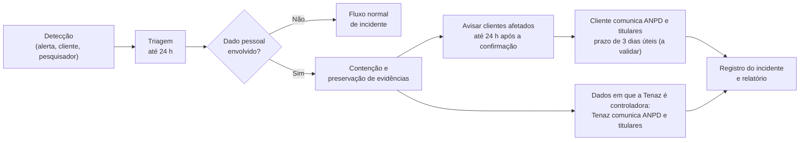

# Segurança e Confiabilidade — Tenaz

**Versão:** 0.4 · **Data:** 12/11/2026 · **Status:** Em elaboração
**Produto:** Tenaz · Gestão de Manutenção e Frota
Alinhado ao sumário executivo 0.6

**Mudanças da versão 0.4:** na seção 5.4, a tabela de permissões típicas, que divergia dos grupos do documento 3, dá lugar à matriz canônica de RF-ADM-005, e a regra anti-escalada ganha a exceção do `administrador`; a concessão de `pessoa.saude.ler` passa a ser avulsa (`usuario_permissao`). Na seção 5.3, a sessão web passa a descrever o cookie com estado no servidor (documento 3, seção 4.2), e não um token de acesso rotativo, que é do app; a renovação do app passa de 14 para 30 dias de inatividade, como em RNF-017, que é o requisito dono do valor. Na seção 5.14, o registro do link usa `ator_tipo = link_execucao`, como no documento 2. Divergências encontradas na etapa E01.

Este documento define as metas de disponibilidade e recuperação, os controles de segurança (inclusive do acesso externo e da conexão entre contas do módulo SRV), a trilha de auditoria, o tratamento de dados pessoais (LGPD), a assinatura eletrônica, a governança de IA e o roteiro de certificações da Tenaz. A mecânica técnica (RLS, sincronização offline, infraestrutura, observabilidade) está em [5_ARQUITETURA_SOFTWARE.md](5_ARQUITETURA_SOFTWARE.md). Os nomes de módulos, entidades e perfis seguem o [Sumário Executivo](0_SUMARIO_EXECUTIVO.md).

**Convenções deste documento:**

- **(proposta)**: decisão de projeto ainda não validada com clientes, custos reais ou jurídico.
- **(a validar)**: ponto legal ou normativo que o estudo de mercado não re-leu e que depende de parecer jurídico.

Público: desenvolvimento, operação e comercial. A seção 1 e o resumo da seção 7 servem de base para respostas a questionários de segurança de clientes (RFP).

---

## Índice

1. [Metas de confiabilidade](#1-metas-de-confiabilidade)
2. [Alta disponibilidade](#2-alta-disponibilidade)
3. [Backup e recuperação de desastre](#3-backup-e-recuperação-de-desastre)
4. [Gestão de incidentes](#4-gestão-de-incidentes)
5. [Segurança](#5-segurança)
6. [Trilha de auditoria](#6-trilha-de-auditoria)
7. [LGPD](#7-lgpd)
8. [Assinatura eletrônica de OS e checklists](#8-assinatura-eletrônica-de-os-e-checklists)
9. [Governança de IA](#9-governança-de-ia)
10. [Roteiro de certificações](#10-roteiro-de-certificações)
11. [Checklist de segurança por release](#11-checklist-de-segurança-por-release)
12. [Alinhamento com o sumário e pendências](#12-alinhamento-com-o-sumário-e-pendências)

---

## 1. Metas de confiabilidade

### 1.1 Resumo

| Dimensão | Meta | Como se cumpre |
|---|---|---|
| Disponibilidade contratual (SLA) | **99,9%** ao mês (Essencial e Profissional) · **99,95%** ao mês (Enterprise) | Seção 2 |
| Disponibilidade interna (SLO) | **99,95%** ao mês (Essencial e Profissional) · **99,97%** ao mês (Enterprise) | Alertas por burn rate (5_ARQUITETURA_SOFTWARE.md, seção 14) |
| Perda máxima de dados (RPO) | **≤ 5 minutos** (falha de zona); falha de região a medir no primeiro ensaio | Multi-AZ síncrono + PITR com logs contínuos |
| Tempo de recuperação (RTO) | **≤ 1 hora** (falha de zona) · **≤ 4 horas** (falha de região, **depende da P7**) | Failover automático; runbook regional (seção 3.4) |
| Recuperação no tempo (PITR) | **14 a 35 dias**; proposta: 35 dias em produção | Backups automáticos do banco gerenciado |
| Cópia em outra conta | Diária, cifrada, imutável | AWS Backup com cópia entre contas e Vault Lock |
| Cópia de recuperação de desastre regional | Local a definir: **pendência P7** (seção 3.6) | Decisão do dono do produto, com apoio jurídico |
| Teste de restauração | **Trimestral**, documentado | Seção 3.5 |
| Página de status | Pública, com **histórico de 90 dias** | Seção 1.5 |
| App offline | 7 dias sem conexão, sem perda de registro | 5_ARQUITETURA_SOFTWARE.md, seção 10 |
| Exportação completa da empresa | Em até 24 horas, sob demanda ou agendada | Seção 7.11 |
| Sincronização entre contas conectadas (SRV) | Atraso **p95 abaixo de 60 segundos** entre a gravação numa conta e a aplicação na outra | 5_ARQUITETURA_SOFTWARE.md, seções 6.8 e 14.5 |

**Plano Enterprise.** O sumário fixa SLA de 99,95% com SLO interno de 99,97% no Enterprise, mantendo a margem entre o que se promete e o que se persegue. No modelo pool, as empresas Enterprise compartilham a infraestrutura das demais; enquanto houver contrato Enterprise sem banco dedicado, a plataforma inteira opera com o alvo de 99,97%.

### 1.2 Como a disponibilidade é medida (proposta)

- **Minuto indisponível:** minuto em que mais de 5% das requisições válidas à API retornam erro 5xx ou estouram o tempo, **ou** em que a verificação sintética externa (login, listagem de OS, sincronização) falha em pelo menos 2 de 3 locais.
- **Disponibilidade mensal** = (minutos do mês − minutos indisponíveis) / minutos do mês.
- O cálculo é por região de serviço, não por empresa. Um incidente que afete só algumas empresas conta para elas no pedido de crédito.
- O app em modo offline continua operando durante uma indisponibilidade, mas isso **não** reduz os minutos contados.

**Exclusões:**

1. Manutenção programada avisada com 7 dias de antecedência, no máximo 4 horas por trimestre, entre 0h e 5h (horário de Brasília). A meta é não precisar dela: deploys comuns não causam indisponibilidade.
2. Falha causada pelo cliente (integração abusiva acima do rate limit, credencial comprometida pelo cliente).
3. Funções marcadas como beta.
4. Indisponibilidade de terceiros contratados pelo cliente (telemática, ERP, provedor de identidade).

### 1.3 Créditos de SLA (proposta)

Crédito sobre a mensalidade do mês afetado, **aplicado automaticamente** na fatura seguinte, sem exigir pedido nem 60 minutos seguidos de queda.

| Disponibilidade no mês (Essencial e Profissional) | Disponibilidade no mês (Enterprise) | Crédito |
|---|---|---|
| < 99,9% e ≥ 99,5% | < 99,95% e ≥ 99,5% | 10% |
| < 99,5% e ≥ 99,0% | < 99,5% e ≥ 99,0% | 25% |
| < 99,0% | < 99,0% | 50% |

O crédito é o remédio financeiro do SLA e não exclui a comunicação do incidente nem o relatório pós-incidente.

### 1.4 RPO e RTO por cenário

| Cenário | RPO | RTO | Mecanismo |
|---|---|---|---|
| Falha de uma tarefa da API ou do worker | 0 | Segundos | Balanceador retira a tarefa; ECS sobe outra |
| Falha de uma zona de disponibilidade | 0 | ≤ 1 hora (esperado: minutos) | Banco Multi-AZ com standby síncrono; tarefas em 3 zonas |
| Corrupção lógica ou erro humano (ex.: exclusão em massa) | ≤ 5 minutos antes do evento | ≤ 4 horas para a empresa afetada | PITR para instância paralela e restauração seletiva por `empresa_id` (seção 3.3) |
| Falha da região | Depende da P7: ≤ 5 minutos na opção (a); maior na (b); sem garantia na (c) | ≤ 4 horas na opção (a); maior na (b) e na (c) | Conforme a opção escolhida na P7 (seção 3.6); runbook na seção 3.4 |
| Comprometimento da conta de produção (ransomware, credencial de administrador) | ≤ 24 horas (última cópia imutável) | ≤ 8 horas **(proposta)** | Cópia diária em conta separada com bloqueio de exclusão |

### 1.5 Página de status

| Item | Definição **(proposta)** |
|---|---|
| Hospedagem | Fora da infraestrutura principal (serviço de status de terceiro ou outra nuvem), para continuar no ar durante incidentes |
| Componentes | API e web, sincronização do app, notificações (e-mail e push), webhooks, conexão entre contas, integrações de telemática, assistente de IA |
| Histórico | 90 dias visíveis, com disponibilidade diária por componente |
| Alimentação | Verificações sintéticas automáticas + atualizações manuais do responsável pela comunicação |
| Assinatura | E-mail e RSS para quem quiser acompanhar |
| Manutenção programada | Publicada com 7 dias de antecedência |
| RPO, RTO e região | Publicados na página, com data da última restauração testada |

---

## 2. Alta disponibilidade

### 2.1 Por camada

| Camada | Redundância | Comportamento na falha |
|---|---|---|
| CDN e web estático | Distribuída pela CDN; origem em object storage multi-zona | Transparente |
| Balanceador | Gerenciado, em 3 zonas | Transparente |
| API | Mínimo de 2 tarefas em zonas diferentes; escala automática | Tarefa com falha no health check é substituída |
| Workers | Mínimo de 2 tarefas | Job em andamento volta para a fila (entrega pelo menos uma vez; jobs idempotentes) |
| Sincronizador entre contas | Mínimo de 2 tarefas | Mensagens ficam nas caixas de saída e são entregues quando o serviço volta, em ordem e sem duplicar (idempotência); cada conta continua operando sozinha |
| PostgreSQL primário | Multi-AZ com standby síncrono | Failover automático, tipicamente 1 a 2 minutos; o app e os workers reconectam com retry |
| Réplica de leitura | Uma réplica | Leituras de painel voltam para o primário |
| Cache | Nó com réplica em outra zona | Sem cache, o sistema funciona: rate limit cai para limite local por tarefa e entitlements vêm do banco |
| Object storage | Multi-zona pelo próprio serviço | Transparente |
| Provedor de LLM | Externo, com timeout e disjuntor | IA fica indisponível; o resto do sistema segue |
| Telemáticas e ERPs | Externos | Conector pausa e retoma; nenhum dado de manutenção depende deles para existir |

### 2.2 Práticas

- **Sem ponto único de falha** em produção. Todo serviço com estado é gerenciado e multi-zona.
- **Deploy sem indisponibilidade:** rolling com health check, migrações compatíveis com a versão anterior (expandir e contrair), rollback automático por alarme.
- **Timeouts em tudo:** servidor HTTP com limites de leitura, escrita e conexão ociosa; consultas com `statement_timeout`; chamadas externas com timeout e disjuntor.
- **Limites por empresa:** rate limit por plano, tamanho máximo de upload, teto de linhas por exportação, concorrência máxima de jobs por empresa. Protege as demais empresas de um vizinho barulhento.
- **Degradação graciosa:** IA, integrações e painéis podem falhar sem afetar OS, preventiva, checklist e sincronização.
- **Capacidade:** teste de carga antes de cada release grande e revisão mensal de folga (CPU, conexões, armazenamento, IOPS).

---

## 3. Backup e recuperação de desastre

### 3.1 Camadas de backup

| Camada | O quê | Retenção | Onde | Protege contra |
|---|---|---|---|---|
| 1. Multi-AZ | Standby síncrono do banco | Contínuo | Outra zona, mesma região | Falha de zona |
| 2. PITR | Snapshots diários + logs de transação enviados a cada 5 minutos | 35 dias **(proposta)** | Mesma região | Erro humano, corrupção lógica |
| 3. Cópia de recuperação regional | Backups e logs do banco e arquivos copiados para o local de recuperação de desastre | 7 dias | **Pendência P7** (seção 3.6): outra região AWS fora do Brasil, segundo provedor no Brasil ou nenhuma (só São Paulo) | Falha de região |
| 4. Cópia imutável | Snapshot diário do banco + réplica dos buckets de arquivos | 35 dias diários + 12 mensais **(proposta)** | **Outra conta**, cofre com bloqueio em modo compliance; região conforme a P7 | Ransomware, conta comprometida, exclusão maliciosa |
| 5. Arquivos | Versionamento no bucket principal + replicação para o local da camada 3 | 30 dias de versões antigas | Mesma região e local da camada 3 | Exclusão acidental de anexo |

Os backups são cifrados com chaves KMS. A cópia imutável usa chave da conta de backup, de modo que comprometer a conta de produção não dá acesso a ela.

**Residência de dados.** A AWS tem uma única região no Brasil. Se as camadas 3 e 4 saírem de São Paulo, só podem ir para fora do país ou para outro provedor. A escolha é a pendência P7 (seção 3.6) e não está decidida neste documento.

### 3.2 Monitoramento dos backups

- Alerta se qualquer backup diário, cópia entre contas ou cópia de recuperação regional (quando houver, conforme a P7) falhar ou atrasar mais de 2 horas.
- Painel com idade do último backup restaurável por camada.
- Relatório mensal de conformidade de backup anexado às evidências de SOC 2.

### 3.3 Restauração seletiva de uma empresa

No modelo pool, um erro que apague dados de uma empresa não justifica voltar o banco inteiro no tempo e prejudicar as outras. Procedimento **(proposta)**:

1. Restaurar o PITR do instante anterior ao erro numa **instância paralela**, isolada da produção.
2. Exportar as linhas da empresa afetada (`WHERE empresa_id = ...`) nas tabelas envolvidas, com a ferramenta de exportação completa da empresa.
3. Comparar com o estado atual e montar o plano de reconciliação (o que foi apagado, o que foi criado depois do erro).
4. Aplicar na produção dentro de `NaEmpresa`, com registro na trilha de auditoria (`origem = restauracao`).
5. Validar com o administrador da empresa e destruir a instância paralela.

Esse procedimento é ensaiado no teste trimestral.

### 3.4 Runbook resumido: falha da região

O runbook abaixo vale para a opção (a) da P7 (cópia em outra região AWS). Na opção (b) os passos são os mesmos, executados no segundo provedor com a IaC dele e tempos maiores; na opção (c) não há failover regional, e o runbook se reduz aos passos 1 a 3, 9 e à restauração em São Paulo quando a região voltar.

Pré-requisitos mantidos o tempo todo na região de recuperação (modelo "pilot light"): rede e sub-redes criadas por IaC, imagens replicadas no registro de contêineres, segredos replicados, chaves KMS multirregião, backups e logs do banco replicados, buckets replicados.

| Passo | Ação | Responsável | Tempo alvo acumulado |
|---|---|---|---|
| 1 | Confirmar a falha regional (status do provedor, verificações sintéticas, 2 pessoas concordam) e declarar SEV1 | Comandante do incidente | 15 min |
| 2 | Decidir o failover. Critério: previsão do provedor acima de 1 hora ou sem previsão | Comandante + responsável técnico | 30 min |
| 3 | Publicar na página de status e avisar os administradores das empresas | Comunicação | 35 min |
| 4 | Restaurar o banco na região de recuperação para o último instante disponível (PITR) | Técnico | 1 h 30 |
| 5 | Aplicar a IaC do ambiente de recuperação (ECS, balanceador, cache, WAF) apontando para o banco restaurado | Técnico | 2 h 15 |
| 6 | Verificações de fumaça, incluindo o **teste de vazamento entre empresas** contra o ambiente restaurado | Técnico | 2 h 45 |
| 7 | Trocar o DNS da API e da CDN; o app reconecta e reenvia a outbox (nenhum comando se perde) | Técnico | 3 h |
| 8 | Monitorar erro, latência e sincronização por 1 hora; comunicar o restabelecimento | Comandante + comunicação | 4 h |
| 9 | Registrar o instante de corte (RPO efetivo) e as empresas afetadas | Comandante | Durante o incidente |
| 10 | Retorno para São Paulo planejado, em janela combinada, depois da normalização | Técnico | Dias seguintes |

Na opção (a), durante a operação na região de recuperação os dados são processados fora do Brasil; isso é informado aos clientes na comunicação do incidente.

### 3.5 Testes

| Teste | Frequência | Ambiente | Evidência |
|---|---|---|---|
| Restauração do PITR e validação de integridade | **Trimestral** | Instância paralela | Tempo medido, contagem de linhas, checksums, teste de vazamento |
| Restauração seletiva de uma empresa | Trimestral (junto com o anterior) | Instância paralela | Relatório de reconciliação |
| Restauração a partir da cópia imutável (outra conta) | Semestral | Conta de backup → `hml` | Tempo medido |
| Failover Multi-AZ forçado | Trimestral | `hml` | Tempo de indisponibilidade observado |
| Simulação de falha regional (game day) | Anual; semestral depois do primeiro contrato Enterprise | `hml` na região de recuperação | RTO e RPO medidos, falhas no runbook corrigidas |

O resultado do último teste de restauração (data e tempo) é publicado na página de status.

### 3.6 Pendência P7: local da cópia de recuperação de desastre

Decisão do dono do produto, com apoio jurídico (sumário, seção 6). As opções, sem recomendação, com os efeitos sobre segurança e LGPD:

| Critério | (a) Cópia de DR fora do Brasil, declarada no DPA | (b) Segundo provedor no Brasil | (c) DR só multi-AZ em São Paulo |
|---|---|---|---|
| Promessa "dados no Brasil" | Dados primários no Brasil; cópias cifradas fora; processamento fora só durante desastre regional | Integral | Integral |
| LGPD | Transferência internacional declarada no DPA, com as cláusulas-padrão da Res. CD/ANPD 19/2024 **(a validar)**; o provedor de nuvem continua o mesmo suboperador | Novo suboperador na lista pública, com aviso prévio de 30 dias aos clientes (7.1) | Nenhuma transferência nova |
| Segurança | Mesmas ferramentas (KMS multirregião, Vault Lock, IAM); superfície igual | Segundo conjunto de credenciais, chaves, IaC e monitoramento a proteger e auditar; cópia lógica do banco a cifrar de ponta a ponta | Menor superfície; a cópia imutável em outra conta continua protegendo contra ransomware |
| RPO e RTO de região | ≤ 5 min e ≤ 4 h (metas do sumário) | Maiores; dependem do método de cópia | Sem garantia; RTO de região publicado teria de ser maior |
| Ensaio (3.5) | Game day na outra região AWS | Game day no segundo provedor, mais caro | Só ensaios de zona e de restauração |

Até a decisão: o DPA e a página de status descrevem a situação vigente; o RTO de região de 4 horas é meta interna e não entra em contrato.

---

## 4. Gestão de incidentes

### 4.1 Severidades

| Severidade | Definição | Exemplos | Resposta |
|---|---|---|---|
| **SEV1** | Indisponibilidade ampla, perda de dados ou **qualquer suspeita de vazamento entre empresas** | API fora do ar; falha regional; dado de uma empresa visível para outra; dado copiado pela conexão para a conta errada ou além da lista de campos; backup comprometido | Plantão responde em até 15 min, 24×7; comandante dedicado; atualização pública a cada 30 min |
| **SEV2** | Função essencial degradada para muitas empresas | Sync do app falhando; preventiva não gerando OS; latência muito acima do SLO | Até 30 min, 24×7; atualização a cada 60 min |
| **SEV3** | Função secundária degradada ou poucas empresas afetadas | Um conector de telemática parado; IA indisponível; atraso em webhooks; sincronização entre contas acima de 60 s sem perda | Até 4 horas úteis |
| **SEV4** | Defeito sem impacto operacional relevante | Erro visual, relatório com formatação errada | Fila normal de correção |

Suspeita de vazamento entre empresas é SEV1 até prova em contrário, mesmo que afete um único registro.

### 4.2 Papéis

| Papel | Responsabilidade |
|---|---|
| Comandante do incidente | Coordena, decide, define severidade, chama ajuda. Não executa correções. |
| Responsável técnico | Diagnostica e corrige |
| Comunicação | Página de status, e-mail aos administradores, aviso dentro do produto, suporte |
| Escriba | Linha do tempo em tempo real |

Numa equipe pequena, uma pessoa pode acumular papéis, exceto comandante e responsável técnico em SEV1.

### 4.3 Comunicação ao cliente

| Momento | Canal | Conteúdo |
|---|---|---|
| Até 30 min após a declaração (SEV1 e SEV2) | Página de status + aviso no web e no app | O que está afetado, desde quando, o que o cliente pode fazer (ex.: continuar no app offline) |
| Durante | Página de status, na cadência da severidade | Progresso e próxima atualização prevista |
| Resolução | Página de status + e-mail aos administradores das empresas afetadas | Hora de início e fim, impacto, se houve perda de dados |
| Até 5 dias úteis depois (SEV1 e SEV2) | E-mail + página de status | Relatório pós-incidente: causa, impacto, correções, prevenção |

Se o incidente envolver dados pessoais, o fluxo da seção 7.9 corre em paralelo.

### 4.4 Pós-incidente

- Análise sem culpa (blameless) para todo SEV1 e SEV2, em até 5 dias úteis.
- Ações corretivas com dono e prazo, acompanhadas até o fim.
- Revisão mensal dos incidentes e do consumo do orçamento de erro. Orçamento estourado congela lançamentos de função nova até a confiabilidade voltar à meta. **(proposta)**

---

## 5. Segurança

### 5.1 Modelo de ameaças (STRIDE)

Ativos principais: dados de manutenção e de frota de cada empresa, documentos e fotos, dados pessoais de técnicos e motoristas (inclusive de saúde), dados de técnicos de prestadores e de locatários pessoa física, clientes atendidos e técnicos das subcontratadas com conta própria (SRV), estoque em poder de terceiros, credenciais de integração do cliente, assinaturas, links de uso único, convites e conexões entre contas e trilha de auditoria.

Fronteiras de confiança: navegador e app ↔ API; internet anônima ↔ rotas públicas do link de uso único e de versão; API ↔ banco; empresa ↔ empresa (dentro do mesmo banco); **conta do cliente ↔ conta da subcontratada conectada, só pelo sincronizador entre contas**; **dentro da empresa: usuários internos ↔ prestador de um fornecedor ↔ prestador de outro fornecedor ↔ locatário**; Tenaz ↔ terceiros (LLM, telemáticas, ERPs, IdP, push); equipe Tenaz ↔ dados de clientes.

| Categoria | Ameaça | Exemplo na Tenaz | Mitigação principal |
|---|---|---|---|
| **S**poofing (falsificação de identidade) | Roubo de sessão ou credencial; token forjado; IdP de uma empresa se passando por usuário de outra | Senha vazada de gestor; e-mail de domínio alheio num IdP mal configurado | MFA; tokens curtos e rotativos; conexão SSO vinculada a uma empresa com domínio verificado; sem ingresso automático por domínio de e-mail sem verificação |
| **T**ampering (adulteração) | Alterar OS encerrada, assinatura ou trilha; comando offline adulterado | Mudar a data de uma inspeção NR-12 depois de assinada | OS encerrada imutável; hash do conteúdo assinado; auditoria append-only com encadeamento de hash; comandos validados pelos mesmos casos de uso da API |
| **R**epudiation (repúdio) | Usuário nega ter feito ou assinado | Técnico diz que não concluiu a OS | Trilha com usuário, horário do servidor e do aparelho, IP, aparelho e geolocalização da assinatura |
| **I**nformation disclosure (vazamento) | **Dados de uma empresa visíveis para outra**; IDOR; URL de arquivo; logs; índice de IA; exportação; dado de saúde visto por perfil indevido | Listagem sem filtro; ID de OS alheia na URL | Defesa em camadas (5.2); permissão específica para dados sensíveis; cifragem de campo |
| **D**enial of service (negação) | Inundar a API; upload gigante; sincronização em massa; vizinho barulhento | Integração do cliente em loop | WAF, rate limit por plano e por chave, limites de tamanho, filas por empresa, `statement_timeout` |
| **E**levation of privilege (escalada) | Técnico vira administrador; usuário de uma unidade vê outra; injeção de prompt manda a IA agir; administrador do cliente acessa dados da plataforma | Editar o próprio perfil; PDF com instruções maliciosas indexado no RAG | Permissões resolvidas no servidor a cada requisição; regras anti-escalada; escopo por unidade; ferramentas de IA com as permissões do usuário e sem gravação; separação total entre administração do cliente e da plataforma |

**Ameaças do acesso externo** (risco R4 do sumário; mecânica em 5_ARQUITETURA_SOFTWARE.md, seções 6.6 e 6.7):

| Categoria | Ameaça | Exemplo na Tenaz | Mitigação principal |
|---|---|---|---|
| Information disclosure | Prestador vê OS, estoque ou custos de outro prestador ou da própria empresa contratante | Usuário da Refrigeração Polar troca o ID na URL para uma OS da Hidráulica Sul | Política RLS restritiva por fornecedor além do RLS por empresa; rotas com escopo declarado; resposta 404; DTOs sem custos internos; teste automatizado (5.2) |
| Information disclosure | Prestador que atende duas contratantes cruza dados entre elas | Mesmo CNPJ cadastrado como fornecedor nas empresas A e B | Cadastros e usuários separados por empresa; um token por empresa; teste com o mesmo CNPJ em duas empresas |
| Information disclosure | Locatário vê ativos, OS ou contratos de outro locatário, ou histórico anterior à locação | Construtora Alfa abre a OS de um ativo que já foi locado a outra construtora | Política restritiva por locatário e pelo período entre entrega e devolução; teste automatizado |
| Elevation of privilege | Usuário externo ganha permissão interna | Administrador concede por engano o perfil `planejador` a um prestador | Perfis `prestador` e `locatario` exclusivos, sem acumular perfil interno; regra anti-escalada; concessão registrada na trilha |
| Tampering | Prestador altera a OS para outro executor ou movimenta almoxarifado alheio | Troca de `fornecedor_id` na requisição | `WITH CHECK` da política restritiva; escopo vem do banco, nunca da requisição |
| Spoofing | Link de uso único encaminhado, vazado ou adivinhado | Prestador repassa o link a outra pessoa; link capturado de um log | Token de 256 bits só como hash, no fragmento da URL, expiração, uso único, vínculo à primeira sessão, código de confirmação opcional, rate limit (5.14) |
| Repudiation | Executor via link nega o registro | "Não fui eu que concluí" | Nome, documento e assinatura simples; IP, aparelho e horário de cada ação na trilha |
| Denial of service | Força bruta ou volume nas rotas públicas | Robô testando tokens | WAF e rate limit por IP e por token nas rotas `/v1/publico/`; resposta uniforme em tempo constante |
| Information disclosure | Endpoint público de versão revela a infraestrutura | Lista de dependências usada para escolher exploit | `GET /v1/versao` expõe só versão, commit curto e data do build (5.15) |

**Ameaças da conexão entre contas** (risco R5 do sumário; mecânica em 5_ARQUITETURA_SOFTWARE.md, seção 6.8 e ADR-009). Aqui a fronteira não fica dentro de uma empresa: são duas empresas que trocam dados de propósito, por um processo próprio (o sincronizador, com o papel de banco `tenaz_sinc`).

| Categoria | Ameaça | Exemplo na Tenaz | Mitigação principal |
|---|---|---|---|
| Information disclosure | **Cópia além do permitido**: campo fora da lista fechada chega à outra conta | Desenvolvedor acrescenta `custo_total` ou o CPF do técnico ao DTO da mensagem; consulta de projeção com `SELECT *` | Lista fechada versionada; `GRANT` por coluna ao `tenaz_sinc` (o banco recusa coluna fora da lista); DTO gerado da lista; teste com valores sentinela; revisão de segurança obrigatória em mudança da lista; alerta de segurança imediato |
| Information disclosure, Tampering | **Conta errada**: mensagem de uma conexão gravada numa terceira empresa | Subcontratada conectada a C1 e C2; um bug usa o `empresa_id` do job em vez da outra ponta da conexão e grava o andamento da OS de C1 na conta de C2 | Destino sempre calculado a partir de `plataforma.conexao_empresa`, nunca do job nem da mensagem; transação de destino com uma só empresa; política `conexao_sinc` exige vínculo da mesma conexão; chaves estrangeiras compostas; teste com três contas; SEV1 |
| Information disclosure | **Transitividade**: dado de um cliente chega a outro cliente por meio da subcontratada | Equipamento copiado de C1 usado numa OS de C2 na conta da subcontratada, e a OS é sincronizada com C2 | Equipamento `de_cliente` com `conexao_empresa_id` só pode receber OS do mesmo `cliente_servico`; a mensagem só leva ativos e OS do vínculo da própria conexão; teste "sem transitividade" |
| Tampering, Repudiation | **Replay e reordenação**: a mesma mensagem é aplicada de novo, ou uma antiga sobrescreve uma nova | Repetição de job depois de falha duplica apontamentos; mensagem "em execução" atrasada chega depois de "concluída" e reabre a OS | `mensagem_id` único na caixa de entrada; sequência por vínculo e por sentido, aplicando só a próxima; dono de cada dado; teste de replay e de ordem |
| Spoofing | **Falsificação de origem**: uma conta se passa por outra ou injeta mensagem numa conexão de terceiros | Usuário mal-intencionado de C2 cria, pela própria conta, uma linha de saída apontando para a conexão C1–S; mensagem forjada inserida direto na fila | O sincronizador lê a mensagem sob o RLS da conta de origem (a linha só existe se pertence a ela); a origem precisa ser ponta da conexão `ativa`; o vínculo precisa existir nas duas contas; o job carrega só IDs, nunca conteúdo; fila sem acesso externo; hash do conteúdo conferido nas duas auditorias |
| Spoofing | **Convite aceito pela empresa errada** | Convite encaminhado a outra subcontratada, que aceita e passa a receber os equipamentos do cliente | Código de convite de 256 bits guardado como hash, validade de 14 dias, 5 tentativas erradas bloqueiam; aceite só por conta cujo CNPJ é o do `fornecedor` convidado e por usuário com permissão de gerenciar conexões; cliente vê quem aceitou e quando |
| Elevation of privilege | **Subcontratada decide o que é do cliente** | Subcontratada envia "encerrada" para liberar a própria OS no cliente, ou altera o cadastro do equipamento | Não existe mensagem de encerramento no sentido subcontratada → cliente; cada campo tem dono; mensagem que altera campo de outro dono é recusada inteira e gera alerta; `os.encerrar` continua só na conta do cliente |
| Elevation of privilege, Information disclosure | **Credencial do `tenaz_sinc` vazada** | Segredo do sincronizador exposto num log ou numa imagem | O RLS com variável de sessão protege contra erro de código, não contra quem tem a credencial: a proteção é a gestão de segredos (5.5), segredo lido só pela tarefa do sincronizador, rede privada, rotação, `GRANT` mínimo por coluna (limita o que a credencial alcança) e detecção (GuardDuty, alerta de volume ou de consulta fora do padrão) |
| Repudiation | Uma das empresas nega ter enviado ou recebido | "Não registramos esse componente"; "não recebemos a recusa da liberação" | Auditoria nas duas contas com o mesmo hash do conteúdo, horário de envio e de aplicação, e conta de origem |
| Denial of service | Uma conta gera volume que atrasa as demais conexões | Atualização em massa de equipamentos compartilhados; laço de eco entre as duas contas | Supressão de eco (mudança aplicada pela conexão não volta); limite de taxa por conexão; fila com justiça entre conexões; alerta de atraso p95 acima de 60 s |
| Information disclosure | Conexão suspensa ou encerrada continua trafegando | Mensagens pendentes entregues depois do encerramento | Estado da conexão lido a cada mensagem, sem cache; só mensagens geradas antes do encerramento são entregues, por até 24 horas **(proposta)**; teste de estados |

### 5.2 Vazamento entre empresas: vetores e controles

Risco R2 do sumário. A arquitetura está em 5_ARQUITETURA_SOFTWARE.md, seção 6; aqui está o inventário de vetores.

| Vetor | Controle | Verificado por |
|---|---|---|
| Consulta sem filtro de empresa | RLS forçado + filtro no repositório | Teste de cobertura de RLS e lint das consultas sqlc |
| Contexto de empresa vazando entre requisições no pool | `set_config(..., true)` só dentro de transação | Teste: transação nova sem contexto retorna zero linhas |
| Referência cruzada (OS de A apontando para ativo de B) | Chaves estrangeiras compostas `(empresa_id, id)` | Teste de escrita cruzada |
| Adivinhar ID (IDOR) | UUIDv7; RLS; resposta 404 | Teste de leitura cruzada na API para todas as rotas |
| Cache compartilhado | Chave sempre prefixada por `empresa_id` | Teste de unidade da camada de cache |
| Arquivo no object storage | Chave com prefixo por empresa; URL assinada só após checar permissão; validade de 5 minutos | Teste de arquivo cruzado |
| Job em segundo plano | `empresa_id` no payload; execução dentro de `NaEmpresa` | Teste de job cruzado |
| Busca textual e vetorial (IA) | Mesmas tabelas com RLS | Teste de busca cruzada |
| Relatórios e exportações na réplica | Mesmo contexto de empresa na transação de leitura | Teste de exportação |
| Webhook entregue ao destino errado | Assinatura e segredo por inscrição, inscrição pertence à empresa | Teste de integração |
| E-mail ou push com dado de outra empresa | Geração dentro do contexto da empresa do destinatário | Teste de notificação |
| Usuário com acesso a duas empresas | Um token por empresa; trocar de empresa emite token novo | Teste de troca de empresa |
| SCIM e SSO | Token SCIM e conexão SSO por empresa | Teste de provisionamento |
| Acesso da equipe Tenaz (suporte) | Acesso só com autorização do cliente, por prazo, registrado na trilha da própria empresa (5.4) | Revisão mensal de acessos |
| Regressão em produção | Verificação sintética periódica com duas empresas de teste em produção | Alerta SEV1 se falhar |
| Prestador de um fornecedor vendo dados de outro fornecedor ou internos (R4) | Escopo `prestador` com política RLS restritiva, rotas com escopo declarado, DTOs reduzidos | **Teste automatizado de isolamento por fornecedor** em todo build (5_ARQUITETURA_SOFTWARE.md, seção 9.3) |
| Locatário vendo dados de outro locatário ou fora do período da locação | Escopo `locatario` com política restritiva pelo contrato e pelo período | **Teste automatizado de isolamento por locatário** em todo build |
| Prestador atendendo duas contratantes | Cadastro e usuário por empresa; um token por empresa | Teste com o mesmo CNPJ como fornecedor em duas empresas |
| Link de uso único acessando outra OS | Escopo `link` limitado a uma OS; IDs da requisição ignorados para decidir o escopo | Teste de troca de IDs com sessão de link |
| Regressão do isolamento externo em produção | Verificação sintética com um fornecedor e um locatário de teste na empresa de teste | Alerta SEV1 se falhar |
| Conexão entre contas copiando campo além da lista (R5) | Lista fechada; `GRANT` por coluna ao `tenaz_sinc`; DTO gerado da lista | **Teste com três contas** em todo build, com valores sentinela (5.16) |
| Conexão gravando na conta errada (R5) | Destino calculado da conexão; transação com uma só empresa; política `conexao_sinc` | Teste com três contas: conta errada, transitividade, falsificação de origem |
| Mensagem de conexão repetida ou fora de ordem (R5) | `mensagem_id` único; sequência por vínculo | Teste de replay e de ordem |
| Usuário da subcontratada vendo dados do cliente na API | Não há acesso: a subcontratada só lê a própria conta (cópia) | Teste de leitura cruzada na API com token da subcontratada e IDs do cliente |
| Regressão da conexão em produção | Verificação sintética com três contas de teste em produção | Alerta SEV1 se falhar |

### 5.3 Autenticação

| Item | Definição **(proposta)** |
|---|---|
| Senha | Hash Argon2id; mínimo de 10 caracteres; recusa de senhas comuns e vazadas (lista local, sem enviar a senha a terceiros); bloqueio progressivo por conta após falhas; resposta em tempo constante para usuário inexistente |
| MFA | TOTP e passkeys (WebAuthn). **Obrigatório para toda a equipe Tenaz.** Para clientes: opcional por usuário, com política da empresa para tornar obrigatório (recomendado para administradores) |
| SSO OIDC | Google e Microsoft Entra, plano Profissional, MVP |
| SSO SAML 2.0 | Plano Enterprise, Fase 2 |
| SCIM 2.0 | Plano Enterprise, Fase 2: criação, alteração e desativação de usuários pelo IdP do cliente |
| Sessão web | Cookie `__Host-tenaz_sessao` `HttpOnly`, `Secure`, `SameSite=Lax`, com identificador aleatório de 256 bits e estado no servidor (`sessao`, canal `web`); proteção CSRF; expira após 12 horas de inatividade e 7 dias no máximo (RNF-017; [3_ESPECIFICACAO_APIS.md](3_ESPECIFICACAO_APIS.md), seção 4.2) |
| Sessão do app | Access token de 15 minutos e refresh token rotativo com detecção de reuso (`token_renovacao`), guardados no Keychain/Keystore; renovação válida por **30 dias** de inatividade para suportar o offline (RNF-017; [3_ESPECIFICACAO_APIS.md](3_ESPECIFICACAO_APIS.md), seção 4.3); ligada ao aparelho |
| Revogação | Versão de sessão no token: troca de senha, desativação, bloqueio ou remoção de aparelho invalidam os tokens anteriores |
| Chaves de API | Por empresa, com escopos, validade e rótulo; guardadas só como hash; prefixo visível para identificação; rotação sem indisponibilidade (duas chaves ativas) |
| Equipe Tenaz | Acesso à nuvem por SSO corporativo com MFA de hardware ou passkey; sem usuários IAM de longa duração |
| Usuários `prestador` e `locatario` | Mesmo mecanismo de senha, MFA e sessão dos demais usuários. Convite por e-mail feito pela empresa; não entram pelo SSO da empresa contratante. MFA recomendado para `prestador` (acesso a OS e estoque); a empresa pode torná-lo obrigatório. Desativação automática quando o fornecedor é inativado ou perde o papel, ou quando o locatário fica sem contrato vigente pelo prazo definido **(proposta)** |
| Link de uso único | Não é login: é um token de acesso a uma OS, com os controles da seção 5.14 |
| Usuário em várias contas (SRV) | Técnico que trabalha para mais de uma empresa tem um `usuario` e um token por conta; no app, uma sessão e um banco local por conta (5.13). Trocar de conta nunca reaproveita token |
| Convite de conexão | Não é login: é um código de 256 bits, guardado como hash, válido por 14 dias, enviado por e-mail ao responsável da subcontratada. O aceite exige sessão autenticada na conta da subcontratada, CNPJ igual ao do fornecedor convidado e a permissão de gerenciar conexões; MFA recomendado para quem tem essa permissão. 5 tentativas erradas bloqueiam o convite **(proposta)** |

### 5.4 Autorização

**Princípios:**

- Permissões resolvidas no servidor **a cada requisição**, a partir do banco (com cache curto), nunca confiando no que está no token.
- Perfis são conjuntos de permissões granulares no formato `<módulo>.<ação>` (`os.encerrar`, `est.ajustar_saldo`, `est.decidir_destino`); `pessoa.saude.ler` é a exceção aceita ao formato.
- **Escopo por unidade:** o usuário só vê dados das unidades a que está vinculado. Filtro aplicado no repositório e testado; RLS por unidade fica como evolução se o teste mostrar risco. **(proposta)**
- **Regras anti-escalada:** ninguém altera as próprias permissões nem concede permissão a si mesmo; só edita um perfil ou usuário quem tem todas as permissões dele, com uma exceção: o `administrador` concede a outros usuários internos `os.encerrar`, `est.decidir_destino` e `pessoa.saude.ler`, que ele mesmo não tem por padrão (RF-ADM-005); só administrador altera administrador.
- Permissão negada responde 403 e fica registrada no log de segurança.

**Perfis padrão (do sumário) e permissões.** A matriz completa, com as 117 permissões do catálogo e os 12 perfis padrão, é a de RF-ADM-005 em [1_ESPECIFICACAO_REQUISITOS.md](1_ESPECIFICACAO_REQUISITOS.md), canônica pelo sumário 3.6. Este documento não a repete. Os pontos que importam para a segurança:

| Regra | Onde é garantida |
|---|---|
| `os.encerrar` só em `gestor` e `planejador` por padrão; nunca em `prestador` nem `locatario`, nem em perfil derivado deles | Catálogo no Go e `CHECK` de `perfil` ([2_ARQUITETURA_BANCO_DADOS.md](2_ARQUITETURA_BANCO_DADOS.md), seção 5.1) |
| `est.decidir_destino` só em `gestor`, `planejador` e `almoxarife` por padrão | Catálogo no Go |
| `pessoa.saude.ler` em nenhum perfil padrão | Catálogo no Go e `ck_perfil_saude` |
| O `administrador` tem todas, menos `pessoa.saude.ler`, `os.encerrar`, `est.decidir_destino` e `ter.manter_catalogo_proprio` | Catálogo no Go (sumário 3.6) |
| Usuário externo nunca recebe as permissões vedadas (liberação de OS, configuração, PRJ, CTR, conexão entre contas, dados de saúde, grupo Admin), nem por perfil nem avulsa | `app.permissoes_vedadas_externo()` e os gatilhos de `perfil`, `usuario_perfil` e `usuario_permissao` |

Os perfis `comprador` (requisições e pedidos de compra) e `plh` (registros NR-13) seguem a mesma lógica, com permissões só da sua área. A liberação (encerramento) de OS é a permissão `os.encerrar`, padrão em `gestor` e `planejador` e nunca concedida a `prestador` ou `locatario` (a regra anti-escalada recusa). O destino de peça com defeito é a permissão `est.decidir_destino`, padrão em `gestor`, `planejador` e `almoxarife`. A ação de assumir OS (`aberta` ou `planejada` da própria equipe) faz parte de "Executar" para o perfil `tecnico`.

**Perfis externos** (sumário 3.1). Têm um conjunto fechado de permissões, não acumulam perfil interno e operam sempre sob o escopo externo (5_ARQUITETURA_SOFTWARE.md, seção 6.6):

| Ação | prestador | locatario | link de uso único |
|---|---|---|---|
| Ver OS | Só as atribuídas ao seu fornecedor | Só as dos ativos locados a ele, no período da locação | Só a OS do link |
| Executar e concluir OS | ● | | ● (uma vez) |
| Encerrar OS | | | |
| Movimentar estoque | Só consumo e devolução no almoxarifado `em_terceiro` do seu fornecedor | | |
| Abrir solicitação | | ● (ativos locados a ele) | |
| Ver custos internos, indicadores, busca global, IA, exportação | | | |
| Ver contrato e vistoria | Contratos de prestação próprios | Contratos de locação e vistorias próprios; assina vistoria | |
| Gerir usuários | | | |

**Subcontratada conectada (SRV).** Não é perfil dentro da conta do cliente: é outra empresa, com usuários próprios. Em relação aos dados do cliente:

| Ação | Subcontratada conectada |
|---|---|
| Ver dados do cliente | Só a cópia, na própria conta: equipamentos compartilhados e OS vinculadas, com os campos da lista fechada |
| Executar e concluir OS vinculada | ● (na própria conta; o andamento vai ao cliente pela conexão) |
| Abrir OS num equipamento do cliente | ● (nasce `aberta` no cliente, com origem `prestador`, para triagem) |
| Encerrar, recusar ou cancelar OS do cliente | |
| Alterar cadastro do equipamento do cliente | |
| Ver custos, indicadores, outras OS ou pessoas do cliente | |
| Técnicos contam na cobrança do cliente | Não (sumário 2.2) |

**Dados de saúde:** a permissão `pessoa.saude.ler` não faz parte de nenhum perfil padrão. O administrador precisa concedê-la explicitamente, usuário a usuário, como permissão avulsa (`usuario_permissao`, em todos os planos) ou, a partir do Profissional, num perfil personalizado (ex.: "Saúde ocupacional"); a concessão fica na trilha. Os demais perfis veem só a situação ("apto", "vencido", "bloqueado"), sem o motivo. **(proposta)**

**Acesso da equipe Tenaz a dados de clientes:**

- Por padrão, a equipe não acessa dados de clientes.
- Para suporte, o administrador da empresa concede acesso temporário (até 72 horas) pelo próprio produto, ligado a um chamado.
- Durante o acesso, a interface mostra um aviso permanente; tudo fica na trilha de auditoria da empresa com `ator_tipo = suporte_tenaz`.
- Acesso direto ao banco de produção só em emergência (break-glass), com papel temporário, aprovação de uma segunda pessoa e registro.

### 5.5 Gestão de segredos

| Regra | Como |
|---|---|
| Nenhum segredo no repositório, na imagem ou em variável de ambiente fixa | Secrets Manager, lido pela tarefa por papel IAM; varredura de segredos no CI e no histórico do Git |
| Nenhum valor padrão para segredo | A aplicação se recusa a subir em produção sem o segredo ou com valor de exemplo |
| Rotação | Credenciais do banco: automática a cada 90 dias. Chaves de assinatura de token: a cada 180 dias, com período de convivência. Imediata em caso de suspeita. |
| Credenciais de integração dos clientes | Cifradas com chave de dados por empresa (envelope encryption com KMS); decifradas só na memória do conector |
| Papéis na nuvem | Uma função IAM por serviço, com o mínimo de permissões |
| Acesso humano | Papéis temporários por SSO; sem chaves de acesso de longa duração |

### 5.6 Criptografia

| Onde | Como |
|---|---|
| Em trânsito, externo | TLS 1.2 ou superior (preferência 1.3), HSTS com preload, cifras modernas na política do balanceador |
| Em trânsito, interno | TLS obrigatório até o banco (`rds.force_ssl`), cache e serviços gerenciados |
| Banco em repouso | AES-256 via KMS com chave gerenciada pelo cliente (CMK), incluindo snapshots e réplicas |
| Object storage | SSE-KMS; bloqueio de acesso público na conta |
| Backups | Chave KMS da conta de backup |
| Campos sensíveis | Resultados de exames e dados de ASO cifrados na aplicação com chave por empresa, além da cifragem do banco **(proposta)** |
| App | SQLite cifrado; chave no Keychain/Keystore |
| Chaves | Rotação anual automática no KMS; uso registrado no CloudTrail |
| Hash de assinatura | SHA-256 (seção 8) |

### 5.7 Desenvolvimento seguro no CI

| Controle | Ferramenta **(proposta)** | Quando | Bloqueia |
|---|---|---|---|
| SAST Go | `gosec` (no golangci-lint) + CodeQL | Todo PR | Sim, achado alto ou crítico |
| SAST TypeScript | CodeQL + regras de segurança do ESLint | Todo PR | Sim, achado alto ou crítico |
| SAST de padrões próprios | Semgrep com regras da Tenaz (ex.: consulta sem `empresa_id`, `SET` de sessão, log de campo sensível) | Todo PR | Sim |
| SCA Go | `govulncheck` (vulnerabilidade alcançável) | Todo PR e diariamente | Sim, alcançável alta ou crítica |
| SCA JavaScript | `osv-scanner` e `npm audit --omit=dev` | Todo PR e diariamente | Sim, alta ou crítica em dependência de produção |
| Segredos | `gitleaks` | Todo push | Sim |
| IaC | Trivy (config) ou Checkov sobre OpenTofu | Todo PR com infra | Sim, alto ou crítico |
| Imagem | Trivy na imagem final; SBOM com Syft; assinatura com Cosign | Todo build | Sim, crítico com correção disponível |
| Isolamento | Teste de vazamento entre empresas, de isolamento por fornecedor e por locatário e de isolamento entre contas conectadas (três contas) | Todo build | **Sempre** |
| Lista de campos da conexão | Diferença entre `campos_conexao.yaml`, os `GRANT` por coluna do `tenaz_sinc` e os DTOs de mensagem | Todo PR | Sim |
| Versão | Tag, CHANGELOG e versão injetada no build iguais (5_ARQUITETURA_SOFTWARE.md, seção 9.5) | Todo release | Sim |
| DAST | OWASP ZAP baseline em `hml` a cada deploy; varredura completa semanal | Pós-deploy | Alerta; crítico vira SEV2 |
| Fuzz da API | Schemathesis a partir do OpenAPI | Todo PR para `main` | Sim, erro 5xx |
| Revisão | Code review obrigatório; **duas aprovações** em código de autenticação, autorização, RLS, migração de política, criptografia, sincronização do app e sincronização entre contas (inclusive a lista de campos) | Todo PR | Sim |
| Cadeia de suprimento | Actions fixadas por SHA; permissões mínimas do token do CI; branch protegida | Sempre | Sim |

### 5.8 Dependências

- Lockfiles versionados (`go.sum`, `pnpm-lock.yaml`); instalação reprodutível no CI.
- Atualização automática semanal (Renovate ou Dependabot), agrupada por ecossistema.
- Critério para dependência nova: manutenção ativa, licença compatível, sem alternativa razoável na biblioteca padrão. Revisão no PR.
- SBOM publicado por release e guardado por 3 anos.

Prazos de correção **(proposta)**:

| Gravidade (CVSS) | Exploração conhecida ou alcançável | Demais casos |
|---|---|---|
| Crítica | 48 horas | 7 dias |
| Alta | 7 dias | 30 dias |
| Média | 30 dias | 90 dias |
| Baixa | Próxima atualização regular | Próxima atualização regular |

### 5.9 Teste de intrusão

- Pentest externo, por empresa independente, **antes do lançamento comercial** e depois **anualmente**, além de após mudança grande de arquitetura.
- Escopo mínimo: API, web, app, isolamento entre empresas (com duas empresas de teste), isolamento por fornecedor e por locatário (portais e app do prestador), conexão entre contas e sincronizador (com três contas de teste: convite, conta errada, falsificação de origem, campos além da lista), link de uso único e demais rotas públicas, autenticação e SSO, upload de arquivos, sincronização offline e, a partir da Fase 2, IA.
- Achados seguem os prazos da seção 5.8.
- Sumário executivo da última rodada disponível para clientes sob acordo de confidencialidade.

### 5.10 Divulgação responsável

- Página pública de segurança e arquivo `/.well-known/security.txt` (RFC 9116) com canal de contato.
- Compromisso: confirmar recebimento em até 3 dias úteis, avaliação inicial em até 10 dias úteis, informar o pesquisador sobre a correção.
- Porto seguro: a Tenaz não aciona judicialmente quem pesquisar de boa-fé, dentro das regras publicadas (sem acessar dados de clientes reais além do necessário para provar o problema, sem negação de serviço, sem engenharia social).
- Programa de recompensa (bug bounty) avaliado na Fase 3.

### 5.11 Hardening de contêiner e de ambiente

| Item | Definição |
|---|---|
| Imagem base | `distroless/static` ou `scratch` com o binário Go estático; sem shell nem gerenciador de pacotes |
| Usuário | Não root (UID fixo) |
| Sistema de arquivos | Somente leitura; diretório temporário em memória quando preciso |
| Capacidades do kernel | Todas removidas |
| Origem da imagem | Construída no CI, assinada (Cosign) e referenciada por digest; scan no registro |
| Acesso interativo | Sem SSH; execução remota em contêiner desligada em produção, salvo break-glass registrado |
| Rede | Tarefas e banco em sub-redes privadas; grupos de segurança mínimos; saída para a internet só para destinos necessários (LLM, telemáticas, ERPs, e-mail) **(proposta: lista de saída permitida na Fase 2)** |
| Borda | WAF com regras gerenciadas (OWASP, reputação de IP), limite por IP, tamanho máximo de corpo |
| Conta de nuvem | CloudTrail organizacional imutável, GuardDuty, Security Hub, alerta de uso da conta root, bloqueio de regiões não usadas |

### 5.12 Backups imutáveis contra ransomware

- Cofre de backup em **conta separada**, com **Vault Lock em modo compliance**: nem o administrador da conta consegue apagar ou encurtar a retenção.
- Buckets de cópia de arquivos com **Object Lock** em modo compliance.
- Nenhuma credencial da operação diária tem escrita na conta de backup; acesso só por break-glass com duas pessoas.
- Chave KMS própria da conta de backup.
- Restauração a partir dessa conta testada semestralmente (seção 3.5).

### 5.13 App móvel

- Banco local cifrado e tokens no armazenamento seguro do sistema.
- Apagamento remoto pelo administrador; desativação do usuário apaga o banco local na próxima conexão.
- Nenhum dado pessoal no texto das notificações push.
- Capturas de tela não bloqueadas (o técnico precisa compartilhar evidências), exceto em telas com dados de saúde.
- Fixação de certificado (pinning) não adotada no MVP, pelo risco de travar o app numa troca de certificado. **(proposta)**
- Usuário `prestador` no app: o banco local recebe só o escopo do fornecedor (5_ARQUITETURA_SOFTWARE.md, seção 10.2). Inativar o fornecedor ou o usuário apaga o banco local na próxima conexão, como na desativação de qualquer usuário.
- **Várias contas no aparelho** (técnico da subcontratada que trabalha para mais de uma empresa): um banco SQLite por conta, cada um com chave própria no Keychain/Keystore, outbox própria e token próprio. O servidor recusa comando cujo token não seja da conta daquele banco. Sair de uma conta, desativar o usuário ou apagar remotamente afeta só aquela conta (5_ARQUITETURA_SOFTWARE.md, seção 10.8).
- **Push de tarefa nova:** o texto leva só "Nova tarefa" e o número da OS (e o nome da conta quando houver mais de uma); nunca nome de cliente pessoa física, endereço ou descrição. O registro de push é por aparelho, usuário e conta, e é apagado ao sair da conta.

### 5.14 Link de uso único

Primeira e única porta da API que aceita escrita sem sessão de usuário. Mecânica em 5_ARQUITETURA_SOFTWARE.md, seção 6.7; aqui estão os controles e o que se verifica.

| Controle | Definição **(proposta)** | Verificado por |
|---|---|---|
| Força do token | 256 bits do gerador criptográfico do sistema, base64url. Só o SHA-256 é guardado (`link_execucao.token_hash`). O token aparece uma vez, na criação. | Teste de unidade do gerador; revisão de que nenhuma tabela ou log guarda o token |
| Transporte e vazamento | Token no fragmento da URL (`/l/#<token>`; não chega ao servidor, à CDN nem ao `Referer`); enviado uma vez no corpo de `POST /v1/publico/links-execucao/ativar`, que devolve uma sessão curta; as demais chamadas usam `/v1/publico/links-execucao/atual/...`; nenhuma rota leva o token no caminho; `Referrer-Policy: no-referrer`; CSP restrita; sem scripts de terceiros; filtro de redação do logger cobre o campo | Teste de que logs do balanceador, da CDN e da aplicação não contêm o token |
| Expiração | Padrão 72 horas, máximo 7 dias, configurável pela empresa; sessão ativada de 2 horas renováveis até a expiração | Teste de link expirado |
| Uso único | Consumido em `POST /v1/publico/links-execucao/atual/registrar-execucao`, que registra e conclui; um link ativo por OS; gerar outro revoga o anterior | Teste de reuso |
| Revogação | Manual a qualquer momento; automática ao cancelar ou encerrar a OS, trocar executor ou fornecedor, ou inativar o fornecedor; efeito imediato, sem cache | Teste de revogação durante sessão ativa |
| Escopo mínimo | Uma OS sob o escopo `link`: leitura dos dados necessários à execução e escrita só de apontamento, peças, leitura, fotos, observação, assinatura simples e conclusão. Sem custos, listagens, busca ou outros IDs | Teste de troca de IDs e de rotas fora da lista |
| Proteção contra encaminhamento | Vínculo à primeira sessão que ativou; código de confirmação opcional (6 dígitos ao contato cadastrado, por outro canal; 5 erros revogam o link); nome e documento do executor; aviso ao gestor na ativação | Teste de ativação em segundo aparelho |
| Rate limit | WAF e API: 10 ativações inválidas por IP em 10 minutos bloqueiam o IP por 1 hora; respostas iguais para token inexistente, expirado, revogado ou consumido, em tempo constante | Teste de carga nas rotas públicas; DAST |
| Registro de auditoria | `ator_tipo = link_execucao`: criação, envio, aberturas, ativação, registros, conclusão, revogação e tentativas inválidas, com IP, aparelho e horário | Teste de trilha |
| Arquivos | Upload só de imagem, tamanho máximo, URL pré-assinada limitada à OS do link, validade de 5 minutos | Teste de upload |

Abuso recorrente de um link (muitas aberturas de IPs diferentes, tentativas de código) gera alerta à empresa e evento de segurança; a empresa pode tornar o código de confirmação obrigatório.

### 5.15 Endpoint público de versão

`GET /v1/versao` é público e sem autenticação, para o diálogo "Sobre" da interface, o suporte e a verificação pós-deploy (5_ARQUITETURA_SOFTWARE.md, seção 9.5).

- Expõe **só** `versao` (SemVer), `commit` (curto) e `data_build`. Nunca lista dependências e suas versões, versão do Go, do sistema operacional ou do PostgreSQL, região, nomes de host, ambiente interno ou cabeçalhos de servidor.
- Sem dado de empresa ou usuário; resposta igual para todos; cache curto na CDN; rate limit por IP como as demais rotas públicas.
- O cabeçalho `Server` e similares não revelam produto nem versão de componentes de infraestrutura.
- Conhecer a versão não deve ser um risco: a política de correção de vulnerabilidades (5.8) vale independentemente dela.
- A rota no singular é exceção aceita à regra de rotas no plural (sumário 3.6). A versão exibida atende aos requisitos RNF-039 (versão visível) e RNF-040 (histórico de versões).

### 5.16 Conexão entre contas (R5): controles e testes

A subcontratada com conta própria (módulo SRV) e o cliente que também usa a Tenaz são duas empresas. A conexão não dá a nenhuma das duas acesso à outra: cada conta guarda a sua cópia, e só o sincronizador grava o que vem da outra conta (5_ARQUITETURA_SOFTWARE.md, seção 6.8 e ADR-009).

| Controle | Definição **(proposta)** | Verificado por |
|---|---|---|
| Papel de banco próprio | `tenaz_sinc` sem `BYPASSRLS`, sem superusuário, não dono de tabela; `GRANT` só nas tabelas e colunas da lista fechada; política restritiva `conexao_sinc` em toda tabela que ele alcança | Teste de cobertura do papel em todo build: tabela ou coluna com privilégio fora da lista quebra o build |
| Credencial separada | Segredo lido só pela tarefa do `tenaz sincronizador` (política IAM própria); rotação a cada 90 dias como as demais credenciais do banco | Revisão de IAM; CloudTrail |
| Transações separadas | Leitura na origem e gravação no destino em transações distintas, cada uma com uma única `app.empresa_id` | Teste de que o sincronizador nunca define duas empresas na mesma transação; revisão de código com duas aprovações |
| Destino calculado | A conta de destino é a outra ponta da conexão lida no banco, nunca um valor da mensagem ou do job | Teste "conta errada" |
| Lista fechada de campos | Arquivo versionado define campos por grupo e por sentido; gera os `GRANT`, os DTOs e o teste. Grupos opcionais desligados por padrão e controlados pelo lado que envia | Teste com valores sentinela; revisão de segurança obrigatória em PR que muda a lista |
| Dados de pessoas | Do técnico da subcontratada vai ao cliente só o nome (em apontamentos, linha do tempo e relatório). Nunca CPF, contato, documentos, capacitações, saúde ou posição | Teste de sentinela com CPF e telefone de técnico |
| Idempotência e ordem | `mensagem_id` único na caixa de entrada; sequência por vínculo e por sentido | Teste de replay e de reordenação |
| Dono do dado | Cliente é dono do cadastro do equipamento, da abertura e da liberação; subcontratada é dona da execução. Mensagem que mexe em campo de outro dono é recusada inteira | Teste com mensagem montada à mão |
| Ciclo de vida | Convite com código de 256 bits como hash, validade, tentativas limitadas, conferência de CNPJ; suspensão e encerramento com efeito imediato, lidos do banco a cada mensagem | Teste de estados e de convite encaminhado |
| Auditoria nos dois lados | Envio e recebimento registrados em `evento_auditoria` de cada conta, com `origem = conexao`, conta de origem, `mensagem_id` e o mesmo hash do conteúdo; sem valores de campos em log | Teste de trilha |
| Detecção | Alerta de segurança imediato em recusa por ponta inválida, campo fora da lista ou campo de outro dono (não acontecem com o código correto); alerta de atraso p95 acima de 60 s | Métricas e alertas (5_ARQUITETURA_SOFTWARE.md, seção 14) |
| Resposta | Suspeita de dado copiado para a conta errada ou além da lista é **SEV1** (4.1). Contenção: suspender as conexões afetadas (as mensagens ficam retidas, nada se perde), investigar pela auditoria dos dois lados, corrigir e ressincronizar | Exercício de mesa anual (7.9) inclui um cenário de conexão |

**Teste automatizado com três contas**, em todo build, com a mesma regra de bloqueio do teste de vazamento entre empresas (detalhe em 5_ARQUITETURA_SOFTWARE.md, seção 9.3): clientes **C1** e **C2** e a subcontratada **S**, conectada aos dois. Verifica cobertura do papel e das colunas, cópia além do permitido (sentinelas), campo injetado, conta errada, ausência de transitividade entre C1 e C2, leitura cruzada do sincronizador, replay e ordem, falsificação de origem, estados da conexão, liberação só pelo cliente, isolamento na API e no app, cobrança (técnicos de S não contam em C1 nem em C2) e auditoria com o mesmo hash nos dois lados. A mesma suíte roda como verificação sintética em produção com três contas de teste; falha é SEV1.

---

## 6. Trilha de auditoria

### 6.1 O que é registrado

Toda criação, alteração e exclusão em: OS e tarefas (inclusive executor e responsável pelo custo, com a justificativa quando difere do padrão), solicitações, ativos e localizações, medidores e leituras, planos, checklists, estoque e movimentações (remessa e retorno a terceiro com NF-e), peças serializadas e ordens de reparo, fornecedores, papéis, catálogo de serviços, contratos de prestação e orçamentos, locatários, contratos de locação, matriz de responsabilidade e vistorias, frota (pneus, abastecimentos, multas, sinistros), documentos com vencimento e capacitações, clientes atendidos, equipamentos de clientes, técnicos e especialidades (SRV), usuários, perfis, permissões, parâmetros, integrações, chaves de API e plano contratado. Também: login e falhas de login, troca de empresa, exportações, acessos de suporte, concessão de permissões sensíveis, **leitura** de dados de saúde, todo o ciclo dos links de uso único (seção 5.14) e todo o ciclo das conexões entre contas: convite, aceite, recusa, mudança de grupos compartilhados, suspensão, reativação, encerramento, pedido de eliminação, e cada mensagem enviada e recebida, nas duas contas (seção 5.16).

Campos de `evento_auditoria` **(proposta)**:

| Campo | Conteúdo |
|---|---|
| `empresa_id`, `id` | Empresa e UUIDv7 do evento |
| `usuario_id` | Quem fez (ou o usuário em nome de quem a integração agiu; no link de uso único, quem gerou o link, com o executor nos dados do registro) |
| `origem` | `web`, `app`, `api`, `integracao`, `job`, `ia`, `suporte`, `restauracao`, `link`, `conexao` |
| `escopo` | `interno`, `prestador` (com o `fornecedor_id`), `locatario` (com o `locatario_id`) ou `link` (com o `link_execucao.id`) |
| `conexao_empresa_id`, `conta_origem_id`, `mensagem_id`, `hash_conteudo` | Só em eventos com `origem = conexao`: conexão, empresa que enviou, mensagem e hash do conteúdo, iguais nas duas contas |
| `acao` | `criar`, `alterar`, `excluir`, `ler_sensivel`, `login`, `exportar`... |
| `entidade`, `entidade_id` | Registro afetado |
| `antes`, `depois` | Valores dos campos alterados (jsonb), **sem** senhas, hashes, tokens ou segredos |
| `ocorrido_em` | Horário do servidor |
| `ocorrido_no_aparelho_em` | Horário do aparelho, para ações offline |
| `ip`, `aparelho`, `request_id` | Contexto técnico |
| `hash_anterior`, `hash` | Encadeamento por empresa (6.2) |

### 6.2 Imutabilidade

- Tabela append-only: o papel da aplicação tem só `INSERT` e `SELECT`; um gatilho bloqueia `UPDATE` e `DELETE` para qualquer papel exceto o processo de arquivamento.
- **Encadeamento de hash por empresa:** cada evento guarda o hash do anterior. Uma alteração no meio da cadeia quebra a verificação.
- Uma vez por dia, o hash do último evento de cada empresa é gravado num bucket com Object Lock. Isso prova que a trilha não foi reescrita, inclusive por alguém com acesso ao banco.
- Gravação na mesma transação da mudança: se a mudança confirma, o evento existe.

### 6.3 Retenção

| Item | Prazo **(proposta)** |
|---|---|
| Trilha consultável no produto | 13 meses em tabela particionada por mês |
| Trilha arquivada | Mínimo de **5 anos**, configurável por empresa para mais; exportada para object storage com Object Lock, consultável sob pedido em até 2 dias úteis |
| Logs de segurança (login, permissão negada, acesso de suporte) | 1 ano consultável, 5 anos arquivados |
| Após o fim do contrato | Ver seção 7.11 |

O prazo de 5 anos é proposta: NR-12 e NR-13 exigem registros disponíveis à fiscalização, mas o estudo não encontrou um prazo único.

### 6.4 Acesso

- O administrador da empresa consulta e exporta a trilha da própria empresa (CSV e JSON).
- A equipe Tenaz não consulta a trilha de clientes, exceto em acesso de suporte autorizado ou investigação de incidente, ambos registrados.

---

## 7. LGPD

Todo este bloco depende de parecer jurídico antes do lançamento. O estudo de mercado não re-leu a legislação de proteção de dados.

### 7.1 Papéis

| Tratamento | Controlador | Operador |
|---|---|---|
| Dados que o cliente coloca na Tenaz (usuários, técnicos, motoristas, OS, assinaturas, geolocalização, documentos, dados de saúde) | **Cliente** | **Tenaz** |
| Dados de contratação e cobrança (contatos comerciais, faturamento) | Tenaz | Provedores de cobrança e e-mail |
| Logs de segurança da plataforma (detecção de fraude e ataque) | Tenaz (legítimo interesse, a validar) | Provedor de nuvem |
| Site, materiais de marketing, testes gratuitos | Tenaz | Provedores de marketing |
| Dados de **locatário pessoa física** (nome, CPF, contatos, local de uso, assinatura e fotos da vistoria, solicitações) | **Cliente** (empresa que cede o ativo) | **Tenaz** |
| Dados de **técnicos de prestador** inseridos na Tenaz (nome, documento, contato, apontamentos, fotos, assinatura, posição pontual) para executar e comprovar a OS da contratante | **Cliente** (empresa contratante), para a gestão da manutenção e do contrato | **Tenaz** |
| Mesmos técnicos, na relação de trabalho com o próprio prestador | **Fornecedor** (empregador), que compartilha os dados com a contratante e informa seus técnicos | Não envolve a Tenaz |
| Executor via link de uso único (nome, documento, IP, aparelho, assinatura simples) | **Cliente** | **Tenaz** |
| Dados que a subcontratada com conta própria (SRV) coloca na conta dela: clientes atendidos (inclusive pessoas físicas), contatos, equipamentos de clientes, técnicos, OS, assinatura do cliente | **Subcontratada** | **Tenaz** |
| Dados que trafegam pela conexão entre o cliente e a subcontratada | Duas leituras possíveis: controladores independentes ou controlador e operador (seção 7.12) **(a validar)** | **Tenaz**, como operadora de cada conta |

Papéis em relação a terceiros e locatários **(a validar com jurídico)**:

- A Tenaz não tem relação contratual com prestadores nem com locatários; trata os dados deles só por instrução do cliente, como operadora. Os termos de uso exibidos no primeiro acesso do `prestador`, do `locatario` e do link dizem isso e apontam o cliente como controlador, com o canal do encarregado do cliente quando houver.
- O cliente define a base legal: tipicamente execução de contrato (contrato de prestação ou de locação) e cumprimento de obrigação legal para registros de segurança. Para técnicos de prestador, o modelo de DPA recomenda cláusula no contrato entre cliente e fornecedor sobre o compartilhamento dos dados dos técnicos.
- O usuário do prestador vê dados pessoais de pessoas da contratante só no mínimo necessário (nome do responsável pela OS); o locatário não vê dados de técnicos além do nome de quem executou.

Suboperadores da Tenaz (provedor de nuvem, provedor de LLM, e-mail e push, suporte, página de status) ficam numa lista pública. Inclusão de novo suboperador é avisada aos clientes com 30 dias de antecedência, com direito de objeção. **(proposta)**

### 7.2 Contrato de tratamento de dados (DPA)

Anexo do contrato, padrão para todos os planos. Conteúdo mínimo **(proposta)**:

1. Objeto, natureza e finalidade do tratamento; categorias de dados e de titulares (tabela 7.5).
2. Tratamento só conforme instruções documentadas do cliente.
3. Confidencialidade da equipe.
4. Medidas de segurança (referência a este documento).
5. Suboperadores e regra de aviso prévio.
6. Local de tratamento: dados primários no Brasil; transferências internacionais listadas, com as cláusulas-padrão da ANPD (7.10).
7. Apoio ao atendimento dos direitos dos titulares (7.8).
8. Comunicação de incidentes ao cliente e prazos (7.9).
9. Devolução e eliminação no fim do contrato (7.11).
10. Direito de auditoria do cliente, atendido preferencialmente por relatórios (SOC 2, pentest).

### 7.3 Relatório de impacto (RIPD) modelo

A Tenaz entrega aos clientes um RIPD modelo, já preenchido com a descrição do tratamento na plataforma, para o cliente completar com a base legal e o contexto dele. Cobre: descrição dos tratamentos, necessidade e proporcionalidade, riscos aos titulares (com destaque para geolocalização e dados de saúde), medidas de mitigação existentes na plataforma e medidas recomendadas ao cliente (perfis, retenção, aviso aos colaboradores). A Tenaz mantém também o próprio RIPD como operadora e controladora dos dados dela.

### 7.4 Encarregado

- A Tenaz indica um encarregado (DPO) desde o lançamento, com canal público (e-mail e formulário) e nome publicado, mesmo que se enquadre como agente de tratamento de pequeno porte e possa ser dispensada. **(proposta; regras de dispensa e de atuação do encarregado a validar)**
- O encarregado responde a titulares, clientes e ANPD, e coordena o fluxo de incidentes com dados pessoais.

### 7.5 Inventário de dados pessoais

| Categoria | Titulares | Exemplos | Sensível? | Observação |
|---|---|---|---|---|
| Identificação e contato | Usuários, técnicos, motoristas, solicitantes | Nome, e-mail, telefone, matrícula | Não | |
| Credenciais | Usuários | Hash de senha, fatores de MFA | Não | Nunca exportados nem exibidos |
| Atividade de trabalho | Técnicos, motoristas | Apontamentos, OS executadas, checklists, assinaturas | Não | Pode revelar desempenho individual |
| Geolocalização | Técnicos, motoristas | Posição na assinatura e no checklist; posição de veículo vinda de telemática | Não, mas de alto risco | Ver 7.7 |
| Habilitação e capacitação | Motoristas, técnicos | CNH (número, categoria, validade), MOPP, NR-10, NR-11, NR-35 | Não | |
| **Saúde** | Motoristas, técnicos | **Exame toxicológico**, **ASO** | **Sim** | Ver 7.6 |
| Infrações | Motoristas | Multas e indicação de condutor | Não, mas sensível no contexto | Acesso restrito a quem gere multas |
| Imagens | Qualquer pessoa | Fotos de OS e de sinistros que mostrem pessoas ou placas | Pode conter | Orientação ao usuário para fotografar o ativo, não pessoas |
| Técnicos de acesso | Usuários | IP, aparelho, horários | Não | Logs de segurança |
| Locatário pessoa física | Locatários com CPF | Nome, CPF, telefone, e-mail, endereço do local de uso, assinatura na vistoria, fotos da vistoria, solicitações | Não | CPF mascarado em listas e na busca; visível completo só no cadastro, para quem gere locação. Fotos de vistoria orientadas ao equipamento |
| Representante do locatário | Pessoas que assinam a vistoria | Nome, documento, rubrica | Não | Assinatura simples (seção 8.2) |
| Técnicos de prestador | Usuários `prestador` e pessoas do fornecedor | Nome, documento, e-mail, telefone, apontamentos, OS executadas, fotos, assinatura, posição pontual na assinatura | Não | Mesma regra de geolocalização (7.7); desempenho individual visível só à empresa contratante e ao próprio fornecedor |
| Executor via link | Prestador ocasional | Nome, documento, IP, aparelho, horários, assinatura simples | Não | Sem conta; dados ligados à OS |
| Cliente atendido pessoa física (SRV) | Clientes da subcontratada com CPF | Nome, CPF, telefone, e-mail, endereço de atendimento | Não | Na conta da subcontratada (controladora). CPF mascarado em listas e na busca |
| Contato e representante do cliente atendido (SRV) | Pessoas da unidade atendida | Nome, função, telefone e e-mail de trabalho, assinatura do cliente na OS | Não | Assinatura simples (seção 8.2); recebe o relatório PDF |
| Técnicos da subcontratada (SRV) | Técnicos com usuário na conta da subcontratada | Os mesmos dados de técnico da linha "Atividade de trabalho" e "Habilitação e capacitação", na conta da subcontratada | Não (saúde: sim, se cadastrada) | Ao cliente conectado vão só nome, horários dos apontamentos e fotos das OS vinculadas (7.12) |

### 7.6 Dados sensíveis: exame toxicológico e ASO

O exame toxicológico de motoristas profissionais e o atestado de saúde ocupacional são dados de saúde, logo **dados pessoais sensíveis**. Controles **(proposta)**:

| Controle | Definição |
|---|---|
| Minimização | Por padrão, a Tenaz guarda só data de realização, validade e resultado "apto" ou "inapto". O laudo em PDF é opcional e fica em área restrita. |
| Permissão específica | `pessoa.saude.ler` fora de todos os perfis padrão (seção 5.4) |
| Situação sem motivo | Planejadores e gestores de frota veem só "apto", "vencido" ou "bloqueado para atribuição", sem saber se o motivo é saúde |
| Cifragem de campo | Resultados cifrados com chave por empresa |
| Auditoria de leitura | Toda leitura é registrada, não só a alteração |
| Fora da IA | Nunca indexados no RAG nem enviados ao provedor de LLM |
| Exportação | Exige a mesma permissão; não entra na exportação geral de relatórios |
| Retenção | Configurável pelo cliente; sugestão padrão: apagar o laudo anexado após o vencimento do exame seguinte |

### 7.7 Geolocalização de motoristas e técnicos

| Regra **(proposta)** | Detalhe |
|---|---|
| Coleta pontual | O app registra a posição só no momento de ações específicas: assinar, iniciar ou encerrar apontamento, concluir checklist, abrir solicitação. **Não há rastreamento contínuo em segundo plano.** |
| Configurável | O administrador da empresa pode desligar a coleta de posição. A assinatura funciona sem ela, com evidência menor. |
| Transparência | Tela no app "O que a Tenaz registra", acessível a qualquer momento, e aviso na primeira coleta. O pedido de permissão do sistema operacional explica o motivo. |
| Posição de veículo (telemática) | Dado do veículo que, durante a jornada, identifica o motorista. Usada para casar eventos e contexto de manutenção, não para monitorar pessoas. Retenção do bruto de 90 dias. |
| Exibição | Precisão reduzida em listas; posição exata só no detalhe da evidência, para quem tem permissão |
| Base legal | Definida pelo cliente (controlador), tipicamente execução do contrato de trabalho ou legítimo interesse, com aviso aos colaboradores (a validar) |
| Prestador, subcontratada e link | Técnicos de prestador e técnicos da subcontratada com conta própria seguem as mesmas regras no app; a posição da assinatura nunca vai ao cliente conectado (fica na conta da subcontratada). A página do link de uso único não pede a localização do aparelho; o aviso ao gestor usa só a localização aproximada derivada do IP, que não é exibida ao locatário nem guardada além da trilha |

### 7.8 Direitos do titular

- Pedidos que chegarem à Tenaz são encaminhados ao cliente controlador em até 2 dias úteis, e o titular é informado disso.
- A plataforma oferece ao cliente ferramentas para:
  - exportar os dados de um titular (JSON e PDF);
  - corrigir dados cadastrais;
  - **anonimizar** um usuário desligado: o nome some das telas e relatórios, mas os registros de manutenção continuam íntegros quando houver obrigação legal de guardá-los (ex.: registros NR-12), com o vínculo pseudonimizado;
  - informar com quem os dados foram compartilhados (integrações ativas da empresa);
  - atender pedido de titular cujos dados existem em duas contas conectadas (seção 7.12): cada empresa responde pela própria cópia;
  - atender locatário pessoa física e técnico de prestador como qualquer titular: exportar, corrigir e, findo o contrato e as obrigações de guarda, anonimizar, mantendo vistorias e OS com o vínculo pseudonimizado quando servirem de prova de cobrança ou de registro de segurança.
- Meta: permitir que o cliente responda a uma solicitação completa em até 15 dias. **(prazo a validar)**

### 7.9 Incidente com dados pessoais

| Etapa | Definição |
|---|---|
| Triagem | Em até 24 horas da detecção: o que aconteceu, quais empresas, quais dados, quantos titulares |
| Aviso ao cliente (Tenaz como operadora) | Em até 24 horas após a confirmação **(proposta)**, com as informações disponíveis, completadas depois. O aviso cedo permite ao cliente cumprir o prazo dele. |
| Comunicação à ANPD e aos titulares | Responsabilidade do controlador. Prazo regulamentar de **3 dias úteis** (Res. CD/ANPD 15/2024) **(a validar)**. A Tenaz fornece o conteúdo técnico: natureza dos dados, titulares, medidas de segurança, riscos, medidas de mitigação. |
| Dados em que a Tenaz é controladora | A Tenaz comunica diretamente, no mesmo prazo |
| Registro | Todo incidente com dado pessoal é registrado, mesmo sem comunicação obrigatória, e guardado por pelo menos 5 anos **(a validar)** |
| Ensaio | Exercício de mesa anual com um cenário de vazamento entre empresas |

### 7.10 Hospedagem no Brasil e transferência internacional

- A LGPD não exige hospedagem no Brasil. Mesmo assim, a Tenaz mantém os **dados primários em São Paulo** como diferencial comercial e para reduzir transferências internacionais.
- A **Res. CD/ANPD 19/2024** tornou obrigatórias, desde 23/08/2025, as cláusulas-padrão sem alteração para transferências internacionais baseadas nesse mecanismo **(a validar)**.
- Transferências previstas e tratamento proposto:

| Transferência | Quando | Tratamento **(proposta)** |
|---|---|---|
| Cópias de recuperação de desastre fora do Brasil | Só se a P7 escolher a opção (a) (seção 3.6) | Cifradas, sem processamento; declaradas no DPA; cláusulas-padrão com o provedor |
| Operação na região de recuperação fora do Brasil | Só na opção (a) da P7 e só em desastre regional | Informada aos clientes na comunicação do incidente |
| Provedor de LLM fora do Brasil | Se o modelo não rodar no país | Declarada no DPA; cliente pode desligar a IA |
| Ferramentas de suporte, e-mail e status | Conforme o fornecedor | Preferir fornecedor com dados no Brasil; senão, cláusulas-padrão |

- Configuração "sem transferência internacional" **(proposta, depende da P7)**: cópia de recuperação no Brasil (opções (b) ou (c) da P7), IA só com modelo no país ou desligada, e ferramentas de suporte sem acesso a dados de clientes. Se a P7 escolher a opção (a) como padrão, essa configuração pode ser oferecida como opção Enterprise com a (b).

### 7.11 Retenção e eliminação no fim do contrato

| Momento | O que acontece **(proposta)** |
|---|---|
| Durante o contrato | Exportação completa da empresa (JSON e CSV mais anexos), sob demanda ou agendada, entregue em até 24 horas |
| Fim do contrato | Acesso somente leitura e exportação por 30 dias |
| Até 90 dias após o fim | Eliminação dos dados no banco e no object storage, com certificado de eliminação ao cliente |
| Backups | Os dados saem dos backups conforme a retenção vence (até 35 dias no PITR e até 12 meses nas cópias mensais imutáveis, que não podem ser apagadas antes). Nesse período ficam cifrados e inacessíveis à operação. |
| Trilha de auditoria arquivada | Mantida pelo prazo configurado pelo cliente quando houver obrigação legal; senão, eliminada junto |
| Conexões entre contas | A eliminação atinge só a conta que saiu. O que já foi copiado para a conta conectada pertence à outra empresa e segue a retenção dela (7.12) |

### 7.12 Conexão entre contas (SRV): papéis, dados de técnicos e retenção

Todo este item é **(a validar com jurídico)**.

**Dados que a subcontratada coloca na conta dela.** Clientes atendidos (inclusive pessoas físicas), contatos, endereços de atendimento, equipamentos de clientes, técnicos, OS e assinaturas: a subcontratada é **controladora**, e a Tenaz é **operadora**, como para qualquer cliente (7.1).

**Dados que trafegam pela conexão.** Há duas leituras possíveis da relação entre o cliente e a subcontratada, e o produto precisa funcionar nas duas:

| Leitura | Como fica | Consequência no produto e no contrato |
|---|---|---|
| (A) **Controladores independentes** | Cada empresa decide sobre a sua cópia, para finalidades próprias: o cliente, para gerir a manutenção dos seus ativos e o contrato; a subcontratada, para executar o serviço, faturar, cumprir garantia e se defender. A conexão é um **compartilhamento** entre controladores | Cada uma responde aos titulares pela própria cópia; cada uma define a própria retenção; o contrato entre as duas (contrato de prestação) deve prever o compartilhamento e a finalidade. A Tenaz é operadora de cada uma, separadamente, e não decide nada sobre o compartilhamento: só executa a conexão que as duas configuraram |
| (B) **Controlador e operador** | Para os dados do cliente que a subcontratada recebe (cadastro dos equipamentos, dados de pessoas da unidade, OS atribuídas), o cliente é controlador e a subcontratada trata por conta dele, como operadora; a Tenaz é suboperadora nessa cadeia | A subcontratada só pode usar esses dados para executar o serviço; no fim da relação, o cliente pode exigir a eliminação ou a devolução, salvo obrigação legal ou exercício de direitos; o contrato entre as duas precisa das cláusulas de operador. Os dados que a subcontratada produz na execução (horas, componentes, nome do técnico) continuam com ela como controladora |

**Proposta para o lançamento:** o produto é desenhado para atender às duas leituras (lista fechada e mínima de campos, grupos opcionais controlados por quem envia, auditoria nos dois lados, eliminação seletiva no fim da conexão). Os termos de uso da conexão, exibidos no convite e no aceite, dizem que cada empresa é responsável pelos dados da própria conta, que a Tenaz não decide sobre o compartilhamento e que o contrato entre as empresas deve tratar o tema. O modelo de DPA e o RIPD modelo (7.3) ganham um anexo "Conexão entre contas". **A escolha entre (A) e (B), ou a orientação de que depende do contrato de cada par de empresas, fica para o parecer jurídico.**

**Dados de técnicos da subcontratada visíveis ao cliente.**

| Dado | Vai ao cliente? | Observação |
|---|---|---|
| Nome do técnico executor | Sim | Em apontamentos, linha do tempo, relatório PDF. Necessário como prova de execução e, em máquina NR-12, para o registro do responsável pela manutenção (item 12.11.2) |
| Horários de início, fim e pausas dos apontamentos | Sim | Revelam a jornada do técnico naquela OS; o cliente vê só as OS vinculadas a ele |
| Fotos | Sim | Orientação no app: fotografar o equipamento, não pessoas (7.5) |
| Assinatura eletrônica do técnico | Só o fato e o horário ("assinatura eletrônica · 13/11 10:44") | O manifesto completo (IP, aparelho, posição) fica na conta da subcontratada |
| CPF, contatos, documentos, capacitações, dados de saúde, posição | Nunca | Fora da lista fechada; testado com sentinelas (5.16) |

A subcontratada, como empregadora, informa seus técnicos de que nome e registros de trabalho vão aos clientes atendidos como prova do serviço (texto sugerido no material de implantação do SRV). A anonimização de um técnico desligado na conta da subcontratada gera uma mensagem para pseudonimizar o nome nas OS vinculadas dos clientes conectados; o cliente pode manter o nome quando tiver obrigação legal de guarda (registros NR-12), com a decisão registrada na trilha dele **(proposta)**.

**Retenção depois de encerrar a conexão.**

| Item | O que acontece **(proposta)** |
|---|---|
| Sincronização | Para. Só mensagens geradas antes do encerramento são entregues, por até 24 horas |
| OS vinculadas e execução | Continuam em cada conta, como histórico dela, com a marca "conexão encerrada". Cada empresa aplica a própria retenção (7.11 e 6.3) |
| Cópias de equipamentos na subcontratada | Ficam somente leitura, ligadas às OS já executadas. Equipamento sem nenhuma OS é eliminado automaticamente em 30 dias. A subcontratada pode converter um equipamento em cadastro próprio (perde o vínculo com o cliente) ou eliminá-lo |
| Pedido de eliminação do cliente (leitura B) | O cliente registra o pedido na tela da conexão; a subcontratada recebe a pendência e executa a ação "Eliminar dados recebidos da Distribuidora Norte", que apaga cadastros de equipamentos e dados de pessoas do cliente e pseudonimiza o que precisa ficar como prova do serviço (OS executadas, relatório emitido). A Tenaz registra o pedido e a execução nas duas trilhas; não apaga por iniciativa própria dados da conta da subcontratada |
| Metadados da sincronização (`envio_conexao`, `recebimento_conexao`) | Só identificadores, sequência, resultado e hash; nenhum valor de campo. Retenção igual à da trilha de auditoria (6.3) |
| Conexão em `plataforma.conexao_empresa` | Mantida com estado `encerrada` e datas, para auditoria das duas empresas, enquanto alguma das duas tiver conta ativa; depois, eliminada com a última conta |
| Fim do contrato de uma das empresas com a Tenaz | A eliminação (7.11) atinge só a conta que saiu. A cópia na outra conta pertence à outra empresa e não é apagada |

**Direitos do titular.** Pedido sobre dado que existe nas duas contas (ex.: técnico da subcontratada, contato da unidade do cliente) é encaminhado às duas empresas controladoras, cada uma responde pela própria cópia; a Tenaz informa o titular de que há duas empresas envolvidas, sem revelar dados de uma à outra.

---

## 8. Assinatura eletrônica de OS e checklists

### 8.1 Contexto legal

- A MP 2.200-2/2001, art. 10, §2º, admite meios de comprovar autoria e integridade fora da ICP-Brasil quando aceitos pelas partes. **(a validar)**
- A Lei 14.063/2020 classifica as assinaturas em simples, avançada e qualificada (ICP-Brasil). Ela trata de interações com entes públicos, mas a classificação serve de referência.
- A NR-12, item 12.11.2, exige registro da manutenção com nome do responsável e indicação conclusiva sobre a segurança da máquina. A NR-13 exige registro de segurança com assinatura do profissional legalmente habilitado (PLH).
- A NR-1, item 1.6, permite documentos em meio digital. **Não está confirmado se exige assinatura ICP-Brasil** para documentos de SST. É a **pendência P1** do sumário.

### 8.2 Assinatura avançada própria (proposta)

Usada em todos os planos (sumário 2.1) e no plano Serviços (sumário 2.2): conclusão e encerramento de OS, checklists, parecer NR-12 ("apto", "apto com restrição", "inapto"), aceite de serviço executado por fornecedor (TER), vistoria de entrega e de devolução de locação (pela empresa), entrega e devolução de veículo, conclusão da OS de serviço pelo técnico da subcontratada (SRV).

| Elemento | Como |
|---|---|
| Identificação | Usuário autenticado; reautenticação no momento de assinar (senha, biometria do aparelho ou PIN de assinatura) |
| Manifestação de vontade | Texto explícito exibido antes ("Declaro que executei os serviços descritos e que a máquina está apta para operar") e ação deliberada de confirmar |
| Integridade | Hash SHA-256 do conteúdo canônico do registro (JSON canonicalizado pela RFC 8785, incluindo os hashes dos anexos) |
| Carimbo de tempo | Horário do servidor no recebimento e horário do aparelho na assinatura. Na Fase 2, carimbo de tempo de autoridade certificadora (RFC 3161), se o parecer jurídico recomendar. |
| Geolocalização | Posição no momento da assinatura, se a empresa permitir (seção 7.7) |
| Trilha | Evento de auditoria com todos os elementos acima, encadeado por hash |
| Bloqueio | Registro assinado não pode ser alterado. Correção só por novo registro que referencia o anterior. OS encerrada é imutável (sumário, seção 3.1). |
| Evidência | PDF com o conteúdo, o manifesto de assinaturas (quem, quando, onde, hash) e um QR code para a página pública de verificação |
| Verificação | A página de verificação confirma se o hash bate com o registro original, sem expor o conteúdo a quem não tem acesso. Vale também para o relatório PDF da OS de serviço (`GET /v1/ordens-servico/{id}/relatorio-pdf`), que leva o código de verificação **(proposta)** |
| OS vinculada (SRV) | A assinatura do técnico e a do cliente ficam na conta da subcontratada. Ao cliente conectado vão o fato, o nome, a função, a imagem da rubrica do cliente e o hash; o manifesto completo (IP, aparelho, posição) não trafega. A liberação (`os.encerrar`) é assinada na conta do cliente |
| Offline | O hash é calculado no aparelho. Na sincronização, o servidor recalcula; se o registro mudou no servidor, a assinatura é guardada como evidência e o responsável é chamado a assinar de novo (5_ARQUITETURA_SOFTWARE.md, seção 10.5) |
| Assinatura de terceiro | Pessoa sem usuário (ex.: operador da máquina, motorista de terceiro, representante do locatário na vistoria, executor via link de uso único, **cliente atendido que assina a OS de serviço no aparelho do técnico da subcontratada**) assina na tela do aparelho com nome, documento ou função e rubrica desenhada, depois de ver o resumo do serviço; classificada como assinatura simples na evidência. "Cliente ausente" registra motivo e foto no lugar da assinatura. Usuário `prestador` ou `locatario` com login assina com assinatura avançada, como os demais usuários |

### 8.3 Pendência P1: ICP-Brasil na NR-1, item 1.6

| Resultado do parecer | Consequência |
|---|---|
| A assinatura avançada basta | Mantém-se a seção 8.2 para todos os documentos |
| ICP-Brasil exigida só para documentos do PLH (NR-13) e laudos | Integração ICP-Brasil (certificado A1, A3 ou em nuvem) só para esses documentos; OS e checklists seguem com assinatura avançada |
| ICP-Brasil exigida para todo registro de SST, inclusive OS de NR-12 | Assinatura qualificada para OS de máquinas NR-12 e documentos NR-13. Impacto grande no app de campo (certificado em nuvem é a opção viável no celular) e no custo para o cliente. |

Para não travar o MVP **(proposta)**:

- O módulo de assinatura tem uma interface (`assinatura.Provedor`) com implementações `avancada_tenaz` e, depois, `icp_brasil`. O modelo de OS não muda conforme o tipo.
- No MVP, documentos do PLH podem ser anexados já assinados fora da Tenaz (PDF com assinatura ICP-Brasil). A Tenaz guarda, calcula o hash e registra o anexo na trilha.
- O módulo CON não é fechado antes do parecer, conforme a ação prevista no sumário para a P1.

---

## 9. Governança de IA

A mecânica está em 5_ARQUITETURA_SOFTWARE.md, seção 12. Aqui estão as regras.

### 9.1 Princípios

| # | Princípio | Controle |
|---|---|---|
| 1 | **Os dados do cliente não treinam modelos** | Cláusula contratual com o provedor; retenção zero ou mínima no provedor |
| 2 | **Humano decide** | Nenhuma gravação definitiva sem confirmação na interface; agentes da Fase 3 só propõem, um humano aprova cada ação |
| 3 | **Mesmo poder do usuário** | Ferramentas executam com as permissões de quem pergunta; a IA não acessa o que o usuário não vê |
| 4 | **Isolamento entre empresas** | Índice vetorial com RLS; contexto do prompt montado só com dados da empresa |
| 5 | **Fonte sempre** | Toda resposta cita a fonte; sem fonte, diz que não encontrou |
| 6 | **Transparência** | Conteúdo gerado por IA marcado na interface e na trilha (`origem = ia`) |
| 7 | **Controle do cliente** | Liga e desliga por empresa e por perfil ou usuário; escolha das fontes indexadas |
| 8 | **Fora da IA** | Dados de saúde, credenciais e documentos restritos nunca vão para o índice nem para o provedor |

### 9.2 Controles operacionais (proposta)

| Controle | Definição |
|---|---|
| Inventário de modelos | Lista de modelos e provedores em uso, por caso de uso, com versão e data de avaliação |
| Mudança de modelo ou prompt | Passa pelo conjunto de avaliação (golden set) e por revisão; resultado registrado |
| Registro de interações | Por empresa, 90 dias por padrão, visível ao administrador |
| Ameaças específicas | Injeção de prompt por documento ou OS, exfiltração por ferramenta, vazamento entre empresas pelo índice: cobertas pelos princípios 3, 4 e 8 e testadas no pentest a partir da Fase 2 |
| Incidente de IA | Resposta com dado de outra empresa é SEV1; resposta perigosa (ex.: instrução de segurança errada com fonte inventada) é SEV2 |
| Custo | Créditos por empresa e teto por usuário (5_ARQUITETURA_SOFTWARE.md, seção 12.5) |
| Regulação | Acompanhar a tramitação do marco legal de IA no Brasil e ajustar a classificação de risco dos casos de uso quando aprovado (a validar) |

---

## 10. Roteiro de certificações

| Marco | Quando **(proposta)** | Entregas |
|---|---|---|
| **LGPD** | Dia 1 (lançamento) | Encarregado nomeado; DPA padrão; RIPD modelo e RIPD próprio; inventário de dados; política de privacidade; lista de suboperadores; fluxo de incidentes; políticas de segurança base |
| Políticas alinhadas à ISO 27001 | Dia 1 | Política de segurança, controle de acesso, gestão de mudanças, backup, resposta a incidentes, gestão de fornecedores, classificação da informação. Escritas uma vez, reusadas no SOC 2 e na ISO. |
| Primeiro pentest externo | Antes do lançamento comercial | Relatório e correções |
| Controles SOC 2 | **Início da Fase 2** (mês 6) | Ferramenta de automação de conformidade (ex.: Vanta, Drata ou Secureframe), análise de lacunas, controles em operação com coleta contínua de evidências |
| Janela de observação SOC 2 Type II | **Começa na Fase 2**, assim que os controles estiverem estáveis (alvo: mês 9), com 3 a 6 meses de duração mínima | Operação dos controles com evidência |
| SOC 2 Type I (opcional) | Durante a Fase 2 | Útil se uma venda grande exigir antes do Type II |
| **Relatório SOC 2 Type II** | **Fase 3** (meses 12 a 24; alvo entre 15 e 18) | Relatório de auditoria independente (critérios de segurança e disponibilidade; confidencialidade e privacidade avaliadas para inclusão). Escopo inclui o isolamento por fornecedor e por locatário, o link de uso único e a conexão entre contas |
| **ISO/IEC 27001** | Depois do SOC 2 Type II, na Fase 3 ou depois | Certificação, reaproveitando os controles; ISO/IEC 27701 (privacidade) avaliada em seguida |

---

## 11. Checklist de segurança por release

Copiar no PR de release e marcar cada item. Release com item crítico desmarcado não vai para produção.

**Isolamento e dados**

- [ ] Teste de vazamento entre empresas passou neste build (crítico)
- [ ] Toda tabela nova com `empresa_id` tem RLS habilitado, forçado e com políticas `USING` e `WITH CHECK` (crítico)
- [ ] Toda tabela nova sem `empresa_id` está na lista de tabelas globais, com justificativa revisada
- [ ] Rotas novas cobertas pelo teste de leitura cruzada na API
- [ ] Chaves novas de cache ou de object storage prefixadas por `empresa_id`
- [ ] Jobs novos carregam `empresa_id` e rodam dentro de `NaEmpresa`
- [ ] Teste de isolamento por fornecedor e por locatário passou neste build (crítico)
- [ ] Toda tabela nova tem a política restritiva `escopo_externo`; se aceitar escopo externo, está na lista revisada (5_ARQUITETURA_SOFTWARE.md, seção 6.6) (crítico)
- [ ] Rotas novas declaram os escopos aceitos; rota aberta a prestador, locatário ou link foi revisada e tem DTO sem dados internos
- [ ] Mudanças no link de uso único ou nas rotas `/v1/publico/` mantêm os controles da seção 5.14
- [ ] **Teste de isolamento entre contas conectadas com três contas (C1, C2 e S) passou neste build**: cópia além do permitido, conta errada, transitividade, replay, falsificação de origem, estados da conexão (crítico)
- [ ] Mudança na lista de campos da conexão (`campos_conexao.yaml`) revisada por segurança, com `GRANT` por coluna do `tenaz_sinc` e DTOs regenerados e iguais à lista (crítico)
- [ ] Tabela nova alcançada pelo `tenaz_sinc` tem a política restritiva `conexao_sinc`; tabela fora da lista não tem privilégio para ele (crítico)
- [ ] Verificação sintética de conexão com três contas ativa em produção
- [ ] Dados pessoais de técnicos da subcontratada continuam fora da lista de campos (só o nome vai ao cliente)

**Acesso**

- [ ] Rotas novas exigem autenticação e permissão específica, conferida no servidor
- [ ] Novas permissões classificadas e atribuídas aos perfis padrão de forma deliberada
- [ ] Nenhuma permissão nova dá acesso a dados de saúde sem `pessoa.saude.ler`
- [ ] Permissões novas no formato `<módulo>.<ação>`; `os.encerrar` não concedida a `prestador` nem a `locatario`
- [ ] Notificações push novas sem dado pessoal no texto
- [ ] Recursos novos de plano verificados por entitlement no backend

**Código e dependências**

- [ ] SAST, SCA, segredos, IaC e scan de imagem sem achado alto ou crítico aberto (crítico)
- [ ] Mudanças em autenticação, autorização, RLS, criptografia ou sincronização com duas aprovações
- [ ] Dependências novas revisadas (manutenção, licença, necessidade)
- [ ] Contrato OpenAPI sem mudança incompatível em `/v1`
- [ ] Imagem assinada e SBOM gerado

**Dados pessoais e auditoria**

- [ ] Campos novos com dado pessoal incluídos no inventário (seção 7.5)
- [ ] Entidades novas cobertas pela trilha de auditoria, sem gravar segredos
- [ ] Logs novos sem dado pessoal sensível, token ou segredo
- [ ] Dados novos fora do índice de IA quando sensíveis

**Operação**

- [ ] Migrações compatíveis com a versão anterior (expandir e contrair)
- [ ] Alarmes de rollback automático ativos para o deploy
- [ ] Métricas e alertas novos criados para funções novas críticas
- [ ] Runbook atualizado se o release muda recuperação, backup ou failover
- [ ] DAST em homologação sem achado crítico novo
- [ ] Notas de release mencionam mudanças de segurança relevantes para clientes (ex.: novo suboperador, nova coleta de dado pessoal)

**Versão**

- [ ] Incremento SemVer coerente com as mudanças (MAJOR só com quebra da API pública; MINOR funcionalidade; PATCH correção) (crítico)
- [ ] Tag `vX.Y.Z`, seção do `CHANGELOG.md` (Keep a Changelog, com seção Segurança quando houver) e versão injetada em API, workers, web e app iguais, conferidas pelo CI (crítico)
- [ ] Produção sem versão de pré-lançamento
- [ ] Após o deploy, `GET /v1/versao` responde a versão liberada e só expõe versão, commit curto e data do build; o selo de versão do web e do app mostra o mesmo valor (RNF-039)
- [ ] `CHANGELOG.md` com todas as implementações e correções da versão (RNF-040)

---

## 12. Alinhamento com o sumário e pendências

Situação deste documento em relação ao sumário executivo 0.4.

**Resolvido pelo sumário 0.4 e aplicado aqui**

| Tema | Como ficou |
|---|---|
| Escopo externo | Valores `interno`, `prestador`, `locatario`, `link`; `prestador` substitui `fornecedor` nos vetores (5.2) e na trilha (6.1) |
| Permissão de liberação | `os.encerrar`, nunca em perfil externo (5.4, 11) |
| Formato das permissões | `<módulo>.<ação>`, com `est.decidir_destino` e a exceção `pessoa.saude.ler` (5.4) |
| Link de uso único | Token no fragmento (`/l/#<token>`), ativação com token no corpo, rotas `atual` sem token no caminho, consumo em `registrar-execucao` (5.14) |
| `GET /v1/versao` | Exceção aceita à regra de plural; RNF-039 e RNF-040 (5.15, 11) |
| Módulo SRV e risco R5 | STRIDE da conexão entre contas (5.1), vetores (5.2), controles e teste com três contas (5.16), convite e várias contas (5.3, 5.13), papel da subcontratada (5.4), auditoria nos dois lados (6.1), LGPD e retenção (7.1, 7.5, 7.12), assinatura do cliente (8.2), checklist de release (11) |

**Continua em aberto**

| # | Pendência | Onde |
|---|---|---|
| P1 | ICP-Brasil na NR-1, item 1.6. Agora inclui saber se a assinatura simples do cliente na OS de serviço (SRV) basta como prova de execução entre empresas | 8.3 |
| P7 | Local da cópia de recuperação de desastre regional | 3.6 |
| — | Leitura jurídica da conexão entre contas: controladores independentes ou controlador e operador; texto dos termos da conexão; anexo do DPA e do RIPD | 7.12 **(a validar)** |
| — | Propagação da anonimização de técnico da subcontratada às cópias do cliente quando houver registro NR-12 | 7.12 **(a validar)** |
| — | Prazos de retenção depois do encerramento da conexão (janela de 24 h, 30 dias para equipamentos sem OS) e fluxo de pedido de eliminação | 7.12 **(proposta)** |
| — | Página pública de verificação do relatório PDF, ainda não prevista na especificação de APIs | 8.2 |
| — | Prova de conceito do papel `tenaz_sinc` (privilégio por coluna com RLS) antes de fechar o MVP | 5.16; 5_ARQUITETURA_SOFTWARE.md, seção 16 |
