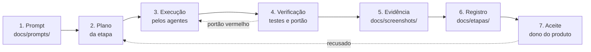
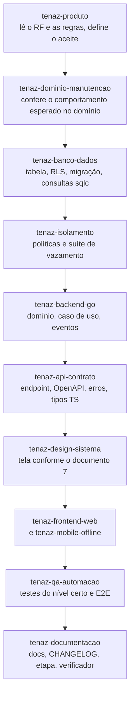

# Modelo de Execução — Tenaz

**Versão:** 0.1 · **Data:** 12/11/2026 · **Status:** Em elaboração
**Produto:** Tenaz · Gestão de Manutenção e Frota
Alinhado ao sumário executivo 0.4 e ao roadmap 0.3.

Este documento define como o trabalho acontece. Quem decide o escopo é o [sumário](../0_SUMARIO_EXECUTIVO.md); quem decide a ordem é o [roadmap](../6_ROADMAP.md); quem decide a forma do código é a [arquitetura](../5_ARQUITETURA_SOFTWARE.md). Aqui está apenas o método.

---

## Índice

1. [O problema que este modelo resolve](#1-o-problema-que-este-modelo-resolve)
2. [Papéis](#2-papéis)
3. [O que não se delega](#3-o-que-não-se-delega)
4. [O ciclo de uma etapa](#4-o-ciclo-de-uma-etapa)
5. [Orquestração dos agentes](#5-orquestração-dos-agentes)
6. [Regras que todo agente obedece](#6-regras-que-todo-agente-obedece)
7. [Portões que bloqueiam](#7-portões-que-bloqueiam)
8. [Artefatos e onde ficam](#8-artefatos-e-onde-ficam)
9. [Limites deste modelo](#9-limites-deste-modelo)

---

## 1. O problema que este modelo resolve

A documentação da Tenaz especifica 206 requisitos funcionais e 42 não funcionais, com modelo de dados, contrato de API, 28 fluxos de negócio, 304 regras de negócio e 9 ADRs. O [roadmap](../6_ROADMAP.md) entrega isso com 15 pessoas em dedicação integral, sendo 126 requisitos funcionais nas 13 sprints do MVP.

A execução real não tem 15 pessoas. Tem o dono do produto e uma equipe de agentes. Isso muda três coisas e deixa duas intactas:

| Muda | Como |
|---|---|
| Capacidade e calendário | As estimativas do roadmap em "sprints-pessoa" ([roadmap](../6_ROADMAP.md), seção 2.1) deixam de medir o esforço. As etapas deste plano não têm duração prevista: terminam quando o portão fecha. |
| Gargalo | No roadmap o gargalo é o backend. Aqui o gargalo é a **revisão humana** e as decisões que dependem do dono do produto (P1 a P8). O trabalho se organiza para não acumular revisão. |
| Risco dominante | Deixa de ser "não cabe no prazo" e passa a ser "foi implementado rápido e errado, e ninguém viu". Daí o peso dos portões da seção 7. |

| Não muda | Por quê |
|---|---|
| Sequência e dependências | As 19 dependências críticas do [roadmap](../6_ROADMAP.md) (seção 8) são técnicas, não de pessoal. Medidor antes de preventiva por medidor; OS completa antes de NR-12; fundação da conexão antes de qualquer fluxo entre contas. |
| Critério de pronto | Os 9 itens do [roadmap](../6_ROADMAP.md) (seção 3.1) e os critérios de marco (seção 3.2) valem iguais. Velocidade de escrita de código não autoriza pular teste de vazamento, acessibilidade ou documentação. |

---

## 2. Papéis

| Papel | Quem | Responsabilidade |
|---|---|---|
| **Dono do produto** | Pessoa | Escopo, prioridade, aceite, pendências P1 a P8, preço, contratação de pilotos e de apoio externo. Escreve ou aprova o prompt de cada etapa. |
| **Orquestrador** | Sessão principal de IA | Lê o prompt da etapa, decide quais agentes chamar e em que ordem, integra o resultado, roda a verificação, escreve o registro da etapa. Não implementa o que um agente especializado faz melhor. |
| **Equipe de agentes** | 16 agentes | Cada um dono de uma especialidade e de um conjunto de documentos. Catálogo em [2_EQUIPE_AGENTES.md](2_EQUIPE_AGENTES.md). |
| **Apoio externo** | Pessoas contratadas | Advogado (P1, P7, LGPD, termo da conexão), consultor de SST (NR-12, NR-13, LOTO, P2, P6), contador (NF-e, CFOPs, P8), empresa de pentest, auditor SOC 2, encarregado de dados. Previstos no [roadmap](../6_ROADMAP.md), seção 2. |

A equipe de agentes cobre os papéis técnicos do roadmap. O mapeamento está em [2_EQUIPE_AGENTES.md](2_EQUIPE_AGENTES.md), seção 2.

---

## 3. O que não se delega

Nenhum agente decide, sozinho, nada desta lista. Quando o assunto aparece, o agente apresenta as opções e para.

| Assunto | Por quê | Onde está registrado |
|---|---|---|
| Pendências P1 a P8 | Dependem de parecer jurídico, consultor, contador ou decisão comercial | [Sumário](../0_SUMARIO_EXECUTIVO.md), seção 6 |
| Preço, planos e mínimos | Dependem de P4 (entrevistas) | [Sumário](../0_SUMARIO_EXECUTIVO.md), seção 2.1 |
| Nome canônico novo | Entra primeiro no sumário, por decisão do dono do produto | [CLAUDE.md](../../CLAUDE.md), seção 3.3 |
| Mudança de escopo ou de fase de um requisito | Altera o sumário e o roadmap | [CLAUDE.md](../../CLAUDE.md), seção 6 |
| Aplicar a linha de corte | Retira valor do lançamento | [Roadmap](../6_ROADMAP.md), seção 2.1 |
| Liberar um portão com teste vermelho | É o risco crítico R2, R4 e R5 do sumário | Seção 7 deste documento |
| Commit e push | Regra explícita do projeto | [CLAUDE.md](../../CLAUDE.md), seção 6 |
| Credenciais, contas de nuvem, publicação nas lojas | Fora do alcance de um agente | — |

---

## 4. O ciclo de uma etapa

Toda etapa segue sete passos, na ordem. Pular um passo é defeito de processo.

| Passo | O que acontece | Quem conduz |
|---|---|---|
| **1. Prompt** | O pedido da etapa é escrito em [../prompts/](../prompts/) antes de qualquer trabalho: objetivo, requisitos pelos IDs, documentos a ler, portão de saída, o que está fora do escopo. Serve de contexto para os agentes e de memória para quem revisar depois. Procedimento na skill `tenaz-prompt-etapa`. | Dono do produto, com o orquestrador |
| **2. Plano** | O orquestrador lê os documentos donos de cada requisito da etapa, consulta `tenaz-arquiteto` e `tenaz-produto` quando há decisão em aberto, e divide a etapa em tarefas com agente dono e ordem de execução. | Orquestrador |
| **3. Execução** | Os agentes trabalham na ordem do plano. Teste junto com a funcionalidade, nunca depois ([CLAUDE.md](../../CLAUDE.md), seção 6). | Agentes |
| **4. Verificação** | Suíte de testes, suíte de vazamento, contrato de API, acessibilidade, verificador de documentação. O portão da etapa é conferido com a saída dos comandos, não por opinião. | `tenaz-qa-automacao`, `tenaz-isolamento` |
| **5. Evidência** | Toda tela nova ou alterada gera screenshot em [../screenshots/](../screenshots/), nos dois temas quando houver. Procedimento na skill `tenaz-evidencia-visual`. | `tenaz-design-sistema`, `tenaz-frontend-web`, `tenaz-mobile-offline` |
| **6. Registro** | Documentos afetados, `CHANGELOG.md`, registro em [../etapas/](../etapas/) e sumário quando couber, tudo no mesmo commit. Procedimento na skill `tenaz-fechar-etapa`. | `tenaz-documentacao` |
| **7. Aceite** | O dono do produto confere a etapa em execução, com a evidência visual e a saída dos testes à vista. Recusa volta ao passo 2 com o motivo escrito no prompt. | Dono do produto |

---

## 5. Orquestração dos agentes

### 5.1 Regras de combinação

1. **Um dono por arquivo.** Dois agentes nunca escrevem no mesmo arquivo na mesma tarefa. O plano da etapa atribui cada arquivo a um agente.
2. **Decisão antes de código.** Se a tarefa exige uma escolha de arquitetura, `tenaz-arquiteto` decide e registra o ADR antes de qualquer implementação. Agente que encontra decisão não registrada para e devolve.
3. **Dados antes de domínio, domínio antes de interface.** `tenaz-banco-dados` entrega tabela, RLS e consultas; `tenaz-backend-go` entrega domínio e casos de uso; `tenaz-api-contrato` entrega contrato; `tenaz-frontend-web` e `tenaz-mobile-offline` consomem o contrato gerado. Interface nunca inventa campo que não existe no contrato.
4. **Paralelismo só entre trilhas independentes.** Web e app podem andar juntos sobre o mesmo contrato. Banco e domínio do mesmo módulo, não.
5. **Revisão cruzada obrigatória.** Quem escreve não aprova. A tabela da seção 5.3 diz quem revisa quem.
6. **Agente especializado tem precedência.** Em conflito entre o orquestrador e o agente dono do assunto, vale o agente dono, ou o impasse sobe para o dono do produto.

### 5.2 Sequência típica de um requisito funcional

O procedimento detalhado está na skill `tenaz-implementar-requisito`.

### 5.3 Quem revisa quem

| Trabalho | Autor | Revisor obrigatório |
|---|---|---|
| ADR e fronteira de módulo | `tenaz-arquiteto` | `tenaz-produto` (efeito no escopo) |
| Tabela, política de RLS, migração | `tenaz-banco-dados` | `tenaz-isolamento` |
| Suíte de vazamento | `tenaz-isolamento` | `tenaz-qa-automacao` |
| Domínio e caso de uso | `tenaz-backend-go` | `tenaz-dominio-manutencao` (comportamento) e `tenaz-arquiteto` (dependências) |
| Endpoint e contrato | `tenaz-api-contrato` | `tenaz-arquiteto` |
| Sincronização entre contas | `tenaz-conexao-contas` | `tenaz-isolamento` e `tenaz-arquiteto` |
| Sincronização do app | `tenaz-mobile-offline` | `tenaz-qa-automacao` |
| Tela web e tela do app | `tenaz-frontend-web`, `tenaz-mobile-offline` | `tenaz-design-sistema` |
| Requisito de NR, LGPD ou fiscal | agente que implementou | `tenaz-conformidade-br` e, fora do repositório, o apoio externo |
| Infraestrutura e esteira de release | `tenaz-plataforma-sre` | `tenaz-arquiteto` |
| Fechamento de etapa | `tenaz-documentacao` | Dono do produto no aceite |

---

## 6. Regras que todo agente obedece

Estas regras vêm de [CLAUDE.md](../../CLAUDE.md) e valem para qualquer agente, em qualquer tarefa. Cada definição de agente as repete de forma resumida.

1. **Ordem das fontes da verdade:** pedido do dono do produto, depois o [sumário](../0_SUMARIO_EXECUTIVO.md), depois o documento dono do assunto.
2. **Vocabulário canônico:** entidades, campos, estados, permissões `<módulo>.<ação>`, rotas `/v1/...` e eventos `<entidade>.<fato>` exatamente como no sumário, seção 3. Nome novo entra primeiro no sumário.
3. **IDs:** criados só no documento dono, nunca renumerados nem reaproveitados; citados sempre por ID e link relativo.
4. **Nada muda sem documentação:** documento afetado, `CHANGELOG.md`, registro da etapa e sumário quando couber, no mesmo commit.
5. **Divergência nunca fica na conversa:** vai para a seção de pendências do documento dono e para o registro da etapa.
6. **Verificador antes de fechar:** `python ferramentas/verificar_docs.py` sem erro.
7. **Teste junto com a funcionalidade**, inclusive o de vazamento entre empresas, prestadores, locatários e contas conectadas.
8. **Idioma:** português do Brasil em interface, documentação, commits e domínio do código; inglês só nos termos técnicos da linguagem.
9. **Pendência P1 a P8 ou decisão do dono do produto:** apresentar opções e parar.
10. **Commit e push só quando o dono do produto pedir.**

---

## 7. Portões que bloqueiam

Portão é uma verificação que, vermelha, impede a etapa de fechar. Não há "fecha com ressalva". Os cinco primeiros vêm do roadmap e da arquitetura; o sexto é a regra de documentação do projeto.

| Portão | O que verifica | Origem | A partir de |
|---|---|---|---|
| **Isolamento entre empresas** | Toda tabela com `empresa_id` com RLS habilitado e forçado, políticas `USING` e `WITH CHECK`, zero leitura e zero escrita cruzada no banco e na API | RNF-013, risco R2 do sumário; [arquitetura](../5_ARQUITETURA_SOFTWARE.md), seção 9.3 | E00 |
| **Isolamento do acesso externo** | Política `escopo_externo` restritiva em toda tabela; prestador não vê outro fornecedor nem OS interna; locatário não vê fora do período de locação; link de uso único só acessa a própria OS | RNF-037, RNF-038, risco R4; ADR-008 | E09 (prestador), fase 2 (locatário) |
| **Isolamento entre contas conectadas** | Suíte de três contas: nenhum campo fora da lista fechada trafega, nenhuma transitividade entre dois clientes da mesma subcontratada, mensagem com campo injetado recusada inteira | RNF-041, RNF-042, risco R5; ADR-009 | E04 (suíte vazia no CI), portão completo em E10 |
| **Offline sem perda** | Desconexão, ação, reconexão e conflito em cenário automatizado; 72 horas em E06 e 7 dias em E11 | RNF-010, RF-MOB-002, RF-MOB-003; ADR-004 | E00 (prova de conceito) |
| **Acessibilidade e identidade** | Verificação automática e manual de WCAG 2.1 AA; tokens e contrastes do [documento 7](../7_PADROES_DESIGN.md); selo de versão visível no canto inferior direito | RNF-025, RNF-039 | E01 |
| **Documentação íntegra** | `python ferramentas/verificar_docs.py` sem erro; `CHANGELOG.md` atualizado; registro da etapa escrito; PDFs regerados | RNF-040; [CLAUDE.md](../../CLAUDE.md), seção 3 | E00 |

Falha de portão de isolamento é tratada como incidente de segurança de severidade alta, mesmo quando acontece só no CI ([arquitetura](../5_ARQUITETURA_SOFTWARE.md), seção 9.3).

---

## 8. Artefatos e onde ficam

| Artefato | Local | Quem escreve | Regra |
|---|---|---|---|
| Prompt da etapa | [../prompts/](../prompts/) | Dono do produto e orquestrador | Antes da etapa começar; nunca reescrito depois, só anotado |
| Evidência visual | [../screenshots/](../screenshots/) | Agentes de interface | Uma captura por tela entregue, nos temas aplicáveis |
| Registro da etapa | [../etapas/](../etapas/) | `tenaz-documentacao` | Um arquivo por etapa, no mesmo commit das mudanças |
| Histórico de versões | [../../CHANGELOG.md](../../CHANGELOG.md) | `tenaz-documentacao` | Seção `[Não lançado]` no mesmo pull request (RNF-040) |
| ADR | [../5_ARQUITETURA_SOFTWARE.md](../5_ARQUITETURA_SOFTWARE.md), seção 15 | `tenaz-arquiteto` | Único lugar onde um `ADR-` nasce |
| Requisito | [../1_ESPECIFICACAO_REQUISITOS.md](../1_ESPECIFICACAO_REQUISITOS.md) | `tenaz-produto` | Único lugar onde um `RF-` ou `RNF-` nasce |
| Regra de negócio | [../4_FLUXOS_PROCESSO.md](../4_FLUXOS_PROCESSO.md) | `tenaz-dominio-manutencao` | Único lugar onde um `RN-` nasce |
| Definição de agente | [../../.claude/agents/](../../.claude/agents/) | `tenaz-arquiteto` | Mudança de papel atualiza também [2_EQUIPE_AGENTES.md](2_EQUIPE_AGENTES.md) |
| Definição de skill | [../../.claude/skills/](../../.claude/skills/) | Agente dono do assunto | Mudança atualiza também [3_SKILLS.md](3_SKILLS.md) |

---

## 9. Limites deste modelo

O que a equipe de agentes **não** resolve, e que precisa de pessoa e de dinheiro:

| Limite | Consequência |
|---|---|
| Pendências jurídicas e regulatórias (P1, P2, P6, P7, P8) | Seguem o prazo do [roadmap](../6_ROADMAP.md), seção 7. Não aceleram com mais agentes. |
| Entrevistas de preço e prioridade (P4) e registro de marca (P5) | Dependem de agenda de terceiros. |
| Pilotos com dados reais | Marcos M3 a M5 do roadmap exigem empresas piloto. Nenhum teste automatizado substitui. |
| Pentest externo e auditoria SOC 2 | Exigem empresa contratada e janela de observação de meses. |
| Publicação nas lojas de aplicativos | Exige contas de desenvolvedor e revisão das lojas. |
| Revisão humana do código crítico | Isolamento, sincronização entre contas e assinatura eletrônica não entram em produção sem leitura humana, por mais verde que esteja o teste. |

O efeito prático: as etapas de construção comprimem bem, e as de validação externa não comprimem. O cronograma do [roadmap](../6_ROADMAP.md) permanece a referência para tudo que depende de terceiros.

---

**Histórico de versões**

- v0.1 (12/11/2026): primeira versão. Papéis, lista do que não se delega, ciclo de sete passos, regras de orquestração, revisão cruzada, seis portões e limites do modelo.
